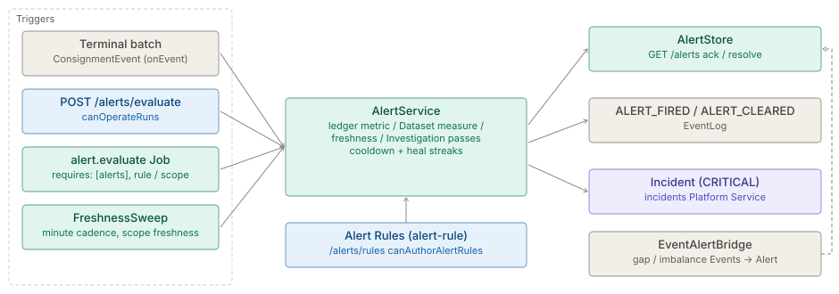

# Alerts

> **Level 3 module page** (`SOLUTION-SUITE-DOCS-1`). Layer: Platform base.
> Offering: every edition (the evaluator and Alert store are in `platform/inspecto-engine`). Checked against the code on 2026-10-17.

## 1. What it is

An **Alert Rule** is an operator-saved, deterministic threshold check; an **Alert** is the stored record a
breach raises. `AlertService` (`platform/inspecto-engine/src/main/java/com/gamma/alert/AlertService.java`)
is the evaluator, and the `alerts` [Platform Service](../../layer/platform/architecture-platform-services.md) (`AlertAccess`) is how a Job
reaches it. No model runs here: the agent's `diagnose-and-alert` skill only drafts a rule
(`features/inspecto-agent/src/main/java/com/gamma/agent/skill/AlertRuleTool.java`); a human saving it arms it.

## 2. Who uses it

- **Builders** author Alert Rules (capability `canAuthorAlertRules`, `platform/inspecto-access/src/main/java/com/gamma/access/Roles.java`).
- **Operators** run a manual sweep (`canOperateRuns`) and acknowledge / resolve Alerts (`canWorkIncidents`).
- **Jobs** — `alert.evaluate` and Link Analysis standing detection (`la.detect`) — consume the `alerts` service.

## 3. Where it sits

Platform base, engine layer. Rules persist as `alert-rule` components under `<write-root>/registry`, with
the same CRUD contract as Expectations and Decision Rules. Fired Alerts go to an `AlertStore`
(`DbAlertStore` or `InMemoryAlertStore`). High-severity breaches cross into the [Incidents](architecture-incidents.md)
add-on only through the `incidents` Platform Service. Delivery to people is the [Notifications](../../module/notify-channels/architecture-overview.md)
module's job: an Alert carries a recipient attribute taken from the rule's `owner`.

## 4. How it works

Four triggers reach the same evaluator:

1. **Terminal batch** — `AlertService.onEvent` evaluates the rules scoped to that Pipeline (plus unscoped
   rules) on every terminal `ConsignmentEvent`, SUCCESS and FAILED alike.
2. **Manual sweep** — `POST /alerts/evaluate` (`evaluateAll`).
3. **Scheduled Job** — `alert.evaluate`
   (`platform/inspecto-engine/src/main/java/com/gamma/job/AlertEvaluateJob.java`) declares
   `requires: [alerts]`. Parameter `rule` evaluates one rule (an unknown name fails the Run); `scope: freshness`
   narrows to `maximumAge` rules. An absent service fails the Run closed.
4. **Freshness sweep** — `FreshnessSweep` arms a minute-cadence system `alert.evaluate` instance while any
   rule has `maximumAge`, and disarms it when the last one goes.

Rule shapes evaluated (`AlertRule.java`):

- **Ledger metric** — `metric` ∈ `error_rate`, `failed_batches`, `rejected_files`, `duration_ms` over the batches
  ledger in `window` (`Ns/Nm/Nh/Nd`, or `Nb` = last N batches); optional `when` condition tree scopes rows.
- **Dataset Measure** — `dataset` + `measure` (`count` or `agg(field)`), optionally `by` key columns for
  per-entity Alerts, capped by `stormCap` (default 100) above which one storm Alert replaces N.
- **Freshness** — `maximumAge` on a Dataset's last publication.
- **Investigation** — `investigation` + `relation` (`entities` | `links` | `excluded`) over a Link Analysis
  Working Set; see [Link Analysis](../../module/la-core/architecture-overview.md).

Re-fire suppression: ledger rules use a per-rule+Pipeline cooldown equal to the window (10 minutes for
batch-count windows, minimum 1 minute). Measure rules are edge-triggered and re-arm only after
`healAfterSweeps` consecutive healthy sweeps (default 1, max 1000). A breach emits `ALERT_FIRED` and a heal
`ALERT_CLEARED` to the [event log](../../module/event/architecture-overview.md); a CRITICAL breach is promoted to an Incident.

Separately, `EventAlertBridge` turns `SEQUENCE_GAP` and `PIPELINE_CONSERVATION_IMBALANCE` Events (and file-problem
and LA index-build failures) into Alerts via `raiseFromEvent`, deduplicated against a still-active Alert.

## 5. Configuration

An Alert Rule (`alert { ... }` TOON block): `name`, `metric` | `dataset`+`measure` | `investigation`+`relation`,
`comparator` (`gt`/`gte`/`lt`/`lte`), `threshold`, `window`, `severity` (`INFO`/`WARNING`/`CRITICAL`),
`onPipeline`, `description`, `owner`, `when`, `by`, `stormCap`, `maximumAge`, `healAfterSweeps`, `runbook`
(`Runbook.java`), `indexLag`. Unknown keys are carried in `extra`. Validation lives in `AlertRule.fromMap`
and the save routes (`inspecto/src/main/java/com/gamma/control/AlertRoutes.java`), which check `by` columns
against the Dataset's Schema. Templates may seed a deferred rule over a score output
(`inspecto/src/main/java/com/gamma/control/PendingAlertRules.java`).

## 6. Screens

The **Alerts** page (route `alerts`, `inspecto-ui/src/app/modules/admin/alerts/alerts.component.ts`) shows
the fired Alerts grid (Acknowledge on OPEN, Resolve on OPEN or ACKNOWLEDGED, applied optimistically and
offered only with `canWorkIncidents`; a 403 drops the page to read-only), an *Open Investigation* action for
an Investigation rule's Alert, the armed Alert Rules (`GET /alerts/rules`) plus pending ones, and a manual
**Evaluate** sweep. Create / edit / delete appear only with `canAuthorAlertRules`; `alert-rule-form.dialog.ts`
is the form.

## 7. API

All in `AlertRoutes.java`:

| Route | Gate |
|---|---|
| `GET /alerts` | none - no `withCapability` and no `CapabilityManifest` entry; any caller past the AuthN gate (everyone on Basic) |
| `GET /alerts/rules`, `GET /alerts/rules/pending` | none (as above) |
| `POST /alerts/evaluate` | `canOperateRuns` |
| `POST /alerts/{id}/ack`, `POST /alerts/{id}/resolve` | `canWorkIncidents` |
| `POST /alerts/rules`, `PUT /alerts/rules/{name}`, `DELETE /alerts/rules/{name}` | `canAuthorAlertRules` |

Investigation rules are authored only through `POST /inv/investigations/{id}/alert-rules`; the generic routes refuse that shape.

## 8. Interactions

- [Platform Services](../../layer/platform/architecture-platform-services.md) — `alerts` = `AlertAccess.evaluateRules()`, `evaluateFreshnessRules()`, `evaluateInvestigationRules()`.
- [Jobs and scheduler](../../module/processor/architecture-jobs-scheduler.md) — `alert.evaluate`, the freshness system job.
- [Incidents](architecture-incidents.md) — CRITICAL promotion via `IncidentAccess`.
- [Notifications](../../module/notify-channels/architecture-overview.md), [Events](../../module/event/architecture-overview.md), [Decision Kernel](../../module/scoring/architecture-decision-kernel.md) (shared condition-tree shape).
- [AI assist](../../module/intelligence/architecture-overview.md) — `AlertRuleTool` / `AlertRuleValidator` draft rules.

## 9. Limits and gotchas

- ⚠ **No preview.** Evaluation mutates (fires, advances cooldowns, may open an Incident). Under a dry run the
  `alerts` stand-in logs and returns empty, so a consumer must report that nothing was *checked*.
- `evaluateInvestigationRules()` fails when the Link Analysis module is absent rather than reporting no breach.
- A hand-written Investigation rule without the binding recorded by its route never evaluates.
- `error_rate` counts rows that arrived (parsed + rejected), so thresholds tuned on older numbers may now fire.
- `FreshnessSweep`'s system job name contains a `.`; an authored Job holding the same name wins and the sweep is refused with a WARN.
- Only `CRITICAL` promotes to an Incident. `isHighSeverity` in `AlertService.java` also accepts `error` and its comments say "error/critical", but `AlertRule.SEVERITIES` admits only `INFO`, `WARNING`, `CRITICAL`, so an `error` rule cannot be saved and that branch is dead.

## References

`docs/okf/product/module/processor/spec-platform-services.md`, `docs/okf/product/module/event/spec-events-metrics.md`.
