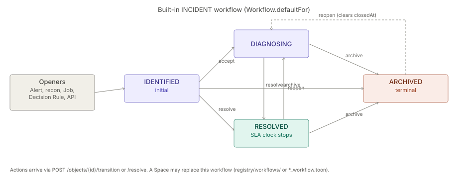
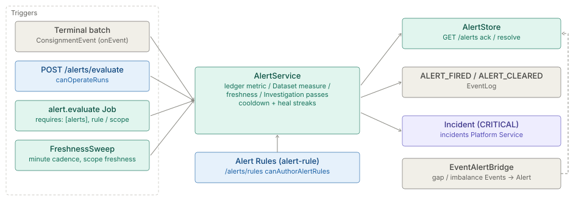

# Incidents and Alerts

The architecture of the `incidents` add-on hub, in two parts: the **Incident**, the operational object that
records something wrong and is worked to resolution, and the **Alert Rule** evaluator, whose stored Alerts
promote to Incidents when critical. The chain is Alert → Incident → Case. Each part keeps its own status
line and the date it was checked against the code.

**On this page**

- [Incidents](#incidents) — the Incident object, its workflow, openers and governance.
- [Alerts](#alerts) — Alert Rules, the evaluator, its triggers and rule shapes.

## Incidents

> **Level 3 module page** (`SOLUTION-SUITE-DOCS-1`). Layer: Add-on.
> Offering: add-on `incidents` in `offerings/standard.toon` — `status: built`, module `ops`
> (the code ships in the engine and the `ops` module). Checked against the code on 2026-10-17.

### 1. What it is

An **Incident** is an operational object of type `INCIDENT` (`ObjectType`, in
`platform/inspecto-workflow/src/main/java/com/gamma/workflow/ObjectType.java`) that records something wrong
and is worked to resolution. The record is `OperationalObject`
(`features/inspecto-ops/src/main/java/com/gamma/ops/OperationalObject.java`), persisted through `ObjectStore`
(`DbObjectStore` / `InMemoryObjectStore`) and changed only through `ObjectService`. States are strings held
by a `Workflow`, not an enum. The capability spec is [Incidents](plan-incidents.md); the chain is
Alert → Incident → Case.

### 2. Who uses it

- **Operators / analysts** holding `canWorkIncidents` acknowledge, transition, assign and resolve.
- **Incident managers** holding `canManageIncidents` open Incidents (also used by `POST /recon/promote`).
- **Administrators** (`canAdminister`) patch objects and author workflows, SLA Policies and Escalation Rules.

### 3. Where it sits

Split across two layers:

- the engine seam `IncidentAccess` / `ObjectAccess` (`platform/inspecto-engine/src/main/java/com/gamma/objects/`)
  lets core code open an Incident without depending on the ops module;
- the store, service, routes and governance live in `features/inspecto-ops`.

A bundle without `inspecto-ops` reports `features.ops=false`; the object routes answer 503 and openers fall
back to signal-only behaviour. See [platform-services](../../layer/platform/architecture-platform-services.md) (`objects` service).

### 4. How it works

Every Incident enters `IDENTIFIED`. The built-in workflow (`Workflow.defaultFor`) allows:

| From | Action | To |
|---|---|---|
| `IDENTIFIED` | `accept` | `DIAGNOSING` |
| `IDENTIFIED` / `DIAGNOSING` | `resolve` | `RESOLVED` |
| `IDENTIFIED` / `DIAGNOSING` / `RESOLVED` | `archive` | `ARCHIVED` |
| `RESOLVED` / `ARCHIVED` | `reopen` | `DIAGNOSING` (out of `ARCHIVED` clears `closedAt`) |

Only `ARCHIVED` is terminal; the SLA clock stops at `RESOLVED`. Openers:

- `POST /objects` (a title and at least one link);
- `AlertService.promoteToIncident` — a critical Alert Rule firing opens one deduped Incident linked
  `ESCALATED_FROM` the Alert, and re-opens it on relapse;
- `POST /recon/promote` and the `recon.run` Job ([reconciliation](../../module/reconciliation/architecture.md));
- the `incident.open` Job (`platform/inspecto-engine/src/main/java/com/gamma/job/IncidentOpenJob.java`);
- a Decision Rule `create-incident` consequence (`CreateIncidentConsequence`);
- `EventAlertBridge` on a sequence-gap event.

Every status change lands in `ObjectService.commit()`, which stamps resolution times and emits `OBJECT_*`
events into the signal ledger.

### 5. Configuration

No dedicated `incidents:` keys exist beyond the offering entry. Governance is authored as components:

- workflow resolution order: `registry/workflows/`, then a `*_workflow.toon` override, then the built-in;
- `registry/sla-policies/` (`SlaPolicy`) and `registry/escalation-rules/` (`EscalationRule`, at most 50
  loaded) — read by `GovernanceRegistry`, re-read on file change, a broken file keeps its last valid version;
- component kinds `workflow`, `sla-policy`, `escalation-rule`;
- Job types `incident.open`, `objects.analytics`, `incident_purge` (see [jobs-scheduler](../../module/processor/architecture.md)).

An authored workflow is validated at save and load (reachable states, a way out of every non-terminal state,
`RESOLVED` present for an Incident). SLA details: [workflow-sla](../../module/workflow/architecture.md).

### 6. Screens

Moved to [Incidents — screens](user-guide-incidents.md).

### 7. API

Moved to [Incidents — API](api-incidents.md).

### 8. Interactions

- [alerts](#alerts) — critical Alerts promote to Incidents; stored Alerts are worked separately.
- [events](../../module/event/architecture.md) — `OBJECT_*` events record every change.
- [notifications](../../module/notify-channels/architecture.md) — SLA notifications key on `sla:{{correlationId}}` (`NotificationRules`).
- [case-management](../../module/case-management/architecture.md) — Cases group Incidents.
- [maker-checker](../../module/workflow/architecture.md) — governance files can be applied through an approval.
- [decision-kernel](../../module/scoring/architecture.md) — the `create-incident` consequence.

### 9. Limits and gotchas

- `POST /objects/{id}/ack` sends action `ack`, which the built-in INCIDENT workflow does not define; it only
  works with a custom workflow (not verified by a test).
- No acknowledged-at stamp, so no MTTA. Queues and watchers were retired; assignment is person-only.
- `reopen` from `IDENTIFIED` / `DIAGNOSING` is illegal, so an Alert relapse there does not change state.
- A reopened Incident's analytics measure to its latest resolution.
- Nothing opens an Incident from a Diagnosis yet.

## Alerts

> **Level 3 module page** (`SOLUTION-SUITE-DOCS-1`). Layer: Platform base.
> Offering: every edition (the evaluator and Alert store are in `platform/inspecto-engine`). Checked against the code on 2026-10-17.

### 1. What it is

An **Alert Rule** is an operator-saved, deterministic threshold check; an **Alert** is the stored record a
breach raises. `AlertService` (`platform/inspecto-engine/src/main/java/com/gamma/alert/AlertService.java`)
is the evaluator, and the `alerts` [Platform Service](../../layer/platform/architecture-platform-services.md) (`AlertAccess`) is how a Job
reaches it. No model runs here: the agent's `diagnose-and-alert` skill only drafts a rule
(`features/inspecto-agent/src/main/java/com/gamma/agent/skill/AlertRuleTool.java`); a human saving it arms it.

### 2. Who uses it

- **Builders** author Alert Rules (capability `canAuthorAlertRules`, `platform/inspecto-access/src/main/java/com/gamma/access/Roles.java`).
- **Operators** run a manual sweep (`canOperateRuns`) and acknowledge / resolve Alerts (`canWorkIncidents`).
- **Jobs** — `alert.evaluate` and Link Analysis standing detection (`la.detect`) — consume the `alerts` service.

### 3. Where it sits

Platform base, engine layer. Rules persist as `alert-rule` components under `<write-root>/registry`, with
the same CRUD contract as Expectations and Decision Rules. Fired Alerts go to an `AlertStore`
(`DbAlertStore` or `InMemoryAlertStore`). High-severity breaches cross into the [Incidents](#incidents)
add-on only through the `incidents` Platform Service. Delivery to people is the [Notifications](../../module/notify-channels/architecture.md)
module's job: an Alert carries a recipient attribute taken from the rule's `owner`.

### 4. How it works

Four triggers reach the same evaluator:

1. **Terminal batch** — `AlertService.onEvent` evaluates the rules scoped to that Pipeline (plus unscoped
   rules) on every terminal `ConsignmentEvent`, SUCCESS and FAILED alike.
2. **Manual sweep** — `POST /alerts/evaluate` (`evaluateAll`).
3. **Scheduled Job** — `alert.evaluate`
   (`platform/inspecto-engine/src/main/java/com/gamma/job/AlertEvaluateJob.java`) declares
   `requires: [alerts]`. Parameter `rule` evaluates one rule (an unknown name fails the Run); `scope: freshness`
   narrows to `maximumAge` rules. An absent service fails the Run closed.
4. **Freshness sweep** — `FreshnessSweep` arms a minute-cadence system `alert.evaluate` instance while any
   rule has `maximumAge`, and disarms it when the last one goes.

Rule shapes evaluated (`AlertRule.java`):

- **Ledger metric** — `metric` ∈ `error_rate`, `failed_batches`, `rejected_files`, `duration_ms` over the batches
  ledger in `window` (`Ns/Nm/Nh/Nd`, or `Nb` = last N batches); optional `when` condition tree scopes rows.
- **Dataset Measure** — `dataset` + `measure` (`count` or `agg(field)`), optionally `by` key columns for
  per-entity Alerts, capped by `stormCap` (default 100) above which one storm Alert replaces N.
- **Freshness** — `maximumAge` on a Dataset's last publication.
- **Investigation** — `investigation` + `relation` (`entities` | `links` | `excluded`) over a Link Analysis
  Working Set; see [Link Analysis](../../module/la-core/architecture.md).

Re-fire suppression: ledger rules use a per-rule+Pipeline cooldown equal to the window (10 minutes for
batch-count windows, minimum 1 minute). Measure rules are edge-triggered and re-arm only after
`healAfterSweeps` consecutive healthy sweeps (default 1, max 1000). While a breach stays open, each sweep refreshes
the open Alert's value, message and fired record in place when the value moved (`ALERT-VALUE-REFRESH-1`, 2026-11-09;
a `by` rule's aggregate Alert does the same, `ALERT-PER-RULE-1`), so an Alert raised while data was still landing ends
up carrying the full figure; nothing new is emitted, and when the breach began is kept. An Incident promoted from
that Alert keeps the value it was opened with, and a resolved Alert is never rewritten. A breach emits `ALERT_FIRED` and a heal
`ALERT_CLEARED` to the [event log](../../module/event/architecture.md); a CRITICAL breach is promoted to an Incident.

Separately, `EventAlertBridge` turns `SEQUENCE_GAP` and `PIPELINE_CONSERVATION_IMBALANCE` Events (and file-problem
and LA index-build failures) into Alerts via `raiseFromEvent`, deduplicated against a still-active Alert.

### 5. Configuration

An Alert Rule (`alert { ... }` TOON block): `name`, `metric` | `dataset`+`measure` | `investigation`+`relation`,
`comparator` (`gt`/`gte`/`lt`/`lte`), `threshold`, `window`, `severity` (`INFO`/`WARNING`/`CRITICAL`),
`onPipeline`, `description`, `owner`, `when`, `by`, `stormCap`, `maximumAge`, `healAfterSweeps`, `runbook`
(`Runbook.java`), `indexLag`. Unknown keys are carried in `extra`. Validation lives in `AlertRule.fromMap`
and the save routes (`inspecto/src/main/java/com/gamma/control/AlertRoutes.java`), which check `by` columns
against the Dataset's Schema. Templates may seed a deferred rule over a score output
(`inspecto/src/main/java/com/gamma/control/PendingAlertRules.java`).

### 6. Screens

Moved to [the user guide](user-guide-alerts.md#screens).

### 7. API

Moved to [Alerts — API](api-alerts.md).

### 8. Interactions

- [Platform Services](../../layer/platform/architecture-platform-services.md) — `alerts` = `AlertAccess.evaluateRules()`, `evaluateFreshnessRules()`, `evaluateInvestigationRules()`.
- [Jobs and scheduler](../../module/processor/architecture.md) — `alert.evaluate`, the freshness system job.
- [Incidents](#incidents) — CRITICAL promotion via `IncidentAccess`.
- [Notifications](../../module/notify-channels/architecture.md), [Events](../../module/event/architecture.md), [Decision Kernel](../../module/scoring/architecture.md) (shared condition-tree shape).
- [AI assist](../../module/intelligence/architecture.md) — `AlertRuleTool` / `AlertRuleValidator` draft rules.

### 9. Limits and gotchas

- ⚠ **No preview.** Evaluation mutates (fires, advances cooldowns, may open an Incident). Under a dry run the
  `alerts` stand-in logs and returns empty, so a consumer must report that nothing was *checked*.
- `evaluateInvestigationRules()` fails when the Link Analysis module is absent rather than reporting no breach.
- A hand-written Investigation rule without the binding recorded by its route never evaluates.
- `error_rate` counts rows that arrived (parsed + rejected), so thresholds tuned on older numbers may now fire.
- `FreshnessSweep`'s system job name contains a `.`; an authored Job holding the same name wins and the sweep is refused with a WARN.
- Only `CRITICAL` promotes to an Incident. `isHighSeverity` in `AlertService.java` also accepts `error` and its comments say "error/critical", but `AlertRule.SEVERITIES` admits only `INFO`, `WARNING`, `CRITICAL`, so an `error` rule cannot be saved and that branch is dead.

### References

`docs/okf/product/module/processor/spec-platform-services.md`, `docs/okf/product/module/event/spec-events-metrics.md`.
