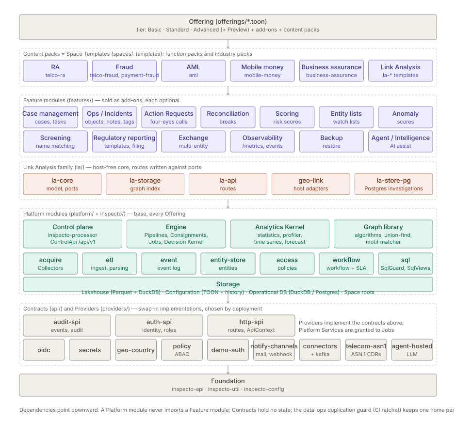
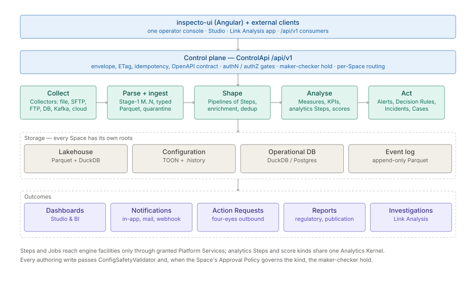
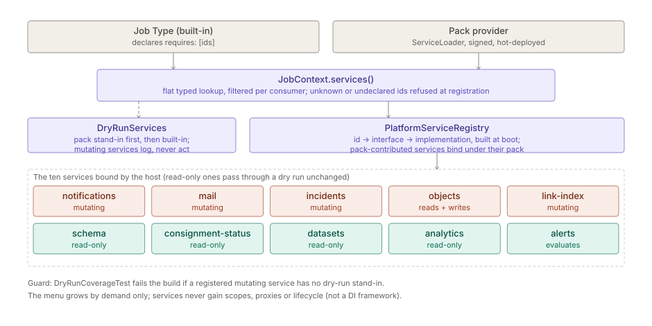
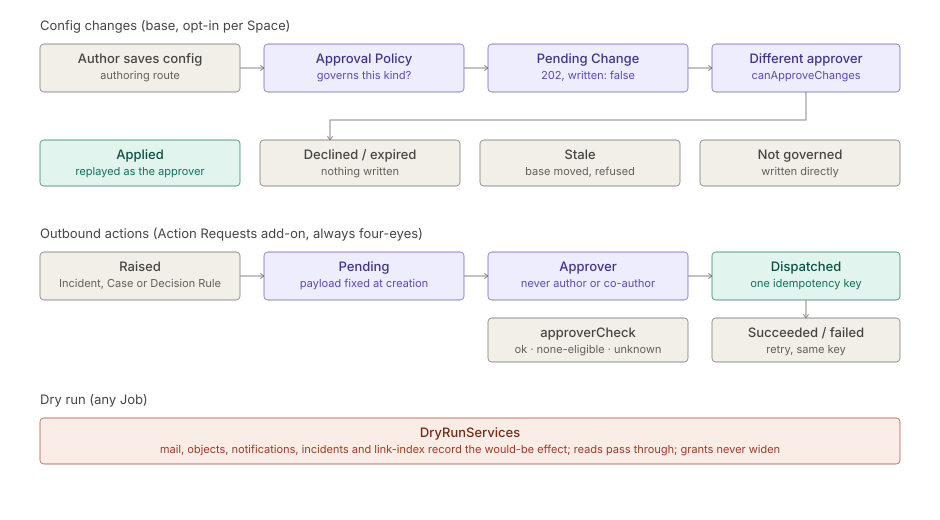

# Inspecto platform architecture

> **Status:** current as of 2026-11-12, checked against the code. Audience: architects, integrators, technical evaluators.

This is the first page to open for the backend. It says what the system is and how its parts fit, and
points to the page that owns each part in depth. Vocabulary follows [`GLOSSARY.md`](../../../../GLOSSARY.md).

## 1. What the system is

Inspecto is one framework-free Java application plus one Angular operator console. The Java side is a
high-throughput file-processing engine with an embedded control plane: it collects files and streams,
parses them, applies a schema and transforms, writes partitioned columnar output, and then analyses and
acts on that data (Measures, Alerts, Decision Rules, Incidents, Cases). All analytical work runs on an
embedded **DuckDB**; there is no external database to install. Storage is files under each Space's roots,
with PostgreSQL as an optional home for the operational stores.

What a customer runs is an **Edition** — Basic, Standard or Advanced (Preview bundles everything, for
testing only) — plus Add-ons and Solution packs. An Edition is an Offering file, `offerings/<id>.toon`,
that lists modules, Add-ons and deployment posture and may include another Offering. A module is usable
only when it is **Installed** in the build, **Enabled** for the Space and **Permitted** for the user.

## 2. Pillars

- **Framework-free.** No Spring, no web framework, no IoC container. The engine and control plane run on
  the JDK plus DuckDB.
- **JDK `HttpServer`.** The control plane is `com.sun.net.httpserver.HttpServer` with a single catch-all
  dispatch context (`ControlApi`). Each request runs on a fresh virtual thread
  (`Executors.newVirtualThreadPerTaskExecutor()`). See [Control API](../../module/processor/api-control-api.md).
- **Manual dependency injection.** Collaborators are constructed directly and passed as constructor
  arguments. `ControlApi.main` builds a `SpaceManager`, which starts one `CollectorService` per Space;
  `CollectorService` is the per-Space composition root (stores, event log, Job engine, alerting,
  notifications). Two process-wide singletons exist: `EventLog.global()` and `MetricRegistry.global()`.
  No annotations, no container.
- **`ServiceLoader` extension points.** Extension points are plain `META-INF/services` contracts.
  **47**<!--count:spi-extension-points--> distinct interfaces are discovered this way (derived by
  `tools/check-doc-counts.mjs` from the `ServiceLoader.load`, `OptionalSpi.all` and `SpiSlot` call sites
  in main code). An absent module is simply not discovered, so the no-op path wins. This is what makes
  Editions build flavors. See §5.
- **Embedded DuckDB.** Bulk ingest goes through the native Appender API; see
  [DuckDB](../../module/engine/spec-duckdb.md). The JVM needs `--enable-native-access=ALL-UNNAMED`
  (see [build and run](spec-build-test.md)).
- **Virtual threads.** HTTP requests, the [Job](../../module/processor/spec-jobs.md) executor, Step
  execution, multi-Collector orchestration, notification dispatch and Action Request dispatch all run
  on virtual threads.
- **Configuration is TOON.** All durable configuration is `.toon` files read and written through
  `ConfigCodec` (JToon). TOON has no comment syntax. Every authoring write passes
  `ConfigSafetyValidator`. See [TOON config](../../module/config/spec-toon-config.md).

### Design ethos

- **Keep the base lean.** Network dependencies live in the [connectors](../../module/connectors/architecture.md)
  module; hosted-AI SDKs live in [agent-hosted](../../module/agent-hosted/architecture.md) and are
  physically absent from air-gapped builds.
- **Editions are build flavors, never git branches.** One auth-free base is assembled per Edition from
  Maven profiles, `ServiceLoader` discovery and `-D` flags. A feature an Edition lacks is a module that
  Edition does not bundle. See [editions model](architecture-editions.md).
- **One line of development.** `master` is the only branch; see
  [branch and release policy](spec-branching-release.md).
- **A module boundary needs a reason.** A separate Maven module exists only for optional shipping, a
  distinct third-party footprint, swappability or test isolation. Otherwise use packages.
- **No abstraction without a second consumer.**

## 3. Shape of the system

The code is one Maven reactor. Modules sit in five group directories plus the root `inspecto` module.
The group directories hold plain modules; there is no aggregator pom per directory.

| Layer | Directory | What lives there | Rule |
|---|---|---|---|
| Solution packs | `spaces/_templates` | Space Templates: Function packs (Revenue Assurance, Fraud, AML …) and Industry packs (Telecom, Mobile Money …) | Data and configuration, no code |
| Feature modules | `features/` | The optional Add-on modules: `inspecto-ops`, `-case-management`, `-action-requests`, `-reconciliation`, `-scoring`, `-screening`, `-anomaly`, `-predictive`, `-regulatory-reporting`, `-entity-list`, `-exchange`, `-observability`, `-backup`, `-agent`, `-intelligence` | Depend on platform modules, never on each other's internals |
| Link Analysis family | `la/` | `inspecto-la-core`, `-la-storage`, `-la-api`, `-la-store-pg`, `inspecto-geo-link` | Host-free core; routes are written against ports, and adapters bind the ports to the host |
| Product module | `inspecto/` | Control plane and processor host (manifest id `processor`, artifactId `inspecto-processor`) | Composition root; ships `inspecto.jar` |
| Platform modules | `platform/` | `inspecto-engine`, `-etl`, `-acquire`, `-event`, `-analytics`, `-graph`, `-access`, `-entity-store`, `-workflow`, and the foundation leaves `inspecto-api`, `-util`, `-config`, `-sql` | Base of every Edition |
| Contracts | `spi/` | `inspecto-audit-spi`, `-auth-spi`, `-http-spi` | Interfaces and value types only, no state |
| Providers | `providers/` | Swap-in implementations: `inspecto-connectors`, `-connectors-kafka`, `-oidc`, `-demo-auth`, `-secrets`, `-policy`, `-geo-country`, `-notify-channels`, `-agent-hosted`, `-telecom-asn1`, and the nested `asn-parser` reactor | Chosen by deployment |

**Module count, and how to re-derive it.** The root `pom.xml` lists 48 `<module>` entries: 47 Inspecto
modules plus `providers/asn-parser/asn-decoders`, a separately parented reactor that is aggregated only
so its `asn-facade` artifact builds first. Of the 47, 28 are in the default `<modules>` list (the Basic
build) and 19 are profile-scoped: 17 enter with `-Pedition-standard`, and `inspecto-policy` and
`inspecto-la-store-pg` enter with `-Pedition-advanced`. `-Pedition-preview` carries the same 19. By
directory: `spi` 3, `platform` 13, `features` 15, `la` 5, `providers` 10 (plus `asn-parser`), root 1.
Count the `<module>` lines of the root `pom.xml` to check; `tools/reactor-modules.mjs` does the same
walk for the guard tools. The directory name equals the artifactId for every module except `inspecto/`.

**Every module declares itself.** Each module carries a manifest, `META-INF/inspecto/module.toon`, with
its id, build role (foundation, contract, platform, implementation), offering role (base, optional,
provider, internal), binding time, and what it provides and requires. The activator
(`com.gamma.module.ModuleActivator` in `inspecto-util`) resolves the manifests at boot; a module whose
requirement is missing starts inert, with the reason reported by `/api/v1/modules`. The module list,
the three classification axes and the packaging rules are in
[module taxonomy](architecture-modules.md).

### Where the packages are

| Module | Packages under `com.gamma` |
|---|---|
| `inspecto` | `control` (HTTP API), `service` (Spaces and the per-Space host), `assist`, `expectation`, `intelligence`, `model`, `report` |
| `inspecto-engine` | `inspector` (Collector poll cycle, ingest strategies), `pipeline` (Pipeline graph, component registry, executor), `job`, `query`, `alert`, `decision`, `notify`, `catalog`, `consignment`, `enrich`, `signal`, `parse`, `ingester`, `objects`, `linkindex`, `mask`, `onboard` |
| `inspecto-etl` | `etl` (Stage-1 config model, parser, ingest, output, `ConsignmentEventBus`) |
| `inspecto-acquire` | `acquire` (connectors contract, ledger, stability gate, retry) |
| `inspecto-event` | `event` (`EventLog`, event stores), `metrics` (`MetricRegistry`) |
| `inspecto-audit-spi` | `audit` (`Event`, `EventType`, `EventStore`, `EventSink`, `AuditChain`) |
| `inspecto-auth-spi` | `spi.auth` (`Authenticator`, `TokenRelay`, `AccessDecider`, `Subject`), `auth.secrets`, `spi` (`OptionalSpi`) |
| `inspecto-http-spi` | `spi.http` (`RouteModule`, `ApiContext`, `Envelope`, `Idempotency`) |
| `inspecto-config` | `config.io` (`ConfigCodec`), `config.spec`, `config.safety` (`ConfigSafetyValidator`) |
| `inspecto-sql` | `sql` (`SqlSandbox`, `SqlGuard`, `SqlViews`) |
| `inspecto-util` | `util` (`DuckDbUtil`, `SqlIdent`, `SqlBuilder`, `Scheduler`, connection sources), `module` (activator) |
| `inspecto-api` | `api` (the `@PublicApi` marker) |

`com.gamma.ops` (Operational Objects: Incidents, Cases, Tasks, their notes, links and tags) is not in
the engine. It is the optional `inspecto-ops` module, reached from the base through the `ObjectAccess`
Platform Service and the `ObjectEngineProvider` contract. On Basic, where the module is absent, its
routes answer `503 CAPABILITY_UNAVAILABLE` with the text of the manifest's `absentMessage`. The
notification interfaces stay in `inspecto-engine`; the webhook and SMTP transports ship in
`inspecto-notify-channels`. The engine also holds two command-line entry points,
`com.gamma.inspector.CollectorProcessor` and `com.gamma.inspector.MainApp`.

## 4. Tech stack

| Concern | Choice | Where it is pinned |
|---|---|---|
| Language and runtime | Java 27 (`maven.compiler.release` = 27) | root `pom.xml` |
| Build | Maven multi-module reactor, version `4.0.0-SNAPSHOT` | root `pom.xml` |
| Analytical engine | Embedded DuckDB, JDBC driver `2.0.0.0` | `duckdb.version` |
| Configuration format | TOON through JToon `1.0.9` | `jtoon.version` |
| HTTP | JDK `HttpServer`; default port 8080 (`-Dcontrol.port`) | `ControlApi` |
| Operational DB (optional) | PostgreSQL driver `42.7.12`, HikariCP `6.3.0` | root `pom.xml` |
| Logging | SLF4J `2.0.17` with Logback `1.5.34` | root `pom.xml` |
| AI assist (optional) | LangChain4j `1.16.3` in the agent modules | `langchain4j.version` |
| Console | Angular 22 SPA, `inspecto-ui/` (npm) | `inspecto-ui/package.json` |

**Packaging.** A bundle is thin first-party jars, one per module, plus `inspecto.jar` (the processor
and third-party code), on a `jlink` runtime. The bundle's `modules.list` names the jars in classpath
order and every launcher reads it. The jar set of an Edition is derived from its Offering and the
module manifests (`tools/bundle-modules.mjs`, checked by `tools/check-offerings.mjs`). There is no JPMS
module layer; a split-package guard (`tools/check-module-architecture.mjs`) holds the boundaries.

## 5. Extension points

The contracts a jar can implement include: Collector connectors (`CollectorConnectorFactory`,
[spec](../../module/connectors/spec-connectors.md)), parser plugins (`ParserPlugin`,
[spec](../../module/engine/spec-parser-plugins.md)), Pipeline node types (`PipelineNodeType`,
`PipelineNodeExecutor`, `StepExecutor`; [Pipeline graph](../../module/engine/architecture-pipeline-graph.md)),
HTTP routes (`RouteModule`), Job Types and maintenance tasks (`JobTypeProvider`,
`MaintenanceTaskProvider`), Platform Services contributed by a pack (`ServiceProvider`), Decision Rule
Consequences (`ConsequenceProvider`), operational store families (`StoreFamilyProvider`), boot-time
host installs (`HostBootHook`), Edition features (`EditionFeatureProvider`), notification channels
(`NotificationChannel`), decompressors (`DecompressorPlugin`), the assist agent (`AssistAgent`,
[spec](../../module/agent/spec-assist-agent.md)), and the security contracts `Authenticator`,
`TokenRelay`, `AccessDecider` and `SecretsProvider` ([auth](../../module/access/admin-guide-auth-security.md)).

Three facts about discovery are worth knowing before adding one:

- **Routes.** The built-in route modules are an explicit ordered list in `ControlApi`; optional
  modules are discovered by `OptionalSpi.all(RouteModule.class)` and appended. Registration is first
  match in order, so the built-in order is load-bearing, and a duplicate method and pattern fails boot.
  Discovery is fail-soft: a staged jar that cannot link on this host is skipped, not fatal.
- **Absent modules.** The processor build copies every module's manifest into the bundle, installed
  or not. A bundle that leaves a module out still answers that module's declared routes with
  `503 CAPABILITY_UNAVAILABLE`, and `/api/v1/modules` lists it as not installed.
- **`StreamingFileIngester` is not a `ServiceLoader` contract.** A plugin ingester is instantiated by
  fully qualified class name off `schemas().ingesterClass()`, through one resolver,
  `PluginIngesters.open`. It has no `META-INF/services` entry. See
  [ingestion](../../module/engine/spec-ingestion.md).

## 6. Data path

1. **Collect.** Collectors pull from local directories, SFTP, FTP and FTPS, databases, object stores
   (S3, Azure Blob, GCS) and Kafka, with deduplication and watermark ledgers and a stability gate.
   See the [acquisition framework](../../module/acquire/architecture.md).
2. **Parse and ingest.** Stage-1 parsing (M files to N record types) writes typed Parquet into the
   lakehouse; bad rows are quarantined. See [Stage-1](../../module/engine/architecture-stage1.md) and
   [ingestion](../../module/engine/spec-ingestion.md).
3. **Shape.** Pipelines of Steps: enrichment, deduplication, joins, time-series and analytics Steps,
   then partitioned [output](../../module/engine/spec-output-sinks.md). The authored Pipeline graph and
   its executor are layered on the engine; see
   [Pipeline graph](../../module/engine/architecture-pipeline-graph.md) and
   [live execution](../../module/engine/spec-live-execution.md).
4. **Analyse.** Measures and KPIs in Studio and BI; scores and baselines through the Analytics Kernel.
5. **Act.** Alerts, Decision Rules (the Decision Kernel and its condition tree), Incidents, Cases and
   Action Requests.

Everything is reached through the control plane, `ControlApi`, served only under `/api/v1`. Responses
use one envelope (`data`, `metadata`, `links`, `diagnostics`), versioned metadata resources carry
strong ETags, retryable writes accept an `Idempotency-Key`, and the OpenAPI contract `docs/api/openapi-v1.json` is generated from
per-module fragments and checked in the build. A request for a Space is addressed with a
`/spaces/{id}` prefix that the dispatcher strips before routing; see
[multi-Space](../../module/processor/architecture.md).

## 7. Engine and analytics

- **Pipelines, Consignments and Jobs** run in `inspecto-engine`. Jobs reach engine facilities only
  through Platform Services (§8).
- **Analytics Kernel** (`platform/inspecto-analytics`) is the single home of generic data operations:
  statistics, the column profiler, time-series grain and SQL, baselines and seasonality, the
  score-output contract, forecasting with prediction intervals, accuracy and backtest, similarity,
  entity grouping, sampling, cohort analysis and the small models (k-means, isolation forest, logistic
  regression). Domain logic stays in its own module. See [analytics spec](../../module/analytics/spec.md).
- **Graph library** (`platform/inspecto-graph`, JDK only): graph algorithms, union-find and the
  temporal motif matcher.
- **One SQL building path.** `SqlIdent` and `SqlBuilder` (in `inspecto-util`) and `SqlViews` (in
  `inspecto-sql`) build SQL; `SqlGuard` validates authored SQL. See
  [DB layer](../../module/engine/spec-db-layer.md).
- A CI ratchet, `tools/check-data-ops-duplication.mjs`, keeps one home per data operation.

## 8. Platform Services

A Platform Service is an engine facility a Job Type or pack may be granted. Job Types and pack
providers declare the services they require; `JobContext.services()` returns a view of the boot-built
`PlatformServiceRegistry` filtered to that declaration. An undeclared service is invisible, and an
unknown id is refused at registration, never at fire time.

The host binds ten services per Space in `CollectorService`: `notifications`, `mail`, `incidents`,
`schema`, `consignment-status`, `datasets`, `analytics`, `alerts`, `link-index` and `objects` (the
last only when `inspecto-ops` is installed). To re-derive the list, read the
`platformServices.register` calls in that class. A Job Pack can contribute further services through
`ServiceProvider`. Under a dry run every mutating service is replaced by a stand-in that records the
would-be effect; `DryRunCoverageTest` fails the build if a service has neither a stand-in nor a
read-only declaration.

See [Platform Services](architecture-platform-services.md) and the
[specification](../../module/processor/spec-platform-services.md).

## 9. Storage

| Store | Format | Holds |
|---|---|---|
| Lakehouse | Hive-partitioned Parquet, read by DuckDB | Ingested and derived Datasets |
| Configuration | TOON files; components and Pipelines keep bounded version snapshots under `.history/` | Pipelines, Collectors, schemas, Expectations, Alert Rules, Decision Rules, dashboards |
| Operational DB | Embedded DuckDB files (default), or PostgreSQL (`-Dinspecto.db=postgres`) | Job runs, provenance, status, Consignment outputs, file stages, Operational Objects with their links, notes and tags |
| Governance records | One signed JSON document per record under the Space's write root | Pending Changes, Action Requests |
| Event log | Rolling Parquet (`-Devents.backend=parquet`, which every Edition's Offering sets), or a bounded in-memory ring (the code default) | Platform events and the audit trail |

Each Space has its own roots (`SpaceRoot`). Business data is never in the Operational DB: it stays
Parquet, and DuckDB reads it as a query engine. Pending Changes and Action Requests are deliberately
not Operational DB families: they sit in the config tree a Space backup already carries. External
warehouse access to the same Parquet is described in [DuckLake integration](api-integrations-ducklake.md).

### DuckDB is opened per use

Analytical DuckDB connections are opened for one operation and closed in try-with-resources. They are
never pooled and never shared between requests. There are two shapes, both in `DuckDbUtil`:

- `openConnection(File)` opens a fresh temp-file database. The ingest strategies, `EnrichmentEngine`,
  `PipelineJobRunner`, previews and dry runs use it: one database per run, not per request.
- `openInMemory(...)` opens an in-memory scratch database that is **sealed by default**: extension
  auto-install and auto-load are off, external access is off, and the caller names the directories
  it may read or write. Jobs, compaction, onboarding and the Parquet event store use it.

To list the call sites, search main code for `DuckDbUtil.openConnection(` and
`DuckDbUtil.openInMemory(`.

### `SqlSandbox` is the boundary for untrusted SQL

On the query, BI, preview and Expectation paths, authored or generated SQL runs inside `SqlSandbox`
(`inspecto-sql`). The sandbox works in two phases, and the order is the security boundary:

1. **`open`** creates a fresh temp database with extension auto-install and auto-load disabled and
   memory and thread caps applied. File access is still on, so the trusted caller can register views
   over the known-safe partition paths.
2. **`seal`** turns external access off and locks the configuration. The untrusted SQL then runs
   with no file access and a configuration it cannot reopen.

Closing the sandbox closes the connection and deletes the temp database. `SqlGuard`, a lexical check,
is the second layer; neither layer alone is sufficient. See [DuckDB](../../module/engine/spec-duckdb.md).

### Operational stores

The operational stores follow one pattern: an interface with an in-memory implementation and a
database implementation. Each store borrows a connection for one operation through `ConnectionSource`.
On DuckDB a store owns one single-writer file and one connection, and callers queue on it. On
PostgreSQL every store borrows from one shared HikariCP pool per process, with a per-family cap
(`-Ddb.pool.size`) inside the process cap (`-Ddb.pool.process.size`). The store families are an open
roster: an optional module contributes its own through `StoreFamilyProvider` (`inspecto-ops` owns the
four Operational Object families).

## 10. Events — two buses, do not conflate them

1. **`EventLog`** (`com.gamma.event`, `inspecto-event`) is the platform event log: an append-only
   record routed per Space, plus publish and subscribe. Every event is stored first and then handed to
   live subscribers, each guarded so one failing subscriber cannot break the emit. Writers include the
   audit trail (`AuditTrail`), the SLF4J bridge (`EventStoreAppender`), acquisition telemetry, Jobs
   and the control plane. Subscribers are wired by the per-Space host before it starts:
   `EventAlertBridge` (turns `SEQUENCE_GAP` and `PIPELINE_CONSERVATION_IMBALANCE` events into stored
   Alerts), the notification subscriber, the freshness, commit and index-lag probes behind Alert
   Rules, and the Signal subscriber of the Job engine. This is the bus the Signal network rides; see
   [events and metrics](../../module/event/spec-events-metrics.md) and the
   [Signal backbone](../../module/event/spec-signal-backbone.md).
2. **`ConsignmentEventBus`** (`com.gamma.etl`, `inspecto-etl`) is the Consignment-commit fan-out: a
   synchronous in-process bus, one per Space, that delivers a `ConsignmentEvent` on the publishing
   thread when a Consignment reaches a terminal state. Its subscribers are `JobService`,
   `EnrichmentService`, `MetricsService`, `AlertService`, the host itself and the Pipeline scheduler,
   which starts downstream Pipelines that are triggered by an upstream commit. A listener must be
   quick or hand off to its own executor. A dry run publishes too, with a flag; every consumer must
   honour the flag or refuse.

The first is the queryable record of what happened. The second is an internal trigger with no
storage. A component that needs history reads the `EventLog`; a component that must react to a commit
inside the same run subscribes to the `ConsignmentEventBus`.

## 11. Security, governance and Editions

**Security is outside the base.** The base carries no authentication code. Identity enters through
the `Authenticator` and `TokenRelay` contracts in `inspecto-auth-spi`:

- `inspecto-oidc` (Standard and above) implements them for OIDC. The provider is a configuration
  choice, `-Dauth.oidc.provider` = `generic`, `wso2` or `keycloak`.
- `inspecto-demo-auth` is staged only for offline demo builds; no Edition bundles it.
- Roles, capabilities, component access and the audit trail are in `inspecto-access`. Attribute-based
  Access Policies are evaluated by `inspecto-policy` (Advanced) through `AccessDecider`. Secrets
  resolve through `SecretsProvider` (`inspecto-secrets`).

Basic runs without authentication (`authMode: none` in its Offering). See
[auth and security](../../module/access/admin-guide-auth-security.md).

**Governance.**

- **Maker-checker for configuration** (base, off by default, opt-in per Space). A write to a config
  kind the Space's Approval Policy governs is held as a Pending Change and applied only when a
  different user approves it. The policy is the Space's `approval.toon`, served at
  `/api/v1/settings/approval`.
- **Action Requests** (Add-on, `inspecto-action-requests`). An outbound API call proposed from an
  Incident, a Case or a Decision Rule's `invoke-api` Consequence is always four-eyes. The payload is
  rendered once at creation and sent under one idempotency key, with bounded retries
  (`-Daction.dispatch.maxAttempts`, default 3).
- Every authoring write passes `ConfigSafetyValidator`; audit events are written through the
  `inspecto-audit-spi` types.

**Editions.** Editions are build flavors of one codebase. Basic is the default build with no profile;
Standard, Advanced and Preview are Maven profiles that add modules (§3). The three gates are kept
outside feature code:

| Gate | Decided by | A refused request answers |
|---|---|---|
| Installed | the Edition's module set | `503 CAPABILITY_UNAVAILABLE` |
| Enabled | the Space's module settings, `/api/v1/settings/modules` | `404 MODULE_DISABLED` |
| Permitted | the user's capabilities | the authorization refusal of the route |

Availability is computed from what bound at boot, never declared: `/api/v1/bootstrap` reports the
features the running build actually has. See [editions model](architecture-editions.md),
[`EDITIONS.md`](../../../../EDITIONS.md) and [module taxonomy](architecture-modules.md).

## 12. Frontend

`inspecto-ui` is one Angular SPA: the operator console, Studio (Pipelines, dashboards, Measures), the
Link Analysis app and administration. It talks only to `/api/v1` and is served by the engine. A
feature's screens appear only when its module is Enabled and Permitted. Its architecture is in
[UI architecture](../product/architecture.md).

## 13. The living-system thesis

This section is the north star, not a state report. It says what the shape is and what each network
is for. It was agreed with the product owner on 2026-07-06.

The platform is a living operational system, not an ETL tool with screens: a set of independent,
interconnected **networks**, each with one responsibility, cooperating over **one metadata model**. No
artifact exists in isolation; every record, decision, Signal, Job, visualization and user action
takes part in one or more networks.

The consequence that carries weight: the architecture is the networks and their contracts, not any
particular engine. The platform can therefore move from a deterministic, authored-logic system to an
AI-assisted one without changing its design. AI is one more decision engine plugged into the Decision
network.

A biological reading helps: data lineage is the circulation (every record has ancestry; data changes
state, it is not lost), Signals are the nerves (lightweight facts that announce and never decide),
decisions are the brain (deterministic first, AI-augmented later), and Pipelines are the metabolism
that consumes data, Signals and decisions and produces new ones.

### The seven networks

| Network | Responsibility | Where its as-built detail lives |
|---|---|---|
| **Data** | records, Datasets, storage, transformations, record lineage, replay | [DB layer](../../module/engine/spec-db-layer.md) · [ingestion](../../module/engine/spec-ingestion.md) · [Consignment addressing](../../module/engine/spec-consignment-addressing.md) |
| **Signal** | events, notifications, Alerts, triggers, scheduler outputs | [Signal backbone](../../module/event/spec-signal-backbone.md) · [events and metrics](../../module/event/spec-events-metrics.md) |
| **Decision** | Expectations, Alert Rules, Decision Rules, AI reasoning, recommendations, approvals | [Decision Rules](../../module/processor/spec-decision-rules.md) · [inline AI authoring](../../module/intelligence/user-guide-inline-ai-authoring.md) |
| **Execution** | Jobs, processors, scheduling, retries | [Jobs](../../module/processor/spec-jobs.md) · [execution lanes](../../module/engine/spec-execution-lanes.md) |
| **Metadata** | schemas, Datasets, queries, lineage, catalog, dimensions, Measures — the spine | [component registry](../../module/processor/spec-component-registry.md) · [Metadata Bundle](../../module/processor/spec-metadata-bundle.md) |
| **Presentation** | dashboards, Widgets, maps, graphs, reports, investigation views | [Studio](../product/user-guide-studio.md) · [geo map](../../module/geo-link/user-guide-geo-map.md) |
| **Security** | users, permissions, audit, ownership, authentication | [auth and security](../../module/access/admin-guide-auth-security.md) |

Security is deliberately outside the base (§11). In the console, a Lens is a UI annotation, never a
permission; what a user may do is decided by capabilities such as `canAuthorWorkbench`.

External integrations ride the Execution and Signal networks: Connections and Collectors inbound,
Consequence-invoked APIs outbound.

### Everything is metadata

A new artifact becomes a **Component kind** in the one registry: a config shape, its references, and
wiring where it is composite. It never gets a bespoke store. The roster is
`ComponentStore.WRITABLE_TYPES` in `inspecto-engine`; it includes `grammar`, `schema`, `mapping`,
`transform`, `sink`, `dataset`, `widget`, `dashboard`, `query`, `expectation`, `requirement`,
`decision-rule`, `alert-rule`, `notification-rule`, `channel`, `reconciliation`, `risk-score`,
`link-analysis-view` and `geo-map-view`. Pipelines, Jobs and Connections are adjacent config stores.
Each kind has identity, lineage through its references, transportability through the Metadata Bundle,
and reuse. The roster is the same on every install, so a kind owned by an absent module loads as inert
config and is never dropped.

Not kinds today: investigation template, Case, report and user action. Scheduler and trigger are
deliberately not separate kinds: cron and event are mutually exclusive Job fields with no second
consumer, so the schedule wiring is the trigger.

Versioning is partial. An overwritten component keeps its prior copies under `.history/` (the newest
ten by default, `-Dcomponents.history.keep`), Pipelines keep numbered snapshots the same way, and a
Metadata Bundle item carries a `contentHash` for drift detection. There is no unbounded version
history.

### Principles and what enforces them

| Principle | Enforced by |
|---|---|
| Everything is metadata | the component registry: a new artifact is a new kind, never a bespoke store |
| Everything has lineage | references between components plus per-run provenance; the bundle carries both |
| Everything emits Signals | the Signal envelope; emitting is part of a kind's execution contract |
| Everything is composable | parts and wiring; Consequences and Pipelines compose the rest |
| Everything is transportable | the Metadata Bundle and its transfer surfaces |
| Everything is observable | the `EventLog`, the audit trail and per-run provenance |
| AI is a decision layer | the decision-engine seam: assist plugs in, the architecture is untouched |
| One metadata model, many networks | this page, the component registry and the glossary |

**Signal**, **Consequence**, **Decision Engine** and **Result Set** were proposed with this thesis and
are binding terms in the glossary.

## 14. Integration checklist

1. Choose an Edition and an identity provider.
2. Define a Collector for each Stream and Reference.
3. Apply a Space Template from a Solution pack, or author Pipelines in Studio.
4. Configure Alert Rules, Decision Rules and notification channels.
5. Turn on maker-checker for the config kinds that need approval.
6. Integrate external systems through `/api/v1` (the OpenAPI contract) or through Action Requests.

## 15. Go deeper

- [Module taxonomy](architecture-modules.md) — the module list, the three axes, Offerings,
  packaging, OpenAPI fragments and the test kit.
- [Editions model](architecture-editions.md) — how a feature is moved into an Edition module.
- [Platform Services](architecture-platform-services.md) — the grant seam for Jobs and packs.
- [Module reorganisation decisions](spec-module-reorg-decisions.md) — the decision record behind
  the layout.
- [Build and test](spec-build-test.md) and [launch flags](admin-guide-launch-flags.md).
- [UI architecture](../product/architecture.md) — the Angular console.
- [Product documentation index](../../index.md) — one hub per module, Add-on and Solution pack.
- [Solution overview](../product/brochure-solution-overview.md) — the entry page of the suite.

## 16. Architecture map

Every hub's architecture page, listed once. Each hub has one `architecture.md`; a topic page
(`architecture-<subject>.md`) exists only for a separate subject too large to fold in. The tables below are
generated by `node tools/render-product-docs.mjs` from the files in the hubs — do not edit them by hand; the
naming rule is held by `node tools/check-product-docs.mjs`.

<!-- architecture-map:start -->

### Solution packs

| Item | Architecture | Topic pages |
|---|---|---|
| AML (`solution-pack.aml`) | [architecture](../../solution-pack/aml/architecture.md) |  |
| Business assurance (`solution-pack.business-assurance`) | [architecture](../../solution-pack/business-assurance/architecture.md) |  |
| Industry pack mobile-money (`solution-pack.industry-mobile-money`) | [architecture](../../solution-pack/industry-mobile-money/architecture.md) |  |
| Industry pack telecom (`solution-pack.industry-telecom`) | [architecture](../../solution-pack/industry-telecom/architecture.md) |  |
| Link Analysis audit showcase (`solution-pack.la-audit`) | [architecture](../../solution-pack/la-audit/architecture.md) |  |
| Link Analysis claims showcase (`solution-pack.la-claims`) | [architecture](../../solution-pack/la-claims/architecture.md) |  |
| Link Analysis daily feed (`solution-pack.la-daily-feed`) | [architecture](../../solution-pack/la-daily-feed/architecture.md) |  |
| Link Analysis mobile money (`solution-pack.la-mobile-money`) | [architecture](../../solution-pack/la-mobile-money/architecture.md) |  |
| Link Analysis ownership showcase (`solution-pack.la-ownership`) | [architecture](../../solution-pack/la-ownership/architecture.md) |  |
| Link Analysis showcase (feature off) (`solution-pack.la-showcase-off`) | [architecture](../../solution-pack/la-showcase-off/architecture.md) |  |
| Link Analysis showcase (`solution-pack.la-showcase`) | [architecture](../../solution-pack/la-showcase/architecture.md) |  |
| Link Analysis trade showcase (`solution-pack.la-trade`) | [architecture](../../solution-pack/la-trade/architecture.md) |  |
| Mobile money (`solution-pack.mobile-money`) | [architecture](../../solution-pack/mobile-money/architecture.md) |  |
| Orders starter (`solution-pack.orders-starter`) | [architecture](../../solution-pack/orders-starter/architecture.md) |  |
| Partner settlement (`solution-pack.partner-settlement`) | [architecture](../../solution-pack/partner-settlement/architecture.md) |  |
| Payment fraud starter (`solution-pack.payment-fraud`) | [architecture](../../solution-pack/payment-fraud/architecture.md) |  |
| Telecom bypass (SIM-box) (`solution-pack.telco-bypass`) | [architecture](../../solution-pack/telco-bypass/architecture.md) |  |
| Telecom fraud (`solution-pack.telco-fraud`) | [architecture](../../solution-pack/telco-fraud/architecture.md) |  |
| Telecom revenue assurance (`solution-pack.telco-ra`) | [architecture](../../solution-pack/telco-ra/architecture.md) |  |
| Telecom re-rating (tariff validation) (`solution-pack.telco-rerating`) | [architecture](../../solution-pack/telco-rerating/architecture.md) |  |

### Layers

| Item | Architecture | Topic pages |
|---|---|---|
| Feature modules (`layer.features`) | [architecture](../../layer/features/architecture.md) |  |
| Link Analysis modules (`layer.la`) | [architecture](../../layer/la/architecture.md) |  |
| Platform (`layer.platform`) | [architecture](../../layer/platform/architecture.md) | [Editions](../../layer/platform/architecture-editions.md) · [Modules](../../layer/platform/architecture-modules.md) · [Platform Services](../../layer/platform/architecture-platform-services.md) |
| Product host (`layer.product`) | [architecture](../../layer/product/architecture.md) | [Studio BI](../../layer/product/architecture-studio-bi.md) |
| Providers (`layer.providers`) | [architecture](../../layer/providers/architecture.md) |  |
| Service contracts (SPI) (`layer.spi`) | [architecture](../../layer/spi/architecture.md) |  |

### Add-ons

| Item | Architecture | Topic pages |
|---|---|---|
| Incidents (`addon.incidents`) | [architecture](../../addon/incidents/architecture.md) |  |

### Modules

| Item | Architecture | Topic pages |
|---|---|---|
| Access policy (roles, grants, row scope, audit trail) (`module.access`) | [architecture](../../module/access/architecture.md) |  |
| Acquisition and collectors (`module.acquire`) | [architecture](../../module/acquire/architecture.md) |  |
| Action Requests (`module.action-requests`) | [architecture](../../module/action-requests/architecture.md) |  |
| Hosted model providers for the assistant (`module.agent-hosted`) | [architecture](../../module/agent-hosted/architecture.md) |  |
| Assistant agent (`module.agent`) | [architecture](../../module/agent/architecture.md) |  |
| Analytics Kernel (canonical statistics and baselines) (`module.analytics`) | [architecture](../../module/analytics/architecture.md) |  |
| Anomaly Detection (`module.anomaly`) | [architecture](../../module/anomaly/architecture.md) |  |
| Public API annotations (`module.api`) | [architecture](../../module/api/architecture.md) |  |
| ASN.1 decoders (`module.asn-decoders`) | [architecture](../../module/asn-decoders/architecture.md) |  |
| Audit contract (`module.audit-spi`) | [architecture](../../module/audit-spi/architecture.md) |  |
| Authentication and capability contract (`module.auth-spi`) | [architecture](../../module/auth-spi/architecture.md) |  |
| Backup and restore (`module.backup`) | [architecture](../../module/backup/architecture.md) |  |
| Case Management (`module.case-management`) | [architecture](../../module/case-management/architecture.md) |  |
| Config model and codecs (`module.config`) | [architecture](../../module/config/architecture.md) | [Space anatomy — every folder and file in a Space](../../module/config/architecture-space-anatomy.md) |
| Kafka stream connector (`module.connectors-kafka`) | [architecture](../../module/connectors-kafka/architecture.md) |  |
| Collector and export connectors (`module.connectors`) | [architecture](../../module/connectors/architecture.md) |  |
| Demo authenticator (`module.demo-auth`) | [architecture](../../module/demo-auth/architecture.md) |  |
| Execution engine (`module.engine`) | [architecture](../../module/engine/architecture.md) | [Pipeline graph — the backend model](../../module/engine/architecture-pipeline-graph.md) · [Stage-1 architecture & design](../../module/engine/architecture-stage1.md) |
| Entity lists (`module.entity-list`) | [architecture](../../module/entity-list/architecture.md) |  |
| Entity store (`module.entity-store`) | [architecture](../../module/entity-store/architecture.md) |  |
| ETL model and step registry (`module.etl`) | [architecture](../../module/etl/architecture.md) |  |
| Event model and log (`module.event`) | [architecture](../../module/event/architecture.md) |  |
| Exchange (publication and ingestion contracts) (`module.exchange`) | [architecture](../../module/exchange/architecture.md) |  |
| MaxMind geo-country resolver (`module.geo-country`) | [architecture](../../module/geo-country/architecture.md) |  |
| Geo and link adapters over platform data (`module.geo-link`) | [architecture](../../module/geo-link/architecture.md) |  |
| Graph algorithms (`module.graph`) | [architecture](../../module/graph/architecture.md) |  |
| Route module contract (`module.http-spi`) | [architecture](../../module/http-spi/architecture.md) |  |
| AI assist and intelligence (`module.intelligence`) | [architecture](../../module/intelligence/architecture.md) | [Embedded intelligence (AGT-5)](../../module/intelligence/architecture-embedded-intelligence.md) |
| Link analysis and geo routes (`module.la-api`) | [architecture](../../module/la-api/architecture.md) |  |
| Link analysis core and ports (`module.la-core`) | [architecture](../../module/la-core/architecture.md) | [Link Analysis backend architecture (la/ modules, entity store, host wiring)](../../module/la-core/architecture-backend.md) |
| Link analysis storage (`module.la-storage`) | [architecture](../../module/la-storage/architecture.md) |  |
| Link analysis PostgreSQL store (`module.la-store-pg`) | [architecture](../../module/la-store-pg/architecture.md) |  |
| Notification channels (`module.notify-channels`) | [architecture](../../module/notify-channels/architecture.md) |  |
| Observability (metrics endpoint + events feed API) (`module.observability`) | [architecture](../../module/observability/architecture.md) |  |
| OIDC authenticator and token relay (`module.oidc`) | [architecture](../../module/oidc/architecture.md) |  |
| Case management and objects (`module.ops`) | [architecture](../../module/ops/architecture.md) |  |
| Attribute-based access policy (`module.policy`) | [architecture](../../module/policy/architecture.md) |  |
| Control plane and processor host (`module.processor`) | [architecture](../../module/processor/architecture.md) |  |
| Reconciliation (`module.reconciliation`) | [architecture](../../module/reconciliation/architecture.md) |  |
| Regulatory Reporting (`module.regulatory-reporting`) | [architecture](../../module/regulatory-reporting/architecture.md) |  |
| Scoring (`module.scoring`) | [architecture](../../module/scoring/architecture.md) |  |
| Screening (`module.screening`) | [architecture](../../module/screening/architecture.md) |  |
| File-keystore secrets provider (`module.secrets`) | [architecture](../../module/secrets/architecture.md) |  |
| SQL guard and helpers (`module.sql`) | [architecture](../../module/sql/architecture.md) |  |
| Telecom ASN.1 decoder (`module.telecom-asn1`) | [architecture](../../module/telecom-asn1/architecture.md) |  |
| Utilities, DuckDB access, TOON helpers, module manifests (`module.util`) | [architecture](../../module/util/architecture.md) |  |
| Workflow and SLA models (`module.workflow`) | [architecture](../../module/workflow/architecture.md) |  |

<!-- architecture-map:end -->
