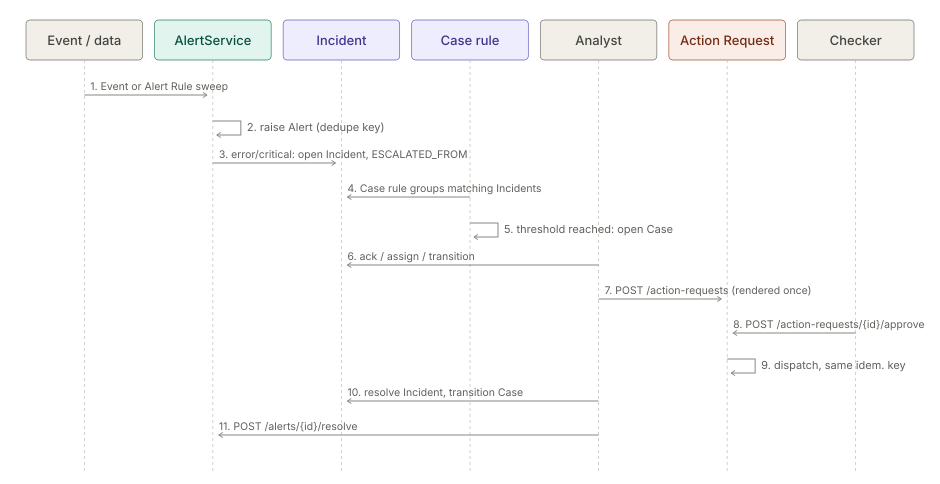

# Journey: from an alert to a closed Case

## Purpose

Follow a signal from the moment something happens to the moment the work is closed: Event or Alert Rule,
Alert, Incident, Case, an outbound Action Request with four-eyes approval, and closure. Each step names the
screen and the `/api/v1` route used.

## Actors

| Actor | Does |
|---|---|
| Platform | Emits Events, evaluates Alert Rules, promotes Alerts, evaluates case rules |
| Rule author | Authors Alert Rules and case rules (`canAuthorWorkbench`) |
| Analyst | Works Incidents and Cases (`canWorkIncidents`), proposes Action Requests |
| Checker | A second person who approves or declines an Action Request (`canApproveChanges`) |

## Walkthrough

1. **Event.** A Run or Collector emits a domain Event, for example `SEQUENCE_GAP` or
   `PIPELINE_CONSERVATION_IMBALANCE`. `EventAlertBridge` turns those two into stored Alerts through
   `AlertService.raiseFromEvent`, on every edition. The **Events** screen is route `events`.
2. **Alert Rule.** The rule author creates an Alert Rule on **Alerts** (route `alerts`) with
   `POST /api/v1/alerts/rules` (edit: `PUT /api/v1/alerts/rules/{ruleId}`). `GET /api/v1/alerts/rules/pending`
   lists rules held for approval; `POST /api/v1/alerts/evaluate` runs an evaluation now. Measure-shape Alert
   Rules evaluate whole-Dataset Measures. A Decision Rule consequence can also author an Alert Rule
   (`BuiltInConsequences`).
3. **Alert.** A firing rule raises an Alert, de-duplicated while a non-terminal Alert with the same
   `dedupeKey` exists. `GET /api/v1/alerts` lists them; `POST /api/v1/alerts/{alertId}/ack` acknowledges one.
4. **Incident.** At severity `error` or `critical` the Alert is promoted to an Incident through the
   `incidents` Platform Service, and the Alert row keeps the Incident id (`AlertRecords.linkEscalation`).
   A scheduled `IncidentOpenJob` can also open one, and an operator can with `POST /api/v1/objects`
   (`canManageIncidents`). Incidents and Cases are operational objects (`ObjectType` `INCIDENT`, `CASE`).
5. **Triage.** On **Incidents** (route `incidents`) the analyst works the object:
   `POST /api/v1/objects/{id}/ack`, `/assign`, `/transition`, `/comments`, `/attachments`, `/rca`;
   `PUT /api/v1/objects/{id}/findings`, `/impact`, `/category`.
6. **Case.** A case rule (`POST /api/v1/cases/rules`) groups matching Incidents, optionally per entity
   (`groupBy`, stored as a digest, never the raw key), and opens a Case at its threshold (`CaseOperations`).
   `POST /api/v1/cases/rules/{ruleId}/evaluate` runs one now; `POST /api/v1/cases/from-entities` opens a Case
   from selected entities; `POST /api/v1/objects/{id}/merge` and `/split` reshape Cases (`canAdminister`).
   The **Cases** screen is route `cases`.
7. **Action Request.** To act outside Inspecto the analyst creates `POST /api/v1/action-requests` from the
   Incident or Case. The payload template is rendered once at creation; the Connection, URL, method and
   idempotency key are fixed then.
8. **Approval.** A checker opens **Action Requests** (route `action-requests`) and calls
   `POST /api/v1/action-requests/{id}/approve` or `/decline`. `ActionDispatcher` sends it. A failed request can
   be retried (`/retry`, same idempotency key) or marked failed (`/mark-failed`). Lifecycle:
   `draft → pending → approved → dispatched → succeeded | failed`, plus `declined` and `expired`.
9. **Closure.** The analyst resolves the Incident (`POST /api/v1/objects/{id}/resolve`), moves the Case to its
   terminal state with `/transition` (workflow from `GET /api/v1/workflows/{type}`), records a postmortem
   (`PUT /api/v1/objects/{id}/postmortem`) and resolves the Alert (`POST /api/v1/alerts/{alertId}/resolve`).

## Diagram

Script: `tools/doc-diagrams/journey-alert-to-case.py`.

## What can go wrong

- **Alert storm.** De-duplication on `dedupeKey` suppresses clones; a re-report after a restart does not
  hand the operator a duplicate.
- **No Incident opened.** In a bundle without the operational-object module, a Decision Rule consequence
  records that no Incident was opened rather than claiming one is open.
- **Self-approval.** An Action Request needs a second person with `canApproveChanges`; the approve call
  carries nothing that can change the payload.
- **Forged record.** Action Request files are HMAC-signed per Space; an edited file reads back
  `status: invalid` and can be neither approved nor dispatched.
- **Nobody decides.** An undecided request expires after the approval policy's `expiresAfterHours`.
- **Remote call fails.** Retry reuses the same idempotency key, so the remote side can de-duplicate.

## Related modules

[events](../../module/event/architecture-overview.md) ·
[alerts](../../addon/incidents/architecture-alerts.md) ·
[decision-kernel](../../module/scoring/architecture-decision-kernel.md) ·
[incidents](../../addon/incidents/architecture-incidents.md) ·
[case-management](../../module/case-management/architecture-overview.md) ·
[action-requests](../../module/action-requests/architecture-overview.md) ·
[workflow-sla](../../module/workflow/architecture-workflow-sla.md) ·
[notifications](../../module/notify-channels/architecture-overview.md) ·
[platform-services](../platform/architecture-platform-services.md) ·
[identity-access](../../module/access/architecture-overview.md)

Concept: [incidents](../../addon/incidents/plan-incidents.md)
