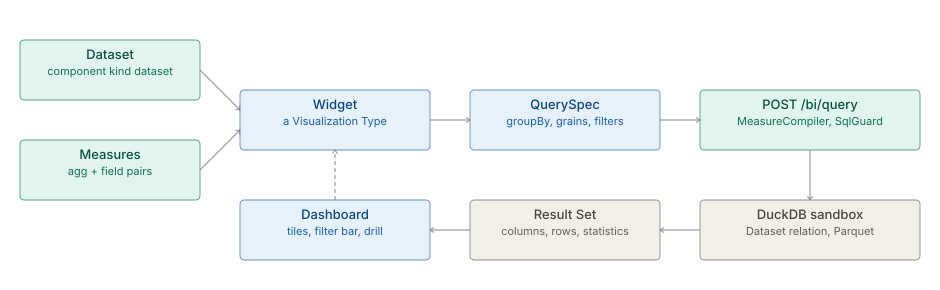

# Studio BI

> **Level 3 module page** (`SOLUTION-SUITE-DOCS-1`). Layer: Platform base.
> Offering: all editions (the BI screens carry no feature gate). The investigation studios mounted under
> `/studio` have their own page, [link-analysis](../../module/la-core/architecture-la-core.md): the Link
> Analysis graph studio ships in every edition, the Geo map and the Entity profile pages in Standard and
> above (`docs/EDITIONS.md`). Checked against the code on 2026-11-12.

## 1. What it is

Studio is where a builder turns a **Dataset** into something a person can read: a number, a table, a
chart, a board. Its parts, in the canonical vocabulary:

- **Dataset** — a named relation over a store (component kind `dataset`), owned by the data plane.
- **Measure** — an aggregation over a Dataset field (`{agg, field}`), or a named calculated Measure
  stored on the Dataset.
- **Visualization Type** — a template for a chart or view (`VizPlugin`); twenty ship.
- **Widget** — an instance: one Visualization Type bound to a Dataset with its controls set.
- **Dashboard** — tiles of Widgets with a quick-filter bar, drill-through and PNG export.
- **KPIs and Reports** — the business gallery, with scheduled delivery through the `report` Job Type.

The capability spec of record is [studio](plan-studio.md); Datasets and the guarded SQL stack
are in [data-plane](../platform/plan-data-plane.md).

## 2. Who uses it

- **Analysts and builders** define Datasets and Measures, build Widgets and Dashboards.
- **Business users** read Dashboards and the KPI and Reports page (the business lens home).
- **External viewers** open a shared Dashboard through a public embed link.

## 3. Where it sits

Studio reads committed stores from [storage](../../module/entity-store/architecture-entity-store.md) through Datasets; it writes nothing to
business data. Widgets, Dashboards and Datasets are ordinary component kinds, so they get versions,
ETags and history from the component registry. Code homes:

- Server: `inspecto/src/main/java/com/gamma/control/BiRoutes.java`,
  `platform/inspecto-engine/src/main/java/com/gamma/query/MeasureCompiler.java`,
  `inspecto/src/main/java/com/gamma/control/ShareRoutes.java`.
- SPA: `inspecto-ui/src/app/modules/admin/studio/` (shell `studio.routes.ts`) and the Visualization
  Type registry in `inspecto-ui/src/app/inspecto/viz/` (`viz-types.ts`, `viz-registry.ts`,
  `plugins/index.ts`, `query-spec.ts`, `dataset-result.service.ts`). The HTTP client is
  `inspecto-ui/src/app/inspecto/api/bi-query.service.ts`.

For the SPA as a whole (stack, boot, layering) see [architecture](architecture-product.md).

## 4. How it works

**Visualization Types.** A `VizPlugin` declares `meta`, `controls`, `buildQuery()`,
`transformProps()` and a `render` descriptor. `BUILTIN_VIZ_PLUGINS` registers, in order: `kpi`,
`table`, the Chart.js standards `bar`, `line`, `area`, `pie`, the breadth additions (`bubble`, `gauge`,
`scatter`, `funnel`, `kpi-trend`, `progress-list`, `treemap`, `waterfall`, `combo`, `heatmap`), and the
view-bound `geo-map`, `link-analysis`, `reconciliation` and `working-set`. `viz-render.component.ts`
dispatches on `render.kind` (`chartjs`, `aggrid`, `component`).

**Controls become structured Measures, never SQL text.** A control value
(`{field, agg, grain, expression}`) is turned into a `QueryMeasure`
(`{id, expression, label, agg?, field?, ratio?}`) by `query-spec.ts`. The Widget produces a `QuerySpec`
(`{datasetId, sourceName, groupBy, grains?, measures, window?, filters?, orderBy?, limit?, queryId?}`).
`biQueryBody` in `dataset-result.service.ts` maps it to the request body: each Measure travels as its
`{agg, field}` pair, a ratio as `{num, den}` in `ratios`, the filter tree as a flat AND list. A spec that
cannot cross faithfully (a named Measure's SQL expression, a real OR branch, no Measure and no group-by)
fails with a message rather than degrading.

**The result path.** `POST /bi/query` hands the body to `MeasureCompiler`, which builds one SELECT
from validated identifiers and bound, typed parameters; no caller SQL text and no filter value enters
the statement. It accepts:

- fifteen aggregations: `count`, `countDistinct`, `sum`, `avg`, `min`, `max`, `median`, `stddev`,
  `variance` and the percentiles `p05`, `p25`, `p75`, `p90`, `p95`, `p99`;
- three grains: `day`, `week`, `month`;
- an optional trailing `window` (`{field, asOf, days?}`), which also enables the as-of aggregate
  `recency`;
- `ratios` of two aggregations;
- an optional `compare` (`{kind, field?, target?}`, BI-INSIGHTS-1 I-1), below.

**Compare (I-1).** A Widget's *Compare with* option (`options.compare.kind`: `previous`, `lastYear`, `target`,
`average`; line, bar, area and KPI) travels as `compare` and is computed **in the Widget's own statement** (D-BI7:
no storage, the same row cap, guard, sandbox and masking). `MeasureCompiler` wraps the aggregate as
`WITH "__cmp_base" AS (…)`, grained columns kept as bucket starts, and adds three columns per Measure and ratio `m`:
`m__cmp` (the compared value), `m__delta` and `m__pct` (the change in % of `|m__cmp|`), marked in
`resultSet.columns[].overlay` (`{overlay: compare, kind, of, part}`, `ResultSetDescriptor.markCompare`).

- `previous` / `lastYear` use the Analytics kernel's `TimeSeriesSql.shift` along `field` (the one grained
  `groupBy` column by default), per the other grouped columns, matched by bucket: a missing bucket gives NULL.
  `lastYear` is 12 months back for a month, 52 weeks for a week (the same weekdays) and, for a day, the same
  date a year earlier (the kernel's `Shift.step`; 29 February looks at 28 February).
- `target` is a constant (`options.kpi.target`); a KPI tile bound to a KPI compares its value with that KPI's
  own target instead. `average` is the mean of the result's rows along `field`, per the other grouped columns.
- A comparison with no value — no earlier bucket, a zero baseline for the % — is NULL, never 0. A Measure that
  returns text or a date (`max` of a name) still shows its compared value; its change is NULL.
- It is refused (422) with no Measure, with `previous`/`lastYear` and no grained column, and with a hidden-aggregate
  `orderBy` (the SPA drops its category order then). A bound Query's `WITH` is merged with the comparison's
  (`MeasureCompiler.withPrefix`).
- Each comparison sees only the rows the filters, condition and window keep: the first bucket of a filtered range
  has no previous value.

The SPA draws the compared series dashed in its Measure's colour, named by its kind ("Amount · previous period"),
adds the change to the tooltip and states the last category's change under the chart ("Latest (Mar 2026): ▼ Down
25.0 % (−5) vs previous period"). The kinds and column suffixes are pinned on both sides by
`contracts/measure-grammar.contract.json` (`compare`).

The text then passes `SqlGuard.check` (422 on failure), the Dataset resolves through
`DatasetRelation.relationSql`, and it runs in the same ephemeral DuckDB sandbox as
`POST /queries/{id}/run`. Two more steps apply before the rows are returned:

- **Bound Query.** When the body names a saved Query (`query`), the Measures are aggregated over that
  Query's result instead of the whole Dataset. The Query must be `type: sql` and read the same Dataset;
  the combined statement is guarded again.
- **Masking.** Classified entity keys are masked in the rows unless the caller may reveal them
  (`BiResultMasking`); the response then carries a `masking` block.

The answer is the shared Result Set:
`{resultSet: {columns, rowCount}, rows, statistics{rowCount, elapsedMs, truncated}, sql}`. The route
fails closed: 503 without a write root, 404 for an unknown or not-visible Dataset, 422 for a bad spec.
The public embed, the `report` Job and the Measure-alert probe compile through `MeasureCompiler` too.

**Chart Markers (BI-INSIGHTS-1 I-2, 2026-11-24).** A `line`, `bar`, `area` or `combo` Widget may carry
`options.markers` (`MARKER_VIZ_TYPES` in `inspecto/viz/chart-markers.ts`): reference lines (`constant`,
`target`, `average`, `percentile` with `p` 1–99) and bands (`band` with `from` / `to` / `tone`, or `rag` = the
bound KPI's red, amber and green zones). `resolveMarkers` turns them into lines and bands with their words at
render time; the Chart.js overlay `chartMarkersPlugin` (`chart-markers.plugin.ts`, decision D-BI9) widens the
value axis `y` to every marker, shades bands behind the data and draws lines over it, each labelled. The
statistics read the values on `y` as drawn: every series, a Combo's bars only while its lines sit on the
right axis, the category totals per stack when stacked (a Combo's bars and lines are two stacks, as Chart.js
draws them); a percentile is a whole number, by DuckDB's `quantile_cont` rule. A `target` line
takes its own `value`, else the bound KPI's target, else `options.kpi.target`; the KPI is
`options.kpi.kpiId`, read from `/components/kpi/{id}` only when a marker needs it, and its bands follow the
server's `KpiDefinition.rag` rule. A marker that cannot be placed is dropped, never drawn at a guess.
Colours come from `CHART_TONE` and `CHART_MARKER_LINE` only, and the canvas text alternative lists every
marker. The Widget editor's cog dialog adds and removes them (`chart-markers-editor.component.ts`) and
offers the KPI picker on those four types.

**Forecast band and anomaly markers (BI-INSIGHTS-1 I-11, I-7, 2026-11-25).** A `line`, `bar` or `area` Widget
whose x axis is a date grouped by day, week or month may carry `options.overlay` (`{forecast?: {horizon?, level?},
anomaly?: {sensitivity?}}`, `inspecto/viz/chart-overlays.ts`). The query sends `overlay` (`{forecast?, anomaly: {}}`;
never along any other x, so a stale option cannot refuse the Widget) and the server's `ChartOverlays`
(`platform/inspecto-engine`, `com.gamma.query`) computes it from the rows the Widget's own statement returned —
after masking, under the same row cap, no second query (D-BI7) — with the Analytics Kernel only:
- **Forecast**: Holt-Winters additive (`Forecaster`, the JVM twin of `ForecastSql`) with its `PredictionInterval`
  at `level` (80 % by default) on `horizon` new rows after the last bucket (`m__fc`, `m__fc_lo`, `m__fc_hi`, the
  Measure NULL there), one series per value of the other grouped column. The period is the one
  `SeasonalityDetector` finds among the grain's calendar cycles, else the first of them (7 days, 52 weeks, 12
  months); the horizon defaults to the period, at most 24. The rolling-origin `Backtest` of the same model on the
  same series (origins from two seasons on, at most 60) gives MAPE, sMAPE, MAE and the band's coverage
  (`Accuracy`). Fewer than two seasons, a gap between buckets, a bucket with no value, a cut result, more than 20
  series or a masked Measure give no forecast and the reason, never a guessed band.
- **Anomaly**: per bucket, the robust z against a `SeasonalBaseline` over the series' other buckets in the result
  (by weekday when the grain is a day and the detector finds a 7-day cycle; at least 7 points) — `m__expected`
  (the baseline's median) and `m__z`.
The columns are marked in `resultSet.columns[].overlay` (`{overlay: forecast | anomaly, kind, of, part}`) and the
response adds `overlays[]`: per overlay, Measure and series, the method, period and its source, the backtest, or
the reason. The SPA draws both through the Chart Markers plugin (D-BI9): an `interval` marker fills the band behind
the data and dashes the point forecast over it, a `points` marker rings each value whose |z| reaches the
sensitivity's threshold (1–5 → 5, 4, 3.5, 3, 2.5). A slider under the chart moves the sensitivity for the viewer
without a new query; captions say what the forecast is, how it tested, how many values are flagged — or why there
is none. The cog dialog offers *Forecast band*, its width (80 / 90 / 95 %), *Anomaly markers* and the starting
sensitivity. The suffixes are pinned by `contracts/measure-grammar.contract.json` (`overlay`).

**Insight-aware Show-Me (BI-INSIGHTS-1 I-20, 2026-11-25).** While a Widget is built, `suggestOverlays()`
(`inspecto/viz/show-me.ts`) offers, above the preview, a forecast band when the server detected a seasonal cycle
over two seasons ("Weekly seasonal pattern found over 112 days of history"), anomaly markers when a point passes the
default sensitivity, and the target line or bands of the bound KPI. The signal is the same Widget statement sent once
more with `overlay: {forecast, anomaly}` — the summary above, no other route. Nothing changes until the user clicks
*Add …*; *Not now* hides a suggestion. Plan §11.6.

**Dashboards.** A Dashboard config holds `tiles: [{widgetId, span}]`, an optional `filter`,
`exposedFields` for the quick-filter chips, a viewer header (`description`, `asOf`, `illustrative`)
and a viewer-only date range (`dateField`, `defaultRange`).

**Freshness.** The Dataset list shows a badge derived at read time from the newest `dataset.write`
Signal against the `maximumAge` of a freshness Alert Rule; nothing is persisted as "stale".

## 5. Configuration

| Component kind | Key fields |
|---|---|
| `dataset` | `sourceName` (never defaulted), `columns`, `calculated` (calculated columns), `measures` (named Measures) |
| `widget` | `vizType` (required), the Dataset binding and control values |
| `dashboard` | `tiles`, `filter`, `exposedFields`, `description`, `asOf`, `illustrative`, `dateField`, `defaultRange` |
| `*_job.toon` with `type: report` | scheduled export and delivery |

The `widget`, `dashboard` and Job specs are declared in
`platform/inspecto-config/src/main/java/com/gamma/config/spec/ConfigSpecs.java`. `dataset` has no entry
there; its relation is validated when it is read, by
`platform/inspecto-engine/src/main/java/com/gamma/query/DatasetRelation.java`.

## 6. Screens

- **Datasets** (`/catalog/datasets`; editor `studio/datasets/dataset-editor.component.ts`, Measures
  tab `dataset-measures.component.ts`). `/studio` and `/studio/datasets` redirect there.
- **Query Library** (`/studio/queries`), **Widgets** (`/studio/widgets`, sidebar label "Viz Library",
  `widget-host.component.ts`), **Dashboards** (`/studio/dashboards`, sidebar label "Dashboard Builder"),
  **Template Gallery** (`/studio/templates`).
- **KPI & Reports** (`/kpi-reports`), a top-level pane, not a Studio child.
- **Shared Dashboard viewer** (`/share/:token`), outside the app shell, with no sign-in.

## 7. API

| Route | Purpose |
|---|---|
| `POST /bi/query` | compile and run a `QuerySpec` |
| `GET /bi/templates`, `POST /bi/templates/{id}/apply` | curated templates, all-or-nothing apply |
| `/components/dataset`, `/components/widget`, `/components/dashboard` | CRUD, versions, restore |
| `GET /datasets/{id}/rows`, `/datasets/{id}/freshness`, `POST /datasets/{id}/materialize` | Dataset reads |
| `POST /queries/{id}/run` | run a saved Query |
| `POST /dashboards/{id}/share`, `GET /public/dashboards/{token}`, `POST …/query` | public embed |
| `GET /kpis/{id}/value` | one KPI value |

## 8. Interactions

- **Alerts:** Measure-shape Alert Rules and freshness Alert Rules ([alerts](../../addon/incidents/architecture-incidents.md)).
- **Jobs:** the `report` Job Type delivers exports on a schedule ([jobs-scheduler](../../module/processor/architecture-processor.md)).
- **Analytics kernel:** time grains and statistics ([analytics-kernel](../../module/analytics/architecture-analytics.md)).
- **Exchange:** shared Datasets and Widgets across Spaces ([exchange](../../module/exchange/architecture-exchange.md)).
- **Identity and access:** public routes and HMAC share tokens ([identity-access](../../module/access/architecture-access.md)).

## 9. Limits and gotchas

- `GET /bi/datasets` was retired; Datasets are listed through the component registry only.
- A `QuerySpec` with a named Measure's free-text `expression`, or with a real OR branch in its filter,
  cannot cross to `/bi/query`; the Widget shows the refusal.
- A `429` from `/bi/query` is retried three times (after 1, 2 and 4 seconds), then shown as rate limited,
  not as "no data".
- `recency` is accepted only together with a `window`, which gives it its as-of date.
- `VizRender` also declares a `g6` kind; no built-in plugin uses it and `viz-render.component.ts` has no
  branch for it.
- Every row read is a page with `truncated`; a consumer that counts must say so.
- A blank Dashboard header value is not written, so clearing a field removes the key.
- Only three time grains (`day`, `week`, `month`) cross the wire.
- *Compare with* is not offered on a table, and the public share viewer does not forward it (it forwards only
  `tableSort`); a time bucket is the wall-clock `DATE_TRUNC` the grain already uses (DuckDB's session zone for a
  `TIMESTAMPTZ`, the host's).
- A comparison grouped by a withheld (`masked:withheld`) key shows equal `average`/`previous` values for rows sharing
  that key: it tells which rows share a key, never the key (open question for the masking owner). `average` is the
  mean over every result row before the row limit, not only the rows shown.
- Chart Markers are drawn on screen only: the Report PDF (`WidgetChartRenderer`) does not draw them yet
  (`REPORT-CHART-MARKERS-1` on the board). On a public share a KPI-bound marker draws only when the KPI
  definition is readable; otherwise a `target` line falls back to the Widget's own target and `rag` draws nothing.
- The forecast band and anomaly markers (I-11, I-7) are drawn on screen only: the Report PDF does not ask for them
  (`REPORT-CHART-MARKERS-1`). The public share viewer forwards `overlay` and the date grain beside `tableSort`, and
  `POST /public/dashboards/{token}/query` computes both from its fenced rows after `BiResultMasking.forPublicShare`
  (a masked Measure gets no band, a masked series key reaches the summary only as its alias). The anomaly baseline is the result's own buckets, so a narrower date range changes the scores; a
  week or month grain has no seasonal slot in `SeasonalBaseline` (weekday / hour only) and is scored against every
  other bucket. A stacked or value-sorted chart draws neither (a band follows each series' own values in time order)
  and says so under the chart; only `line`, `bar` and `area` send `overlay`, so a Widget switched to another type keeps
  the stored option without asking for it.
