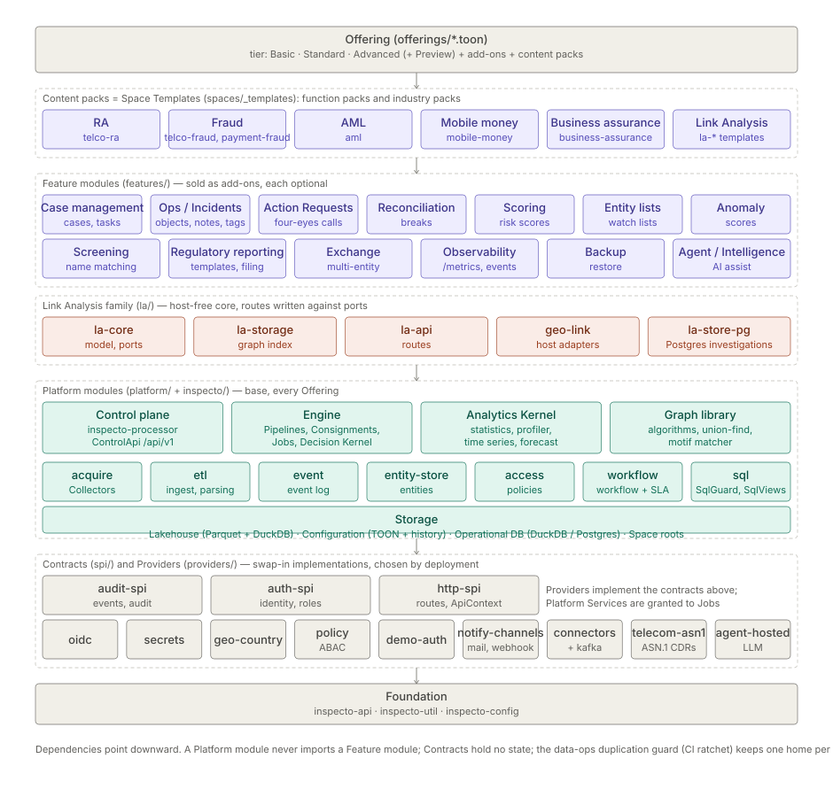

# Inspecto — Solution Overview

> **Level 0 of the solution suite** (`SOLUTION-SUITE-DOCS-1`, plan: [`solution-suite-docs-plan.md`](../../../../archived-documents/plans-archive/solution-suite-docs-plan.md)).
> Audience: buyers, sponsors, new users. Checked against `offerings/*.toon` and `spaces/_templates/` on 2026-10-18.
> Vocabulary per [`../../../../GLOSSARY.md`](../../../../GLOSSARY.md). The market framing is in the
> [Executive Brief](brochure-executive-brief.md); this page is the map into the technical suite.

## 1. What it does for you

Inspecto takes data from where it lives, makes it trustworthy, shows it, and turns what it finds into work that
someone owns:

1. **Collect** — Collectors pull files, SFTP/FTP, databases, Kafka and cloud stores.
2. **Parse and ingest** — typed records into the lakehouse; bad rows are quarantined, not lost.
3. **Shape** — Pipelines of Steps enrich, deduplicate, join and score.
4. **Analyse** — Measures and dashboards in Studio & BI; baselines and scores from the Analytics Kernel.
5. **Act** — Alerts, Decision Rules, Incidents, Cases and Action Requests, with change control around the
   configuration that drives them.

## 2. What you get, by Offering

An **Offering** is a tier plus add-ons plus content packs, composed in `offerings/*.toon`. The tiers are
**Basic**, **Standard** (includes Basic) and **Advanced** (includes Standard); **Preview** bundles everything for
evaluation. A module is usable only when it is Installed in the build, Enabled for the Space and Permitted for
the user. See [`../../../../EDITIONS.md`](../../../../EDITIONS.md) for the full placement table.

| | Basic | Standard | Advanced |
|---|---|---|---|
| Sign-in | none (single user, local) | OIDC | OIDC plus attribute-based Access Policies |
| Platform base (Collectors, Pipelines, Studio & BI, Alerts, maker-checker) | ✅ | ✅ | ✅ |
| Link Analysis explorer | ✅ | ✅ | ✅ (Postgres investigation store) |
| Add-ons: Incidents, Case Management, Action Requests, Reconciliation, Risk Scores (Entity Lists are in Basic), Anomaly Detection, Screening, Regulatory Reporting, Exchange, AI assist | — | ✅ | ✅ (adds the intelligence agent) |
| Content packs | Business Assurance (placement is an open decision, `OFFERING-DECLARATION-DRIFT-1`), Link Analysis daily feed, Orders starter | adds Revenue Assurance, Telecom Fraud, Payment Fraud, AML, Mobile Money | same as Standard |

## 3. Solutions (level 2)

Each pack page names the modules the pack switches on and walks the end-to-end story.

| Solution | For | Page |
|---|---|---|
| Revenue Assurance | telecom revenue leakage between switch, mediation, rating and billing | [revenue-assurance](../../solution-pack/business-assurance/architecture-revenue-assurance.md) |
| Telecom Fraud | IRSF, Wangiri, SIM box and related typologies | [telecom-fraud](../../solution-pack/telco-fraud/architecture.md) |
| Payment Fraud | card and wallet fraud patterns | [payment-fraud](../../solution-pack/payment-fraud/architecture.md) |
| AML | laundering typologies, screening, suspicious transaction reports | [aml](../../solution-pack/aml/architecture.md) |
| Mobile Money | trust-account and settlement proof, agent abuse | [mobile-money](../../solution-pack/mobile-money/architecture.md) |
| Business Assurance | seasonal and trend deviations in revenue and margin | [business-assurance](../../solution-pack/business-assurance/architecture.md) |
| Link Analysis | relationship investigations across the above | [link-analysis](../../solution-pack/la-showcase/architecture.md) |

Three journeys follow one piece of work across modules: [from a file to a dashboard](user-guide-journey-file-to-dashboard.md),
[from an alert to a closed Case](user-guide-journey-alert-to-case.md) and
[a safe config change](user-guide-journey-safe-config-change.md).

## 4. How it is put together (level 1)

One Java application with an embedded DuckDB engine and one Angular console, shipped as thin per-module jars.
Content packs sit on feature modules, which sit on platform modules, which sit on contracts and providers.
[`../platform/architecture-technical.md`](../platform/architecture-technical.md) is the architect's view.

## 5. How each part works (level 3)

[Module pages](../../index.md) — 29 pages, one per module, on one nine-heading template (what it is, who uses
it, where it sits, how it works, configuration, screens, API, interactions, limits). Start with
[maker-checker](../../module/workflow/architecture-maker-checker.md) for governance, [Pipelines and Steps](../../module/etl/architecture-pipelines-steps.md) for data
flow, or [Alerts](../../addon/incidents/architecture-alerts.md) for detection.

## 6. Where to go next

| You are | Read |
|---|---|
| Executive or sponsor | [Executive Brief](brochure-executive-brief.md) |
| Evaluating a solution | its page in §3, then [Product Capabilities](features-product-capabilities.md) |
| Architect or integrator | [Technical Architecture](../platform/architecture-technical.md), the [OpenAPI contract](../../../../api/openapi-v1.json) |
| Operator or admin | [Operations Guide](../platform/admin-guide-operations.md), the module pages |
| End user | [User Guide](../../../../USER_GUIDE.md) |
