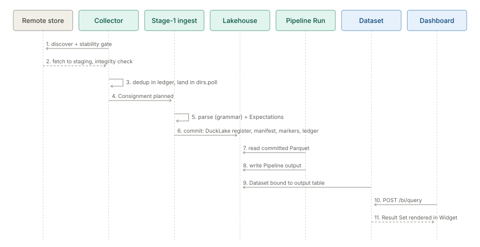

# Journey: from a file to a dashboard

## Purpose

Follow one file from a remote store to a number on a Dashboard: Collector, Stage-1 parsing and ingest,
the lakehouse commit, a Pipeline Run, a Dataset, a Measure and the Widget that renders it. Each step names
the screen and the `/api/v1` route a person or system uses. Concept detail lives in the module pages and
OKF concepts linked below; this page only strings them together.

## Actors

| Actor | Does |
|---|---|
| Data engineer | Authors the Connection, the Collector block, the grammar (parser) and the Pipeline |
| Scheduler (Jobs) | Fires acquire and Pipeline Runs; `POST /api/v1/jobs/{name}/trigger` fires one by hand (`canOperateRuns`) |
| Analyst | Binds a Dataset, defines Measures, builds Widgets and Dashboards in Studio |
| Viewer | Opens the Dashboard, or a public embed when one is shared |

## Walkthrough

1. **Connection.** The data engineer opens **Connections** (route `connections`) and tests reach with
   `POST /api/v1/connections/test`. A Connection is a `*_connection.toon` file read by `ConnectionRegistry`.
2. **Collector.** The `collector:` block of the Pipeline (`include`, `stability`, `duplicate`, `fetch`,
   `post_action`, `consignment`) drives `CollectorProcessor.acquire`: discover, stability gate, dedup in the
   `AcquisitionLedger`, gap detection, fetch to `collector.fetch.staging_dir`, then an atomic rename into
   `dirs.poll`. The **Collectors** screen (route `collectors`) lists them from `GET /api/v1/collectors`;
   `POST /api/v1/collectors/{collectorId}/notify` tells one that a file is waiting.
3. **Parsing preview.** While authoring, `POST /api/v1/config/preview/parsing` and
   `POST /api/v1/config/preview/schema` show what the grammar makes of a sample;
   `POST /api/v1/config/suggest/schema` proposes a schema. Saves go through `POST /api/v1/config/write`
   (see the [safe config change journey](user-guide-journey-safe-config-change.md)).
4. **Stage-1 ingest.** `ConsignmentPlanner` groups inbox files into a Consignment; `ConsignmentIngestor`
   parses, transforms and partitions it and checks Expectations; rejected rows go to quarantine.
5. **Lakehouse commit.** `ConsignmentIngestor` commits in crash-safe order: DuckLake register, manifest,
   backup of originals, markers, ledger last. A failed Consignment leaves no markers, so it is picked up again.
   Detail: [ingestion](../../module/etl/plan-ingestion.md).
6. **Pipeline Run.** The Pipeline's later Steps read the committed Parquet and write their outputs. Operators
   watch it on **Runs** (route `runs`): `GET /api/v1/runs/{runId}/files`, `/commits`, `/quarantine`,
   `/outputs`, `/errors`, `/lineage`; `POST /api/v1/runs/{runId}/reprocess` and `/replay-rejects` repair.
7. **Dataset.** The analyst binds a Dataset to an output table in **Catalog > Datasets** (`/catalog/datasets`;
   `/studio/datasets` redirects there). `GET /api/v1/datasets/{datasetId}/rows` samples it,
   `GET /api/v1/datasets/{datasetId}/freshness` reports how current it is, and
   `POST /api/v1/datasets/{datasetId}/materialize` materialises it.
8. **Measure.** In Studio a Measure is a client-side `NamedMeasure` (`{id, expression, label}`) authored per
   Dataset; there is no server Measure entity. It reaches the server inside a `QuerySpec`.
9. **Widget.** **Studio > Widgets** binds a Visualization Type to the Dataset's Result Set. The Widget renders
   through `POST /api/v1/bi/query` (`MeasureCompiler`, then the guarded sandbox). Widgets are components,
   saved through `/api/v1/components/widget`.
10. **Dashboard.** **Studio > Dashboards** lays Widgets out. `POST /api/v1/bi/templates/{templateId}/apply`
    seeds a starter set (`kpi-overview`, `quality-monitor`, `trend-monitor`).
    `POST /api/v1/dashboards/{dashboardId}/share` makes a public embed served by
    `GET /api/v1/public/dashboards/{dashboardId}`.

## Diagram

Script: `tools/doc-diagrams/journey-file-to-dashboard.py`.

## What can go wrong

- **A file never arrives or arrives twice.** A gap in a dated series emits `SEQUENCE_GAP`, which becomes an
  Alert (`EventAlertBridge`); a changed file is handled by `duplicate.on_change` (`IGNORE`, `REPROCESS`,
  `ALERT`, `ARCHIVE_OLD_VERSION`).
- **Partial download.** Fetches land in the staging dir and are integrity-checked before the rename, so a
  partial file never sits in the inbox.
- **Bad rows.** Expectations and parse failures send rows to quarantine; see `/runs/{runId}/quarantine`.
- **Crash mid-commit.** Markers and ledger are written last, so the Consignment is retried, not lost.
- **Stale Dashboard.** Check Dataset freshness before suspecting the Widget.
- **Measure drift.** A Measure lives in the client model per Dataset; two Datasets can define the same label
  differently.

## Related modules

[collectors](../../module/acquire/architecture-collectors.md) ·
[parsing-ingest](../../module/etl/architecture-parsing-ingest.md) ·
[storage](../../module/entity-store/architecture-storage.md) ·
[pipelines-steps](../../module/etl/architecture-pipelines-steps.md) ·
[jobs-scheduler](../../module/processor/architecture-jobs-scheduler.md) ·
[analytics-kernel](../../module/analytics/architecture-overview.md) ·
[studio-bi](architecture-studio-bi.md) ·
[alerts](../../addon/incidents/architecture-alerts.md) ·
[observability-backup](../../module/observability/architecture-observability-backup.md)

Concepts: [Studio](plan-studio.md) ·
[ingestion](../../module/etl/plan-ingestion.md) ·
[acquisition](../../module/acquire/plan-acquisition.md)
