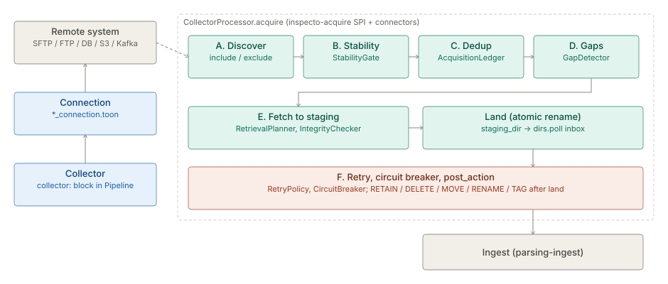

# Acquisition

The architecture of the `acquire` hub, in three parts: the acquisition engine's cycle and its phases A to F,
the Collector and Connection module summary, and the composition pattern for ingesting one logical feed
from several locations. The parts keep their own status lines and decision dates; the capability spec is
[Acquisition & connectivity (`ACQ`)](plan-acquisition.md).

**On this page**

- [Data Acquisition Framework](#data-acquisition-framework) — the cycle, back-pressure and phases A–F.
- [Collectors](#collectors) — the Collector and Connection module summary: schemes, configuration, limits.
- [Multi-location ingest — the composition pattern](#multi-location-ingest--the-composition-pattern) — N
  single-Collector Pipelines and one merge, never a Collector list.

## Data Acquisition Framework

A full acquisition engine (not a directory poller): **Discover → Determine readiness → Guarantee collection
semantics → Retrieve/validate → Finalize**. The phases below are `CollectorProcessor.acquire(cfg)`, which
fetches remote files and lands them atomically in the inbox; ingest then discovers them by walking the inbox
like any local push. In the one-shot CLI/`reprocess`/manual path, `CollectorProcessor.run()` calls
`acquire` then `ingest` in one cycle. In the **always-on service** the two run on their own timers (B3b):
`dispatchAcquireCycle()` fetches under `acquire.pollSeconds` / `acquire.maxConcurrent`, guarded per-pipeline by
a dedicated `acquireGuard`, so a slow fetch neither blocks nor is blocked by ingest, and two acquisitions of
one pipeline never overlap. `acquire` is a no-op for a `local` collector. For what was *required* and what was *refused*, start at the capability spec
[**Acquisition & connectivity (`ACQ`)**](plan-acquisition.md); this part is the
mechanism tier for the cycle. *(It used to name `spec-framework-design.md` as "authoritative" — a
chain that ended in the never-maintained archive tier.)*

> **Gotcha — manual run vs. background acquisition.** The manual "run now" acquires inline under the *ingest*
> `runGuard`, which is separate from the background `acquireGuard`; a manual run can therefore overlap one
> background acquisition tick of the same pipeline. This is benign and self-correcting — landing is atomic
> (B3a stage-then-rename) and duplicates are caught by markers/fingerprint dedup — but it is why the two
> guards are deliberately not one.

**Back-pressure (B4).** Acquisition de-schedules itself when the inbox it feeds is full: if a pipeline's
inbox backlog (`CollectorProcessor.countPending`, the exact landed count from B3b) has reached
`-Dacquire.backpressure.highWater`, `selectDueForAcquire` skips that pipeline this tick and bumps
`inspecto_acquire_backpressure_skips_total`. The already-landed files wait in the **durable inbox — which is
the spill-to-disk hand-off queue** of the design's §3.5 escalation — until ingest drains them below the mark.
This throttles the *producer* (acquisition), so it is **negative** feedback, and is therefore the opposite of
T15/`IntakeGovernor`, which deliberately does **not** throttle on inbox lag because throttling the *ingest
consumer* on backlog would be positive feedback. The mark is **0 = off by default** (like
`-Dingest.maxFilesPerCycle`); a failed pending scan returns `-1` and so fails open (never pauses).
⚠ The gate bounds backlog **across** ticks, not within one: a single acquire cycle still fetches the whole
discovered listing, so one tick can overshoot the mark. Bounding a single cycle's fetch volume is a separate,
deferred knob (`acquire.maxFilesPerCycle`, BACKLOG §6).

### Phases

* **A — Discovery.** `CollectorConnectors.forConfig(cfg)` resolves the [connector](../connectors/spec-connectors.md): scheme
  `local` → built-in `LocalFileSystemConnector`; otherwise a `ServiceLoader<CollectorConnectorFactory>` lookup.
  `CollectorConnector.discover(ctx)` lists candidates (never dedups — that's an engine concern).
* **B — Stability gate.** `StabilityGate` (`com/gamma/acquire/StabilityGate.java`) holds back half-written
  files: it first asks `connector.readiness()`; if `UNKNOWN`, applies size/mtime quiescence (unchanged for
  `stability.window` across `stability.size_checks` cycles). One shared instance per [space](../processor/architecture.md).
* **C — Deduplication + watermark.** `AcquisitionLedger` (`com/gamma/acquire/AcquisitionLedger.java`) is the
  fingerprint SPI: `find`/`record` per `(sourceId, relativePath)`, `highWatermark(sourceId)` for incremental
  discovery, `dbWatermark` for row-level DB export. Implementations: `InMemoryAcquisitionLedger` (default,
  lost on restart) and `DbAcquisitionLedger` (durable DuckDB/Postgres, via `-Dacquire.ledger.backend=db`).
  `DuplicatePolicy` is **three** enums, not one list (`DuplicatePolicy.java:17,38,56`) — ⚠ conflating
  them is how this line came to name four tokens that do not exist:
  · **`Mode`** (how a file already seen at the same path is judged) — `PATH`, `METADATA`, `CHECKSUM`,
    `ETAG`; unknown input falls back to `PATH`, and `ETAG` degrades to `METADATA` when neither side
    supplies an etag or version.
  · **`OnChange`** (what to do when a known path's content changed) — `IGNORE`, `REPROCESS` (the
    default), `ALERT` (emits `FILE_CHANGED`), `ARCHIVE_OLD_VERSION`.
  · **`Decision`** (the verdict for one candidate) — `NEW`, `DUPLICATE`, `CHANGED`.
  ⛔ There is no `SKIP`, `VERSION` or `FAIL`.
* **D — Gap detection.** `GapDetector` (`com/gamma/acquire/GapDetector.java`) flags missing files in a
  sequence series and fires alerts via `AcquisitionTelemetry`.
* **E/F — Retry + circuit breaker.** `RetryPolicy` (`com/gamma/acquire/retry/RetryPolicy.java`, configurable
  attempts + EXPONENTIAL/FIXED backoff) wraps connector calls; `CircuitBreaker` (`com/gamma/acquire/CircuitBreaker.java`,
  per-source) opens after a failure threshold and skips the source until cooldown.

`AcquisitionLedgers` (`com/gamma/acquire/AcquisitionLedgers.java`) is the per-space `shared()` accessor +
lifecycle manager (one of the five MDC-routed singletons — see [multi-space](../processor/architecture.md)).

## Collectors

> **Level 3 module page** (`SOLUTION-SUITE-DOCS-1`). Layer: Platform base.
> Offering: all tiers (local, SFTP, FTP/FTPS, DB, S3, Azure, GCS); the Kafka Collector is Standard and above.
> Checked against the code on 2026-10-17.

### 1. What it is

A **Collector** is a configured collection task bound to one **Connection** (a named endpoint plus
credentials). It reaches a remote system, decides which files are new and complete, fetches them once,
and lands them in the Pipeline's inbox (`dirs.poll`). Everything after landing is ingest's job
([parsing-ingest](../etl/architecture.md)). The capability spec of record is
[acquisition.md](plan-acquisition.md); this part is the module summary.

Code homes:

- SPI and engine-side logic: `platform/inspecto-acquire/src/main/java/com/gamma/acquire` —
  `CollectorConnector`, `CollectorConnectorFactory`, `CollectorConnectors`, `ConnectionProfile`,
  `StabilityGate`, `AcquisitionLedger`, `DuplicatePolicy`, `GapDetector`, `RetrievalPlanner`,
  `IntegrityChecker`, `CircuitBreaker`, `RateLimiter`, `PostAction`, `retry/RetryPolicy.java`.
- Remote connectors: `providers/inspecto-connectors/src/main/java/com/gamma/acquire/connectors`.
- Kafka connector: `providers/inspecto-connectors-kafka/src/main/java/com/gamma/acquire/kafka`.
- Cycle driver: `platform/inspecto-engine/src/main/java/com/gamma/inspector/CollectorProcessor.java`.

### 2. Who uses it

- **Integration engineers** author Connections and the `collector:` block of a Pipeline.
- **Operators** watch Collector state, test Connections, and trigger an immediate scan.
- **Upstream systems** (an S3 event, an upload script) can call the notify route to ask for a scan now.

### 3. Where it sits

Collectors are the first stage of the platform base: a remote system feeds a Collector, the Collector
lands bytes, and a [Pipeline](../etl/architecture.md) parses and loads them into [storage](../entity-store/architecture.md).
The connector schemes are pluggable through `ServiceLoader`: `CollectorConnectors.forConfig` resolves
`local` to the built-in `LocalFileSystemConnector` and any other scheme to a registered
`CollectorConnectorFactory` matched on `scheme()`. An unknown scheme fails fast; there is no fall-back
to `local`.

| Scheme | Class | Module |
|---|---|---|
| `local` | `LocalFileSystemConnector` | `inspecto-acquire` (built in) |
| `sftp` | `SftpConnector` | `inspecto-connectors` |
| `ftp`, `ftps` | `FtpConnector` (two factories) | `inspecto-connectors` |
| `db` | `DbExportConnector` | `inspecto-connectors` |
| `s3` | `S3Connector` + `AwsSigV4` | `inspecto-connectors` (SDK-free) |
| `azure` | `AzureBlobConnector` + `AzureSharedKey` | `inspecto-connectors` (SDK-free) |
| `gcs` | `GcsConnector` + `GcpServiceAccountToken` | `inspecto-connectors` (SDK-free) |
| `kafka` | `KafkaConnector` | `inspecto-connectors-kafka` |

The registry files are
`providers/inspecto-connectors/src/main/resources/META-INF/services/com.gamma.acquire.CollectorConnectorFactory`
and the matching file in `inspecto-connectors-kafka`.

### 4. How it works



`CollectorProcessor.acquire` runs phases A to F; `acquire` is a no-op for a `local` Collector.

- **A. Discover.** `CollectorConnector.discover` lists candidates; it never dedups. Shaped by
  `include`, `exclude`, `recursive_depth` and `discovery` (`poll` or `watch`).
- **B. Stability.** `StabilityGate` asks the connector's `readiness` first (object stores answer
  `READY`), and only on `UNKNOWN` applies size/mtime quiescence (`window`, `size_checks`) or a
  `ready_marker`.
- **C. Dedup.** `DuplicatePolicy` has a `Mode` (`PATH`, `METADATA`, `CHECKSUM`, `ETAG`) and an
  `OnChange` (`IGNORE`, `REPROCESS`, `ALERT`, `ARCHIVE_OLD_VERSION`). Fingerprints live in the
  `AcquisitionLedger` (`InMemoryAcquisitionLedger` by default, `DbAcquisitionLedger` when durable).
- **D. Gaps.** `GapDetector` finds missing keys in a dated filename series and emits `SEQUENCE_GAP`
  once per hole (`GapTracker`).
- **E. Fetch and land.** `RetrievalPlanner` picks `FETCH_TO_BACKUP`, `STREAM` or `STAGE_TEMP`. Fetches go
  to `collector.fetch.staging_dir`, are checked by `IntegrityChecker`, then atomically renamed into
  `dirs.poll`. A partial download never sits in the inbox.
- **F. Resilience and disposition.** `RetryPolicy` wraps `discover` and `fetchTo`; `CircuitBreaker`
  skips a failing Collector for a cooldown; `PostAction` applies `RETAIN`, `DELETE`, `MOVE`, `RENAME` or
  `TAG` to the remote file only after landing.

`db` and `kafka` Collectors produce slices: the row watermark or offset frontier is advanced only after
the slice commits, so delivery is at-least-once.

### 5. Configuration

**Connection** — authored as `*_connection.toon` (`ConnectionRegistry`), parsed by
`ConnectionProfile`: `id`, `connector`, `host`, `port`, `database`, `base_path`, `username`, `password`,
`options`, plus optional `tunnel` and `proxy` blocks. Secrets resolve through `SecretResolver` references.

**Collector** — the `collector:` block of a Pipeline (`platform/inspecto-etl/src/main/java/com/gamma/etl/PipelineConfigParser.java`;
there is no other spelling):

| Key | Purpose |
|---|---|
| `connector`, `connection` | scheme (default `local`) and the Connection id |
| `include`, `exclude`, `recursive_depth`, `discovery` | discovery |
| `stability` | `window`, `size_checks`, `ready_marker`, `exclude_temp_files`, `exclude_temp_patterns` |
| `duplicate` | `mode`, `algorithm`, `on_change` |
| `guarantee` | `BEST_EFFORT` (default), `AT_LEAST_ONCE`, `EXACTLY_ONCE` |
| `incremental.watermark` | `last_modified` file-level watermark |
| `gap_detection` | `enabled`, `sequence`, `file_template`, `seq_scope` — `enabled: false` (default `true`) stops the live `sequence` detector, the windowed `file_template` check and the per-day delivery manifest; the `file_template` still names a file's day in Signals and is the `kpi.completeness` Job's default template (`GAP-DETECTION-ENABLED-IGNORED-1`, 2026-11-12) |
| `fetch` | `mode`, `staging_dir`, `parallel_fetch`, `rate_limit` |
| `retry` | `count`, `backoff`, `initial_delay`, `max_delay` |
| `circuit_breaker` | `failure_threshold`, `cooldown` |
| `post_action` | `on_success`, `archive_path`, `tags`, `on_unsupported` |
| `consignment` | `max_files`, `max_bytes`, `order` |

Connector `options` examples: Kafka reads `topic`, `bootstrap_servers`, `security_protocol`,
`max_records`, `start` (default `earliest`); `db` reads `watermark_column`, `watermark_type`,
`watermark_initial`.

JVM switches: `-Dacquire.ledger.backend` (`memory` | `db`), `-Dacquire.pollSeconds`,
`-Dacquire.maxConcurrent`, `-Dacquire.backpressure.highWater` (0 = off).

### 6. Screens

Moved to [the user guide](user-guide-collectors.md#screens).

### 7. API

Moved to [Collectors — API](api-collectors.md).

### 8. Interactions

- [parsing-ingest](../etl/architecture.md) — consumes the landed inbox.
- [pipelines-steps](../etl/architecture.md) — the `collector:` block lives in a Pipeline.
- [identity-access](../access/architecture.md) — `canOperateRuns`, `canOnboardConnections`.
- [observability-backup](../observability/architecture.md) — acquisition metrics and the completeness KPI that reads `gap_detection`.
- [events](../event/architecture.md) — `SEQUENCE_GAP`, `FILE_CHANGED`.
- [spaces](../config/architecture.md) — ledgers and stability gates are per Space.
- Mechanism detail: [connectors](../connectors/spec-connectors.md),
  [framework](#data-acquisition-framework).

### 9. Limits and gotchas

- The default ledger is in memory: restart-safe dedup and frontiers need `-Dacquire.ledger.backend=db`.
- A ledger-requiring `guarantee` with `duplicate.mode: path` only logs a `[CONFIG]` warning and behaves
  as best-effort.
- `staging_dir` must be outside `dirs.poll`; it is refused otherwise.
- `discovery: watch` narrows latency only; the interval poll stays on as the backstop.
- The DB watermark compare is strictly `>`: back-dated rows below the frontier are missed.
- NFS/SMB connectors were declined by design; mount the share and use `local`.
- `https` is a Connection scheme for the outbound webhook, not a Collector scheme.
- Kafka is proven against `MockConsumer` and a fake connector, not a live broker; broker consumer
  groups are out by decision.
- Older javadocs in `inspecto-acquire` still say `source.*`; the config key is `collector.*`.

## Multi-location ingest — the composition pattern

**Decided 2026-08-11** (pipeline-multiplicity plan Part B): ingesting one logical feed from N
locations is done by **composition of existing pieces, never by widening acquisition** —
⛔ `PipelineConfig.collector` stays a single `Collector` **permanently**. The list design was
refuted by grounding: every stateful acquisition subsystem (`AcquisitionLedger`, `GapTracker`,
`StabilityGate`, `CircuitBreaker`, retry, the incremental watermark) is keyed on one durable
collector id, so a `collector()` list would force a ledger re-keying migration to reach semantics
the composition already has.

### The pattern

```
N independent collector pipelines          one flow job                      one store
(one per location, MultiCollectorProcessor)  (PipelineJobRunner, T32 Phase C)
  location A → pipeline a_etl → store A  ┐
  location B → pipeline b_etl → store B  ├→ N source_store nodes → transform.merge → sink
  location C → pipeline c_etl → store C  ┘   (union / inner / left)
```

- **Stage 1, per location:** one ordinary single-collector pipeline each, run concurrently by
  `MultiCollectorProcessor` (vthread per source, `sources.max` semaphore, no shared state). Each
  keeps its own collector id — ledger, gap tracking, circuit breaker and watermark all stay
  single-arity and per-location.
- **Stage 2, the merge:** a flow with one `source_store` node per landed store feeding a
  `transform.merge`; `PipelineJobRunner.seedsOf` registers one DuckDB view per store and the graph
  executor unions/joins them (`RowShaper.merge`). Pinned by
  `PipelineJobRunnerTest.unionsTwoSourceStores`. Incremental mode (`incremental_column`) keeps a
  watermark per `(pipelineId, store)`, so each location advances independently.
- **Trigger:** the flow job's `on_pipeline` takes a comma-separated upstream list, and
  `on_pipeline_gate: all` fires one run only after **every** named upstream has committed since
  the last firing (then re-arms). Default `any` fires per commit. The all-gate's pending set is
  kept in `job-gate-pending.tsv` under the Space's audit directory (one `job<TAB>pipeline` line per
  pending commit, written atomically on every change), so a restart no longer loses partial progress;
  an unreadable file costs only a full cycle — a late run, never a wrong one
  (`JobService.onConsignmentEvent`, pinned by `JobServiceTest.anAllGateKeepsItsProgressAcrossARestart`).
  A service with no audit directory keeps it in memory only. Cron remains fine when arrival times are known.

Demo: none shipped. The disabled `regional_orders_merge_flow.toon` template was removed
(2026-08-18) when the demo space's authored flows were converted to canonical pipelines — a
`transform.merge` fan-in has **no** `*_pipeline.toon` form (`PipelineEditable.lower` refuses it
with `UNSUPPORTED_NODE`; the flat vocabulary has no join/union node), so the pattern stays
canvas-authored. `PipelineJobRunnerTest.unionsTwoSourceStores` remains the executable pin.

### Why the answers fall out by construction

| Part B question | Answer under the composition |
|---|---|
| Identity | Each location is its own collector id; no sub-identities, no migration |
| Merge semantics | One batch per source in Stage 1; the merge is Stage 2, per-source watermarks |
| Failure isolation | One bad source trips *its* breaker; the rest land; signals stay per-collector |
| Beats a `collector()` list? | Inverted — the list would re-key five durable subsystems for nothing |

The "silently proceeds on 3 of 4 sources" concern is an **alerting** concern, not an engine one:
author a freshness Expectation / Alert Rule per landed store.

### Related

- [`../engine/spec-live-execution.md`](../engine/spec-live-execution.md) — T32 flow jobs, multi-source seeding, incremental mode.
- [`../engine/architecture-pipeline-graph.md`](../engine/architecture-pipeline-graph.md) — graph model, `transform.merge`.
- `docs/archived-documents/plans-archive/pipeline-multiplicity-plan.md` Part B — provenance only; the
  refutation it recorded is restated in full at the top of this part (the plan shipped and was archived 2026-08-11).
