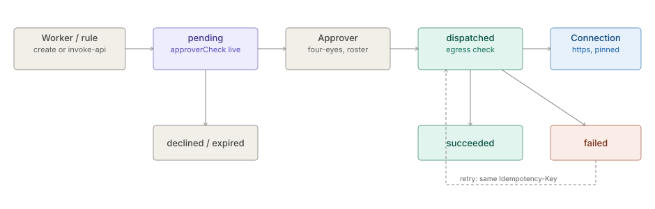

# Action Requests

> **Level 3 module page** (`SOLUTION-SUITE-DOCS-1`). Layer: Add-on.
> Offering: Standard and Advanced (optional module `inspecto-action-requests`, module id `action-requests`).
> Checked against the code on 2026-10-17.

## 1. What it is

An **Action Request** is an outbound API call raised from an Incident or a Case - by a person, or by a Decision
Rule's `invoke-api` consequence. Nothing is sent until a *different* person approves it. The dispatcher then
sends it once to a registered `https` Connection, retrying on failure under one idempotency key, and records
every answer on the request.

Code: `features/inspecto-action-requests/src/main/java/com/gamma/actionrequests/` -
`ActionRequests.java` (model + store), `ActionDispatcher.java` (sending), `ActionRequestRoutes.java` (HTTP),
`InvokeApiConsequence.java` (the Decision Rule consequence). Core: `ApproverCheck`, `ApproverRoster`.

## 2. Who uses it

- **Incident and Case workers** (`canWorkIncidents`) raise requests.
- **Approvers** (`canApproveChanges`) approve, decline, retry and mark stuck requests failed.
- **Administrators** keep the Egress Allowlist and the approver roster.

## 3. Where it sits

An optional feature module; its manifest is
`features/inspecto-action-requests/src/main/resources/META-INF/inspecto/module.toon`. Absent, every
`/action-requests*` route answers 503 naming the module and a rule's `invoke-api` reports `unavailable`. The
wire is `inspecto-notify-channels` (`HttpWebhookSinkTransport`, pinned connect). Linked Incidents / Cases are
resolved through the core `LinkedSubjectProvider` seam that `inspecto-ops` fills.

## 4. How it works

1. **Create** (`POST /action-requests`): Connection, method (POST, PUT, PATCH) and payload template are fixed
   at creation; each string leaf is rendered once (`{{incident.id}}`, `{{case.id}}`, `{{context.x}}`,
   `{{author}}`, `{{origin}}`). The idempotency key is the request id unless the author gave one. Status moves
   straight to `pending`.
2. **Four-eyes, always on.** The author - and every co-author (for `invoke-api`, the rule's makers) - is 403 on
   approve or decline. It is not an Approval Policy option, and the request is never also held as a Pending
   Change (one call, one approval). Under OIDC the approver must also be on `approvers.toon`.
3. **`approverCheck`**, computed live on every read, list item and create response:
   - `ok` - an enumerated non-maker holds `canApproveChanges` unscoped;
   - `none-eligible` - no role grants the capability, every holder is a maker, the OIDC roster is empty, or Basic (no Subject);
   - `unknown` - enumeration failed, a holder is scoped or an Access Policy exists, or the record's MAC fails.
   A `none-eligible` at raise time emits one WARN audit `action-request.no-eligible-approver`. It is
   informational: nothing auto-declines.
4. **Dispatch** (`ActionDispatcher.submit`): the Connection must still resolve to the approved `targetUrl`; the
   host passes the egress policy before **every** attempt (deny by default; loopback, link-local and this host
   never liftable). The `Idempotency-Key` header is identical on every attempt and every retry.
5. **Retries.** Retryable: I/O failure or timeout, 5xx, 408, 429. A 3xx or other status fails at once. A `failed`
   request may be **retried** by an approver: back to `dispatched`, same key, attempts counted cumulatively.
6. **Stuck.** A request left `dispatched` by a process stop is never re-sent automatically;
   `mark-failed` moves it to `failed` once idle past the stuck timeout, then a retry re-sends under the same key.

States: `draft` (model only), `pending`, `approved`, `dispatched`, `succeeded`, `failed`, `declined`, `expired`
(after the Approval Policy's `expiresAfterHours`, default 168), and `invalid` (MAC failure, never decidable).

## 5. Configuration

| Key | Default | Meaning |
|---|---|---|
| `-Daction.dispatch.maxAttempts` | 3 (clamped 1..10) | attempts per dispatch |
| `-Daction.dispatch.backoffMs` | 1000, doubling, cap 30 s | backoff between attempts |
| `-Daction.dispatch.stuckAfterMinutes` | 15 | idle time before `mark-failed` is allowed |
| `egress.toon` (Space) | empty | Egress Allowlist: lifts private / CGNAT classes only |
| `approvers.toon` (Space) | absent = nobody | roster under OIDC |

Each attempt runs under the Connection's `timeout_seconds`. Storage: one HMAC-signed JSON per request under
`<write-root>/action-requests/`, signed with the Pending Change key via `PendingChanges.domainMac`. Reserved from
import, skipped by Space export, never in a backup.

## 6. Screens

Moved to [Action Requests — screens](user-guide-action-requests.md).

## 7. API

Moved to [Action Requests — API](api-action-requests.md).

## 8. Interactions

- [Maker-checker](../workflow/architecture-maker-checker.md): shares `ApproverCheck`, the roster and the HMAC key; not under its policy.
- [Decision Kernel](../scoring/architecture-decision-kernel.md): `invoke-api` proposes a pending request on the rule's Incident.
- Incidents and Cases (module page `incidents`, `case-management`) via `LinkedSubjectProvider`.
- Full detail: [Action Requests concept](spec.md).

## 9. Limits and gotchas

- No per-request path below the Connection's base path: one Connection per endpoint.
- A restored Space has no Action Request history; audit rows are the durable trail.
- `approverCheck` is not in `openapi-v1.json`; the `/action-requests*` operations there are generated skeletons.
- `ok` from the Demo role table ignores Access Grants tied to a request.
- A rule whose makers cannot be named raises nothing (fail closed) and emits `action-request.skipped-unknown-makers`.
