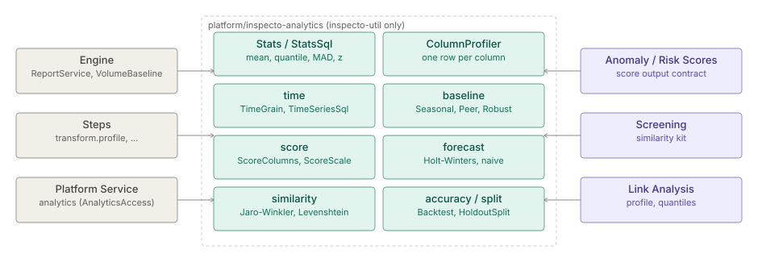

# Analytics kernel

> **Level 3 module page** (`SOLUTION-SUITE-DOCS-1`). Layer: Platform base.
> Offering: all tiers (a core thin jar in every edition). Checked against the code on 2026-10-17.

## 1. What it is

The Analytics kernel is the module `platform/inspecto-analytics`: one written definition of every
statistic and time-series primitive the product uses, as pure Java functions and DuckDB SQL builders.
It has no routes, no state and no third-party dependency. Before it existed, the same statistic was
computed several ways in several modules; the kernel is the single home, and callers were moved
onto it.

The concept page of record, with every formula, is
[analytics-kernel](spec.md); the plan is row `ANALYTICS-CORE-1` in
[`analytics-core-plan.md`](../../../../superpower/analytics-core-plan.md).

## 2. Who uses it

- **Module developers** (engine, add-ons, Link Analysis) call it instead of writing their own
  statistics.
- **Pipeline authors** reach it through Steps such as `transform.profile` and
  `transform.timeseries.forecast`.
- **Job and pack authors** reach it through the read-only Platform Service `analytics`.

End users never see the module; they see the figures it computes.

## 3. Where it sits

Main code depends only on `inspecto-util` (for `SqlIdent`); `tools/check-module-deps.mjs` and the
pom's enforcer rule allow only the foundation layer. A feature module may depend on the kernel; the
kernel can never reach the engine or a feature. It ships as its own jar beside `inspecto.jar`
(`tools/bundle-modules.mjs` `CORE_MODULES`).

Packages under `platform/inspecto-analytics/src/main/java/com/gamma/analytics`:

| Package | Contents |
|---|---|
| `com.gamma.analytics` | `Stats`, `StatsSql`, `MedianMode`, `QuantileMode`, `ColumnProfiler` |
| `.time` | `TimeGrain` (one truncation definition), `TimeSeriesSql` (resample, shift), `SeasonalityDetector` |
| `.baseline` | `BaselineStatistic`, `BaselineStatistics`, `SeasonalBaseline`, `Seasonality`, `PeerBaseline`, `Baseline`, `BaselineScore`, `RobustStats` |
| `.score` | the score output contract: `ScoreKind`, `ScoreColumns`, `ScoreScale`, `EntityCap`, `ScoreRunFiles`, `ExplanationPart` |
| `.forecast` | `Forecaster`, `ForecastMethod`, `ForecastSql`, `ForecastOutput`, `PredictionInterval` |
| `.similarity` | `Similarity`, `JaroWinkler`, `TextUnit`, `SimilaritySql` |
| `.accuracy`, `.split` | `Accuracy`, `AccuracySql`, `Backtest`; `HoldoutSplit` |

## 4. How it works

- **Statistics.** `Stats` defines mean, population and sample variance and stddev, median
  (`STANDARD`, `LOWER`), quantile (`CONTINUOUS` by default, `DISCRETE`, `NEAREST_RANK`), MAD and
  scaled MAD, classic and robust z, IQR, Tukey fences, ratio and rate. Each entry names the DuckDB
  function it matches, and parity tests pin the JVM and SQL forms to the same value. Ratio and rate
  return empty, never NaN, on a zero denominator.
- **Column profiler.** `ColumnProfiler` builds one SQL row per column (row count, null count and
  rate, distinct count, min, max, mean, stddev, and requested quantiles). It serves `transform.profile`, Expectation baselines and Link Analysis'
  column profile.
- **Time series.** `TimeGrain` is the one truncation definition (zoned); `TimeSeriesSql` builds
  resample (bucket and fill gaps) and shift (period over period). They serve the
  `transform.timeseries.*` Steps, file-sequence gaps, KPI periods and BI grains.
- **Baselines.** The baseline contract (moved from the Anomaly module) gives pluggable seasonal and
  peer baselines and robust scoring.
- **Score output contract.** Anomaly Scores and Risk Scores both write through it: output names,
  the column schema, the 0–100 scale and `normal` / `elevated` / `high` bands, the entity cap
  (default 200,000, ceiling 2,000,000; the run fails past it), run files and retention, and an
  explanation part that makes each score recomputable from its row. The writer itself is
  `ScoreOutputWriter` in the engine, because writing needs DuckDB and Jackson.
- **Forecasting.** `SEASONAL_NAIVE` and additive `HOLT_WINTERS` with declared parameters (nothing
  fitted), as a JVM kernel and as SQL, plus prediction intervals. Serves
  `transform.timeseries.forecast`.
- **Similarity kit.** Jaro, Jaro-Winkler, Levenshtein, Jaccard and normalization, each with a
  DuckDB form. Serves Screening and the `transform.similarity` Step.
- **Accuracy, seasonality, holdout.** Accuracy measures, a rolling-origin backtest, seasonality
  detection and a deterministic holdout split are built; no caller uses them yet.

## 5. Configuration

None of its own: the kernel is a library. Parameters arrive from its callers — Step keys
([step catalog](../etl/spec-step-catalog.md)), score model specs, and the per-kind
entity cap `-D` property that `EntityCap` parses (malformed or ≤ 0 keeps the default).

## 6. Screens

None. Its output appears in the Step previews, Expectation baselines, Anomaly and Risk Score
screens, Screening hits and the Link Analysis profile panes.

## 7. API

No HTTP routes. The programmatic surface for Jobs and packs is the Platform Service `analytics`:
`requires: [analytics]`, then `ctx.services().get(AnalyticsAccess.class)`. `AnalyticsAccess` lives in
the engine (`com.gamma.query`) and only delegates here ([platform-services](../../layer/platform/architecture-platform-services.md)).

## 8. Interactions

Callers found in the code (`grep com.gamma.analytics`):

- **Engine:** `ReportService` (percentiles), `BaselineEvaluator` (Expectation baselines),
  `PendingAlertRules` (score kinds), `FileSequenceGaps` in `inspecto-acquire`.
- **[Anomaly](../anomaly/architecture-overview.md) and [scoring](../scoring/architecture-scoring-entity-lists.md):** baselines and the score contract.
- **[Screening](../screening/architecture-overview.md):** `NameMatcher` uses the similarity kit.
- **[AI assist](../intelligence/architecture-overview.md):** triage run similarity and the assistant's statistics tools.
- **[Link Analysis](../la-core/architecture-overview.md):** `ColumnProfile`, `DatasetLinkStats`, `LinkTemporalDetector`.
- **[Graph library](../graph/architecture-overview.md):** the temporal motif matcher lives there, not here.

## 9. Limits and gotchas

- `DISCRETE` and `NEAREST_RANK` pick the same rank written two ways; both stay so existing figures
  never moved.
- A forecast series must be regular (bucket and fill it first) and hold at least two seasons.
- SQL-side `quantile_cont` / `quantile_disc` strings in other modules stay SQL by decision.
- Deterministic entity grouping (blocking keys plus union-find) is built: `com.gamma.analytics.entity.EntityGrouping`
  in the kernel and the Step `enrichment.entity.link` (`transform.entity.link`, `EntityLinkStep`), delivered in
  `ProcessorCatalog`. The shared `UnionFind` lives in the [graph library](../graph/architecture-overview.md).
