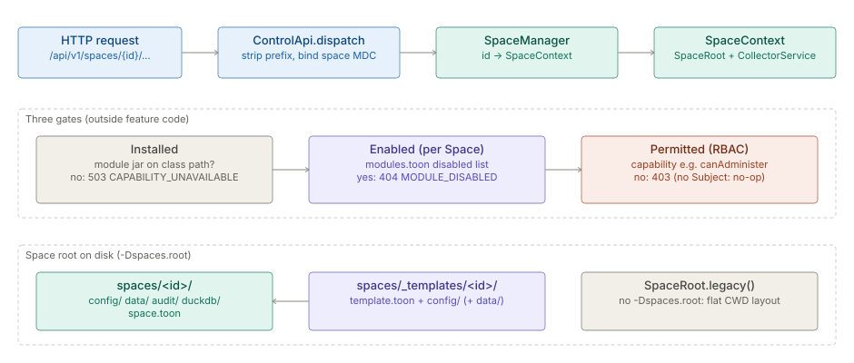

# Spaces

> **Level 3 module page** (`SOLUTION-SUITE-DOCS-1`). Layer: Platform base.
> Offering: every edition (multi-Space hosting needs `-Dspaces.root`). Checked against the code on 2026-10-17.

## 1. What it is

A **Space** is a fully isolated project environment inside one installation: its own config, data, audit
trail and DuckDB stores, its own engine instance, and its own module switches. A **Space Template** is a
reusable blueprint that seeds a new Space (Type → Instance). This page also covers the **Installed →
Enabled → Permitted** gates, because the middle gate is a per-Space setting.

The requirement of record is the [Spaces & tenancy capability spec](plan-spaces.md); the hosting
mechanism is [Multi-Space Hosting](../processor/architecture-multi-space.md); the module gates are defined in
[module taxonomy](../../layer/platform/architecture-module-taxonomy.md).

## 2. Who uses it

- **Operators** choose the boot mode (`-Dspaces.root`) and run the one-time `SpaceMigrator` CLI.
- **Administrators** create, rename and delete Spaces, seed them from templates or a whole-Space zip, and
  switch modules off per Space (`canAdminister`).
- **Every user** works inside one Space at a time; the SPA's space interceptor prefixes their calls.

## 3. Where it sits

| Piece | Code |
|---|---|
| Space registry and lifecycle | `inspecto/src/main/java/com/gamma/service/SpaceManager.java` |
| Per-Space holder (id + root + manifest + engine) | `inspecto/src/main/java/com/gamma/service/SpaceContext.java` |
| Where a Space's files live | `inspecto/src/main/java/com/gamma/service/SpaceRoot.java` |
| Flat-to-Space migration CLI | `inspecto/src/main/java/com/gamma/service/SpaceMigrator.java` |
| Space CRUD routes | `inspecto/src/main/java/com/gamma/control/SpaceRoutes.java` |
| Enabled gate (routes) | `ControlApi.requireModuleEnabled` in `inspecto/src/main/java/com/gamma/control/ControlApi.java` |
| Enabled gate (settings file) | `inspecto/src/main/java/com/gamma/control/ModuleSettings.java`, `ModuleSettingsRoutes` |
| Enabled gate (Jobs, sweeps, maintenance) | `inspecto/src/main/java/com/gamma/control/ModuleGate.java`, `JobModuleGate` |
| Installed gate (absent-module stubs) | `inspecto/src/main/java/com/gamma/control/AbsentModuleRoutes.java`, `ModulesRoutes` |
| Permitted gate | `ApiContext.withCapability` in `spi/inspecto-http-spi/src/main/java/com/gamma/spi/http/ApiContext.java` |
| Template catalog | `spaces/_templates/` (one directory per template) |

## 4. How it works

**Boot modes** (`ControlApi.main` reads the `spaces.root` system property):

- **single** — no `-Dspaces.root`: `SpaceManager.single(CollectorService)` over `SpaceRoot.legacy()`, the
  pre-Spaces flat layout relative to the working directory. `supportsCrud()` is false, so Space CRUD answers
  409 "this server hosts a single space".
- **discover** — `-Dspaces.root=<dir>`: `SpaceManager.discover(root)` boots every `spaces/<id>/` that has a
  `config/` subtree, each over `SpaceRoot.under(base)`. Zero Spaces boots with a warning; Space-scoped routes
  then answer 503 "No Space is attached".

**Space root.** `SpaceRoot` is the one object deciding where a Space's state lives. For a directory Space
(`DirSpaceRoot`): `config/` (scanned `*.toon`), `data/` (partition stores; events under `data/events/`),
`audit/`, `duckdb/`, and authored Pipelines under `config/pipelines/` (an older `config/flows/` still
resolves). Each store accessor (`objectsDbUrl()`, `jobRunDbUrl()`, ...) gives the per-Space default; a
`-D` flag can still override it. `_`-prefixed directories (`_templates/`, `_shared/`) are never Spaces.

**Request binding.** `ControlApi.dispatch` strips `/api/v1`, matches `/spaces/{id}/…`, rewrites the path
and binds the `space` SLF4J MDC key for the request; an un-prefixed path binds the current Space.
Process-wide singletons (`EventLog`, `MetricRegistry`, `ConnectionRegistry`, `StabilityGate`,
`AcquisitionLedgers`) resolve per Space through `EventLog.currentSpaceId()`.

**Lifecycle.** `create`, `createFromBundle`, `createFromTemplate`, `update` and `delete(id, purge)` run under
one `lifecycleLock`; reads are lock-free. `createFromTemplate` copies the template's `config/`, rewriting
`${SPACE}` tokens in every `.toon`, and copies `data/` verbatim.

**The three gates** (never inside feature code):

1. **Installed** — is the module on the class path? A known but absent module's routes answer
   `503 CAPABILITY_UNAVAILABLE` (`AbsentModuleRoutes`); `GET /modules` lists it `not-installed`.
2. **Enabled (per Space)** — `modules.toon` in the Space's config root holds a `disabled:` list. A route
   owned by a disabled feature answers `404 MODULE_DISABLED` before its handler runs; the module's Jobs
   are recorded `SKIPPED` and its gated background ticks pause (`ModuleGate`). An unreadable file disables
   nothing (fail-open). Core routes own no feature and are never gated here.
3. **Permitted (RBAC)** — `ApiContext.withCapability` demands a capability of the request's Subject
   (403 otherwise); with no Subject attached (Basic) it is a no-op.

## 5. Configuration

| Key / file | Where | Meaning |
|---|---|---|
| `-Dspaces.root=<dir>` | JVM flag | discover mode; unset = single flat Space |
| `space.toon` | Space directory | the Space manifest (display name, description) |
| `modules.toon` → `disabled: [ids]` | Space config root | Enabled gate; absent file = all installed modules on; unknown ids kept as `inert` |
| `template.toon` → `name`, `tagline`, `description`, `icon`, `contents[]` | template directory | gallery entry, e.g. `spaces/_templates/orders-starter/template.toon` |

Space ids match `[a-z0-9][a-z0-9-]{0,62}`; `default` is reserved and cannot be renamed.

## 6. Screens

- **Settings → Spaces** (`inspecto-ui/src/app/modules/admin/spaces/spaces.component.ts`): list, create,
  rename, delete, import; the template picker is
  `inspecto-ui/src/app/modules/admin/spaces/space-template-gallery.dialog.ts`. `/spaces` redirects to
  `settings/spaces` (`inspecto-ui/src/app/app.routes.ts`).
- **Settings → Modules** (`inspecto-ui/src/app/modules/admin/settings/module-settings.component.ts`): the
  per-Space module switches, through `inspecto-ui/src/app/inspecto/api/module-settings.service.ts`.
- Request prefixing for the selected Space: `inspecto-ui/src/app/inspecto/api/space.interceptor.ts`.

## 7. API

Server-global, un-prefixed (`SpaceRoutes`):

| Route | Purpose |
|---|---|
| `GET /spaces` | list Spaces |
| `GET /spaces/_meta` | `{multiSpace}` capability probe |
| `GET /spaces/templates` | template gallery (empty on a single-tenant server) |
| `POST /spaces` | create; optional `template` |
| `POST /spaces/import` | create a new Space from a zip |
| `PUT /spaces/{id}` | rename / re-describe |
| `DELETE /spaces/{id}?purge=` | deregister, or also delete files |

Whole-Space zip (`inspecto/src/main/java/com/gamma/control/DataSourceRoutes.java`): `GET /spaces/{id}/export`,
`POST /spaces/{id}/import/preview`, `POST /spaces/{id}/import`. Gates: `GET /modules` (`ModulesRoutes`),
`GET|PUT /settings/modules` (`ModuleSettingsRoutes`; `PUT` needs `canAdminister`).

## 8. Interactions

- [Identity & access](../access/architecture-overview.md) — the Permitted gate and per-Space role tables.
- [Jobs & scheduler](../processor/architecture-jobs-scheduler.md) — Jobs of a disabled module are skipped (`JobModuleGate`).
- [Exchange](../exchange/architecture-overview.md) — the only sanctioned cross-Space path, by grant; its ledger lives under `_shared/`.
- [Storage](../entity-store/architecture-storage.md) — every per-Space store default comes from `SpaceRoot`.
- [Observability & backup](../observability/architecture-observability-backup.md) — the `space` label on metrics and events.
- Content packs ([telecom fraud](../../solution-pack/telco-fraud/architecture.md),
  [revenue assurance](../../solution-pack/business-assurance/architecture-revenue-assurance.md)) ship as Space Templates.

## 9. Limits and gotchas

- **The MDC does not cross thread pools.** Every executor on the execution path must copy it, or work lands
  in the `default` Space (see [cross-cutting gotchas](../../layer/platform/admin-guide-gotchas.md)).
- **`SpaceMigrator` is a CLI, not a boot step**, and a discover-mode server has no flat fallback.
- **`DELETE` has two 409s:** any CRUD verb on a single-tenant server, and `?purge=true` on the last Space
  directory on disk.
- **A whole-Space zip never imports into an existing Space** (403); it seeds a new Space only.
- **`SpaceRoot.legacy()` writes into the working directory** — start a single-Space server from the folder
  you intend it to use.
- **Enabled is fail-open:** an unreadable `modules.toon` disables nothing; the Permitted gate is unaffected.
- **Templates are not a Component kind**; an unreadable template is skipped with a warning.
