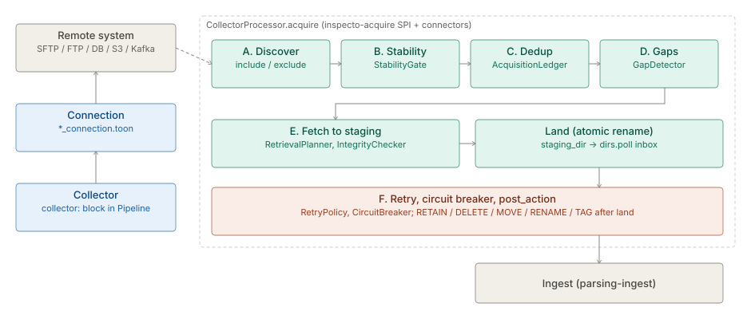
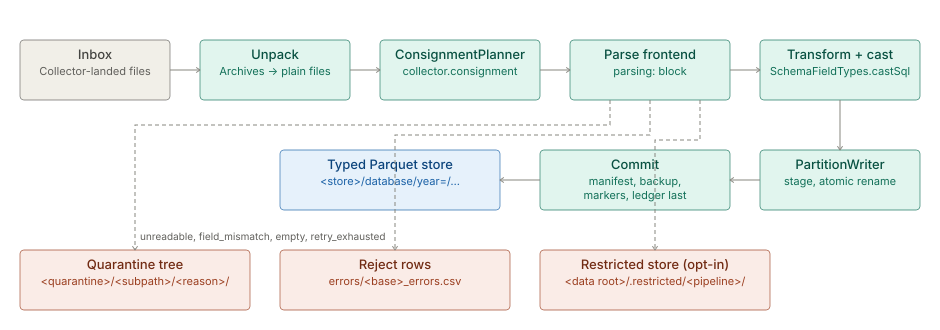
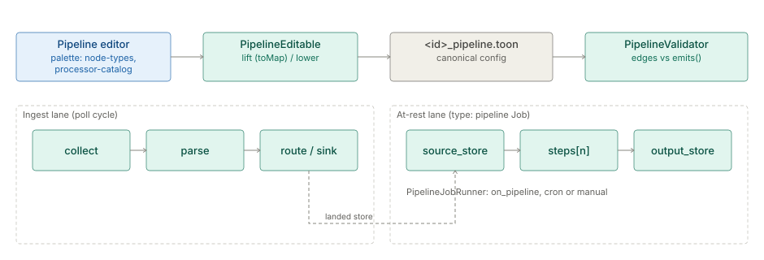

# ELT — architecture — Acquisition, Collectors, parsing and Pipelines

Part 1 of 3 of [ELT — architecture](architecture-elt.md) · next: [Engine code, design scope and how a file becomes Tables](architecture-elt-engine-design.md).

## Data Acquisition Framework

A full acquisition engine (not a directory poller): **Discover → Determine readiness → Guarantee collection
semantics → Retrieve/validate → Finalize**. The phases below are `CollectorProcessor.acquire(cfg)`, which
fetches remote files and lands them atomically in the inbox; ingest then discovers them by walking the inbox
like any local push. In the one-shot CLI/`reprocess`/manual path, `CollectorProcessor.run()` calls
`acquire` then `ingest` in one cycle. In the **always-on service** the two run on their own timers (B3b):
`dispatchAcquireCycle()` fetches under `acquire.pollSeconds` / `acquire.maxConcurrent`, guarded per-pipeline by
a dedicated `acquireGuard`, so a slow fetch neither blocks nor is blocked by ingest, and two acquisitions of
one pipeline never overlap. `acquire` is a no-op for a `local` collector. For what was *required* and what was *refused*, start at the capability spec
[**Acquisition & connectivity (`ACQ`)**](plan-elt.md); this part is the
mechanism tier for the cycle. *(It used to name `spec.md` as "authoritative" — a
chain that ended in the never-maintained archive tier.)*

> **Gotcha — manual run vs. background acquisition.** The manual "run now" acquires inline under the *ingest*
> `runGuard`, which is separate from the background `acquireGuard`; a manual run can therefore overlap one
> background acquisition tick of the same pipeline. This is benign and self-correcting — landing is atomic
> (B3a stage-then-rename) and duplicates are caught by markers/fingerprint dedup — but it is why the two
> guards are deliberately not one.

**Back-pressure (B4).** Acquisition de-schedules itself when the inbox it feeds is full: if a pipeline's
inbox backlog (`CollectorProcessor.countPending`, the exact landed count from B3b) has reached
`-Dacquire.backpressure.highWater`, `selectDueForAcquire` skips that pipeline this tick and bumps
`inspecto_acquire_backpressure_skips_total`. The already-landed files wait in the **durable inbox — which is
the spill-to-disk hand-off queue** of the design's §3.5 escalation — until ingest drains them below the mark.
This throttles the *producer* (acquisition), so it is **negative** feedback, and is therefore the opposite of
T15/`IntakeGovernor`, which deliberately does **not** throttle on inbox lag because throttling the *ingest
consumer* on backlog would be positive feedback. The mark is **0 = off by default** (like
`-Dingest.maxFilesPerCycle`); a failed pending scan returns `-1` and so fails open (never pauses).
⚠ The gate bounds backlog **across** ticks, not within one: a single acquire cycle still fetches the whole
discovered listing, so one tick can overshoot the mark. Bounding a single cycle's fetch volume is a separate,
deferred knob (`acquire.maxFilesPerCycle`, BACKLOG §6).

### Phases

* **A — Discovery.** `CollectorConnectors.forConfig(cfg)` resolves the [connector](../connectors/spec-connectors.md): scheme
  `local` → built-in `LocalFileSystemConnector`; otherwise a `ServiceLoader<CollectorConnectorFactory>` lookup.
  `CollectorConnector.discover(ctx)` lists candidates (never dedups — that's an engine concern).
* **B — Stability gate.** `StabilityGate` (`com/gamma/acquire/StabilityGate.java`) holds back half-written
  files: it first asks `connector.readiness()`; if `UNKNOWN`, applies size/mtime quiescence (unchanged for
  `stability.window` across `stability.size_checks` cycles). One shared instance per [space](../processor/architecture-processor.md).
* **C — Deduplication + watermark.** `AcquisitionLedger` (`com/gamma/acquire/AcquisitionLedger.java`) is the
  fingerprint SPI: `find`/`record` per `(sourceId, relativePath)`, `highWatermark(sourceId)` for incremental
  discovery, `dbWatermark` for row-level DB export. Implementations: `InMemoryAcquisitionLedger` (default,
  lost on restart) and `DbAcquisitionLedger` (durable DuckDB/Postgres, via `-Dacquire.ledger.backend=db`).
  `DuplicatePolicy` is **three** enums, not one list (`DuplicatePolicy.java`) — ⚠ conflating
  them is how this line came to name four tokens that do not exist:
  · **`Mode`** (how a file already seen at the same path is judged) — `PATH`, `METADATA`, `CHECKSUM`,
    `ETAG`; unknown input falls back to `PATH`, and `ETAG` degrades to `METADATA` when neither side
    supplies an etag or version.
  · **`OnChange`** (what to do when a known path's content changed) — `IGNORE`, `REPROCESS` (the
    default), `ALERT` (emits `FILE_CHANGED`), `ARCHIVE_OLD_VERSION`.
  · **`Decision`** (the verdict for one candidate) — `NEW`, `DUPLICATE`, `CHANGED`.
  ⛔ There is no `SKIP`, `VERSION` or `FAIL`.
* **D — Gap detection.** `GapDetector` (`com/gamma/acquire/GapDetector.java`) flags missing files in a
  sequence series and fires alerts via `AcquisitionTelemetry`.
* **E/F — Retry + circuit breaker.** `RetryPolicy` (`com/gamma/acquire/retry/RetryPolicy.java`, configurable
  attempts + EXPONENTIAL/FIXED backoff) wraps connector calls; `CircuitBreaker` (`com/gamma/acquire/CircuitBreaker.java`,
  per-Collector) opens after a failure threshold and skips the Collector until cooldown.

`AcquisitionLedgers` (`com/gamma/acquire/AcquisitionLedgers.java`) is the per-space `shared()` accessor +
lifecycle manager (one of the five MDC-routed singletons — see [multi-space](../processor/architecture-processor.md)).
## Collectors

> **Level 3 module page** (`SOLUTION-SUITE-DOCS-1`). Layer: Platform base.
> Offering: all tiers (local, SFTP, FTP/FTPS, DB, S3, Azure, GCS); the Kafka Collector is Standard and above.
> Checked against the code on 2026-10-17.

### A1. What it is

A **Collector** is a configured collection task bound to one **Connection** (a named endpoint plus
credentials). It reaches a remote system, decides which files are new and complete, fetches them once,
and lands them in the Pipeline's inbox (`dirs.poll`). Everything after landing is ingest's job
([Parsing and ingest](#parsing-and-ingest)). The capability spec of record is
[acquisition.md](plan-elt.md); this part is the module summary.

Code homes:

- SPI and engine-side logic: `platform/inspecto-acquire/src/main/java/com/gamma/acquire` —
  `CollectorConnector`, `CollectorConnectorFactory`, `CollectorConnectors`, `ConnectionProfile`,
  `StabilityGate`, `AcquisitionLedger`, `DuplicatePolicy`, `GapDetector`, `RetrievalPlanner`,
  `IntegrityChecker`, `CircuitBreaker`, `RateLimiter`, `PostAction`, `retry/RetryPolicy.java`.
- Remote connectors: `providers/inspecto-connectors/src/main/java/com/gamma/acquire/connectors`.
- Kafka connector: `providers/inspecto-connectors-kafka/src/main/java/com/gamma/acquire/kafka`.
- Cycle driver: `platform/inspecto-engine/src/main/java/com/gamma/inspector/CollectorProcessor.java`.

### A2. Who uses it

- **Integration engineers** author Connections and the `collector:` block of a Pipeline.
- **Operators** watch Collector state, test Connections, and trigger an immediate scan.
- **Upstream systems** (an S3 event, an upload script) can call the notify route to ask for a scan now.

### A3. Where it sits

Collectors are the first stage of the platform base: a remote system feeds a Collector, the Collector
lands bytes, and a [Pipeline](#pipelines-and-steps) parses and loads them into [storage](../entity-store/architecture-entity-store.md).
The connector schemes are pluggable through `ServiceLoader`: `CollectorConnectors.forConfig` resolves
`local` to the built-in `LocalFileSystemConnector` and any other scheme to a registered
`CollectorConnectorFactory` matched on `scheme()`. An unknown scheme fails fast; there is no fall-back
to `local`.

| Scheme | Class | Module |
|---|---|---|
| `local` | `LocalFileSystemConnector` | `inspecto-acquire` (built in) |
| `sftp` | `SftpConnector` | `inspecto-connectors` |
| `ftp`, `ftps` | `FtpConnector` (two factories) | `inspecto-connectors` |
| `db` | `DbExportConnector` | `inspecto-connectors` |
| `s3` | `S3Connector` + `AwsSigV4` | `inspecto-connectors` (SDK-free) |
| `azure` | `AzureBlobConnector` + `AzureSharedKey` | `inspecto-connectors` (SDK-free) |
| `gcs` | `GcsConnector` + `GcpServiceAccountToken` | `inspecto-connectors` (SDK-free) |
| `kafka` | `KafkaConnector` | `inspecto-connectors-kafka` |

The registry files are
`providers/inspecto-connectors/src/main/resources/META-INF/services/com.gamma.acquire.CollectorConnectorFactory`
and the matching file in `inspecto-connectors-kafka`.

### A4. How it works



`CollectorProcessor.acquire` runs phases A to F; `acquire` is a no-op for a `local` Collector.

- **A. Discover.** `CollectorConnector.discover` lists candidates; it never dedups. Shaped by
  `include`, `exclude`, `recursive_depth` and `discovery` (`poll` or `watch`).
- **B. Stability.** `StabilityGate` asks the connector's `readiness` first (object stores answer
  `READY`), and only on `UNKNOWN` applies size/mtime quiescence (`window`, `size_checks`) or a
  `ready_marker`.
- **C. Dedup.** `DuplicatePolicy` has a `Mode` (`PATH`, `METADATA`, `CHECKSUM`, `ETAG`) and an
  `OnChange` (`IGNORE`, `REPROCESS`, `ALERT`, `ARCHIVE_OLD_VERSION`). Fingerprints live in the
  `AcquisitionLedger` (`InMemoryAcquisitionLedger` by default, `DbAcquisitionLedger` when durable).
- **D. Gaps.** `GapDetector` finds missing keys in a dated filename series and emits `SEQUENCE_GAP`
  once per hole (`GapTracker`).
- **E. Fetch and land.** `RetrievalPlanner` picks `FETCH_TO_BACKUP`, `STREAM` or `STAGE_TEMP`. Fetches go
  to `collector.fetch.staging_dir`, are checked by `IntegrityChecker`, then atomically renamed into
  `dirs.poll`. A partial download never sits in the inbox.
- **F. Resilience and disposition.** `RetryPolicy` wraps `discover` and `fetchTo`; `CircuitBreaker`
  skips a failing Collector for a cooldown; `PostAction` applies `RETAIN`, `DELETE`, `MOVE`, `RENAME` or
  `TAG` to the remote file only after landing.

`db` and `kafka` Collectors produce slices: the row watermark or offset frontier is advanced only after
the slice commits, so delivery is at-least-once.

### A5. Configuration

**Connection** — authored as `*_connection.toon` (`ConnectionRegistry`), parsed by
`ConnectionProfile`: `id`, `connector`, `host`, `port`, `database`, `base_path`, `username`, `password`,
`options`, plus optional `tunnel` and `proxy` blocks. Secrets resolve through `SecretResolver` references.

**Collector** — the `collector:` block of a Pipeline (`platform/inspecto-etl/src/main/java/com/gamma/etl/PipelineConfigParser.java`;
there is no other spelling):

| Key | Purpose |
|---|---|
| `connector`, `connection` | scheme (default `local`) and the Connection id |
| `include`, `exclude`, `recursive_depth`, `discovery` | discovery |
| `stability` | `window`, `size_checks`, `ready_marker`, `exclude_temp_files`, `exclude_temp_patterns` |
| `duplicate` | `mode`, `algorithm`, `on_change` |
| `guarantee` | `BEST_EFFORT` (default), `AT_LEAST_ONCE`, `EXACTLY_ONCE` |
| `incremental.watermark` | `last_modified` file-level watermark |
| `gap_detection` | `enabled`, `sequence`, `file_template`, `seq_scope` — `enabled: false` (default `true`) stops the live `sequence` detector, the windowed `file_template` check and the per-day delivery manifest; the `file_template` still names a file's day in Signals and is the `kpi.completeness` Job's default template (`GAP-DETECTION-ENABLED-IGNORED-1`, 2026-11-12) |
| `fetch` | `mode`, `staging_dir`, `parallel_fetch`, `rate_limit` |
| `retry` | `count`, `backoff`, `initial_delay`, `max_delay` |
| `circuit_breaker` | `failure_threshold`, `cooldown` |
| `post_action` | `on_success`, `archive_path`, `tags`, `on_unsupported` |
| `consignment` | `max_files`, `max_bytes`, `order` |

Connector `options` examples: Kafka reads `topic`, `bootstrap_servers`, `security_protocol`,
`max_records`, `start` (default `earliest`); `db` reads `watermark_column`, `watermark_type`,
`watermark_initial`.

JVM switches: `-Dacquire.ledger.backend` (`memory` | `db`), `-Dacquire.pollSeconds`,
`-Dacquire.maxConcurrent`, `-Dacquire.backpressure.highWater` (0 = off).

### A6. Screens

Moved to [the user guide, §21](user-guide-elt-collectors-runs.md#21-collectors-and-collector-configuration).

### A7. API

Moved to [Collectors — API](api-elt.md).

### A8. Interactions

- [Parsing and ingest](#parsing-and-ingest) — consumes the landed inbox.
- [Pipelines and Steps](#pipelines-and-steps) — the `collector:` block lives in a Pipeline.
- [identity-access](../access/architecture-access.md) — `canOperateRuns`, `canOnboardConnections`.
- [observability-backup](../observability/architecture-observability.md) — acquisition metrics and the completeness KPI that reads `gap_detection`.
- [events](../event/architecture-event.md) — `SEQUENCE_GAP`, `FILE_CHANGED`.
- [spaces](../config/architecture-config.md) — ledgers and stability gates are per Space.
- Mechanism detail: [connectors](../connectors/spec-connectors.md),
  [framework](#data-acquisition-framework).

### A9. Limits and gotchas

- The default ledger is in memory: restart-safe dedup and frontiers need `-Dacquire.ledger.backend=db`.
- A ledger-requiring `guarantee` with `duplicate.mode: path` only logs a `[CONFIG]` warning and behaves
  as best-effort.
- `staging_dir` must be outside `dirs.poll`; it is refused otherwise.
- `discovery: watch` narrows latency only; the interval poll stays on as the backstop.
- The DB watermark compare is strictly `>`: back-dated rows below the frontier are missed.
- NFS/SMB connectors were declined by design; mount the share and use `local`.
- `https` is a Connection scheme for the outbound webhook, not a Collector scheme.
- Kafka is proven against `MockConsumer` and a fake connector, not a live broker; broker consumer
  groups are out by decision.
- Older javadocs in `inspecto-acquire` still say `source.*`; the config key is `collector.*`.
## Multi-location ingest — the composition pattern

**Decided 2026-08-11** (pipeline-multiplicity plan Part B): ingesting one logical feed from N
locations is done by **composition of existing pieces, never by widening acquisition** —
⛔ `PipelineConfig.collector` stays a single `Collector` **permanently**. The list design was
refuted by grounding: every stateful acquisition subsystem (`AcquisitionLedger`, `GapTracker`,
`StabilityGate`, `CircuitBreaker`, retry, the incremental watermark) is keyed on one durable
collector id, so a `collector()` list would force a ledger re-keying migration to reach semantics
the composition already has.

### The pattern

```
N independent collector pipelines          one Pipeline Job                  one store
(one per location, MultiCollectorProcessor)  (PipelineJobRunner, T32 Phase C)
  location A → pipeline a_etl → store A  ┐
  location B → pipeline b_etl → store B  ├→ N source_store nodes → transform.merge → sink
  location C → pipeline c_etl → store C  ┘   (union / inner / left)
```

- **Stage 1, per location:** one ordinary single-collector pipeline each, run concurrently by
  `MultiCollectorProcessor` (vthread per Collector, `sources.max` semaphore, no shared state). Each
  keeps its own collector id — ledger, gap tracking, circuit breaker and watermark all stay
  single-arity and per-location.
- **Stage 2, the merge:** a Pipeline graph with one `source_store` node per landed store feeding a
  `transform.merge`; `PipelineJobRunner.seedsOf` registers one DuckDB view per store and the graph
  executor unions/joins them (`RowShaper.merge`). Pinned by
  `PipelineJobRunnerTest.unionsTwoSourceStores`. Incremental mode (`incremental_column`) keeps a
  watermark per `(pipelineId, store)`, so each location advances independently.
- **Trigger:** the Pipeline Job's `on_pipeline` takes a comma-separated upstream list, and
  `on_pipeline_gate: all` fires one run only after **every** named upstream has committed since
  the last firing (then re-arms). Default `any` fires per commit. The all-gate's pending set is
  kept in `job-gate-pending.tsv` under the Space's audit directory (one `job<TAB>pipeline` line per
  pending commit, written atomically on every change), so a restart no longer loses partial progress;
  an unreadable file costs only a full cycle — a late run, never a wrong one
  (`JobService.onConsignmentEvent`, pinned by `JobServiceTest.anAllGateKeepsItsProgressAcrossARestart`).
  A service with no audit directory keeps it in memory only. Cron remains fine when arrival times are known.

Demo: none shipped. The disabled `regional_orders_merge_flow.toon` template was removed
(2026-08-18) when the demo space's authored graphs were converted to canonical pipelines — a
`transform.merge` fan-in has **no** `*_pipeline.toon` form (`PipelineEditable.lower` refuses it
with `UNSUPPORTED_NODE`; the flat vocabulary has no join/union node), so the pattern stays
canvas-authored. `PipelineJobRunnerTest.unionsTwoSourceStores` remains the executable pin.

### Why the answers fall out by construction

| Part B question | Answer under the composition |
|---|---|
| Identity | Each location is its own collector id; no sub-identities, no migration |
| Merge semantics | One batch per location in Stage 1; the merge is Stage 2, per-location watermarks |
| Failure isolation | One bad location trips *its* breaker; the rest land; signals stay per-collector |
| Beats a `collector()` list? | Inverted — the list would re-key five durable subsystems for nothing |

The "silently proceeds on 3 of 4 locations" concern is an **alerting** concern, not an engine one:
author a freshness Expectation / Alert Rule per landed store.

### Related

- [`spec-pipeline-model.md`](spec-pipeline-model.md) — T32 Pipeline Jobs, multi-store seeding, incremental mode.
- [§E4 below](architecture-elt-graph-consignments.md#e4-the-pipeline-graph--the-backend-model) — graph model, `transform.merge`.
- `docs/archived-documents/plans-archive/pipeline-multiplicity-plan.md` Part B — provenance only; the
  refutation it recorded is restated in full at the top of this part (the plan shipped and was archived 2026-08-11).

## Parsing and ingest

> **Level 3 module page** (`SOLUTION-SUITE-DOCS-1`). Layer: Platform base.
> Offering: all tiers; the ASN.1 frontend (module `inspecto-telecom-asn1`) is Advanced only (DATA-TIERS-1 DT-12, 2026-11-17).
> Checked against the code on 2026-10-17.

### 1. What it is

Stage-1 ingest is the road from a file in a Pipeline's inbox to typed rows in a Parquet store. It
groups inbox files into a **Consignment**, parses each file with one of the parse frontends, maps and
casts the columns to the declared Schema, writes partitioned Parquet, and commits the whole
Consignment atomically. A file that cannot be read goes to the **quarantine** tree; rows that fail
parsing go to a reject file beside it.

The capability spec of record is [ingestion.md](plan-elt.md); the design is the
[execution engine internals](#execution-engine-internals) below (§E1–§E7). This part is the module summary.

Code homes:

- Poll cycle and Consignment coordinator: `platform/inspecto-engine/src/main/java/com/gamma/inspector`
  (`CollectorProcessor`, `ConsignmentIngestor`, `MultiCollectorProcessor`).
- Planner, writer and Unpack: `platform/inspecto-etl/src/main/java/com/gamma/etl`
  (`ConsignmentPlanner`, `PartitionWriter`, `CommitLog`, `MarkerManager`, package `unpack`).
- Parser registry: `platform/inspecto-engine/src/main/java/com/gamma/parse` (`ParserPlugin`, `Parsers`).
- Control routes: `inspecto/src/main/java/com/gamma/control/ParserRoutes.java` and
  `inspecto/src/main/java/com/gamma/control/RunRoutes.java`.

### 2. Who uses it

- **Integration engineers** author the `parsing:` block, the Schema mapping and the grammar of a
  Pipeline, and preview a sample file before saving.
- **Operators** watch Consignments land, read the quarantine tree and the rejected rows, and
  reprocess or replay.
- **Plugin authors** add a format through the `StreamingFileIngester` wrap-SPI
  ([ingest-wrap-spi](spec-ingest.md)).

### 3. Where it sits

Ingest starts where a [Collector](#collectors) has landed a file in `dirs.poll`. It ends at a
committed store that [Datasets](../../layer/product/architecture-studio-bi.md) and at-rest [Steps](#pipelines-and-steps) read. Typing
rules come from the Schema registry (metamodel); storage layout is described in [storage](../entity-store/architecture-entity-store.md).
Every Consignment runs on a virtual thread bounded by `processing.threads`; many Pipelines share one
JVM under `MultiCollectorProcessor`.

### 4. How it works



1. **Scan and Unpack.** `CollectorProcessor.ingest` scans the inbox and expands Archives and
   compressed streams through the Unpack stage (`UnpackStage`, `UnpackLimits`) before planning, so an
   Entry is an ordinary file from then on ([unpack-stage](spec-acquisition-unpack.md)).
2. **Plan.** `ConsignmentPlanner` cuts the candidate list into Consignments bounded by
   `collector.consignment: {max_files, max_bytes, order}` (`order` is `mtime` by default, or `name`).
3. **Parse.** `ConsignmentIngestor` picks a strategy: `CsvIngestStrategy` for the DuckDB-native
   frontends, `StreamingPluginIngestStrategy` for Java parsers. The plugin strategy runs union mode
   when every file is below `processing.streaming.large_file_bytes` (default 256 MB) and generation
   mode, in batches of `flush_records` rows, above it.
4. **Map and cast.** `SchemaFieldTypes.castSql` casts each mapped column to its declared type. A
   failed `TRY_CAST` yields NULL and keeps the row; `DataTransformer.countCastFailures` counts those.
5. **Write.** `PartitionWriter` copies into a staging directory and reveals by atomic rename, with
   `PARTITION_BY` for a keyed schema and one flat file for an unkeyed one.
6. **Commit.** In crash-safe order: DuckLake register, manifest, backup of originals, markers, and the
   ledger last. A failed Consignment leaves no marker, so its files are found again on the next poll.
   Retries are bounded by `-Dingest.retry.max` (default 5); exhaustion quarantines the file.

**The frontends.** `PipelineConfigParser.FRONTENDS` accepts ten tokens for eight formats:

| Token | Engine |
|---|---|
| `delimited` | DuckDB `read_csv`, or the Java `CsvIngester` when junk-line skipping forces it |
| `fixedwidth` / `fixed_width` | `read_text` plus SQL substrings; binary records use `FixedWidthRecordIngester` |
| `json` | `read_json`, with a `records_path` selector |
| `text_regex` | `read_text` plus SQL regex; `record_split` enables block records |
| `xlsx` / `excel` | DuckDB `excel` extension |
| `parquet` | native read |
| `asn1` | `Asn1ParserPlugin` and `Asn1RecordIngester` |
| `plugin` | any `StreamingFileIngester` class, for example `XmlRecordIngester` |

**Quarantine.** A bad file moves to `<quarantine>/<poll-subpath>/<reason>/<file>` with reason
`field_mismatch`, `unreadable`, `empty`, `corrupt_download` or `retry_exhausted`. Parse rejects travel
as `errors/<base>_errors.csv`. With `processing.refusal: restricted_quarantine` a file can be refused
whole (mapping `INGEST_REFUSE:<CODE>`, or the card-number scan) and moved to
`<data root>/.restricted/<pipeline>/`, outside every `dirs:` entry.

### 5. Configuration

All keys live in the Pipeline's `*_pipeline.toon`; the full list is
[spec-parsing.md](spec-parsing.md) (the parsing options).

| Key | Meaning |
|---|---|
| `parsing.frontend` and its sub-block | which frontend, plus its grammar options |
| `parsing.plugin.ingester` | fully qualified `StreamingFileIngester` class for `plugin` |
| `collector.consignment.max_files` / `max_bytes` / `order` | Consignment size and order |
| `processing.threads` | parallel Consignments per Pipeline |
| `processing.streaming.large_file_bytes`, `flush_records` | union vs generation mode |
| `processing.duplicate_check` | file-grain duplicate check (record dedup is the `transform.dedup` Step) |
| `processing.refusal`, `refusal_scan`, `refusal_scan_exempt` | opt-in content refusal |
| `dirs.poll`, `dirs.quarantine`, `dirs.database` | inbox, quarantine and output roots |
| `-Dingest.retry.max`, `-Dingest.lane` | JVM flags: retry cap; `auto`, `graph` or `flat` lane |

### 6. Screens

Moved to [Parsing and ingest — screens](user-guide-elt.md).

### 7. API

Moved to [Parsing and ingest — API](api-elt.md).

### 8. Interactions

- **Collectors** land files; ingest never fetches ([Collectors](#collectors)).
- **Pipelines and Steps:** a `route:` Pipeline forks the write per branch on the ingest lane; the
  at-rest chain runs after commit as a Job ([pipelines-steps](#pipelines-and-steps)).
- **Jobs:** an `on_pipeline` Job fires on a committed Consignment ([jobs-scheduler](../processor/architecture-processor.md)).
- **Events:** commit and failure outcomes are published as Signals ([events](../event/architecture-event.md)).
- **Storage:** the committed store and the status ledgers ([storage](../entity-store/architecture-entity-store.md)).
- **Observability:** batch counters and the status ledger feed run reports ([observability-backup](../observability/architecture-observability.md)).

### 9. Limits and gotchas

- A file's outcome and its Consignment's outcome are two facts: a `COMMITTED` file inside a `FAILED`
  Consignment is normal, and the failed Consignment is retried as a whole.
- A cast failure keeps the row with a NULL value; it is counted, not quarantined.
- An unknown `delimited.*` key is not rejected at load.
- Nested Archives are not extracted: `UnpackLimits.depth` is 1 and other values are refused.
- An ASN.1 or XML parse error fails the whole file as unreadable, never a prefix.
- Hive partition columns do not read back with one type (`year` as `BIGINT`, `month` and `day` as
  `VARCHAR`).
- Expectations evaluate at rest, not at ingest, and have no UI.

## Pipelines and Steps

> **Level 3 module page** (`SOLUTION-SUITE-DOCS-1`). Layer: Platform base.
> Offering: all tiers; the `transform.mask` Step is Advanced. Checked against the code on 2026-10-17.

### 1. What it is

A **Pipeline** is a chain of **Steps**: `collect → parse → transform Steps → sink`. It is authored
as one file, `<id>_pipeline.toon`, and edited either as text or as a graph in the Pipeline editor.
The graph is an immutable IR (`PipelineGraph`) lifted from the flat config; the editor's save lowers
it back into the same file, so there is one source of truth.

Two vocabularies describe Steps:

- **Step kinds** — the node types the engine executes (`BuiltinNodeType`, served with their
  attribute specs by `GET /pipelines/node-types`). Plugins add more through the `PipelineNodeType`
  `ServiceLoader` seam ([node-types](spec-pipeline-model.md)).
- **Step Processors** — the 119-entry product taxonomy the palette lists in eight families
  (`ProcessorCatalog`, `GET /pipelines/processor-catalog`). A processor is a label over a Step kind or
  an engine capability, not a class of its own; planned entries show as "Not yet available".

The as-built references are the [pipeline-graph bundle](../../index.md) and the
[step catalog](spec-step-catalog.md); the capability specs are
[pipeline-authoring](plan-elt.md) and
[pipeline-execution](plan-elt.md).

### 2. Who uses it

- **Integration engineers and analysts** author Pipelines in the editor or as TOON.
- **Operators** run, pause, drain and dry-run them, and restore an earlier saved version.
- **Plugin authors** add node types and parsers.

### 3. Where it sits

A Pipeline binds a [Collector](#collectors), the [parse stage](#parsing-and-ingest), transform Steps
and one or more sinks into [storage](../entity-store/architecture-entity-store.md). Its at-rest half runs as a Job of type `pipeline`
on the [scheduler](../processor/architecture-processor.md). Code homes:

- Model, lift and validator: `platform/inspecto-engine/src/main/java/com/gamma/pipeline`
  (`PipelineGraph`, `PipelineLift`, `PipelineValidator`, `PipelineEditable`, `BuiltinNodeType`,
  `PipelineNodeTypes`, `ProcessorCatalog`).
- At-rest runner: `platform/inspecto-engine/src/main/java/com/gamma/job/PipelineJobRunner.java`.
- Routes: `inspecto/src/main/java/com/gamma/control/PipelineGraphRoutes.java`,
  `PipelineListRoutes.java`, `PipelineHistoryRoutes.java`, `PipelineSettingsRoutes.java`.

### 4. How it works



**Two lanes.** Every Step executes in exactly one lane ([execution-lanes](spec-pipeline-execution.md)):

| Lane | Steps | How it runs |
|---|---|---|
| Ingest | `collect`, every `parse` frontend, `route`, `sink` | the poll cycle; `route:` forks the write into one destination per branch |
| At rest | `filter`, `dedup`, `join`, `summarize`, `sql` and the other `transform.*` Steps in `steps[n]:` | a `type: pipeline` Job lifts the chain and runs it over the landed store, writing `output_store:` |

**Delivered Step kinds** (from `BuiltinNodeType`): `acquisition`; the parser family
(`parser.delimited`, `parser.fixedwidth`, `parser.json`, `parser.text_regex`, `parser.xlsx`,
`parser.asn1`, `parser.plugin`); `transform.filter`, `transform.lookup`, `transform.select`,
`transform.derive`, `transform.sql`, `transform.validate`, `transform.dedup`, `transform.route`,
`transform.join`, `transform.summarize`, `transform.running`, `transform.profile`, `transform.hash`,
`transform.mask`, `transform.explode`, `transform.matrix.unpivot`, `transform.timeseries.resample`,
`transform.timeseries.shift`, `transform.timeseries.forecast`, `transform.similarity`,
`transform.analytics.rank`, `transform.sample`, `transform.matrix.pivot`, `transform.entity.link`,
`transform.stats.outlier`, `transform.data.binning`, `transform.stats.correlation`,
`transform.timeseries.changepoint`, `transform.cohort.retention`, `transform.cohort.funnel`, `transform.split`,
`transform.merge`; and the sinks
(`sink.persistent`, `sink.materialized`, `sink.webhook`, `sink.excel`, `sink.view`). The step catalog documents each
one's keys, refusals and a runnable example.

**The round-trip.** `PipelineEditable.toMap` lifts topology but carries each node's verbatim TOON
section; `lower` writes those sections back. A present node owns its section; keys the graph does not
model travel through a save untouched. A graph the flat file cannot express is refused with a named
code (`UNSUPPORTED_NODE`, `UNSUPPORTED_BINDING` and others) rather than truncated
([editable-round-trip](spec-pipeline-model.md)).

**Validation.** `PipelineValidator` rejects an edge whose relationship is not in the source node
type's `emits()`. Saves also pass `ConfigSafetyValidator` (path jail and allow-lists).

**At-rest execution.** `PipelineJobRunner` loads the graph, registers a DuckDB view per
`source_store` seed (at least one is required), walks the graph with `PipelineExecutor`, writes sinks
through `PartitionSinkWriter`, optionally records provenance and runs `ConservationCheck`, then
publishes a Consignment event ([live-execution](spec-pipeline-execution.md)).

**Park and drain.** Switching off a route-branch sink parks its Consignments durably;
`POST /runs/{name}/drain` completes them through the real commit tail
([step-park-drain](spec-pipeline-execution.md)).

### 5. Configuration

The census of every block is [pipeline-config-keys](../config/spec-pipeline-config-keys.md).

| Key | Meaning |
|---|---|
| `collector:` | the Collector and Consignment caps |
| `parsing:` | frontend and grammar ([parsing-ingest](#parsing-and-ingest)) |
| `route:` | ingest-lane branches, one destination each |
| `steps[n]:` | the at-rest chain, a list of single-key maps |
| `output_store:` | where the at-rest chain writes; a chain without it refuses to lift |
| `output:`, `sinks:` | one destination, or a list of `{database, format, compression, ducklake}` |
| `*_job.toon` `type: pipeline` with `pipeline_config:` and `on_pipeline:` | runs the at-rest chain after each commit |

### 6. Screens

Moved to [the user guide](user-guide-elt.md).

### 7. API

Moved to [Pipelines and Steps — API](api-elt.md).

### 8. Interactions

- **Jobs:** the at-rest lane is a `pipeline` Job ([jobs-scheduler](../processor/architecture-processor.md)).
- **Analytics kernel:** `transform.profile`, `transform.timeseries.*` and `transform.similarity` call
  the kernel ([analytics-kernel](../analytics/architecture-analytics.md)).
- **Maker-checker:** a Pipeline save can be held as a pending change ([maker-checker](../workflow/architecture-workflow.md)).
- **Platform Services:** a dry run substitutes stand-ins ([platform-services](../../layer/platform/architecture-platform-services.md)).

### 9. Limits and gotchas

- Graph save is key-preserving but reformats the file; unquoted scalars can change form.
- An active Pipeline whose at-rest chain no Job runs is an orphan finding, not an error.
- `PipelineNodeType` carries no execution hook; a plugin node type needs an executor elsewhere.
- Providers override a built-in node type of the same `type()`; the last one loaded wins.
- A dry run of a `transform.join` whose reference file is missing answers 422 `JOIN_REFERENCE_MISSING`.
- Record dedup is the `transform.dedup` Step; `processing.dedup` on the ingest lane is refused.

---

## Execution engine internals

The engine is the part of Inspecto that turns arriving files into partitioned
Tables and runs authored Pipelines over them. This part explains how it is put together: which modules
hold the code, the "many files in, many partitioned files out" ingest design and what it deliberately
does not do, how a Pipeline is modelled as a graph that is derived from its config file, what is
recorded about each Consignment as it moves (so an operator can audit a failed file or record), how a
Space stops cleanly, and how a Space's files are laid out on disk.
