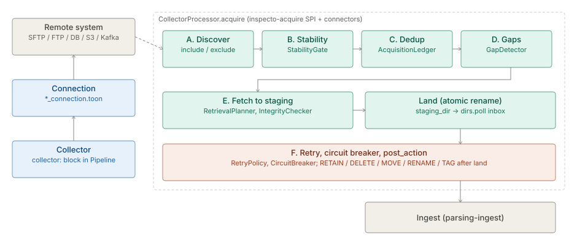
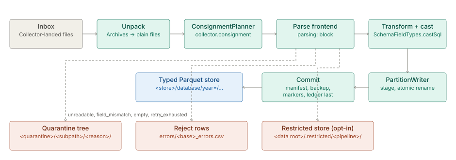
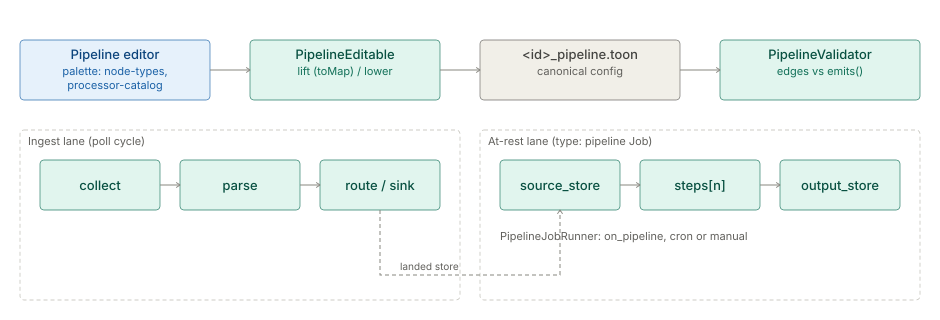

# ELT — architecture

**What this covers.** How the ELT layer is built, in the order data moves: acquisition (the Collector cycle
and its phases A to F, Collectors and Connections, ingesting one feed from several locations), Stage-1
parsing and ingest (Consignments, the parse frontends, quarantine, commit), Pipelines and Steps (Step kinds,
the graph round-trip, the two execution lanes), and the execution engine internals underneath (code homes,
the M..N multiplexer, the Pipeline graph model, Consignment status, graceful stop, directory layout). Each
part keeps its own status line and the date it was checked against the code.

**Contents**

- **Acquire**
  - [Data Acquisition Framework](#data-acquisition-framework) — the cycle, back-pressure and phases A–F.
  - [Collectors](#collectors) — the Collector and Connection module summary: schemes, configuration, limits (§A1–§A9).
  - [Multi-location ingest — the composition pattern](#multi-location-ingest--the-composition-pattern) — N
    single-Collector Pipelines and one merge, never a Collector list.
- **Parse and ingest** — [Parsing and ingest](#parsing-and-ingest) — Consignments, the parse frontends, quarantine and commit (§1–§9).
- **Pipeline** — [Pipelines and Steps](#pipelines-and-steps) — Step kinds, the two lanes, the round-trip, at-rest execution (§1–§9).
- **Engine internals** — [Execution engine internals](#execution-engine-internals)
  - [E1. Where the engine's code lives](#e1-where-the-engines-code-lives)
  - [E2. Design Philosophy & Scope](#e2-design-philosophy--scope) — the M..N multiplexer ingest engine
  - [E3. How a file becomes Tables](#e3-how-a-file-becomes-tables) — bootstrap, continuous processing, the at-rest transform chain
  - [E4. The Pipeline graph — the backend model](#e4-the-pipeline-graph--the-backend-model) (E4.1–E4.11)
  - [E5. Consignment status flow (the flowfile question)](#e5-consignment-status-flow-the-flowfile-question)
  - [E6. Stopping a Space (graceful stop)](#e6-stopping-a-space-graceful-stop)
  - [E7. Directory layout](#e7-directory-layout)
- [References](#references)

**Section numbers.** *Parsing and ingest* and *Pipelines and Steps* keep their own §1–§9 (each part is
numbered on its own). The Collectors part's sections are §A1–§A9 and the engine internals §E1–§E7 (with
§E4.1–§E4.11): the letter names the part a number came from (acquire and engine pages, merged here
2026-11-18).

## Data Acquisition Framework

A full acquisition engine (not a directory poller): **Discover → Determine readiness → Guarantee collection
semantics → Retrieve/validate → Finalize**. The phases below are `CollectorProcessor.acquire(cfg)`, which
fetches remote files and lands them atomically in the inbox; ingest then discovers them by walking the inbox
like any local push. In the one-shot CLI/`reprocess`/manual path, `CollectorProcessor.run()` calls
`acquire` then `ingest` in one cycle. In the **always-on service** the two run on their own timers (B3b):
`dispatchAcquireCycle()` fetches under `acquire.pollSeconds` / `acquire.maxConcurrent`, guarded per-pipeline by
a dedicated `acquireGuard`, so a slow fetch neither blocks nor is blocked by ingest, and two acquisitions of
one pipeline never overlap. `acquire` is a no-op for a `local` collector. For what was *required* and what was *refused*, start at the capability spec
[**Acquisition & connectivity (`ACQ`)**](plan.md); this part is the
mechanism tier for the cycle. *(It used to name `spec.md` as "authoritative" — a
chain that ended in the never-maintained archive tier.)*

> **Gotcha — manual run vs. background acquisition.** The manual "run now" acquires inline under the *ingest*
> `runGuard`, which is separate from the background `acquireGuard`; a manual run can therefore overlap one
> background acquisition tick of the same pipeline. This is benign and self-correcting — landing is atomic
> (B3a stage-then-rename) and duplicates are caught by markers/fingerprint dedup — but it is why the two
> guards are deliberately not one.

**Back-pressure (B4).** Acquisition de-schedules itself when the inbox it feeds is full: if a pipeline's
inbox backlog (`CollectorProcessor.countPending`, the exact landed count from B3b) has reached
`-Dacquire.backpressure.highWater`, `selectDueForAcquire` skips that pipeline this tick and bumps
`inspecto_acquire_backpressure_skips_total`. The already-landed files wait in the **durable inbox — which is
the spill-to-disk hand-off queue** of the design's §3.5 escalation — until ingest drains them below the mark.
This throttles the *producer* (acquisition), so it is **negative** feedback, and is therefore the opposite of
T15/`IntakeGovernor`, which deliberately does **not** throttle on inbox lag because throttling the *ingest
consumer* on backlog would be positive feedback. The mark is **0 = off by default** (like
`-Dingest.maxFilesPerCycle`); a failed pending scan returns `-1` and so fails open (never pauses).
⚠ The gate bounds backlog **across** ticks, not within one: a single acquire cycle still fetches the whole
discovered listing, so one tick can overshoot the mark. Bounding a single cycle's fetch volume is a separate,
deferred knob (`acquire.maxFilesPerCycle`, BACKLOG §6).

### Phases

* **A — Discovery.** `CollectorConnectors.forConfig(cfg)` resolves the [connector](../connectors/spec-connectors.md): scheme
  `local` → built-in `LocalFileSystemConnector`; otherwise a `ServiceLoader<CollectorConnectorFactory>` lookup.
  `CollectorConnector.discover(ctx)` lists candidates (never dedups — that's an engine concern).
* **B — Stability gate.** `StabilityGate` (`com/gamma/acquire/StabilityGate.java`) holds back half-written
  files: it first asks `connector.readiness()`; if `UNKNOWN`, applies size/mtime quiescence (unchanged for
  `stability.window` across `stability.size_checks` cycles). One shared instance per [space](../processor/architecture.md).
* **C — Deduplication + watermark.** `AcquisitionLedger` (`com/gamma/acquire/AcquisitionLedger.java`) is the
  fingerprint SPI: `find`/`record` per `(sourceId, relativePath)`, `highWatermark(sourceId)` for incremental
  discovery, `dbWatermark` for row-level DB export. Implementations: `InMemoryAcquisitionLedger` (default,
  lost on restart) and `DbAcquisitionLedger` (durable DuckDB/Postgres, via `-Dacquire.ledger.backend=db`).
  `DuplicatePolicy` is **three** enums, not one list (`DuplicatePolicy.java`) — ⚠ conflating
  them is how this line came to name four tokens that do not exist:
  · **`Mode`** (how a file already seen at the same path is judged) — `PATH`, `METADATA`, `CHECKSUM`,
    `ETAG`; unknown input falls back to `PATH`, and `ETAG` degrades to `METADATA` when neither side
    supplies an etag or version.
  · **`OnChange`** (what to do when a known path's content changed) — `IGNORE`, `REPROCESS` (the
    default), `ALERT` (emits `FILE_CHANGED`), `ARCHIVE_OLD_VERSION`.
  · **`Decision`** (the verdict for one candidate) — `NEW`, `DUPLICATE`, `CHANGED`.
  ⛔ There is no `SKIP`, `VERSION` or `FAIL`.
* **D — Gap detection.** `GapDetector` (`com/gamma/acquire/GapDetector.java`) flags missing files in a
  sequence series and fires alerts via `AcquisitionTelemetry`.
* **E/F — Retry + circuit breaker.** `RetryPolicy` (`com/gamma/acquire/retry/RetryPolicy.java`, configurable
  attempts + EXPONENTIAL/FIXED backoff) wraps connector calls; `CircuitBreaker` (`com/gamma/acquire/CircuitBreaker.java`,
  per-Collector) opens after a failure threshold and skips the Collector until cooldown.

`AcquisitionLedgers` (`com/gamma/acquire/AcquisitionLedgers.java`) is the per-space `shared()` accessor +
lifecycle manager (one of the five MDC-routed singletons — see [multi-space](../processor/architecture.md)).
## Collectors

> **Level 3 module page** (`SOLUTION-SUITE-DOCS-1`). Layer: Platform base.
> Offering: all tiers (local, SFTP, FTP/FTPS, DB, S3, Azure, GCS); the Kafka Collector is Standard and above.
> Checked against the code on 2026-10-17.

### A1. What it is

A **Collector** is a configured collection task bound to one **Connection** (a named endpoint plus
credentials). It reaches a remote system, decides which files are new and complete, fetches them once,
and lands them in the Pipeline's inbox (`dirs.poll`). Everything after landing is ingest's job
([Parsing and ingest](#parsing-and-ingest)). The capability spec of record is
[acquisition.md](plan.md); this part is the module summary.

Code homes:

- SPI and engine-side logic: `platform/inspecto-acquire/src/main/java/com/gamma/acquire` —
  `CollectorConnector`, `CollectorConnectorFactory`, `CollectorConnectors`, `ConnectionProfile`,
  `StabilityGate`, `AcquisitionLedger`, `DuplicatePolicy`, `GapDetector`, `RetrievalPlanner`,
  `IntegrityChecker`, `CircuitBreaker`, `RateLimiter`, `PostAction`, `retry/RetryPolicy.java`.
- Remote connectors: `providers/inspecto-connectors/src/main/java/com/gamma/acquire/connectors`.
- Kafka connector: `providers/inspecto-connectors-kafka/src/main/java/com/gamma/acquire/kafka`.
- Cycle driver: `platform/inspecto-engine/src/main/java/com/gamma/inspector/CollectorProcessor.java`.

### A2. Who uses it

- **Integration engineers** author Connections and the `collector:` block of a Pipeline.
- **Operators** watch Collector state, test Connections, and trigger an immediate scan.
- **Upstream systems** (an S3 event, an upload script) can call the notify route to ask for a scan now.

### A3. Where it sits

Collectors are the first stage of the platform base: a remote system feeds a Collector, the Collector
lands bytes, and a [Pipeline](#pipelines-and-steps) parses and loads them into [storage](../entity-store/architecture.md).
The connector schemes are pluggable through `ServiceLoader`: `CollectorConnectors.forConfig` resolves
`local` to the built-in `LocalFileSystemConnector` and any other scheme to a registered
`CollectorConnectorFactory` matched on `scheme()`. An unknown scheme fails fast; there is no fall-back
to `local`.

| Scheme | Class | Module |
|---|---|---|
| `local` | `LocalFileSystemConnector` | `inspecto-acquire` (built in) |
| `sftp` | `SftpConnector` | `inspecto-connectors` |
| `ftp`, `ftps` | `FtpConnector` (two factories) | `inspecto-connectors` |
| `db` | `DbExportConnector` | `inspecto-connectors` |
| `s3` | `S3Connector` + `AwsSigV4` | `inspecto-connectors` (SDK-free) |
| `azure` | `AzureBlobConnector` + `AzureSharedKey` | `inspecto-connectors` (SDK-free) |
| `gcs` | `GcsConnector` + `GcpServiceAccountToken` | `inspecto-connectors` (SDK-free) |
| `kafka` | `KafkaConnector` | `inspecto-connectors-kafka` |

The registry files are
`providers/inspecto-connectors/src/main/resources/META-INF/services/com.gamma.acquire.CollectorConnectorFactory`
and the matching file in `inspecto-connectors-kafka`.

### A4. How it works



`CollectorProcessor.acquire` runs phases A to F; `acquire` is a no-op for a `local` Collector.

- **A. Discover.** `CollectorConnector.discover` lists candidates; it never dedups. Shaped by
  `include`, `exclude`, `recursive_depth` and `discovery` (`poll` or `watch`).
- **B. Stability.** `StabilityGate` asks the connector's `readiness` first (object stores answer
  `READY`), and only on `UNKNOWN` applies size/mtime quiescence (`window`, `size_checks`) or a
  `ready_marker`.
- **C. Dedup.** `DuplicatePolicy` has a `Mode` (`PATH`, `METADATA`, `CHECKSUM`, `ETAG`) and an
  `OnChange` (`IGNORE`, `REPROCESS`, `ALERT`, `ARCHIVE_OLD_VERSION`). Fingerprints live in the
  `AcquisitionLedger` (`InMemoryAcquisitionLedger` by default, `DbAcquisitionLedger` when durable).
- **D. Gaps.** `GapDetector` finds missing keys in a dated filename series and emits `SEQUENCE_GAP`
  once per hole (`GapTracker`).
- **E. Fetch and land.** `RetrievalPlanner` picks `FETCH_TO_BACKUP`, `STREAM` or `STAGE_TEMP`. Fetches go
  to `collector.fetch.staging_dir`, are checked by `IntegrityChecker`, then atomically renamed into
  `dirs.poll`. A partial download never sits in the inbox.
- **F. Resilience and disposition.** `RetryPolicy` wraps `discover` and `fetchTo`; `CircuitBreaker`
  skips a failing Collector for a cooldown; `PostAction` applies `RETAIN`, `DELETE`, `MOVE`, `RENAME` or
  `TAG` to the remote file only after landing.

`db` and `kafka` Collectors produce slices: the row watermark or offset frontier is advanced only after
the slice commits, so delivery is at-least-once.

### A5. Configuration

**Connection** — authored as `*_connection.toon` (`ConnectionRegistry`), parsed by
`ConnectionProfile`: `id`, `connector`, `host`, `port`, `database`, `base_path`, `username`, `password`,
`options`, plus optional `tunnel` and `proxy` blocks. Secrets resolve through `SecretResolver` references.

**Collector** — the `collector:` block of a Pipeline (`platform/inspecto-etl/src/main/java/com/gamma/etl/PipelineConfigParser.java`;
there is no other spelling):

| Key | Purpose |
|---|---|
| `connector`, `connection` | scheme (default `local`) and the Connection id |
| `include`, `exclude`, `recursive_depth`, `discovery` | discovery |
| `stability` | `window`, `size_checks`, `ready_marker`, `exclude_temp_files`, `exclude_temp_patterns` |
| `duplicate` | `mode`, `algorithm`, `on_change` |
| `guarantee` | `BEST_EFFORT` (default), `AT_LEAST_ONCE`, `EXACTLY_ONCE` |
| `incremental.watermark` | `last_modified` file-level watermark |
| `gap_detection` | `enabled`, `sequence`, `file_template`, `seq_scope` — `enabled: false` (default `true`) stops the live `sequence` detector, the windowed `file_template` check and the per-day delivery manifest; the `file_template` still names a file's day in Signals and is the `kpi.completeness` Job's default template (`GAP-DETECTION-ENABLED-IGNORED-1`, 2026-11-12) |
| `fetch` | `mode`, `staging_dir`, `parallel_fetch`, `rate_limit` |
| `retry` | `count`, `backoff`, `initial_delay`, `max_delay` |
| `circuit_breaker` | `failure_threshold`, `cooldown` |
| `post_action` | `on_success`, `archive_path`, `tags`, `on_unsupported` |
| `consignment` | `max_files`, `max_bytes`, `order` |

Connector `options` examples: Kafka reads `topic`, `bootstrap_servers`, `security_protocol`,
`max_records`, `start` (default `earliest`); `db` reads `watermark_column`, `watermark_type`,
`watermark_initial`.

JVM switches: `-Dacquire.ledger.backend` (`memory` | `db`), `-Dacquire.pollSeconds`,
`-Dacquire.maxConcurrent`, `-Dacquire.backpressure.highWater` (0 = off).

### A6. Screens

Moved to [the user guide, §21](user-guide.md#21-collectors-and-collector-configuration).

### A7. API

Moved to [Collectors — API](api.md).

### A8. Interactions

- [Parsing and ingest](#parsing-and-ingest) — consumes the landed inbox.
- [Pipelines and Steps](#pipelines-and-steps) — the `collector:` block lives in a Pipeline.
- [identity-access](../access/architecture.md) — `canOperateRuns`, `canOnboardConnections`.
- [observability-backup](../observability/architecture.md) — acquisition metrics and the completeness KPI that reads `gap_detection`.
- [events](../event/architecture.md) — `SEQUENCE_GAP`, `FILE_CHANGED`.
- [spaces](../config/architecture.md) — ledgers and stability gates are per Space.
- Mechanism detail: [connectors](../connectors/spec-connectors.md),
  [framework](#data-acquisition-framework).

### A9. Limits and gotchas

- The default ledger is in memory: restart-safe dedup and frontiers need `-Dacquire.ledger.backend=db`.
- A ledger-requiring `guarantee` with `duplicate.mode: path` only logs a `[CONFIG]` warning and behaves
  as best-effort.
- `staging_dir` must be outside `dirs.poll`; it is refused otherwise.
- `discovery: watch` narrows latency only; the interval poll stays on as the backstop.
- The DB watermark compare is strictly `>`: back-dated rows below the frontier are missed.
- NFS/SMB connectors were declined by design; mount the share and use `local`.
- `https` is a Connection scheme for the outbound webhook, not a Collector scheme.
- Kafka is proven against `MockConsumer` and a fake connector, not a live broker; broker consumer
  groups are out by decision.
- Older javadocs in `inspecto-acquire` still say `source.*`; the config key is `collector.*`.
## Multi-location ingest — the composition pattern

**Decided 2026-08-11** (pipeline-multiplicity plan Part B): ingesting one logical feed from N
locations is done by **composition of existing pieces, never by widening acquisition** —
⛔ `PipelineConfig.collector` stays a single `Collector` **permanently**. The list design was
refuted by grounding: every stateful acquisition subsystem (`AcquisitionLedger`, `GapTracker`,
`StabilityGate`, `CircuitBreaker`, retry, the incremental watermark) is keyed on one durable
collector id, so a `collector()` list would force a ledger re-keying migration to reach semantics
the composition already has.

### The pattern

```
N independent collector pipelines          one Pipeline Job                  one store
(one per location, MultiCollectorProcessor)  (PipelineJobRunner, T32 Phase C)
  location A → pipeline a_etl → store A  ┐
  location B → pipeline b_etl → store B  ├→ N source_store nodes → transform.merge → sink
  location C → pipeline c_etl → store C  ┘   (union / inner / left)
```

- **Stage 1, per location:** one ordinary single-collector pipeline each, run concurrently by
  `MultiCollectorProcessor` (vthread per Collector, `sources.max` semaphore, no shared state). Each
  keeps its own collector id — ledger, gap tracking, circuit breaker and watermark all stay
  single-arity and per-location.
- **Stage 2, the merge:** a Pipeline graph with one `source_store` node per landed store feeding a
  `transform.merge`; `PipelineJobRunner.seedsOf` registers one DuckDB view per store and the graph
  executor unions/joins them (`RowShaper.merge`). Pinned by
  `PipelineJobRunnerTest.unionsTwoSourceStores`. Incremental mode (`incremental_column`) keeps a
  watermark per `(pipelineId, store)`, so each location advances independently.
- **Trigger:** the Pipeline Job's `on_pipeline` takes a comma-separated upstream list, and
  `on_pipeline_gate: all` fires one run only after **every** named upstream has committed since
  the last firing (then re-arms). Default `any` fires per commit. The all-gate's pending set is
  kept in `job-gate-pending.tsv` under the Space's audit directory (one `job<TAB>pipeline` line per
  pending commit, written atomically on every change), so a restart no longer loses partial progress;
  an unreadable file costs only a full cycle — a late run, never a wrong one
  (`JobService.onConsignmentEvent`, pinned by `JobServiceTest.anAllGateKeepsItsProgressAcrossARestart`).
  A service with no audit directory keeps it in memory only. Cron remains fine when arrival times are known.

Demo: none shipped. The disabled `regional_orders_merge_flow.toon` template was removed
(2026-08-18) when the demo space's authored graphs were converted to canonical pipelines — a
`transform.merge` fan-in has **no** `*_pipeline.toon` form (`PipelineEditable.lower` refuses it
with `UNSUPPORTED_NODE`; the flat vocabulary has no join/union node), so the pattern stays
canvas-authored. `PipelineJobRunnerTest.unionsTwoSourceStores` remains the executable pin.

### Why the answers fall out by construction

| Part B question | Answer under the composition |
|---|---|
| Identity | Each location is its own collector id; no sub-identities, no migration |
| Merge semantics | One batch per location in Stage 1; the merge is Stage 2, per-location watermarks |
| Failure isolation | One bad location trips *its* breaker; the rest land; signals stay per-collector |
| Beats a `collector()` list? | Inverted — the list would re-key five durable subsystems for nothing |

The "silently proceeds on 3 of 4 locations" concern is an **alerting** concern, not an engine one:
author a freshness Expectation / Alert Rule per landed store.

### Related

- [`spec-pipeline.md`](spec-pipeline.md) — T32 Pipeline Jobs, multi-store seeding, incremental mode.
- [§E4 below](#e4-the-pipeline-graph--the-backend-model) — graph model, `transform.merge`.
- `docs/archived-documents/plans-archive/pipeline-multiplicity-plan.md` Part B — provenance only; the
  refutation it recorded is restated in full at the top of this part (the plan shipped and was archived 2026-08-11).

## Parsing and ingest

> **Level 3 module page** (`SOLUTION-SUITE-DOCS-1`). Layer: Platform base.
> Offering: all tiers; the ASN.1 frontend (module `inspecto-telecom-asn1`) is Advanced only (DATA-TIERS-1 DT-12, 2026-11-17).
> Checked against the code on 2026-10-17.

### 1. What it is

Stage-1 ingest is the road from a file in a Pipeline's inbox to typed rows in a Parquet store. It
groups inbox files into a **Consignment**, parses each file with one of the parse frontends, maps and
casts the columns to the declared Schema, writes partitioned Parquet, and commits the whole
Consignment atomically. A file that cannot be read goes to the **quarantine** tree; rows that fail
parsing go to a reject file beside it.

The capability spec of record is [ingestion.md](plan.md); the design is the
[execution engine internals](#execution-engine-internals) below (§E1–§E7). This part is the module summary.

Code homes:

- Poll cycle and Consignment coordinator: `platform/inspecto-engine/src/main/java/com/gamma/inspector`
  (`CollectorProcessor`, `ConsignmentIngestor`, `MultiCollectorProcessor`).
- Planner, writer and Unpack: `platform/inspecto-etl/src/main/java/com/gamma/etl`
  (`ConsignmentPlanner`, `PartitionWriter`, `CommitLog`, `MarkerManager`, package `unpack`).
- Parser registry: `platform/inspecto-engine/src/main/java/com/gamma/parse` (`ParserPlugin`, `Parsers`).
- Control routes: `inspecto/src/main/java/com/gamma/control/ParserRoutes.java` and
  `inspecto/src/main/java/com/gamma/control/RunRoutes.java`.

### 2. Who uses it

- **Integration engineers** author the `parsing:` block, the Schema mapping and the grammar of a
  Pipeline, and preview a sample file before saving.
- **Operators** watch Consignments land, read the quarantine tree and the rejected rows, and
  reprocess or replay.
- **Plugin authors** add a format through the `StreamingFileIngester` wrap-SPI
  ([ingest-wrap-spi](spec-ingest.md)).

### 3. Where it sits

Ingest starts where a [Collector](#collectors) has landed a file in `dirs.poll`. It ends at a
committed store that [Datasets](../../layer/product/architecture-studio-bi.md) and at-rest [Steps](#pipelines-and-steps) read. Typing
rules come from the Schema registry (metamodel); storage layout is described in [storage](../entity-store/architecture.md).
Every Consignment runs on a virtual thread bounded by `processing.threads`; many Pipelines share one
JVM under `MultiCollectorProcessor`.

### 4. How it works



1. **Scan and Unpack.** `CollectorProcessor.ingest` scans the inbox and expands Archives and
   compressed streams through the Unpack stage (`UnpackStage`, `UnpackLimits`) before planning, so an
   Entry is an ordinary file from then on ([unpack-stage](spec-acquisition.md)).
2. **Plan.** `ConsignmentPlanner` cuts the candidate list into Consignments bounded by
   `collector.consignment: {max_files, max_bytes, order}` (`order` is `mtime` by default, or `name`).
3. **Parse.** `ConsignmentIngestor` picks a strategy: `CsvIngestStrategy` for the DuckDB-native
   frontends, `StreamingPluginIngestStrategy` for Java parsers. The plugin strategy runs union mode
   when every file is below `processing.streaming.large_file_bytes` (default 256 MB) and generation
   mode, in batches of `flush_records` rows, above it.
4. **Map and cast.** `SchemaFieldTypes.castSql` casts each mapped column to its declared type. A
   failed `TRY_CAST` yields NULL and keeps the row; `DataTransformer.countCastFailures` counts those.
5. **Write.** `PartitionWriter` copies into a staging directory and reveals by atomic rename, with
   `PARTITION_BY` for a keyed schema and one flat file for an unkeyed one.
6. **Commit.** In crash-safe order: DuckLake register, manifest, backup of originals, markers, and the
   ledger last. A failed Consignment leaves no marker, so its files are found again on the next poll.
   Retries are bounded by `-Dingest.retry.max` (default 5); exhaustion quarantines the file.

**The frontends.** `PipelineConfigParser.FRONTENDS` accepts ten tokens for eight formats:

| Token | Engine |
|---|---|
| `delimited` | DuckDB `read_csv`, or the Java `CsvIngester` when junk-line skipping forces it |
| `fixedwidth` / `fixed_width` | `read_text` plus SQL substrings; binary records use `FixedWidthRecordIngester` |
| `json` | `read_json`, with a `records_path` selector |
| `text_regex` | `read_text` plus SQL regex; `record_split` enables block records |
| `xlsx` / `excel` | DuckDB `excel` extension |
| `parquet` | native read |
| `asn1` | `Asn1ParserPlugin` and `Asn1RecordIngester` |
| `plugin` | any `StreamingFileIngester` class, for example `XmlRecordIngester` |

**Quarantine.** A bad file moves to `<quarantine>/<poll-subpath>/<reason>/<file>` with reason
`field_mismatch`, `unreadable`, `empty`, `corrupt_download` or `retry_exhausted`. Parse rejects travel
as `errors/<base>_errors.csv`. With `processing.refusal: restricted_quarantine` a file can be refused
whole (mapping `INGEST_REFUSE:<CODE>`, or the card-number scan) and moved to
`<data root>/.restricted/<pipeline>/`, outside every `dirs:` entry.

### 5. Configuration

All keys live in the Pipeline's `*_pipeline.toon`; the full list is
[spec-ingest.md](spec-ingest.md) (the parsing options).

| Key | Meaning |
|---|---|
| `parsing.frontend` and its sub-block | which frontend, plus its grammar options |
| `parsing.plugin.ingester` | fully qualified `StreamingFileIngester` class for `plugin` |
| `collector.consignment.max_files` / `max_bytes` / `order` | Consignment size and order |
| `processing.threads` | parallel Consignments per Pipeline |
| `processing.streaming.large_file_bytes`, `flush_records` | union vs generation mode |
| `processing.duplicate_check` | file-grain duplicate check (record dedup is the `transform.dedup` Step) |
| `processing.refusal`, `refusal_scan`, `refusal_scan_exempt` | opt-in content refusal |
| `dirs.poll`, `dirs.quarantine`, `dirs.database` | inbox, quarantine and output roots |
| `-Dingest.retry.max`, `-Dingest.lane` | JVM flags: retry cap; `auto`, `graph` or `flat` lane |

### 6. Screens

Moved to [Parsing and ingest — screens](user-guide.md).

### 7. API

Moved to [Parsing and ingest — API](api.md).

### 8. Interactions

- **Collectors** land files; ingest never fetches ([Collectors](#collectors)).
- **Pipelines and Steps:** a `route:` Pipeline forks the write per branch on the ingest lane; the
  at-rest chain runs after commit as a Job ([pipelines-steps](#pipelines-and-steps)).
- **Jobs:** an `on_pipeline` Job fires on a committed Consignment ([jobs-scheduler](../processor/architecture.md)).
- **Events:** commit and failure outcomes are published as Signals ([events](../event/architecture.md)).
- **Storage:** the committed store and the status ledgers ([storage](../entity-store/architecture.md)).
- **Observability:** batch counters and the status ledger feed run reports ([observability-backup](../observability/architecture.md)).

### 9. Limits and gotchas

- A file's outcome and its Consignment's outcome are two facts: a `COMMITTED` file inside a `FAILED`
  Consignment is normal, and the failed Consignment is retried as a whole.
- A cast failure keeps the row with a NULL value; it is counted, not quarantined.
- An unknown `delimited.*` key is not rejected at load.
- Nested Archives are not extracted: `UnpackLimits.depth` is 1 and other values are refused.
- An ASN.1 or XML parse error fails the whole file as unreadable, never a prefix.
- Hive partition columns do not read back with one type (`year` as `BIGINT`, `month` and `day` as
  `VARCHAR`).
- Expectations evaluate at rest, not at ingest, and have no UI.

## Pipelines and Steps

> **Level 3 module page** (`SOLUTION-SUITE-DOCS-1`). Layer: Platform base.
> Offering: all tiers; the `transform.mask` Step is Advanced. Checked against the code on 2026-10-17.

### 1. What it is

A **Pipeline** is a chain of **Steps**: `collect → parse → transform Steps → sink`. It is authored
as one file, `<id>_pipeline.toon`, and edited either as text or as a graph in the Pipeline editor.
The graph is an immutable IR (`PipelineGraph`) lifted from the flat config; the editor's save lowers
it back into the same file, so there is one source of truth.

Two vocabularies describe Steps:

- **Step kinds** — the node types the engine executes (`BuiltinNodeType`, served with their
  attribute specs by `GET /pipelines/node-types`). Plugins add more through the `PipelineNodeType`
  `ServiceLoader` seam ([node-types](spec-pipeline.md)).
- **Step Processors** — the 119-entry product taxonomy the palette lists in eight families
  (`ProcessorCatalog`, `GET /pipelines/processor-catalog`). A processor is a label over a Step kind or
  an engine capability, not a class of its own; planned entries show as "Not yet available".

The as-built references are the [pipeline-graph bundle](../../index.md) and the
[step catalog](spec-step-catalog.md); the capability specs are
[pipeline-authoring](plan.md) and
[pipeline-execution](plan.md).

### 2. Who uses it

- **Integration engineers and analysts** author Pipelines in the editor or as TOON.
- **Operators** run, pause, drain and dry-run them, and restore an earlier saved version.
- **Plugin authors** add node types and parsers.

### 3. Where it sits

A Pipeline binds a [Collector](#collectors), the [parse stage](#parsing-and-ingest), transform Steps
and one or more sinks into [storage](../entity-store/architecture.md). Its at-rest half runs as a Job of type `pipeline`
on the [scheduler](../processor/architecture.md). Code homes:

- Model, lift and validator: `platform/inspecto-engine/src/main/java/com/gamma/pipeline`
  (`PipelineGraph`, `PipelineLift`, `PipelineValidator`, `PipelineEditable`, `BuiltinNodeType`,
  `PipelineNodeTypes`, `ProcessorCatalog`).
- At-rest runner: `platform/inspecto-engine/src/main/java/com/gamma/job/PipelineJobRunner.java`.
- Routes: `inspecto/src/main/java/com/gamma/control/PipelineGraphRoutes.java`,
  `PipelineListRoutes.java`, `PipelineHistoryRoutes.java`, `PipelineSettingsRoutes.java`.

### 4. How it works



**Two lanes.** Every Step executes in exactly one lane ([execution-lanes](spec-pipeline.md)):

| Lane | Steps | How it runs |
|---|---|---|
| Ingest | `collect`, every `parse` frontend, `route`, `sink` | the poll cycle; `route:` forks the write into one destination per branch |
| At rest | `filter`, `dedup`, `join`, `summarize`, `sql` and the other `transform.*` Steps in `steps[n]:` | a `type: pipeline` Job lifts the chain and runs it over the landed store, writing `output_store:` |

**Delivered Step kinds** (from `BuiltinNodeType`): `acquisition`; the parser family
(`parser.delimited`, `parser.fixedwidth`, `parser.json`, `parser.text_regex`, `parser.xlsx`,
`parser.asn1`, `parser.plugin`); `transform.filter`, `transform.lookup`, `transform.select`,
`transform.derive`, `transform.sql`, `transform.validate`, `transform.dedup`, `transform.route`,
`transform.join`, `transform.summarize`, `transform.running`, `transform.profile`, `transform.hash`,
`transform.mask`, `transform.explode`, `transform.matrix.unpivot`, `transform.timeseries.resample`,
`transform.timeseries.shift`, `transform.timeseries.forecast`, `transform.similarity`,
`transform.analytics.rank`, `transform.sample`, `transform.matrix.pivot`, `transform.entity.link`,
`transform.stats.outlier`, `transform.data.binning`, `transform.stats.correlation`,
`transform.timeseries.changepoint`, `transform.cohort.retention`, `transform.cohort.funnel`, `transform.split`,
`transform.merge`; and the sinks
(`sink.persistent`, `sink.materialized`, `sink.webhook`, `sink.excel`, `sink.view`). The step catalog documents each
one's keys, refusals and a runnable example.

**The round-trip.** `PipelineEditable.toMap` lifts topology but carries each node's verbatim TOON
section; `lower` writes those sections back. A present node owns its section; keys the graph does not
model travel through a save untouched. A graph the flat file cannot express is refused with a named
code (`UNSUPPORTED_NODE`, `UNSUPPORTED_BINDING` and others) rather than truncated
([editable-round-trip](spec-pipeline.md)).

**Validation.** `PipelineValidator` rejects an edge whose relationship is not in the source node
type's `emits()`. Saves also pass `ConfigSafetyValidator` (path jail and allow-lists).

**At-rest execution.** `PipelineJobRunner` loads the graph, registers a DuckDB view per
`source_store` seed (at least one is required), walks the graph with `PipelineExecutor`, writes sinks
through `PartitionSinkWriter`, optionally records provenance and runs `ConservationCheck`, then
publishes a Consignment event ([live-execution](spec-pipeline.md)).

**Park and drain.** Switching off a route-branch sink parks its Consignments durably;
`POST /runs/{name}/drain` completes them through the real commit tail
([step-park-drain](spec-pipeline.md)).

### 5. Configuration

The census of every block is [pipeline-config-keys](../config/spec-pipeline-config-keys.md).

| Key | Meaning |
|---|---|
| `collector:` | the Collector and Consignment caps |
| `parsing:` | frontend and grammar ([parsing-ingest](#parsing-and-ingest)) |
| `route:` | ingest-lane branches, one destination each |
| `steps[n]:` | the at-rest chain, a list of single-key maps |
| `output_store:` | where the at-rest chain writes; a chain without it refuses to lift |
| `output:`, `sinks:` | one destination, or a list of `{database, format, compression, ducklake}` |
| `*_job.toon` `type: pipeline` with `pipeline_config:` and `on_pipeline:` | runs the at-rest chain after each commit |

### 6. Screens

Moved to [the user guide](user-guide.md).

### 7. API

Moved to [Pipelines and Steps — API](api.md).

### 8. Interactions

- **Jobs:** the at-rest lane is a `pipeline` Job ([jobs-scheduler](../processor/architecture.md)).
- **Analytics kernel:** `transform.profile`, `transform.timeseries.*` and `transform.similarity` call
  the kernel ([analytics-kernel](../analytics/architecture.md)).
- **Maker-checker:** a Pipeline save can be held as a pending change ([maker-checker](../workflow/architecture.md)).
- **Platform Services:** a dry run substitutes stand-ins ([platform-services](../../layer/platform/architecture-platform-services.md)).

### 9. Limits and gotchas

- Graph save is key-preserving but reformats the file; unquoted scalars can change form.
- An active Pipeline whose at-rest chain no Job runs is an orphan finding, not an error.
- `PipelineNodeType` carries no execution hook; a plugin node type needs an executor elsewhere.
- Providers override a built-in node type of the same `type()`; the last one loaded wins.
- A dry run of a `transform.join` whose reference file is missing answers 422 `JOIN_REFERENCE_MISSING`.
- Record dedup is the `transform.dedup` Step; `processing.dedup` on the ingest lane is refused.

---

## Execution engine internals

The engine is the part of Inspecto that turns arriving files into partitioned
Tables and runs authored Pipelines over them. This part explains how it is put together: which modules
hold the code, the "many files in, many partitioned files out" ingest design and what it deliberately
does not do, how a Pipeline is modelled as a graph that is derived from its config file, what is
recorded about each Consignment as it moves (so an operator can audit a failed file or record), how a
Space stops cleanly, and how a Space's files are laid out on disk.

## E1. Where the engine's code lives

### Core Module (`inspecto/`)

The **composition root** (artifactId `inspecto-processor`, jar `inspecto.jar`) — the module that wires
the object graph together and shades the single deployable fat JAR. It keeps **zero network/AI
dependencies**: remote protocols live in [connectors](../connectors/architecture.md), hosted models in
[agent-hosted](../agent-hosted/architecture.md).

> **Not the engine anymore.** Before the WS-D reactor split (2026-07-22) `inspecto/` held the whole
> engine; the engine was then extracted into the sibling modules below, and `inspecto/` now depends
> *down* on them. Authoritative build order, version management, and the extraction playbook live in
> [../../layer/platform/architecture-modules.md](../../layer/platform/architecture-modules.md).

What lives here now — `inspecto/src/main/java/com/gamma/`: `service` (the always-on host — `CollectorService`, the
[control API](../processor/api-control-api.md) wiring, [`SpaceManager`](../processor/architecture.md)),
`control` (the ~50 HTTP routes), `report`, `assist` (the assist SPI — [interface only](../agent/spec-assist-agent.md)),
`exchange`, `expectation`, `intelligence`, and `model`.

### Extracted engine modules (WS-D) — `inspecto/` depends down on these

The concept docs are unchanged by the move; only the home module changed:

- **`inspecto-engine`** (`inspecto-engine`) — the engine cluster: `signal`, `query`,
  [`pipeline` / pipeline-graph](#e4-the-pipeline-graph--the-backend-model), `inspector` ([DuckDB](../engine/spec-duckdb.md) sinks
  plus the fat-jar entry points `CollectorProcessor` and `MainApp`), `ingester`, `ops`,
  [`job`](../processor/spec-jobs.md), `enrich`, `alert`, `notify`, `catalog`.
- **`inspecto-etl`** (`inspecto-etl`) — [`etl`](spec-ingest.md): `PipelineConfig`, the
  ingesters, batch planning, quarantine, lineage, [partitioned Parquet output](spec-pipeline.md).
- **`inspecto-event`** (`inspecto-event`) — [`event` + `metrics`](../event/spec-events-metrics.md):
  the Operational-Intelligence event store + metric registry; owns `logback.xml`.
- **`inspecto-acquire`** (`inspecto-acquire`) — the [acquisition framework](#data-acquisition-framework):
  connectors, connection profiles/registry/workbench, the fingerprint ledger, stability gate,
  retry/circuit-breaker/rate-limit policies.
- Foundation leaves **`inspecto-api`** (`@PublicApi`), **`inspecto-util`** (DuckDB access + CSV/file/tar
  helpers), **`inspecto-config`** ([TOON config](../config/spec-toon-config.md) — spec/io/safety), and
  **`inspecto-sql`** (the sandboxed read-only DuckDB SQL surface).

Modularization is reactor-internal — the single `inspecto.jar` is unchanged (shade has no
include-list, so the sibling modules' classes and resources bundle automatically).

Build/run: see [build & test](../../layer/platform/spec-build-test.md).

### Ingest package structure

```
com.gamma
  inspector/
    CollectorProcessor          — single-Pipeline ELT runner; virtual-thread + semaphore batch fan-out
    MultiCollectorProcessor     — runs many Pipelines concurrently in one JVM (outer M..N orchestrator)
    ConsignmentIngestor           — thin per-batch coordinator: selects a ConsignmentIngestStrategy, then drives the shared commit → audit tail
    ConsignmentIngestStrategy      — ingest+transform+write seam (delimited-text vs plugin); returns a typed IngestOutcome (+ shared dropTable/msg helpers)
    CsvIngestStrategy         — built-in delimited-text path → transform → write → lineage. Native (read_csv) batches stream with
                               NO raw_f/raw_input table copies: single member via one read_csv VIEW, many members via
                               per-member views UNION ALL-ed into one transform (materialised once). Files over
                               processing.chunking.max_file_bytes are streamed in bounded chunks (FileChunker). The Java
                               parse engine keeps the per-file temp table → raw_input(__src_id) staging path.
    FileChunker              — streams an oversized file into bounded, header-replicating chunks (one on disk at a time)
    StreamingPluginIngestStrategy — the plugin path (StreamingFileIngester): per batch, picks union mode (many small
                               files → emit into per-member tables → union per segment → one transform/write/lineage) or
                               generation mode (huge file → DuckDbRecordSink flushes bounded generations) by file size
    DuckDbRecordSink         — framework RecordSink impl: Appender-loads emitted rows to DuckDB; generation-flushes on a
                               row budget, or (union mode) leaves raw tables for the strategy to union
    IngestOutcome            — record: status, survivors, outputs, lineage, per-member audit, totals (commit/audit input)
    MemberAudit              — record: per-input-file audit row accumulated during ingest
    ReprocessCommand         — `POST /runs/{pipeline}/reprocess`: delete outputs/markers, restore members, re-run
  etl/
    PipelineConfig           — immutable config object; static factory loads and validates .toon
    SchemaSelector           — two-pass schema dispatch (file-pattern fast path + column-count probe)
    CsvIngester              — Java line-by-line CSV/CSV.GZ parser → DuckDB staging table (fallback engine)
    DuckDbCsvIngester        — native vectorized read_csv ingest (4-5× faster; default for clean configs)
    DataTransformer          — assembles the transform SELECT (CREATE TABLE AS); delegates per-column SQL to TransformCompiler
    TransformCompiler        — pure per-column SQL compiler; transformType → expression function registry (functional injection)
    PartitionWriter          — COPY … PARTITION_BY + two-step atomic file reveal; format via the OutputFormat enum-strategy
    OutputFormat             — enum-as-strategy: extension + COPY token + compression applicability per output format
    MarkerManager            — .processed sentinel files for idempotent ingest; retention-based cleanup
    QuarantineManager        — moves zero-valid-row and unreadable files to quarantine/
    DuckLakeRegistrar        — optional: registers written Parquet files into a DuckLake catalog
    ConsignmentAuditWriter         — thread-safe append to the per-run status, batches, and lineage CSVs
    ConsignmentPlanner             — groups polled files into batches respecting max_files / max_bytes limits
    ManifestStore            — writes and reads per-batch JSON manifests under status_dir/manifests/
    LineageCollector         — tracks input-to-output row counts for the lineage CSV; dynamic partition paths
    IngestResult             — record: parsedRows, errorRows, junkCandidateRows
    PartitionOutput          — record: output paths and sizes produced by one batch
    StreamingFileIngester    — the plugin SPI for custom parsers; ingest() emits records into a RecordSink
    RecordSink               — framework callback the ingester emits into (define/emit/reject/junk)
    PartitionDef             — record + enum for explicit partitions[] declarations; backward-compat fromSchema()
  ingester/
    TypedRecordIngester      — reference StreamingFileIngester for type-tagged text records; multi-segment dispatch
  util/
    ToonHelper               — load/validate .toon files; require/opt section helpers
    TarUtil                  — deleteTree
    SqlBuilder               — typed DuckDB SELECT expressions (COALESCE/TRY_STRPTIME chains)
    LogSetup                 — TeeOutputStream; per-run timestamped log file wired to stdout/stderr
    DuckDbUtil               — JDBC URL builder; temp DB file lifecycle; datetime formatter
```

**Design principle:** `CollectorProcessor` is a pure orchestrator — it creates the thread pool and drives the per-batch lifecycle, but contains zero business logic itself. Every concern is owned by a focused single-responsibility class: batch planning (`ConsignmentPlanner`), parsing (`CsvIngester`), transformation (`DataTransformer`), deduplication (`MarkerManager`), quarantine (`QuarantineManager`), registration (`DuckLakeRegistrar`), and auditing (`ConsignmentAuditWriter`, `ManifestStore`, `LineageCollector`). All shared low-level helpers live in `com.gamma.util` and are reused across the engine.

**Behavior-injection seams.** Variant behavior is injected into the engine rather than branched inline, so the orchestration code stays thin and a new variant is a closed-set edit:

- **`ConsignmentIngestStrategy`** (`CsvIngestStrategy` / `StreamingPluginIngestStrategy`) — the per-batch ingest+transform+write path. `ConsignmentIngestor.process` selects one by config (the built-in delimited-text path when no `ingester`, else the streaming plugin engine) and consumes its typed `IngestOutcome`; the shared commit → audit tail is path-agnostic. The plugin engine then self-selects union vs generation mode per batch by file size.
- **`StreamingFileIngester`** (SPI, by FQCN) — custom parsers emit records into a `RecordSink`; the reference `TypedRecordIngester` splits one input into many typed segment streams ([spec-ingest.md](spec-ingest.md)).
- **`TransformCompiler`** — a `transformType → ColumnRule` function registry; `DataTransformer` assembles the SELECT and delegates each column expression.
- **`OutputFormat`** — enum-as-strategy owning each format's extension, COPY token, and compression rule, used by `PartitionWriter`.
- **`StatusStore`** (`FileStatusStore` / `DbStatusStore`) and the **`ConsignmentEventBus`** (`Consumer<ConsignmentEvent>` observers) — pluggable audit backend and commit-event fan-out.

These keep the data path lean while making formats, ingest paths, transforms, and audit sinks independently extensible and testable. See [design-notes → D7](../../../../archived-documents/design-notes.md#d7--engine-modularity-pass-behavior-injection-seams--done-v390).

---

## E2. Design Philosophy & Scope

> **Scope note.** This section describes **Stage-1**: the M..N multiplexer ingest engine
> (`com.gamma.etl` + `com.gamma.inspector`) — still the heart of the data plane. Around it the platform
> has since grown the **Stage-2 enrichment engine** (`com.gamma.enrich`, 2.x), which deliberately *does*
> the joins/aggregations listed below as Stage-1 non-goals; the service + control plane; **authored
> Pipelines** (`com.gamma.pipeline` — [§E4](#e4-the-pipeline-graph--the-backend-model)); multi-space tenancy;
> the Component metamodel; editions as build flavors; and the optional assist agent. The package-level
> **layer map** lives in [`architecture.md`](../../layer/platform/architecture.md) (layer/platform). The
> non-goals below are **still correct for Stage-1** — they are what keep each batch embarrassingly
> parallel and crash-isolated.

This is a deliberately small ELT engine built around one idea: an **M..N
multiplexer**. A batch of **M** input files is demultiplexed and routed into
**N** partitioned output files — explicitly *not* one-to-one. Understanding this
framing explains every design choice that follows, and the non-goals are as
important as the goals.

### The M..N multiplexer

Records flow from many inputs to many outputs; the input file count and the
output file count are decoupled. Two complementary mechanisms do the routing:

- **Partition fan-out (the "N").** Every surviving record is routed to an output
  file by its partition key — typically `year/month/day` derived from a date
  column, optionally prefixed by other columns (e.g. `event_type`). A batch of
  M files spanning 30 days produces ~30 partition files per segment, regardless
  of how the input was split across files.
- **Segment demultiplexing (plugin path).** A single input file can carry
  multiple record types (e.g. CALL + SMS interleaved in one CDR file). The
  [plugin ingester](spec-ingest.md#plugin-ingester) splits these into independent typed
  streams, each with its own schema and its own partitioned output tree. One
  input → many typed outputs.

Combined: **M input files → unioned per record type → N partitioned outputs.**
The batch is the unit of work; partition key and segment type are the routing
keys.

### Minor, per-record transformations only

Transformations are **stateless and applied to each record independently** —
the kind of work that maps cleanly onto DuckDB's vectorized SQL:

- Type coercion — VARCHAR → `DATE` / `TIMESTAMP` / `DOUBLE` / `INTEGER`
- Column selection and renaming (raw `selector` index → target column)
- Partition-key derivation (`YEAR()` / `MONTH()` / `DAY()` from a date)
- Lightweight composition — `CONCAT_DT` (date + time → timestamp),
  `FILENAME_DATE` (extract a date embedded in the filename)

That's the whole transformation vocabulary. It's intentionally narrow.

### Deliberate non-goals (Stage-1)

The **Stage-1 ingest engine does not** — by design, not by omission (Stage-2 enrichment
does these; see the scope note above):

- **Join against external / reference data.** No dimension lookups, no
  enrichment from a second data origin, no foreign-key resolution.
- **Aggregate across records.** No `GROUP BY` rollups, no windowing, no dedup
  across rows.
- **Hold state across records or batches.** Each record is transformed in
  isolation; each batch is independent.

> ⚠ **Read the list above as the *rule*, not as a description of every line of code.** It was audited
> against the implementation on 2026-08-11 and three things were found crossing it. One has been removed;
> two are deliberate and remain. Recording them here because the gap between this list and the code is
> what made the boundary hard to reason about when deciding where the pipeline `steps:` chain executes.
> **That question is now answered — see [*The Stage-2 transform chain, at rest*](#the-stage-2-transform-chain-at-rest-shipped-2026-08-11) below.**
>
> - ✅ **Record dedup (`processing.dedup`) used to run here** — a `ROW_NUMBER()` QUALIFY in
>   `BatchIngestStrategy` (now `ConsignmentIngestStrategy`), the one genuine cross-record operation in the multiplexer. **Removed
>   2026-08-11**: dedup is a transform concern, so in ELT terms it belongs in the T, not the EL.
>   The key still parses, lifts and round-trips; `prepare()` now **refuses to arm** a pipeline carrying
>   it, exactly as it does for `summarize`, `join` and `route`. Stage-2 executes it.
> - ⚠ **Two `GROUP BY` aggregates remain, and they are load-bearing.** `LineageCollector` runs
>   `SELECT __src_id, <partCols>, COUNT(*) … GROUP BY` and `ConsignmentOutputs` runs
>   `min()/max(__event_time) … GROUP BY` per write. An earlier version of this page called lineage
>   "audit metadata, not output data" — **that is not accurate**: `ConsignmentOutputs.fromLineage` turns
>   those counts into durable output-registry rows.
> - ⚠ **Reference versioning holds state across batches.** For `produces: reference` with
>   `load: upsert|scd2`, `stampReferenceVersions` reads the store's *existing* on-disk versions and skips
>   rows identical to the current one.
>
> What actually unifies the three survivors — and the test to apply to anything proposed for Stage-1 — is
> **batch independence**, not statelessness per record. Lineage and bounds are within-batch; reference
> versioning touches only its own store's history. None of them requires shared state across concurrently
> running batches, which is the property the non-goals exist to protect.

### Why the non-goals matter

These constraints are what make the engine fast, parallel, and crash-isolated.
Because no batch needs shared reference state, every batch is an embarrassingly
parallel, single-pass unit with its own DuckDB connection (see
[Batch Processing](../../layer/platform/admin-guide-operations-reference.md#batch-processing)). Adding joins or lookups would force
shared state, serialize the batch model, and break the clean M..N routing. If
you need heavy joins or enrichment, do it **downstream** — query the
Hive-partitioned Parquet output through the
[warehouse query layer](../../layer/platform/api-integrations-ducklake.md#warehouse-query-layer--dbeaver-via-pg_duckdb) or a
DuckLake catalog, where a real SQL engine can join across the whole dataset. The
multiplexer's job ends at partition-and-write.

Since the 2.x line, that downstream answer is **first-class and in-platform**: the
**Stage-2 enrichment engine** (`com.gamma.enrich`) reads the Hive-partitioned output as
views and runs exactly these joins/aggregations as its own `transform` SQL, idempotently and
incrementally (event- or schedule-driven), under the same service/control plane. So "do it
downstream" no longer means "leave the platform" — Stage-1 stays a clean multiplexer, and
Stage-2 owns the cross-record work. See [v3-architecture.md](../../../../archived-documents/v3-architecture.md) for the
two-stage map.

### Format-specific configuration

Because different file formats need different handling, configuration is
organized **per format** rather than forced into one shape — and that
divergence is intended. Delimited text uses `csv_settings`; binary/proprietary
formats use a plugin `ingester` plus `ingester_config`. See
[Configuration by source format](../config/admin-guide-configuration-reference.md#configuration-by-source-format) for the map,
and [spec-ingest.md](spec-ingest.md) for the parse model.

---

## E3. How a file becomes Tables

```
┌──────────────── STEP 1: Bootstrap (once per Pipeline) ────────────────────────┐
│                                                                               │
│   sample file ──►  Add data ──► <name>_schema.toon                            │
│                             └──► <name>_pipeline.toon                         │
│                                                                               │
└───────────────────────────────────────────────────────────────────────────────┘

┌──────────────── STEP 2: ELT Processing (continuous) ──────────────────────────┐
│                                                                               │
│   <name>_pipeline.toon ───┐                                                   │
│   <name>_schema.toon ─────┼──► CollectorProcessor ──┬──►  Parquet / CSV       │
│   inbox/<date>/*.csv.gz ──┘                         └──►  DuckLake (optional) │
│                                                                               │
└───────────────────────────────────────────────────────────────────────────────┘

┌──────────────── STEP 3: Analytics Query Layer (optional) ─────────────────────┐
│                                                                               │
│   warehouse_setup.sql ──► pg_duckdb extension ──► PostgreSQL :5432            │
│                                    │                      ▲                   │
│   database/**/*.parquet ───────────┘                      │                   │
│                                                           │                   │
│   DBeaver / any PG client ────────────────────────────────┘                   │
│   (standard PostgreSQL driver; DuckDB transparent to users)                   │
│                                                                               │
└───────────────────────────────────────────────────────────────────────────────┘
```

### Step 1 — Schema bootstrapping (run once)

Onboard a sample file with **Add data**: it auto-infers column types from the sample and writes:
- `<name>_schema.toon` — field definitions and mapping rules (the ELT source of truth)
- `<name>_pipeline.toon` — runtime directories, threading, output format

These generated files are committed to version control and edited as needed. **Schema inference is never involved in production processing.**
(The `ura` pre-ELT staging utilities and their `create-schema` command were retired 2026-11-06; Collectors bring files in.)

### Step 2 — ELT processing (continuous)

```
CollectorProcessor  <pipeline_config.toon>
```

**CollectorProcessor** is the runtime engine — it reads both generated config files, polls the inbox
directory, and for each unprocessed file:
1. Ingests the file into a per-worker DuckDB staging table (the built-in delimited-text reader, or a custom plugin ingester)
2. Applies typed SQL transformations via DuckDB
3. Writes partitioned output (Parquet or CSV)
4. Optionally registers output into DuckLake
5. Writes a `.processed` marker and updates the status log

How Consignments are planned, ingested and committed is [spec-ingest.md](spec-ingest.md).

### The Stage-2 transform chain, at rest (shipped 2026-08-11)

The boundary audit above left one question open: **where does a flat pipeline's transform chain
execute**, given that `dedup`/`summarize`/`join` were all removed from — or never ran on — the linear
ingest path? Answer: as a **Pipeline Job over the store Step 2 landed**, never inside the EL.

A flat `*_pipeline.toon` declares its chain and where the shaped result rests:

```
name: orders_etl
output_store: orders_shaped        # authored, never derived — the store the chain writes
steps[2]:
  - dedup:
      keys[1]: ORDER_ID
  - summarize:
      group_by[1]: ORDER_DAY
      measures[1]: count
```

and a job runs it:

```
job:
  name: orders_shape
  type: pipeline
  pipeline_config: config/orders_pipeline.toon    # lifted at run time — the flat file stays the truth
  on_pipeline: orders_etl                          # each ingest commit shapes the new rows
```

`PipelineLift.stageTwo` projects the chain into `source_store(landed) → chain → sink.persistent(output_store)`;
`PipelineJobRunner` executes it through the production `PipelineExecutor`/`RowShaper`. A `transform.join`
resolves its Reference Dataset through the shared `ReferenceReader` — the same resolution the Stage-2
enrichment uses, so a versioned reference store's current/as-of view is derived identically on both routes.

🔴 **The job is not optional, and nothing runs the chain without it.** `output_store:` arms the chain on
the *declared promise* that a `pipeline_config:` job exists; it does not create one. Author the chain,
skip the job, and the pipeline ingests forever while the transform never runs — the one failure this
split makes possible.

Two things close that gap, both as of 2026-09-01:

- **`pipeline_config` is a declared parameter of the `pipeline` Job Type**, so the generated Jobs form can
  author it. ⚠ It and `pipeline:` are the two graph sources — **mutually exclusive, exactly one
  required** — a constraint no single declaration expresses, so **both are optional** in the descriptor and
  `PipelineJobRunner` enforces "pick one" at run time. ⛔ Do not restore `required` on `pipeline`: that
  made the at-rest job unrepresentable (the contract demanded a key this path must not carry), and
  `JobServiceTest.thePipelineTypeDeclaresBothGraphSourcesAndRequiresNeither` now pins it.
- **The orphan check is DEFAULT-ON in every space** (2026-09-01, fail-closed fix): the scan
  (`SchedulerAuditTask.orphanOutputStoreFindings`, extracted — one statement, two hosts) runs from
  `JobService.auditOrphanOutputStores()` after every registry rebuild and on job upsert/remove,
  emitting one `maintenance.scheduler.findings` WARN signal per orphan **transition** (never per
  cycle; resolved-then-regressed re-emits). Kill switch `-Djobs.orphan.audit=false`. The
  `scheduler_audit` maintenance job remains the richer on-demand audit
  (`spaces/demo/config/jobs/scheduler_audit_job.toon`). ⚠ History: until 2026-09-01 the check fired
  ONLY from that job and no shipped space but `demo` had one — a fail-open gate; a stock space had
  no orphan detection at all ("the one failure this split makes possible"). A Job covers a Pipeline when
  its `pipeline_config:`, resolved as the runner resolves it, names a file whose registered id is that
  Pipeline's (`PipelineConfigIds.registeredIdOf`, the save gate's rule too); until 2026-11-15 it was the
  file name less `_pipeline.toon`, which flagged every `07-steps` sample (`SCHEDULER-AUDIT-PIPELINE-NAME-1`).

**`output_store:` is the arming condition.** `prepare()` refuses to arm a pipeline carrying
`summarize`/`dedup`/`join`/`steps:` *unless* `output_store:` is authored — with it, the file itself
declares the EL/T split; without it the keys have no execution route and arming would silently run
neither. ⚠ An absolute refusal was the original design and was **wrong**: it would have meant Stage 1
could never land the store the chain reads, making the route unreachable.

⛔ **Not covered by this route**: ingest-side `route:` demux —
one `output_store` cannot name N branch destinations, so a `route` step refuses here too — and
multi-destination `sinks:` arming. ⚠ **Refused at rest as well:** a *legacy* (pre-map) filter, whose
predicate speaks raw-column vocabulary the landed store no longer has, and any filter carrying pre-parse
include/exclude keys. An explicit `steps:` filter is post-map and runs fine.

---

## E4. The Pipeline graph — the backend model

> **Scope (2026-09-01 consolidation):** this section owns the **backend Pipeline model** — the IR,
> the lift, the validator, the execution model and its decisions of record. Its siblings own the
> rest: [spec-pipeline.md](spec-pipeline.md) (the type registry + execution SPI, the token
> model, the authoring round-trip — refusal codes, parser family, settings, dry-run — and which lanes
> run a pipeline),
> [../config/spec-pipeline-config-keys.md](../config/spec-pipeline-config-keys.md) (the config-key census),
> [user-guide.md](user-guide.md) (the Pipeline editor UI). The plan of record is
> [`archived-documents/plans-archive/pipeline-spec.md`](../../../../archived-documents/plans-archive/pipeline-spec.md). The 2026-06 design-era
> prose (motivation, roadmap, T-checklist, capability gate) is archived verbatim at
> [`plans-archive/pipeline-graph-design-era-2026-06.md`](../../../../archived-documents/plans-archive/pipeline-graph-design-era-2026-06.md).

### E4.1 The model in one paragraph — and the token rule

A Pipeline is authored and stored as the flat `<name>_pipeline.toon`; the **graph is DERIVED, not
stored**. `PipelineLift` lifts the file (plus its referenced `*_schema.toon`) into the IR —
`PipelineGraph(name, active, nodes, edges)`, `PipelineNode(id, type, name, description, cfg, use,
enabled)`, `PipelineEdge(from, rel, to)` — which the validator, the projections, and the editor
consume. Saving reverses it (`PipelineEditable.lower`, [spec-pipeline.md](spec-pipeline.md)).

🔴 **Edges are wiring, not data carriers (adopted 2026-08-30, spec §13 D2).** A Step receives a
**Consignment token** and resolves data **by reference** (`ProcessorContext.outputs()`/`read()`);
no rows travel an edge, `transform.map` is never executed as a node at all, and six of the ten
declared `PipelineRel` relations never appear in a lifted graph. Documentation is written in this
token vocabulary now; the remaining runtime pieces converge with the amendment plan's Phase 7 — the
corrected model and its migration are [spec-pipeline.md](spec-pipeline.md) § *The token model*.
Everything else here — IR, lift, validator, registry, commit model — stands as built.

**The three outlets (the token vocabulary, and what the constants below mean).** `data` — the token
continues (the token model wrote `main`; X5 decision D4 keeps `data`) · `reject:<reason>` — one reject kind
carrying its reason · `route:<key>` — content demux. **As built in 4.0.0 (X5-a)** — the history below explains
why; the membership of record is [spec-pipeline.md](spec-pipeline.md) § *The token model*.

🔴 **The ten `PipelineRel` constants are NOT one vocabulary, and the old control/split grouping is the
conflation being removed.** They split **four and four** around the edge itself:

* `data` — the edge; the token continues (default when an edge omits `rel`).
* **Four were Signals, not edges at all** — `success` · `failure` · `on_commit` · `gap`. The first three were
  **retired in 4.0.0** (no producer; an authored edge naming one is dropped on decode with a `RETIRED_RELATION`
  warning); `gap` stays an edge to its CONTROL node.
* **Four are one reject kind differing only in reason** — `UNMATCHED` · `DROPPED` · `INVALID` · `DUPLICATE`,
  whose values are `reject:unmatched` … `reject:duplicate` since 4.0.0; `PipelineRel.canonical` reads the old
  bare spellings (authored graphs, stored provenance).
* `route:*` — operator-named content demux; survives the token model unchanged.

⛔ **`unmatched` is a reject, not a control relationship.** An earlier revision of this line grouped it
with `success`/`failure`/`gap`/`on_commit` as a five-member "control set" against a three-member
"diverted set"; that is the 5/3 misgrouping the design of record corrected to 4/4 on 2026-09-13. Do not
reintroduce it.

⚠ Two SEPARATE properties, easy to merge and wrong to: "is not a Signal" and "is not lifted".
`PipelineLift` builds only `data`, `reject:unmatched`, `gap` and `route:*` — so `reject:dropped`/`reject:invalid`/
`reject:duplicate` are real at runtime yet never drawn as edges.

### E4.2 Two graphs — keep them distinct

The **lineage graph** (`com.gamma.catalog.MetadataGraphService`) is a derived projection of configs
answering "where did this column come from". The **pipeline graph** (`com.gamma.pipeline`) is the
derived topology answering "what runs, in what order, where do outcomes go". The pipeline graph
compiles down into the lineage graph (a sink's store yields the table node), and both render
through the same G6 component with different projections. There is a third, parallel concern — the
**provenance data plane** ([E4.9](#e49-the-provenance-data-plane-shipped)): quantities painted onto the pipeline graph's edges for one concrete
run.

### E4.3 Node types, categories, and the sink family

The registry and its execution SPI are owned by [spec-pipeline.md](spec-pipeline.md):
`PipelineNodeTypes` layers `BuiltinNodeType` with `ServiceLoader<PipelineNodeType>` providers,
`PipelineNodeExecutor` is the execution half (shipped 2026-08-29), and node-type **packs**
hot-load through an owner-keyed overlay (2026-08-31). Facts that shape the model:

- Every type declares a `category` (`SOURCE`/`PARSE`/`TRANSFORM`/`SINK`/`CONTROL`), a UI
  `label`/`description`, and its `emits`/`accepts` relations (+ `emitsNamedRoutes()` for `route`).
  Grouping code asks **category, not type string** (`PipelineNodeTypes.isCategory`) — the sink and
  parser families extend without edits there.
- **Sink is a family**: `sink.persistent` (rests bytes), `sink.materialized` (per-batch upsert
  rollup), `sink.view` (nothing rests — a logical store consumers bind to; carries a
  `derived_sql`). `PipelineStores.producedStores(...).restsOnDisk()` is the persistence flag the
  **deletion fence** reads: only a resting store can be a deletion hazard; a view never
  participates. A legacy `*_pipeline.toon` only ever lifts `sink.persistent`;
  `materialized`/`view` are authored-only.
- **Parse is a family** too — `parser` plus `parser.<frontend>` subtypes; retype/lower rules live
  in [spec-pipeline.md](spec-pipeline.md) (the parser family).
- Every node carries a user `name`/`description`; lifted nodes get derived defaults (a lifted sink
  is named after its store), and `PipelineLift` deliberately does NOT stamp type labels as names.

### E4.4 The lift — what the flat file encodes (capability table, as currently true)

`PipelineLift.lift(PipelineConfig)` reads the pipeline file **and its referenced schema file(s)**
(the transform vocabulary, field selectors and partitions live in `*_schema.toon`, not the pipeline
file). Encodings of record — the 2026-06 G-table, updated to what is true today:

| Capability | Encoding today |
|---|---|
| CSV row-filters (`filter_target_column` + include/exclude) | a `transform.filter` node between parser and map — index-anchored, pre-naming. `PipelineLift` EMITS this type for any pipeline with row filters, so refusing it in `lower` would break open-then-save. |
| File-grain dedup | **both subsystems ride the `acquisition` Step** (fingerprint policy `collector.duplicate.*` since 2026-08-04; marker dedup `processing.duplicate_check` + `dirs.markers` since P5 2026-08-16, single rule statement `PipelineLift.markerHome`). ⚠ The design-era encoding (distinct `transform.dedup.marker`/`.fingerprint` nodes) is RETIRED: the fingerprint node was removed 2026-08-04 (dedup executes in the `CollectorProcessor` poll cycle, not a transform), and `transform.dedup.marker` is read-compat only — accepted, never emitted. |
| Multi-schema `schemas[]` selector | a `parser` dispatcher emitting `route:<key>` edges carrying `{priority, file_pattern, column_count}`; first-match-wins preserved; `reject:unmatched` → quarantine. |
| Plugin-ingester `segments` | `parser` + ingester binding, emitting `route:<segment-key>` per segment table; fan-out is opaque to the graph (the plugin owns keys at runtime). |
| `incremental.watermark` | `acquisition.cfg.incremental` + the cross-field warn (watermark ⇒ a content-based `duplicate.mode`). |
| `post_action` | a **success-side finalizer on `acquisition`** (there is no `failure` edge; it was retired in 4.0.0); `on_unsupported` governs the failure branch; capability-checked against the connector SPI at run time. |
| Gap detection | `acquisition` emits `gap` → a `gap` CONTROL node. |
| Pipeline ↔ enrichment/job boundary | **two Pipelines/Jobs joined by declared store name** — each sink declares the store it produces, each consumer its `source_store`, and `PipelineStores.superimpose` derives the producer→consumer topology from configs alone. Never `on_pipeline` name-coupling. |
| Dead top-level keys (`version:`/`search:`/`copy_tars:`/`backup:`) | dropped by the lift — never reproduced. |
| The transform chain | two spellings, the FILE owns which (`steps:` vs the legacy singular blocks) — [spec-pipeline.md](spec-pipeline.md) (the round-trip). |

The lift retypes a parser subtype only on an EXPLICIT `parsing.frontend` (delimited is the implicit
default and must not retype deployed files on a read) — full rules in
[spec-pipeline.md](spec-pipeline.md) (the parser family).

### E4.5 The validator

`PipelineValidator.validate(g)` returns typed findings (`Issue` records — ERROR/WARNING, stable codes);
`validateOrThrow` gates execution, and the save path 422s on ERRORs. Checks: DAG over `data` edges
(`CYCLE`, names the path; control/`route:*` edges excluded, matching the walk), dangling endpoints
(no exemption since `on_commit` was retired in 4.0.0), duplicate ids, no-entry-node,
emit/accept wiring against the type contract (`ILLEGAL_EMIT`/`ILLEGAL_ACCEPT` — handlers needn't
list every inbound outcome; the emitter governs), **pairing** (`ILLEGAL_PAIRING` — an outcome or route
edge's target must accept that relation **or** accept `data`, deliberately so that anything consuming rows
may also consume a reject or a route stream; an unregistered plugin type is *warned*, not blocked),
and `UNKNOWN_TYPE` as a **warning** (nothing
rejects an unknown type harder than that — which is why an invented palette once survived unnoticed;
the UI contract tests now pin the served vocabulary). *(The pairing rule was distilled 2026-09-10 (Sprint 7.6)
from the three archived plans; this was their only home.)*

With a registry, `validate(g, ComponentRegistry)` adds `UNKNOWN_USE_REF` (ERROR) for a dangling
`use:` of a real component kind and `UNKNOWN_USE_KIND` for a bad kind (one typo must not read as two
faults). ⚠ Skipped when the space has no write root (the registry reads empty there and every
binding would look dangling). A `transform.join` is checked the same two-layered way since 2026-09-06:
`JOIN_REFERENCE_MISSING` / `JOIN_ON_MISSING` are config shape (engine, always), `UNKNOWN_JOIN_REFERENCE`
is existence (control plane, registry-gated — resolved through `ReferenceReader.parse` + the loaded
pipelines exactly as the run resolves it; a `path:` reference is syntax-checked only). ⚠ **Save-time resolution is not run-time resolution**:
`PipelineJobRunner` never calls `effectiveConfig` — a `use:` binding is resolved for preview/save
validation, not honoured by a run. That gap is recorded, not closed.

### E4.6 Execution model — commit, branches, and where things actually run

Which lane runs a pipeline (ingest flat, ingest graph-fork, at-rest job, scratch, parked) is owned
by [spec-pipeline.md](spec-pipeline.md); the branch-aware ingest fork by
[spec-ingest.md](spec-ingest.md) § *Branch-aware ingest*. Model facts:

- **The committable unit is `(batch, branch)`.** `BranchCommitLog` (durable, fsync-per-record,
  phase `BRANCH`/`SOURCE` = the partial-commit state) + `BranchCommitCoordinator`: commit
  per-branch, then source-finalisation (backup → **markers LAST** → ledger/watermark) gated on
  *all branches committed*, run exactly once, idempotent on replay. One healthy branch stays
  committed when a sibling fails; the failed branch retries/circuit-breaks independently; sink
  writes are idempotent (deterministic partition filenames). Cross-branch all-or-nothing is
  deliberately out of scope.
- **`PipelineExecutor`** (the at-rest/authored lane) validates, walks `data` edges topologically
  (Kahn), compiles transforms via `RowShaper` (multi-named-relation
  SQL: filter/validate/route case+clone/dedup/split/map/select/derive/merge — one `shape` per node in
  order; the `fuse()` chain-fusion was deleted 2026-09-06), routes each produced relation along its edge, and drives the
  coordinator at sinks. ⚠ Under the token rule ([E4.1](#e41-the-model-in-one-paragraph--and-the-token-rule)) this SQL-relation walk is the **at-rest lane's
  mechanism**, not the general edge semantics — the ingest lane diverts at `writeAndTrace`, and the
  runtime's remaining convergence on the token model lands with Phase 7.
- **Conservation invariant**: at a non-amplifying node `recordsIn = recordsOut + diverted +
  dropped`; at `route` clone / `split`, conservation is over records *accounted for* and the
  per-branch sum is a tracked amplification factor. An imbalance is silent data loss —
  `ConservationCheck` → `FLOW_CONSERVATION_IMBALANCE` event (LOSS/AMPLIFICATION) → alert.

### E4.7 Scheduling, triggers, and the two drivers

- **Entry nodes are scheduled; everything downstream is data-driven.** `PipelineTrigger` parses
  `schedule` (`every:`/`cron:`) / `event` (`on:`/`from:`/`coalesce:`) / `manual` / absent ⇒ the
  service poll interval (zero regression for legacy configs). `CollectorService.runAllOnce` gates
  each pipeline by its trigger; `EVENT` Pipelines fire from a bus subscriber off the publishing thread
  through a per-Pipeline `TriggerCoalescer` (an event storm collapses to one non-overlapping run);
  `MANUAL` runs only via the trigger endpoint. A Pipeline never overlaps itself (`PipelineRunGuard`).
- **Two drivers, one responsibility each** (the boundary rule's owner is
  [`control-plane/job-vs-step.md`](../processor/architecture.md)): the **loop scheduler** drives
  pipelines and owns ingest exclusively; the **job scheduler** (`JobService`, cron/event/manual)
  drives jobs over data at rest and never ingests (`JobType.INGEST` was deleted — an `ingest` job
  is a config error). The dividing line is **in-motion (pipeline) vs at-rest (job)**, not the
  operation's name. Stage B split the loop side into two coordinated timers (acquire → inbox →
  ingest, producer/consumer across the durable inbox, per-pipeline `acquireGuard`/`runGuard`) —
  one execution model with an explicit hand-off, not two schedulers racing one inbox.
- **Deletion is the one cross-driver hazard.** `DeletionFence.check` conflicts only when a delete
  targets a **resting** store with an active producer/consumer; `CollectorService.checkDeletion`
  folds authored Pipelines and in-flight runs into the check (`STORE_DELETE_CONFLICT`). Maintenance
  jobs (the deleters) stay standalone and own this fence.
- **Misfire/catch-up**: `catch_up:` (default false) — on start, a cron job whose fire elapsed while
  down submits one immediate run; a never-run job is not force-fired. (Quartz was rejected — the
  config file is the durable schedule.)

### E4.8 Back-pressure — admission control, never queues

No inter-node queues: the durable inbox is the queue, and back-pressure is admission control.

- **`IntakeGovernor`** (per-pipeline per-cycle admission cap, oldest-first, **on by default at 500
  files/cycle** (operator, 2026-10-06: soak waived; `0` = unbounded) via
  `-Dingest.maxFilesPerCycle`, floor `-Dingest.minFilesPerCycle`, `-Dingest.backpressure.adaptive`;
  per-Pipeline TOON override `processing.intake.*`, absent block = inherit globals). The controller
  halves the cap on **cycle overrun** and doubles it back under half the interval — the 2× gap is
  the hysteresis. ⚠ **Inbox lag / pending depth are deliberately NOT throttle inputs** — throttling
  on them is positive feedback (admitting less raises both) and would pin a backlogged-but-healthy
  pipeline at the floor; they stay observability surfaces (`inspecto_inbox_oldest_seconds`).
  Exported gauge: `inspecto_intake_cap`. How it composes with the Consignment slot broker:
  [spec-ingest.md](spec-ingest.md) (concurrency).
- **Acquire high-water (B4)** (detail: *Back-pressure (B4)* in the [Data Acquisition Framework](#data-acquisition-framework) above): acquisition de-schedules itself when the inbox backlog reaches
  `-Dacquire.backpressure.highWater` (0 = off) — throttles the *producer*, the deliberate mirror of
  the intake governor, which must never throttle the ingest *consumer* on backlog.
- Fixed ceilings: `sources.max × processing.threads × duckdb_threads`, DuckDB `memory_limit` /
  `max_temp_directory_size`, per-Collector `CircuitBreaker` + `RateLimiter`. Fan-out (`route` clone,
  `split`) charges the **amplified** volume against the batch budget; overflow chunks and branches
  run sequentially.

### E4.9 The provenance data plane (shipped)

Per-(node, relationship) row counts are collected inline by `ProvenanceCollector` during authored
runs and persisted by `DbProvenanceStore` when `-Dprovenance.backend=duckdb` is set (default off).
`GET /provenance?flow=&consignment=` + `GET /provenance/batches?flow=` feed the editor's last-run overlay
and the per-edge Sankey; the conservation invariant ([E4.6](#e46-execution-model--commit-branches-and-where-things-actually-run)) is checked over these counts. The plane
shares the pipeline graph's topology — quantities painted onto its edges.

### E4.10 Decisions of record and boundaries

Design-era decisions D1–D12 (runtime = topology over the batch engine · TOON files + `use:`
registry · route case/clone · merge = SQL over predecessors · adapter lands files (land-then-ack,
at-least-once) · entry-node triggers · admission back-pressure on cycle overrun · `(batch, branch)`
commit · in-file component identity, no version pinning · DAG over `data` edges · test = bounded
scratch dry-run · legacy auto-lift with parity gate) all stand; the full statements with rationale
are in the [archived design text](../../../../archived-documents/plans-archive/pipeline-graph-design-era-2026-06.md)
§9. The decisions of record taken 2026-08-31 (D1–D10) are in
[the ELT plan](plan.md) § *Decisions*, and the
token model itself is [spec-pipeline.md](spec-pipeline.md) § *The token model*.

Boundaries still true (v1 non-goals, archived §12 for the full table): no decoupled per-node
scheduling or inter-node queues; no live × live keyed join; adapter ingestion is at-least-once; no
component version pinning; transforms must be SQL-expressible (imperative logic = the plugin SPI);
DAGs only; per-Pipeline trigger granularity; no cross-branch transactional commit; multi-tenant RBAC is
an edition concern.

Review risks R1–R6 (2026-06-16): all resolved — R1 (row-shaping machinery) built as `RowShaper`;
R2 (`(batch, branch)` commit) built as `BranchCommitLog`/`Coordinator`; R3 (branch executor)
**CLOSED 2026-08-26**, armed on the ingest path at the `writeAndTrace` choke point
([spec-ingest.md](spec-ingest.md) § *Branch-aware ingest*); R4 (fan-out lift) built; R5
(`on_commit` cross-Pipeline rule) enforced until the relation was retired in 4.0.0 (X5-a); R6 (`ingest` job type) deleted.

### E4.11 Route branches and arming (pointer)

A `route:` branch is `{key, where, database}` — `key` and `database` are DERIVED (edge name; the
sink the edge feeds, stamped as the branch↔sink join key), `where` is authored. `RouteArming`
refuses an armed branch with no `where` (WARNING while `active: false`, 422 once active; the
`default:` branch is not exempt). ⛔ `branches` must never get an `AttributeSpec` — a specced key is
form-owned and would destroy the derived pair. Full account:
[spec-pipeline.md](spec-pipeline.md) (route branches); runtime fork:
[spec-ingest.md](spec-ingest.md) § *Branch-aware ingest*.

---

## E5. Consignment status flow (the flowfile question)

"Where is this Consignment, and what happened to it?" — NiFi's flowfile question, answered by four
separate mechanisms rather than one attribute bag. As-built after the consignment-chain plan
(shipped 2026-08-12/13; provenance from S3, the live gauge from S7, the audit holes closed after).
Vocabulary: **Consignment** in code too since the Phase-7 rename shipped (`ff33246a` —
`ConsignmentAuditWriter`, `ConsignmentManifest`, `ConsignmentEvent`, …); ⚠ wire and persisted
spellings deliberately kept `batch_id`/`batches` (ledger columns via read-alias, `GET /runs/{n}/batches`).
The persisted trio (the DB columns, the `__batch_id` reference column, the `batch_id` job key) became
`consignment_id` / `__consignment_id` in 4.0.0 (D-12, 2026-11-17), with legacy reads kept.

### Per lane

The per-lane identity/status table lives in
[spec-pipeline.md](spec-pipeline.md) — this section owns the recording mechanisms
below (gauges, ledgers, quarantine, drill-down).

All provenance-writing lanes share the same `inspecto_pipeline_provenance` matrix, through **one**
`DbProvenanceStore` shared via the per-space `ProvenanceStores` registry — DuckDB is single-writer, so
two independently-opened stores would contend. Default-off (`-Dprovenance.backend=duckdb`); absent, the
editor's per-edge weights 404 and recording is a map lookup.

### Live gauges are in-memory by decision, not by omission

`IngestProgress` (which file) and `StepProgress` (which step) are process-local
`ConcurrentHashMap`s, cleared in a `finally` so a snapshot never outlives its batch/run — success or
failure alike. Both are served by the existing poll route (`InboxStatus.current` / `.step`,
`RunRoutes`). Two alternatives were **refused** with reasons that still hold:

- ⛔ **Per-step Signals.** A Signal is a durable ledger write, and the one existing emission is already
  synchronous *inside the pipeline's run claim* (`ConsignmentAuditWriter.flush` → `PipelineConsignmentSignal`).
  Per-step would multiply durable writes on the claim-holding thread — and because Signals trigger
  `on_signal` jobs, a mid-batch Signal invites triggered work to fire **while the claim is held**: the
  re-entrancy class [PROJECT_NOTES §6](../../../../PROJECT_NOTES.md) forbids. Revisit only at
  per-Consignment grain with a mandatory off-bus hand-off.
- ⛔ **Periodic persistence of progress.** Stale by construction, recurring writes for a value that
  expires in seconds, and crash-orphaned rows to clean. The post-crash question is already answered by
  the ledgers.

A wedged-but-alive step therefore reads as a **stale `startedAt` on a still-present snapshot** — that
is the intended hang diagnostic. The EL lane tracks `parse`→`transform`→`sink` on the Java per-member
path only: the native streaming paths fuse those stages into one pass, so they are deliberately
untracked rather than reported falsely.

### Auditing a failed file or record

**Files.** A bad input is moved to `<quarantine>/<poll-subpath>/<reason>/<file>` (reasons:
`field_mismatch`, `unreadable`, `empty`, `corrupt_download`, and since X1 `retry_exhausted` — a file whose
Consignment failed at COMMIT `-Dingest.retry.max` times; see the bounded-retry note in
[operations-reference](../../layer/platform/admin-guide-operations-reference.md)) — the tree itself is evidence, organised by
why. The status ledger carries a row per member file (`filename, status, parsed_rows, error_rows,
error, consignment_id`), the batches ledger the per-Consignment roll-up, the lineage ledger the
output↔input join. UI: **Run Detail** tabs (Batches / Files / Lineage / Quarantine / Commits), drill-in
by `consignment_id`, and Reprocess by batch id.

**Records.** Two distinct failure kinds, both now auditable:
1. **Parse rejects** — offending lines are written to a companion `errors/<base>_errors.csv` which
   travels *into quarantine beside its input file*. `GET /runs/{name}/errors?file=<bare name>` serves
   that content (bounded, `truncated` reports the true total), surfaced as "View the rejected rows" on
   Files rows with `error_rows > 0` and on Quarantine rows.
2. **Coercion failures** — a failed `TRY_CAST`/`TRY_STRPTIME` yields NULL and **keeps the row**.
   `DataTransformer.countCastFailures` measures these over the *same compiled expressions* the
   transform uses (never a re-derivation) and reports `cast_failures` on the batches ledger.
   ⚠ **`-1` means NOT MEASURED and writes a BLANK cell** — a path that cannot measure must never claim
   a clean batch. `EXPR` mapping rules are excluded by design: author-owned SQL has no defined
   "non-blank source".

**Job-lane rejects are ONE kind carrying a reason** — `reject:<reason>`, where the reason names which
operator diverted the rows (`filter`→`dropped`, `validate`→`invalid`, `dedup`→`duplicate`,
`merge`→`unmatched`). ⚠ They are four *reasons*, not four relations; since 4.0.0 (X5-a) the
constants carry the `reject:<reason>` spelling, and the old bare spellings are read as aliases. Rejects are scratch unless the author **wires a sink to the reject
outlet** — the designed pattern ("the user never wires these, only tunes where they rest").
`ConservationCheck` alerts on an unexplained in/out imbalance either way.

#### Rejects are counted in TWO columns, files and rows (D2 — AS-BUILT 2026-09-22)

✅ **SHIPPED 2026-09-22 (`WB-09`).** The batches ledger header is
`…,member_count,rejected_files,rejected_rows,total_input_rows,…`, and `total_input_rows` counts what
ARRIVED. ⚠ **A wholly-rejected member counts in `rejected_files` and NOT in `rejected_rows`** — its rows
were never parsed, so counting them as rows would double-count the file as rows it never had.

🔴 **The header has SEVEN construction/mirror sites, not the four the plan listed.** Beyond
`ConsignmentAuditWriter`'s header string, its `batchLine` codec, `ConsignmentRow` and
`OperationalTables.BATCHES` (the agent's SQL surface, which declares the header explicitly), the
compiler found `DrainCommand` and four test fixtures across three
modules. ✅ That is the case for the typed record over the string header: **a stale string mirror
mis-reads silently; a stale constructor does not compile.** Readers parse **by header name per file**
(`Csv.readInto`), so *appending* a column never breaks old ledger files; a stale mirror silently hides it.

⚠ **`error_rate` changed meaning, deliberately.** The alert measure is
`1 - sum(total_output_rows)/sum(total_input_rows)`; with the old input count excluding dropped rows, a
file that lost a record reported **0%**. It now reports the real rate, so thresholds tuned against the
old always-reconciling numerator may fire where they used to stay quiet. ✅ The alert measure was
already NAMED `rejected_files` while reading a column called `rejected_count`; the rename ends that
mismatch too.

Pinned by `ConsignmentAuditWriterTest.theBatchLedgerCountsRejectedFilesAndRejectedRowsSeparately`,
which asserts the two columns by POSITION as well as by name — readers parse by header name, so a codec
emitting them in the wrong order would swap files and rows with every column still present.

*(The decision, for provenance:)* `rejected_count` is **split, not redefined** — `rejected_files`
(today's value: members not `SUCCESS`) **and** `rejected_rows` (the sum of `IngestResult.errorRows`), with
`total_input_rows` = parsed + rejected rows so the ledger reconciles to the file on disk. Renaming rather
than overloading is what the ledger needs: one number that meant both was the ambiguity. ✅ Breaking the
header is free — nothing after 3.x shipped.

🔴 **Why:** measured 2026-09-22 on a 20-data-row file carrying one row truncated mid-write to 9 of 18
fields, the batch row read `status=SUCCESS · rejected_count=0 · total_input_rows=19 ·
total_output_rows=19` — **the counters reconcile (19 = 19) while a record is missing.** The drop is
recorded only in `<dirs.errors>/<file>_errors.csv`, which nothing in the audit row points at. An operator
reconciling output against the store by these counters concludes nothing was lost.

⚠ The invariant the split buys: `total_input_rows = total_output_rows + rejected_rows` when no Step drops
rows; a Step that drops rows is the other, already-honest half (see
[`spec-step-catalog.md`](spec-step-catalog.md)'s counted reject relation). Tracked as `WB-09` in
`archived-documents/plans-archive/workbench-trust-plan.md`; row `INGEST-REJECT-ACCOUNTING-1`.

### Intrinsic and inherited status must not collapse into one enum

A file's own outcome and the outcome of the Consignment containing it are different facts, and both are
needed: a `COMMITTED` file inside a `FAILED` Consignment is a real and common state (the file landed; the
Consignment failed later, on another file or at commit). Folding them into a single status loses the ability
to answer "which files actually made it?" after a partial failure — which is exactly the question reprocessing
asks.

*Distilled 2026-09-07 from `consignment-elt-architecture.md` when that plan was archived ([archive copy](../../../../archived-documents/plans-archive/consignment-elt-architecture.md)).*

---

## E6. Stopping a Space (graceful stop)

`SpaceManager.close()` closes each Space under a 10 s budget (`CLOSE_DEADLINE_MS`). `CollectorService.close()`
first asks in-flight runs to stop, then drains them (Jobs, timers, trigger workers, enrichment, the notification
queue), and closes the stores last. A busy Space can overrun the budget; its drain is then abandoned on a daemon
thread. **Since `DEMO-BAKE-WAL-RACE-1` (2026-11-12) an abandoned close still closes the Space's stores**
(`CollectorService.closeStoresNow()`, which also closes the Job run ledger and provenance store through
`JobService.closeStores()`), under a second budget (5 s since `JOB-OUTLIVES-CLOSE-1`, below). A closing DuckDB store checkpoints, so no `.wal` is left;
work still running then fails on a closed store, which is the stop it was already asked to make. Each store
serialises its one connection (`SingleConnectionSource`), so a store close waits for the statement in flight and
never cuts it; only a store still busy after the second budget keeps its `.wal`, which DuckDB replays at the next
start. The store close runs once, whichever path reaches it first.

**Since `JOB-OUTLIVES-CLOSE-1` (2026-11-15) an overrun drain is escalated before it is abandoned.** A Job Run that
did not stop for the cooperative cancel (the claim's `cancelled()`, read at `CommitFence.checkpoint`) is interrupted:
`SpaceManager` calls `CollectorService.interruptRuns()` → `JobService.interruptRuns()` (`shutdownNow()` on the Run
executor; the Space is marked closing, so an interrupted Run is recorded `CANCELLED`, a Run still waiting for a run
slot is recorded `SKIPPED` "the Space is shutting down", and a Run spends the interrupt before it writes its own
records). The drain then gets up to 5 s more (`STOP_GRACE_MS`) to finish, its own
store close included; only a drain still busy after that is abandoned, and `closeStoresNow()` gets what is left of
the second budget, 5 s. The worst case per Space stays two budgets (20 s). ⚠ Trade-off: the flush budget is halved on
every overrun, also when the drain is stuck outside any Run (an agent or a notification queue that will not close),
where the grace cannot help and only shortens the flush; a store close waits only for its statement in flight, so 5 s
is normally ample. Before this a Run still writing its Dataset
went on writing after `SpaceManager.close()` had returned — on a loaded machine `ControlApiSpaceTemplateSeedGateTest`
could not delete `t-la-utility/data/transformer_loss`, and its log showed 2–3 Spaces abandoned per run even when it
passed. `sql.template` now checks the cancel before each write under the data root (before it creates the sink,
after its query, before each Decision Rule route and before the snapshot swap), so a cancelled Run reveals no
snapshot. ⚠ Not covered: a Run inside a native DuckDB statement stops only when that statement returns (an interrupt
does not cancel it); such a Run is still abandoned, as before, with the WARN. ⚠ Known limit: an interrupt that lands while a Run emits an
event closes the event journal's `FileChannel` until its next rotation, exactly as a Run deadline expiry
(`JobDeadline`) already can; the events appended until then are buffered only ("survives only a clean shutdown",
`ParquetEventStore`), not crash-durable. Tests: `SpaceCloseStopsRunsTest`,
`JobCloseStopTest`.

Decision: close the stores at the deadline rather than extend the budget while Jobs finish. A container runtime
stops a process after its own grace period (10 s for `docker stop`, 30 s for a Kubernetes pod) and Spaces close one
after another, so a longer budget would not hold; a checkpoint alone would not either, because work that is still
writing would add to the WAL again before the JVM exits. Test: `SpaceCloseFlushTest`.

How a Pipeline run and a Job Run react to the cooperative cancel (`RunCancelledException`, `CANCELLED`
outcomes, lease hand-over) is [spec-ingest.md](spec-ingest.md) § *Failover and graceful stop*.

---

## E7. Directory layout

Since multi-space, everything an installation owns lives under a **Space** directory
(`-Dspaces.root`, default `./spaces`); single-space installs use the `default` Space. Legacy flat
layouts are migrated once via `com.gamma.service.SpaceMigrator` — there is no flat fallback.

```
sandbox-root/                       ← working directory for local runs (the JVM CWD)
  packs/                            ← host-wide Job Packs (job-framework §12; -Djobs.packs.dir default)
  spaces/                           ← -Dspaces.root; one directory per Space
    _shared/                        ← THE EXCHANGE (cross-Space sharing) — reserved, not a Space
    <space-id>/
      space.toon                    ← Space manifest
      config/<name>/                ← *_gen.toon, *_schema.toon, *_pipeline.toon (+ grammars, jobs, alerts)
        share-grants/               ← owner-side Share Grants (cross-Space dataset/widget sharing)
      data/…                        ← the per-pipeline dirs.* trees: inbox, partitioned Parquet
                                      output (Tables), backup, errors, quarantine, markers,
                                      status, temp scratch, logs
      audit/                        ← batch/file audit ledgers
      duckdb/                       ← per-Space DuckDB state
      flows/                        ← authored Pipeline definitions (storage dir name is historical)
      views/                        ← ViewDefinitions (T32-C)
  warehouse_setup.sql               ← pg_duckdb warehouse schema, views (run once on server)
```

**Layout contract (§L0).** The four persistence axes — `config/` (authored definitions), `data/` (the
data plane), `audit/` (ledgers) and `duckdb/` (embedded-DB state) — must never mix. This is checked at
Space boot by `com.gamma.service.SpaceLayoutContract` and is **advisory**: every departure emits a
`LAYOUT_CONTRACT_VIOLATION` WARN event, never a boot failure (matching the warning-and-skipping posture
of `SpaceManager.discover`). Every new subsystem must declare its home here before landing:

| Subsystem | Home | Axis |
|---|---|---|
| Job run logs | `audit/` | audit |
| Job Run Artifacts DB | `duckdb/` | duckdb |
| Job Packs (host-wide) | `<install-root>/packs/` | (install scope) |
| Share Grants (owner-side) | `config/share-grants/` | config |
| The Exchange (cross-Space) | `spaces/_shared/` | (install scope, reserved) |
| ViewDefinitions | `views/` | config-adjacent |

Contract rules enforced by the check: canonical subdirs (`data/ audit/ duckdb/`) must exist; no
embedded-DB file (`*.duckdb`/`*.db`/`*.wal`) may sit outside `duckdb/`; no unrecognised top-level entry
may appear at the Space root. `_shared/` under `-Dspaces.root` is **not** a Space (discovery admits only
dirs with a `config/` subtree, so it is skipped) — see
[storage-layout-and-sharing-plan](../../../../archived-documents/plans-archive/storage-layout-and-sharing-plan.md) §2.

⚠️ **A relative `dirs.*` path resolves under the Space directory, not the JVM working directory** —
write it Space-relative (`data/<pipeline>/database`); a config ref sits beside its config
(`DATA-DIRS-RESOLVE-AGAINST-CWD-1` / `SCHEMA-FILE-RESOLVES-AGAINST-CWD-1`, 2026-09-23 — see
[config safety](../config/spec-config-safety.md)). `SpaceMigrator` still cannot rewrite absolute paths.

---

---

## References

- [spec-acquisition.md](spec-acquisition.md) — the acquisition mechanism: the connector SPI, the resolvable schemes, the phases, the Unpack stage
- [spec-ingest.md](spec-ingest.md) — the ingest SPI, Consignment coordination, failover, branch-aware ingest; Consignment
  addressing (Selector, revisions, Watermark) and concurrency; parse mechanisms, the `parsing:` block, parser plugins
- [spec-pipeline.md](spec-pipeline.md) — node types, the token model, the authoring round-trip; execution lanes, live
  execution, test runs; output sinks and quarantine
- [spec-step-catalog.md](spec-step-catalog.md) — every Step kind's keys, refusals and a runnable example
- [spec-duckdb.md](../engine/spec-duckdb.md) · [spec-db-layer.md](../engine/spec-db-layer.md)
- [events-metrics](../event/spec-events-metrics.md) · [jobs](../processor/spec-jobs.md)
- [layer/platform architecture](../../layer/platform/architecture.md) — the platform-wide layer model
- [GLOSSARY.md](../../../../GLOSSARY.md) §2 *Consignment* / §6-B
