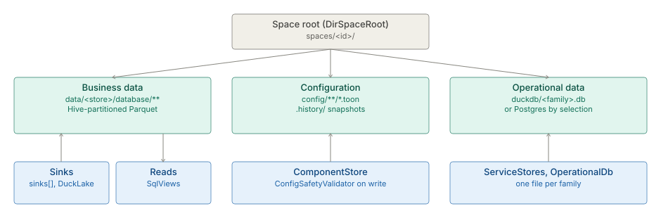

# Storage

> **Level 3 module page** (`SOLUTION-SUITE-DOCS-1`). Layer: Platform base.
> Offering: all tiers (embedded DuckDB everywhere); Postgres for operational data, DuckLake
> registration and the compliance archive are Standard and above. Checked against the code on 2026-10-17.

## 1. What it is

Inspecto has no ORM and no single database. Each Space keeps three physically distinct classes of
state ([db-layer](../engine/spec-db-layer.md) §1):

| Class | What it is | Where it lives | Engine |
|---|---|---|---|
| **Business data** (the lakehouse) | ingested and derived rows | Hive-partitioned Parquet (or CSV) under `<data root>/<store>/**` | files, read through DuckDB `read_parquet` / `read_csv` |
| **Configuration** | Pipelines, Jobs, components, connections, settings | TOON files under the Space's `config/`, with `.history/` snapshots | plain files, no JDBC |
| **Operational data** | the platform's own facts: Alerts, Incidents, job runs, ingest status, ledgers, events | one DuckDB file per family under `<space>/duckdb/`, or Postgres by selection | JDBC |

A **Sink** is where a Pipeline writes business data. The capability spec of record is
[data-plane](../../layer/platform/plan-data-plane.md).

## 2. Who uses it

- **Administrators** choose the operational database and the Space roots at deployment.
- **Integration engineers** declare sinks and stores in Pipelines.
- **Operators** restore an earlier Pipeline or component version, and run retention Jobs.

## 3. Where it sits

Everything else sits on it: [parsing-ingest](../etl/architecture-parsing-ingest.md) and [Pipelines](../etl/architecture-pipelines-steps.md)
write business data; [Studio](../../layer/product/architecture-studio-bi.md) reads it through Datasets; every add-on keeps its
records in the operational stores; [Spaces](../config/architecture-spaces.md) decide where each Space's roots are. Code homes:

- Space roots: `inspecto/src/main/java/com/gamma/service/SpaceRoot.java` (`DirSpaceRoot`,
  `LegacySpaceRoot`).
- Operational stores: `inspecto/src/main/java/com/gamma/service/ServiceStores.java` and
  `inspecto/src/main/java/com/gamma/service/OperationalDb.java`.
- Reads: `platform/inspecto-sql/src/main/java/com/gamma/sql/SqlViews.java`,
  `platform/inspecto-engine/src/main/java/com/gamma/query/DatasetRelation.java`.
- Writes: `platform/inspecto-etl/src/main/java/com/gamma/etl/PartitionWriter.java`.
- Configuration history: `ComponentStore` and `inspecto/src/main/java/com/gamma/control/PipelineHistory.java`.

## 4. How it works

**Space roots.** With `DirSpaceRoot` a Space is a directory (for example `spaces/demo/`) holding
`config/`, `data/`, `duckdb/` and `audit/`. `DirSpaceRoot` creates `duckdb/` on first use, because
DuckDB does not create parent directories. `LegacySpaceRoot` is the flat working-directory layout.

**Business data.** A persistent store is a top-level directory under the Space data root. A
pipeline-shaped store is read at its mapped output, `<store>/database/**`, so `backup/` and
`quarantine/` never leak into reads (`SqlViews.storeReadRoot`). `SqlViews` owns every `read_*(`
option; nothing concatenates its own. Writes are staged and revealed by atomic rename
([output-sinks](../engine/spec-output-sinks.md)).

**Sinks.** A Pipeline has one `output:` plus `dirs.database`, or a `sinks:` list of
`{database, format, compression, ducklake}` entries. `ConfigSafetyValidator.checkSink` path-jails
each `database` and allow-lists format and compression. Format is `PARQUET` or `CSV`
(`OutputFormat`). Optional DuckLake registration runs in the commit
([object-storage-export](../engine/spec-object-storage-export.md) covers pushing a store out).

**Configuration and history.** Components are TOON files written through `ComponentStore`; every
write archives the prior copy to `<typeDir>/.history/<id>.v<N>.toon` (keep
`-Dcomponents.history.keep`, default 10). A Pipeline save snapshots the file to
`<write-root>/.history/pipelines/<pipelineId>/v<N>.toon`, keeping the newest 50 by default
(`pipeline-history.toon`). Every write passes `ConfigSafetyValidator`
([config-safety](../config/spec-config-safety.md), [toon-config](../config/spec-toon-config.md)).

**Operational data.** `OperationalDb` lists the store families — for example `STATUS`, `EVENTS`,
`JOB_RUNS`, `PROVENANCE`, `CONSIGNMENT_OUTPUTS`, `FILE_STAGES`, `DEDUP_LEDGER`,
`ACQUISITION_LEDGER`, `DELIVERY_RECEIPTS`, `ALERTS` — each with its own `*.backend` default.
`-Dinspecto.db=duckdb|postgres` selects the connection for all of them; a per-family `*.db.url` still
wins. DDL is portable (`VARCHAR` / `BIGINT`, no upserts). An unhonourable `postgres` selection fails at
boot. The JDBC driver ships as the `postgresql.jar` sidecar in Standard and Advanced bundles.

## 5. Configuration

| Key | Meaning |
|---|---|
| `-Dinspecto.db`, `-Dinspecto.db.url` / `.user` / `.password` | operational database; password may be `${ENV:…}`, `${KEYSTORE:…}`, `${FILE:…}` |
| `-D<family>.backend`, `-D<family>.db.url` | per-family override, e.g. `-Dstatus.backend`, `-Djobs.backend`, `-Devents.backend` |
| `-Dcomponents.history.keep` | component history depth |
| `pipeline-history.toon` (`/settings/pipeline-history`) | Pipeline history depth per Space |
| `output:`, `sinks:`, `dirs.database` in `*_pipeline.toon` | where business data lands |
| `sinks[].ducklake` | DuckLake registration (Standard and above) |

## 6. Screens

Moved to [Storage — screens](user-guide-storage.md).

## 7. API

Moved to [Storage — API](api-storage.md).

## 8. Interactions

- **Spaces** own the roots and the per-Space store files ([spaces](../config/architecture-spaces.md)).
- **Maker-checker** can hold a configuration write as a pending change ([maker-checker](../workflow/architecture-maker-checker.md)).
- **Backup** archives a Space's configuration tree; retention Jobs prune stores
  ([observability-backup](../observability/architecture-observability-backup.md)).
- **Exchange** reads `shared/…` store references across Spaces ([exchange](../exchange/architecture-overview.md)).

## 9. Limits and gotchas

- Each DuckDB file has a single writer; one store family per file per Space.
- A global `-D*.db.url` funnels every Space into one file; leave it unset in multi-space mode.
- A sink nested inside another store fails the run before any bytes are written.
- Business data is never in the operational database, in any edition.
- The `.restricted` refusal store is excluded from reads, listings and backups
  ([parsing-ingest](../etl/architecture-parsing-ingest.md)).
- Postgres round-trip tests cover nine of the twelve families; the dedup ledger, acquisition ledger
  and delivery receipts are covered by reasoning only.
