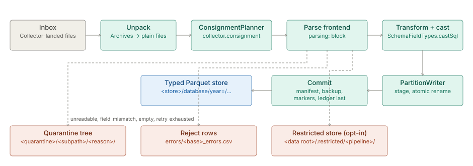

# Parsing and ingest

> **Level 3 module page** (`SOLUTION-SUITE-DOCS-1`). Layer: Platform base.
> Offering: all tiers; the ASN.1 frontend (module `inspecto-telecom-asn1`) is Standard and above.
> Checked against the code on 2026-10-17.

## 1. What it is

Stage-1 ingest is the road from a file in a Pipeline's inbox to typed rows in a Parquet store. It
groups inbox files into a **Consignment**, parses each file with one of the parse frontends, maps and
casts the columns to the declared Schema, writes partitioned Parquet, and commits the whole
Consignment atomically. A file that cannot be read goes to the **quarantine** tree; rows that fail
parsing go to a reject file beside it.

The capability spec of record is [ingestion.md](plan-ingestion.md); the design is
[stage1-architecture.md](../engine/architecture-stage1.md). This page is the module summary.

Code homes:

- Poll cycle and Consignment coordinator: `platform/inspecto-engine/src/main/java/com/gamma/inspector`
  (`CollectorProcessor`, `ConsignmentIngestor`, `MultiCollectorProcessor`).
- Planner, writer and Unpack: `platform/inspecto-etl/src/main/java/com/gamma/etl`
  (`ConsignmentPlanner`, `PartitionWriter`, `CommitLog`, `MarkerManager`, package `unpack`).
- Parser registry: `platform/inspecto-engine/src/main/java/com/gamma/parse` (`ParserPlugin`, `Parsers`).
- Control routes: `inspecto/src/main/java/com/gamma/control/ParserRoutes.java` and
  `inspecto/src/main/java/com/gamma/control/RunRoutes.java`.

## 2. Who uses it

- **Integration engineers** author the `parsing:` block, the Schema mapping and the grammar of a
  Pipeline, and preview a sample file before saving.
- **Operators** watch Consignments land, read the quarantine tree and the rejected rows, and
  reprocess or replay.
- **Plugin authors** add a format through the `StreamingFileIngester` wrap-SPI
  ([ingest-wrap-spi](../engine/spec-ingest-wrap-spi.md)).

## 3. Where it sits

Ingest starts where a [Collector](../acquire/architecture-collectors.md) has landed a file in `dirs.poll`. It ends at a
committed store that [Datasets](../../layer/product/architecture-studio-bi.md) and at-rest [Steps](architecture-pipelines-steps.md) read. Typing
rules come from the Schema registry (metamodel); storage layout is described in [storage](../entity-store/architecture-storage.md).
Every Consignment runs on a virtual thread bounded by `processing.threads`; many Pipelines share one
JVM under `MultiCollectorProcessor`.

## 4. How it works

1. **Scan and Unpack.** `CollectorProcessor.ingest` scans the inbox and expands Archives and
   compressed streams through the Unpack stage (`UnpackStage`, `UnpackLimits`) before planning, so an
   Entry is an ordinary file from then on ([unpack-stage](../acquire/spec-unpack-stage.md)).
2. **Plan.** `ConsignmentPlanner` cuts the candidate list into Consignments bounded by
   `collector.consignment: {max_files, max_bytes, order}` (`order` is `mtime` by default, or `name`).
3. **Parse.** `ConsignmentIngestor` picks a strategy: `CsvIngestStrategy` for the DuckDB-native
   frontends, `StreamingPluginIngestStrategy` for Java parsers. The plugin strategy runs union mode
   when every file is below `processing.streaming.large_file_bytes` (default 256 MB) and generation
   mode, in batches of `flush_records` rows, above it.
4. **Map and cast.** `SchemaFieldTypes.castSql` casts each mapped column to its declared type. A
   failed `TRY_CAST` yields NULL and keeps the row; `DataTransformer.countCastFailures` counts those.
5. **Write.** `PartitionWriter` copies into a staging directory and reveals by atomic rename, with
   `PARTITION_BY` for a keyed schema and one flat file for an unkeyed one.
6. **Commit.** In crash-safe order: DuckLake register, manifest, backup of originals, markers, and the
   ledger last. A failed Consignment leaves no marker, so its files are found again on the next poll.
   Retries are bounded by `-Dingest.retry.max` (default 5); exhaustion quarantines the file.

**The frontends.** `PipelineConfigParser.FRONTENDS` accepts ten tokens for eight formats:

| Token | Engine |
|---|---|
| `delimited` | DuckDB `read_csv`, or the Java `CsvIngester` when junk-line skipping forces it |
| `fixedwidth` / `fixed_width` | `read_text` plus SQL substrings; binary records use `FixedWidthRecordIngester` |
| `json` | `read_json`, with a `records_path` selector |
| `text_regex` | `read_text` plus SQL regex; `record_split` enables block records |
| `xlsx` / `excel` | DuckDB `excel` extension |
| `parquet` | native read |
| `asn1` | `Asn1ParserPlugin` and `Asn1RecordIngester` |
| `plugin` | any `StreamingFileIngester` class, for example `XmlRecordIngester` |

**Quarantine.** A bad file moves to `<quarantine>/<poll-subpath>/<reason>/<file>` with reason
`field_mismatch`, `unreadable`, `empty`, `corrupt_download` or `retry_exhausted`. Parse rejects travel
as `errors/<base>_errors.csv`. With `processing.refusal: restricted_quarantine` a file can be refused
whole (mapping `INGEST_REFUSE:<CODE>`, or the card-number scan) and moved to
`<data root>/.restricted/<pipeline>/`, outside every `dirs:` entry.

## 5. Configuration

All keys live in the Pipeline's `*_pipeline.toon`; the full list is
[parsing-options-reference.md](../engine/spec-parsing-options.md).

| Key | Meaning |
|---|---|
| `parsing.frontend` and its sub-block | which frontend, plus its grammar options |
| `parsing.plugin.ingester` | fully qualified `StreamingFileIngester` class for `plugin` |
| `collector.consignment.max_files` / `max_bytes` / `order` | Consignment size and order |
| `processing.threads` | parallel Consignments per Pipeline |
| `processing.streaming.large_file_bytes`, `flush_records` | union vs generation mode |
| `processing.duplicate_check` | file-grain duplicate check (record dedup is the `transform.dedup` Step) |
| `processing.refusal`, `refusal_scan`, `refusal_scan_exempt` | opt-in content refusal |
| `dirs.poll`, `dirs.quarantine`, `dirs.database` | inbox, quarantine and output roots |
| `-Dingest.retry.max`, `-Dingest.lane` | JVM flags: retry cap; `auto`, `graph` or `flat` lane |

## 6. Screens

- **Pipeline editor, Parse definition** (`inspecto-ui/src/app/modules/admin/pipelines/pipeline-parse-definition.component.ts`):
  frontend choice, grammar form rendered from the parser's served `grammarSchema`, and a sample preview.
- **Run detail** (`inspecto-ui/src/app/modules/admin/run-detail/run-detail.component.ts`): tabs
  Batches, Files, Lineage, Quarantine and Commits, plus "View the rejected rows".
- **Processing status** (`inspecto-ui/src/app/modules/admin/processing-status/processing-status.component.ts`):
  problem files per Pipeline.

## 7. API

| Route | Purpose |
|---|---|
| `GET /parsers`, `POST /parsers/{id}/preview`, `/parsers/asn1/profile` | parser list and compute-only preview |
| `POST /config/preview/parsing`, `POST /config/preview/schema` | preview the parse and the cast of a draft |
| `GET /runs/{name}/batches`, `/files`, `/lineage`, `/quarantine`, `/commits`, `/outputs` | Run-detail ledgers |
| `GET /runs/{name}/errors?file=` | the reject rows for one file (bounded, reports `truncated`) |
| `POST /runs/{name}/trigger`, `/pause`, `/resume`, `/reprocess`, `/replay-rejects` | operator actions |

## 8. Interactions

- **Collectors** land files; ingest never fetches ([collectors](../acquire/architecture-collectors.md)).
- **Pipelines and Steps:** a `route:` Pipeline forks the write per branch on the ingest lane; the
  at-rest chain runs after commit as a Job ([pipelines-steps](architecture-pipelines-steps.md)).
- **Jobs:** an `on_pipeline` Job fires on a committed Consignment ([jobs-scheduler](../processor/architecture-jobs-scheduler.md)).
- **Events:** commit and failure outcomes are published as Signals ([events](../event/architecture-overview.md)).
- **Storage:** the committed store and the status ledgers ([storage](../entity-store/architecture-storage.md)).
- **Observability:** batch counters and the status ledger feed run reports ([observability-backup](../observability/architecture-observability-backup.md)).

## 9. Limits and gotchas

- A file's outcome and its Consignment's outcome are two facts: a `COMMITTED` file inside a `FAILED`
  Consignment is normal, and the failed Consignment is retried as a whole.
- A cast failure keeps the row with a NULL value; it is counted, not quarantined.
- An unknown `delimited.*` key is not rejected at load.
- Nested Archives are not extracted: `UnpackLimits.depth` is 1 and other values are refused.
- An ASN.1 or XML parse error fails the whole file as unreadable, never a prefix.
- Hive partition columns do not read back with one type (`year` as `BIGINT`, `month` and `day` as
  `VARCHAR`).
- Expectations evaluate at rest, not at ingest, and have no UI.
