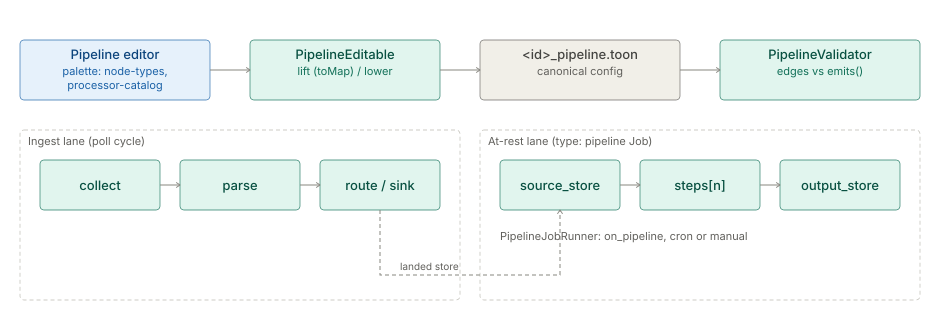

# Pipelines and Steps

> **Level 3 module page** (`SOLUTION-SUITE-DOCS-1`). Layer: Platform base.
> Offering: all tiers; the `transform.mask` Step is Advanced. Checked against the code on 2026-10-17.

## 1. What it is

A **Pipeline** is a chain of **Steps**: `collect → parse → transform Steps → sink`. It is authored
as one file, `<id>_pipeline.toon`, and edited either as text or as a graph in the Pipeline editor.
The graph is an immutable IR (`PipelineGraph`) lifted from the flat config; the editor's save lowers
it back into the same file, so there is one source of truth.

Two vocabularies describe Steps:

- **Step kinds** — the node types the engine executes (`BuiltinNodeType`, served with their
  attribute specs by `GET /pipelines/node-types`). Plugins add more through the `PipelineNodeType`
  `ServiceLoader` seam ([node-types](../engine/spec-node-types.md)).
- **Step Processors** — the 119-entry product taxonomy the palette lists in eight families
  (`ProcessorCatalog`, `GET /pipelines/processor-catalog`). A processor is a label over a Step kind or
  an engine capability, not a class of its own; planned entries show as "Not yet available".

The as-built references are the [pipeline-graph bundle](../../index.md) and the
[step catalog](spec-step-catalog.md); the capability specs are
[pipeline-authoring](plan-pipeline-authoring.md) and
[pipeline-execution](../engine/plan-pipeline-execution.md).

## 2. Who uses it

- **Integration engineers and analysts** author Pipelines in the editor or as TOON.
- **Operators** run, pause, drain and dry-run them, and restore an earlier saved version.
- **Plugin authors** add node types and parsers.

## 3. Where it sits

A Pipeline binds a [Collector](../acquire/architecture-collectors.md), the [parse stage](architecture-parsing-ingest.md), transform Steps
and one or more sinks into [storage](../entity-store/architecture-storage.md). Its at-rest half runs as a Job of type `pipeline`
on the [scheduler](../processor/architecture-jobs-scheduler.md). Code homes:

- Model, lift and validator: `platform/inspecto-engine/src/main/java/com/gamma/pipeline`
  (`PipelineGraph`, `PipelineLift`, `PipelineValidator`, `PipelineEditable`, `BuiltinNodeType`,
  `PipelineNodeTypes`, `ProcessorCatalog`).
- At-rest runner: `platform/inspecto-engine/src/main/java/com/gamma/job/PipelineJobRunner.java`.
- Routes: `inspecto/src/main/java/com/gamma/control/PipelineGraphRoutes.java`,
  `PipelineListRoutes.java`, `PipelineHistoryRoutes.java`, `PipelineSettingsRoutes.java`.

## 4. How it works

**Two lanes.** Every Step executes in exactly one lane ([execution-lanes](../engine/spec-execution-lanes.md)):

| Lane | Steps | How it runs |
|---|---|---|
| Ingest | `collect`, every `parse` frontend, `route`, `sink` | the poll cycle; `route:` forks the write into one destination per branch |
| At rest | `filter`, `dedup`, `join`, `summarize`, `sql` and the other `transform.*` Steps in `steps[n]:` | a `type: pipeline` Job lifts the chain and runs it over the landed store, writing `output_store:` |

**Delivered Step kinds** (from `BuiltinNodeType`): `acquisition`; the parser family
(`parser.delimited`, `parser.fixedwidth`, `parser.json`, `parser.text_regex`, `parser.xlsx`,
`parser.asn1`, `parser.plugin`); `transform.filter`, `transform.lookup`, `transform.select`,
`transform.derive`, `transform.sql`, `transform.validate`, `transform.dedup`, `transform.route`,
`transform.join`, `transform.summarize`, `transform.running`, `transform.profile`, `transform.hash`,
`transform.mask`, `transform.explode`, `transform.matrix.unpivot`, `transform.timeseries.resample`,
`transform.timeseries.shift`, `transform.timeseries.forecast`, `transform.similarity`,
`transform.analytics.rank`, `transform.sample`, `transform.matrix.pivot`, `transform.entity.link`,
`transform.stats.outlier`, `transform.data.binning`, `transform.stats.correlation`, `transform.split`,
`transform.merge`; and the sinks
(`sink.persistent`, `sink.materialized`, `sink.webhook`, `sink.excel`, `sink.view`). The step catalog documents each
one's keys, refusals and a runnable example.

**The round-trip.** `PipelineEditable.toMap` lifts topology but carries each node's verbatim TOON
section; `lower` writes those sections back. A present node owns its section; keys the graph does not
model travel through a save untouched. A graph the flat file cannot express is refused with a named
code (`UNSUPPORTED_NODE`, `UNSUPPORTED_BINDING` and others) rather than truncated
([editable-round-trip](../engine/spec-editable-round-trip.md)).

**Validation.** `PipelineValidator` rejects an edge whose relationship is not in the source node
type's `emits()`. Saves also pass `ConfigSafetyValidator` (path jail and allow-lists).

**At-rest execution.** `PipelineJobRunner` loads the graph, registers a DuckDB view per
`source_store` seed (at least one is required), walks the graph with `PipelineExecutor`, writes sinks
through `PartitionSinkWriter`, optionally records provenance and runs `ConservationCheck`, then
publishes a Consignment event ([live-execution](../engine/spec-live-execution.md)).

**Park and drain.** Switching off a route-branch sink parks its Consignments durably;
`POST /runs/{name}/drain` completes them through the real commit tail
([step-park-drain](../engine/spec-step-park-drain.md)).

## 5. Configuration

The census of every block is [pipeline-config-keys](../config/spec-pipeline-config-keys.md).

| Key | Meaning |
|---|---|
| `collector:` | the Collector and Consignment caps |
| `parsing:` | frontend and grammar ([parsing-ingest](architecture-parsing-ingest.md)) |
| `route:` | ingest-lane branches, one destination each |
| `steps[n]:` | the at-rest chain, a list of single-key maps |
| `output_store:` | where the at-rest chain writes; a chain without it refuses to lift |
| `output:`, `sinks:` | one destination, or a list of `{database, format, compression, ducklake}` |
| `*_job.toon` `type: pipeline` with `pipeline_config:` and `on_pipeline:` | runs the at-rest chain after each commit |

## 6. Screens

- **Pipeline editor** (`inspecto-ui/src/app/modules/admin/pipelines/pipeline-editor.component.ts`,
  graph in `pipeline-editor-graph.component.ts`): palette, node forms generated from the served
  attribute specs, dry run, save and history. UI reference:
  [pipeline-editor](user-guide-pipeline-editor.md).
- **Runs and Run detail**: trigger, pause, resume, drain ([parsing-ingest](architecture-parsing-ingest.md) §6).

## 7. API

| Route | Purpose |
|---|---|
| `GET /pipelines`, `/pipelines/combined`, `/pipelines/authored`, `/pipelines/authored/{id}` | lists and one Pipeline |
| `GET /pipelines/node-types`, `GET /pipelines/processor-catalog` | palette and node specs |
| `GET /pipelines/{name}/graph`, `PUT /pipelines/{name}/graph`, `GET …/graph/raw`, `GET …/document` | read and save the graph |
| `POST /pipelines/authored/{id}/dry-run`, `/run`, `/trigger` | dry run, test run and trigger |
| `GET /pipelines/{name}/history`, `…/history/{version}`, `…/history/diff`, `POST …/history/{version}/restore` | saved versions |
| `POST /pipelines/{name}/rename`, `GET` / `POST …/settings`, `POST …/label`, `POST …/save-as-template` | rename, settings, template |
| `GET /pipelines/{name}/related`, `GET /config/pipeline/{name}/impact` | dependants and impact |

## 8. Interactions

- **Jobs:** the at-rest lane is a `pipeline` Job ([jobs-scheduler](../processor/architecture-jobs-scheduler.md)).
- **Analytics kernel:** `transform.profile`, `transform.timeseries.*` and `transform.similarity` call
  the kernel ([analytics-kernel](../analytics/architecture-overview.md)).
- **Maker-checker:** a Pipeline save can be held as a pending change ([maker-checker](../workflow/architecture-maker-checker.md)).
- **Platform Services:** a dry run substitutes stand-ins ([platform-services](../../layer/platform/architecture-platform-services.md)).

## 9. Limits and gotchas

- Graph save is key-preserving but reformats the file; unquoted scalars can change form.
- An active Pipeline whose at-rest chain no Job runs is an orphan finding, not an error.
- `PipelineNodeType` carries no execution hook; a plugin node type needs an executor elsewhere.
- Providers override a built-in node type of the same `type()`; the last one loaded wins.
- A dry run of a `transform.join` whose reference file is missing answers 422 `JOIN_REFERENCE_MISSING`.
- Record dedup is the `transform.dedup` Step; `processing.dedup` on the ingest lane is refused.
