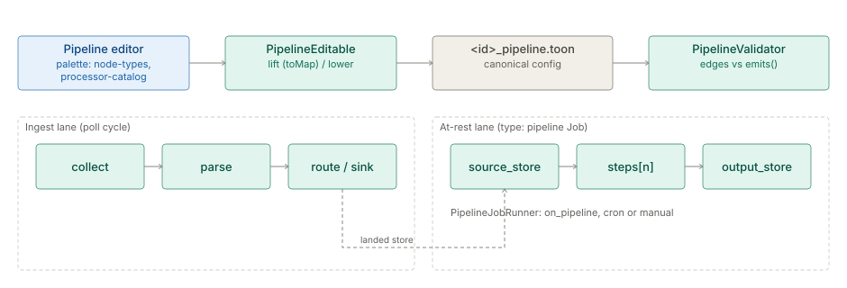
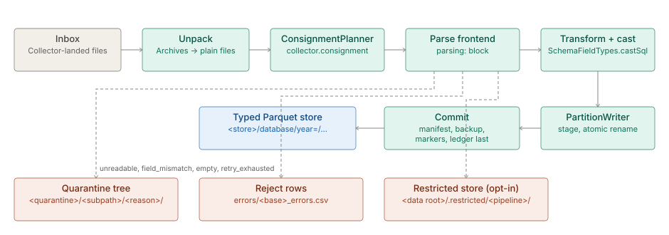

# Pipelines, Steps and ingest

The architecture of the `etl` hub, in two parts: the Pipeline as a chain of Steps (authoring, the graph
round-trip, the two execution lanes) and Stage-1 ingest, the road from a file in a Pipeline's inbox to
typed rows in a Parquet store. Each part keeps its own status line and the date it was checked against
the code.

**On this page**

- [Pipelines and Steps](#pipelines-and-steps) — Step kinds, the two lanes, the round-trip, at-rest execution.
- [Parsing and ingest](#parsing-and-ingest) — Consignments, the parse frontends, quarantine and commit.

## Pipelines and Steps

> **Level 3 module page** (`SOLUTION-SUITE-DOCS-1`). Layer: Platform base.
> Offering: all tiers; the `transform.mask` Step is Advanced. Checked against the code on 2026-10-17.

### 1. What it is

A **Pipeline** is a chain of **Steps**: `collect → parse → transform Steps → sink`. It is authored
as one file, `<id>_pipeline.toon`, and edited either as text or as a graph in the Pipeline editor.
The graph is an immutable IR (`PipelineGraph`) lifted from the flat config; the editor's save lowers
it back into the same file, so there is one source of truth.

Two vocabularies describe Steps:

- **Step kinds** — the node types the engine executes (`BuiltinNodeType`, served with their
  attribute specs by `GET /pipelines/node-types`). Plugins add more through the `PipelineNodeType`
  `ServiceLoader` seam ([node-types](../engine/spec-node-types.md)).
- **Step Processors** — the 119-entry product taxonomy the palette lists in eight families
  (`ProcessorCatalog`, `GET /pipelines/processor-catalog`). A processor is a label over a Step kind or
  an engine capability, not a class of its own; planned entries show as "Not yet available".

The as-built references are the [pipeline-graph bundle](../../index.md) and the
[step catalog](spec-step-catalog.md); the capability specs are
[pipeline-authoring](plan-pipeline-authoring.md) and
[pipeline-execution](../engine/plan-pipeline-execution.md).

### 2. Who uses it

- **Integration engineers and analysts** author Pipelines in the editor or as TOON.
- **Operators** run, pause, drain and dry-run them, and restore an earlier saved version.
- **Plugin authors** add node types and parsers.

### 3. Where it sits

A Pipeline binds a [Collector](../acquire/architecture.md), the [parse stage](#parsing-and-ingest), transform Steps
and one or more sinks into [storage](../entity-store/architecture.md). Its at-rest half runs as a Job of type `pipeline`
on the [scheduler](../processor/architecture.md). Code homes:

- Model, lift and validator: `platform/inspecto-engine/src/main/java/com/gamma/pipeline`
  (`PipelineGraph`, `PipelineLift`, `PipelineValidator`, `PipelineEditable`, `BuiltinNodeType`,
  `PipelineNodeTypes`, `ProcessorCatalog`).
- At-rest runner: `platform/inspecto-engine/src/main/java/com/gamma/job/PipelineJobRunner.java`.
- Routes: `inspecto/src/main/java/com/gamma/control/PipelineGraphRoutes.java`,
  `PipelineListRoutes.java`, `PipelineHistoryRoutes.java`, `PipelineSettingsRoutes.java`.

### 4. How it works

**Two lanes.** Every Step executes in exactly one lane ([execution-lanes](../engine/spec-execution-lanes.md)):

| Lane | Steps | How it runs |
|---|---|---|
| Ingest | `collect`, every `parse` frontend, `route`, `sink` | the poll cycle; `route:` forks the write into one destination per branch |
| At rest | `filter`, `dedup`, `join`, `summarize`, `sql` and the other `transform.*` Steps in `steps[n]:` | a `type: pipeline` Job lifts the chain and runs it over the landed store, writing `output_store:` |

**Delivered Step kinds** (from `BuiltinNodeType`): `acquisition`; the parser family
(`parser.delimited`, `parser.fixedwidth`, `parser.json`, `parser.text_regex`, `parser.xlsx`,
`parser.asn1`, `parser.plugin`); `transform.filter`, `transform.lookup`, `transform.select`,
`transform.derive`, `transform.sql`, `transform.validate`, `transform.dedup`, `transform.route`,
`transform.join`, `transform.summarize`, `transform.running`, `transform.profile`, `transform.hash`,
`transform.mask`, `transform.explode`, `transform.matrix.unpivot`, `transform.timeseries.resample`,
`transform.timeseries.shift`, `transform.timeseries.forecast`, `transform.similarity`,
`transform.analytics.rank`, `transform.sample`, `transform.matrix.pivot`, `transform.entity.link`,
`transform.stats.outlier`, `transform.data.binning`, `transform.stats.correlation`,
`transform.timeseries.changepoint`, `transform.cohort.retention`, `transform.cohort.funnel`, `transform.split`,
`transform.merge`; and the sinks
(`sink.persistent`, `sink.materialized`, `sink.webhook`, `sink.excel`, `sink.view`). The step catalog documents each
one's keys, refusals and a runnable example.

**The round-trip.** `PipelineEditable.toMap` lifts topology but carries each node's verbatim TOON
section; `lower` writes those sections back. A present node owns its section; keys the graph does not
model travel through a save untouched. A graph the flat file cannot express is refused with a named
code (`UNSUPPORTED_NODE`, `UNSUPPORTED_BINDING` and others) rather than truncated
([editable-round-trip](../engine/spec-editable-round-trip.md)).

**Validation.** `PipelineValidator` rejects an edge whose relationship is not in the source node
type's `emits()`. Saves also pass `ConfigSafetyValidator` (path jail and allow-lists).

**At-rest execution.** `PipelineJobRunner` loads the graph, registers a DuckDB view per
`source_store` seed (at least one is required), walks the graph with `PipelineExecutor`, writes sinks
through `PartitionSinkWriter`, optionally records provenance and runs `ConservationCheck`, then
publishes a Consignment event ([live-execution](../engine/spec-live-execution.md)).

**Park and drain.** Switching off a route-branch sink parks its Consignments durably;
`POST /runs/{name}/drain` completes them through the real commit tail
([step-park-drain](../engine/spec-step-park-drain.md)).

### 5. Configuration

The census of every block is [pipeline-config-keys](../config/spec-pipeline-config-keys.md).

| Key | Meaning |
|---|---|
| `collector:` | the Collector and Consignment caps |
| `parsing:` | frontend and grammar ([parsing-ingest](#parsing-and-ingest)) |
| `route:` | ingest-lane branches, one destination each |
| `steps[n]:` | the at-rest chain, a list of single-key maps |
| `output_store:` | where the at-rest chain writes; a chain without it refuses to lift |
| `output:`, `sinks:` | one destination, or a list of `{database, format, compression, ducklake}` |
| `*_job.toon` `type: pipeline` with `pipeline_config:` and `on_pipeline:` | runs the at-rest chain after each commit |

### 6. Screens

Moved to [the user guide](user-guide-pipelines.md#screens).

### 7. API

Moved to [Pipelines and Steps — API](api-pipelines-steps.md).

### 8. Interactions

- **Jobs:** the at-rest lane is a `pipeline` Job ([jobs-scheduler](../processor/architecture.md)).
- **Analytics kernel:** `transform.profile`, `transform.timeseries.*` and `transform.similarity` call
  the kernel ([analytics-kernel](../analytics/architecture.md)).
- **Maker-checker:** a Pipeline save can be held as a pending change ([maker-checker](../workflow/architecture.md)).
- **Platform Services:** a dry run substitutes stand-ins ([platform-services](../../layer/platform/architecture-platform-services.md)).

### 9. Limits and gotchas

- Graph save is key-preserving but reformats the file; unquoted scalars can change form.
- An active Pipeline whose at-rest chain no Job runs is an orphan finding, not an error.
- `PipelineNodeType` carries no execution hook; a plugin node type needs an executor elsewhere.
- Providers override a built-in node type of the same `type()`; the last one loaded wins.
- A dry run of a `transform.join` whose reference file is missing answers 422 `JOIN_REFERENCE_MISSING`.
- Record dedup is the `transform.dedup` Step; `processing.dedup` on the ingest lane is refused.

## Parsing and ingest

> **Level 3 module page** (`SOLUTION-SUITE-DOCS-1`). Layer: Platform base.
> Offering: all tiers; the ASN.1 frontend (module `inspecto-telecom-asn1`) is Standard and above.
> Checked against the code on 2026-10-17.

### 1. What it is

Stage-1 ingest is the road from a file in a Pipeline's inbox to typed rows in a Parquet store. It
groups inbox files into a **Consignment**, parses each file with one of the parse frontends, maps and
casts the columns to the declared Schema, writes partitioned Parquet, and commits the whole
Consignment atomically. A file that cannot be read goes to the **quarantine** tree; rows that fail
parsing go to a reject file beside it.

The capability spec of record is [ingestion.md](plan-ingestion.md); the design is
[stage1-architecture.md](../engine/architecture-stage1.md). This part is the module summary.

Code homes:

- Poll cycle and Consignment coordinator: `platform/inspecto-engine/src/main/java/com/gamma/inspector`
  (`CollectorProcessor`, `ConsignmentIngestor`, `MultiCollectorProcessor`).
- Planner, writer and Unpack: `platform/inspecto-etl/src/main/java/com/gamma/etl`
  (`ConsignmentPlanner`, `PartitionWriter`, `CommitLog`, `MarkerManager`, package `unpack`).
- Parser registry: `platform/inspecto-engine/src/main/java/com/gamma/parse` (`ParserPlugin`, `Parsers`).
- Control routes: `inspecto/src/main/java/com/gamma/control/ParserRoutes.java` and
  `inspecto/src/main/java/com/gamma/control/RunRoutes.java`.

### 2. Who uses it

- **Integration engineers** author the `parsing:` block, the Schema mapping and the grammar of a
  Pipeline, and preview a sample file before saving.
- **Operators** watch Consignments land, read the quarantine tree and the rejected rows, and
  reprocess or replay.
- **Plugin authors** add a format through the `StreamingFileIngester` wrap-SPI
  ([ingest-wrap-spi](../engine/spec-ingest-wrap-spi.md)).

### 3. Where it sits

Ingest starts where a [Collector](../acquire/architecture.md) has landed a file in `dirs.poll`. It ends at a
committed store that [Datasets](../../layer/product/architecture-studio-bi.md) and at-rest [Steps](#pipelines-and-steps) read. Typing
rules come from the Schema registry (metamodel); storage layout is described in [storage](../entity-store/architecture.md).
Every Consignment runs on a virtual thread bounded by `processing.threads`; many Pipelines share one
JVM under `MultiCollectorProcessor`.

### 4. How it works

1. **Scan and Unpack.** `CollectorProcessor.ingest` scans the inbox and expands Archives and
   compressed streams through the Unpack stage (`UnpackStage`, `UnpackLimits`) before planning, so an
   Entry is an ordinary file from then on ([unpack-stage](../acquire/spec-unpack-stage.md)).
2. **Plan.** `ConsignmentPlanner` cuts the candidate list into Consignments bounded by
   `collector.consignment: {max_files, max_bytes, order}` (`order` is `mtime` by default, or `name`).
3. **Parse.** `ConsignmentIngestor` picks a strategy: `CsvIngestStrategy` for the DuckDB-native
   frontends, `StreamingPluginIngestStrategy` for Java parsers. The plugin strategy runs union mode
   when every file is below `processing.streaming.large_file_bytes` (default 256 MB) and generation
   mode, in batches of `flush_records` rows, above it.
4. **Map and cast.** `SchemaFieldTypes.castSql` casts each mapped column to its declared type. A
   failed `TRY_CAST` yields NULL and keeps the row; `DataTransformer.countCastFailures` counts those.
5. **Write.** `PartitionWriter` copies into a staging directory and reveals by atomic rename, with
   `PARTITION_BY` for a keyed schema and one flat file for an unkeyed one.
6. **Commit.** In crash-safe order: DuckLake register, manifest, backup of originals, markers, and the
   ledger last. A failed Consignment leaves no marker, so its files are found again on the next poll.
   Retries are bounded by `-Dingest.retry.max` (default 5); exhaustion quarantines the file.

**The frontends.** `PipelineConfigParser.FRONTENDS` accepts ten tokens for eight formats:

| Token | Engine |
|---|---|
| `delimited` | DuckDB `read_csv`, or the Java `CsvIngester` when junk-line skipping forces it |
| `fixedwidth` / `fixed_width` | `read_text` plus SQL substrings; binary records use `FixedWidthRecordIngester` |
| `json` | `read_json`, with a `records_path` selector |
| `text_regex` | `read_text` plus SQL regex; `record_split` enables block records |
| `xlsx` / `excel` | DuckDB `excel` extension |
| `parquet` | native read |
| `asn1` | `Asn1ParserPlugin` and `Asn1RecordIngester` |
| `plugin` | any `StreamingFileIngester` class, for example `XmlRecordIngester` |

**Quarantine.** A bad file moves to `<quarantine>/<poll-subpath>/<reason>/<file>` with reason
`field_mismatch`, `unreadable`, `empty`, `corrupt_download` or `retry_exhausted`. Parse rejects travel
as `errors/<base>_errors.csv`. With `processing.refusal: restricted_quarantine` a file can be refused
whole (mapping `INGEST_REFUSE:<CODE>`, or the card-number scan) and moved to
`<data root>/.restricted/<pipeline>/`, outside every `dirs:` entry.

### 5. Configuration

All keys live in the Pipeline's `*_pipeline.toon`; the full list is
[parsing-options-reference.md](../engine/spec-parsing-options.md).

| Key | Meaning |
|---|---|
| `parsing.frontend` and its sub-block | which frontend, plus its grammar options |
| `parsing.plugin.ingester` | fully qualified `StreamingFileIngester` class for `plugin` |
| `collector.consignment.max_files` / `max_bytes` / `order` | Consignment size and order |
| `processing.threads` | parallel Consignments per Pipeline |
| `processing.streaming.large_file_bytes`, `flush_records` | union vs generation mode |
| `processing.duplicate_check` | file-grain duplicate check (record dedup is the `transform.dedup` Step) |
| `processing.refusal`, `refusal_scan`, `refusal_scan_exempt` | opt-in content refusal |
| `dirs.poll`, `dirs.quarantine`, `dirs.database` | inbox, quarantine and output roots |
| `-Dingest.retry.max`, `-Dingest.lane` | JVM flags: retry cap; `auto`, `graph` or `flat` lane |

### 6. Screens

Moved to [Parsing and ingest — screens](user-guide-parsing-ingest.md).

### 7. API

Moved to [Parsing and ingest — API](api-parsing-ingest.md).

### 8. Interactions

- **Collectors** land files; ingest never fetches ([collectors](../acquire/architecture.md)).
- **Pipelines and Steps:** a `route:` Pipeline forks the write per branch on the ingest lane; the
  at-rest chain runs after commit as a Job ([pipelines-steps](#pipelines-and-steps)).
- **Jobs:** an `on_pipeline` Job fires on a committed Consignment ([jobs-scheduler](../processor/architecture.md)).
- **Events:** commit and failure outcomes are published as Signals ([events](../event/architecture.md)).
- **Storage:** the committed store and the status ledgers ([storage](../entity-store/architecture.md)).
- **Observability:** batch counters and the status ledger feed run reports ([observability-backup](../observability/architecture.md)).

### 9. Limits and gotchas

- A file's outcome and its Consignment's outcome are two facts: a `COMMITTED` file inside a `FAILED`
  Consignment is normal, and the failed Consignment is retried as a whole.
- A cast failure keeps the row with a NULL value; it is counted, not quarantined.
- An unknown `delimited.*` key is not rejected at load.
- Nested Archives are not extracted: `UnpackLimits.depth` is 1 and other values are refused.
- An ASN.1 or XML parse error fails the whole file as unreadable, never a prefix.
- Hive partition columns do not read back with one type (`year` as `BIGINT`, `month` and `day` as
  `VARCHAR`).
- Expectations evaluate at rest, not at ingest, and have no UI.
