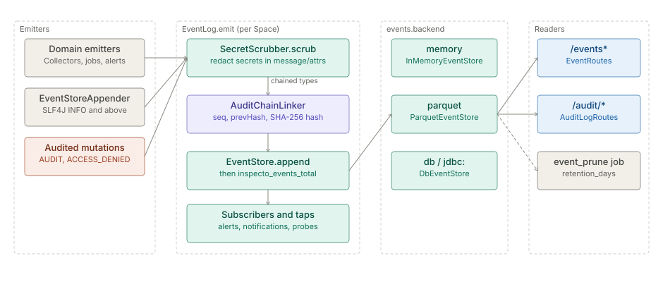

# Events and event log

> **Level 3 module page** (`SOLUTION-SUITE-DOCS-1`). Layer: Platform base.
> Offering: every edition (the bus is `platform/inspecto-event`; the `/events*` routes ship with the
> `observability` module in `features/inspecto-observability`). Checked against the code on 2026-10-17.

## 1. What it is

The **event log** is the per-Space, append-only record of what happened: lifecycle facts (`BATCH_COMMITTED`,
`FILE_QUARANTINED`, `ALERT_FIRED` ...), captured log lines (`LOG`) and the security audit trail (`AUDIT`,
`ACCESS_DENIED`). `EventLog` (`platform/inspecto-event/src/main/java/com/gamma/event/EventLog.java`) is the
synchronous bus that writes each event to an `EventStore` and hands it to subscribers.

## 2. Who uses it

- **Operators** read the Events screen and filter by level, type, Pipeline or correlation id (any caller).
- **Builders** save named filters (`/events/views`, capability `canAuthorWorkbench`).
- **Auditors / administrators** search and export the audit trail and verify the hash chain (`canAdminister`
  for `/audit/verify` and `/audit/anchors`).
- Internally, [Alerts](../../addon/incidents/architecture-alerts.md), [Notifications](../notify-channels/architecture-overview.md) and freshness probes subscribe to it.

## 3. Where it sits

- SPI types: `spi/inspecto-audit-spi` - `Event`, `EventLevel`, `EventType`, `EventStore`, `EventSink`,
  `EventQuery`, `AuditChain`, `AuditAttrs` (package `com.gamma.audit`).
- Implementation: `platform/inspecto-event` - `EventLog`, `InMemoryEventStore`, `ParquetEventStore`,
  `DbEventStore`, `EventStoreAppender`, `SecretScrubber`, `AuditChainLinker`, `SavedViewStore`, plus
  `MetricRegistry` (`com/gamma/metrics/MetricRegistry.java`).
- Routes: `EventRoutes` (`features/inspecto-observability/src/main/java/com/gamma/eventsapi/EventRoutes.java`)
  and `AuditLogRoutes` (`inspecto/src/main/java/com/gamma/control/AuditLogRoutes.java`).
- Gates: Installed (every Offering ships the bus); the `/events*` routes follow the `observability` module's
  Enabled gate; Permitted per the table in section 7.

## 4. How it works

1. A domain emitter calls `EventLog.emit`, or `EventStoreAppender` turns an SLF4J record at `INFO` or above
   into a `LOG` event (`EventLevel.CAPTURE_THRESHOLD`; `DEBUG`/`TRACE` are never captured automatically).
2. `EventLog.current()` routes by the calling thread's `space` MDC; an MDC naming an unregistered Space is
   dropped, never routed to the global log.
3. `SecretScrubber` redacts secrets in message and attributes.
4. For `AUDIT` and `ACCESS_DENIED`, the Space's `AuditChain` stamps `audit_seq`, `audit_prev_hash` and
   `audit_hash` (SHA-256 over canonical JSON) before the append, holding one writer per Space.
5. The event is appended to the Space's `EventStore`, then each subscriber is called **inline on the
   publishing thread**; subscribers that start work hand it to a virtual-thread pool.
6. Readers query through `/events*` and `/audit/*`; the `event_prune` maintenance Job ages out old days.

**Event kinds.** `EventType` is an open set of string constants, not a closed enum: a caller may emit a new
type without editing the class. Families present today: logging and audit (`LOG`, `AUDIT`, `ACCESS_DENIED`,
`SECURITY_TRIGGERED`), Pipeline lifecycle (`PIPELINE_REGISTERED`, `PIPELINE_PAUSED`, `PIPELINE_RENAMED`
...), consignment and file acquisition (`BATCH_COMMITTED`, `BATCH_FAILED`, `FILE_RECEIVED`,
`FILE_DISCOVERED`, `FILE_FETCHED`, `FILE_STABLE`, `SEQUENCE_GAP`, `SOURCE_CIRCUIT_OPEN` ...), Jobs
(`JOB_STARTED`, `JOB_FAILED`), `SIGNAL`, conservation (`PIPELINE_CONSERVATION_IMBALANCE`), Exchange
(`EXCHANGE_OFFERED` ... `EXCHANGE_REFRESHED`), Entity Lists, geo projection, alerting (`ALERT_FIRED`,
`ALERT_CLEARED`), reports (`REPORT_READY`), `EXPECTATION_FAILED`, and object activity. Levels are
`TRACE`, `DEBUG`, `INFO`, `WARN`, `ERROR`.

## 5. Configuration

Event storage is a JVM system property, not a TOON key (`ServiceStores.openEventStore`,
`inspecto/src/main/java/com/gamma/service/ServiceStores.java`):

| Property | Default | Meaning |
|---|---|---|
| `-Devents.backend` | `memory` | `memory` = bounded ring, nothing survives a restart; `parquet` = rolling Hive-partitioned Parquet; `db`, `postgres`, `postgresql` or a `jdbc:` URL = `DbEventStore` |
| `-Devents.dir` | the Space root's events directory | Parquet location |

A Parquet store that fails to open degrades to memory and is reported as degraded in store health.

Retention is a maintenance Job of type `event_prune` with a **required** `retention_days` (>= 1, no default;
`platform/inspecto-engine/src/main/java/com/gamma/job/EventPruneTask.java`). It deletes whole
`level/year/month/day` partitions. Until such a Job is scheduled, retention is stated policy only.

## 6. Screens

- **Events** (route `events`, `inspecto-ui/src/app/modules/admin/events/events.component.ts`) - filterable
  event grid; `event-detail.dialog.ts` shows one event's attributes.
- **Audit log** (route `audit`, `inspecto-ui/src/app/modules/admin/audit-logs/audit-logs.component.ts`) -
  read-only; flattens `AUDIT` / `ACCESS_DENIED` attributes (actor, action, target, ip) into columns.

## 7. API

| Route | Gate |
|---|---|
| `GET /events` (on `/api/v1`: cursor-paginated, `limit` 1..500) | none beyond AuthN |
| `GET /events/search`, `GET /events/export`, `GET /events/{id}` | none beyond AuthN |
| `GET /events/views` | none beyond AuthN |
| `POST /events/views`, `POST /events/views/{id}/delete` | `canAuthorWorkbench` |
| `GET /audit/search`, `GET /audit/export` (core; `type` must be `AUDIT` or `ACCESS_DENIED`, anything else is 400), `GET /audit/route-inventory` | none beyond AuthN |
| `GET /audit/verify`, `GET /audit/anchors`, `POST /audit/anchors`, `POST /audit/anchors/rebaseline` | `canAdminister` |

Filter parameters on search: `level`, `type`, `pipeline`, `correlationId`, `q`, `from`, `to`, `limit`,
`offset`. Contract: `docs/api/openapi-v1.json`.

## 8. Interactions

- Every mutating control-plane request is recorded as `AUDIT` by the central audit interceptor; denials on a
  matched route become `ACCESS_DENIED` with the missing capability in `AuditAttrs`.
- [Alerts](../../addon/incidents/architecture-alerts.md) evaluate on terminal batch events and emit `ALERT_FIRED` / `ALERT_CLEARED`.
- [Notifications](../notify-channels/architecture-overview.md) subscribe and deliver off the bus.
- [Jobs and scheduler](../processor/architecture-jobs-scheduler.md) runs `event_prune`; [Observability and backup](../observability/architecture-observability-backup.md)
  exposes `/metrics`. Deep detail: [Events and metrics](spec-events-metrics.md).

## 9. Limits and gotchas

- ⚠ Emission is synchronous. A subscriber that starts the same Pipeline inline deadlocks on the run claim the
  publishing thread holds - always hand off.
- ⚠ The default backend is `memory`: the audit trail is lost on restart unless `events.backend` is set.
- ⚠ SHA-256 needs no key, so a chain rewritten after the last anchor still verifies; only an anchor catches it.
  Anchors live in the Space's `.secrets` sibling and are not backed up.
- Rows written before 2026-09-27 carry no `audit_seq` and are outside the chain.
- A corrupt Parquet file is skipped and raised once as a `SIGNAL` (`events.file_unreadable`); reads answer
  from the remaining files rather than failing.
- The `/events*` read routes carry no capability gate; any caller past AuthN can read the whole log. Where the
  `observability` module is off, the feed is gone but `/audit/search` still serves the audit projection.

## References

- `platform/inspecto-event/src/main/java/com/gamma/event/EventLog.java`
- `spi/inspecto-audit-spi/src/main/java/com/gamma/audit/EventType.java`
- `inspecto/src/main/java/com/gamma/control/AuditVerifier.java`
- [Events and metrics (backend)](spec-events-metrics.md)
