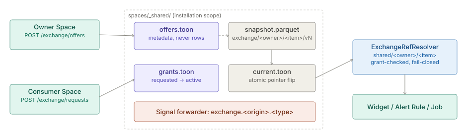

# Exchange (multi-entity sharing)

> **Level 3 module page** (`SOLUTION-SUITE-DOCS-1`). Layer: Add-on.
> Offering: Standard and above (`multiEntity` add-on, module `exchange`). Checked against the code on 2026-10-17.

## 1. What it is

The Exchange is the installation-scope surface through which one [Space](../config/architecture-spaces.md) shares a Dataset, a Widget, a
saved Link Analysis view or a Signal type with another Space - the multi-entity add-on (group companies, a
regulator and its reporting entities). Sharing is per item, opt-in and grant-mediated: nothing is discoverable
unless its owner **offers** it, and nothing is usable without an **active Share Grant**.

Module: `features/inspecto-exchange` (manifest id `exchange`, background work `exchange-snapshot-refresh`).
Concept: [Exchange sharing](spec.md).

## 2. Who uses it

- **Owner Space administrators** list offers and approve, deny or revoke grants.
- **Consumer Space users** browse the catalog, request use, and bind `shared/<owner>/<item>` refs.
- **Group / regulator analysts** read shared Widgets and views render-only.

## 3. Where it sits

An add-on that lives under `spaces/_shared/` (reserved, never itself a Space). It needs multi-Space mode
(`-Dspaces.root`); with a single Space there is no one to share with, the Exchange is disabled and every route
answers 409. `ExchangeBootHook` installs the host seams at boot; without the module `shared/...` refs fail closed.

## 4. How it works

1. **Offer** (`Offer`). Kind `dataset`, `widget`, `link-analysis-view` or `signal`; metadata only - description,
   Result Set columns - never rows. A Widget or view offer lists the Datasets it reads; their grants travel with
   it. A `signal` offer names `payloadKeys`, the only keys that may cross.
2. **Grant** (`ShareGrant`). One per `(kind, item, owner, consumer)`. Lifecycle `requested -> active | denied`; an
   active grant can be `revoked` or `expired`. Optional `pin` (a version such as `v12`) and `expiresAt`; `mode`
   `snapshot` (default) or `live`. Ledgers: `offers.toon` and `grants.toon`, written atomically under one lock.
3. **Snapshot** (`ExchangeSnapshotWriter`, `ExchangeSnapshots`). The owner's Dataset is copied to
   `<_shared>/exchange/<owner>/<item>/<version>/snapshot.parquet`; `current.toon` flips to the new version
   atomically and carries row count, refresh time and columns. Old versions are pruned.
4. **Refresh** (`ExchangeSnapshotSweep`). An offer's `refresh` cadence (`hourly` / `daily`) republishes only when an
   active snapshot grant exists; the outcome lands in `last-refresh.toon`; a failure waits a full interval.
5. **Consume** (`ExchangeRefResolver`). A `shared/<owner>/<item>` ref (Widget binding, Alert Rule `dataset:`, Job
   params) resolves to the owner's current snapshot only with an active grant for the calling Space.
6. **Signals** (`ExchangeSignalForwarder`). Under an active `signal` grant with the consumer hosted in the same Pod,
   a Signal is re-emitted on the consumer's ledger as `exchange.<origin>.<type>`, actor `exchange-grant:<id>`,
   allowlisted payload only. Otherwise `exchange.signal.undeliverable` is recorded on the origin; never queued.

## 5. Configuration

- **Multi-Space**: `-Dspaces.root` must be set; the Exchange lives in its `_shared` directory.
- **Ledgers**: `offers.toon`, `grants.toon` (managed through the API, not hand-edited).
- **Per offer**: `refresh` cadence; **per grant**: `pin`, `expiresAt`, `mode`.
- **Module switch**: the background refresh skips a Space where `exchange` is switched off.

## 6. Screens

- **Catalog - Sharing** (`inspecto-ui/src/app/modules/admin/catalog/sharing.component.ts`): offers, grant
  requests and decisions.
- Share actions on the Studio Datasets and Widgets lists
  (`inspecto-ui/src/app/modules/admin/studio/datasets/datasets.component.ts`,
  `inspecto-ui/src/app/modules/admin/studio/widgets/widgets.component.ts`).

## 7. API

| Route | Capability (owning Space's role table) |
|---|---|
| `GET /exchange/offers[?owner=]` | read |
| `POST /exchange/offers` | `canOfferDatasets` |
| `POST /exchange/signal-offers` | `canOfferSignals` |
| `POST /exchange/refresh` | `canOfferDatasets` |
| `POST /exchange/requests` | `canRequestShares` |
| `POST /exchange/grants/{id}/approve`, `deny`, `revoke` | `canApproveShares` |
| `POST /exchange/grants/{id}/pin` / `/expiry` | `canRequestShares` / `canApproveShares` |
| `GET /exchange/grants[?space=]` | read |
| `GET /exchange/datasets/{owner}/{item}`, `/widgets/...`, `/views/...` | read; Widgets and views render-only |

Routes are un-prefixed (not under `/spaces/{id}`). Transitions are audited and signalled at the HTTP edge.

## 8. Interactions

- [Spaces](../config/architecture-spaces.md) - owner and consumer; multi-Space mode required.
- [Studio and BI](../../layer/product/architecture-studio-bi.md) - Widgets and Datasets that bind shared refs.
- [Alerts](../../addon/incidents/architecture-alerts.md) - an Alert Rule may watch a `shared/...` Dataset.
- [Events](../event/architecture-overview.md) - cross-Space Signals; [Jobs scheduler](../processor/architecture-jobs-scheduler.md) - `on_signal` Jobs on the consumer.
- [Link Analysis](../la-core/architecture-overview.md) - saved views offered as `link-analysis-view`.

## 9. Limits and gotchas

- Single-Space installs: every route 409s by design.
- Signals cross only between Spaces hosted in the same Pod; nothing is queued for later.
- An `exchange.*` Signal is never forwarded again, offered, or emitted by a Job or Decision Rule (loop guard).
- A consumer reads a snapshot, not live rows, unless the grant `mode` is `live`.
