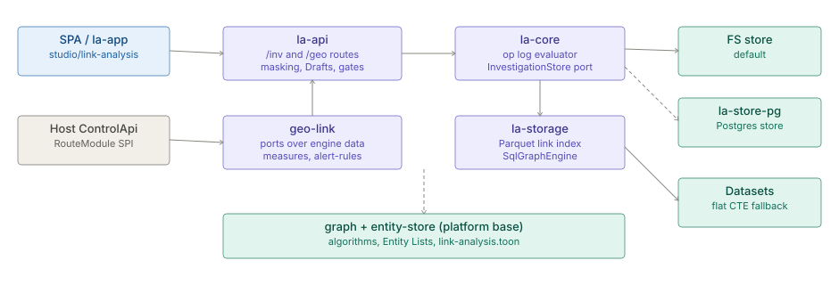

# Link Analysis — architecture — Shape, modules and the domain core

Part 1 of 4 of [Link Analysis — architecture](architecture-la-core.md) · next: [Domain core — masking onward](architecture-la-core-masking.md).

## Overview

**Offering:** every edition from Basic (`linkAnalysis` add-on in `offerings/basic.toon`: `la-storage`, `la-core`,
`la-api`, `geo-link`); Advanced adds `la-store-pg`. Basic withholds the Investigation surface (§8,
`docs/EDITIONS.md`). Checked against the code on 2026-10-24.

### What it is

Link Analysis (LA) lets an analyst explore who is connected to whom in platform Datasets (calls, transfers,
devices, accounts), record that exploration as an **Investigation**, run graph algorithms over it, and hand the
result on as a sealed dossier, a Case link or a standing detection. It is an optional, ServiceLoader-discovered
extension of the one host process - no LA server, no LA main class (§1).

### Who uses it

- **Fraud and AML investigators** expand from a seed entity, pin evidence, and export a dossier.
- **Supervisors** approve sensitive expansions (four-eyes) and promote Drafts.
- **Space administrators** tune limits, masking and the link index.
- **External reviewers** read a time-limited public embed of an Investigation.

### How it works



1. **Investigation = op log.** Each action (`POST /inv/investigations/{id}/ops`) is appended to a hash-sealed log
   and folded deterministically into a **Working Set**; undo, reorder and replay re-fold the log (§3.1).
2. **Reads** come from the Dataset (flat recursive CTE in sandboxed DuckDB) or, when `index.enabled` (default on)
   and a fresh index exists, from the link index; a fallback always carries a closed `Reason` (§4).
3. **Link index**: versioned bucketed Parquet, `full | append | compact` builds via `POST /inv/index/builds` or the
   `la.index.build` Job (§4).
4. **Graph Run**: algorithms from `GET /inv/graph/algorithms` over the Working Set or the index, in a bounded pool (§5).
5. **Drafts**: fork, ops, rebase, promote - parallel work on one Investigation without blocking the main log (§3.3).
6. **Masking**: `EntityMasking` sends tokens out; raw values stay inside; reveal is audited (§3.4).
7. **Outputs**: dossier and bundle (SHA-256 root, verify routes), Case link, Working Set measures, standing
   detection via the `la.detect` Job into [Alerts](../../addon/incidents/architecture-incidents.md) (§7), public embeds (§6.2).
8. **Store**: filesystem by default; Postgres with `-Dinvestigations.backend=db` and a `jdbc:postgresql:` URL (§3.2).
9. **Onboarding** (`LA-ONBOARD-1`, closed 2026-10-22): Getting started with a sample Space and a Space guide, Add data,
   *Start from...*, the Entities page with its Columns tab, *My work*, help on every screen and local onboarding
   counters - [architecture-data-onboarding.md](architecture-data-onboarding.md) §6.10-§6.13, §6.15; *Start from...*
   and *My work* in §3.4; the Explorer / Investigations level (runtime add-on `laInvestigations`) in §8.

### Configuration

- **Space**: `link-analysis.toon` in the Space write root (masking mode, index switch, SPACE-layer limits), edited
  through `PUT /settings/link-analysis` and `PUT /settings/link-analysis/limits`.
- **Install**: `la-limits.toon` (INSTALL-layer limits: Graph Run pool and ceilings, index threads, rate buckets),
  edited through `PUT /system/link-analysis/limits` (`canAdminister`). Catalogue: `LaLimit` in
  `platform/inspecto-entity-store`. Full limit table: §9.
- **JVM**: `-Dinvestigations.backend=db` (Postgres store), `-Dla.embed.enabled` (public embeds),
  `-Daddons.laInvestigations=false` (withholds the Investigations add-on, §8).
- **Enablement**: Installed (jar) -> Enabled (`geoLink` per Space) -> Permitted (capability, membership, policy).

Screens: [user guide](user-guide-la-core-reference-screens.md#screens). Routes: [Link Analysis — API](api-la-core.md) and §6.

### Interactions

- [Graph library](../graph/architecture-graph.md) - algorithms; [Scoring and Entity Lists](../scoring/architecture-scoring.md) - identity.
- [Case management](../case-management/architecture-case-management.md) - Case link; [Alerts](../../addon/incidents/architecture-incidents.md) - standing detection.
- [Jobs scheduler](../processor/architecture-processor.md) - `la.index.build`, `la.detect`; [Storage](../entity-store/architecture-entity-store.md) - Datasets.
- [Exchange](../exchange/architecture-exchange.md) - saved views shared across Spaces; [AI assist](../intelligence/architecture-intelligence.md).
- [Link Analysis solution](../../solution-pack/la-showcase/architecture-la-showcase.md).

### Limits and gotchas

- Every bound is a configuration item; a stored value outside its range reads as the default (§9).
- Expensive exploration POSTs are rate-limited per subject (burst 30, 1 per 2 s by default); Investigation routes
  are exempt (§6.1).
- A view-backed Dataset cannot be fingerprinted, so the index serves it only while younger than
  `index.max_age_hours` (default 24) (§4).
- A stale-served `expand` may count hub degree over newer rows than it shows (documented exception, §4).
- An index build waits while ingest runs and fails after 6 h of continuous ingest (§9).

## 1. Shape in one paragraph

Link Analysis (LA) is an **optional, ServiceLoader-discovered extension of the one host process**. There is no LA
main class and no LA server: `la/inspecto-la-api` contributes `RouteModule`s (the `/inv` and `/geo` routes) to the
host `ControlApi`, `la/inspecto-geo-link` is the bridge that implements la-core's ports against engine services, and
the standalone `la-app` is only a second Angular shell (`package.ps1 -Product la`) served by that same host. The
domain is an **append-only, hash-sealed Investigation op log** folded deterministically into a Working Set; reads
come either from a Dataset relation (flat recursive CTE in DuckDB) or, when switched on, from a **versioned Parquet
link index**; graph algorithms run in a bounded in-process pool over either input.

### Data flow

```
 INGEST (host engine, not LA)                           IDENTITY (entity-store)
 ─────────────────────────────                          ───────────────────────
 file lands ─▶ Collector ─▶ Pipeline ─▶ Parquet          analyst / import
 (CSV, Parquet,  (DayManifest,  (PartitionWriter)  store      │ POST /entity-lists, /inv/entity-identities
  Reference)      gap check)          │                       ▼
                                      ▼                  Identity Fact log (hash chain) ─▶ fold: Entity Lists,
                              Dataset relation SQL       │                                 resolution groups
                              (DatasetRelation,          └─▶ EntityListSidecar (Parquet, SQL-readable)
                               inputFiles fingerprint)
                                      │
             ┌────────────────────────┼─────────────────────────────────────────────┐
             │ INDEX BUILD (la-storage)                                              │
             │ POST /inv/index/builds  or  la.index.build Job                        │
             │   (signal pipeline.commit* → link-index service →                     │
             │    ScheduledLinkIndexBuilder → ScheduledIndexBuild, owner re-decided) │
             │        ▼                                                              │
             │ IndexPlan.classify ─▶ IndexBuildService ─▶ IndexBuilder (DuckDB COPY) │
             │   full | append | compact                                             │
             │        ▼                                                              │
             │ la-index/<ds>/<mapping>/vN/{out,in,nodes}/bucket=B/*.parquet          │
             │        + manifest.json, CURRENT pointer, pins.json                    │
             └────────┬──────────────────────────────────────────────────────────────┘
                      │                                │
 READ (la-api)        ▼ index.enabled + fresh         ▼ otherwise (closed Reason)
 ──────────────  IndexedRead ─▶ IndexReader       flat recursive CTE over the Dataset
                 (bucket literal, 1 hop/query)    (sandboxed DuckDB, view gate)
                      └──────────────┬─────────────────┘
                                     ▼
 request ─▶ authenticate ─▶ rate limit ─▶ ABAC ─▶ module enabled ─▶ capability ─▶ open gate
            (Subject)       (linkAnalysis)                (geoLink)                (member, R3, PDP)
                                     │
            ┌────────────────────────┼──────────────────────────────┐
            ▼                        ▼                              ▼
   exploration reads        Investigation op                Graph Run
   (projection, paths,      POST …/ops (or Draft ops)       POST /inv/graph/runs
    neighbours, patterns)          │                         input: workingSet | index
            │               sealed rows ─▶ InvestigationEvaluator (pure fold)
            │                      ▼                              │
            │               InvestigationStore.append ◀──────────┤ Materialised ─▶ InMemoryGraphEngine
            │               (FS audit/snapshots/<id> | Postgres)  │ IndexRef     ─▶ SqlGraphEngine
            │               log.jsonl + sets/<step>.json          ▼
            │               sensitive expand ─▶ pending ─▶ approve/deny (four-eyes)
            │                      │                      result cache (raw)
            │               Drafts: fork ─▶ ops ─▶ rebase ─▶ promote (main lock / txn)
            │                      │                              │
            └──────────────────────┴──────────────┬───────────────┘
                                                  ▼
                                    EntityMasking (tokens out, raw stays inside)
                                                  ▼
                                    JSON response · audit event (LinkEventTypes)
                                                  │
 OUTPUTS                                          ▼
 ───────   Dossier / bundle (SHA-256 root, verify) · Case link · Working Set measures
           ─▶ la.detect Job ─▶ AlertService ─▶ StandingDetection.decide (sweep:<id>) ─▶ Alert
```

\* **Trigger.** A landed file commits a Consignment and emits `pipeline.commit` (mirrored in `JobService`);
`job.dataset.produced` is emitted **only** by the `sql.template` Job. A `la.index.build` Job meant to refresh after a
daily file must therefore use `on_signal: pipeline.commit` (guard `$signal.pipeline`) or `on_pipeline`. Each half is
unit-tested, and `ControlApiIndexRefreshOnCommitTest` (`la/inspecto-geo-link`) runs commit → `pipeline.commit` → Job → index
version N+1 → indexed read, plus the negative on `job.dataset.produced` (`LA-DEMO-INDEX-1`, DR-T1).
`ScheduledDailyChainTest` (same module, `LA-DAILY-INGEST-1`) runs the whole daily chain with no hand-driven step: a
sample feed lands one CSV per day in the Collector inbox, the 1 s poll scheduler runs the Pipeline, the Pipeline writes
Parquet partitioned by `EVENT_DATE` (`day=NN`) straight into the Dataset's `physicalRef` store (a Pipeline's
`dirs.database` may BE a Dataset store, since `physicalRef` reads `<store>/**`), and the `la.index.build` Job on
`pipeline.commit` builds FULL on day one (`allow_full: true`, no index yet) and APPENDs each later day; each read sees
the new day, one build per day. Still out of scope: Hive JDBC / Kerberos and the `db` Collector (`D-ING5`, file-first),
SCD2 / as-of joins (`D-ING4`); dimension attributes are joined at read time, never baked into the index (`D-ING6`).

Two invariants the diagram encodes: **raw values never leave through a response** (masking is the last step before
serialisation, after every cache), and **the op log never re-reads a Dataset on replay** (rows are sealed into the
entry at write time, so an index rebuild or a Dataset change cannot alter a recorded Investigation).

## 2. Modules and dependency direction

```
                    inspecto (host: ControlApi, CollectorService, JobService, AlertService)
                         ▲ ServiceLoader (RouteModule, ports, LinkIndexBuilder, InvestigationMeasureProbe)
   la/inspecto-geo-link ─┤  bridge: engine ⇄ la-core ports        (depends on inspecto-processor, la-api, la-core, entity-list, entity-store)
   la/inspecto-la-api  ──┘  routes, gates, Drafts orchestration    (la-core, la-storage, entity-store, access, http/auth/audit-spi, config, sql, util)
        │
        ├── la/inspecto-la-storage   link index: build, read, index GraphEngine   (la-core, sql, DuckDB)
        │        │
        ▼        ▼
   la/inspecto-la-core   domain: op evaluator, InvestigationStore port + FS impl, Drafts store, Graph Run service, ports
        │                (graph, entity-store, http/auth/audit-spi, config, sql, util)
        ├── platform/inspecto-graph   pure-Java graph algorithms, RunControl, UnionFind (Base; no inspecto deps; enforcer-fenced)
        └── platform/inspecto-entity-store   Entity Types, Entity Lists, Identity Fact log, MaskTokens, LinkAnalysisSettings
   la/inspecto-la-store-pg   Postgres InvestigationStore (ServiceLoader provider)   (la-core)
```

| Module (manifest id) | Role | Key classes |
|---|---|---|
| `graph` (platform, base) | Leaf algorithm library (package `com.gamma.graph`), line-for-line port of the SPA's `graph-analysis.ts`; not LA-only since D-AN2 (2026-10-17) — a core thin jar in every edition so Fraud, AML and Case Management can use it without Link Analysis | `GraphAlgorithms`, `GraphCentrality`, `GraphIterative`, `GraphPaths`, `GraphStructure`, `GraphSuspicion`, `GraphPropagation` (server-only), `UnionFind`, `RunControl`, `GraphAborted` |
| `la-core` (platform, optional, boot) | Domain + ports, no HTTP routes | `InvestigationEvaluator`, `InvestigationStore`/`InvestigationStores`/`FsInvestigationStore`, `InvestigationMembers`, `DraftStore`/`DraftLifecycle`/`DraftCheckpoints`/`DraftIndex`, `GraphRunService`, `GraphEngine`, `InMemoryGraphEngine`, `GraphInput`, `Algorithm`, `GraphBudget`, `LinkEventTypes`, ports `DatasetProvider`/`CasePort`/`CollectorCoveragePort` |
| `la-storage` | The link index (D-3) and the index-backed engine | `IndexBuilder`, `IndexBuildService`, `IndexStore`, `IndexManifest`, `IndexMapping`, `IndexPlan`, `IndexReader`, `IndexPins`, `BucketFunction`, `IndexedTraversal`, `SqlGraphEngine`, `RoutingGraphEngine` |
| `la-api` (feature `geoLink`) | HTTP surface and orchestration | 32 `RouteModule`s (routes counted in §6), `EntityMasking`, `InvestigationMemberStore`, `DraftAdmission`/`DraftRebase`/`DraftPromote`, `IndexedRead` + `Indexed*`, `IndexStaleness`, `IndexBuildServices`, `GraphRunServices`, `StandingDetection`, `ScheduledIndexBuild` |
| `geo-link` | Bridge to the host | `EngineDatasetProvider`, `HostCasePort`, `HostCollectorCoveragePort`, `ScheduledLinkIndexBuilder`, `WorkingSetMeasures`, `InvestigationMeasureRoutes`, `InvestigationDataChangesRoutes` (7 routes), `EmbedExpirySweepModule`, `IntegrationWebhooks` (route-less) |
| `la-store-pg` (provider) | Postgres backend for Investigations | `PgInvestigationStore`, `PgInvestigationStoreProvider` |
| `entity-store` (platform, base) | Space-wide identity data; not LA-only | `EntityFactLog`, `EntityRegistry`, `EntityTypes`, `EntityListEntries`, `EntityListFacts`, `EntityListSidecar`, `MaskTokens`, `LinkAnalysisSettings` |

Design rules visible in the dependency graph:

* **Ports point inward.** la-core defines `GraphEngine`, `GraphInput`, `DatasetProvider`, `CasePort`,
  `CollectorCoveragePort` and `InvestigationStoreProvider`; storage, geo-link and store-pg implement them. la-core
  never names an index class: `GraphInput.IndexRef` carries only primitives (version dir, seeds, estimates).
* **The engine names no `la-*` class** (grep-true; LA route paths appear only as strings, and enforced by `tools/check-engine-names-no-la.mjs`). The host reaches LA only through ServiceLoader SPIs it owns
  (`RouteModule`, `LinkIndexBuilder`, `InvestigationMeasureProbe`); absent jars degrade to
  `AbsentModuleRoutes` (503 `CAPABILITY_UNAVAILABLE`, "Standard edition and above").
* **Entity Lists are not LA.** `/entity-lists/*` routes live in `features/inspecto-entity-list`; LA reads the same
  fact log through the host-free `EntityListFacts` helper so neither side depends on the other's routes.

## 3. Domain core (la-core)

### 3.1 Investigation op log

* An Investigation is a header, an append-only `log.jsonl` of **ops**, and one sealed Working Set file per step
  (`sets/<step>.json`, the audit/replay record, not the evaluation input).
* `InvestigationEvaluator` is a **pure fold** of the log. The apply switch handles 15 labels: `seed`, `seedBy`,
  `expand`, `exclude`, `excludeBy`, `hide`, `keep`, `threshold`, `annotate`, `window`, `resolve`, `connect`
  (2026-10-13, below), and the markers `snapshot`, `compare`, `temporal`. An unknown op throws "not evaluable" (fail closed).
* **Sealed reads (D-E3).** `expand` stores the rows it read, `compare`/`temporal` store their findings with a
  fingerprint, so replay needs no Dataset and a Dataset change cannot rewrite history.
* **Hashing.** State hash = `sha256(canonical(workingSet))`, recorded per log entry; the prefix hash
  (`DraftStore.prefixHash`) = SHA-256 over the first *k* raw log lines and guards rebase and promote. Write order is
  log line first, then the set file is sealed (CREATE_NEW).
* **Members** (`InvestigationMembers`, `members.jsonl`, append-only grant/revoke): `lead | analyst | reviewer`, owner
  is implicitly lead. Only a lead writes the main log; lead or reviewer decides a pending expand (never the
  requester); lead or analyst writes their own Draft; a change that leaves no lead is refused.
* **Pending approvals (D-U7).** A sensitive `expand` is written as a pending request, never to the log, so
  four-eyes holds by construction; `replacePending(expected, new)` is the compare-and-set that closes the
  approve/deny race.
* **Supernode suppression (2026-10-11).** An `expand` resolves `hubThreshold` (the op's own, else the Space's
  `hub_threshold`, default 500) into its sealed rung, and seals `read.hubs [{id, degree}]`: row endpoints outside the
  frontier whose distinct-contact degree (counted as `candidateDegreeMax` counts it: both directions, allowed kinds,
  excluded pruned, in-window) exceeds it. Unlike `candidateDegreeMax` (which drops), a hub is admitted and flagged
  `highConnectivity` (state hash gains the key only when flagged, so old logs hash unchanged; Working Set relation
  column `highConnectivity`). Later frontiers leave flagged entities out (`rung.hubsHeld`; `GET .../log` carries only the COUNT as `read.hubsHeld`, so a reopened Investigation's degree line says the same words as the live one) unless the op carries the
  override `expandHubs: [ids]` or `includeHubs: true`, sealed in its params and named in the log line; a NAMED hub
  without it is a 422. The degree check is one extra flat statement over the Dataset even when the index answered the
  rows (rows and fingerprint untouched). Overriding is not a four-eyes trigger of its own: the budget / fan-out
  thresholds already bound what it can admit.
  *Follow-ups (2026-10-11):* only entities a step ADDS are hub candidates — one already in the Working Set (a seed
  outside the frontier included) is never newly flagged by another frontier's rows; this is decided when the read is
  sealed (`hubs()` drops the pre-step Working Set), and the evaluator is unchanged, so logs sealed before it replay to
  their recorded hashes. `expandHubs` ids are checked against the Working Set on append (a Draft append is the same
  code), and on a Draft promote/rebase re-seal (422 → a `blocked` conflict). Fork, template and approval do not
  refuse an absent `expandHubs` id: an override only lifts a hold, an absent id has nothing to hold, so ignoring it
  cannot widen the read (fork and template ops were validated when first appended; an approval's were validated at
  request). One "nothing to expand" refusal names the held hubs everywhere; an approval whose frontier is all newly
  flagged says so (409) rather than "left the Working Set".
  *Expanded state (LA-UNEXPANDED-MARKER-1, 2026-10-13, as built):* `State.expanded` holds every Working Set entity that an effective
  `expand` had in its SEALED `read.query.frontier` (a step that found nothing still marks it; entities the step ADDED are not in it), kept
  OUTSIDE `toMap()`/`hash()` like `hubDegree` so no hash changes, dropped with the entity on exclude, and reverted by undo because undo
  replays without the step. The Working Set entities relation gains the boolean column `expanded` (last column, after `contacts`;
  `false` = still an unexpanded node). The SPA draws from the REPLAYED Working Set, not that relation, so `replay` and the Draft replay also stamp `expanded` on each entity map AFTER `toMap()` (`InvestigationRoutes.stampExpanded`; never hashed, masked with the rest). The held hubs are never in a frontier, so they stay `expanded: false`; the SPA draws a flagged hub
  with its ring only. `InvestigationExpandedFoldTest` and `ControlApiInvestigationHubDegreeTest` pin it.
  *Restricted expand (LA-EXPAND-PICK-NEIGHBOURS-1, 2026-10-13, as built):* the `expand` op takes an optional `only` (a sorted,
  de-duplicated list of at most 1 000 neighbour ids, masked aliases resolved like `ids`/`expandHubs`), sealed in the rung (`read.query.only`,
  step result `read.rung.only`) ONLY when stated, so older rungs seal and replay unchanged. The flat read applies it as a predicate on the
  candidate (`other`) endpoint BEFORE the per-anchor fan-out rank, so `maxFanOut`, `fanOutCapped`, `truncated` and the budget count only
  the chosen neighbours; a rung with `only` is never served from the index (it is answered exactly by the flat read). It restricts the NEW
  endpoint: a frontier-to-frontier row is kept only if that member is listed. `State.expanded` is NOT set for such a rung, so the entity
  stays an unexpanded node. Four-eyes: a rung with 1..50 `only` ids is exempt (`ONLY_EXEMPT_MAX`, operator 2026-10-13: it skips both the
  budget and the fan-out clause); a longer list is judged by `budget` / `maxFanOut` as any expand. The log line and the Dossier say
  "restricted to N chosen neighbours" (`InvestigationTime.rungClause`), and a saved template drops `only` with `ids` (case data).
  `ControlApiInvestigationPickNeighboursTest` and `InvestigationExpandedFoldTest` pin it.
  *Grow preview (LA-GROW-EXCLUDE-1 phases 1-2, 2026-10-22, as built, backend only):* `POST /inv/investigations/{id}/expand/preview`
  takes exactly the `expand` op body (`op` optional, `expand` only) and runs the append's own path minus the write: the lead
  open gate (`canManageIncidents` + member lead; non-member 404), `params` + `requireBindings`, the ids-in-Working-Set check,
  `expandFrontier` (the `expandHubs` / held-frontier / empty / `max_frontier` checks, extracted so the append and the preview
  share them), the same `read` (index or flat) and the same `evaluate` over the round-tripped would-be entry. Nothing is
  appended, sealed, cached or emitted. Answer (`GrowPreview`): `addsNodes` = the delta's `admitted`, `addsLinks` = `linksAdded`,
  `held [{id, contacts}]` = the read's hubs left flagged (the append's `hubsFlagged`, busiest first), `excludedByLists
  [{listId, title, removed, rounded}]` = per `excludeBy` in force the distinct not-yet-admitted read endpoints its remembered
  keys drop, `truncated`, `readPath` (`index` when the index answered, else `flat` with the fallback's `reason`),
  `needsApproval`. Held ids are masked with the WOULD-BE log (`EntityMasking.of(inv, log + entry)`), so the pseudonym is the one
  the appended step shows. A body the four-eyes thresholds make sensitive is NOT read: `needsApproval: true`, null counts,
  `exceeded[]`, no pending request. *Restricted-list counts (plan §7):* `removed` is rounded to the nearest 5, never below 5,
  0 stays 0, for every list that does not read as open; Entity Lists carry no `visibility` yet (phase 4), so every count is
  rounded (`GrowPreview.open` is the one seam to flip). The explorer twin `POST /inv/projection/neighbors/preview` (Basic too,
  read-shaped exemption, no event) counts one neighbours step from a SET of ids with no Investigation: body `{dataset,
  sourceCol, targetCol, linkKindCol?, attrCols?, ids[] (or the neighbours read's one-entity `value`), drawn?, direction?, linkKinds?, hubThreshold?, excludeBy? [listIds], filter?, limit?}`, one
  flat statement (distinct `(s, t, k, attrCols…)` links, the neighbours read's own fold; neighbours outside `ids` and
  `drawn`; each neighbour's distinct contacts over the whole Dataset), list members matched in Java by each list's normaliser
  (unknown list 404, retired 409), `limit` caps the neighbours read (`truncated` then makes the counts lower bounds), ids in
  and out as exploration aliases. `drawn` (bounded as `ids`) names what the explorer graph already shows: those neighbours
  are not added. The answer adds `linksWithinGraph`: the step's links whose both ends are already shown (between `ids`, or
  to `drawn`), not in `addsLinks`; only the SPA knows which of them it draws, so it adds the rest (`withUndrawnLinks`) - none
  on a graph its query drew whole, the missing ones on a graph cut short by a limit. Both routes are rate-classed
  EXPENSIVE. *Remove held super nodes* needs no route: the SPA appends an `exclude` with `reason: "busy number above N
  contacts"` - `exclude` already requires and seals `reason` (unchanged). `ControlApiGrowPreviewTest` pins parity (preview
  counts = the append's delta right after, log length and Working Set unchanged), list rounding, masking, four-eyes, the
  armed gate and Basic; `theNeighboursPreviewCountsWhatTheExplorerGrowAdds` pins the explorer twin's parity (preview counts
  = what one neighbours read per frontier value adds to the drawn graph: a whole graph, a grown one in each direction, a
  filtered view, attribute columns, a graph cut short by the query's limit).
  *Neighbour list (LA-EXPAND-PICK-NEIGHBOURS-1 residuals, 2026-10-13):* the *Choose neighbours* list is the `list` form of `POST /inv/projection/neighbors`
  (`{..., value, list: true, offset?, limit?}`; no new route, so no manifest / route-gating / openapi entry changed): the server folds ONE entity's
  link rows per neighbour (events across kinds, sorted kinds), strongest first (ties by id), a self-link is no neighbour, and answers
  `{neighbours[{id,count,kinds}], total, offset, limit, hasMore}` with the REAL distinct-neighbour `total` (a window past the end carries
  `total: 0`; the SPA keeps its first page's). Page default 100, ceiling 400 (`neighbours.page_default` / `neighbours.page_max`, `LaLimit`). It is a READ-ONLY hint and is NEVER refused by the four-eyes
  fan-out threshold (the flat form still is, 403): reading a hub's list is allowed, only the expand is held; the row-budget bound still judges
  the page size. Ids leave as aliases on a masked Space, and an alias is accepted as `value` (`ControlApiExplorationMaskingTest`). It is always
  the flat read: the index serves no listing. The approval inbox summary names a held restricted expand ("restricted to N chosen neighbours (...)",
  ids masked like `ids`), so a list longer than 50 no longer reads as a plain expand. SPA: `InvService.neighbourList`, store `neighbours`
  (`total`, `hasMore`) with `moreNeighbours()` (*Show more*). Pinned by `ControlApiInvestigationPickNeighboursTest`, `ControlApiInvestigationApprovalInboxTest`.
  *Connect seeds (LA-SEED-CONNECT-1, 2026-10-13, as built, not browser-driven):* the fifteenth op, `connect {ids (2..`connect.max_seeds`, default 40), maxHops (default `connect.default_hops` 3, ceiling `connect.max_hops` 6), entityType?, budget?, linkKinds?, window?, minEvents?, hubThreshold?}`, on the existing `/ops` route (no new route). `ConnectSeeds` runs ONE bounded breadth-first search per seed over the Investigation's own one-hop `read` (index-backed when it can answer, the Dataset otherwise) and reads every unordered pair off the first seed's search: hops, shortest-route count, one example route; a pair with no route within `maxHops` is disconnected and never searched deeper. A hub is reached, flagged, never walked through, and a disconnected pair names it (`notWalked`); an excluded entity is never routed through. The entry seals `read.rows` (the example routes' links, fingerprinted as an expand's), `read.pairs`, `read.hubs`, `read.noLinks`; the evaluator seeds `ids` and admits route nodes by a multi-source walk (nearest seed wins, row order never matters) and adds no `expanded` mark. A fork and a Draft rebase re-search over the new base; the Draft `/ops` route admits it as a heavy job. Not four-eyes gated (bounded by seeds, hops and a per-level budget). *Explore next degree* = a normal `expand` over the route nodes (the SPA's *Expand from these nodes*); alternating expansion is DECLINED for now (operator 2026-10-13). A click on a connected pair's row emphasises its example route on the canvas (`InvestigationSessionStore.highlightRoute`; display only, nothing recorded). *Expanded marker, decisions (operator 2026-10-13):* a legend hide of a link kind is DISPLAY ONLY - it does not change what *Expand one hop* follows and is not recorded in the log (the legend says so); the exploration canvas (no Investigation) dots nodes no expand has followed, from a browser-side `expandedNodeIds` list reset by each run (marked only after the first expand). `ConnectSeedsTest`, `InvestigationConnectFoldTest`, `ControlApiInvestigationConnectOpTest` pin it.
  *Degree surfaced + from the index (2026-10-11, as built):* the sealed degree now reaches the client, always from the
  SEALED read, never recomputed: the evaluator keeps `State.hubDegree` (id → `read.hubs[].degree` of the LATEST step that
  sealed it — a later read re-flagging it supersedes the first; dropped with the entity on exclude) OUTSIDE `toMap()`/`hash()`, so hashes are unchanged; the Working Set
  entities relation gains column `contacts` (the degree when `highConnectivity`, else null; numeric for measures); the
  step result's `read` and the log view's `read` summary carry `hubs [{id, degree}]` (ids masked like every other id).
  The read also seals `hubDegreeSource: index|flat` (beside `hubs`, not in the rung, so a reread's rung is unchanged).
  `index` when the edge index SERVED the rows and is not stale: `IndexedExpand` counts the degree from the same
  version (`IndexReader.distinctCounterparties`: both sides per candidate, allowed kinds, excluded counterparties
  pruned — exactly the flat definition; a served rung has no window). Otherwise (fallback, stale-served, window etc.)
  the flat statement as before. Parity-tested rung by rung (`ControlApiInvestigationHubDegreeTest`). Old logs: no
  `hubDegreeSource` (and, before suppression, no `hubs`) — the fields are absent and replay matches.
* **Events weighting (2026-10-11).** Optional header binding `eventsCol` (create / template instantiate; an
  INTEGER-family column, 422 otherwise; key absent when unbound, so an unweighted header and every older one is
  byte-identical). When set, the expand CTE's pair weight is `CAST(SUM(COALESCE(CAST(eventsCol AS BIGINT), 1)) AS
  BIGINT)` instead of `COUNT(*)` — a NULL count is one row's worth — and that weight drives `minEvents`, the
  `maxFanOut` rank, the budget order and the sealed `count`. `minDistinctDays` and the degree checks
  (`candidateDegree*`, hub degree: distinct counterparties) are unchanged. A weighted rung is served from the edge
  index when an index's `weightCol` equals `eventsCol` (case-insensitive): the folds sum
  `CAST(SUM(COALESCE(CAST(w AS BIGINT), 1)) AS BIGINT)` (fingerprint parity with the flat SUM tested); otherwise it
  falls back with `read.fallback {reason: rung_not_indexable, details: "...which no index carries as its weightCol"}`
  (never a silently wrong count). Caveat: the index stores `w` as DOUBLE, so an integer count above 2^53 could round. Templates carry `eventsCol` in `roles` only
  when bound; the Dossier names it in the method statement.
* **Endpoint Entity Type (ONB-LA-ENDPOINT-TYPE-1, 2026-10-11).** `POST /inv/investigations` takes an optional
  `entityType` (both endpoints) or `sourceType` / `targetType` (each side; never both forms - 422), each an Entity
  Type in force (case-insensitive, stored as its id; unknown → 422). Sealed in the header ONLY when given. Every expand
  copies them into `read.rung` (`query.sourceType/targetType`), and the evaluator types each endpoint it admits by the
  side it was reached on - replay reads the log alone; a read without the keys admits untyped endpoints, so older logs
  and untyped Investigations keep byte-identical headers, reads and hashes. Before this, only the seed carried a type,
  so node actions keyed on type (Add to watch list) found nothing for expanded entities. Masking: under `typed`, a
  masked endpoint type masks that side's ids (unknown type → masked, fail closed). Forks inherit the header; template
  instantiate does NOT carry the fields yet. Test: `ControlApiInvestigationEndpointTypeTest`.

### 3.2 InvestigationStore port and its two backends

`InvestigationStore` (~40 methods) groups: identity (create, header, fork), sealed log
(`append(Scope, expectedVersion, …)`, `log`, `set`, `version`), members, references (bounded), workflow records
(Alert Rule binding, pending, Case link, templates), `maskKey`, cache identity, and 24 Draft methods.
`Scope(investigationId, draftId|null)` addresses the main log or a Draft with the same calls.

| | Filesystem (`FsInvestigationStore`, default) | Postgres (`PgInvestigationStore`) |
|---|---|---|
| Selection | `-Dinvestigations.backend=fs` | `=db` + `investigations.db.url` (else `inspecto.db.url`, must be `jdbc:postgresql:`), password via `SecretResolver`; provider found by `SpiSlot` (exactly one) |
| Layout | `<writeRoot>/audit/snapshots/investigations/<id>/`, or `<data root>/audit/snapshots/…` for a Space with a data root (`SpaceAuditDir`; an Investigation still at the old place moves whole when touched) (header, log, sets, members, references, templates, pending, `case-link.json`, `alert-rules/`, `investigation-details.json` (the title / purpose overlay of `PATCH`), `embeds/`, `mask.key`, `drafts/`) | one schema per Space; tables `la_space`, `la_investigation`, `la_log`, `la_set`, `la_member`, `la_reference`, `la_alert_binding`, `la_pending`, `la_template`, `la_draft`; sealed bytes stored as `text`, immutability trigger |
| Concurrency | JVM monitor per directory + OS `FileChannel.lock` on `.store.lock` (two-JVM safe); `expectedVersion` check → `InvestigationVersionConflictException` | `SELECT … FOR NO KEY UPDATE` on the Investigation/Draft row in one short transaction; Space-wide Draft cap = `FOR UPDATE` on the `la_space` row |
| Promote atomicity | intent file → append → mark promoted; `recoverDrafts` finishes or undoes a half promote | one transaction; nothing to recover |
| Editions | every LA edition | Preview and Advanced only |

Creates, forks,
references, Case link and Alert Rule binding are last-writer-wins by design on FS.

### 3.3 Drafts (D-7)

* A Draft lives **inside** its Investigation (`drafts/<draft-uuid>/{header.json, log.jsonl, sets/, discarded.json,
  promoted.json}`); its state = the main log's first `baseStep` entries folded + its own entries, numbered
  continuously. Created by staging in a scratch dot-directory and an atomic move.
* An optional human `label` (fork body; trimmed, 1..80 chars, no control characters, else 422) is a plain `header.json`
  field, returned by fork / list / read. It is the analyst's free text: **not masked**, never in a seal or Dossier input
  (promote copies ops only; `ControlApiDraftLabelTest` pins that), and `link.draft.forked` audits its length only.
* States `OPEN → HIBERNATED → DISCARDED | PROMOTED` (`DraftLifecycle`); expiry is a discard with `expired:true`.
  Defaults from `LinkAnalysisSettings.Drafts`: 50 open per Space, hibernate after 60 min, expire after 30 d.
* Admission (`DraftAdmission`, la-api): one live Draft per member, Space cap, heavy-op permit `max(1, min(4, cores/3))`.
* Rebase (`DraftRebase`) carries effective ops and classifies conflicts `no-op | changed | superseded | blocked`;
  promote (`DraftPromote`) rebases to head and appends under the main lock, all-or-nothing, or becomes a pending
  four-eyes request when it carries a sensitive expand. **Storage is in la-core, orchestration in la-api.**
* `DraftCheckpoints` caches folded state per step (keyed on size+mtime; in memory, so a restart costs one cold fold).
  `IndexPins` (la-storage) keeps the index version a Draft read alive for 30 d.
