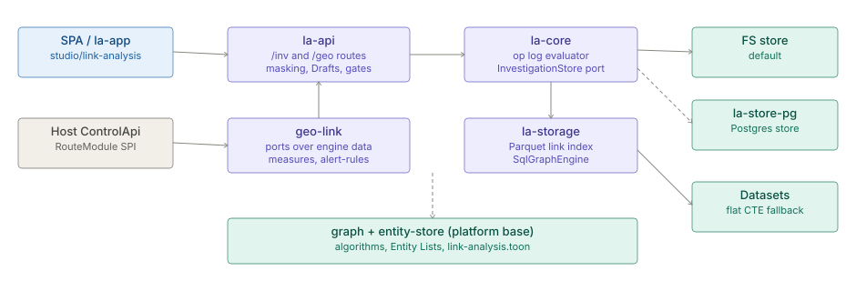

# Link Analysis — architecture

- [Overview](#overview) - what it is, who uses it, how it works, configuration, interactions, limits and gotchas.
- [§1 Shape in one paragraph](#1-shape-in-one-paragraph) and its data flow.
- [§2 Modules and dependency direction](#2-modules-and-dependency-direction).
- [§3 Domain core](#3-domain-core-la-core): op log (§3.1), store port (§3.2), Drafts (§3.3), [masking (§3.4)](#34-masking), entity store (§3.5), Domain Profile and Industry packs (§3.6).
- [§4 Link index](#4-link-index-la-storage) · [§5 Graph Run](#5-graph-run-graph--la-core--la-storage).
- [§6 HTTP surface](#6-http-surface-la-api-geo-link) - the route table; §6.1-§6.9 and §6.14 are in
  [architecture-http-and-ui.md](architecture-http-and-ui.md), §6.10-§6.13 and §6.15-§6.20 in
  [architecture-data-onboarding.md](architecture-data-onboarding.md).
- [§7 Host registration, Jobs and live detection](#7-host-registration-jobs-and-live-detection) ·
  [§8 Editions and packaging](#8-editions-and-packaging) · [§9 Bounds](#9-concurrency-and-resource-bounds-summary) ·
  [§10 Seams and residuals](#10-known-seams-and-residuals).

The product is **Inspecto LA (Link Analysis)** (`ED-1`); the capability, its routes, keys and modules keep the name
Link Analysis. Behaviour as the analyst sees it: [user guide](user-guide.md); as-built records of the SPA:
[architecture-records.md](architecture-records.md); open work: [BACKLOG](../../../../BACKLOG.md) and
[`superpower/link-analysis-roadmap.md`](../../../../superpower/link-analysis-roadmap.md). Class names are given without
paths; locate them with `codegraph_explore`. The source of truth for module metadata is each module's
`META-INF/inspecto/module.toon`, never this page. The backend sections were grounded in a code read on 2026-10-09
(tip `957c554af`) and carry dated as-built updates since.

## Overview

**Offering:** every edition from Basic (`linkAnalysis` add-on in `offerings/basic.toon`: `la-storage`, `la-core`,
`la-api`, `geo-link`); Advanced adds `la-store-pg`. Basic withholds the Investigation surface (§8,
`docs/EDITIONS.md`). Checked against the code on 2026-10-24.

### What it is

Link Analysis (LA) lets an analyst explore who is connected to whom in platform Datasets (calls, transfers,
devices, accounts), record that exploration as an **Investigation**, run graph algorithms over it, and hand the
result on as a sealed dossier, a Case link or a standing detection. It is an optional, ServiceLoader-discovered
extension of the one host process - no LA server, no LA main class (§1).

### Who uses it

- **Fraud and AML investigators** expand from a seed entity, pin evidence, and export a dossier.
- **Supervisors** approve sensitive expansions (four-eyes) and promote Drafts.
- **Space administrators** tune limits, masking and the link index.
- **External reviewers** read a time-limited public embed of an Investigation.

### How it works



1. **Investigation = op log.** Each action (`POST /inv/investigations/{id}/ops`) is appended to a hash-sealed log
   and folded deterministically into a **Working Set**; undo, reorder and replay re-fold the log (§3.1).
2. **Reads** come from the Dataset (flat recursive CTE in sandboxed DuckDB) or, when `index.enabled` (default on)
   and a fresh index exists, from the link index; a fallback always carries a closed `Reason` (§4).
3. **Link index**: versioned bucketed Parquet, `full | append | compact` builds via `POST /inv/index/builds` or the
   `la.index.build` Job (§4).
4. **Graph Run**: algorithms from `GET /inv/graph/algorithms` over the Working Set or the index, in a bounded pool (§5).
5. **Drafts**: fork, ops, rebase, promote - parallel work on one Investigation without blocking the main log (§3.3).
6. **Masking**: `EntityMasking` sends tokens out; raw values stay inside; reveal is audited (§3.4).
7. **Outputs**: dossier and bundle (SHA-256 root, verify routes), Case link, Working Set measures, standing
   detection via the `la.detect` Job into [Alerts](../../addon/incidents/architecture.md) (§7), public embeds (§6.2).
8. **Store**: filesystem by default; Postgres with `-Dinvestigations.backend=db` and a `jdbc:postgresql:` URL (§3.2).
9. **Onboarding** (`LA-ONBOARD-1`, closed 2026-10-22): Getting started with a sample Space and a Space guide, Add data,
   *Start from...*, the Entities page with its Columns tab, *My work*, help on every screen and local onboarding
   counters - [architecture-data-onboarding.md](architecture-data-onboarding.md) §6.10-§6.13, §6.15; *Start from...*
   and *My work* in §3.4; the Explorer / Investigations level (runtime add-on `laInvestigations`) in §8.

### Configuration

- **Space**: `link-analysis.toon` in the Space write root (masking mode, index switch, SPACE-layer limits), edited
  through `PUT /settings/link-analysis` and `PUT /settings/link-analysis/limits`.
- **Install**: `la-limits.toon` (INSTALL-layer limits: Graph Run pool and ceilings, index threads, rate buckets),
  edited through `PUT /system/link-analysis/limits` (`canAdminister`). Catalogue: `LaLimit` in
  `platform/inspecto-entity-store`. Full limit table: §9.
- **JVM**: `-Dinvestigations.backend=db` (Postgres store), `-Dla.embed.enabled` (public embeds),
  `-Daddons.laInvestigations=false` (withholds the Investigations add-on, §8).
- **Enablement**: Installed (jar) -> Enabled (`geoLink` per Space) -> Permitted (capability, membership, policy).

Screens: [user guide](user-guide.md#screens). Routes: [Link Analysis — API](api.md) and §6.

### Interactions

- [Graph library](../graph/architecture.md) - algorithms; [Scoring and Entity Lists](../scoring/architecture.md) - identity.
- [Case management](../case-management/architecture.md) - Case link; [Alerts](../../addon/incidents/architecture.md) - standing detection.
- [Jobs scheduler](../processor/architecture.md) - `la.index.build`, `la.detect`; [Storage](../entity-store/architecture.md) - Datasets.
- [Exchange](../exchange/architecture.md) - saved views shared across Spaces; [AI assist](../intelligence/architecture.md).
- [Link Analysis solution](../../solution-pack/la-showcase/architecture.md).

### Limits and gotchas

- Every bound is a configuration item; a stored value outside its range reads as the default (§9).
- Expensive exploration POSTs are rate-limited per subject (burst 30, 1 per 2 s by default); Investigation routes
  are exempt (§6.1).
- A view-backed Dataset cannot be fingerprinted, so the index serves it only while younger than
  `index.max_age_hours` (default 24) (§4).
- A stale-served `expand` may count hub degree over newer rows than it shows (documented exception, §4).
- An index build waits while ingest runs and fails after 6 h of continuous ingest (§9).

## 1. Shape in one paragraph

Link Analysis (LA) is an **optional, ServiceLoader-discovered extension of the one host process**. There is no LA
main class and no LA server: `la/inspecto-la-api` contributes `RouteModule`s (the `/inv` and `/geo` routes) to the
host `ControlApi`, `la/inspecto-geo-link` is the bridge that implements la-core's ports against engine services, and
the standalone `la-app` is only a second Angular shell (`package.ps1 -Product la`) served by that same host. The
domain is an **append-only, hash-sealed Investigation op log** folded deterministically into a Working Set; reads
come either from a Dataset relation (flat recursive CTE in DuckDB) or, when switched on, from a **versioned Parquet
link index**; graph algorithms run in a bounded in-process pool over either input.

### Data flow

```
 INGEST (host engine, not LA)                           IDENTITY (entity-store)
 ─────────────────────────────                          ───────────────────────
 file lands ─▶ Collector ─▶ Pipeline ─▶ Parquet          analyst / import
 (CSV, Parquet,  (DayManifest,  (PartitionWriter)  store      │ POST /entity-lists, /inv/entity-identities
  Reference)      gap check)          │                       ▼
                                      ▼                  Identity Fact log (hash chain) ─▶ fold: Entity Lists,
                              Dataset relation SQL       │                                 resolution groups
                              (DatasetRelation,          └─▶ EntityListSidecar (Parquet, SQL-readable)
                               inputFiles fingerprint)
                                      │
             ┌────────────────────────┼─────────────────────────────────────────────┐
             │ INDEX BUILD (la-storage)                                              │
             │ POST /inv/index/builds  or  la.index.build Job                        │
             │   (signal pipeline.commit* → link-index service →                     │
             │    ScheduledLinkIndexBuilder → ScheduledIndexBuild, owner re-decided) │
             │        ▼                                                              │
             │ IndexPlan.classify ─▶ IndexBuildService ─▶ IndexBuilder (DuckDB COPY) │
             │   full | append | compact                                             │
             │        ▼                                                              │
             │ la-index/<ds>/<mapping>/vN/{out,in,nodes}/bucket=B/*.parquet          │
             │        + manifest.json, CURRENT pointer, pins.json                    │
             └────────┬──────────────────────────────────────────────────────────────┘
                      │                                │
 READ (la-api)        ▼ index.enabled + fresh         ▼ otherwise (closed Reason)
 ──────────────  IndexedRead ─▶ IndexReader       flat recursive CTE over the Dataset
                 (bucket literal, 1 hop/query)    (sandboxed DuckDB, view gate)
                      └──────────────┬─────────────────┘
                                     ▼
 request ─▶ authenticate ─▶ rate limit ─▶ ABAC ─▶ module enabled ─▶ capability ─▶ open gate
            (Subject)       (linkAnalysis)                (geoLink)                (member, R3, PDP)
                                     │
            ┌────────────────────────┼──────────────────────────────┐
            ▼                        ▼                              ▼
   exploration reads        Investigation op                Graph Run
   (projection, paths,      POST …/ops (or Draft ops)       POST /inv/graph/runs
    neighbours, patterns)          │                         input: workingSet | index
            │               sealed rows ─▶ InvestigationEvaluator (pure fold)
            │                      ▼                              │
            │               InvestigationStore.append ◀──────────┤ Materialised ─▶ InMemoryGraphEngine
            │               (FS audit/snapshots/<id> | Postgres)  │ IndexRef     ─▶ SqlGraphEngine
            │               log.jsonl + sets/<step>.json          ▼
            │               sensitive expand ─▶ pending ─▶ approve/deny (four-eyes)
            │                      │                      result cache (raw)
            │               Drafts: fork ─▶ ops ─▶ rebase ─▶ promote (main lock / txn)
            │                      │                              │
            └──────────────────────┴──────────────┬───────────────┘
                                                  ▼
                                    EntityMasking (tokens out, raw stays inside)
                                                  ▼
                                    JSON response · audit event (LinkEventTypes)
                                                  │
 OUTPUTS                                          ▼
 ───────   Dossier / bundle (SHA-256 root, verify) · Case link · Working Set measures
           ─▶ la.detect Job ─▶ AlertService ─▶ StandingDetection.decide (sweep:<id>) ─▶ Alert
```

\* **Trigger.** A landed file commits a Consignment and emits `pipeline.commit` (mirrored in `JobService`);
`job.dataset.produced` is emitted **only** by the `sql.template` Job. A `la.index.build` Job meant to refresh after a
daily file must therefore use `on_signal: pipeline.commit` (guard `$signal.pipeline`) or `on_pipeline`. Each half is
unit-tested, and `ControlApiIndexRefreshOnCommitTest` (`la/inspecto-geo-link`) runs commit → `pipeline.commit` → Job → index
version N+1 → indexed read, plus the negative on `job.dataset.produced` (`LA-DEMO-INDEX-1`, DR-T1).
`ScheduledDailyChainTest` (same module, `LA-DAILY-INGEST-1`) runs the whole daily chain with no hand-driven step: a
sample feed lands one CSV per day in the Collector inbox, the 1 s poll scheduler runs the Pipeline, the Pipeline writes
Parquet partitioned by `EVENT_DATE` (`day=NN`) straight into the Dataset's `physicalRef` store (a Pipeline's
`dirs.database` may BE a Dataset store, since `physicalRef` reads `<store>/**`), and the `la.index.build` Job on
`pipeline.commit` builds FULL on day one (`allow_full: true`, no index yet) and APPENDs each later day; each read sees
the new day, one build per day. Still out of scope: Hive JDBC / Kerberos and the `db` Collector (`D-ING5`, file-first),
SCD2 / as-of joins (`D-ING4`); dimension attributes are joined at read time, never baked into the index (`D-ING6`).

Two invariants the diagram encodes: **raw values never leave through a response** (masking is the last step before
serialisation, after every cache), and **the op log never re-reads a Dataset on replay** (rows are sealed into the
entry at write time, so an index rebuild or a Dataset change cannot alter a recorded Investigation).

## 2. Modules and dependency direction

```
                    inspecto (host: ControlApi, CollectorService, JobService, AlertService)
                         ▲ ServiceLoader (RouteModule, ports, LinkIndexBuilder, InvestigationMeasureProbe)
   la/inspecto-geo-link ─┤  bridge: engine ⇄ la-core ports        (depends on inspecto-processor, la-api, la-core, entity-list, entity-store)
   la/inspecto-la-api  ──┘  routes, gates, Drafts orchestration    (la-core, la-storage, entity-store, access, http/auth/audit-spi, config, sql, util)
        │
        ├── la/inspecto-la-storage   link index: build, read, index GraphEngine   (la-core, sql, DuckDB)
        │        │
        ▼        ▼
   la/inspecto-la-core   domain: op evaluator, InvestigationStore port + FS impl, Drafts store, Graph Run service, ports
        │                (graph, entity-store, http/auth/audit-spi, config, sql, util)
        ├── platform/inspecto-graph   pure-Java graph algorithms, RunControl, UnionFind (Base; no inspecto deps; enforcer-fenced)
        └── platform/inspecto-entity-store   Entity Types, Entity Lists, Identity Fact log, MaskTokens, LinkAnalysisSettings
   la/inspecto-la-store-pg   Postgres InvestigationStore (ServiceLoader provider)   (la-core)
```

| Module (manifest id) | Role | Key classes |
|---|---|---|
| `graph` (platform, base) | Leaf algorithm library (package `com.gamma.graph`), line-for-line port of the SPA's `graph-analysis.ts`; not LA-only since D-AN2 (2026-10-17) — a core thin jar in every edition so Fraud, AML and Case Management can use it without Link Analysis | `GraphAlgorithms`, `GraphCentrality`, `GraphIterative`, `GraphPaths`, `GraphStructure`, `GraphSuspicion`, `GraphPropagation` (server-only), `UnionFind`, `RunControl`, `GraphAborted` |
| `la-core` (platform, optional, boot) | Domain + ports, no HTTP routes | `InvestigationEvaluator`, `InvestigationStore`/`InvestigationStores`/`FsInvestigationStore`, `InvestigationMembers`, `DraftStore`/`DraftLifecycle`/`DraftCheckpoints`/`DraftIndex`, `GraphRunService`, `GraphEngine`, `InMemoryGraphEngine`, `GraphInput`, `Algorithm`, `GraphBudget`, `LinkEventTypes`, ports `DatasetProvider`/`CasePort`/`CollectorCoveragePort` |
| `la-storage` | The link index (D-3) and the index-backed engine | `IndexBuilder`, `IndexBuildService`, `IndexStore`, `IndexManifest`, `IndexMapping`, `IndexPlan`, `IndexReader`, `IndexPins`, `BucketFunction`, `IndexedTraversal`, `SqlGraphEngine`, `RoutingGraphEngine` |
| `la-api` (feature `geoLink`) | HTTP surface and orchestration | 32 `RouteModule`s (routes counted in §6), `EntityMasking`, `InvestigationMemberStore`, `DraftAdmission`/`DraftRebase`/`DraftPromote`, `IndexedRead` + `Indexed*`, `IndexStaleness`, `IndexBuildServices`, `GraphRunServices`, `StandingDetection`, `ScheduledIndexBuild` |
| `geo-link` | Bridge to the host | `EngineDatasetProvider`, `HostCasePort`, `HostCollectorCoveragePort`, `ScheduledLinkIndexBuilder`, `WorkingSetMeasures`, `InvestigationMeasureRoutes`, `InvestigationDataChangesRoutes` (7 routes), `EmbedExpirySweepModule`, `IntegrationWebhooks` (route-less) |
| `la-store-pg` (provider) | Postgres backend for Investigations | `PgInvestigationStore`, `PgInvestigationStoreProvider` |
| `entity-store` (platform, base) | Space-wide identity data; not LA-only | `EntityFactLog`, `EntityRegistry`, `EntityTypes`, `EntityListEntries`, `EntityListFacts`, `EntityListSidecar`, `MaskTokens`, `LinkAnalysisSettings` |

Design rules visible in the dependency graph:

* **Ports point inward.** la-core defines `GraphEngine`, `GraphInput`, `DatasetProvider`, `CasePort`,
  `CollectorCoveragePort` and `InvestigationStoreProvider`; storage, geo-link and store-pg implement them. la-core
  never names an index class: `GraphInput.IndexRef` carries only primitives (version dir, seeds, estimates).
* **The engine names no `la-*` class** (grep-true; LA route paths appear only as strings, and enforced by `tools/check-engine-names-no-la.mjs`). The host reaches LA only through ServiceLoader SPIs it owns
  (`RouteModule`, `LinkIndexBuilder`, `InvestigationMeasureProbe`); absent jars degrade to
  `AbsentModuleRoutes` (503 `CAPABILITY_UNAVAILABLE`, "Standard edition and above").
* **Entity Lists are not LA.** `/entity-lists/*` routes live in `features/inspecto-entity-list`; LA reads the same
  fact log through the host-free `EntityListFacts` helper so neither side depends on the other's routes.

## 3. Domain core (la-core)

### 3.1 Investigation op log

* An Investigation is a header, an append-only `log.jsonl` of **ops**, and one sealed Working Set file per step
  (`sets/<step>.json`, the audit/replay record, not the evaluation input).
* `InvestigationEvaluator` is a **pure fold** of the log. The apply switch handles 15 labels: `seed`, `seedBy`,
  `expand`, `exclude`, `excludeBy`, `hide`, `keep`, `threshold`, `annotate`, `window`, `resolve`, `connect`
  (2026-10-13, below), and the markers `snapshot`, `compare`, `temporal`. An unknown op throws "not evaluable" (fail closed).
* **Sealed reads (D-E3).** `expand` stores the rows it read, `compare`/`temporal` store their findings with a
  fingerprint, so replay needs no Dataset and a Dataset change cannot rewrite history.
* **Hashing.** State hash = `sha256(canonical(workingSet))`, recorded per log entry; the prefix hash
  (`DraftStore.prefixHash`) = SHA-256 over the first *k* raw log lines and guards rebase and promote. Write order is
  log line first, then the set file is sealed (CREATE_NEW).
* **Members** (`InvestigationMembers`, `members.jsonl`, append-only grant/revoke): `lead | analyst | reviewer`, owner
  is implicitly lead. Only a lead writes the main log; lead or reviewer decides a pending expand (never the
  requester); lead or analyst writes their own Draft; a change that leaves no lead is refused.
* **Pending approvals (D-U7).** A sensitive `expand` is written as a pending request, never to the log, so
  four-eyes holds by construction; `replacePending(expected, new)` is the compare-and-set that closes the
  approve/deny race.
* **Supernode suppression (2026-10-11).** An `expand` resolves `hubThreshold` (the op's own, else the Space's
  `hub_threshold`, default 500) into its sealed rung, and seals `read.hubs [{id, degree}]`: row endpoints outside the
  frontier whose distinct-contact degree (counted as `candidateDegreeMax` counts it: both directions, allowed kinds,
  excluded pruned, in-window) exceeds it. Unlike `candidateDegreeMax` (which drops), a hub is admitted and flagged
  `highConnectivity` (state hash gains the key only when flagged, so old logs hash unchanged; Working Set relation
  column `highConnectivity`). Later frontiers leave flagged entities out (`rung.hubsHeld`; `GET .../log` carries only the COUNT as `read.hubsHeld`, so a reopened Investigation's degree line says the same words as the live one) unless the op carries the
  override `expandHubs: [ids]` or `includeHubs: true`, sealed in its params and named in the log line; a NAMED hub
  without it is a 422. The degree check is one extra flat statement over the Dataset even when the index answered the
  rows (rows and fingerprint untouched). Overriding is not a four-eyes trigger of its own: the budget / fan-out
  thresholds already bound what it can admit.
  *Follow-ups (2026-10-11):* only entities a step ADDS are hub candidates — one already in the Working Set (a seed
  outside the frontier included) is never newly flagged by another frontier's rows; this is decided when the read is
  sealed (`hubs()` drops the pre-step Working Set), and the evaluator is unchanged, so logs sealed before it replay to
  their recorded hashes. `expandHubs` ids are checked against the Working Set on append (a Draft append is the same
  code), and on a Draft promote/rebase re-seal (422 → a `blocked` conflict). Fork, template and approval do not
  refuse an absent `expandHubs` id: an override only lifts a hold, an absent id has nothing to hold, so ignoring it
  cannot widen the read (fork and template ops were validated when first appended; an approval's were validated at
  request). One "nothing to expand" refusal names the held hubs everywhere; an approval whose frontier is all newly
  flagged says so (409) rather than "left the Working Set".
  *Expanded state (LA-UNEXPANDED-MARKER-1, 2026-10-13, as built):* `State.expanded` holds every Working Set entity that an effective
  `expand` had in its SEALED `read.query.frontier` (a step that found nothing still marks it; entities the step ADDED are not in it), kept
  OUTSIDE `toMap()`/`hash()` like `hubDegree` so no hash changes, dropped with the entity on exclude, and reverted by undo because undo
  replays without the step. The Working Set entities relation gains the boolean column `expanded` (last column, after `contacts`;
  `false` = still an unexpanded node). The SPA draws from the REPLAYED Working Set, not that relation, so `replay` and the Draft replay also stamp `expanded` on each entity map AFTER `toMap()` (`InvestigationRoutes.stampExpanded`; never hashed, masked with the rest). The held hubs are never in a frontier, so they stay `expanded: false`; the SPA draws a flagged hub
  with its ring only. `InvestigationExpandedFoldTest` and `ControlApiInvestigationHubDegreeTest` pin it.
  *Restricted expand (LA-EXPAND-PICK-NEIGHBOURS-1, 2026-10-13, as built):* the `expand` op takes an optional `only` (a sorted,
  de-duplicated list of at most 1 000 neighbour ids, masked aliases resolved like `ids`/`expandHubs`), sealed in the rung (`read.query.only`,
  step result `read.rung.only`) ONLY when stated, so older rungs seal and replay unchanged. The flat read applies it as a predicate on the
  candidate (`other`) endpoint BEFORE the per-anchor fan-out rank, so `maxFanOut`, `fanOutCapped`, `truncated` and the budget count only
  the chosen neighbours; a rung with `only` is never served from the index (it is answered exactly by the flat read). It restricts the NEW
  endpoint: a frontier-to-frontier row is kept only if that member is listed. `State.expanded` is NOT set for such a rung, so the entity
  stays an unexpanded node. Four-eyes: a rung with 1..50 `only` ids is exempt (`ONLY_EXEMPT_MAX`, operator 2026-10-13: it skips both the
  budget and the fan-out clause); a longer list is judged by `budget` / `maxFanOut` as any expand. The log line and the Dossier say
  "restricted to N chosen neighbours" (`InvestigationTime.rungClause`), and a saved template drops `only` with `ids` (case data).
  `ControlApiInvestigationPickNeighboursTest` and `InvestigationExpandedFoldTest` pin it.
  *Grow preview (LA-GROW-EXCLUDE-1 phases 1-2, 2026-10-22, as built, backend only):* `POST /inv/investigations/{id}/expand/preview`
  takes exactly the `expand` op body (`op` optional, `expand` only) and runs the append's own path minus the write: the lead
  open gate (`canManageIncidents` + member lead; non-member 404), `params` + `requireBindings`, the ids-in-Working-Set check,
  `expandFrontier` (the `expandHubs` / held-frontier / empty / `max_frontier` checks, extracted so the append and the preview
  share them), the same `read` (index or flat) and the same `evaluate` over the round-tripped would-be entry. Nothing is
  appended, sealed, cached or emitted. Answer (`GrowPreview`): `addsNodes` = the delta's `admitted`, `addsLinks` = `linksAdded`,
  `held [{id, contacts}]` = the read's hubs left flagged (the append's `hubsFlagged`, busiest first), `excludedByLists
  [{listId, title, removed, rounded}]` = per `excludeBy` in force the distinct not-yet-admitted read endpoints its remembered
  keys drop, `truncated`, `readPath` (`index` when the index answered, else `flat` with the fallback's `reason`),
  `needsApproval`. Held ids are masked with the WOULD-BE log (`EntityMasking.of(inv, log + entry)`), so the pseudonym is the one
  the appended step shows. A body the four-eyes thresholds make sensitive is NOT read: `needsApproval: true`, null counts,
  `exceeded[]`, no pending request. *Restricted-list counts (plan §7):* `removed` is rounded to the nearest 5, never below 5,
  0 stays 0, for every list that does not read as open; Entity Lists carry no `visibility` yet (phase 4), so every count is
  rounded (`GrowPreview.open` is the one seam to flip). The explorer twin `POST /inv/projection/neighbors/preview` (Basic too,
  read-shaped exemption, no event) counts one neighbours step from a SET of ids with no Investigation: body `{dataset,
  sourceCol, targetCol, linkKindCol?, attrCols?, ids[] (or the neighbours read's one-entity `value`), drawn?, direction?, linkKinds?, hubThreshold?, excludeBy? [listIds], filter?, limit?}`, one
  flat statement (distinct `(s, t, k, attrCols…)` links, the neighbours read's own fold; neighbours outside `ids` and
  `drawn`; each neighbour's distinct contacts over the whole Dataset), list members matched in Java by each list's normaliser
  (unknown list 404, retired 409), `limit` caps the neighbours read (`truncated` then makes the counts lower bounds), ids in
  and out as exploration aliases. `drawn` (bounded as `ids`) names what the explorer graph already shows: those neighbours
  are not added. The answer adds `linksWithinGraph`: the step's links whose both ends are already shown (between `ids`, or
  to `drawn`), not in `addsLinks`; only the SPA knows which of them it draws, so it adds the rest (`withUndrawnLinks`) - none
  on a graph its query drew whole, the missing ones on a graph cut short by a limit. Both routes are rate-classed
  EXPENSIVE. *Remove held super nodes* needs no route: the SPA appends an `exclude` with `reason: "busy number above N
  contacts"` - `exclude` already requires and seals `reason` (unchanged). `ControlApiGrowPreviewTest` pins parity (preview
  counts = the append's delta right after, log length and Working Set unchanged), list rounding, masking, four-eyes, the
  armed gate and Basic; `theNeighboursPreviewCountsWhatTheExplorerGrowAdds` pins the explorer twin's parity (preview counts
  = what one neighbours read per frontier value adds to the drawn graph: a whole graph, a grown one in each direction, a
  filtered view, attribute columns, a graph cut short by the query's limit).
  *Neighbour list (LA-EXPAND-PICK-NEIGHBOURS-1 residuals, 2026-10-13):* the *Choose neighbours* list is the `list` form of `POST /inv/projection/neighbors`
  (`{..., value, list: true, offset?, limit?}`; no new route, so no manifest / route-gating / openapi entry changed): the server folds ONE entity's
  link rows per neighbour (events across kinds, sorted kinds), strongest first (ties by id), a self-link is no neighbour, and answers
  `{neighbours[{id,count,kinds}], total, offset, limit, hasMore}` with the REAL distinct-neighbour `total` (a window past the end carries
  `total: 0`; the SPA keeps its first page's). Page default 100, ceiling 400 (`neighbours.page_default` / `neighbours.page_max`, `LaLimit`). It is a READ-ONLY hint and is NEVER refused by the four-eyes
  fan-out threshold (the flat form still is, 403): reading a hub's list is allowed, only the expand is held; the row-budget bound still judges
  the page size. Ids leave as aliases on a masked Space, and an alias is accepted as `value` (`ControlApiExplorationMaskingTest`). It is always
  the flat read: the index serves no listing. The approval inbox summary names a held restricted expand ("restricted to N chosen neighbours (...)",
  ids masked like `ids`), so a list longer than 50 no longer reads as a plain expand. SPA: `InvService.neighbourList`, store `neighbours`
  (`total`, `hasMore`) with `moreNeighbours()` (*Show more*). Pinned by `ControlApiInvestigationPickNeighboursTest`, `ControlApiInvestigationApprovalInboxTest`.
  *Connect seeds (LA-SEED-CONNECT-1, 2026-10-13, as built, not browser-driven):* the fifteenth op, `connect {ids (2..`connect.max_seeds`, default 40), maxHops (default `connect.default_hops` 3, ceiling `connect.max_hops` 6), entityType?, budget?, linkKinds?, window?, minEvents?, hubThreshold?}`, on the existing `/ops` route (no new route). `ConnectSeeds` runs ONE bounded breadth-first search per seed over the Investigation's own one-hop `read` (index-backed when it can answer, the Dataset otherwise) and reads every unordered pair off the first seed's search: hops, shortest-route count, one example route; a pair with no route within `maxHops` is disconnected and never searched deeper. A hub is reached, flagged, never walked through, and a disconnected pair names it (`notWalked`); an excluded entity is never routed through. The entry seals `read.rows` (the example routes' links, fingerprinted as an expand's), `read.pairs`, `read.hubs`, `read.noLinks`; the evaluator seeds `ids` and admits route nodes by a multi-source walk (nearest seed wins, row order never matters) and adds no `expanded` mark. A fork and a Draft rebase re-search over the new base; the Draft `/ops` route admits it as a heavy job. Not four-eyes gated (bounded by seeds, hops and a per-level budget). *Explore next degree* = a normal `expand` over the route nodes (the SPA's *Expand from these nodes*); alternating expansion is DECLINED for now (operator 2026-10-13). A click on a connected pair's row emphasises its example route on the canvas (`InvestigationSessionStore.highlightRoute`; display only, nothing recorded). *Expanded marker, decisions (operator 2026-10-13):* a legend hide of a link kind is DISPLAY ONLY - it does not change what *Expand one hop* follows and is not recorded in the log (the legend says so); the exploration canvas (no Investigation) dots nodes no expand has followed, from a browser-side `expandedNodeIds` list reset by each run (marked only after the first expand). `ConnectSeedsTest`, `InvestigationConnectFoldTest`, `ControlApiInvestigationConnectOpTest` pin it.
  *Degree surfaced + from the index (2026-10-11, as built):* the sealed degree now reaches the client, always from the
  SEALED read, never recomputed: the evaluator keeps `State.hubDegree` (id → `read.hubs[].degree` of the LATEST step that
  sealed it — a later read re-flagging it supersedes the first; dropped with the entity on exclude) OUTSIDE `toMap()`/`hash()`, so hashes are unchanged; the Working Set
  entities relation gains column `contacts` (the degree when `highConnectivity`, else null; numeric for measures); the
  step result's `read` and the log view's `read` summary carry `hubs [{id, degree}]` (ids masked like every other id).
  The read also seals `hubDegreeSource: index|flat` (beside `hubs`, not in the rung, so a reread's rung is unchanged).
  `index` when the edge index SERVED the rows and is not stale: `IndexedExpand` counts the degree from the same
  version (`IndexReader.distinctCounterparties`: both sides per candidate, allowed kinds, excluded counterparties
  pruned — exactly the flat definition; a served rung has no window). Otherwise (fallback, stale-served, window etc.)
  the flat statement as before. Parity-tested rung by rung (`ControlApiInvestigationHubDegreeTest`). Old logs: no
  `hubDegreeSource` (and, before suppression, no `hubs`) — the fields are absent and replay matches.
* **Events weighting (2026-10-11).** Optional header binding `eventsCol` (create / template instantiate; an
  INTEGER-family column, 422 otherwise; key absent when unbound, so an unweighted header and every older one is
  byte-identical). When set, the expand CTE's pair weight is `CAST(SUM(COALESCE(CAST(eventsCol AS BIGINT), 1)) AS
  BIGINT)` instead of `COUNT(*)` — a NULL count is one row's worth — and that weight drives `minEvents`, the
  `maxFanOut` rank, the budget order and the sealed `count`. `minDistinctDays` and the degree checks
  (`candidateDegree*`, hub degree: distinct counterparties) are unchanged. A weighted rung is served from the edge
  index when an index's `weightCol` equals `eventsCol` (case-insensitive): the folds sum
  `CAST(SUM(COALESCE(CAST(w AS BIGINT), 1)) AS BIGINT)` (fingerprint parity with the flat SUM tested); otherwise it
  falls back with `read.fallback {reason: rung_not_indexable, details: "...which no index carries as its weightCol"}`
  (never a silently wrong count). Caveat: the index stores `w` as DOUBLE, so an integer count above 2^53 could round. Templates carry `eventsCol` in `roles` only
  when bound; the Dossier names it in the method statement.
* **Endpoint Entity Type (ONB-LA-ENDPOINT-TYPE-1, 2026-10-11).** `POST /inv/investigations` takes an optional
  `entityType` (both endpoints) or `sourceType` / `targetType` (each side; never both forms - 422), each an Entity
  Type in force (case-insensitive, stored as its id; unknown → 422). Sealed in the header ONLY when given. Every expand
  copies them into `read.rung` (`query.sourceType/targetType`), and the evaluator types each endpoint it admits by the
  side it was reached on - replay reads the log alone; a read without the keys admits untyped endpoints, so older logs
  and untyped Investigations keep byte-identical headers, reads and hashes. Before this, only the seed carried a type,
  so node actions keyed on type (Add to watch list) found nothing for expanded entities. Masking: under `typed`, a
  masked endpoint type masks that side's ids (unknown type → masked, fail closed). Forks inherit the header; template
  instantiate does NOT carry the fields yet. Test: `ControlApiInvestigationEndpointTypeTest`.

### 3.2 InvestigationStore port and its two backends

`InvestigationStore` (~40 methods) groups: identity (create, header, fork), sealed log
(`append(Scope, expectedVersion, …)`, `log`, `set`, `version`), members, references (bounded), workflow records
(Alert Rule binding, pending, Case link, templates), `maskKey`, cache identity, and 24 Draft methods.
`Scope(investigationId, draftId|null)` addresses the main log or a Draft with the same calls.

| | Filesystem (`FsInvestigationStore`, default) | Postgres (`PgInvestigationStore`) |
|---|---|---|
| Selection | `-Dinvestigations.backend=fs` | `=db` + `investigations.db.url` (else `inspecto.db.url`, must be `jdbc:postgresql:`), password via `SecretResolver`; provider found by `SpiSlot` (exactly one) |
| Layout | `<writeRoot>/audit/snapshots/investigations/<id>/`, or `<data root>/audit/snapshots/…` for a Space with a data root (`SpaceAuditDir`; an Investigation still at the old place moves whole when touched) (header, log, sets, members, references, templates, pending, `case-link.json`, `alert-rules/`, `investigation-details.json` (the title / purpose overlay of `PATCH`), `embeds/`, `mask.key`, `drafts/`) | one schema per Space; tables `la_space`, `la_investigation`, `la_log`, `la_set`, `la_member`, `la_reference`, `la_alert_binding`, `la_pending`, `la_template`, `la_draft`; sealed bytes stored as `text`, immutability trigger |
| Concurrency | JVM monitor per directory + OS `FileChannel.lock` on `.store.lock` (two-JVM safe); `expectedVersion` check → `InvestigationVersionConflictException` | `SELECT … FOR NO KEY UPDATE` on the Investigation/Draft row in one short transaction; Space-wide Draft cap = `FOR UPDATE` on the `la_space` row |
| Promote atomicity | intent file → append → mark promoted; `recoverDrafts` finishes or undoes a half promote | one transaction; nothing to recover |
| Editions | every LA edition | Preview and Advanced only |

Creates, forks,
references, Case link and Alert Rule binding are last-writer-wins by design on FS.

### 3.3 Drafts (D-7)

* A Draft lives **inside** its Investigation (`drafts/<draft-uuid>/{header.json, log.jsonl, sets/, discarded.json,
  promoted.json}`); its state = the main log's first `baseStep` entries folded + its own entries, numbered
  continuously. Created by staging in a scratch dot-directory and an atomic move.
* An optional human `label` (fork body; trimmed, 1..80 chars, no control characters, else 422) is a plain `header.json`
  field, returned by fork / list / read. It is the analyst's free text: **not masked**, never in a seal or Dossier input
  (promote copies ops only; `ControlApiDraftLabelTest` pins that), and `link.draft.forked` audits its length only.
* States `OPEN → HIBERNATED → DISCARDED | PROMOTED` (`DraftLifecycle`); expiry is a discard with `expired:true`.
  Defaults from `LinkAnalysisSettings.Drafts`: 50 open per Space, hibernate after 60 min, expire after 30 d.
* Admission (`DraftAdmission`, la-api): one live Draft per member, Space cap, heavy-op permit `max(1, min(4, cores/3))`.
* Rebase (`DraftRebase`) carries effective ops and classifies conflicts `no-op | changed | superseded | blocked`;
  promote (`DraftPromote`) rebases to head and appends under the main lock, all-or-nothing, or becomes a pending
  four-eyes request when it carries a sensitive expand. **Storage is in la-core, orchestration in la-api.**
* `DraftCheckpoints` caches folded state per step (keyed on size+mtime; in memory, so a restart costs one cold fold).
  `IndexPins` (la-storage) keeps the index version a Draft read alive for 30 d.

### 3.4 Masking

How Link Analysis keeps raw identifiers out of its answers: mask tokens and their keys, the exploration alias book, the
masked and conditional reads, reference rows and Reference details, case history, entity profiles, *Start from...* and
*My work*.

`MaskTokens` (entity-store): token = `masked:` + first 16 hex of HMAC-SHA256(key, id); the 32-byte key is published
by hard link so a race loser reads the winner's key. One key per Investigation (`mask.key` in its directory) and ONE
Space identity key (`MaskTokens.spaceKey`: `<write root>.secrets/.risk-score-mask.key`, owner-only, outside every
exported, imported and backed-up tree; D-M7, 2026-10-13, moved from `audit/entity-facts/mask.key`, so a token minted
before the move differs from one minted after) shared by LA exploration, Entity Lists, Screening, BI and Risk /
Anomaly Scores. A list member's token therefore differs from an Investigation's for the same value. `LinkAnalysisSettings.maskingMode` defaults
to `typed` (fail closed). `EntityMasking` (la-api) masks on the way **out**: engine results and caches stay raw; a
raw id that masking hides is answered as a nonexistent node; `reveal` needs `canRevealLinkEntities`.

**A reader outside Link Analysis resolves an Investigation's alias through a port** (`LA-SUSPICION-FACTORS-INVESTIGATION-1`,
2026-10-31). `InvestigationAliases` (entity-store, ServiceLoader) is provided by la-api's `InvestigationAliasResolver`:
`InvestigationRoutes.openForRead` first (its 404 / 422 propagate), then `EntityMasking.of(inv, []).reveal(alias)`, so only a
pseudonym that Investigation issued resolves. Its one caller is `GET /risk-scores/{model}/{alias}?investigation=<id>` (the
Studio's *Factors* on an Investigation canvas: the toolbox passes `investigationId()` to `inspecto-risk-score-panel`). We kept
the per-Investigation key rather than moving Investigations to the Space key: moving would change every existing Investigation's
pseudonyms (Dossiers, notes and hand-offs already carry them).

**Mask the same way everywhere (DR-D2, operator 2026-10-10).** The stateless exploration reads (`/inv/projection{,/neighbors,/multi}`,
`/inv/traversal/recursive-paths`, `/inv/pattern/*`, `/inv/value-measures`) have no Investigation, so `ExplorationMasking`
(la-api) masks them under the **Space** identity key (`MaskTokens.spaceKey`, the key an Entity List member uses; D-M7): `all`
masks every id; `typed` masks every id when a bound endpoint column's classification is claimed by a masked Entity Type
(`EntityMasking.maskedColumns`, the rule an Investigation applies); `none` shows raw. Each answer carries
`masking {mode, masked, basis}`, which the SPA shows as a *Masking: mode* badge in the query panel. An alias handed back (an
expand's `value`, a traversal's `startNode`, an Investigation seed's `ids`) is resolved from an in-memory alias-to-raw
book of what this server minted for this Space (bounded LRU; nothing raw is ever sent). The book is also appended, one
`alias<TAB>base64(raw)` line per newly minted alias, to `<root>.secrets/.exploration-alias-book` beside the Space key
(owner-only, outside every exported tree), and every in-memory miss scans that file, so an alias survives a restart
or an eviction; a line is believed only when its alias is the token of its raw value, so a torn line is skipped
(LA-EDITIONS-RESIDUALS-1 4c, 2026-10-19; `ExplorationMaskingSpaceKeyTest`). **Measured and fixed 2026-10-20
(`LA-CASE-HISTORY-UPLOAD-FOLLOWUPS-1`, `ExplorationAliasBookScaleBench`):** the per-miss scan was a half-file read on average
(109 ms per alias on a 1 M-line / 39 MB book, so resolving 200 distinct evicted aliases took 21.8 s and a 1000-node graph after
a restart about 110 s: linear in the book per alias, quadratic over a graph). A per-book-file offset index (alias to line
start, 64 bits of the token, first line wins, two `long[]`, about 32 bytes per alias) is now built by ONE pass and only
extended over the bytes appended since; each miss then reads the one indexed line and still believes it only when its alias
is the token of its raw value (a torn first line of an alias falls back to the full scan, so a later good line is found). The
same 200 aliases cost 1.5 s (one 1.2 s pass plus 200 single-line reads, 7.6 ms each); a never-minted alias costs nothing after the pass.
A book above 4 M lines (about 160 MB) stops being indexed and falls back to the scan (4.5 M lines: 0.8 s per alias, accepted: far
above the 500k in-memory bound). A repeated miss on a book of unchanged size still answers from the bounded negative cache
(any mint grows the book and re-opens the question), pinned by `ExplorationMaskingSpaceKeyTest`. Case history tries the Investigation's own
pseudonym before the book, so Investigation-alias nodes never read it. An append first ends a torn last line with a
newline, so a crash mid-append cannot swallow the next line; appends go through an `APPEND` channel as one write, so
two processes sharing a Space lose no line. ⚠ The negative cache is keyed on the file's SIZE: an outside rewrite of the
book to the same size can leave a cached miss stale until restart. The
file is not compacted: it grows by one line per distinct alias minted (plus one if an evicted alias is minted again).
An alias never minted (or whose book was removed) is 422 *alias not known* and the query is re-run. ⚠ An Investigation keeps its own key, so a seeded entity has a second alias
there: Working Set answers (`/working-set`, `/replay`, op answers) carry `exploreAliases` (Investigation alias to
exploration alias, aliases only) and the SPA matches a selected node to its Working Set entity through it. Sealed logs still
bind raw ids. Known gap: an Investigation also masks a seed's explicit `entityType`, which a stateless read does not
carry, so a column no Entity Type claims is raw on the query graph but seeded ids of a masked `entityType` are aliased in the Working Set.

**Stateless four-eyes semantics (fix 2026-10-11).** A *default* is not a declaration (2026-10-12): a `recursive-paths` call that sends no `maxEdgeYield` has its default clamped to `four_eyes_fan_out_above` (the response `fences.maxEdgeYield` says what ran) instead of being refused; one that declares a larger bound is still refused. A stateless read's `limit` is a RENDER CAP, never a fan-out: `/inv/projection`,
`/multi` and the identity import are judged only as rows against `four_eyes_budget_above`. `four_eyes_fan_out_above` gates where one
entity's expansion is the thing read - an Investigation `expand` (held for approval) and `/inv/projection/neighbors` of ONE node, judged
on that node's real counted degree (distinct links; over the threshold = 403). Traversals still judge their declared `maxEdgeYield`.

**Conditional projection read (PERF-P4-2, 2026-10-24).** The flat `/inv/projection` and `/inv/projection/neighbors` (not `list`,
not `/multi`) answer with `ETag` + `Cache-Control: private, no-cache`; a repeat with a matching `If-None-Match` gets `304` and no
projection read (`ProjectionCache`: LRU 64, TTL 60 s, process-local). One read still runs before the cache is
consulted: a `/inv/projection/neighbors` request, when `four_eyes_fan_out_above` is set, first runs the one degree
`COUNT(*)`, because that gate must judge the live degree before a cached answer is allowed. It is consulted only AFTER every gate of the read (write root,
body 422, R3 view 404, filter, four-eyes, alias resolution), and the read is still audited on a hit with the miss's own
`source` / `indexVersion` / `indexStale` / `sourceReason`. Bounds: a result over 5,000 rows or 2 MB serialised is served but not
stored (no ETag); all entries together stay under 32 MB of SERIALISED bytes, evicting least-recently-used by bytes. ⚠ That
figure counts the JSON, not the heap: measured retained heap is about 5.8x the counted bytes unmasked and 4.7x masked, so the
real footprint at the bound is roughly 130-190 MB. Every store first sweeps the expired entries; an expired entry is never
served, but it stays in memory until the next store sweeps it (not at the TTL). The key (and so the ETag)
hashes: route, Space, viewer (Subject id, capabilities, data scopes, attributes, held roles), canonical body, resolved limit, the
Dataset registry entry and relation SQL, its FRESH input fingerprint, the LA settings in force (masking mode, Entity Types,
thresholds, index, caps), the Space masking key, and for neighbours each mapping's published index version. Only a `files:`
fingerprint is cached - a view, a Postgres store, too many files or a timed-out listing is read every time. Limits, stated:
(1) the fingerprint sees path, size and mtime (ms) only, so an in-place rewrite that keeps BOTH size and mtime (an
mtime-preserving copy) is served from the cache until the TTL ends; (2) a hit does not re-run masking. This adds no exposure of its own:
`ExplorationMasking.lookup` answers from the in-memory alias book first, and `remember` appends to the book file only
for a pair this process did not already hold, so a MISS does not re-write a deleted book file either. A pair the process
never held is simply unknown (422 "run the query again") whether the read was a hit or a miss; (3) the relation SQL is derived from the registry entry for every cached
(files-backed) Dataset, so it is never the only key input that changes. The executor's outer `LIMIT n+1` is
already planned by DuckDB as a Top-N over the group-by (no full sort), so the projection needs no inner limit.

**Conditional Working Set read (PERF-P4-3, hardened 2026-10-25).** `GET /inv/investigations/{id}/working-set` answers with a strong `ETag`
built from the store's `logToken` (a stat), the verified content key, table, page, pin and masking profile; a matching `If-None-Match`
is a bodiless `304` after the gate. Four rules keep it honest: (1) the token is taken BEFORE the log is read and re-checked AFTER the read
and the fold - if it moved (a failed promote or Draft append truncating inside one coarse mtime tick) the freshly read answer is served as a
correct `200` UNCACHED with NO ETag, so an old token is never cached against newer content; (2) a cached relation is trusted for 30 s on a
MONOTONIC clock (`System.nanoTime`), so a backwards wall-clock step cannot stretch the window before the full SHA-256 revalidation; (3) the test
seams (`WorkingSetRoutes` clock/window/`FULL_READS`, `FsInvestigationStore.LOG_READS`) are package-private, reached from other modules only
through same-package accessors in the test source sets; (4) an error response of any status never carries an ETag - `WorkingSetRoutes` tags
only around a successful serialisation and `ControlApi.respond` withdraws any tag from a status of 400 or above (this also covers the shared `ETags.respond`).

**Owner display names in the list (T-186, 2026-11-01).** The server keeps no directory of people (a `Subject` carries only its own
name), so `InvestigationRoutes.recordOwnerName` writes the creator's `displayName` as `ownerName` into the Investigation's `details`
record right after the create, fork (`/reorder`) or template instantiation succeeds - through the existing `updateDetails`, so the
filesystem and Postgres stores needed no change, and a later edit merges per field and keeps it. `GET /inv/investigations` serves the
recorded name; an Investigation without one (created before this) falls back to the caller's own Subject name when the caller owns it,
else no `ownerName` (the UI shows the login id). Masking: the name passes `EntityMasking.inText` exactly as the title does, so a name that
is a masked entity id shows as its per-Investigation pseudonym; the name is never laid over the header (`withDetails` takes only title and
purpose), so it reaches neither the log header, the embed nor the Dossier. Not atomic with the create: a crash between the two writes
leaves an Investigation that shows its login id, which is the older behaviour, not a failure.
**Live check 2026-11-01 (Preview Demo Auth bundle of `a24fca153`): FAIL on Demo Auth.** An Investigation instantiated from
`mule-ring-template` as `fm.analyst` (and one made by a plain create) listed `owner` only, with no `ownerName`, so **File ▸ Open…** read
"Owner fm.analyst" even to its creator, and no `investigation-details.json` was written. Cause: `DemoAuthenticator` puts the Demo User's
name in `Subject.attributes().displayName`, not in the `displayName` component, so `recordOwnerName` finds no name and the list fallback
none either (defect `DEMO-AUTH-SUBJECT-DISPLAY-NAME-1`). An OIDC sign-in, which fills `displayName`, was not driven.
**Fixed 2026-11-01 (`DEMO-AUTH-SUBJECT-DISPLAY-NAME-1`):** `DemoAuthenticator` passes the Demo User's name as the Subject's `displayName`
component as well, so nothing on the LA side changed. `DemoAuthHttpTest` asserts the session's display name, and
`ControlApiInvestigationListTest` now covers the template-instantiate path. Not re-walked live yet.


**Reference rows (`POST /inv/reference-rows`, 2026-10-11).** Body `{dataset, keyCol, keys[1..500], columns?, investigationId?}`
→ `{dataset, keyCol, columns, rows:[{key, row}], matchedKeys, unresolved, rawKeysRefused, truncated, masking{…, maskedColumns}}`. The node
dialog's Risk / Enrichment and the panel's *Fill nodeScores from indicators* look entities up through it instead of reading a
whole Dataset over `/db/query` (which masks nothing). Gates: 503 write root → 422 body (`keyCol`/`columns` safe identifiers)
→ 413 over 500 keys → with `investigationId` the Investigation read gate (404) → `relationFor` R3 (404) → four-eyes row
budget on the key count (403) → 422 for a column the relation lacks. Identifiers are quoted; keys are bound `?` parameters
shaped so DuckDB can prune row groups by min/max (`typeof` of one row picks the form): a VARCHAR key is compared directly
(`key IN (?, …)`), an integer key gets typed binds (`key IN (CAST(? AS BIGINT), …)`) when every key is the canonical decimal
of an in-range value, and anything else falls back to `CAST(key AS VARCHAR) IN (?, …)` (same rows, never a failure), at most `reference.max_rows` rows (default 4,000; `truncated`). Keys IN (only when the exploration rule masks `keyCol` - otherwise an alias is unresolved, so it cannot be matched against an arbitrary column as a membership oracle): an Investigation pseudonym
(`EntityMasking.reveal`) or an exploration alias (the book) resolves; under masking a RAW key names nothing (counted in
`rawKeysRefused`, never echoed, like `/inv/graph/runs`' hidden raw id), so the route is no raw-id oracle. Rows carry the key AS ASKED. Values
OUT, `none` shows raw; otherwise the key column is masked when the exploration rule masks `keyCol` or any key was an alias,
and any column whose registry/lineage class is claimed by a masked Entity Type or is `ColumnClassification.SENSITIVE`
(MSISDN/IMSI/ACCOUNT/PII) is masked, and under `all` every value but fractional numbers and booleans (an integral column may be an unclassified id), to the Space's exploration alias; untraceable lineage masks every column. Audited as
`LINK_REFERENCE_READ` (counts only, never the keys).

**Reference details on nodes (`ONBOARDING-FIRST-RUN-1` C6a step 4, 2026-11-05; A-5, every edition).** A Reference is
an Add data Dataset of kind `reference` with an `identifyingColumn` and a `primaryEntityType` (`LaDataset` gained
`kind` and `identifyingColumn`, filled by both hosts: the LA app from the registry entry, the console from Studio's
`extra`). `reference-details.ts` (`nodeReferences`, `referencesFor`, `nodesNotMatching`) keys References by that
Entity Type. **Node dialog:** `NodeInsightContext.references` lists the References for the node's type (its own
`entityType`, else the type the graph is drawn as); the **Details** section reads the node's row of each through
`NodeRiskService.lookup` (`POST /inv/reference-rows`, so masked, the key as asked, the Investigation's aliases
resolved) and lists its other columns. **Filter by details** (`<inspecto-la-reference-filter>`, in the filter panel of
the *rows* dock tab, explorer only, shown while a drawn Entity Type has a Reference): a Reference (when several), a
detail and a text; `filterByDetails` looks up the drawn nodes of that type (chunked at 500 keys) and `hideLocally` the
ones whose detail does not contain the text (case ignored) or that have no row - unless the read was cut
(`truncated`: a missing row may lie beyond the cut, so those stay, and the line says so). The filter remembers the nodes it
hid: it is *active* while any of them is still hidden (Undo, a new draw or *Show hidden again* end it), and *Show all*
brings back only those, never another hide. The panel is offered from the whole drawn graph, so a filter that hid every
node of its type keeps its *Show all*. No
join builds data (DT-6). Tests: `reference-details.spec`, `link-analysis-reference-filter.component.spec`,
`node-insight.component.spec` (Details), `link-analysis.component.spec` (*Filter by details*).

**Colour by a Reference detail, and the coverage line (`LA-REFERENCE-DETAILS-MORE-1`, 2026-11-06; every edition).**
*Colour:* `NodeRule` gained `reference?` (the Reference's Dataset id). A rule with it reads `attr` from
`GraphDisplayOptions.referenceDetails` (Reference → node id → column → value), never from the node's `attrs`.
`nodeRuleMatches` never matches a value starting `masked:` (`MaskTokens.TOKEN_PREFIX`). The host's
`referenceDetailsWanted` (the References a rule names among `drawnReferences`, with every drawn node of their Entity Type,
hidden nodes included, so a hide does not re-read) drives one effect. `loadReferenceDetails` runs `NodeRiskService.lookup`
(chunked `POST /inv/reference-rows`; a newer read wins), and `detailValuesByNode` keeps only unmasked values: it drops the
key column, every `masking.maskedColumns` entry (any case; `ReferenceTable` gained `maskedColumns`) and every `masked:`
value. A node without a row gets no entry and stays uncoloured. `referenceDetails` sits in `displayOptions` only, never
`chosenDisplay`, so a saved view keeps the rule but not the values. `referenceDetailsNote` lists unreadable or truncated
reads and masked details. The rule works in the explorer only, like *Filter by details* (an Investigation has no
`drawnReferences`).
*Coverage:* `GET /datasets/{id}/coverage` (`DatasetCoverage`, core `DatasetRoutes`; read gate = the Dataset's view
permission, as `/arrivals`; 503 without a write root, 400 for a bad id, 404 for an unknown or unviewable id) answers
`{dataset, entityType, entityTypeLabel?, identifyingColumn, described, datasets:[{dataset, columns, appear, absent}],
truncated, reason?}`. `described` counts the distinct trimmed keys of the identifying column. Each other viewable,
non-Reference Dataset contributes the columns whose `classification` resolves to the Entity Type
(`OnboardMatches.typeOf`), and `appear` counts the described keys found in any of them. The read is bounded at
`MAX_SCAN_ROWS` = 1,000,000 rows per Dataset and `MAX_DATASETS` = 20 Datasets; `truncated` says when a cap was hit. The
answer holds counts only, and never a count over a column masked for the caller (`BiResultMasking.hidesFromCaller`, the
`matches` rule). Someone who may create a Dataset can fill it with chosen values classified as the Entity Type, so
`appear` would otherwise tell them which masked keys the Reference holds (the verification probe, 2026-11-06). So a
Reference whose identifying column is masked for the caller answers no counts, only a `reason`, and a holder's masked
columns are never compared; a holder left with no column is not listed. Under masking, then, the line shows only to
someone who may reveal ids, or when the keys are not masked. Keys compare
as trimmed text, without the Entity Type normaliser, the same as `matches`. The UI is
`<inspecto-la-reference-coverage>` on the shared import card for a `kind: reference` Dataset, so it shows on Add data's
result, the console Dataset page and the Link Analysis Data page. It re-reads whenever the card's arrivals change and
shows nothing when the read fails. Tests: `ControlApiDatasetCoverageTest` (a synthetic pair: 40 described, 20 appear, 20
absent, no key in the body; no count over a column masked for the caller, either side; a Dataset the caller
cannot view is 404 as the Reference and never counted; the bounded scan), `node-rules.spec`, `reference-details.spec`,
`link-analysis-display-rules.component.spec`, `link-analysis.component.spec` (the batched masked read),
`reference-coverage.component.spec`, `import-dataset-card.component.spec`. All are mutation-checked.

**Case history (`POST /inv/case-history`, 2026-10-11).** Body `{key, investigationId?, status?, limit?}` →
`{entityType, resolved, reason?, objects, total, truncated, masking{mode, masked}}`. The node dialog's Case history for a
key it holds only as an alias (`GET /objects/by-entity` needs the raw id). The key resolves with the reference-rows rules:
an Investigation pseudonym (readable Investigation only), else an exploration alias, and only when the masking covers the
Entity Type (`all`, or `typed` with a masked type). A raw key resolves only under mode `none`; under any other mode it
names nothing, whatever the header type (`resolved:false`, the same answer as an unknown alias — no oracle;
`LA-CASE-HISTORY-RAW-KEY-1`, 2026-10-19). So under `typed`, an uncovered type (e.g. `cell`) has no case history here. The read applies the `ObjectReadMasking.hides` filter
(D-P8, `LA-CASE-HISTORY-UPLOAD-FOLLOWUPS-1` (1)): `EntityHistory.query` (the 7-argument public form `ObjectServiceAccess.byEntity` calls) builds the
filter from the Space root and the caller itself, as does the `GET /objects/by-entity` route, so a caller without `canRevealLinkEntities` gets no object
matched through a classified key and no seam caller can skip it. Entity Type = the Investigation header's `entityType`/`sourceType`/`targetType`,
else `msisdn`. The read is the ops module's own (`ObjectAccess.byEntity` → `EntityHistory.query`, reached through
`CasePort.history` / `HostCasePort`): same matching, SEC-7d / ABAC post-filter and `truncated`. No key is echoed; under
masking titles are scrubbed fail-closed: the raw id in any spelling (spaces, dashes, dots, parentheses, `+`) becomes the
key as asked, every other token of 5+ digits `[number]` and an email `[email]` (placeholders, never minted aliases), and
rows carry only an allowlist of fields.
**Attached Cases (fix, 2026-10-11).** Attach to Case (seal → `POST /inv/snapshots/attach` → `PUT …/case`) registers no
entity reference on the host, so the host's read alone missed the very Case the analyst attached the graph to. The route
now also lists, deduplicated against the host rows, each Case linked to an Investigation whose current Working Set
contains the entity (`matchedOn:"investigation"`, `via` = Investigation id) and each Case a sealed snapshot holding the
entity among its `nodes` was attached to (`matchedOn:"snapshot"`, `via` = snapshot id; alias / pseudonym node ids are
resolved server-side). Fail closed: only Investigations the caller can read (`openForRead`; a snapshot is judged by the
Investigation it is anchored to, an unanchored one is never listed) and only an existing Case the caller may see
(`CasePort.summary` + `visibleTo`); same status filter, title scrub and field allowlist. Bounded: at most `case_history.max_linked_investigations`
(default 200) Case-linked Investigations and the newest `case_history.max_attachments` (default 1,000) attachment records are read; beyond that `truncated:true`.
Gates: 503 write root → 503 Case management not installed → 422 body → Investigation read gate (404) → 422 unsearchable
key (message never names it). Rate class expensive; audited as `LINK_CASE_HISTORY_READ` (counts only).

**Entity profiles (la-entity-profile-plan lane A, 2026-10-15; la-api `EntityProfileRoutes` + `EntityProfiles`).**
`GET /inv/entity-types` (types, bindings, cached headline; never a query), `GET /inv/entity-types/{id}/profile?sections=`
(aggregates only) and `GET /inv/entities/{type}/{key}/profile`, shapes fixed by plan §4.5. Seams and gotchas:
* **Bindings** (`EntityTypeBindings`): a type binds every viewable Dataset column whose `classification` it claims; `role`
  is source/target when a saved `link-analysis-view` (`query.projection`, `projections[]`, `multi.edges[]`, read through the
  new `DatasetProvider.linkAnalysisViews` port) or a published index manifest names the column as a link end. Time column =
  the Dataset's `eventDate`, else an index mapping's `timeColumn`.
* **One Entity = the normalised key, counted in DuckDB** through `EntityKeySql`, the SQL mirror of `EntityTypes.normalise`;
  `EntityKeySqlTest` runs the shared normaliser parity fixture through it (sharp s needed an explicit fold: DuckDB's `upper`
  keeps it). Every readable binding joins ONE `UNION ALL` relation, so distinct counts and the timeline span Datasets.
* **Shared column profile** (`ColumnProfile`): the overlap profile's former private `ColumnStats`, now also the per-Dataset
  pass of the bindings section.
* **Reads run in UTC** - DuckDB knows `UTC`, not the `Z` that `ZoneOffset.UTC` names (a `Z` zone fails every time read).
* **Cache** keyed by every bound Dataset's `files:` input fingerprint (`InputFingerprintCache`, so a new File is seen within
  its TTL); a view-backed or `no-files` Dataset is never cached. The headline is kept per caller view of the bindings.
* **Links** come from `LinkStatsSource`s in order; only `DatasetLinkStats` (`from:"dataset"`) exists until the index manifest
  carries link statistics (plan §4.2). Limits: the `entity_profile.*` items of the catalogue.
* **A raw identifier never travels in a URL** (operator 2026-10-15): for a type masked under the Space's mode the Entity
  route takes ONLY the alias and refuses a raw value 422 before reading anything, without repeating it; `POST
  /inv/entities/{type}/resolve {key}` (raw value or alias, in the body) answers the alias of the normalised key - the same alias
  the exploration reads mint - or, for an unmasked type, the normalised value. The envelope's `links.self` echoes the request
  path, which is why the rule is enforced at the route.
* **The Start box's type-ahead** (LA-ONBOARD-1 phase 6, OB-9; `reveal` [architecture-data-onboarding.md](architecture-data-onboarding.md) §6.12): `POST /inv/entities/{type}/suggest {prefix?, dataset?, limit?, reveal?}`
  runs over the same union relation, restricted to the type's LINK-END bindings (`source` / `target`; attribute columns never
  start a graph) and optionally one Dataset: values whose raw spelling or normalised key begins with the prefix, busiest
  first, with their link rows and first / last seen, plus `distinct` (Entities matching; a value that normalises to nothing
  is no Entity). A masked type lists nothing, and is counted only for an EMPTY prefix - a count per prefix would spell a raw
  value out character by character. The prefix travels in the body; the read is a `read-shaped` exemption like resolve.
* **Delete if unused** (LA-ENTITY-TYPE-RETIRE-1, operator decision 2026-11-01; no Retire state): `DELETE /inv/entity-types/{id}`,
  gated `canAuthorWorkbench` (the capability that states the types through `PUT /settings/link-analysis`) → 503 write root →
  404 not in force → 409 while anything uses it or for the last type → `LinkAnalysisSettings.deleteEntityType`, a
  read-modify-write under `LaLimits.WRITE_LOCK` that states the types in force minus it (deleting an inherited default states
  the rest, as the Industry Pack labels them in force - so a later Domain Profile switch no longer relabels them) and keeps
  every other key. **What counts as a use** (`EntityProfileRoutes.uses`, recorded decision): a column of
  ANY registered Dataset whose classification the type claims - every Dataset, not the caller's R3 view; a column the caller
  cannot view is counted, never named; a **live** Entity List of the type (a retired list can seed nothing again, so it does
  not block); an Investigation whose header (its endpoint types), main log or an open Draft's log names the id under an
  `entityType` / `sourceType` / `targetType` key anywhere in an entry (seed, Seed by list, expand, connect), undone steps
  included because replay reads every entry; matched in any case, as masking reads a sealed type (a seed keeps the type as
  sent). Investigation Templates are not checked.
  Not a lock across stores: a use created between the check and the write is not caught. `PUT /settings/link-analysis` can
  still drop a type from the stated list without this check (that is how New Entity Type writes); the SPA deletes only
  through the route. Audited `LINK_ENTITY_TYPE_DELETED`; rate class expensive (it reads every Investigation's log).
  Test: `ControlApiEntityTypeDeleteTest` (falsified: without the use check the three 409 probes answer 200).
Audited as `LINK_ENTITY_TYPES_LISTED`, `LINK_ENTITY_TYPE_PROFILED`, `LINK_ENTITY_PROFILED`, `LINK_ENTITY_KEY_RESOLVED`,
`LINK_ENTITY_SUGGESTED` (never a key, a prefix or a value). Rate class: the list exempt; both profiles, resolve and suggest expensive.

**Start from... (LA-ONBOARD-1 phase 6, as built 2026-10-22).** The SPA's pure half is `link-analysis/start-from.ts`
(`startMapping` precedence: `defaultLinkMapping` > a Domain Profile `investigate` mapping over the Dataset > the first saved
single-mapping view > the classified `source` / `target` columns; `startCatalogue` over the Datasets, views and
`GET /inv/entity-types`; with the registry unreadable only the primary types start). `LaDataset` (and the console's `Dataset`,
read-only) carry `primaryEntityType` and `defaultLinkMapping`. An explorer start is `drawStart`: one neighbours read per value
(at most 25, five at a time) merged into a NEW graph, the Grow preview's `held` set as the basic held items, the values marked
expanded, and the run remembered over the mapping WITHOUT a filter, so Grow continues from the ring. One entity on the
Investigations level goes through `prepareInvestigation`: the Domain Profile binding wins (override), else `genericBinding`
(the start Dataset's mapping typed by the seed, server-default rung). **F-8 root cause** (traced 2026-10-22): an Entity
profile's *Investigate* navigates `?seed=<key>&entityType=<type>&dataset=<where[0]>`; on the Explorer level
`prepareInvestigation` returned at once with "Investigations are available in Standard and above…", queued nothing, ignored
`dataset`, and the stream dropped the three params; the empty state's only action was *Choose a Dataset* →
`exploreDataset()` → the Query panel's guided picker, whose pick ran an unseeded `POST /inv/projection` of the whole
Dataset. The seed never reached any read. On Standard an `account` fared no better: no profile investigates it, so the
same picker drew the whole Dataset with the seed merely queued. Both now draw / bind from the entity (spec
`link-analysis.component.spec.ts` "F-8: …", falsified against the old branch). `?dataset=<id>` alone (Add data's *Explore in
Link Analysis*, phase 4) preselects the Dataset in the Start box when it can start a graph, else picks it in the Query panel
as *Explore a Dataset* does.

**My work and discovery (LA-ONBOARD-1 phase 7, as built 2026-10-22; UC-10, UC-12, UC-13, UC-14, A-1b).** SPA only, plus one
optional pack field; no route was added.
* **A case = a saved view + the Entity Lists it uses.** `LinkAnalysisView` (the `link-analysis-view` content) gained two
  optional keys, read defensively (`listsOf` / `startOf` drop a wrong shape): `lists {start?, exclusions?[]}` (Entity List
  ids) and `start {datasetId, values?[], listId?}`. The page keeps `caseStart` / `caseLists` signals: a Start box start sets
  them (`startFrom`, `startFromEntity`), an exclusion written from this graph adds to `exclusions` (Exclude → Add to a list,
  on either level, and *Add to a list* with purpose exclusion), `clearResults` (any new graph) forgets both. *Save as a case*
  (the former *Save view* menu, same `saveView()`) writes them with the view: `start.values` = the drawn values plus every
  grown node's first raw id (at most 25); for a list start only what was grown beyond the members, because opening re-reads
  the list. **Opening a case with `start`** (`loadView` → `drawCaseStart`) draws `drawStart` over the start Dataset (live
  list members + values), then hides the drawn nodes whose raw id is a member of an `exclusions` list now (case-insensitive,
  `hideLocally`, undoable); when the Dataset no longer starts a graph or nothing is found it reruns `query`, as every older
  view does. Specs `link-analysis.component.spec.ts` "a case, and Find something interesting" (falsified: without
  `drawCaseStart` the whole-Dataset projection runs; without `caseOfState` nothing is saved) and `link-analysis.service.spec.ts`.
* **My work** (`la-app` `my-work.ts` + `my-work.component.ts`, on the home page after the Space guide): cases from
  `GET /components/link-analysis-view` (the list carries `modified`, now on `ComponentDef`), most recent first, list titles
  from `GET /entity-lists`, each a link to `/link-analysis?view=<id>` (phase 3's param). **What changed in your data** reads
  no new route: the registry's `dataset` entries with `origin: import` + `importPipeline`, then `GET /runs/{pipeline}/batches`
  (the ingest audit ledger, ungated, Basic) - the last `SUCCESS` batch's `end_time`, `total_output_rows`, `rejected_rows`. The
  first import reads `+N rows`; a re-import reads the entry's `lastImport` ([architecture-data-onboarding.md](architecture-data-onboarding.md) §6.10, 2026-10-28): *replaced …, 2,104 → 2,300
  rows (+196)* or *appended …, +196 rows (now 2,300)*. When the ledger's last `SUCCESS` batch is not `lastImport.batch` (a
  Run now, which records none) or the entry has no `lastImport`, it falls back to *N rows loaded*, never a stale net change.
  Matched by `consignment_id`, not by clock: the ledger's `end_time` is server-local time with no zone.
* **Find something interesting** (`discover.ts` pure, `link-analysis-discover.component.ts`, top of the Analysis tab):
  *Who is busiest* = `degreeCentrality` top 5 (super nodes skipped; the hint "X has N links. Add it to an exclusion list?" on
  the top row when it has at least 5 links and twice the next one's); *Which groups stick together* = `louvainCommunities`, groups
  of 3+, largest 5, links among them and the days their links span when a time column is chosen; *How does A reach B* =
  `shortestPath` direction `out`, else `both` (said so). Every reading is one sentence in `packTerms`. Row actions: *Show on
  graph* (emphasis + focus), *Start from these* = the new `StartRequest` kind `found` over the graph's Dataset (delivers phase
  6's "the busiest / a community" start), *Add to a list* = `LinkAnalysisAddToListDialog` (pick a list of the same Entity
  Type or create one with a purpose in plain words; it writes `POST /entity-lists` + `/members` and closes with the list).
* **First lists from the pack**: `IndustryPack.Profile.suggestedLists` from the manifest's optional
  `profile.suggested_lists[n]{title,purpose,entity_type,why}` (at most 10; purpose one of allow / block / watch / exclusion;
  a core Entity Type; a bad entry refuses the pack whole), served as `profile.suggestedLists`; the neutral profile suggests
  *Busy entities to leave out* and *Entities to watch* with no Entity Type. The Entity Lists page offers them while the Space
  has no list and the person may write lists; *Create* opens `CreateEntityListDialog` with `initial`. Telecom ships *Call
  centres* / *Lines to watch*, mobile money *Merchants* / *Wallets to watch* (`IndustryPacksTest`).
* **Levels.** Everything works on Explorer. *Start an Investigation from this* is shown locked in the *Save as a case* menu
  on Explorer (`inspecto-locked-action`, `featureReasons.investigations`); with Investigations the Investigation tab is
  unchanged.

### 3.5 Entity store (identity data)

* **Identity Fact log** (`EntityFactLog`): `<Space config root>/audit/entity-facts/` (the data root's `audit/` when the Space has one), one file per fact
  (12-digit seq), each carrying `prevHash` = SHA-256 of the previous file's bytes; written stage → fsync →
  hard-link publish (refuses overwrite, cross-process). `read()` verifies the whole chain every call
  (`BrokenChainException` → 500 `INTEGRITY_VIOLATION`); a truncated tail is caught only by a cited head hash.
* **Fold** (`EntityRegistry.fold(facts, atSeq)`): list created / members added-removed (optional `expiresAt`) /
  ranges / retired; `identity.asserted`/`retracted` union-find into resolution groups (deterministic only, D-M1).
* **Entity Types** (`EntityTypes`): nine defaults (ids subscriber, imsi, imei, msisdn, wallet, account, agent, handset,
  cell; their labels are NEUTRAL since LA-EDITIONS-1, e.g. *Phone number*, and the Space's Industry pack relabels them, §3.6), max 64, closed normaliser set `default | digits | e164 | upper-trim` that must match the SPA's
  `entity-key.ts` character for character (shared parity fixture). Stored in `link-analysis.toon`.
* **Sidecar** (`EntityListSidecar`): a Parquet projection per list for SQL (`physicalRef` Dataset); a failed write
  never undoes the fact.
* `LinkAnalysisSettings` is the one reader of `link-analysis.toon` (caps, masking, four-eyes thresholds, entity
  types, distinct caps, `hub_threshold`, `index` and `drafts` records, graph-run knobs); null = inherit default, never unbounded.

### 3.6 Domain Profile and Industry packs (LA-EDITIONS-1 phase 4, as built 2026-10-17; settles `LDP-D7`)

* **What it is.** A Space's **Domain Profile** names the installed **Industry pack** whose vocabulary Link Analysis
  uses: `domain_profile: <pack id>` in `link-analysis.toon`; absent, `generic` or a pack this build does not ship =
  the neutral vocabulary. ⛔ A pack relabels the core's concepts and, since `ENTITY-TYPE-CATALOG-1` (2026-11-04), may add
  Entity Types — each under a core family — and record types; further packs join through `extra_packs` (one id is one
  Entity Type in every pack; as built: [entity-store spec](../entity-store/spec.md) "Industry packs"). Every term is
  keyed by a canonical concept key (`concept.node|link|row|link_from|link_to`, `entity_type.<core or pack type>`,
  `record_type.<record type the pack lists>`, `link_kind.<kind the pack lists>`,
  `measure.<Value Measure>`, `pattern.<pattern pack the pack lists>`, or `term.<id>` for a glossary-only entry such as
  a fraud typology), and a key that names nothing in the core refuses the whole pack.
* **Format** (`IndustryPack`, `IndustryPacks`, in `inspecto-entity-store`, a base module, so every edition ships the
  packs, Basic included, ED-5). Each jar may carry an index `META-INF/inspecto/industry-packs.toon`
  (`packs[n]: a,b`); each pack is four files (plus an optional `industry-pack-record-types.toon`) under `META-INF/inspecto/industry-packs/<id>/`: `industry-pack.toon`
  (id, name, description, `space_templates`, `pattern_packs`, `profile` = measure / time column hints, suggested tool
  groups, the optional "Investigate a number" binding and the optional `suggested_lists`, LA-ONBOARD-1 phase 7), `industry-pack-terms.toon`
  (`terms[n]{key,label,abbreviation,definition}`), `industry-pack-entity-types.toon` (the Entity Types the pack's Spaces
  read: starter ids restated, or the pack's own under a `family`, each with normaliser, masked, classifications and an
  optional value `shape` and `example`; see the entity-store spec) and
  `industry-pack-link-kinds.toon`. Normalisers stay the closed set: a pack picks one per type, it never ships code.
* **Shipped packs.** `telecom` (lead Space Template `telco-fraud`, also `la-showcase`; pattern packs
  `forwarding-relay` + the three `telecom-*` in `la-showcase`) and `mobile-money` (`la-mobile-money`, also
  `mobile-money`; the built-in money pattern packs). Each lead template's `link-analysis.toon` selects its pack.
* **Fail closed.** Discovery reads every index once (`IndustryPacks.bundled()`); a pack with a missing or unparseable
  file, any rule broken, an id two indexes declare, or the reserved id `generic`, is **refused whole** and reported
  (`refused[]`), never partly installed. `IndustryPacksTest` pins: the shipped packs load with nothing refused, each
  referenced Space Template, pattern pack and investigate Dataset ships.
* **Effective Entity Types.** `LinkAnalysisSettings.effectiveEntityTypes()` = the stated list, else
  `EntityTypes.DEFAULTS` overlaid by the active pack (`IndustryPack.overlay`: same ids and order, the pack's
  normaliser / masking / classifications and its `entity_type.*` labels). Every route that shows Entity Types
  (`entityTypesInForce`, Entity profile pages, masking) therefore speaks the pack's words.
* **Routes** (`DomainProfileRoutes`, core): `GET /settings/link-analysis/domain-profile` answers `{active, stated,
  diagnostic?, profile, installed[], refused[]}` (the active pack in full, terms included);
  `PUT /settings/link-analysis/domain-profile` `{domainProfile: id | "generic" | null}` under `canAuthorWorkbench`:
  503 without a writable Space, 422 for a missing / non-string / uninstalled id (the message names the installed
  ones), 409 when `link-analysis.toon` does not parse (left as it is). It writes ONLY `domain_profile`
  (`LinkAnalysisSettings.writeDomainProfile`, read-modify-write under `LaLimits.WRITE_LOCK`); the record's own
  `write` does not model the key, so `PUT /settings/link-analysis` keeps it. Real-HTTP test:
  `ControlApiDomainProfileTest`.
* **Neutrality (AC-09).** The banned words are DERIVED from the shipped term files (every label and abbreviation):
  `IndustryPackNeutralityTest` checks the server's neutral labels (`EntityTypes.DEFAULTS`, `IndustryPack.CONCEPTS`);
  `tools/check-vocabulary.mjs` rule `industry-pack-term` checks the text users read in core Link Analysis (the
  `link-analysis` and `la-app` SPA projects, `la/*`, `inspecto-entity-store`). A single-token literal is matched as
  written, so an id such as `msisdn` (a data contract) passes while a label `MSISDN` does not. The pack term files are
  the only place the words may live. `IndustryPack.MEASURES` mirrors `ValueMeasures.ALERTABLE`
  (`ValueMeasuresPackKeysTest`).
* **SPA relabels.** The SPA renders the concept, Entity Type and Measure relabels and the term table; the canvas
  legend reads `link_kind.*` and the pattern picker `pattern.*` (label and definition), and the tool-rail glossary
  popover lists the pack's typology terms `term.*` (2026-10-18, `link-analysis-glossary.component.ts`). The guard
  above already bans every `term.*` label and abbreviation in core text. **Residuals.** The node-risk mapping and the pattern-pack column defaults in the SPA are still keyed by the `telecom` id.

## 4. Link index (la-storage)

* **Layout:** `<writeRoot>/la-index/<dataset>/<mappingHash>/vNNNNNN/` with a `CURRENT` pointer (build to
  `.tmp`, rename, atomic-move the pointer). A version holds `manifest.json` and three Parquet tables, each
  `PARTITION_BY (bucket)`, zstd, row group 100,000, sorted by (bucket, key, ts): `out/` (edges keyed by src),
  `in/` (the same edges keyed by dst — **both directions stored**, data doubles) and `nodes/`. Columns
  `src, dst, kind, ts, w, a0..ak`; NULL endpoints are dropped and counted; `ts` is naive UTC (session zone pinned).
* **Bucket:** `BucketFunction` = `md5_number_lower(id) % N` (fixed MD5 bytes, golden-tested, Java and SQL
  renderings, both the Analytics Kernel's `Md5Bucket` — the one definition, shared with the holdout split), `N = clamp(pow2(ceil(edges / 4e6)), 16, 1024)`. DuckDB cannot derive the partition from a key
  equality, so **the reader computes the bucket in Java and writes it as a literal** — without that the layout does
  not prune.
* **Build memory (`LA-INDEX-SCALE-MEASURE-1`, 2026-10-21):** `out` and `in` are written first (sorted, bucketed); `nodes` is then
  folded ONE BUCKET AT A TIME from those two written tables (`IndexBuilder.copyNodes`: per bucket, the `FULL JOIN` of the bucket's
  `out` fold and `in` fold - a node's two sides share its bucket), where it was one statement over the whole edge relation (two
  global grouped `count(DISTINCT (neighbour, kind))`, a join, a global sort) that ran out of memory at 2x10^8 edges and above. The
  link statistics' degree is `DISTINCT (key, neighbour)` then `count(*)`. Same rows in every table (`IndexNodesFoldTest`, `IndexLinkStatsParityTest`); the
  relation is no longer scanned for `nodes` (the old statement scanned it twice). Not changed, global, unmeasured above 10^8: the `out` / `in` sorts and the statistics' distinct-links
  table and node-sized aggregates.
* **Modes** (`IndexPlan.classify`, shared by `GET /inv/index`, the submit gate and the builder's own defence):
  `full` from the relation SQL; `append` = a delta (`dNNN` files in the same bucket dirs, version N+1 hard-links its
  parent) only when the manifest's input files are an unchanged subset of today's and one is new; `compact` merges
  main + deltas. Delta cap `MAX_DELTAS = 8` (`delta_cap_reached`). FULL-forcing reasons: relation SQL / bucket fn /
  DuckDB version changed, input files unknown, removed or changed; and, with no new file, a derived-tables cap other than
  `index.loops_max_degree` (`derived_tables_outdated`).
* **Staleness** (`IndexStaleness`, la-api) compares input-file fingerprints from `DatasetRelation.inputFiles`
  (platform engine); a view-backed Dataset has no file list (`fingerprintKnown=false`) and is never called stale —
  hence D-ING6: dimension data is joined at read time, never baked into the index.
* **Build service** (`IndexBuildService`, one per write root via `IndexBuildServices`): 1 thread, queue 4; one live
  build per (Dataset, mapping) → 409; disk estimate `rows × 34 B` vs `max_disk_bytes` → 422 (estimate bounded at
  10 s); queue full → 503. The builder uses its own **non-sandboxed** in-memory DuckDB (COPY TO is forbidden in the
  sandbox) over trusted relation SQL after the caller's view gate; failure deletes the stage, `CURRENT` untouched,
  only the exception class is stored.
* **Reader** (`IndexReader`): one sealed `SqlSandbox` connection per request limited to the version directory,
  views over `read_parquet(... hive_partitioning)`, one key equality per side `UNION ALL`ed, **one hop per query**;
  idle pool of 4 per version, siblings evicted unless pinned. Parquet is the only persisted form — no `.duckdb` file.
* **What reads from it** (`IndexedRead` gate in la-api: `index.enabled` (default ON since 2026-10-10; only an explicit `false` disables) + a matching published index
  + staleness gate, else a closed fallback `Reason`): `recursive-paths` (`IndexedTraversal`, depth ≤ 2, frontier
  ≤ 20), neighbours, simple Investigation `expand` (byte-identical fingerprint to the flat read; weighted when the
  mapping's `weightCol` is the Investigation's `eventsCol`; the supernode hub degree from the same version when fresh —
  `read.hubDegreeSource`, §3.1), temporal, and Graph
  Run with `input: "index"`. **Age gate (LA-INDEX-MAX-AGE-1, 2026-10-11):** a Dataset whose input files cannot be fingerprinted (view-backed, `fingerprintKnown=false`) is never reported stale, so the index serves it only while younger than the Space setting `index.max_age_hours` (default 24, 1..8760); an older or undated build reads flat with the Reason `stale_unknown` (the 12th closed Reason; listed in the SPA's `index-source.ts`). A fingerprinted Dataset ignores the age (stale-served and flagged, as before). A response never mixes index and flat answers — with ONE known, documented exception:
  an `expand` served from a **stale** index (input files added since the build) takes its rows from the older index
  version but counts the hub degree flat over the CURRENT Dataset (`hubDegreeSource: flat`), so a sealed `hubs[].degree`
  may count links the sealed rows do not show yet. Accepted (the degree is display + flagging only, sealed, outside
  the hash; `read.index.stale` says so); pinned by `ControlApiInvestigationHubDegreeTest
  .aStaleServedRungCountsTheHubDegreeFlatOverTheCurrentDataset`.
* **Bounded degree statements:** `IndexReader.distinctCounterparties` and the flat `hubs()` check pass their
  candidate and excluded ids as ONE bind each (`IndexReader.idRelation`: joined on U+001F, `unnest(string_split(..))`;
  a `VALUES` fallback only when an id itself carries U+001F) and prune the index by the candidates' bucket set, so a
  large exclusion list or candidate set never grows the statement (parity: `IndexReaderTest`, 2,300 keys × 5,000
  exclusions).
* **Scheduled builds:** the `la.index.build` Job → `link-index` Platform Service → `ScheduledLinkIndexBuilder`
  (geo-link) → `ScheduledIndexBuild` (la-api), principal `index-build:<job>` holding only `canBuildLinkIndex`,
  authority = the Job's stamped `owner`, re-decided every run; runs the plan's advice only (`full` needs
  `allow_full`).

## 5. Graph Run (graph + la-core + la-storage)

* **What stays in LA, what is the platform's** (D-AN2, 2026-10-17). The algorithms take plain node/edge ids and an
  edge-id → weight map, and live in `platform/inspecto-graph`. Link Analysis keeps the algorithm catalogue
  (`Algorithm`), dispatch (`InMemoryGraphEngine`), the cost ceilings and budget (`GraphBudget`), and the
  `"kind · N"` edge-label weight parse, `WorkingSetGraphInput.edgeWeight` (la-core; pinned by `EdgeWeightParityTest`
  against `graph-paths-parity.fixture.json`). `GraphSuspicion` stays in the library: it is the generic weighted blend
  of five graph factors (default weight 1 each) with no LA preset in it. The TypeScript twins and the parity fixtures
  stay under `inspecto-ui/projects/link-analysis/src/graph/`; the Java parity tests read them from there.
* **Motif search: the matcher is the platform's, the compiler stays** (S6, 2026-10-17). The windowed fan-in / fan-out
  search behind `/inv/pattern/branching` is `com.gamma.graph.TemporalMotifMatcher` in `platform/inspecto-graph`
  ([Analytics Kernel § Temporal motif matcher](../analytics/spec.md#temporal-motif-matcher)), so AML, Mobile Money
  and Fraud can match structuring rings without Link Analysis. LA keeps `PatternQueryCompiler` (stage parsing and its
  422s, the SQL prune over the whole Dataset, key normalisation), its `Stage` with edge kind, node kind and threshold
  band, and `Stage.motif()` — the mapping onto the matcher's neutral stage, where a node kind other than `entity`
  admits no nodes. `PatternRoutes` (la-api) still masks, labels and shapes the answer.
* **Temporal scan: cut in DuckDB, detected in Java** (`DUCKDB-2-LOOP-QUERIES-1` C3, 2026-11-14). Behind
  `/inv/pattern/temporal` and the Investigation `temporal` op, one statement (`TemporalCut`, la-core) reads the capped,
  ordered `(source, target, time)` rows and returns only the series that can hold a finding - a burst when an event's
  `(minEvents - 1)`-th successor is within the window (`lead`, not a `RANGE` count: one hot link of 2 000 000 events ran a
  `RANGE` frame past the 10 s timeout), a regular series when its gap CV is within `maxCv` plus a float tolerance - with
  `skippedNoTime` and `rowCapped`. The flat read and the link index (`IndexReader.scanTemporalCut`) share it, and
  `LinkTemporalDetector` decides on what is kept, so findings and sealed fingerprints are the same as reading every row
  (`TemporalCutParityTest`). About 0.4 % of the rows reach the JVM, so `pattern.temporal_max_rows` defaults to 2 000 000
  (was 400 000). Bench and the refused `USING KEY` traversal (C1):
  [`2026-11-14-duckdb-loop-queries-plan.md`](../../../../archived-documents/plans-archive/2026-11-14-duckdb-loop-queries-plan.md).
* **Index traversal stays per-key** (C1 measured 2026-11-14, refused): a `WITH RECURSIVE ... USING KEY` reachability over
  the index joins the whole `out` copy per iteration, so it lost to the per-level bucket lookups 5x at 10^6 and 40x at
  10^7 edges at depth 2. `SqlGraphEngine` / `IndexedTraversal` keep their 2-hop / 20-key caps.
* **Two more DuckDB 2.0 loop candidates measured and refused** (2026-11-14, opt-in benches in `la/inspecto-la-storage`
  tests; same answers in every run):
  * **C4, branching legs with `ASOF JOIN`** (`BranchingLegsBench`): the `afterPrevious` test of `PatternQueryCompiler.legs`
    stays the correlated `e.ts > (SELECT min(p.ts) FROM prev p WHERE p.t = e.s)`. `ASOF JOIN` took 3.2 s vs 2.3 s at
    10^6 rows and 84 s vs 26 s at 10^7; an explicit `GROUP BY` join tied at 10^6 and took 54 s at 10^7. DuckDB already
    decorrelates the subquery well.
  * **C2, components by `USING KEY` label propagation** (`ComponentsLabelPropagationBench`): equal to
    `GraphAlgorithms.connectedComponents` at 10^6 edges in 3.0 s vs the JVM's 3.6 s, but one round per step of a
    component's diameter, so adding a single 200-node chain made it 52.8 s (the JVM stayed at 3.5 s). Components stay
    in memory.
  * **C5, the expand ladder as one statement** (operator, closed without building): each degree of an Investigation's
    ladder is its own sealed step with its own hub rule and, when sensitive, its own four-eyes approval before the next
    degree runs; one statement cannot stop between degrees for an approval or seal each one, and its recursive form
    carries C1's cost.
  * **C8, DuckLake as the home of Drafts and Working Sets** (`DuckLakeDraftStoreSpike`, extension loaded from the local
    cache with auto-install off): byte-identical text and time travel work, but every one-step append is a catalog
    snapshot at about 23 ms (200 steps 4.6 s, 202 snapshots), and a second writer on the DuckDB-file catalog is refused
    ("already attached"), so more than one pod would need a Postgres catalog - where `PgInvestigationStore` already
    keeps the log with row locks and versioned writes. The sealed log already is the history. Kept on the file and
    Postgres stores.

* **Input** is a sealed `GraphInput`: `Materialised` (from the Working Set, `WorkingSetGraphInput`) or `IndexRef`.
  `RoutingGraphEngine` routes **by input type only**, never by size: Materialised → `InMemoryGraphEngine`
  (exhaustive switch over `Algorithm`, so a new algorithm fails to compile until implemented), IndexRef →
  `SqlGraphEngine` (neighbourhood, ego network, seeds-only degree; caps throw `IndexCapExceeded`, no reroute).
* **29 algorithms** (`Algorithm`), each with a cost class (SYNC / JOB, a hint) and a node ceiling (e.g. 500 for
  betweenness, 100,000 for shortest path) that is the inline-versus-job threshold, not a limit — the budget refuses.
  The toolbox has dedicated controls for 18 (*Run on server*) and 3 (*Run on index*); its catalogue-driven *All
  algorithms (server)* panel runs every other one, `propagatedRisk` included (number-list, node-list and
  fill-from-indicators controls for `DOUBLE_LIST` / `ID_LIST` / `SCORE_MAP`); only a parameter type it does not know
  is labelled *API only* with Run held.
* **`propagatedRisk`** (server-only, `GraphPropagation`, no TS twin; JOB, ceiling 1,000): `raw(n) = own(n) + Σ own(o) ×
  weights[d(o,n)]` over origins `o ≠ n` within `weights.size()` (≤ 6) shortest hops; `score = min(raw, 100)`. Params:
  `nodeScores` (id → 0-100, request-only — nodes carry no attributes, so no `scoreAttribute`),
  `seeds` (empty = every node with own > 0), `weights` (each in [0,1], default `[1, .6, .35, .15]`), `direction`. Each
  node returns its top 5 `factors` (origin, distance, weight, contribution) and `contributors` (the full count).
* **Space setting `graph_run.propagated_risk_weights`** (1..6 numbers in [0,1]; absent = `[1.0, 0.6, 0.35, 0.15]`):
  the weights a `propagatedRisk` run takes when its params state none; the start response echoes
  `propagatedRiskWeights {weights, source: request | space}`; `GET /settings/link-analysis` echoes `propagatedRiskWeightsInForce`.
* **Budgets** (`GraphRunService`): shipped default 50,000 nodes / 500,000 edges / 30 s; ceilings 500,000 / 5,000,000 /
  300 s (the defaults are Space settings `graph_run.max_nodes` / `max_edges` / `timeout_ms`; the ceilings, the pool
  and `index.threads` / `index.queue` are install-wide limits since `LA-CONFIG-LIMITS-1`, see §9). Size is checked before work, the deadline at `RunControl` checkpoints; overrun ends `BUDGET_EXCEEDED` with
  no result — never a silent cap.
* **Pool:** 2 threads, queue 16 (`AbortPolicy` → `REJECTED`, HTTP 503), finished-run retention 200, result cache 32 entries /
  10 min. Cache key = relation + row-scope fingerprint (a tripwire against crossing scopes) + algorithm + resolved
  params + weights + input identity. Only COMPLETED results are cached; masking applies after the cache.
* **Parity:** Java and TypeScript assert the same hand-derived fixtures with canonical-v1 tie-breaks; the server has
  no node cap of its own beyond the budget.

## 6. HTTP surface (la-api, geo-link)

32 `RouteModule`s in la-api plus `InvestigationMeasureRoutes` and `InvestigationDataChangesRoutes` in geo-link (its other two, `EmbedExpirySweepModule` and `IntegrationWebhooks`, serve no route), **111**<!--count:la-routes--> routes (**104**<!--count:la-api-routes--> in la-api + **7**<!--count:geo-link-routes--> in geo-link;
the live `GET /audit/route-inventory` lists 78 for `/inv` and `/geo`, all present in `openapi-v1.json`):

| Area | Routes | Write capability |
|---|---|---|
| Exploration | `/geo/projection`, `/geo/routes`, `/inv/projection{,/neighbors,/multi}`, `/inv/schema/*`, `/inv/traversal/recursive-paths`, `/inv/reference-rows`, `/inv/case-history`, `/inv/pattern/{branching,temporal}`, `/inv/value-measures`, `/inv/snapshots*` | none (rate-limited as expensive); snapshots POST `canManageIncidents` |
| Investigations | `/inv/investigations` create/list, `PATCH` / `DELETE …/{id}` (rename and restate the purpose `LA-INVESTIGATION-RENAME-1`; delete, lead only, 409 while linked to an open Case or holding a pending approval `LA-INVESTIGATION-DELETE-1`), `POST /inv/expand/preview` (the unsaved Investigation's dry run of `seed` / `expand` steps, nothing stored, `LA-UNSAVED-INVESTIGATION-1`), `…/{id}/expand/preview`, `…/{id}/ops`, `/undo`, `/reorder`, `/replay`, `/log`, `/working-set`, `/coverage`, `/compare`, `/references`, `/case`, `/members`, `/template`, `/inv/investigation-templates*` | `canManageIncidents` (+ lead) |
| Four-eyes / reveal | `…/pending/{p}/approve|deny`, `GET /inv/pending` (approver inbox), `…/reveal` | `canApproveLinkExpansions`, `canRevealLinkEntities` |
| Dossier | `…/dossier`, `/dossier/verify`, `/dossier/bundle`, `/dossier/bundle/verify` | read gate only |
| Drafts | `…/drafts` create/list, `…/drafts/{d}` + `/log`, `/working-set`, `/replay`, `/conflicts`, `/ops`, `/undo`, `/discard`, `/rebase`, `/promote` | `canManageIncidents` + per-role act check |
| Identity | `/inv/entity-identities`, `/group`, `/import`, `/{id}/retract` | `canManageIncidents` (the reads too; `/import` has no UI) |
| Graph Run | `/inv/graph/runs`, `/algorithms`, `/runs/{id}`, `/cancel` | `canRunLinkGraphAnalysis` on the POST that starts a run; list/get are read-gated; cancel is owner-or-admin, else 404 |
| Analyst upload | `POST /inv/uploads/{collector}?name=x.csv[&replace=true]`; `GET /inv/uploads` (upload-enabled Collectors), `GET /inv/uploads/{collector}` (own uploads + ingest state), `DELETE /inv/uploads/{collector}/{file}` (withdraw a pending upload) | `canUploadData` ([architecture-http-and-ui.md](architecture-http-and-ui.md) §6.6); the list is the caller's own, the delete is uploader-or-`canAdminister` |
| Index | `/inv/index`, `/inv/index/builds`, `/builds/{id}`, `/cancel` | `canBuildLinkIndex` on the POST that starts a build; the reads and cancel are not capability-gated |
| Entity profiles (2026-10-15) | `GET /inv/entity-types`, `GET /inv/entity-types/{id}/profile`, `GET /inv/entities/{type}/{key}/profile`, `POST /inv/entities/{type}/resolve`, `POST /inv/entities/{type}/suggest` (2026-10-22, the Start box) (la-api `EntityProfileRoutes`) | none beyond a subject (like the exploration reads); Dataset view gate per binding; profiles rate-limited as expensive |
| Data trust (LA-DATA-TRUST-1, 2026-10-14) | `GET /inv/datasets/{id}/files` (one row per File: outcome, event day, rows, error rows, index state; la-api `DatasetFilesRoutes`), `GET …/{id}/data-changes` (corrected-day warning; geo-link `InvestigationDataChangesRoutes`), `…/{id}/coverage` | read-only; Dataset view gate / Investigation `open` gate. As built: [user guide §Data trust](user-guide.md) |
| Embed link | `…/{id}/embeds` (POST mint, GET list), `…/embeds/{grantId}/revoke`, and the public `GET /public/investigations/{token}` | `canShareInvestigation` on mint and revoke (+ lead role); the list is read-gated; the public GET is authenticated by its token alone ([architecture-http-and-ui.md](architecture-http-and-ui.md) §6.2) |
| Measures & detection (geo-link) | `…/{id}/measures`, `…/alert-rules`, `…/standing-detection` | `canAuthorAlertRules` |

Capability constants are in `platform/inspecto-access` `Roles`. OpenAPI fragments
(`META-INF/inspecto/openapi.fragment.json` in la-api and geo-link) merge into `openapi-v1.json`; a new route also
needs `CapabilityManifest`, rate-class and auth-gate coverage (see the `endpoint` skill).

**A Dataset read failure is translated in one place (`DatasetReadFault`, la-api).** A file-backed Dataset whose store holds no files yet answers a closed `409 CONFLICT` ("Dataset 'X' has no rows yet: its Pipeline 'P' has not run." - the Pipeline is named only when the Dataset records it, `importPipeline`; the wording is `DatasetNoData` in inspecto-util, shared with the core routes) on every exploration read (projection, neighbors, multi, traversal, pattern, value measures, geo, reference rows, identity import); any other driver message stays a 422 but loses the JDBC preamble and every absolute path (`<path>`). The SPA's `invErrorMessage` adds a one-line hint.

Sections 6.1 to 6.20 are on two pages:

| Section | Page |
|---|---|
| 6.1 Gate order for an `/inv` request | [architecture-http-and-ui.md](architecture-http-and-ui.md) |
| 6.2 Embed links | [architecture-http-and-ui.md](architecture-http-and-ui.md) |
| 6.3 Entity profile routes | [architecture-http-and-ui.md](architecture-http-and-ui.md) |
| 6.4 Third-party integration (inbound) | [architecture-http-and-ui.md](architecture-http-and-ui.md) |
| 6.5 Third-party integration (outbound) | [architecture-http-and-ui.md](architecture-http-and-ui.md) |
| 6.6 Analyst CSV upload | [architecture-http-and-ui.md](architecture-http-and-ui.md) |
| 6.7 Masked-alias refusal on identity writes | [architecture-http-and-ui.md](architecture-http-and-ui.md) |
| 6.8 Category exclusion lists in Investigations | [architecture-http-and-ui.md](architecture-http-and-ui.md) |
| 6.9 Grow, Held and Exclude on the graph, with 6.9.1 The Investigation tab as one Expand filter | [architecture-http-and-ui.md](architecture-http-and-ui.md) |
| 6.10 Add data: the shared import route | [architecture-data-onboarding.md](architecture-data-onboarding.md) |
| 6.11 Help on every screen and the onboarding counters | [architecture-data-onboarding.md](architecture-data-onboarding.md) |
| 6.12 Explorer defects found by the acceptance drive, fixed | [architecture-data-onboarding.md](architecture-data-onboarding.md) |
| 6.13 Onboarding residuals | [architecture-data-onboarding.md](architecture-data-onboarding.md) |
| 6.14 Studio UI reorganization | [architecture-http-and-ui.md](architecture-http-and-ui.md) |
| 6.15 Column roles | [architecture-data-onboarding.md](architecture-data-onboarding.md) |
| 6.16 Discovery in Basic: presets, Discover, entity summary, query builder | [architecture-data-onboarding.md](architecture-data-onboarding.md) |
| 6.17 Arrivals: the ledger, Data status and what a later file does | [architecture-data-onboarding.md](architecture-data-onboarding.md) |
| 6.18 Arrival feeds: the inbox and Keep this up to date | [architecture-data-onboarding.md](architecture-data-onboarding.md) |
| 6.19 Dataset storage: compaction, the merge map and retention | [architecture-data-onboarding.md](architecture-data-onboarding.md) |
| 6.20 Watch this folder: the 30 s inbox poll | [architecture-data-onboarding.md](architecture-data-onboarding.md) |

## 7. Host registration, Jobs and live detection

* **ServiceLoader files:** la-api → `RouteModule` (32, recounted 2026-11-15); geo-link → `RouteModule` (4), `InvestigationMeasureProbe`,
  `CasePort`, `CollectorCoveragePort`, `DatasetProvider`, `OutboundPort`, `UploadLandingPort`, `LinkIndexBuilder`; la-store-pg →
  `InvestigationStoreProvider`.
* **Host wiring:** `CollectorService` registers Platform Service `link-index` and wires the alerting Investigation
  probe; `JobService` registers Job types `la.detect` (needs `alerts`) and `la.index.build` (needs `link-index`),
  both failing the Run closed when the service or module is absent. `JobAuthority.stamp` (and `TemplateSeedGate`)
  stamp an `la.index.build` Job's `owner` to the saving Subject.
* **Live detection:** `POST …/standing-detection` records an `Authority` (principal `sweep:<investigation id>`,
  owner, dataset, masking basis, capability snapshot) beside the Alert Rule binding. `la.detect` →
  `AlertService.evaluateInvestigationRules` → `WorkingSetMeasures` → `StandingDetection.decide`, which re-decides
  before every read (refusals `NOT_ENABLED`, `NO_OWNER`, `BINDING_CHANGED`, `DATASET_GONE`, `DATASET_NOT_SHARED`,
  `ROLE_SHARE_ONLY`, `NOT_LEAD`, `MASKING_TIGHTENED`, `POLICY_DENIED`, `UNDECIDABLE`). The sweep holds no capability
  of its own; a breach fires an Alert. The Alert's `evidence` carries the aggregate breach facts only
  (`LA-DETECT-ALERT-AGGREGATE-1`): `measure`, `threshold` (the `ValueMeasures.label` line), `breachCount`, and
  `worstOf` / `worstValue` (the Measure's headline column on its first, worst-ordered row). Never an entity id,
  name or alias; entities are named only inside the Investigation.

## 8. Editions and packaging

Edition names per `LA-EDITIONS-1` ED-2 (2026-10-17; formerly Personal / Professional / Enterprise). Feature placement:
[`spec-editions.md`](../../layer/platform/spec-editions.md) (*Inspecto LA feature placement*).

| | Basic | Standard | Advanced | Preview |
|---|---|---|---|---|
| la-core, la-storage, la-api, geo-link, entity-list (the **explorer**) | ✓ | ✓ | ✓ | ✓ |
| Investigation surface (`investigations` edition feature, declared by `inspecto-ops`, AND the Investigations add-on held) | — (503) | ✓ by default | ✓ by default | ✓ by default |
| Geo map, routes and co-location (`geoMap` route feature on `GeoRoutes`, declared by `inspecto-ops`; D-LAE5) | — (503) | ✓ | ✓ | ✓ |
| Entity profile pages (`entityPages` route feature on `EntityPageRoutes`, declared by `inspecto-ops`; D-LAE4) | — (503) | ✓ | ✓ | ✓ |
| Link analysis and Geo map Widget types (`laWidgets`, a `/bootstrap` UI flag only; D-LAE2) | hidden | ✓ | ✓ | ✓ |
| Case history beside a node (`CaseHistoryRoutes`, `investigations`; D-LAE1) | — (503) | ✓ | ✓ | ✓ |
| Sign-in (`inspecto-oidc`; Preview: demo sign-in) | — | ✓ | ✓ | ✓ |
| la-store-pg (Postgres Investigations) | — | — | ✓ | ✓ |
| D-E7 PDP (`providers/inspecto-policy`) | — | — | ✓ | ✓ |

**Basic = the Link Analysis explorer (phase 3, 2026-10-17).** The five modules are default-reactor modules and ship in
every bundle. The Investigation surface is the set of route modules whose `featureIds()` names `investigations`
(beside `geoLink`): la-api's `InvestigationRoutes`, `DossierRoutes`, `DossierBundleRoutes`, `DraftRoutes`,
`WorkingSetRoutes`, `InvestigationReferenceRoutes`, `InvestigationTemplateRoutes`, `InvestigationCoverageRoutes`,
`InvestigationComparisonRoutes`, `InvestigationCaseRoutes`, `InvestigationMemberRoutes`, `InvestigationEmbedRoutes`,
`PublicInvestigationRoutes`, `GraphRunRoutes`, `IndexRoutes`, `DatasetFilesRoutes`, and the integration surface
(ED-6, `LD-EDITIONS-12`) `InvestigationInboundRoutes` and `IntegrationRoutes` (the geo-link webhook tap sends nothing without the feature); geo-link's
`InvestigationMeasureRoutes` (measures, Alert Rules, standing detection) and `InvestigationDataChangesRoutes`. The host
answers each of them `503 CAPABILITY_UNAVAILABLE` "… available in Standard and above" at dispatch
(`ControlApi.requireModuleEnabled` → `EditionFeatures.gatesRoutes`) when no installed module declares
`EditionFeatures.INVESTIGATIONS`; only `inspecto-ops` (`OpsEditionFeatures`) does. The explorer route modules
(`InvRoutes`, `PatternRoutes`, `ValueMeasureRoutes`, `EntityIdentityRoutes`, `EntityProfileRoutes`,
`ExclusionListRoutes`) own `geoLink` only and answer with no sign-in. `GeoRoutes` names `geoLink` and `geoMap`
(D-LAE5, 2026-10-20): Basic answers `POST /geo/projection` and `POST /geo/routes` 503 `CAPABILITY_UNAVAILABLE` while
the other Link Analysis modules stay up; `/bootstrap` reports `features.geoMap`, and the console nav, the LA app Geo
area and the Menu Builder Geo view key on it. `EntityPageRoutes` names `geoLink` and `entityPages` (D-LAE4, 2026-10-25): it
holds only the two profile GETs, split out of `EntityProfileRoutes` so the Entity Type list, resolve and suggest (read by the
Basic Start box, Add data and Open in Link Analysis) stay open; Basic answers the two 503, `/bootstrap` reports
`features.entityPages`, and the console nav, the LA app Entities area, Open-in-LA's "Open the Entity" link and the canvas node dialog's Entity page link
(`entityPageOf` in `link-analysis.component.ts`, null on Basic; it links the node's own resolved Entity Type, `5bbdc9c82`) key on it. `laWidgets` (D-LAE2) only hides the Link analysis and Geo map Widget
types in the Widget builder on Basic; their routes stay open. `/bootstrap` reports `features.investigations` (false on Basic), `laLevel` and
`featureReasons` (below). Pinned by `ControlApiBasicEditionLinkAnalysisTest` (geo-link; Basic and Standard over real HTTP).

**Trust vs level (`LA-ONBOARD-1` phase 1, 2026-10-22; OB-5, OB-6, OB-10).** Three axes are kept apart: the EDITION decides who
the user is (sign-in, masking, roles - DT-11: still the one governance switch), the **LA level** decides the screens, and
data origin decides the entry points (phase 2).
- **The Investigations add-on is enforced at runtime.** Product Map `addon.laInvestigations` (Order Code
  `INS-AO-LA-INVESTIGATIONS`, `enforcement: runtime`, a vocabulary value added for it; `offerings/standard.toon` add-on
  `laInvestigations` on module `ops`, inherited by Advanced and Preview). `EditionFeatures.present(INVESTIGATIONS)` = a module
  declares it (Standard and above) AND `EditionFeatures.holdsInvestigationsAddon()`. The add-on is held by default; the install
  setting `-Daddons.laInvestigations=false` (any value but `true`, read live) removes it. ⚠ **The hook:** that method is the
  ONE place the proof is read; a signed entitlement replaces its body (until then whoever runs the server can claim the
  add-on). Basic never has it - no module declares the feature, whatever the setting says. Without it every Investigation
  route answers `503 CAPABILITY_UNAVAILABLE` with `refusal(INVESTIGATIONS)`, which names the add-on and its Order Code on a
  Standard+ install ("… need the Investigations add-on (INS-AO-LA-INVESTIGATIONS), which this installation does not hold
  (addons.laInvestigations=false) - Link Analysis runs at the Explorer level") and keeps "available in Standard and above,
  with the Investigations add-on" on Basic. Every other gate (route dispatch, `/bootstrap`, the geo-link webhook tap) reads
  `present()`, so nothing else changed.
- **`/bootstrap` contract** (space-agnostic, also served before sign-in): `laLevel: "explorer" | "investigations"`
  (`investigations` exactly when `features.investigations` is true) and `featureReasons: {featureId: oneLine}` -
  `EditionFeatures.lockedReasons()`: one entry per WITHHELD route feature (today `investigations`, `geoMap`, `entityPages`), none for a
  present one, always an object. The line is `EditionFeatures.lockedReason(f)` ("Needs the Investigations add-on, which this
  installation does not hold." / "Investigations are in Standard and above, with the Investigations add-on." / "The Geo map
  is in Standard and above."); a feature without a short line falls back to `refusal(f)`, so DATA-TIERS-1 phase 2 extends the
  map by adding refusals. ⚠ A feature switched off per Space (`modules.toon`) reports false with NO reason (it is not
  withheld by the edition); the SPA then shows its own fallback line.
- **Locked, not hidden** (A-11). Shared `<inspecto-locked-action label reason>` (`src/app/inspecto/components/
  locked-action.component.ts`, usable by the console and `la-app`): the action's own stroked button, disabled but focusable
  (`disabledInteractive`, `aria-disabled`), a lock icon, and one visible line (`aria-describedby`). The SPA reads
  `SessionService.laLevel` / `featureReasons`; Link Analysis gets them through `LA_FEATURES.featureReasons` (optional) and
  `investigationsLockedReason()` (fallback "Investigations need the Investigations add-on (Standard and above)."). Locked on
  the Explorer level: *Start an Investigation from the top results* under a ranking (`LinkAnalysisResultNextComponent`), the
  Investigation toolbox tab (kept in the tablist; its panel is the locked *Start an Investigation*; the rail's *Open the
  Investigation* opens it), *Run on server* / *Run on index* (`LinkAnalysisServerRunComponent`, the over-cap note kept), and
  the *All algorithms (server)* and *Edge index* tool groups (listed, their action locked). Whole Standard+ pages stay out of
  the navigation (the Alerts entry's `feature: investigations` in `apps/link-analysis/app.toon`, `investigationsGuard`). Deep links (`?investigation=`, `?seed=`) still do not open one.
  ⚠ *Find paths (server)* is NOT locked: `POST /inv/traversal/recursive-paths` is an explorer route (`InvRoutes`, every
  edition; EDITIONS "Find paths … ✅ Basic").
- **The masking default keys on sign-in** (OB-6, A-16). `EditionMaskingDefault` answers `none` when nobody signs in
  (`auth.mode` none AND no `Authenticator` installed) and `typed` otherwise, whatever the level: a sign-in install without the
  add-on stays masked. `LinkAnalysisSettings.effectiveMaskingMode` (entity-store, the one seam every masking reader and
  `GET /settings/link-analysis` `maskingModeInForce` share) asks this `MaskingDefault` ServiceLoader provider, read live; with
  no provider on the classpath (entity-store / la-api unit tests) the shipped `typed` holds. A stated mode always wins. It is
  the Space's one mode, so `BiResultMasking` (BI queries, KPIs, DB browser, Report Job exports) follows it too; a public
  dashboard share reads only a STATED mode, else `typed`, since its anonymous holder cannot reveal (`BI-QUERY-MASKING-1`
  review, 2026-10-23). ⚠ Tests: no test classpath sets `auth.mode`, so every test without an armed `Authenticators.forTest` runs
  as "no sign-in" (`none` by default); a test relying on the `typed` default sets `-Dauth.mode=oidc` or arms an
  Authenticator (the `investigations` pin no longer matters). With no sign-in there is no Subject, so the capability behind an
  audited reveal is never checked and anyone may reveal; a stated mode stops a casual glance, not a user.
- Pinned by `ControlApiInvestigationsAddonTest` (Standard without / with the add-on, Basic with the setting on),
  `ControlApiMaskingDefaultBySignInTest` (the matrix: no sign-in → none, also at the Investigations level; sign-in with and
  without the add-on → typed; a stated mode wins), `EditionFeaturesTest.investigationsNeedTheEditionAndTheRuntimeAddon`, and
  the vitest specs `locked-action.component.spec.ts`, `link-analysis-toolbox.component.spec.ts` (result next),
  `link-analysis-toolbox.server-run.spec.ts` (Explorer level) and `link-analysis.component.spec.ts` (Explorer level), each with
  axe.
⚠ `POST /inv/case-history` (Case history beside a node) is Standard and up by an explicit gate since 2026-10-20 (D-LAE1): it
moved out of `InvRoutes` into its own route module `CaseHistoryRoutes` (an edition gate is per `RouteModule`) naming
`geoLink` and `investigations`, so Basic answers 503 "available in Standard and above" at dispatch and the node dialog hides
the section. The scheduled link-index builder (`la.index.build` Job) is not edition-gated — its routes are.
⚠ Route edition features are the set `EditionFeatures.ROUTE_FEATURES` (`investigations`, `geoMap`, `entityPages`; generalised from one
id 2026-10-20), and each member needs its own `refusal()` text (`EditionFeaturesTest`). `laWidgets` is deliberately not in
the set: it is a `/bootstrap` UI flag only. A new route gate goes on a whole `RouteModule`, so a route that must differ from
its neighbours moves to a module of its own first, as Case history and the Entity profile pages did. Placement decisions
D-LAE3, D-LAE4, D-LAE6 were answered 2026-10-25: `docs/superpower/link-analysis-roadmap.md` §D3.
The Postgres store also needs `-Dinvestigations.backend=db` plus a `jdbc:postgresql:` URL; the jar alone keeps the
filesystem store.

Jars are staged by `inspecto/package.ps1`; `-Product la` swaps the bundled SPA, not the edition. Enablement then runs
Installed (jar present) → Enabled (`modules.toon` `geoLink`, per Space) → Permitted (capability + gates above).

## 9. Concurrency and resource bounds (summary)

**Every bound is a configuration item (`LA-CONFIG-LIMITS-1`, built 2026-10-15).** One catalogue, `LaLimit`
(`platform/inspecto-entity-store`), holds every Link Analysis limit: key (= its TOON path and wire key), layer, whether
an analyst may override it in their browser, group, unit, default, per-item `min..max`. Decisions CL-1…CL-18 and the
lane record: [`archived plan`](../../../../archived-documents/plans-archive/la-configurable-limits-plan.md).

* **Three layers.** SPACE items live in the Space's `link-analysis.toon` (Space admin, `canAuthorWorkbench`); INSTALL
  items live in `la-limits.toon` in the server-wide document home (resolved like `/system/scheduler`:
  `-Dsystem.config.dir`, spaces container root, sole Space's write root; installed at boot; reserved in
  `ReservedConfigPaths`) and are edited by `canAdminister`; `browser:true` SPACE items may also carry a per-analyst
  value in the browser's `localStorage`, clamped to `[min, Space value]`.
* **Routes.** `GET /settings/link-analysis/limits` (every item with `default`, `min`, `max`, stated `value`,
  `inForce`, `editable` for the caller; pod-scoped), `PUT /settings/link-analysis/limits` (SPACE keys) and
  `PUT /system/link-analysis/limits` (INSTALL keys): all or nothing, an unknown key, a wrong-layer key or a value
  outside `min..max` is 422 naming the key and the range; Draft expiry > hibernation and embed default TTL ≤ max are
  checked when the body touches them.
* **Reading.** `LaLimits.forSpace(writeRoot)` → `LaLimitValues`, cached on file CONTENT; a stored value outside its
  range reads as the default. la-api sites read through `SpaceLimits`; library code (la-storage, la-core) takes the
  value as a parameter from its la-api caller. INSTALL values: install doc, else the old JVM property where one
  existed (`control.rateLimit.*`, `assist.sql.*`, `inspecto.la.draft.heavy`), else the default.
* **Writers are read-modify-write over the raw TOON map** (`LinkAnalysisSettings.write`), and the old
  `PUT /settings/link-analysis` keeps any limit key its body leaves out (`SettingsRoutes.keepUnsentLimits`; a stated
  null still clears). ⚠ Before this, the old PUT dropped every key it did not model.
* **Hot apply.** Graph Run ceilings and pool size: `GraphRunService.retune` on every request (the queue is bounded at
  submit so it can shrink); index pools: `IndexBuildService.retune`; rate buckets: rebuilt at boot and after the
  system PUT (a hand edit of `la-limits.toon` applies at the next PUT or restart); traversal memory / threads: read per
  call; heavy Draft permits: re-read per heavy job. A Graph Run service's SQL engine keeps the traversal policy it was
  built with until it idles out.
* **Index build memory.** `index.build_memory_pct` (default 80) → a DuckDB `memory_limit` of that share of physical
  RAM, passed to `IndexBuilder.Options` (unknown RAM → the shared DuckDB cap). **A build waits while ingest runs**:
  `IngestActivity` (inspecto-util) counts Consignments from before `ConcurrencyBroker` grants a slot until it is
  released; a build stays QUEUED in phase `waiting_for_ingest` (backoff 0.5 → 5 s, cancellable, FAILED
  `IngestStillActiveException` after 6 h). One-way: ingest that starts after a build starts is not held back.
  ⚠ The "8 GB" in the scale measurements is the bench's `inspecto.bench.buildMemory`, not production.
* **Bucket sizing** (`index.edges_per_bucket`, `min_buckets`, `max_buckets`, INSTALL): a full build records
  `bucketSizing` in the manifest; a changed sizing makes `IndexPlan.classify` force a full build
  (`bucket_sizing_changed`; append refused 409).
* **Suspicion score has ONE cap** for browser and server: `suspicion_node_cap` (default 1,000) drives the browser
  refusal, the server's inline-or-job decision and the ceiling echoed by `GET /inv/graph/algorithms`.
* **SPA loading.** `LaLimitsService` (root) reads the GET once per Space and publishes into the `la-limits` store the
  pure modules read. A host that projects once, up front, awaits `whenLoaded()` first — the dashboard Link analysis
  widget does, so every tile shares one GET and a failed read leaves the shipped fallbacks (built 2026-10-19). The Geo
  map widget loads none: its sources leave `limit` unset, so `GeoRoutes` applies the Space's `display.geo_point_cap`.
  Both widgets show the studio's *Truncated* wording when a cap cut the answer.
* **Parity.** `LaLimitCatalogueParityTest` parses the SPA's `LA_LIMIT_FALLBACKS` (`la-limits.ts`) and fails on a key
  the catalogue lacks or a default that differs; it also pins that no wired site still holds its old constant.

| Resource (key) | Default | On overflow |
|---|---|---|
| Graph Run pool (`graph_run.threads` / `queue`, INSTALL) | 2 threads, queue 16 | `REJECTED` |
| Graph Run ceilings (`graph_run.ceiling_*`, INSTALL) | 500,000 nodes, 5,000,000 edges, 300 s | budget clamped, `budgetClamped` echoed |
| Index builds (`index.threads` / `queue`, INSTALL) | 1 thread, queue 4, one per (Dataset, mapping) | 503 / 409 |
| Index disk (`index.max_disk_bytes`) | none; estimate `rows × 34 B` | 422 before any work |
| Index deltas (`index.max_deltas`) | 8 | `append` refused, `compact` advised |
| Index traversal (`index.traversal_depth` / `frontier_cap`) | depth 2, frontier 20 | flat fallback with a closed `Reason` |
| Recursive paths (`traversal.*`) | depth 12 / max 20, 10 s, paths 2,000 / 20,000 | fenced, `truncated` |
| Expand (`investigation.expand_budget_*`, `max_frontier`) | 4,000 / 40,000 rows, frontier 2,000 | clamped / refused |
| Connect (`connect.*`) | 40 seeds, 3 hops default, 6 max | 422 |
| Open Drafts (`drafts.max_open`) | 50 per Space, 1 per member | 409 |
| Heavy Draft ops (`drafts.heavy_jobs`, INSTALL) | `max(1, min(4, cores/3))`, never waited for | 429 |
| Expensive exploration POSTs (`rate.link_analysis_*`, INSTALL) | burst 30, 1 per 2 s per subject | 429 |

## 10. Known seams and residuals

* **Collector coverage has no expected-Collector roster** (decided 2026-10-18 under operator delegation, BACKLOG §6): a Collector
  that never delivered is invisible. A derived roster is wrong for single-schema / segmented Pipelines (their batches record no
  `output_table`); an authored list needs a new write route. ⚠ `GET /lineage` (`LineageRoutes`) still reads only the
  configured run's audit CSV, the blind spot `HostCollectorCoveragePort` fixed for coverage on 2026-10-14.
* **Limits settled 2026-10-18** (decided under operator delegation): browser betweenness (500) stays below suspicion score
  (1,000) — suspicion computes betweenness unguarded, so it is never refused in betweenness's words; Graph Run and index pools
  are one per Space (a multi-Space host multiplies them); a hand edit of `la-limits.toon` reaches rate buckets at the next system
  PUT or restart and a Graph Run service's traversal policy at its idle-out; the Case member cap is a fixed 100 on both sides
  (`CaseRoutes.MAX_CASE_ENTITIES`, 422 above it; SPA `MAX_CASE_MEMBERS`), not a configuration item. Open: the CL-10 defaults
  were measured on a laptop, not a server-class host (`LA-CONFIG-LIMITS-RESIDUALS-1`).
* Index scale is proven to 10^8 edges; 10^9 is extrapolation (`LA-INDEX-SCALE-MEASURE-1`). Entity cardinality measured
  2026-10-20 (`IndexCardinalityBench`, 10^7 edges in one file): 4.85 M nodes FULL 38 s, 12.1 M nodes FULL 48 s, peak 3.5-3.6 GB
  (1.8 M nodes: 31 s, 3.3 GB), so cardinality costs time in the nodes step, not memory. *Qualified 2026-10-21:* a peak working set
  under a generous cap is what DuckDB chose to use of it, not what the build needs (a 10^8-edge FULL build completes at 1 GB); build
  memory follows the number of distinct (node, neighbour, kind) links, see §4 *Build memory*.
* **A day that lands while a FULL runs (2026-10-20, `IndexFullPinTest`, `ScheduledIndexBuildTest`).** The scheduled run renders
  the relation, the service lists the inputs at submit, and the build reads the relation later: three moments. A store with a
  Consignment registry renders a pinned file list (a landing day never reaches that read), but the relation and the
  manifest's listing are two separate reads, and the fallback relation is a glob every statement re-expands. A FULL now reads
  exactly the listing it records in its manifest (`IndexBuilder.fullReadSql`, through the Dataset's own file-list renderer;
  no renderer or no listing = the relation as given), so the index never holds a day the manifest lacks nor lacks one it claims.
  Without it a day listed after the relation was rendered was silently missing from an index its manifest called current, and
  over a glob a day landing mid-FULL failed the build's own verification or was appended a second time. The Job that meets the
  FULL waits (audited `BUILD_IN_PROGRESS`), then re-plans and APPENDs the landed day once (6 edges, not 9).
* The index builder connection is deliberately unsandboxed; its safety rests on the trusted-relation contract and
  the caller's view gate.
* Per-key index lookup cost is linear in the key's degree; the frontier cap bounds key count, not hub cost.
* `FsInvestigationStore` carries a self-declared TRANSITIONAL note: path-keyed Draft code still reaches into the
  directory; legacy `SnapshotStore` still exists in la-core.
* Entity List purposes (`allow | block | watch | exclusion`) are a free string in the fold; no enum enforces them
  in entity-store.
