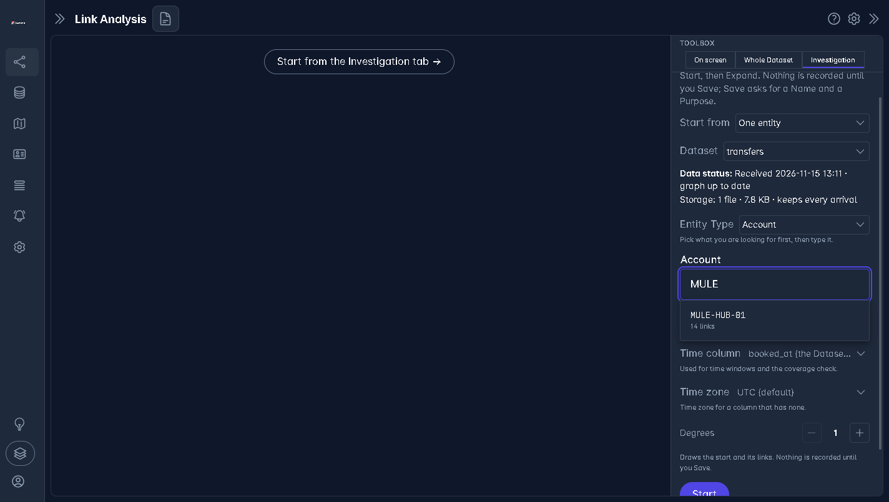
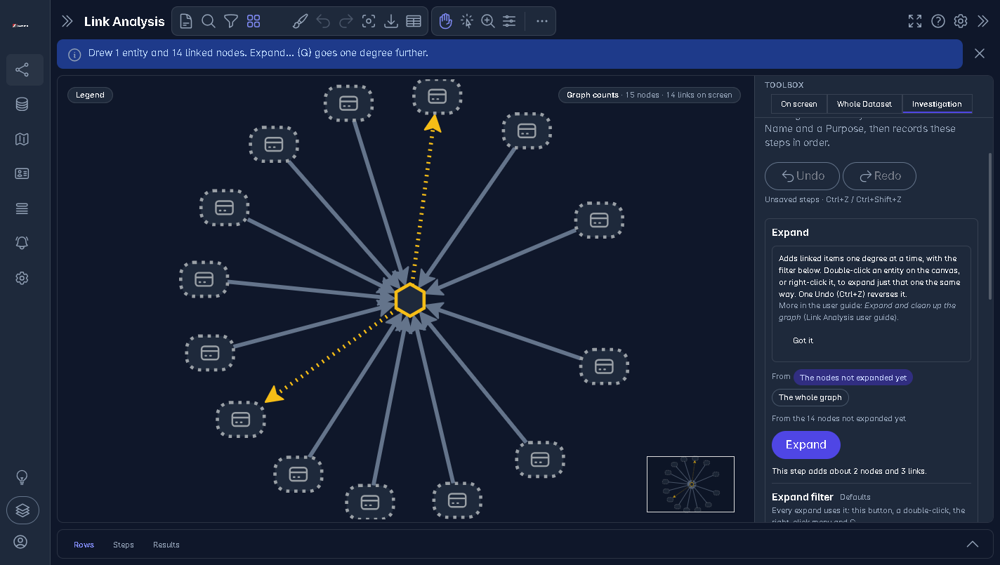

# Link Analysis — User Guide — The screen, building and looking at a graph

Part 2 of 7 of [Link Analysis — User Guide](user-guide-la-core.md) · previous: [What Link Analysis is, quick start and signing in](user-guide-la-core-getting-started.md) · next: [Expand, analyse, match patterns and save](user-guide-la-core-analysis.md).

## 4. The screen

Act on the canvas, read in the dock, configure in **⚙ Settings**.

* **One header row.** The title **Link Analysis**, then the **tool rail** and the **canvas toolbar** side by side,
  then **Full screen**, **About** (what this page is and its terms) and **⚙ Settings**. **About** defines each term it
  lists (Entity, Link, Dataset, Entity Projection, Saved view, Investigation, Working Set): from the glossary, else in
  the Studio's own words; it never quotes deployment or internal notes. When the browser refuses **Full screen** (an
  embedded page that is not allowed to go full screen, for one) a message says so. Every control is an icon: hover
  it for its name. Counts (Held, Hidden, collapsed, Attach) are a small number on the icon. When the header is too
  narrow, the canvas toolbar's groups after Canvas mode fold into **More canvas tools** (`⋯`), and a long selection
  row drops under the rail rather than being clipped. The page never grows past the window: long content scrolls
  inside its own panel (LA-NO-LONG-PAGES-1, 2026-11-10). In the Inspecto LA app, **Collapse** for the left navigation
  rail sits in this header before the title, the rail is drag-resizable (160-400 px) when expanded, and
  **Show / Hide the toolbox** is a toggle after **⚙ Settings**.
* **The open saved view is named after the title** (the description is its tooltip). Click the name for the *Saved
  view* dialog: **Name** and **Description**, the facts (Dataset, layout, industry pack, Investigations, id) and
  **Version history**. **Save** changes only the name and description, never the graph on screen; a view you may not
  change is shown read-only with the reason (LA-VIEW-DETAILS-1, 2026-11-10).
* **Start area (empty canvas):** without Investigations (Basic, the Explorer level), one bounded panel with tabs
  (*Start a graph*, *Preset queries*, *Build a question*, *Explore the Dataset*) that scrolls inside itself; a preset
  or builder answer opens in a closable card. With Investigations the empty canvas shows **Start an Investigation**
  instead: one sentence on what to pick and where, and **Start from the Investigation tab →**, which opens the start
  form there ([§5.1](#51-start-a-graph)).
* **Tool rail (file and view):** **File ▾** first ([§10](user-guide-la-core-analysis.md#10-saving-exporting-and-the-file-menu)), then **Search
  nodes**, **Filter node types**, **Graph layout**, **Filter edges by time**, **Help**, **Glossary**, **Display
  options** (the brush), **Undo** and **Redo** (display and filter changes), **Fit the graph to the screen**, **Show
  as list**, **Export** and **Show the rows** (opens the dock). **Glossary** (the book icon) lists the Industry pack's
  typology terms (*SIM box*, *IRSF*, *Wangiri*…: label, abbreviation, one-line definition, sorted by label; *No
  definition stated.* when the pack gives none). It is absent when the pack states no such terms (Generic, for one); it
  explains words only, and has no search.
* **Canvas toolbar (work on the canvas):** **Canvas mode** (Pan, Lasso, Fisheye, Link filter), the selection (**Select
  all**, **Invert the selection**, **Select neighbours**, **Clear the selection**, and the count), the
  graph edits (**Expand**, which in an Investigation opens its tab section, **Collapse**, **Hide**, **Exclude** and **Merge** on an Investigation's canvas, **Attach to
  Case**), **Clean up** (the broom), and **Held** and **Hidden by lists**.
* **Canvas:** the graph, with the legend, the Working set tiles and the minimap. The minimap starts folded to a small
  button at the right end of the line under the canvas (**Show the minimap** / **Hide the minimap**); View ▸ **Minimap**
  says whether the canvas offers one at all, and is kept with a saved view. It is drawn to read on a projector
  (LA-FULL-CYCLE-TEST-1, 2026-11-16): a node's name sits on a small backing in the node colour of the scheme, a few
  pixels under the node, so a link or an arrowhead that passes under it never cuts through the letters; in the dark
  scheme links are a lighter grey (about 7:1 against the canvas, was under 4:1, which vanished on a projector); the
  minimap's frame is the scheme's own faint line on the card colour rather than a bright grey box, so it no longer
  outshines the graph. Every colour comes from the theme, in both schemes.
* **Right panel**, collapsed to a thin rail (**Show the toolbox**, **On screen**, **Whole Dataset**, **Investigation**) or open
  with three tabs (**«** collapses it again; LA-PANELS-REDESIGN-1, 2026-10-29):
  * **On screen**: *Find something interesting* and the tools that run on the graph on screen.
  * **Whole Dataset**: the server algorithms and the tools that read the whole Dataset.
  * **Investigation**: the New Investigation form, or the open one's Act panel ([§11](user-guide-la-core-investigations.md#11-investigations)).

  The analysis catalogue is [§8](user-guide-la-core-analysis.md#8-the-analysis-catalogue). Settings in the three tabs are edited the same way
  everywhere: **label · value · ✎** (click the pencil or the value, Enter keeps it, Escape drops it), and a choice
  opens as a list in a popup.
* **Dock (bottom):** **Rows** (the links and nodes behind the graph) and **Results** (a long algorithm table), plus **Steps** (one line per step) while an Investigation is still unsaved, or,
  with an Investigation open, **Step log**, **Working Set table**, **Coverage**, **Annotations** and **Excluded
  entities**. Its tabs are plain text tabs, the open one underlined; on a narrow screen they scroll sideways. Drag its
  edge to resize; it remembers its tab and height in this browser. It never opens on nothing: **Results** is not
  remembered (its table lives only until the page reloads), so a dock left on Results comes back collapsed to its tabs,
  on **Rows**; and an empty Results tab is one line high (*Long algorithm results open here…*), not the dock's height.
  An empty dock used to take a fifth of the screen.
* There is no status bar under the canvas (2026-10-29). The graph model and **Refresh** are in **⚙ Settings ▸ Graph
  model**; the counts are on the **Graph counts** card on the canvas, whose **Limits** icon (bottom right) shows the
  node limits in force; **Installed modules** is a section of ⚙ Settings.

A window about 1,300 px wide or more shows the canvas and the right panel side by side; narrower, the panel stacks
under the canvas.

### 4.1 ⚙ Settings

One dialog for what you set rarely; the left side lists the sections, each with one line of help. It remembers the
last section in this browser. Running the graph model closes it; closing it over an edit you did not run asks first.

| Group | Sections |
|---|---|
| **This graph** | **Graph model** (Dataset, the two entity columns, link type, mappings, attribute columns, root, depth and direction; **Run query** and **Refresh** at the foot; the Space's Industry pack is shown read-only at the top) · **Entity Types** (the types the graph is drawn as, **New Entity Type**, **Delete**) · **Display rules** (node colour rules by attribute, [§6.4](#64-display-rules-colour-nodes-by-a-condition)) |
| **Data** | **Entity Lists** · **Identities** (identity resolution, [§11.7](user-guide-la-core-investigations.md#117-identity-resolution)) · **Add data** (upload a CSV to a Collector that accepts uploads, [§3.5](user-guide-la-core-getting-started.md#35-upload-a-csv-to-a-collector)) |
| **This Investigation** (only while one is open) | **Investigation settings**: Case, Members, Share and embed, Drafts, Replay and drift, Pin to a Widget, Oversight and approvals, Measures and templates, Dossier, References |

**Industry pack, not a profile picker.** The words and suggested tools follow the Space's Industry pack (Telecom:
*subscribers* and *calls*; Mobile Money: *wallets* and *transfers*). There is no picker on the page; Graph model shows
the pack in force. The pack names the Working set tiles, the Entity Types, the link kinds on the legend's chips, the
pattern names in the picker (the pack's definition replaces the pattern's description), the Value Measure names and the
*Phone number* field of the starter card; the stored kind and id never change, only the words. Without a pack, or until
the Space's packs have been read, the neutral words apply. A saved view never applies a pack of its own: the Space's
pack applies, and a view saved under one of the former browser-only profiles (finance, supply chain, cyber) opens under
Generic words. The Space's pack is chosen in **Settings ▸ Link Analysis ▸ Domain Profile** (*Generic* or an installed
pack, **Apply** with *Workbench author*); that page also lists the active pack's terms (key, label, abbreviation,
definition), warns when the stated pack is not installed and names each pack that was refused. A deep link that starts
from a type no installed pack investigates waits for the packs before it binds.

**Masked ids.** Names such as `masked:1d4d76be…` mean your Space hides sensitive ids. The same alias always stands for
the same account, so you can still group, count, search, seed and follow it. Graph model says **Masking on: ids
shown as aliases**. Details beside a masked id (a holder's name, a city) are masked with it. Inside a saved
Investigation, someone with *See unmasked ids* who leads it turns every alias on screen back into its real identifier in one
step: **Reveal…** under the canvas or in a node's details (see [Masked ids in an Investigation](user-guide-la-core-investigations.md#masked-ids-in-an-investigation)).

---

## 5. Building a graph

### 5.1 Start a graph

*Start from one entity: pick the Dataset and Entity Type, type the first letters and pick a match.*

On an edition with Investigations the empty canvas reads **Start an Investigation**: *Pick a Dataset and what to start
from (one entity, an Entity List, pasted values or the whole Dataset) in the Investigation tab. You work unsaved until
you choose Save. To carry on with earlier work, use File ▸ Open…*, with the button **Start from the Investigation tab
→**. This form is in the toolbox's **Investigation** tab. When the Entity Type is masked (in Standard and up, *Account*, *Phone number* and
other identifying types are masked unless the Space says otherwise) nothing is suggested: type the whole value, or turn
on **Show values (this is logged)** if you may reveal them. The line under the field says where the real identifiers are: if
you have *See unmasked ids*, the graph shows aliases until you save it and press **Reveal…** on the canvas or in a
node's details; otherwise it says that seeing them needs *See unmasked ids*.

*The first graph: the start entity and everything it is linked to. Dotted outlines are entities not expanded yet.*

Without Investigations (Basic, the Explorer level) the first screen is the Start area, its first tab the **Start a
graph** box. With Investigations the centre shows only how to start and **Start from the Investigation tab →**: the
start form lives in that tab, so Dataset, Start from and Entity Type are asked in one place ([§11.1](user-guide-la-core-investigations.md#111-start-one)). Pick the **Dataset** first (already picked when you come from
*Explore in Link Analysis*), then what to start from:

* **One entity** — pick the **Entity Type** (the Dataset's main one is chosen: accounts for transfers, phone numbers
  for calls), then type the value. Matches appear with how busy they are: *MULE-HUB-01 - 10 links, first seen 3 Sep
  2026, last seen 30 Sep 2026*. A masked type suggests nothing: type the whole value, or, if you may reveal, choose
  *Show its values* (each look-up is recorded).
* **A list** — an Entity List (suspects, a watch list).
* **A paste** — values, one per line (commas, semicolons and tabs work too).
* **The whole Dataset** — every link at once. When the Dataset holds more entities than the node cap the box warns
  first: the graph is cut to the busiest, and starting from one entity is usually clearer.

**Start** draws what you chose plus **one ring** of everything linked to it, with busy entities held
([§7.2](user-guide-la-core-analysis.md#72-held-busy-entities)), so **Expand** (**G**) continues from there. A line above the graph says what was drawn and
lists any value not in the Dataset. A list or a paste draws at most 25 values in one start (its first 25) and reports
the rest as *N more values not drawn*.

**Start from** is a choice that opens as a popup, like the Entity Type. The box always draws; it records nothing.

**Preset queries** (Basic, under the Start box) ask a Dataset the questions your industry already asks, without
writing a query: most of them point at *who to look at first*. The same core set is offered in every Space; an
industry pack adds its own questions ahead of it. Pick the **Dataset** (the Start box's, at first) and a **Question**, set its few values (each has a default), and choose **Ask**:

| Question | Answers | Offered when the Dataset maps |
|---|---|---|
| Reached by many | the entities that most distinct others link to, at least *N* | From, To |
| Reaching many | the entities that link to the most distinct others, at least *N* | From, To |
| Two-way pairs | pairs that link to each other in both directions, with the links each way | From, To |
| Short loops | three entities linked in a circle (A to B to C and back to A); very busy entities are left out | From, To |
| Newcomers | entities first seen in the last days of the data that already have many links | From, To, When |
| Top counterparts of one entity | who one entity links to most: links, and the total amount when there is one | From, To |
| Two steps from one entity | its direct counterparts, then theirs, and through how many of them | From, To |
| Biggest senders by amount | the entities that send the most in total | From, To, Amount |
| Money in, then out again within hours *(mobile money)* | entities whose money leaves again soon after it arrives: median hours, links out, received | From, To, Kind of link, When, Amount |
| Linked through one shared item *(telecom)* | entities linked to many others by a kind of link that means sharing one item (the pack's shared device) | From, To, Kind of link |

From and To come from the Dataset's link (Add data and Mappings state it), else its first two columns that hold an
Entity Type; Kind of link is a column named `kind` or `…_kind`; When is its event date; Amount is a number column
the Space's industry calls an amount. A question the Dataset cannot answer is not listed: name the columns on the Data
page ([§3.4](user-guide-la-core-getting-started.md#34-the-data-page-datasets-entities-and-mappings)). The answer is a table (at most 500 rows; masked ids show
as aliases, exactly as on the graph). **Draw these** starts a graph from the listed entities, the top 25 first, the way
a paste does. Every question asked is recorded.

On a large Dataset, Reached by many, Reaching many, Newcomers, Two-way pairs and Short loops are answered from the
Dataset's **link index** when one is published (a line under the table says so, and whether the index is behind the data).
Short loops leaves out entities with more than 50 links in and out by default, the limit the index is built with; ask for
more and the Dataset itself answers. The other questions read the Dataset and can run out of time on tens of millions of
links: they then say so in a sentence.

**About <Dataset>** (Basic, under the preset queries) is the Data page's *Discover* for the Dataset picked in the Start
box ([§3.4](user-guide-la-core-getting-started.md#34-the-data-page-datasets-entities-and-mappings)); its **Draw these** starts a graph from the busiest
entities, and a busiest row opens that entity's summary, whose *Draw it* starts from that one entity.

**Build a question** (Basic, under the preset queries) asks a question of your own over the same Dataset: rank the
senders or the receivers by their links, their distinct counterparts or the total of a Measure; keep one sender or
receiver, some kinds of link, a period on any Time column (*From day* is included, *Before day* is not), a range on
any Measure (both ends included), groups with at least a value, and how many rows (at most 500). Only the columns the
Dataset gives that role are offered, and the server refuses anything else. **Draw these** starts from the answer;
**Save as preset** names the question and adds it, for everyone in this Space, to the *Question* list of every Dataset
that has its columns (*… (saved here)*). A saved question is shown only to those it is shared with.

**Investigate** on an Entity's page, and **Investigate … in Link Analysis** on an Incident or Case page, open a short
*Investigate {number}* form in the Investigation tab that asks only for the purpose.

**Open…**, **Explore Dataset…** and **Examples ▸ Follow the money** are in the **File** menu
([§10](user-guide-la-core-analysis.md#10-saving-exporting-and-the-file-menu)). Under the box, **Add data** brings a file in.

### 5.2 Graph model: draw a Dataset yourself

**File ▸ Explore Dataset…** or the pencil opens **⚙ Settings ▸ Graph model**:

1. **Dataset.** The ones that look like links are listed first, each with the reason. **Entity/Link (several
   Datasets)** puts up to 16 mappings in one graph; the same entity in more than one Dataset becomes **one node** that
   lists every Dataset it came from. If you cannot read even one of them, the whole query is refused — never a
   partial graph.
2. **The two entity columns** (who → whom) are filled in when two columns look like the two ends of a link (payer /
   payee, caller / callee, from / to…); change them if the link runs the other way. **Derive mapping** asks the
   assistant to draft them and needs permission to author configuration.
3. Optionally a **Link kind column** (wire, card, cash_out, SMS…; kinds get colours and can be filtered) and
   **Attribute columns** (amount, country, time — they feed the timeline, Value Measures and pattern tools). **Add
   another mapping** stacks more column pairs. **Root**, **depth** and **direction** start from chosen entities and
   grow outwards.
4. **Run query.** Settings closes and the graph is drawn; the **Graph counts** card says how many entities and links.
   **Refresh** (here in Graph model) runs the same model again later.

### 5.3 Filters — two stages, deliberately

1. **Apply locally** — instant, in your browser, over the links already loaded.
2. **Push to server** — the same condition goes to the database, so it applies *before* the graph is folded and
   counts stay right on large data.

Conditions are a tree of AND/OR groups; a single bare condition is refused — wrap it in a group.

> **Mind the "≥ 5 000" trap.** A view filtered to "amount ≥ 5 000" hides exactly the small payments structuring
> consists of. Pattern and Measure tools run over the **whole Dataset**, not your filtered view, for this reason.

### 5.4 Size limits — told honestly

* By default the server returns at most **4 000 links** (ceiling 40 000), the canvas admits **1 000 nodes**, and
  analysis in the browser runs up to **2 500 nodes** (heavier scores stop sooner and say so). The **Limits** icon at
  the bottom right of the **Graph counts** card shows the node limits in force (Escape closes it): *Graph drawn*, *On screen tools* and *Whole Dataset tools*. Every number is a setting ([§15](user-guide-la-core-examples-roles.md#15-limits-and-honest-behaviour)).
* When a cap cuts data you see **Truncated** — never a silent "no results". Narrow the query or use the Server side
  of the catalogue.
* Each server read says where it was answered: *Answered from the link index v3* (*, which is out of date* and why, when
  files were added after it was built) or *Answered from the Dataset because …*, with the reason in words, for example
  *because the link index is out of date (the Dataset's definition changed after the index was built)*.
* Very busy hubs are folded into a **super-node**. Above 20 links on the canvas, link labels show on hover or click
  only; *All link labels* in Display options overrides it. Above 1,000 links, arrowheads and node labels also show on
  hover or click only (the canvas says so at the bottom); *Arrows and node labels on large graphs* overrides it, at the
  cost of slower drawing.

---

## 6. Looking at the graph

| To find | Use |
|---|---|
| A particular node | **Search nodes**; **Clear search and filters** resets |
| Only some kinds of node | **Filter node types**, or the legend's chips |
| A better layout | **Graph layout** |
| Links in a time range | **Filter links by time**: pick a time column (only date/time columns are listed), then drag the cutoff; times are UTC. Needs a time column among the Attribute columns |
| The rows behind the picture | The dock's **Rows** tab (**Show the table**): **Links** or **Nodes** of what the graph draws; a node row (click, or Enter on the focused row) selects that node on the graph |
| The same entities on a map | Geo Map: selecting an area there highlights the matching entities here, and back; a node's dialog can also open its record on the map ([§6.3](#63-pivot-between-graph-and-map)) |

**Layouts.** *Layered, Grid, Force, Clustering force, Radial, Degree ordered, Circular, Information density,
Force (spread)*, and tree layouts (*Mind map, Organisation chart…*) enabled only when the data is tree-shaped.
**Layered is disabled, with the reason, on a wide shallow graph** (*too wide*: more than 60 nodes would share one row — say 300
claims under 20 providers — which it would stack into one column too tall to fit); use *Force*. A saved view that
picked Layered opens in the default layout then.

**Display options** (the brush) switch node and link labels, colours, shapes, node size and spacing, **Align while
dragging** and **Highlight on hover**, and the overlays: **Legend**, **Graph counts**, **Level of detail**, **Minimap**,
**Grid**, **Community outlines**, **Group single-link neighbours**, **Community shading** and **Link bundling**. Every
link kind and Entity Type is named as the legend names it, here, in the node-type filter, the links table and the node
card. Colour rules by attribute
are in **⚙ Settings ▸ Display rules**. The legend and Graph counts start as small pills at the top of the canvas, so a
graph is drawn clear of them; open either with one click, and this browser remembers that choice. The one exception:
while the canvas draws links in more than one style (a coloured kind, a dashed or dotted one), the legend starts open,
so no link style is left unexplained; minimise it and this browser remembers that too. A dashed or dotted link kind's
chip shows its line pattern beside its name. Fitting the graph
(on drawing, *Fit to screen*, or a resize) keeps the pills' band, the status line along the bottom and a margin on
every side clear, so no node is drawn under a pill or cut by the canvas edge. A layout or overlay the graph is too big for is greyed out and says why (*needs at most 300 nodes (this graph
has 921)*); reduce the graph first with Clean up, a filter or Collapse. The legend's link-kind chips change the
drawing only — a hidden kind is still followed by the next expand; to leave it out, set link kinds in **Expand** ▸
**Links** (that is recorded).

**How nodes look by default.** Node labels show on their own while the graph has **at most 80 nodes**, and are off
above that; the line along the bottom of the canvas then says *node labels off above 80 nodes: Display options turns
them on*. Your tick or untick of **Node labels** in Display options wins either way, and a saved view keeps the labels
it was saved with. Link labels start off. The brush is tinted while a label switch differs from that start.

**Notices** (a refusal, a save) open at the top centre of the window, and a step's result line at the top centre of
the canvas, between the Legend and Graph counts pills, both clear of the minimap and the page's own buttons. The start's outcome (*Drew 1 entity and 14 linked nodes…*) stays above the canvas until your
next step (an Expand, an Exclude, a Clean up, an Undo, Save), whose own result line takes its place.

* **Node size** is a Display setting, never derived from links or an attribute: *Tiny* 12 · *Small* 20 (the start) ·
  *Medium* 28 · *Large* 40 px. **Node spacing** multiplies the layout's own distances: *Compact* · *Roomy* · *Spacious* ·
  *Wide* (the start) · *Widest*; Grid, Circular and the information-density layout have no spacing. Changing either
  re-runs the layout; more spacing means a smaller zoom after fit.
* **Automatic colour and shape.** Over the graph drawn, the most common node type and the most common link type stay
  neutral; every other type gets a colour plus a shape (diamond, square, triangle, hexagon, star), or for a link type a
  colour plus a line pattern. A type keeps its look while rarer types come and go; no two types share both colour and
  shape, and no automatic colour comes close to the plain link colour. Your own per-kind choices in Display options
  always win, the legend shows the same colours, and a saved view keeps only your choices, never the automatic look.
* **Icons.** Built-in Entity Types (subscriber, IMSI, IMEI, phone number, wallet, account, agent, handset, cell) draw
  as an icon tile that scales with node size; a shape you set for that kind replaces the icon, and a type with no icon
  keeps its plain shape. Nodes with no Entity Type (a saved view's untyped *entity* nodes, an expand's untyped
  neighbours) show no icon.

### 6.1 Canvas modes and selecting

The **Canvas mode** decides what a drag on the empty canvas does. One is active at a time; the key is in the tooltip.

| Mode | A drag on the canvas |
|---|---|
| **Pan** (default; **Esc** returns to it) | moves the view. **Shift+drag** draws a lasso that adds to the selection. |
| **Lasso** (**L**) | draws a lasso (handy on a touchpad) |
| **Fisheye** (**F**) | moves a magnifying lens over the graph |
| **Link filter** | moves a lens; only the links inside it show |

In every mode: scroll zooms, dragging a node moves it (and the whole selection), **Shift+click** adds or removes one
node, **Ctrl+A** selects all (super-nodes excluded), and the arrow keys and **+** / **−** move and zoom.

### 6.2 The node detail dialog

Click a node for its rows (id, links, neighbours, Datasets, attributes), **Explain node** (why is it interesting?) and
its canvas actions. On an Investigation's canvas, click once to select, then click the selected node again to open the
dialog. Three sections look up only the entities they need on the server, so they work in a masked Space too
(identifying values show as aliases and the section says *Entity masking is on*; numeric scores stay readable):

* **Masked id** — only for a masked node: it says the name is an alias and offers **Reveal the masked entities on screen…** (the
  one Reveal, see [Masked ids in an Investigation](user-guide-la-core-investigations.md#masked-ids-in-an-investigation)), or why you cannot. Once revealed it
  shows the real identifier, and the node's details, enrichment and risk factors are read again in the clear, each recorded
  with your reason. Before that, text and dates beside a masked id are masked with it; counts and scores stay readable.

* **Risk** — on a pack that maps an indicators Dataset (Telecom: `telecom_msisdn_indicators` by `msisdn`), the node's
  **indicator score** and factor columns. **Compute risk** runs propagated risk on the server over the Investigation's
  Working Set and shows the node's propagated score and its top contributing origins (*+28 from 99979100001, 3 hops,
  weight 0.35*). Without an open Investigation, or the *Run link graph analysis* capability, it is held and says why.
* **Enrichment** — the node's CRM/KYC row when the pack maps one (Telecom: `crm_kyc`), and the Entity Lists of its
  type it is on.
* **Case history** — Standard and up. Opening it reads the Incidents and Cases that reference the entity, newest
  first; *Show* filters all / open / closed. A masked node is looked up by alias and the number is never shown.
* **Summary** — every edition. *Summarise its links in <Dataset>* reads the node's links in the Dataset the graph was
  drawn from: links in and out, distinct counterparts, first and last seen, the counterparts with the most links and
  with the most money (the Dataset's primary Measure, sent and received), its kinds of link and its activity per day
  over the 90 days before it was last seen. A masked entity is read by its alias, and its counterparts show as aliases.
  The full Entity page (every Dataset, lineage, relationships, cases) is Standard and up ([§3.3](user-guide-la-core-getting-started.md#33-entities-what-the-columns-hold)).
* **Actions** — **Add to <list name>** asks for a reason (a list under four-eyes answers
  *Waiting for approval*); needs *Manage incidents*. **Hide on canvas** (exploring only) takes the node off the canvas.

### 6.3 Pivot between graph and map

A node that stands for an Incident or Case record offers a **map** button in its detail dialog; a point on the
**Geo Map** whose row names a Case, an Incident or another record (`caseId`, `incidentId`, `objectId`) offers a
**graph** button. The button takes the
record's reference to the other page (nothing else travels, and no new query is sent). Because each page draws nothing
until you run a query, the record is looked for in the next graph or map you draw there: on the graph its node is
emphasised, on the map the point is selected and the map centres on it. If it is not in that answer, a short message
says so and the page stays as it is; the look-up is tried once. There is no timeline view to pivot to yet, and a record
in the table opens through the dialog's **Open record**. The Geo Map side: [Geo Map user guide](../geo-link/user-guide-geo-map.md).

### 6.4 Display rules: colour nodes by a condition

**⚙ Settings ▸ Display rules** colours nodes by their details: each rule is an Entity Type (or any), a detail, a
comparison (*equals*, *is not*, *contains*, *greater*, *less*) and a colour; the list is in the order you added the
rules and the first rule that matches wins. *Greater* and *less* need numbers on both sides, and a node without that
detail never matches, not even *is not*. A rule reads the node's detail columns (the mapping's attribute columns). A
group colour from an analysis comes before a rule, and a rule before the per-kind colour in Display options; halos,
the dotted *not expanded* outline and dimming stay visible over any rule. Rules are saved with the view and follow
Undo / Redo; they are kept in your browser and the view, not shared across the Space.

**Colour by a Reference detail** (every edition, exploring only). The detail picker also lists, under **Details in
&lt;Reference&gt;**, the columns of each Reference that describes an Entity Type on the graph; such a rule reads like
*segment (in accounts) equals retail*. The values are read through masking for the nodes drawn: a node the Reference
has no row for is not coloured, nor is a masked value (a masked column or alias is never compared, and a note under the
rules names the masked detail). A saved view keeps the rule, never the values.

Not offered (kept on the board until an analyst asks): shapes, sizes or halos as the outcome, rules on links, rules on
Measures, rules shared across the Space, re-ordering rules, and a legend row for rule colours.

---
