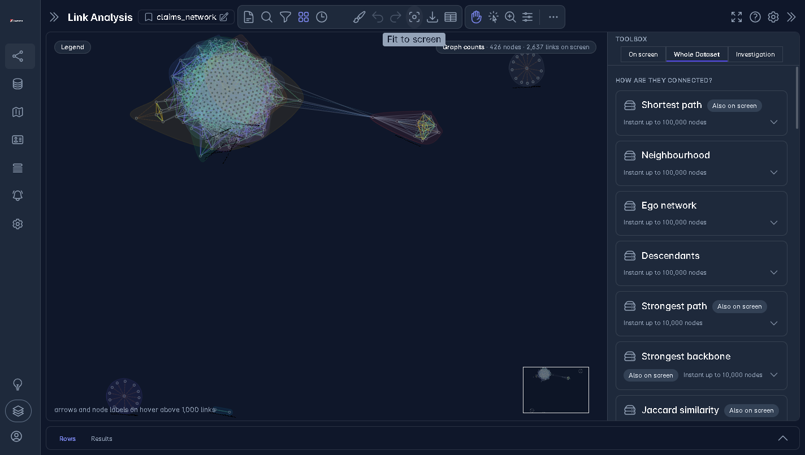

# Link Analysis — User Guide — Worked examples, roles, limits and troubleshooting

Part 5 of 7 of [Link Analysis — User Guide](user-guide-la-core.md) · previous: [Investigations, Entity Lists, Alerts and Geo](user-guide-la-core-investigations.md) · next: [Reference notes](user-guide-la-core-reference-notes.md).

## 13. Worked examples

*A saved view opened from **My work** (*claims_network*, 426 nodes): the dense group is the staged-accident ring. The **Whole Dataset** tab lists the server algorithms.*

**Find a money-mule ring.** Choose **File ▸ Examples ▸ Follow the money**, or open `mule_layering_ring` (on the
`la-showcase` Space Template: 112 accounts over three days). On screen ▸ **Suspicion score** ▸ **Find suspicious nodes** puts the relays and
the hub in the top decile. **Pattern match ▸ Structuring (smurfing)** finds `MULE-HUB-01`: 96 in-band legs from 12
payers. **Value Measures ▸ Pass-through** flags 13 accounts (the two relays at ≈ 0.985, the hub at 0.979, `SHELL-A`
above 1); **Velocity** shows them forwarding within hours (median 1.5 h and 2.5 h for the relays, 6 h for the hub).
**Start an Investigation from the top results**, state your purpose, expand one degree; **File ▸ Save snapshot…**
▸ *create a new Case from graph nodes*, tick the hub and relays; **Build Dossier**, **Verify this Dossier**, and send
the sealed Dossier to the reviewer.

**Find the cash-out point.** **Value Measures ▸ Cash-out concentration** with cash-out kind `cash_out`: `TILL-06` holds
97 % of cash-out value from 8 payers (reproduced by `ControlApiLaShowcaseFiguresTest`). **Benefit transfer** isolates
`SKIMMER-01` (6 recipients).

**Check for one person behind two identities.** In the `demo` Space open `roaming_imsi_footprint` (each roaming IMSI
linked to the visited networks that billed it): IMSI `001010000000042` touches four partners in three days, which
**Explain node** and **Centrality** surface. Spellings of one operator (*Cinder Wireless*, written four ways) merge into
one node automatically; for a phone number and a SIM of one person, open an Investigation, **Merge** them (§11.7), then
**resolve**. *(Unverified: whether the screen announces a count of possible split identities.)*

**Telecom fraud.** The `la-showcase` Space also ships `telecom_fraud_network`, and the `demo` Space other views; the
telecom demo as a presenter runs it is [§13.1](#131-telecom-fraud-demo-as-built-2026-10-12).

### 13.1 Telecom fraud demo (as-built 2026-10-12)

Shipped through six live browser walk-throughs; the sixth (2026-10-12) was judged *ready to present*, every storyboard
beat passing. Backend routes and invariants are in [architecture-la-core.md](architecture-la-core.md); presenter setup in
[admin-guide-demo.md](admin-guide-demo.md). Provenance (archived):
[`la-telecom-fraud-demo-storyboard.md`](../../../../archived-documents/plans-archive/la-telecom-fraud-demo-storyboard.md)
and [`la-telecom-demo-data.md`](../../../../archived-documents/plans-archive/la-telecom-demo-data.md). Remaining small
items: BACKLOG `LA-TELECOM-DEMO-RESIDUALS-1`.

**Scenes (one analyst, one ring, ~15 min).** (1) Start from the **MSISDN starter card** ("Investigate a number",
`?seed=`) with the suspect `99979100001` - telecom typology Alerts are aggregate-only (no entity on the Alert, by
design), so they are not the entry point. (2) Degree 1: voice / SMS / forwarding / shared-device neighbours and the
counts. (3) Expand degree 2, 3, 4 with the hub held; **only then**, as the last beat, show the hub's audited **Expand
anyway** and four-eyes - overriding the hub first floods the frontier with its background contacts. (4) Slice by link
kind (voice, SMS, forwarding, shared device / identity / payment, SIM history). (5) The ring: shared IMEI, forwarding
chain. (6) Node dialog: Risk (propagated risk), Enrichment (`crm_kyc`, `hlr_eir`, read through masking), Case history,
watch / block actions. (7) Louvain community and the telecom pattern packs (Wangiri, IRSF, SIM box, forwarding chain).
(8) Act: watch list, one-step Attach to Case, export. (9) Under the hood: the Pipelines and Jobs that built it.

**Data (`la-showcase` Space Template).** Eight synthetic feeds (CDR voice/SMS, HLR/EIR, CRM/KYC, recharge,
provisioning, block list, alarms; generator `tools/gen-la-telecom-data.py`, byte-identical output) folded by the
`sql.template` Jobs `telecom_links` (MSISDN-MSISDN pairs, the "shared X" key in `via`) and `telecom_msisdn_indicators`
(0-100 score) on a `*/10` cron, plus `telecom_typology_counts`. Planted: suspect / Wangiri `99979100001` (WANGIRI-B
`99979100002`), premium range `99891000001`-`12`, IRSF `99979200001`-`4`, subscription fraud `99979300001`-`5`, SIM
box `99979400001`-`6`, mules `99979500001`-`5`, the benign taxi-dispatch hub `99970000100`. Degree ladder from the
suspect under the Telecom preset (pinned by `TelecomLinksGoldenTest`): d1 402 admitted · d2 492, hub flagged at 628
in-window contacts · d3 143 (SUBFRAUD-01..05) · d4 55 (SIMBOX-01/06, MULE-01..05) · SIMBOX-02..05 at d5 via
`shared_device`. Nothing is fan-out capped or truncated.

**Telecom preset.** 30-day window on `last_seen` ending at the Dataset's latest `last_seen`, read zone-free
(`strftime`) and parsed as UTC (a bare `MAX` came back in the host zone and dropped links); when the latest time cannot
be read no window is sent ("all available data"). `minEvents` 1, `maxFanOut` 500, `budget` 10000, `hubThreshold` 500;
expand ranks by `eventsCol`. `config/link-analysis.toon` sets `four_eyes_fan_out_above: 2000` (operator 2026-10-11),
so the bounded ladder never waits.

**Four-eyes beat.** An unbounded expand (no `maxFanOut`) or any fan-out above 2000 waits for approval: `analyst`
requests, `manager` approves in **Approvals → Link expansions**; the panel re-reads the log and shows approved /
denied.

**Gotchas.** Only `manager` (`la-manager`, `canOperateRuns`) may press *Run* on the Jobs - the seed `admin` gets
403; press it after seeding rather than waiting for the cron. The benign taxi hub scores like the suspect - a talking
point (high connectivity is not guilt), not a defect. Offline smoke: `node tools/la-demo-smoke.mjs --telecom`; the
same runner also probes the empty-Dataset 409, the read-only persona, the settings round-trip and the sign-in picker
(`--embed` for the embed link when the host runs `-Dla.embed.enabled=true`). Live run recipe: build the bundle in a
worktree and serve it on a free port (e.g. :8099), never the shared :8080.

---

## 14. Who can do what: roles and editions

If a control is greyed out, hover it: it names what is missing.

| You want to | You need |
|---|---|
| Explore, analyse, save a view, export | Sign-in |
| Start an Investigation, take steps, Drafts, link or attach to a Case, add to a watch or block list | *Manage Incidents and Cases* (`canManageIncidents`) |
| Run on the Server side of the catalogue, **Compute risk** | `canRunLinkGraphAnalysis` |
| Build a link index | `canBuildLinkIndex` |
| Approve or deny a held large expand (never your own) | *Approve link expansions* (`canApproveLinkExpansions`) |
| **Watch** a Measure (bind an Alert Rule) | `canAuthorAlertRules` |
| See real identifiers instead of aliases | *Reveal* (`canRevealLinkEntities`) |
| Mint an embed link | `canShareInvestigation` and lead of the Investigation |
| Change Link Analysis settings, set what a column holds, add an Entity Type, choose the Space's Industry pack | `canAuthorWorkbench` |
| Add data with sign-in, **Upload a CSV** to a Collector | the right to upload data (`canUploadData`) |
| See **Getting started counters** | an administrator (`canAdminister`) |
| **Settings → Spaces**: attach, detach, change a Space's Data folder | an administrator (`canAdminister`) |

**Read-only roles.** Without *Manage Incidents and Cases* the Investigation tab shows a **Read-only** banner, *Changing an Investigation needs the Manage
Incidents and Cases permission.* (the banner's title says Read-only, so the sentence does not repeat it): you can open, read, replay, re-read and build, download and verify the Dossier; every
write control is disabled with that sentence. A reviewer of an Investigation, and a member of its linked Case, read it
the same way (*You review this Investigation: you can read it and decide approvals…*): only a lead changes its steps, so they get no Expand form, and **Undo** and **Redo** are disabled with that reason. A refusal shows the server's reason; a missing
permission is named in words (*Your role does not have the Workbench author permission*). *Not found* on an Investigation can mean it does
not exist, is not yours, or its Dataset is no longer shared with you — the same answer on purpose. In the
`la-showcase` demo, *Demo Reviewer* is read-only and *Demo Outsider* signs in but is admitted to no Space (the home page says *You have no access to any Space*); *Demo Analyst* holds manage-incidents,
graph-run, index-build and Alert Rule authoring; *Demo Manager* is the second approver; *Demo Admin* also holds
`canAuthorWorkbench`.

**Saved views and settings (Workbench author).** The seeded `admin` role holds the *Workbench author* permission
(since 2026-11-15, `LA-FULL-CYCLE-TEST-1` D1), as `power`, the developer roles and `super` do, so the administrator
who creates a Space can save its first view and change its settings; `operations`, `support` and `business` do not
hold it. Without the *Workbench author* permission (`canAuthorWorkbench`) —
a separate question from *Manage Incidents and Cases* — Settings → Link Analysis shows its values with no Save, and File ▸
Save view, Save view as… and Delete view (and Rename, Duplicate and Delete in File ▸ Open…) are greyed out with the
reason. A view shared with you to view only cannot be saved over or renamed (use Save view as… for a copy), and only
its owner can delete a shared view.

**Editions and levels.** Link Analysis is in every edition, but what it offers depends on the edition and on the
Inspecto LA level (see [EDITIONS](../../../../EDITIONS.md) and the [level admin guide](admin-guide-la-core.md)):

| | Basic / Explorer level | Standard and above, with Investigations |
|---|---|---|
| Start a graph, Expand…, Clean up, Collapse, browser catalogue, saved views, Snapshot | ✓ (exploring only: nothing recorded) | ✓ |
| Investigations, step log, Dossier, four-eyes, Drafts, Case history | hidden or locked, with one line naming what has it (*Start an Investigation from this*) | ✓ |
| Server side of the catalogue | hidden, with the reason | ✓ (with `canRunLinkGraphAnalysis`) |
| Add data from a file, an inbox (*Watch this folder*) or a Postgres table; Discover, *About*, *Build a question* | ✓ | ✓ |
| *Read from another database or a remote system*, *Keep this up to date* | locked | ✓ |
| *Keep* (retention) on the Dataset card | not shown: every file stays, compacted | ✓ |

**Masking.** Per Space, ids are shown *typed* (only sensitive types masked), *all* masked, or *none*; a Space that sets
nothing uses *typed* in Standard and above and *none* in Basic. The same rule applies on the graph, the node list,
paths, patterns, Value Measures and the Working Set. One rule decides what is masked everywhere (MASKING-TWO-VOCABULARIES-1,
2026-11-14): a column in a sensitive class, or a class or id that a masked Entity Type claims. Risk Score evidence,
publication and embed links, BI in *typed* mode and Link Analysis all use it, and an Entity Type's `masked: false` no
longer unmasks a sensitive class; only masking mode *none* turns masking off.

---

## 15. Limits and honest behaviour

* **Views are not evidence; snapshots and Dossiers are.**
* Nothing is silently dropped: truncation, unmatched values, unvalued rows and refusals are all stated.
* Time-based tools read times in a stated zone (UTC for Measures); naive timestamps are assumed UTC.
* The server path search over a Dataset is certified at about one million links; above that the link index (Space
  setting `index.enabled`, on by default) is measured to 100 million links.
* An Alert on an Investigation watches its **sealed** Working Set, not live data.
* **Every limit is a setting.** *Settings → Link Analysis* lists each with its default, range and value in force, in
  three sections: **Analysis** (the Space's limits — expand budgets, hub threshold, four-eyes thresholds, path depth,
  page sizes, masking mode, link index, Draft limits, embed link lifetimes — set by a Space administrator), **Host
  resources** (Graph Run ceilings, index build memory, rate limits — a system administrator), and **My browser**
  (canvas, labels, layouts and browser algorithm caps for your own machine, never above the Space's value; *Reset to
  Space value*). A value outside its range is refused with the range. Exact keys and defaults: [*Grounded limits and
  consequences*](architecture-records-grounded-limits.md#grounded-limits-and-consequences).
* Rate limit: a burst of 30 requests per user, then one every 2 seconds (server-wide `rate.link_analysis_burst` /
  `rate.link_analysis_per_s`).

---

## 16. Troubleshooting

| You see | It means / do this |
|---|---|
| A control is greyed out | You lack the capability or edition named in its tooltip; ask your administrator |
| **Truncated** | A cap cut the data. Narrow the query, or use the Server side of the catalogue |
| *No preview on this server* in Expand… | The server is older than the preview; Expand anyway — the result line says what it added, with Undo |
| Layered is greyed out | The graph is wide and shallow (more than 60 nodes on one rank); use Force |
| `masked:…` everywhere | Your Space masks sensitive ids; with *See unmasked ids*, save the graph as an Investigation and press **Reveal…** (see [Masked ids in an Investigation](user-guide-la-core-investigations.md#masked-ids-in-an-investigation)) |
| *Waiting for approval* | The expand is above the four-eyes limit; a second approver opens the Investigation (§11.4) |
| *Investigation is not available* / not found | It does not exist, is not yours, or its Dataset is no longer shared; ask its owner to add you |
| *No node on this graph can become a Case member* | The ids are masked, and Reveal does not unmask a Case key; link the Investigation to a Case (**Investigation settings… ▸ Case**) |
| A tool says it needs a time column | The pattern is time-ordered; see §9 |
| A pattern finds nothing on a big graph but should | The browser graph was truncated; switch the catalogue to Server |
| *Every node mapping needs a Dataset and an id column* | Fill every required field in Graph model before Run query |
| Merged step refused | No **resolve** is in force at that point; add one first |
| *The analysis was not saved* with a reason | The server refused it; usually a missing capability |
| *That is over a size limit, so nothing was stored.* (413) | Narrow the step (fewer seeds, shorter window) or fork a smaller Investigation |
| *Too many requests…* (429) | Wait a few seconds and retry |
| Sign-in: **The server could not start a session** | The server's message is shown with **Try again**; an administrator fixes the configuration |
| Sign-in: **Single sign-on isn't set up** | Ask the administrator |
| *The server requires sign-in, but this page started without a session* | Reload to sign in |
| *No Space is attached …* (503) | An administrator must add or create a Space |

---

## 17. Vocabulary

| Word | Meaning |
|---|---|
| **Dataset** | A table of rows Link Analysis reads |
| **Entity / node / link** | An account, number or device; a transfer or call folded from rows between two of them |
| **Entity Type** | The kind of thing a column holds (Account, Phone number); two columns join only on the same type |
| **Industry pack** | The Space's domain words and suggested tools (Telecom, Mobile Money, Generic) |
| **Saved view** | A named graph start plus the Entity Lists it uses; re-reads live data |
| **Snapshot** | A frozen copy of what was on screen, with a fingerprint |
| **Investigation** | The recorded, replayable work |
| **Working Set** | The entities an Investigation currently holds |
| **Step log** | The ordered steps of an Investigation |
| **Draft** | A side line forked from the main log |
| **Dossier** | The evidence document built from an Investigation |
| **Entity List** | A named set of entities (watch, exclusion, known good, block) |
| **Identity resolution** | Declaring that two identifiers are one entity |
| **Measure** | A computed figure over a Dataset or Working Set, such as pass-through ratio |
| **Alert Rule** | A saved condition that raises an Alert when a Measure crosses a level |
| **Incident / Case** | The operational records you escalate to |
| **Space** | Your team's workspace, with its own Datasets, members and settings |

---

## 18. If you used the old Studio

The Studio was reorganized on 2026-10-27 (`LA-STUDIO-UI-REORG-1`). Nothing was removed; this is where things went.

| Old | Now |
|---|---|
| Query panel (left) | ⚙ Settings ▸ **Graph model** (with **Refresh**; the status bar was removed on 2026-10-29) |
| Grow (popover, rung form) | **Expand** (**G**) — in an Investigation, a section of the Investigation tab: From, a − N + Degrees stepper, Direction, then the Links / Time / Limits folds |
| Status bar: Limits, Installed modules | The **Limits** icon on the Graph counts card; ⚙ Settings ▸ **Installed modules** |
| Domain profile picker | None — the Space's **Industry pack** applies, shown in Graph model |
| Save as a case (saved view) | **File ▸ Save view** / **Save view as…** |
| Open saved views | **File ▸ Open…** ▸ *Saved views* |
| Toolbox → View tab | The tool rail (layout, filters, Display options) and **Canvas mode** |
| Toolbox → Analysis tab, *All algorithms (server)* | Right panel ▸ **On screen** and **Whole Dataset** tabs (2026-10-29: the Analysis tab's Browser \| Server switch became two tabs, renamed for where the tools look) |
| Start box's *Follow the money*, *Open a saved view*, *Explore a Dataset* cards | **File ▸ Examples ▸ Follow the money**, **File ▸ Open…**, **File ▸ Explore Dataset…** |
| Start box ▸ One entity ▸ *Investigate*, then the purpose form, then Expand… | One start form in the Investigation tab (File ▸ New): Start from, Time column, Time zone, Degrees; Name and Purpose on **Save** |
| Selection bar, box select | Canvas toolbar selection group; **Shift+drag** lasso in Pan, or Lasso mode |
| Investigation tab's Case, Members, Drafts, Oversight, Dossier cards | ⚙ Settings ▸ **Investigation settings** |
| Investigation tab's *Upload a CSV* and Identity sections | ⚙ Settings ▸ **Add data** and ⚙ Settings ▸ **Identities** |
| Display menu's colour rules | ⚙ Settings ▸ **Display rules** |
| Title, explain button and page info in the footer status bar (2026-10-15 layout) | The title and **About** in the header row; the page-info line and the status bar are gone |
| Table icon in the toolbar | **Show the rows** (tool rail) opens the dock |
| Plain drag draws a selection box | Plain drag pans; **Shift+drag** or Lasso mode selects |
| *Retire* an Entity Type | **Delete** (only a type nothing uses) |

---
