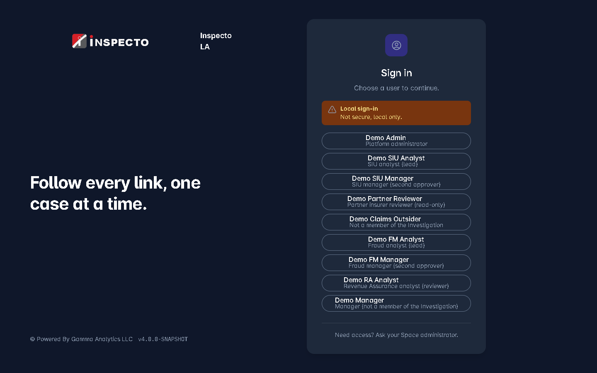
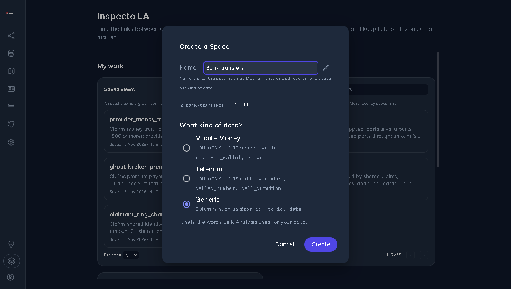
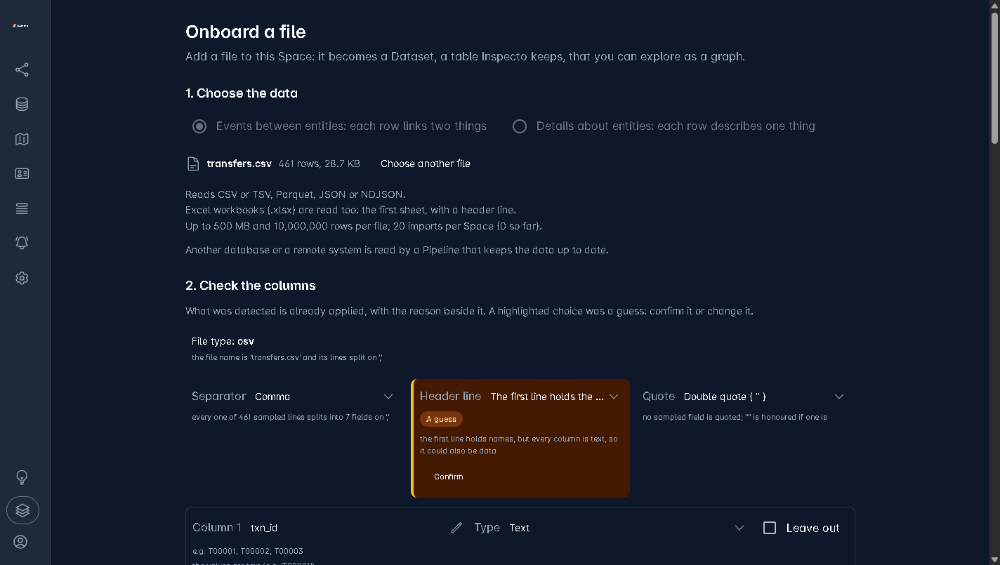
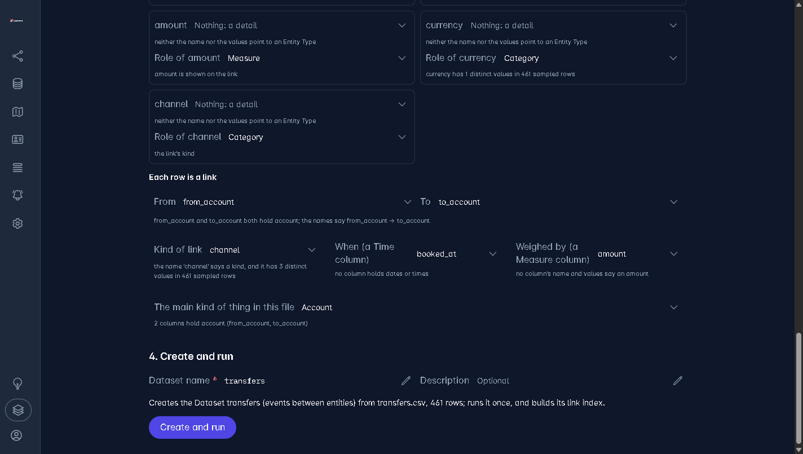
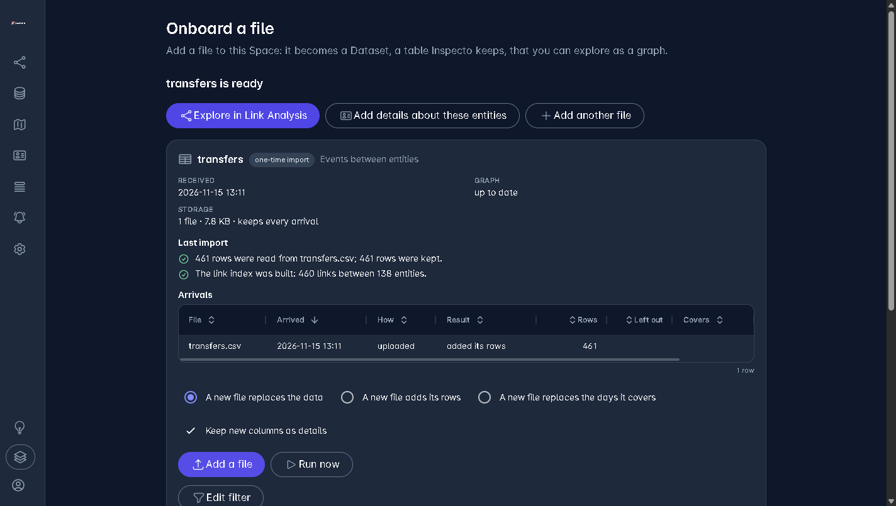

# Link Analysis — User Guide — What Link Analysis is, quick start and signing in

Part 1 of 7 of [Link Analysis — User Guide](user-guide-la-core.md) · next: [The screen, building and looking at a graph](user-guide-la-core-building-graph.md).

## 1. What Link Analysis is

Link Analysis draws **who is connected to whom** from the rows of a **Dataset** — transfers between accounts, calls
between numbers. Each account or number is a **node** (an Entity); each transfer or call is a **link**. You look at
the picture, run tools that point at suspicious shapes and, when something matters, open an **Investigation**: a
recorded, replayable list of the steps you took that can be handed over as evidence.

It answers questions such as:

* Who sits in the middle of this money chain, and does it look like layering?
* Which accounts receive many small payments just under a reporting limit (**structuring**)?
* Which agent till takes most of the cash-out, and from how many different payers?
* Which subscribers share a device or partner and might be one person (**split identity**)?

**Where:** *Studio → Link Analysis* in the console (`/studio/link-analysis`), or the standalone **Inspecto LA**
application. **You need:** to be signed in; changing things needs the capabilities in [§14](user-guide-la-core-examples-roles.md#14-who-can-do-what-roles-and-editions).

**Two modes — know which one you are in.**

| | **Exploring** | **Investigation** |
|---|---|---|
| What it is | The canvas, its tools and the analysis catalogue over live data | A recorded **step log** over a **Working Set** of entities |
| Is it evidence? | **No.** A saved view re-reads live data; reopening it later may differ. | **Yes**, once you build a **Dossier** ([§11.9](user-guide-la-core-investigations.md#119-evidence-snapshot-dossier-sealed-bundle)). |
| Use it to | Look around, try ideas, find leads | Work a case you may have to defend: replay it, fork it, hand it over |

---

## 2. Quick start: from a blank install to a first finding

About ten minutes, with the screens alone. The example is the one the product is tested with (see the
[onboarding live drive](tests-live-drives.md)): a file of money transfers (`transfers.csv`) in which a
few accounts pass money along a chain, a file describing the accounts (`accounts.csv`), and one very busy merchant
that would otherwise hide everything.

1. **Open Inspecto LA.** On a new installation the front page is **Getting started** ([§3](#3-signing-in-getting-started-and-add-data)).
   To look around first, **Try the sample** loads invented transfers and opens a ready graph. For your own data,
   **Create a Space**: name it after the data (*Mobile money*) and choose what kind of data it is.
2. **Add data.** You land on **Onboard a file**. Choose *Events between entities* and drop `transfers.csv`. The
   screen applies what it detected and says why; a choice that was only a guess is marked **A guess** — press
   **Confirm**, or **Confirm all** for every guess of the step, or change it.
3. **Say what the columns hold.** `from_account` and `to_account` hold an **Account**; a link goes **From**
   `from_account` **To** `to_account`; pick the time and amount columns if the screen did not. Press **Create and
   run**. The result says how many rows were read and kept, any value left blank or row that draws no link, and how
   many links between how many accounts the graph has.
4. **Add details (optional).** **Add details about these entities** brings in `accounts.csv`; say which column
   identifies each account (`account_id`). Names and segments then show on the graph.
5. **Start from one account.** **Explore in Link Analysis** opens **Start a graph** with your Dataset picked. Keep
   **One entity** and **Account**, type the first letters of the account you are worried about (`MULE`) and pick it
   from the list, which shows how busy each match is. **Start** draws it and everyone it is linked to.
6. **Expand and clean up.** **Expand** (canvas toolbar, or **G**; in an Investigation it opens the Expand section of the Investigation tab) says what the next step adds before it adds it;
   very busy accounts are held, not drawn. An account that links to almost everyone (a big merchant) only hides the
   pattern: right-click it, **Exclude…**, and add it to a list whose purpose is *Exclusion: leave out of analyses*, so
   it stays out of every later step too.
7. **Quick questions.** Open the right panel's **On screen** tab: **Busiest nodes**, **Tight groups** (the chain shows
   as one group) and **Route from A to B** (from the victim's account to the cash-out account). Each answer is one sentence, with **Show on graph**, **Start from these** and **Add to a list**.
8. **Save view.** **File ▸ Save view as…** asks a name, *Mule ring*. A saved view keeps the graph's start and the
   lists it uses; it re-reads your data when it opens, so it is not evidence.
9. **Come back.** The front page now shows **My work**: open *Mule ring* to draw it again over the data as it is
   then. **What changed in your data** says when each file was last brought in; **Add a file** on the Dataset card
   brings in next month's file.

**When you are stuck.** **What can I do next?** (the light bulb in the left menu) is on every screen: it reads what
your Space already holds and offers at most three next steps, the recommended one first, each with one line saying
why. A word with a **?** beside it on first use (*Dataset*, *Entity Type*, *Entity*, *Entity List*, *case*) explains
itself in one sentence; the **?** beside the Studio's
title explains the page. An empty page always says why it is empty and offers the one thing that fills it.
Something your edition or role does not include is greyed out with one line naming what has it; it is never a
button that fails.

---

## 3. Signing in, Getting started and Add data

*Sign-in on a demonstration install: pick a Demo User. Screenshots in this guide are from the build of 2026-11-15, with invented data.*

1. Open the application and pick yourself on the sign-in page. A demonstration install lists Demo Users with no
   password; a secured install shows **Sign in with SSO**.
2. The front page offers **Link Analysis**, **Geo**, **Entity Lists** and **Alerts** (and **Settings** if you may
   change them). The same areas sit in the slim menu down the left edge, with the Space switcher and your user menu.
3. **Light or dark.** Inspecto LA follows your browser's light or dark setting, and changes with it. To fix one, open
   the user menu (the person icon at the foot of the left menu) ▸ **Colour scheme**: **Match system** (the start),
   **Light** or **Dark**. The choice is kept in this browser for you (for each person who signs in on it); where nobody
   signs in, the menu holds just this choice.

### 3.1 The Getting started page

Until your Space holds data, the front page is **Getting started**: while there is no Space yet, or the current
Space has no Dataset yet. Three ways in:

* **Try it with sample data** — **Try the sample** creates a Space called *Sample: invented data*, loads three days
  of invented money transfers with a planted money-mule ring, and opens Link Analysis with the ring drawn (the
  `la-sample` Space Template; nothing in it is real). If part of the data does not load, the card names what failed
  and still offers **Open the sample Space**.
* **Use my own data** — **Create a Space** asks a **Name** (one Space per kind of data, such as *Mobile money* or
  *Call records*) and **What kind of data?**: *Mobile Money*, *Telecom* or *Generic*, each with three example column
  names. The choice sets the Space's **Industry pack**: the words Link Analysis uses for your data and the tools it
  suggests. When a Space already exists, the button is **Add data** itself.

*Create a Space: type the **Name**, then choose the kind of data. (The picture predates the text box: it shows the
older row with a pencil.)*

  **Create** opens the new Space on **Onboard a file**, from Getting started, from the Space guide and from **New
  Space…** in the Space switcher alike. With sign-in, adding data is off in a Space until an administrator turns it
  on; a Space created here has it turned on as part of the create, because whoever may create a Space is an
  administrator. If that step is refused, the page names it and offers **Turn on Add data**.
* **Open my team's data** — shown when Spaces exist: the Space switcher.

A choice you cannot take is greyed out with one line saying why: with sign-in, only an administrator may create a
Space; a server running a single Space cannot add a sample one. The **Space switcher** with no Space yet reads **No
Space yet** and offers **New Space…** and **New from sample…** to anyone who may create a Space.

**The Space guide** lists the setup steps and ticks each one from what the server holds: **Space**, **Data** (a
Dataset exists), **What the columns hold**, **First graph** (a graph is saved in the Space) and, optional, **A list**.
Click a line to go to that step; collapse it with the arrow (remembered in this browser). It disappears once the four
required steps are ticked.

**My work** (once the Space holds data):

* **Saved views** — every view saved in the Space, the most recent first, with when it was saved and the Entity Lists
  it uses (*Lists: started from Suspects; leaves out Busy merchants*). Click one to open its graph.
* **What changed in your data** — one line per Dataset brought in with **Add data**, its last import first:
  *transfers: imported 1 Oct 2026, +2,104 rows*; after **Add a file**, whether the file replaced or was added to the
  rows and the net change (*transfers: replaced 3 Oct 2026, 2,104 → 2,000 rows (−104)*). Data a Pipeline keeps up to
  date is not listed here.

**Beginner counters.** Inspecto counts, on this server only, how far first-time users get (first Space, first
Dataset, first graph, the Space guide finished, the step people stopped at). No names or values are kept and nothing
is sent anywhere. Administrators see it, read-only, in **Settings → Getting started counters**.

**Space folders.** On a server with several Spaces, an administrator's **Settings → Spaces** lists each Space with its
Space folder and Data folder, and offers **Attach existing Space**, **Change data folder** (only while the Space holds no
data) and **Detach** (only a Space attached by reference; its folders stay on disk); **Create a Space** offers the same
folders under *Advanced: folders*. Where the server sets no `spaces.allowed.roots` (`SPACES_ALLOWED_ROOTS`), the page
says so and offers no folder action.

### 3.2 Add data: onboard a file

**Add data** opens **Onboard a file**: one of your files becomes a Dataset Link Analysis can draw, in four steps.

1. **Drop or choose a file.** Say what is in it: *Events between entities* (transfers, calls, messages) or *Details
   about entities* (customers, accounts, devices). Drop the file or press **Choose a file**. The screen lists what it
   reads (CSV or TSV, Parquet, JSON or NDJSON; Excel when this installation includes it) and this Space's limits
   (for example *up to 500 MB and 10,000,000 rows per file; 20 imports per Space*). Or choose **A Postgres table**
   (every edition; see *Data* below). *Read from another database or a remote system* is locked on Basic, with the
   reason.
2. **Check the columns.** What was detected is applied, with the reason beside it. A guess is highlighted and marked
   **A guess**: **Confirm** it or change it. When a step holds several guesses, **Confirm all N guesses** at its top
   confirms them together, after you have read their reasons. Rename a column, change its type or **Leave out** a
   column; a table shows the first rows as they will be kept.

*Check the columns: each detected choice gives its reason; a guess is highlighted with **Confirm**.*

   A column that is *almost all* dates or dates with a time — at least nine values in ten, and at least ten of them —
   is proposed as that type, marked **A guess**, and its reason names a value that does not fit (*460 of 461 sampled
   values are dates with a time, but 1 is not (e.g. 'not-a-date'); it will be left blank*). The import leaves such a
   value blank, keeps its row and counts it in the result. **A number is proposed only when every value is one:** a
   column with even one value that is not a number stays *Text*, and its reason says so (*460 of 461 sampled values
   are numbers, but 1 is not (e.g. 'abc'), so it is kept as text*); change its type yourself to read it as a number,
   and the import leaves the odd value blank. The types are *Text*, *Whole number*, *Decimal number*, *Date*, *Date
   and time*, *Time of day* (`09:30:00`) and *Yes / no*; a date written in words (`March 22, 2025`) is a *Date*.
   These are the same types, read from the same rule, that the Pipelines editor's parse preview and *Suggest from
   sample* propose (2026-11-19).

   When you change a column's **Type** or **Role** yourself, the screen asks the server again and everything that
   depends on it follows in that one edit: the reason beside the type (how many values it reads, and one it does
   not), the column's role, and **When** and **Weighed by** in step 3. What you picked yourself is never proposed
   over.
3. **What does each column hold?** An *Entity Type* (Account, Phone number…) or *Nothing: a detail*. For events:
   which column a link goes **From** and **To**, and optionally its kind, time and amount. For details: **Which
   column identifies each entity?** Without a From and a To the screen warns that the Dataset cannot be drawn as a
   graph.

*What each column holds: a link goes **From** one column **To** another, with its kind, time and amount.*
4. **Create and run.** The Dataset name comes from the file name (lower-case letters, digits and `_`). **Create and
   run** waits until every guess is confirmed or changed; a very large file runs on the server and the screen
   follows it.

The result accounts for every row and value, one line each:

- how many rows were read and how many were kept, and, when there are any, the rows set aside because the line itself
  could not be read (too few columns, a broken quote);
- each column where a value did not fit its type and was **left blank** (*1 value in booked_at was not a date with a
  time and was left blank (e.g. 'not-a-date')*) — the row is kept;
- rows that **draw no link** because their From or To is empty (*1 row has no From (from_account), so it draws no
  link*) — which is why the graph can have fewer links than the Dataset has rows;
- values of an entity column that are **a second spelling** of an entity already there, differing only by spaces or
  letter case (*' acc-1003 ' is ACC-1003*) — worth correcting in the file: an Entity profile and the import's entity
  count take both as one entity, and a graph started from either spelling reads the links of both, but the graph still
  draws each spelling as its own node;
- whether the link index was built, with its links and entities, and each Expectation on the data when the Dataset
  has any (a first import has none).

The rows that draw no link and the second spellings are counted over the rows this import added. Then **Explore in Link Analysis** (for events
it opens **Start a graph** with the Dataset picked; after details about entities it opens the events those entities
are in, where the details now show on each entity), **Add details about these entities** (after events), or **Add
another file**.

*The result and the Dataset card after **Create and run**.*

**The Dataset card** says *one-time import* and shows the last import. **Add a file** brings in the next file (for
events, choose whether it *replaces the data* or *adds its rows*; details are always replaced); **Run now** runs the
import again. **Inbox** shows the folder on the server where another system may write this Dataset's files (an administrator sees its full path on the server; anyone else sees it within the Space's data folder, such as `inbox/transfers`), how many
wait there, and **Import waiting files** (the same as Run now); on Basic nothing is imported on its own unless you turn
on **Watch this folder**, which checks the inbox every 30 seconds (every edition). **Keep this up to date** is locked on
Basic. On Standard and up it asks where the files come from (*files written to this inbox*, or
*files on an SFTP server* through a Connection), how often to check, and an optional ready marker (read `name.csv` only
once `name.csv.done` is there); new files are then imported on their own, a file sent again is skipped, and the Job that
adds them to the graph is saved for you when you may author Jobs (else the card names the Job to ask an administrator
for). **Stop** goes back to importing only when asked. **Storage** says how many files the Dataset holds; past 20 an import
merges them into one so reading stays quick, and **Compact now** does it at once; the merge keeps each arrival's
period on record (the *Arrivals* list shows it once it reads that record, `LA-ARRIVAL-LEDGER-1`). On
Standard and up, **Keep** sets what the Dataset keeps (*every arrival*, *the last N days* by each row's date, or *the
last N arrivals*); older rows are removed at the next compaction. If adding data is off in this Space the screen says so, and that an administrator can turn it on. An administrator
sees **Turn on Add data** on that screen: one press turns it on and the Add data screen opens in place (a refusal is
shown under the button). The same switch is **Settings → Add data**, *People may add data in this Space* (after
a refused change or a failed read it offers **Try again**, which reads the setting afresh), and you need the right to
upload data. The la-app **Access** screen names the role that builds data *Data builder* (its id stays
`pipeline-developer`).

### 3.3 Entities: what the columns hold

Two columns join up in the graph only when they hold the same **Entity Type**. The **Entities** page (left menu)
shows and sets this.

* **Entity Types** tab — one card per Entity Type some column of this Space's data holds, with its distinct count,
  Datasets and data-as-of date; a Dataset's **primary** type comes first (*Primary in &lt;Dataset&gt;*). The others
  wait, folded, under **Not in your data (n)**.
* **Columns** tab (where the Space guide's *What the columns hold* step lands) — per Dataset, each column that looks
  like an identifier, with what it holds or **Not set**. **Holds** sets the Entity Type at once and the page says what
  changed (*"to_account" in transfers now holds Account.*); **Show every column** lists the rest. The picker beside
  the Dataset name sets its **primary Entity Type**.
* **New Entity Type** — a **Name**, an **Example value** (shows *Kept as …*) and **Compare values as**: *Upper case,
  spaces trimmed*, *Digits only*, *Phone number* or *Case ignored*. A name the Space already has is refused before
  anything is written.
* **Delete** — the bin button on an Entity Type's own page (and **Delete** beside each type in ⚙ Settings → Entity
  Types) removes a type nothing uses, after a confirm naming it. It cannot be undone. A type still used is kept and the
  page says by what: the Dataset columns that hold it, a live Entity List of that type, or the number of Investigations
  that name it (a step, or the endpoint types set when it was created). Change or retire those first; the last Entity Type of a Space cannot be deleted.

These changes need the right to edit Datasets when you sign in; without it they are greyed out with the reason.

**Profile pages** (Standard and up; in la-app and in the console). Each Entity Types card shows a stale or *not
assessed* badge when it applies and opens that type's page:

* **Entity Type Profile** — collapsible sections: Identity, Where it appears, Lineage, Volume and quality, Value shapes,
  Time, Links, Relationships and *What is not here*. Its **Masked** tile shows whether the type is masked under the
  Space's masking mode in force, with the mode and the type's own setting in the hint; the Entities cards say *Masked:
  shown as aliases.* only when the mode in force actually masks the type.
* **Entity Profile** — one entity: when it was seen, rows per day, where it appears, its links, related identifiers,
  the lists and groups it is in, and freshness. The graph's node dialog links to it ([§6.2](user-guide-la-core-building-graph.md#62-the-node-detail-dialog)).
* **Open an Entity** — type the value and press Enter (or **Open**); the page opens by the key the server returns, so
  for a masked type the address holds the alias, never the raw value. Enter also works on the closed row once it holds
  a value.

Honesty rules: an approximate count says `approx.`; a section the server could not read says *Not assessed* with its
reason and is listed again under *What is not here*; a type nobody has profiled yet reads *Not assessed: not computed
yet* on its card.

### 3.4 The Data page: Datasets, Entities and Mappings

**Data** (left navigation) lists every Dataset you added with *Add data*, then every Dataset a Pipeline or a Job keeps
up to date, grouped as **Streams** and **References**. Each group folds from its heading. Each Dataset is folded to one
line (where its data comes from - *Added here* or *From a Pipeline* - how many columns, and how many Mappings once it
has one; the line wraps rather than being cut) until you open it; a Space with a single Dataset
shows it open. Opened, each one shows:

- its card: for a Dataset you added, its facts under their own labels - **Origin**, **Filter**, **Received** (when data
  last arrived), **Covers** (the period it covers), **Graph** (whether the graph has it: *up to date*; *out of date*,
  with a **Rebuild** button, when its link index must be built again; or how many files behind), **Inbox** or **Kept up to date**,
  **Storage** and **Compacted**, each only when known - then the **Arrivals** table (every file it took, uploaded or put
  in its inbox by another system: File, Arrived, How, Result, Rows, Left out, Covers, Columns; newest first, ten to a
  page; **Left out** counts the file's rows that are not in the Dataset — set aside, or left out by the row filter —
  and says 0 when there are none; **Covers** is the period of its Time column; a file a later replace set aside reads
  muted and its Result says so), *Add a file* and
  *Run now*; under **Inbox**, *Watch this folder* imports what another system writes there on its own, checked every
  30 seconds, once the files have stopped changing (every edition); a Postgres table snapshot shows *Refresh now*
  instead, and is copied again only when you press it; one a Pipeline or a Job keeps up to date has no card: its
  header's *Kept up to date by a Pipeline* says where its rows come from, so there is nothing to add here, and while
  its Pipeline has not written any rows yet the header says *Waiting for its first run* (in grey: a wait, not a fault);
- **Entities**: what each column holds, one Entity Type or *Nothing: a detail* per column - changed here, saved at once;
- **Mappings**: how its rows are read as links. The Dataset has its own; **New mapping** saves another, under its own
  name: *From* and *To* (what each holds starts at what the Dataset says that column holds), and optionally *Kind of
  link*, *When* and *Amount*. A Mapping is a Dataset
  of its own over the same data - it appears in the Start box and everywhere a Dataset does, without copying anything.
  One file of transfers can be read as *account → account* and as *account → channel*. *Edit* changes a Mapping, *Delete*
  removes only the Mapping (never the data), *Explore* opens it in Link Analysis.

Files always go to the Dataset you added, never to a Mapping (*Add a file* on a Mapping is refused and names the
Dataset). A Dataset that Mappings read cannot be deleted until they are.

**What a new file does.** *Add a file* asks once per file:

- **replaces the data**: everything before is set aside;
- **adds its rows**: everything before stays;
- **replaces the days it covers** (only for a Dataset with a *When* column): its rows are added, and the older rows on
  the same days are removed; every other day stays. Send a corrected week this way and you get exactly that week again.

The same file twice is refused ("already imported on …"), whatever its name, so its rows are never counted twice; a copy
another system puts in the inbox is set aside in `refused/` and listed with that reason. To load it again, replace
everything; a file whose every row a later *replace the days it covers* replaced may also come back. A file must have the Dataset's columns, by name: a missing column, or one moved to another place, refuses
the file and says which. A new column is kept as a detail of the Dataset: the result says "New column fee: kept as a
detail", and older files read it as empty. Untick *Keep new columns as details* before you add the file to leave it out
instead. Once a column is kept, a later file without it is refused, naming the column and the file it was kept from. A file another system put in the inbox is judged the same way by *Run now*; a refused one is set
aside in the Dataset's `refused` folder and listed in *Arrivals* with the reason.

The **Data status** line also shows in Explore, under the Start box's Dataset and above the Rows table: *graph up to
date*, or *graph N files behind* when a later file could not be indexed.

- **Who sees a Mapping:** only someone who may read its Dataset. A Mapping never shows a Dataset's rows to someone the
  Dataset is not shared with; for them it is simply not there.
- **When a Dataset changes under a Mapping:** if a Pipeline drops a column a Mapping reads, the Mapping is marked
  (*Reads a column … no longer has: …*), and a preset question over it is refused with the column named rather than
  answered over other columns. Edit the Mapping.
- **Other Datasets** at the end of the page are listed by name. They are computed when read, have no stored data, are
  an Entity List's store, or list fewer than two columns, so no Mapping is offered for them.
- A Mapping of a large Dataset has no link index of its own until an administrator adds an index build Job for it. Until
  then, preset questions over it read the Dataset.
- **Discover** (every edition, Basic included) says what is in a Dataset before you draw anything. Choose *Show what is
  in it*: its link rows and the period its Time covers, about how many entities of each Entity Type it holds, its kinds
  of link with their counts, the total and median of every Measure (in its unit), and the ten busiest entities at each
  end (sending to and reached by the most others). A part the Dataset cannot answer says why (no Time column, no
  Measure, a ranking that took longer than the Space allows) - never a 0 nobody counted. Counts of entities and medians
  are close estimates and say so. The answer is kept until a file arrives, so the second look is instant; on a large
  Dataset the first one takes a few seconds, and the busiest come from its link index when it has one. Click a busiest
  row for that entity's summary ([§6.2](user-guide-la-core-building-graph.md#62-the-node-detail-dialog)). To draw the busiest, use the same panel under the
  Start box in Explore ([§5.1](user-guide-la-core-building-graph.md#51-start-a-graph)).

### 3.5 Upload a CSV to a Collector

**⚙ Settings ▸ Add data** holds **Upload a CSV**: a file handed to a Pipeline's own Collector, as opposed to *Add data*,
which makes a Dataset of its own. It is shown only to a user with the upload capability (operations, support, power,
admin) on a build that includes the link-analysis module.

1. Choose a **Collector**. Only a local Collector whose Pipeline says *Accepts analyst upload* is listed; a single one is
   preselected. The section shows the file-name patterns it picks up and the size limit. With none enabled it says so
   and what to ask a Space administrator for.
2. **Choose a CSV file** and press **Upload**. The browser checks what it can see (a `.csv` extension, a plain file
   name, the size cap) and says why in words; a workbook (`.xlsx`) is refused with *export the sheet as CSV (UTF-8)*.
   The server checks the rest (pattern, content, daily quota, the four-eyes row budget).
3. The file only **lands**: the Collector's own Pipeline ingests it on its next poll, so the Dataset it fills appears
   afterwards (then use it for identity import or the link index as before).
4. **Your uploads** lists what you uploaded to that Collector, newest first, with its ingest state: *Waiting for the
   Collector*, *Ingested* (with *N rows rejected* when the Pipeline wrote a reject ledger), *Quarantined (reason)* or
   *Picked up*. A Space administrator sees every analyst's uploads. The refresh icon re-reads.
5. **Delete** is offered while a file is still waiting; once the Collector has picked it up the rows are in the Dataset
   and the delete is refused, and while a run of the Pipeline is in flight it is refused too (*may be being ingested
   right now; try again*). Uploading a name that is still waiting answers *still waiting in the inbox*; **Replace the
   waiting file** is offered only when that waiting file is your own (only an administrator can replace another
   analyst's file).

Refusals read as a cause plus a next step: over the size limit names the limit and says to split the file or ask an
administrator; too many requests says to wait a few seconds; deleting someone else's file says you can only delete your
own. The landed file follows the Collector's own retention; the upload records behind the list are kept 90 days. In
the `la-showcase` template the `crm_kyc` Collector accepts uploads, so a showcase Space has one target out of the box.

---
