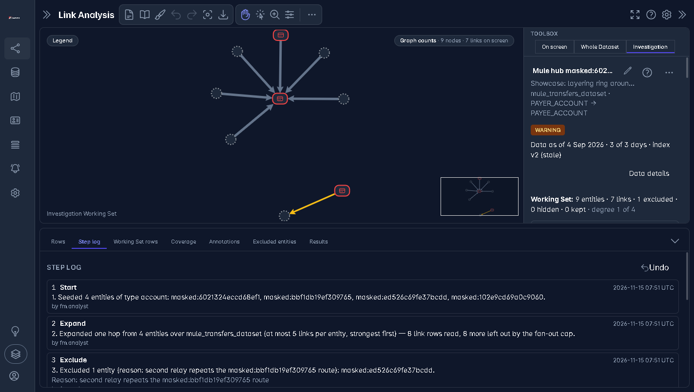
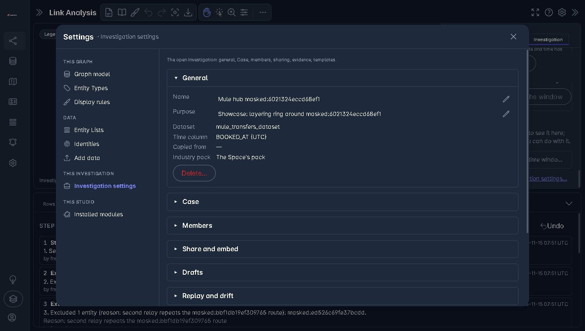
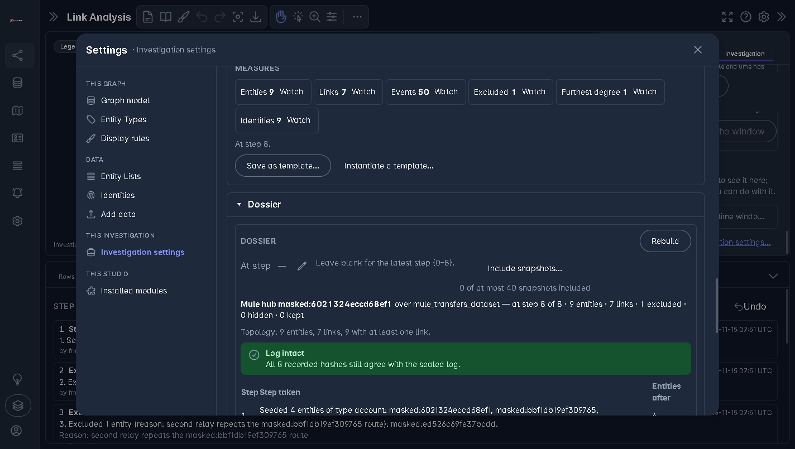
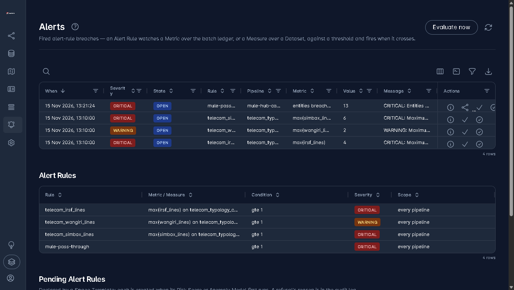

# Link Analysis — User Guide — Investigations, Entity Lists, Alerts and Geo

Part 4 of 7 of [Link Analysis — User Guide](user-guide-la-core.md) · previous: [Expand, analyse, match patterns and save](user-guide-la-core-analysis.md) · next: [Worked examples, roles, limits and troubleshooting](user-guide-la-core-examples-roles.md).

## 11. Investigations

Use an Investigation when you need an **auditable** trail: an ordered **step log** over a **Working Set** you expand and
prune deliberately. Every step is sealed with what it read, so it replays identically even if the data changes later.

### 11.1 Start one

**File ▸ New**, the centre's **Start from the Investigation tab →**, or the Investigation tab with nothing open, shows
the **New Investigation** start form (LA-UNSAVED-INVESTIGATION-1, 2026-10-29). Each **New** starts it fresh. It asks
for no Name and no Purpose: you work **unsaved** first, and **Save** asks for them. Fill it in top to bottom:

1. **Start from** (a popup, like the Entity Type): **One entity**, **Entity List**, **Pasted values** or **Whole Dataset**.
   While a graph is drawn (a saved view, or a graph drawn with Explore Dataset…), it also offers **Graph on screen**:
   work over that graph's one mapping, with no start entities yet.
2. The **Dataset**.
3. The input for that choice, and only that one:
   * one entity: the Entity Type and the value, with the same matches as [§5.1](user-guide-la-core-building-graph.md#51-start-a-graph);
   * a list: the Entity List;
   * a paste: the values;
   * the whole Dataset: nothing more. A warning shows when it is above the node cap.
4. **Time column**: a popup of the Dataset's columns stored as TIMESTAMP or TIMESTAMP WITH TIME ZONE (read from the store,
   so a column the Dataset does not declare is offered too); the blank choice is the Dataset's own time column. A DATE or
   text column is not offered: time windows read instants. It is used for time windows and the coverage check. If the
   server still refuses the start (say the Dataset's own column is a DATE), the form says why.
5. **Time zone**: a popup, for a time column that has none (UTC by default).
6. **Degrees**: a **− 1 +** stepper, up to 3 and never past the profile's last degree. The start always draws one ring;
   each degree more walks one ring further.

**Start** draws what you chose plus its ring, with busy entities held, exactly as [§5.1](user-guide-la-core-building-graph.md#51-start-a-graph) does. A list
or a paste starts from the values found in the Dataset. The whole Dataset and Graph on screen start with no start
entities: select entities on the graph, then **Start from selected** in the Investigation tab.

#### Unsaved work and Save

Until you save, nothing is on the server. The Investigation tab shows an **Unsaved** marker beside **Save…** and a
close button, then:

* **Steps so far**, in order (*Start from 2 entities*, *Expand 1 degree from the outer ring, both ways*, …);
* **Undo** / **Redo** of the unsaved steps (also **Ctrl+Z** / **Ctrl+Shift+Z**), several steps back and forward, the
  canvas with them. The start itself is not undone (Close discards it); a new step clears what can be redone;
* **Expand**, the same one control as in a saved Investigation ([§7.1](user-guide-la-core-analysis.md#71-expand)). Each Expand is a step;
* **Start entities ▸ Start from selected**: the selected entities and their links join the graph as a start;
* **Clean up** ([§7.4](user-guide-la-core-analysis.md#74-clean-up)), the same one-press buttons: each hides on screen and is a step that Save records
  as a `hide` with its reason. With *Exclude instead of hide* the entities leave the graph with their links and stay
  out of every later Expand; Save records it as one `exclude` with its reason;
* one line: Keep, Hide, Exclude, Annotate and the other steps change a recorded Working Set, so **Save first**.

An Expand that the Space would hold for a second person's approval cannot run unsaved: it says *This Expand needs
approval from a second person, so it cannot run unsaved. Save first, then Expand.*

**Save…** asks for the **Name** and the **Purpose** (why you are investigating: the stated reason or legal basis, shown
in the Dossier), both pre-filled from the start: *Account MULE-HUB-01* / *Review of an Account and its links*,
*Members of “Suspects”* / *Review of the members of “Suspects” and their links*, *Transfers* / *Review of the links in
Transfers*. In a Space that masks values the default Name leaves the value out and says when you started instead
(*Phone number, 2026-11-16 14:05*), so two Investigations are not saved under one Name. Your edits are kept if
you cancel. Save then creates the Investigation and records the steps in order, each with your name. While unsaved,
every degree is already read by the server with the Industry pack's settings (time window, minimum events, row limit,
neighbours per entity, busy limit) and your Links, Time and Limits choices, so what you see is what Save records. If the
data changed in between and a degree's entities are no longer admitted, Save expands from what is, and still completes. If a step is
refused partway, the Investigation is saved with the steps before it and a message names the steps that were not
recorded. If a step needs a second person's approval, Save stops there and the step waits for approval. Save keeps
the picture: every entity is drawn where it was before you saved, even on a Space that masks values (the saved
Investigation names entities by its own aliases).

**Save** needs the *Manage Incidents and Cases* permission. Without it you can still start and Expand; the Save button is disabled and says
*Needs the Manage Incidents and Cases permission.*

Unsaved work is kept in this browser tab only. **Close**, **File ▸ New** and **File ▸ Open…** ask *Save*, *Discard* or
*Cancel*. Reloading or closing the browser tab asks first too; a reload loses unsaved steps. Moving to another page of
the same Space keeps them.

From a ranking, **Start an Investigation from the top results** queues the entities. The Investigation tab then shows
*Start Investigation with N queued start entities*: give a **Purpose** and the queued entities become the first
step. It binds the drawn graph's one Dataset mapping; the query's filter is not carried over, and the panel says
so.

Reopen an Investigation with **File ▸ Open…** ▸ *Investigations*. Over a pre-aggregated Dataset (one row per pair with
an event count, like `telecom_links`), the count column is bound so an expand counts events, not rows. The Telecom pack
binds `events` for you.

### 11.2 The Investigation tab (Act panel)

*An open Investigation with the **Step log** in the dock: every step, who took it and when.*

***Investigation settings…** (bottom of the Investigation tab): General, Case, Members, Share and embed, Drafts, Replay and drift, Oversight and approvals, Measures and templates, Dossier, References.*

Masked ids show as aliases (`masked:…`) on the canvas, in the step log
and in the Dossier, and one entity reads as the same alias everywhere in the Investigation. When ids on the canvas are
masked, the line under it says *N entities masked* with **Reveal…**; the node details dialog has the same button under
**Masked id**. Reveal asks for a reason, then shows the real identifiers of every masked node on screen, to you and on this
screen only: the canvas labels, the hover text, the node's title and details, and the step log read the real identifiers. Each entity revealed
is recorded in the audit trail with your reason. You need *See unmasked ids* and to lead the Investigation; reviewers
and everyone else keep the aliases, the Dossier stays masked, and closing the Investigation forgets what you revealed.
On a graph that is not saved yet the button says to save it first: a reveal is recorded against an Investigation and
its purpose. **Investigation settings… ▸ Oversight and approvals ▸ Masked entities** lists the aliases with the same
one **Reveal all…**. A second person approves or denies a held expand in the same section. Each request says which
four-eyes limit it crossed in words (*reads up to 500 rows, above the limit of 100*) and when it was made, in the same
local `2026-11-15 13:21` form as every other recorded time in Link Analysis.

Top to bottom, most important first:

1. **Header:** the **Name** (a lead renames it in place: label · value · ✎; a long name wraps to two lines, the whole of
   it in its tooltip), then three facts on three lines: the purpose (it wraps to up to three lines; the whole of it is in
   its tooltip), *Data:* and the Dataset in words (its name, else the first sentence of its description), and its link
   (*Links from payer account to payee account*; the stored names are in the tooltip of those two lines), the data-trust sentence and **Data details** ([§11.11](#1111-data-trust-what-data-am-i-looking-at)), a **?** that shows *How to investigate* again, and `⋯` with **Settings…** (⚙ Settings ▸
   Investigation settings), **Build Dossier…**, **Members…**, **Close** and **Delete**. A person who may approve a held
   expand of someone else sees a **N to approve** badge under the Dataset line; it brings the waiting line into view
   ([§11.4](#114-large-expands-need-a-second-person-four-eyes)). Under it one counts line: *Working Set: 42 entities · 118 links ·
   3 excluded · 2 hidden · 1 kept · 2 degrees from the start, up to 4 · 3 busy held*: how many links out from the start
   entities the Working Set reaches, and the most this Space allows. A count of excluded, hidden or kept that is
   zero is left out, and before the first Expand it ends *not expanded yet*.
2. **How to investigate** — five steps, shown until you press **Got it** (remembered in this browser).
3. **Undo** / **Redo** of recorded steps, which stay at the top while the tab scrolls ([§7](user-guide-la-core-analysis.md#7-expand-and-clean-up-the-graph)).
   A reviewer, or someone reading it through its Case, sees both disabled; their tooltip says *Only a lead changes the
   steps of this Investigation.*
4. The **queued start entities**, when there are any.
5. **Expand** ([§7.1](user-guide-la-core-analysis.md#71-expand)): the per-degree results, then ONE Expand form — From, **Expand** with its preview and
   four-eyes line, and the **Expand filter** groups. A reader sees *Needs the Manage Incidents and Cases permission.* instead of the form; a reviewer of the Investigation,
   or someone reading it through its Case, sees *Only a lead expands this Investigation.* and no *How to investigate*
   coaching. Before you save, an Expand that finds nothing new is not recorded: the line under the canvas says *Expand found nothing new,
   so no step was added.*
6. **Clean up** ([§7.4](user-guide-la-core-analysis.md#74-clean-up)): one-press clean-ups with their counts.
7. **Selected entity:** who it is (masked, busy, not in the Working Set), **Start from it** when it is not in the Working
   Set yet, **Expand anyway** on a busy one, **Pick neighbours…** (tick some, or **Add the 10 strongest**: one expand to
   only those), its notes and **Note** / **Annotate**. Expand, Keep, Hide, Exclude and Shrink are on the canvas
   (double-click, right-click, the canvas toolbar, keys). Right-click one entity ▸ **Pick neighbours…** selects it,
   opens this tab and reads its neighbour list.
8. **Busy entities** (a fold; each with its sealed count, *Busy: 650 linked entities (limit 500), not expanded*, and
   **Expand anyway**).
9. **More steps** (a fold): **Connect** (Connect start entities) · **Time** (Time window, Snapshot marker) · **Compare**
   (Threshold, Compare), the **Scope list** (entity ids to **Include** or **Leave out**) and **Add start entities…**
   (the start form: Start from, Entity Type and value, an Entity List or pasted values, recorded as one Start step).
10. Two links: **Open the Step log** (the dock's Step log tab) and **Investigation settings…**.

The tab lists no steps: the full record is in the dock's **Step log** (with **Undo** and **Re-order steps…**, which
creates a fork), beside **Working Set table**, **Coverage**, **Annotations** (entity and link) and **Excluded
entities**. **Replay** is in ⚙ Settings ▸ Investigation settings ▸ *Replay and drift*. Clicking a node while an
Investigation is open **selects** it for the next step.

### 11.3 Steps you can take

| Step | Effect |
|---|---|
| **seed** | Put starting entities into the Working Set (by id, or from an Entity List) |
| **expand** | Follow links: direction, link kinds, time window, minimum events / distinct days, degree bounds, fan-out cap, budget, and the busy limit (an added entity with more linked entities is *busy*: held, not expanded further unless overridden) |
| **window** | The time range later expands inherit: from / to, slot, days of the week and **Excluded dates (holidays)** — a date, `FROM..TO`, or a yearly rule `*-MM-DD`, `*-MM-DOW#N` (e.g. `*-11-THU#4`) or `*-MM-DOW#L`, at most 32 rules |
| **exclude** | Remove entities — a **reason is required** |
| **hide / keep** | Hide from view only; **keep** protects an entity from exclusion |
| **annotate** | A note, with an optional confidence grade (NATO/Admiralty, e.g. `B2`), on an entity or a link |
| **resolve** | Merge identifiers the Space knows to be one person ([§11.7](#117-identity-resolution)) |
| **undo** | A recorded step that reverts an earlier one |

### 11.4 Large expands need a second person (four-eyes)

An expand whose budget or fan-out cap is above the Space's four-eyes thresholds does not run: it says **waiting for
approval**, names the request (for example *p1*) and the limit crossed. Someone **other than you** with *Approve link
expansions* opens the same Investigation and sees it at once: a **1 to approve** badge in the header, and on the same
line, instead of your waiting text, *Requested next, not yet run: Degree 2.* (your name) *asks for your approval. It
would add every neighbour of each entity, more than the 2,000 allowed without a second approval.* with **Approve** and
**Deny**. It opens *Requested next, not yet run* because it sits under the line of the Expand already recorded (*… (step
2): 6 new entities, 7 links added.*), and both can name the same Expand (*Expand one hop from every entity*).

The approver's line is written for the person deciding (LA-FULL-CYCLE-TEST-1, 2026-11-16). It names you as the sign-in
names you: a Demo User's display name, or the signed-in person's own name; under OIDC the browser holds no directory of
other people, so another person reads as their sign-in id. It leaves the request id out (that is the server's handle; **Oversight and approvals**
still lists it), and it says the limit as what the expand would do (*read up to 5,000 rows, more than the 1,000
allowed*, *add every neighbour of each entity…*) rather than in setting words; when it crosses both, the two limits
share one clause (*…; without a second approval the limits are 1,000 rows and 2,000 neighbours of each entity.*).

* **Approve** asks first (*Approve this expand?*, in the same words: who asks and what it would do; approving runs it
  now, as your step, and records them as the approver), then runs it; the line then says what it admitted.
* **Deny** is a second step on the line: an optional **Reason** (at most 200 characters; you see it on your line) and
  **Deny request**, or **Cancel**. Nothing is read. The reason is optional because the server, Oversight and the
  console's inbox all take it as optional, and the denial itself (who, when) is always recorded.

The same decision stays in ⚙ Settings ▸ Investigation settings ▸ **Oversight and approvals** (Approve there asks the
same question) and, in the console, **Approvals Inbox → Link expansions**. Nobody can approve their own request, and
without a sign-in (Basic) nobody can approve at all: the server cannot tell two people apart, so neither the badge nor
the buttons are offered. Where the Investigation has members only a lead or reviewer may decide (a refusal is shown on
the line). Before you press Expand, the
form already says *Will need approval from a second person* when it would be held.

### 11.5 Replay, drift, Drafts and Members

* **Replay** re-checks that the log still produces the recorded Working Set; **Re-read** re-runs each recorded query
  and shows **drift** — what changed in the data since. Both work read-only, so a reviewer can check.
* **Re-order steps** creates a **fork**: a new Investigation showing its parent; the original is untouched.
* **Drafts** (⚙ ▸ Investigation settings): **Fork a Draft** (optionally named, up to 80 characters; one live Draft per
  person, up to 50 open in a Space) to try a side line, then **Conflicts**, **Rebase**, **Promote** (a promote with a
  sensitive expand waits for four-eyes) or **Discard**.
* **Members** (**File ▸ Members…**, the Investigation's `⋯` menu, or Investigation settings): lead, analyst,
  reviewer. A lead can **Grant** and **Revoke**; the last lead cannot be removed.

### 11.6 Working Set table and Coverage

**Working Set table** lists entities, links or exclusions with paging and says if and where it is truncated.
**Coverage** (**Check coverage**) shows which days of the window have no rows at all (*Days with no data* / *Every day
has data*) — an empty result on a missing day says nothing about activity — and, where the Dataset can tell, days
covered per Collector.

### 11.7 Identity resolution

Select two entities and **Merge** (canvas toolbar) to open ⚙ Settings ▸ **Identities** with the pair filled in; state
that they are the same, with a reason. Keys are typed and normalised (`msisdn:+4477…`); a **mapping Dataset** imports
many pairs at once (the import answers with counts only). The **Identity Facts** tab shows its head (fact number and
hash) and *Chain verified* (the whole chain is re-checked on every read); when the check fails it says *Chain NOT
verified* and hides the head. The screen states what the log alone cannot show: facts cut off its end. Inside an
Investigation the **resolve** step shows merged nodes; by default this is display only — choose **merged** on a step to
treat a whole group as one entity. It is reversible: retract an assertion.

**Merge** is on the canvas toolbar only while an Investigation's canvas is open, and needs *Manage Incidents and Cases*. It is
disabled with the reason unless exactly two entities with an Entity Type are selected and neither is a masked alias
(the server refuses an alias too; under the default *typed* masking a masked type such as *account* therefore cannot be
merged). It only fills the *Assert same entity* form: nothing is written until you give a reason and confirm. After the
assertion succeeds in an open Investigation, the form offers **Add a resolve step**; the merge stays a view, no id is
rewritten. **Possible duplicates** ([§8](user-guide-la-core-analysis.md#8-the-analysis-catalogue)) suggests pairs to merge.

### 11.8 Measures and Alert Rules

The **Measures** strip (⚙ ▸ Investigation settings ▸ Measures and templates) shows entity, link and event counts,
excluded count, deepest hop and links by kind. **Watch** on a Measure creates an **Alert Rule** over the sealed Working
Set; it fires through the normal alert path, **once, on the count** of breaching entities, and can open an Incident. A
fired Alert names the Investigation, not the entities — *Open Investigation* on the Alerts page reads them where access
rules and masking apply. **Save as template** turns the method into a reusable recipe (seeds become parameters; ad-hoc
exclusions are dropped and the preview says so); **Instantiate** builds a new Investigation from it.

### 11.9 Evidence: snapshot, Dossier, sealed bundle

***Build Dossier** is in **File ▸ Build Dossier…**, the Investigation's `⋯` menu and **Investigation settings… ▸ Dossier**. *Log intact* means every recorded step still matches the sealed log.*

1. **File ▸ Save snapshot…** freezes the screen as a **snapshot** with a SHA-256 fingerprint; the dialog's button is
   **Save snapshot**, and the line under the canvas then confirms *Snapshot “…” saved and sealed as evidence.* A *saved
   view* re-reads live data; a *snapshot* does not change.
2. **Build Dossier** (**File ▸ Build Dossier…**, the Investigation's `⋯` menu, or ⚙ ▸ Investigation settings ▸
   Dossier): summary and topology, a ledger of every step with who
   and why, exclusions, score tables and a **SHA-256 manifest**. Download the *steps* and *method* statements or the
   JSON. Masked ids stay masked, even inside free-text reasons.
3. **Verify this Dossier** reports anything **changed, missing or added** since.
4. **Download Dossier (sealed)** — one file for someone outside the system (Dossier + references + a seal), taken at
   the step on screen; *Verify a bundle…* checks the uploaded file whole and fails an edited file (*edited after
   export*), listing each problem as found. A failed seal is a result, not an error.
5. **Compare and seal** (Steps ▸ Compare ▸ Compare) compares two windows and seals the difference as a step.
6. **References** — pointers to records in other systems (system, type, id, optional URL); shown as text, never
   opened, never edited — add a new one to supersede.

### 11.10 Widgets, sharing and embed

* **Case:** an Investigation is yours by default. **Link to Case** lets the owner or assignee of that open Case
  *read* it until the Case closes. *Shared through Case … (read-only)* marks such a row in File ▸ Open….
* **Pin to a Widget** puts a Working Set on a Dashboard: **Show** picks which of its rows; **Frozen** (as of a pinned
  step, the default) or **Live**.
  Only readers of the Investigation see data; others see *Not available to you*.
* **Share and embed** gives someone without an account a **read-only, sealed view** through a link (served at
  `/embed/inv/<token>` by the console and by Inspecto LA). Off unless the host enables embedding; minting needs the
  share capability **and** being a lead. **Create link** (label, lifetime up to the Space's maximum) shows the link
  **once** — copy it before **Done**. Each link lists status, expiry and views; **Revoke** cuts access at once.
* **Read-only toolset.** A Dashboard Widget and the embed viewer show the graph with the viewing tools only (search,
  filters, layout, fit, display); nothing that changes the graph or the Investigation is offered there.

### 11.11 Data trust: what data am I looking at

An open Investigation shows a **Data strip** above it: a status badge and one plain sentence, for example *Data
current to 4 Sep 2026 (3 of 3 days).*, and **Data details**, which opens a drawer with four parts. The sentence says
how current and how complete the data is, and adds a second sentence only for what needs a look (*1 missing day; the
link index is out of date.*). The badge says what its colour means: **All clear**, **Check data**, **Data problem** or
**Not known**. The link index version, and a link index that is simply up to date, are no news to the reader, so they
are in the sentence's tooltip (*Link index version 2, up to date.*) and in Data details, not in the sentence
(LA-FULL-CYCLE-TEST-1, 2026-11-16: *link index v2* and a bare *OK* meant nothing to someone outside the team). The
judgement behind it is unchanged, and the index state is the one answer the Data page reads too. The drawer:

* **Fresh** — when data last arrived for the Dataset.
* **Complete** — the days of the Investigation's window, day by day. A missing day inside the span of the delivered
  files is a **gap** (the strip's sentence counts it as a *missing day*); a missing day before the first or after the newest file reads *not delivered yet* (not a gap, no
  warning); with no delivered day known every missing day is a gap. An Investigation with no time window is judged over
  the files' span; with no event day in any file it says *this Investigation sets no time window, and its Files name
  no event day.*
* **Files** — one row per file: name, event day, rows, error rows (rows in the empty partition count as errors and make
  the file *PARTIAL*), when it was ingested (the time it was committed, in UTC, not when it arrived), its outcome
  (*SUCCESS*, *PARTIAL*, *QUARANTINED*, *FAILED*) and its index state (*INDEXED vN*, *WAITING*, *UNKNOWN* past the index's
  file limit, *NO_INDEX*). Newest event day first, then by name.
* **Index** — the link index version and whether it is out of date, with the reason in plain words.

**An out-of-date link index.** The strip then adds *The link index is out of date.* with a **Check data** badge, the Data page's
**Graph** says *out of date*, and the Expand says *Answered from the Dataset because the link index is out of date*:
the three read one judgement of the index. (A Dataset drawn over several column pairs has an index per pair: the strip
and the Data page warn when any of them is out of date, the Expand speaks of the one it reads.) Until the index is
built again the graph is read from the Dataset,
which gives the same answer more slowly. **Rebuild**, beside the words, builds it again in the way the server advises;
it is enabled for someone allowed to build the link index, and for anyone else it says *Needs Build link index.*

**Corrected days.** When a Collector re-delivers a day inside the Investigation's window after your last look, the
strip turns to a warning naming the corrected days; **Refresh** re-reads the strip and the Investigation. The warning
clears only after you record a step that reads data (a start, Connect, Expand, Compare or a temporal step); a step that
reads nothing (exclude, hide, keep, annotate, a window, an undo…) does not count as a look.

**In the Dossier** a data footer gives the data-as-of day, the index version and whether it was out of date, files waiting and
days missing. It is labelled as the state at export time: it is outside the Dossier's fingerprint and the bundle's seal.

**Stated limits** (also in the drawer): an unchanged duplicate file is skipped silently; a file still in an inbox is a
count only; completeness is judged on days and file order, not on a list of Collectors expected to deliver.

**Alerts that watch the data** (set up by an administrator; the `la-daily-feed` Space Template ships them): a
freshness Alert Rule whose maximum age can follow the Collector's poll (*auto* = twice the poll), an index-lag Alert
Rule, one Alert per failed or refused index build, one per file problem (per Pipeline, file and day; it names no
entity), and a daily rows band (below 50 % or above 200 % of the 7-day median; days with fewer than 3 days before them
are not judged). Durations read as `45 s`, `2 h 10 min`, `3 d 4 h`, and days as `2026-09-08`.

---

## 12. Entity Lists, Alerts and Geo

*Alerts: what fired, with **What happened**, **Acknowledge** and **Resolve** on each row, and the Alert Rules below.*

* **Entity Lists:** named lists of accounts or numbers (watch lists, agent tills), with ranges, CIDR network ranges,
  expiry and every change on the record. Add to one from a *Find something interesting* result (**Add to a list**),
  **Exclude… ▸ Add to a list…**, or, with an Investigation open, the selection. A list can seed or exclude in bulk; a
  governed list needs a second approver. A Space with no list is offered **first lists to start with** from its pack
  (Telecom: *Call centres* to leave out, *Lines to watch*; Mobile Money: *Merchants*, *Wallets to watch*).
* **Alerts:** fired Alerts, and a way into the Investigation behind a standing detection.
* **Geo:** places entities and routes on a map, over a Dataset with coordinates ([§6.3](user-guide-la-core-building-graph.md#63-pivot-between-graph-and-map)
  for moving a record between the map and the graph).

### 12.1 Links that open Inspecto LA

Another system can link straight to an Investigation or an entity: the link opens the **Open in Inspecto LA** page
(`/open` in la-app, inside the signed-in app; `/studio/open` in the console). The page checks the link first and says
in a sentence what is wrong (an unknown parameter, no entity and no Investigation, a malformed `<type>:<key>`, a bad id,
a time window with no zone or ending before it starts); the server then checks it again, and its refusal (a raw value
of a masked type, an Investigation you may not read) is shown the same way. The entity is shown by the key the server
returns, the alias for a masked type; **Reveal the value** shows only if you may reveal, asks the server once (recorded)
and keeps the value on the page, never in an address. The page never moves on by itself: choose **Open the
Investigation** or **Open the Entity**. The link format: [architecture-http-and-ui.md §6.4](architecture-http-and-ui.md).

---
