# Inspecto LA (Link Analysis) — User Guide

*For analysts who investigate fraud, revenue leakage, money laundering or telecom abuse. This is the analyst's path
through today's Studio (the layout as reorganized on 2026-10-27, `LA-STUDIO-UI-REORG-1`); every control named here is
a label or tooltip you see on screen. It replaces the former end-user guide, user manual, Link Analysis feature page
(merged 2026-10-28) and the Investigation Pivot page (merged 2026-11-15). The as-built reference (limits, Graph Run,
the link index, Dossier bundle, design records) is [architecture-records.md](architecture-records.md); the backend is
[architecture.md](architecture.md) and the HTTP surface and Investigation UI are
[architecture-http-and-ui.md](architecture-http-and-ui.md).*

**What is where.**
[1 What it is](#1-what-link-analysis-is) · [2 Quick start](#2-quick-start-from-a-blank-install-to-a-first-finding)
· [3 Getting started and Add data](#3-signing-in-getting-started-and-add-data) · [4 The screen](#4-the-screen) ·
[5 Building a graph](#5-building-a-graph) · [6 Looking at the graph](#6-looking-at-the-graph) ·
[7 Expand and clean up](#7-expand-and-clean-up-the-graph) · [8 Analysis catalogue](#8-the-analysis-catalogue) ·
[9 Pattern matching](#9-pattern-matching) · [10 Saving and the File menu](#10-saving-exporting-and-the-file-menu) ·
[11 Investigations](#11-investigations) · [12 Entity Lists, Alerts, Geo](#12-entity-lists-alerts-and-geo) ·
[13 Worked examples](#13-worked-examples) · [14 Who can do what](#14-who-can-do-what-roles-and-editions) ·
[15 Limits](#15-limits-and-honest-behaviour) · [16 Troubleshooting](#16-troubleshooting) ·
[17 Vocabulary](#17-vocabulary) · [18 If you used the old Studio](#18-if-you-used-the-old-studio) ·
[Reference notes](#reference-notes) (engineering detail no architecture doc holds) · [Screens](#screens).

---

## 1. What Link Analysis is

Link Analysis draws **who is connected to whom** from the rows of a **Dataset** — transfers between accounts, calls
between numbers. Each account or number is a **node** (an Entity); each transfer or call is a **link**. You look at
the picture, run tools that point at suspicious shapes and, when something matters, open an **Investigation**: a
recorded, replayable list of the steps you took that can be handed over as evidence.

It answers questions such as:

* Who sits in the middle of this money chain, and does it look like layering?
* Which accounts receive many small payments just under a reporting limit (**structuring**)?
* Which agent till takes most of the cash-out, and from how many different payers?
* Which subscribers share a device or partner and might be one person (**split identity**)?

**Where:** *Studio → Link Analysis* in the console (`/studio/link-analysis`), or the standalone **Inspecto LA**
application. **You need:** to be signed in; changing things needs the capabilities in [§14](#14-who-can-do-what-roles-and-editions).

**Two modes — know which one you are in.**

| | **Exploring** | **Investigation** |
|---|---|---|
| What it is | The canvas, its tools and the analysis catalogue over live data | A recorded **step log** over a **Working Set** of entities |
| Is it evidence? | **No.** A saved view re-reads live data; reopening it later may differ. | **Yes**, once you build a **Dossier** ([§11.9](#119-evidence-snapshot-dossier-sealed-bundle)). |
| Use it to | Look around, try ideas, find leads | Work a case you may have to defend: replay it, fork it, hand it over |

---

## 2. Quick start: from a blank install to a first finding

About ten minutes, with the screens alone. The example is the one the product is tested with (see the
[onboarding live drive](tests-live-drives.md)): a file of money transfers (`transfers.csv`) in which a
few accounts pass money along a chain, a file describing the accounts (`accounts.csv`), and one very busy merchant
that would otherwise hide everything.

1. **Open Inspecto LA.** On a new installation the front page is **Getting started** ([§3](#3-signing-in-getting-started-and-add-data)).
   To look around first, **Try the sample** loads invented transfers and opens a ready graph. For your own data,
   **Create a Space**: name it after the data (*Mobile money*) and choose what kind of data it is.
2. **Add data.** You land on **Onboard a file**. Choose *Events between entities* and drop `transfers.csv`. The
   screen applies what it detected and says why; a choice that was only a guess is marked **A guess** — press
   **Confirm**, or **Confirm all** for every guess of the step, or change it.
3. **Say what the columns hold.** `from_account` and `to_account` hold an **Account**; a link goes **From**
   `from_account` **To** `to_account`; pick the time and amount columns if the screen did not. Press **Create and
   run**. The result says how many rows were read and kept, any value left blank or row that draws no link, and how
   many links between how many accounts the graph has.
4. **Add details (optional).** **Add details about these entities** brings in `accounts.csv`; say which column
   identifies each account (`account_id`). Names and segments then show on the graph.
5. **Start from one account.** **Explore in Link Analysis** opens **Start a graph** with your Dataset picked. Keep
   **One entity** and **Account**, type the first letters of the account you are worried about (`MULE`) and pick it
   from the list, which shows how busy each match is. **Start** draws it and everyone it is linked to.
6. **Expand and clean up.** **Expand** (canvas toolbar, or **G**; in an Investigation it opens the Expand section of the Investigation tab) says what the next step adds before it adds it;
   very busy accounts are held, not drawn. An account that links to almost everyone (a big merchant) only hides the
   pattern: right-click it, **Exclude…**, and add it to a list whose purpose is *Exclusion: leave out of analyses*, so
   it stays out of every later step too.
7. **Quick questions.** Open the right panel's **On screen** tab: **Busiest nodes**, **Tight groups** (the chain shows
   as one group) and **Route from A to B** (from the victim's account to the cash-out account). Each answer is one sentence, with **Show on graph**, **Start from these** and **Add to a list**.
8. **Save view.** **File ▸ Save view as…** asks a name, *Mule ring*. A saved view keeps the graph's start and the
   lists it uses; it re-reads your data when it opens, so it is not evidence.
9. **Come back.** The front page now shows **My work**: open *Mule ring* to draw it again over the data as it is
   then. **What changed in your data** says when each file was last brought in; **Add a file** on the Dataset card
   brings in next month's file.

**When you are stuck.** **What can I do next?** (the light bulb in the left menu) is on every screen: it reads what
your Space already holds and offers at most three next steps, the recommended one first, each with one line saying
why. A word with a **?** beside it on first use (*Dataset*, *Entity Type*, *Entity*, *Entity List*, *case*) explains
itself in one sentence; the **?** beside the Studio's
title explains the page. An empty page always says why it is empty and offers the one thing that fills it.
Something your edition or role does not include is greyed out with one line naming what has it; it is never a
button that fails.

---

## 3. Signing in, Getting started and Add data

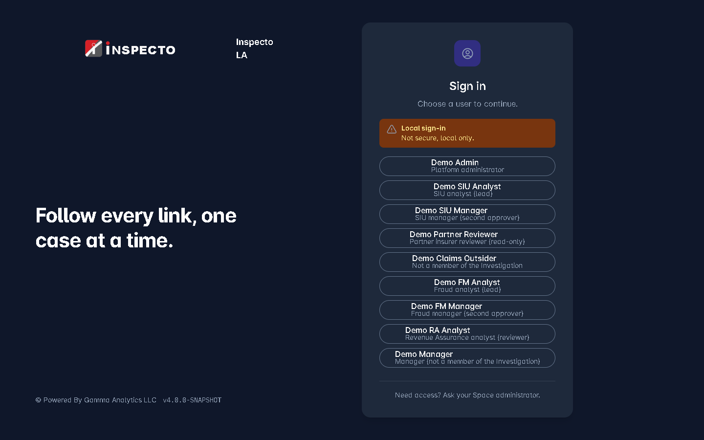
*Sign-in on a demonstration install: pick a Demo User. Screenshots in this guide are from the build of 2026-11-15, with invented data.*

1. Open the application and pick yourself on the sign-in page. A demonstration install lists Demo Users with no
   password; a secured install shows **Sign in with SSO**.
2. The front page offers **Link Analysis**, **Geo**, **Entity Lists** and **Alerts** (and **Settings** if you may
   change them). The same areas sit in the slim menu down the left edge, with the Space switcher and your user menu.
3. **Light or dark.** Inspecto LA follows your browser's light or dark setting, and changes with it. To fix one, open
   the user menu (the person icon at the foot of the left menu) ▸ **Colour scheme**: **Match system** (the start),
   **Light** or **Dark**. The choice is kept in this browser for you (for each person who signs in on it); where nobody
   signs in, the menu holds just this choice.

### 3.1 The Getting started page

Until your Space holds data, the front page is **Getting started**: while there is no Space yet, or the current
Space has no Dataset yet. Three ways in:

* **Try it with sample data** — **Try the sample** creates a Space called *Sample: invented data*, loads three days
  of invented money transfers with a planted money-mule ring, and opens Link Analysis with the ring drawn (the
  `la-sample` Space Template; nothing in it is real). If part of the data does not load, the card names what failed
  and still offers **Open the sample Space**.
* **Use my own data** — **Create a Space** asks a **Name** (one Space per kind of data, such as *Mobile money* or
  *Call records*) and **What kind of data?**: *Mobile Money*, *Telecom* or *Generic*, each with three example column
  names. The choice sets the Space's **Industry pack**: the words Link Analysis uses for your data and the tools it
  suggests. When a Space already exists, the button is **Add data** itself.

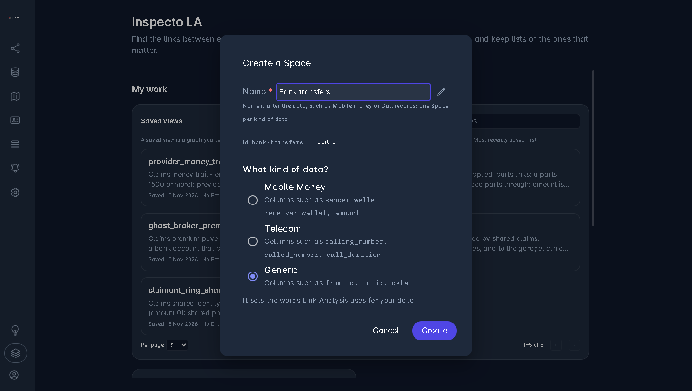
*Create a Space: type the **Name**, then choose the kind of data. (The picture predates the text box: it shows the
older row with a pencil.)*

  **Create** opens the new Space on **Onboard a file**, from Getting started, from the Space guide and from **New
  Space…** in the Space switcher alike. With sign-in, adding data is off in a Space until an administrator turns it
  on; a Space created here has it turned on as part of the create, because whoever may create a Space is an
  administrator. If that step is refused, the page names it and offers **Turn on Add data**.
* **Open my team's data** — shown when Spaces exist: the Space switcher.

A choice you cannot take is greyed out with one line saying why: with sign-in, only an administrator may create a
Space; a server running a single Space cannot add a sample one. The **Space switcher** with no Space yet reads **No
Space yet** and offers **New Space…** and **New from sample…** to anyone who may create a Space.

**The Space guide** lists the setup steps and ticks each one from what the server holds: **Space**, **Data** (a
Dataset exists), **What the columns hold**, **First graph** (a graph is saved in the Space) and, optional, **A list**.
Click a line to go to that step; collapse it with the arrow (remembered in this browser). It disappears once the four
required steps are ticked.

**My work** (once the Space holds data):

* **Saved views** — every view saved in the Space, the most recent first, with when it was saved and the Entity Lists
  it uses (*Lists: started from Suspects; leaves out Busy merchants*). Click one to open its graph.
* **What changed in your data** — one line per Dataset brought in with **Add data**, its last import first:
  *transfers: imported 1 Oct 2026, +2,104 rows*; after **Add a file**, whether the file replaced or was added to the
  rows and the net change (*transfers: replaced 3 Oct 2026, 2,104 → 2,000 rows (−104)*). Data a Pipeline keeps up to
  date is not listed here.

**Beginner counters.** Inspecto counts, on this server only, how far first-time users get (first Space, first
Dataset, first graph, the Space guide finished, the step people stopped at). No names or values are kept and nothing
is sent anywhere. Administrators see it, read-only, in **Settings → Getting started counters**.

### 3.2 Add data: onboard a file

**Add data** opens **Onboard a file**: one of your files becomes a Dataset Link Analysis can draw, in four steps.

1. **Drop or choose a file.** Say what is in it: *Events between entities* (transfers, calls, messages) or *Details
   about entities* (customers, accounts, devices). Drop the file or press **Choose a file**. The screen lists what it
   reads (CSV or TSV, Parquet, JSON or NDJSON; Excel when this installation includes it) and this Space's limits
   (for example *up to 500 MB and 10,000,000 rows per file; 20 imports per Space*). Or choose **A Postgres table**
   (every edition; see *Data* below). *Read from another database or a remote system* is locked on Basic, with the
   reason.
2. **Check the columns.** What was detected is applied, with the reason beside it. A guess is highlighted and marked
   **A guess**: **Confirm** it or change it. When a step holds several guesses, **Confirm all N guesses** at its top
   confirms them together, after you have read their reasons. Rename a column, change its type or **Leave out** a
   column; a table shows the first rows as they will be kept.

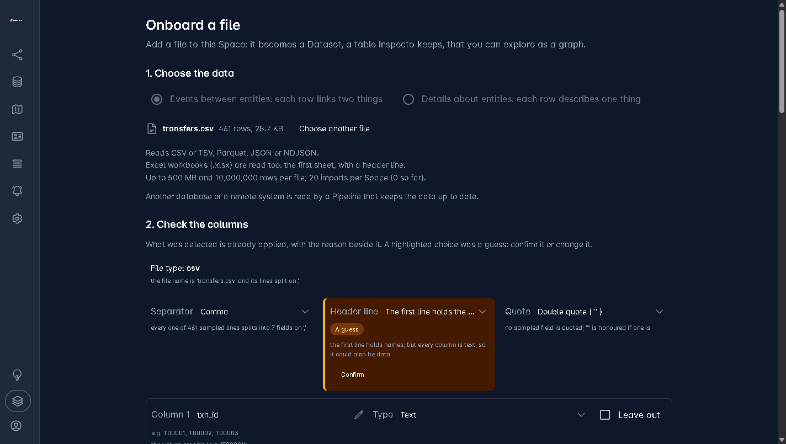
*Check the columns: each detected choice gives its reason; a guess is highlighted with **Confirm**.*

   A column that is *almost all* dates, dates with a time or numbers — at least nine values in ten, and at least ten
   of them — is proposed as that type, marked **A guess**, and its reason names a value that does not fit (*460 of 461
   sampled values are dates with a time, but 1 is not (e.g. 'not-a-date'); it will be left blank*). The import leaves
   such a value blank, keeps its row and counts it in the result. A whole-number column is proposed this way only
   when its name says an amount (`amount`, `total`, `fee`…); digits with a few letters among them are more often
   identifiers, so any other such column stays *Text*. Below nine in ten the column stays *Text* too.

   When you change a column's **Type** or **Role** yourself, the screen asks the server again and everything that
   depends on it follows in that one edit: the reason beside the type (how many values it reads, and one it does
   not), the column's role, and **When** and **Weighed by** in step 3. What you picked yourself is never proposed
   over.
3. **What does each column hold?** An *Entity Type* (Account, Phone number…) or *Nothing: a detail*. For events:
   which column a link goes **From** and **To**, and optionally its kind, time and amount. For details: **Which
   column identifies each entity?** Without a From and a To the screen warns that the Dataset cannot be drawn as a
   graph.

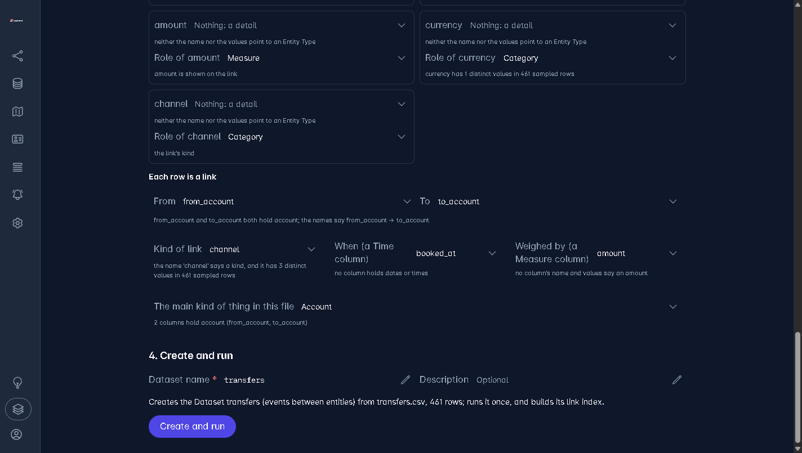
*What each column holds: a link goes **From** one column **To** another, with its kind, time and amount.*
4. **Create and run.** The Dataset name comes from the file name (lower-case letters, digits and `_`). **Create and
   run** waits until every guess is confirmed or changed; a very large file runs on the server and the screen
   follows it.

The result accounts for every row and value, one line each:

- how many rows were read and how many were kept, and, when there are any, the rows set aside because the line itself
  could not be read (too few columns, a broken quote);
- each column where a value did not fit its type and was **left blank** (*1 value in booked_at was not a date with a
  time and was left blank (e.g. 'not-a-date')*) — the row is kept;
- rows that **draw no link** because their From or To is empty (*1 row has no From (from_account), so it draws no
  link*) — which is why the graph can have fewer links than the Dataset has rows;
- values of an entity column that are **a second spelling** of an entity already there, differing only by spaces or
  letter case (*' acc-1003 ' is ACC-1003*) — worth correcting in the file: an Entity profile and the import's entity
  count take both as one entity, and a graph started from either spelling reads the links of both, but the graph still
  draws each spelling as its own node;
- whether the link index was built, with its links and entities, and each Expectation on the data when the Dataset
  has any (a first import has none).

The rows that draw no link and the second spellings are counted over the rows this import added. Then **Explore in Link Analysis** (for events
it opens **Start a graph** with the Dataset picked; after details about entities it opens the events those entities
are in, where the details now show on each entity), **Add details about these entities** (after events), or **Add
another file**.

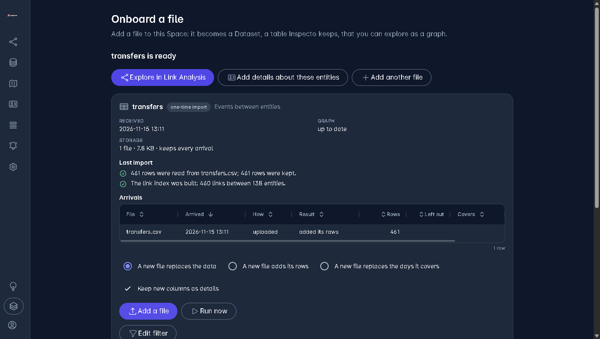
*The result and the Dataset card after **Create and run**.*

**The Dataset card** says *one-time import* and shows the last import. **Add a file** brings in the next file (for
events, choose whether it *replaces the data* or *adds its rows*; details are always replaced); **Run now** runs the
import again. **Inbox** shows the folder on the server where another system may write this Dataset's files (an administrator sees its full path on the server; anyone else sees it within the Space's data folder, such as `inbox/transfers`), how many
wait there, and **Import waiting files** (the same as Run now); on Basic nothing is imported on its own unless you turn
on **Watch this folder**, which checks the inbox every 30 seconds (every edition). **Keep this up to date** is locked on
Basic. On Standard and up it asks where the files come from (*files written to this inbox*, or
*files on an SFTP server* through a Connection), how often to check, and an optional ready marker (read `name.csv` only
once `name.csv.done` is there); new files are then imported on their own, a file sent again is skipped, and the Job that
adds them to the graph is saved for you when you may author Jobs (else the card names the Job to ask an administrator
for). **Stop** goes back to importing only when asked. **Storage** says how many files the Dataset holds; past 20 an import
merges them into one so reading stays quick, and **Compact now** does it at once; the merge keeps each arrival's
period on record (the *Arrivals* list shows it once it reads that record, `LA-ARRIVAL-LEDGER-1`). On
Standard and up, **Keep** sets what the Dataset keeps (*every arrival*, *the last N days* by each row's date, or *the
last N arrivals*); older rows are removed at the next compaction. If adding data is off in this Space the screen says so, and that an administrator can turn it on. An administrator
sees **Turn on Add data** on that screen: one press turns it on and the Add data screen opens in place (a refusal is
shown under the button). The same switch is **Settings → Add data**, *People may add data in this Space* (after
a refused change or a failed read it offers **Try again**, which reads the setting afresh), and you need the right to
upload data. The la-app **Access** screen names the role that builds data *Data builder* (its id stays
`pipeline-developer`).

### 3.3 Entities: what the columns hold

Two columns join up in the graph only when they hold the same **Entity Type**. The **Entities** page (left menu)
shows and sets this.

* **Entity Types** tab — one card per Entity Type some column of this Space's data holds, with its distinct count,
  Datasets and data-as-of date; a Dataset's **primary** type comes first (*Primary in &lt;Dataset&gt;*). The others
  wait, folded, under **Not in your data (n)**.
* **Columns** tab (where the Space guide's *What the columns hold* step lands) — per Dataset, each column that looks
  like an identifier, with what it holds or **Not set**. **Holds** sets the Entity Type at once and the page says what
  changed (*"to_account" in transfers now holds Account.*); **Show every column** lists the rest. The picker beside
  the Dataset name sets its **primary Entity Type**.
* **New Entity Type** — a **Name**, an **Example value** (shows *Kept as …*) and **Compare values as**: *Upper case,
  spaces trimmed*, *Digits only*, *Phone number* or *Case ignored*. A name the Space already has is refused before
  anything is written.
* **Delete** — the bin button on an Entity Type's own page (and **Delete** beside each type in ⚙ Settings → Entity
  Types) removes a type nothing uses, after a confirm naming it. It cannot be undone. A type still used is kept and the
  page says by what: the Dataset columns that hold it, a live Entity List of that type, or the number of Investigations
  that name it (a step, or the endpoint types set when it was created). Change or retire those first; the last Entity Type of a Space cannot be deleted.

These changes need the right to edit Datasets when you sign in; without it they are greyed out with the reason.

**Profile pages** (Standard and up; in la-app and in the console). Each Entity Types card shows a stale or *not
assessed* badge when it applies and opens that type's page:

* **Entity Type Profile** — collapsible sections: Identity, Where it appears, Lineage, Volume and quality, Value shapes,
  Time, Links, Relationships and *What is not here*. Its **Masked** tile shows whether the type is masked under the
  Space's masking mode in force, with the mode and the type's own setting in the hint; the Entities cards say *Masked:
  shown as aliases.* only when the mode in force actually masks the type.
* **Entity Profile** — one entity: when it was seen, rows per day, where it appears, its links, related identifiers,
  the lists and groups it is in, and freshness. The graph's node dialog links to it ([§6.2](#62-the-node-detail-dialog)).
* **Open an Entity** — type the value and press Enter (or **Open**); the page opens by the key the server returns, so
  for a masked type the address holds the alias, never the raw value. Enter also works on the closed row once it holds
  a value.

Honesty rules: an approximate count says `approx.`; a section the server could not read says *Not assessed* with its
reason and is listed again under *What is not here*; a type nobody has profiled yet reads *Not assessed: not computed
yet* on its card.

### 3.4 The Data page: Datasets, Entities and Mappings

**Data** (left navigation) lists every Dataset you added with *Add data*, then every Dataset a Pipeline or a Job keeps
up to date, grouped as **Streams** and **References**. Each group folds from its heading. Each Dataset is folded to one
line (where its data comes from - *Added here* or *From a Pipeline* - how many columns, and how many Mappings once it
has one; the line wraps rather than being cut) until you open it; a Space with a single Dataset
shows it open. Opened, each one shows:

- its card: for a Dataset you added, its facts under their own labels - **Origin**, **Filter**, **Received** (when data
  last arrived), **Covers** (the period it covers), **Graph** (whether the graph has it: *up to date*; *out of date*,
  with a **Rebuild** button, when its link index must be built again; or how many files behind), **Inbox** or **Kept up to date**,
  **Storage** and **Compacted**, each only when known - then the **Arrivals** table (every file it took, uploaded or put
  in its inbox by another system: File, Arrived, How, Result, Rows, Left out, Covers, Columns; newest first, ten to a
  page; **Left out** counts the file's rows that are not in the Dataset — set aside, or left out by the row filter —
  and says 0 when there are none; **Covers** is the period of its Time column; a file a later replace set aside reads
  muted and its Result says so), *Add a file* and
  *Run now*; under **Inbox**, *Watch this folder* imports what another system writes there on its own, checked every
  30 seconds, once the files have stopped changing (every edition); a Postgres table snapshot shows *Refresh now*
  instead, and is copied again only when you press it; one a Pipeline or a Job keeps up to date has no card: its
  header's *Kept up to date by a Pipeline* says where its rows come from, so there is nothing to add here, and while
  its Pipeline has not written any rows yet the header says *Waiting for its first run* (in grey: a wait, not a fault);
- **Entities**: what each column holds, one Entity Type or *Nothing: a detail* per column - changed here, saved at once;
- **Mappings**: how its rows are read as links. The Dataset has its own; **New mapping** saves another, under its own
  name: *From* and *To* (what each holds starts at what the Dataset says that column holds), and optionally *Kind of
  link*, *When* and *Amount*. A Mapping is a Dataset
  of its own over the same data - it appears in the Start box and everywhere a Dataset does, without copying anything.
  One file of transfers can be read as *account → account* and as *account → channel*. *Edit* changes a Mapping, *Delete*
  removes only the Mapping (never the data), *Explore* opens it in Link Analysis.

Files always go to the Dataset you added, never to a Mapping (*Add a file* on a Mapping is refused and names the
Dataset). A Dataset that Mappings read cannot be deleted until they are.

**What a new file does.** *Add a file* asks once per file:

- **replaces the data**: everything before is set aside;
- **adds its rows**: everything before stays;
- **replaces the days it covers** (only for a Dataset with a *When* column): its rows are added, and the older rows on
  the same days are removed; every other day stays. Send a corrected week this way and you get exactly that week again.

The same file twice is refused ("already imported on …"), so its rows are never counted twice. To load it again, replace
everything. A file must have the Dataset's columns, by name: a missing column, or one moved to another place, refuses
the file and says which. A new column is kept as a detail of the Dataset: the result says "New column fee: kept as a
detail", and older files read it as empty. Untick *Keep new columns as details* before you add the file to leave it out
instead. Once a column is kept, a later file without it is refused, naming the column and the file it was kept from. A file another system put in the inbox is judged the same way by *Run now*; a refused one is set
aside in the Dataset's `refused` folder and listed in *Arrivals* with the reason.

The **Data status** line also shows in Explore, under the Start box's Dataset and above the Rows table: *graph up to
date*, or *graph N files behind* when a later file could not be indexed.

- **Who sees a Mapping:** only someone who may read its Dataset. A Mapping never shows a Dataset's rows to someone the
  Dataset is not shared with; for them it is simply not there.
- **When a Dataset changes under a Mapping:** if a Pipeline drops a column a Mapping reads, the Mapping is marked
  (*Reads a column … no longer has: …*), and a preset question over it is refused with the column named rather than
  answered over other columns. Edit the Mapping.
- **Other Datasets** at the end of the page are listed by name. They are computed when read, have no stored data, are
  an Entity List's store, or list fewer than two columns, so no Mapping is offered for them.
- A Mapping of a large Dataset has no link index of its own until an administrator adds an index build Job for it. Until
  then, preset questions over it read the Dataset.
- **Discover** (every edition, Basic included) says what is in a Dataset before you draw anything. Choose *Show what is
  in it*: its link rows and the period its Time covers, about how many entities of each Entity Type it holds, its kinds
  of link with their counts, the total and median of every Measure (in its unit), and the ten busiest entities at each
  end (sending to and reached by the most others). A part the Dataset cannot answer says why (no Time column, no
  Measure, a ranking that took longer than the Space allows) - never a 0 nobody counted. Counts of entities and medians
  are close estimates and say so. The answer is kept until a file arrives, so the second look is instant; on a large
  Dataset the first one takes a few seconds, and the busiest come from its link index when it has one. Click a busiest
  row for that entity's summary ([§6.2](#62-the-node-detail-dialog)). To draw the busiest, use the same panel under the
  Start box in Explore ([§5.1](#51-start-a-graph)).

### 3.5 Upload a CSV to a Collector

**⚙ Settings ▸ Add data** holds **Upload a CSV**: a file handed to a Pipeline's own Collector, as opposed to *Add data*,
which makes a Dataset of its own. It is shown only to a user with the upload capability (operations, support, power,
admin) on a build that includes the link-analysis module.

1. Choose a **Collector**. Only a local Collector whose Pipeline says *Accepts analyst upload* is listed; a single one is
   preselected. The section shows the file-name patterns it picks up and the size limit. With none enabled it says so
   and what to ask a Space administrator for.
2. **Choose a CSV file** and press **Upload**. The browser checks what it can see (a `.csv` extension, a plain file
   name, the size cap) and says why in words; a workbook (`.xlsx`) is refused with *export the sheet as CSV (UTF-8)*.
   The server checks the rest (pattern, content, daily quota, the four-eyes row budget).
3. The file only **lands**: the Collector's own Pipeline ingests it on its next poll, so the Dataset it fills appears
   afterwards (then use it for identity import or the link index as before).
4. **Your uploads** lists what you uploaded to that Collector, newest first, with its ingest state: *Waiting for the
   Collector*, *Ingested* (with *N rows rejected* when the Pipeline wrote a reject ledger), *Quarantined (reason)* or
   *Picked up*. A Space administrator sees every analyst's uploads. The refresh icon re-reads.
5. **Delete** is offered while a file is still waiting; once the Collector has picked it up the rows are in the Dataset
   and the delete is refused, and while a run of the Pipeline is in flight it is refused too (*may be being ingested
   right now; try again*). Uploading a name that is still waiting answers *still waiting in the inbox*; **Replace the
   waiting file** is offered only when that waiting file is your own (only an administrator can replace another
   analyst's file).

Refusals read as a cause plus a next step: over the size limit names the limit and says to split the file or ask an
administrator; too many requests says to wait a few seconds; deleting someone else's file says you can only delete your
own. The landed file follows the Collector's own retention; the upload records behind the list are kept 90 days. In
the `la-showcase` template the `crm_kyc` Collector accepts uploads, so a showcase Space has one target out of the box.

---

## 4. The screen

Act on the canvas, read in the dock, configure in **⚙ Settings**.

* **One header row.** The title **Link Analysis**, then the **tool rail** and the **canvas toolbar** side by side,
  then **Full screen**, **About** (what this page is and its terms) and **⚙ Settings**. **About** defines each term it
  lists (Entity, Link, Dataset, Entity Projection, Saved view, Investigation, Working Set): from the glossary, else in
  the Studio's own words; it never quotes deployment or internal notes. When the browser refuses **Full screen** (an
  embedded page that is not allowed to go full screen, for one) a message says so. Every control is an icon: hover
  it for its name. Counts (Held, Hidden, collapsed, Attach) are a small number on the icon. When the header is too
  narrow, the canvas toolbar's groups after Canvas mode fold into **More canvas tools** (`⋯`), and a long selection
  row drops under the rail rather than being clipped. The page never grows past the window: long content scrolls
  inside its own panel (LA-NO-LONG-PAGES-1, 2026-11-10). In the Inspecto LA app, **Collapse** for the left navigation
  rail sits in this header before the title, the rail is drag-resizable (160-400 px) when expanded, and
  **Show / Hide the toolbox** is a toggle after **⚙ Settings**.
* **The open saved view is named after the title** (the description is its tooltip). Click the name for the *Saved
  view* dialog: **Name** and **Description**, the facts (Dataset, layout, industry pack, Investigations, id) and
  **Version history**. **Save** changes only the name and description, never the graph on screen; a view you may not
  change is shown read-only with the reason (LA-VIEW-DETAILS-1, 2026-11-10).
* **Start area (empty canvas):** without Investigations (Basic, the Explorer level), one bounded panel with tabs
  (*Start a graph*, *Preset queries*, *Build a question*, *Explore the Dataset*) that scrolls inside itself; a preset
  or builder answer opens in a closable card. With Investigations the empty canvas shows **Start an Investigation**
  instead: one sentence on what to pick and where, and **Start from the Investigation tab →**, which opens the start
  form there ([§5.1](#51-start-a-graph)).
* **Tool rail (file and view):** **File ▾** first ([§10](#10-saving-exporting-and-the-file-menu)), then **Search
  nodes**, **Filter node types**, **Graph layout**, **Filter edges by time**, **Help**, **Glossary**, **Display
  options** (the brush), **Undo** and **Redo** (display and filter changes), **Fit the graph to the screen**, **Show
  as list**, **Export** and **Show the rows** (opens the dock). **Glossary** (the book icon) lists the Industry pack's
  typology terms (*SIM box*, *IRSF*, *Wangiri*…: label, abbreviation, one-line definition, sorted by label; *No
  definition stated.* when the pack gives none). It is absent when the pack states no such terms (Generic, for one); it
  explains words only, and has no search.
* **Canvas toolbar (work on the canvas):** **Canvas mode** (Pan, Lasso, Fisheye, Link filter), the selection (**Select
  all**, **Invert the selection**, **Select neighbours**, **Clear the selection**, and the count), the
  graph edits (**Expand**, which in an Investigation opens its tab section, **Collapse**, **Hide**, **Exclude** and **Merge** on an Investigation's canvas, **Attach to
  Case**), **Clean up** (the broom), and **Held** and **Hidden by lists**.
* **Canvas:** the graph, with the legend, the Working set tiles and the minimap. The minimap starts folded to a small
  button at the right end of the line under the canvas (**Show the minimap** / **Hide the minimap**); View ▸ **Minimap**
  says whether the canvas offers one at all, and is kept with a saved view. It is drawn to read on a projector
  (LA-FULL-CYCLE-TEST-1, 2026-11-16): a node's name sits on a small backing in the node colour of the scheme, a few
  pixels under the node, so a link or an arrowhead that passes under it never cuts through the letters; in the dark
  scheme links are a lighter grey (about 7:1 against the canvas, was under 4:1, which vanished on a projector); the
  minimap's frame is the scheme's own faint line on the card colour rather than a bright grey box, so it no longer
  outshines the graph. Every colour comes from the theme, in both schemes.
* **Right panel**, collapsed to a thin rail (**Show the toolbox**, **On screen**, **Whole Dataset**, **Investigation**) or open
  with three tabs (**«** collapses it again; LA-PANELS-REDESIGN-1, 2026-10-29):
  * **On screen**: *Find something interesting* and the tools that run on the graph on screen.
  * **Whole Dataset**: the server algorithms and the tools that read the whole Dataset.
  * **Investigation**: the New Investigation form, or the open one's Act panel ([§11](#11-investigations)).

  The analysis catalogue is [§8](#8-the-analysis-catalogue). Settings in the three tabs are edited the same way
  everywhere: **label · value · ✎** (click the pencil or the value, Enter keeps it, Escape drops it), and a choice
  opens as a list in a popup.
* **Dock (bottom):** **Rows** (the links and nodes behind the graph) and **Results** (a long algorithm table), plus **Steps** (one line per step) while an Investigation is still unsaved, or,
  with an Investigation open, **Step log**, **Working Set rows**, **Coverage**, **Annotations** and **Excluded
  entities**. Its tabs are plain text tabs, the open one underlined; on a narrow screen they scroll sideways. Drag its
  edge to resize; it remembers its tab and height in this browser. It never opens on nothing: **Results** is not
  remembered (its table lives only until the page reloads), so a dock left on Results comes back collapsed to its tabs,
  on **Rows**; and an empty Results tab is one line high (*Long algorithm results open here…*), not the dock's height.
  An empty dock used to take a fifth of the screen.
* There is no status bar under the canvas (2026-10-29). The graph model and **Refresh** are in **⚙ Settings ▸ Graph
  model**; the counts are on the **Graph counts** card on the canvas, whose **Limits** icon (bottom right) shows the
  node limits in force; **Installed modules** is a section of ⚙ Settings.

A window about 1,300 px wide or more shows the canvas and the right panel side by side; narrower, the panel stacks
under the canvas.

### 4.1 ⚙ Settings

One dialog for what you set rarely; the left side lists the sections, each with one line of help. It remembers the
last section in this browser. Running the graph model closes it; closing it over an edit you did not run asks first.

| Group | Sections |
|---|---|
| **This graph** | **Graph model** (Dataset, the two entity columns, link type, mappings, attribute columns, root, depth and direction; **Run query** and **Refresh** at the foot; the Space's Industry pack is shown read-only at the top) · **Entity Types** (the types the graph is drawn as, **New Entity Type**, **Delete**) · **Display rules** (node colour rules by attribute, [§6.4](#64-display-rules-colour-nodes-by-a-condition)) |
| **Data** | **Entity Lists** · **Identities** (identity resolution, [§11.7](#117-identity-resolution)) · **Add data** (upload a CSV to a Collector that accepts uploads, [§3.5](#35-upload-a-csv-to-a-collector)) |
| **This Investigation** (only while one is open) | **Investigation settings**: Case, Members, Share and embed, Drafts, Replay and drift, Pin to a Widget, Oversight and approvals, Measures and templates, Dossier, References |

**Industry pack, not a profile picker.** The words and suggested tools follow the Space's Industry pack (Telecom:
*subscribers* and *calls*; Mobile Money: *wallets* and *transfers*). There is no picker on the page; Graph model shows
the pack in force. The pack names the Working set tiles, the Entity Types, the link kinds on the legend's chips, the
pattern names in the picker (the pack's definition replaces the pattern's description), the Value Measure names and the
*Phone number* field of the starter card; the stored kind and id never change, only the words. Without a pack, or until
the Space's packs have been read, the neutral words apply. A saved view never applies a pack of its own: the Space's
pack applies, and a view saved under one of the former browser-only profiles (finance, supply chain, cyber) opens under
Generic words. The Space's pack is chosen in **Settings ▸ Link Analysis ▸ Domain Profile** (*Generic* or an installed
pack, **Apply** with *Workbench author*); that page also lists the active pack's terms (key, label, abbreviation,
definition), warns when the stated pack is not installed and names each pack that was refused. A deep link that starts
from a type no installed pack investigates waits for the packs before it binds.

**Masked ids.** Names such as `masked:1d4d76be…` mean your Space hides sensitive ids. The same alias always stands for
the same account, so you can still group, count, search, seed and follow it. Graph model says **Masking on: ids
shown as aliases**. Details beside a masked id (a holder's name, a city) are masked with it. Inside a saved
Investigation, someone with *See unmasked ids* who leads it turns every alias on screen back into its real identifier in one
step: **Reveal…** under the canvas or in a node's details (see [Masked ids in an Investigation](#masked-ids-in-an-investigation)).

---

## 5. Building a graph

### 5.1 Start a graph

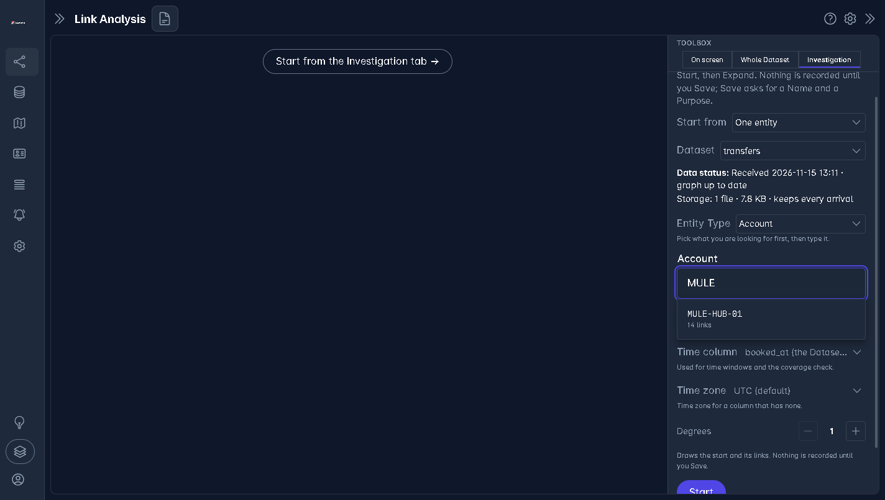
*Start from one entity: pick the Dataset and Entity Type, type the first letters and pick a match.*

On an edition with Investigations the empty canvas reads **Start an Investigation**: *Pick a Dataset and what to start
from (one entity, an Entity List, pasted values or the whole Dataset) in the Investigation tab. You work unsaved until
you choose Save. To carry on with earlier work, use File ▸ Open…*, with the button **Start from the Investigation tab
→**. This form is in the toolbox's **Investigation** tab. When the Entity Type is masked (in Standard and up, *Account*, *Phone number* and
other identifying types are masked unless the Space says otherwise) nothing is suggested: type the whole value, or turn
on **Show values (this is logged)** if you may reveal them. The line under the field says where the real identifiers are: if
you have *See unmasked ids*, the graph shows aliases until you save it and press **Reveal…** on the canvas or in a
node's details; otherwise it says that seeing them needs *See unmasked ids*.

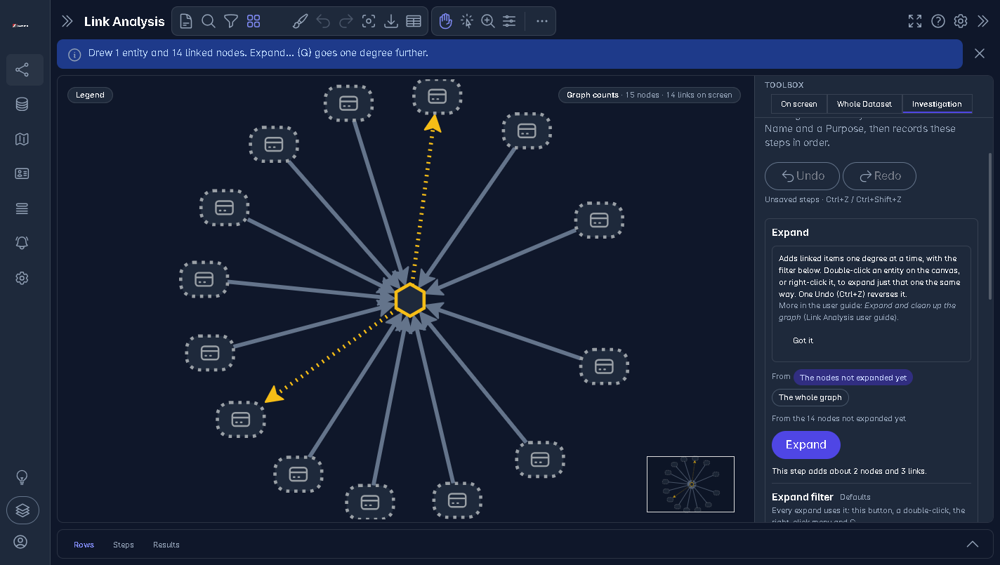
*The first graph: the start entity and everything it is linked to. Dotted outlines are entities not expanded yet.*

Without Investigations (Basic, the Explorer level) the first screen is the Start area, its first tab the **Start a
graph** box. With Investigations the centre shows only how to start and **Start from the Investigation tab →**: the
start form lives in that tab, so Dataset, Start from and Entity Type are asked in one place ([§11.1](#111-start-one)). Pick the **Dataset** first (already picked when you come from
*Explore in Link Analysis*), then what to start from:

* **One entity** — pick the **Entity Type** (the Dataset's main one is chosen: accounts for transfers, phone numbers
  for calls), then type the value. Matches appear with how busy they are: *MULE-HUB-01 - 10 links, first seen 3 Sep
  2026, last seen 30 Sep 2026*. A masked type suggests nothing: type the whole value, or, if you may reveal, choose
  *Show its values* (each look-up is recorded).
* **A list** — an Entity List (suspects, a watch list).
* **A paste** — values, one per line (commas, semicolons and tabs work too).
* **The whole Dataset** — every link at once. When the Dataset holds more entities than the node cap the box warns
  first: the graph is cut to the busiest, and starting from one entity is usually clearer.

**Start** draws what you chose plus **one ring** of everything linked to it, with busy entities held
([§7.2](#72-held-busy-entities)), so **Expand** (**G**) continues from there. A line above the graph says what was drawn and
lists any value not in the Dataset. A list or a paste draws at most 25 values in one start (its first 25) and reports
the rest as *N more values not drawn*.

**Start from** is a choice that opens as a popup, like the Entity Type. The box always draws; it records nothing.

**Preset queries** (Basic, under the Start box) ask a Dataset the questions your industry already asks, without
writing a query: most of them point at *who to look at first*. The same core set is offered in every Space; an
industry pack adds its own questions ahead of it. Pick the **Dataset** (the Start box's, at first) and a **Question**, set its few values (each has a default), and choose **Ask**:

| Question | Answers | Offered when the Dataset maps |
|---|---|---|
| Reached by many | the entities that most distinct others link to, at least *N* | From, To |
| Reaching many | the entities that link to the most distinct others, at least *N* | From, To |
| Two-way pairs | pairs that link to each other in both directions, with the links each way | From, To |
| Short loops | three entities linked in a circle (A to B to C and back to A); very busy entities are left out | From, To |
| Newcomers | entities first seen in the last days of the data that already have many links | From, To, When |
| Top counterparts of one entity | who one entity links to most: links, and the total amount when there is one | From, To |
| Two steps from one entity | its direct counterparts, then theirs, and through how many of them | From, To |
| Biggest senders by amount | the entities that send the most in total | From, To, Amount |
| Money in, then out again within hours *(mobile money)* | entities whose money leaves again soon after it arrives: median hours, links out, received | From, To, Kind of link, When, Amount |
| Linked through one shared item *(telecom)* | entities linked to many others by a kind of link that means sharing one item (the pack's shared device) | From, To, Kind of link |

From and To come from the Dataset's link (Add data and Mappings state it), else its first two columns that hold an
Entity Type; Kind of link is a column named `kind` or `…_kind`; When is its event date; Amount is a number column
the Space's industry calls an amount. A question the Dataset cannot answer is not listed: name the columns on the Data
page ([§3.4](#34-the-data-page-datasets-entities-and-mappings)). The answer is a table (at most 500 rows; masked ids show
as aliases, exactly as on the graph). **Draw these** starts a graph from the listed entities, the top 25 first, the way
a paste does. Every question asked is recorded.

On a large Dataset, Reached by many, Reaching many, Newcomers, Two-way pairs and Short loops are answered from the
Dataset's **link index** when one is published (a line under the table says so, and whether the index is behind the data).
Short loops leaves out entities with more than 50 links in and out by default, the limit the index is built with; ask for
more and the Dataset itself answers. The other questions read the Dataset and can run out of time on tens of millions of
links: they then say so in a sentence.

**About <Dataset>** (Basic, under the preset queries) is the Data page's *Discover* for the Dataset picked in the Start
box ([§3.4](#34-the-data-page-datasets-entities-and-mappings)); its **Draw these** starts a graph from the busiest
entities, and a busiest row opens that entity's summary, whose *Draw it* starts from that one entity.

**Build a question** (Basic, under the preset queries) asks a question of your own over the same Dataset: rank the
senders or the receivers by their links, their distinct counterparts or the total of a Measure; keep one sender or
receiver, some kinds of link, a period on any Time column (*From day* is included, *Before day* is not), a range on
any Measure (both ends included), groups with at least a value, and how many rows (at most 500). Only the columns the
Dataset gives that role are offered, and the server refuses anything else. **Draw these** starts from the answer;
**Save as preset** names the question and adds it, for everyone in this Space, to the *Question* list of every Dataset
that has its columns (*… (saved here)*). A saved question is shown only to those it is shared with.

**Investigate** on an Entity's page, and **Investigate … in Link Analysis** on an Incident or Case page, open a short
*Investigate {number}* form in the Investigation tab that asks only for the purpose.

**Open…**, **Explore Dataset…** and **Examples ▸ Follow the money** are in the **File** menu
([§10](#10-saving-exporting-and-the-file-menu)). Under the box, **Add data** brings a file in.

### 5.2 Graph model: draw a Dataset yourself

**File ▸ Explore Dataset…** or the pencil opens **⚙ Settings ▸ Graph model**:

1. **Dataset.** The ones that look like links are listed first, each with the reason. **Entity/Link (several
   Datasets)** puts up to 16 mappings in one graph; the same entity in more than one Dataset becomes **one node** that
   lists every Dataset it came from. If you cannot read even one of them, the whole query is refused — never a
   partial graph.
2. **The two entity columns** (who → whom) are filled in when two columns look like the two ends of a link (payer /
   payee, caller / callee, from / to…); change them if the link runs the other way. **Derive mapping** asks the
   assistant to draft them and needs permission to author configuration.
3. Optionally a **Link kind column** (wire, card, cash_out, SMS…; kinds get colours and can be filtered) and
   **Attribute columns** (amount, country, time — they feed the timeline, Value Measures and pattern tools). **Add
   another mapping** stacks more column pairs. **Root**, **depth** and **direction** start from chosen entities and
   grow outwards.
4. **Run query.** Settings closes and the graph is drawn; the **Graph counts** card says how many entities and links.
   **Refresh** (here in Graph model) runs the same model again later.

### 5.3 Filters — two stages, deliberately

1. **Apply locally** — instant, in your browser, over the links already loaded.
2. **Push to server** — the same condition goes to the database, so it applies *before* the graph is folded and
   counts stay right on large data.

Conditions are a tree of AND/OR groups; a single bare condition is refused — wrap it in a group.

> **Mind the "≥ 5 000" trap.** A view filtered to "amount ≥ 5 000" hides exactly the small payments structuring
> consists of. Pattern and Measure tools run over the **whole Dataset**, not your filtered view, for this reason.

### 5.4 Size limits — told honestly

* By default the server returns at most **4 000 links** (ceiling 40 000), the canvas admits **1 000 nodes**, and
  analysis in the browser runs up to **2 500 nodes** (heavier scores stop sooner and say so). The **Limits** icon at
  the bottom right of the **Graph counts** card shows the node limits in force (Escape closes it): *Graph drawn*, *On screen tools* and *Whole Dataset tools*. Every number is a setting ([§15](#15-limits-and-honest-behaviour)).
* When a cap cuts data you see **Truncated** — never a silent "no results". Narrow the query or use the Server side
  of the catalogue.
* Each server read says where it was answered: *Answered from the link index v3* (*, which is out of date* and why, when
  files were added after it was built) or *Answered from the Dataset because …*, with the reason in words, for example
  *because the link index is out of date (the Dataset's definition changed after the index was built)*.
* Very busy hubs are folded into a **super-node**. Above 20 links on the canvas, link labels show on hover or click
  only; *All link labels* in Display options overrides it. Above 1,000 links, arrowheads and node labels also show on
  hover or click only (the canvas says so at the bottom); *Arrows and node labels on large graphs* overrides it, at the
  cost of slower drawing.

---

## 6. Looking at the graph

| To find | Use |
|---|---|
| A particular node | **Search nodes**; **Clear search and filters** resets |
| Only some kinds of node | **Filter node types**, or the legend's chips |
| A better layout | **Graph layout** |
| Links in a time range | **Filter links by time**: pick a time column (only date/time columns are listed), then drag the cutoff; times are UTC. Needs a time column among the Attribute columns |
| The rows behind the picture | The dock's **Rows** tab (**Show the table**): **Links** or **Nodes** of what the graph draws; a node row (click, or Enter on the focused row) selects that node on the graph |
| The same entities on a map | Geo Map: selecting an area there highlights the matching entities here, and back; a node's dialog can also open its record on the map ([§6.3](#63-pivot-between-graph-and-map)) |

**Layouts.** *Layered, Grid, Force, Clustering force, Radial, Degree ordered, Circular, Information density,
Force (spread)*, and tree layouts (*Mind map, Organisation chart…*) enabled only when the data is tree-shaped.
**Layered is disabled, with the reason, on a wide shallow graph** (*too wide*: more than 60 nodes would share one row — say 300
claims under 20 providers — which it would stack into one column too tall to fit); use *Force*. A saved view that
picked Layered opens in the default layout then.

**Display options** (the brush) switch node and link labels, colours, shapes, node size and spacing, **Align while
dragging** and **Highlight on hover**, and the overlays: **Legend**, **Graph counts**, **Level of detail**, **Minimap**,
**Grid**, **Community outlines**, **Group single-link neighbours**, **Community shading** and **Link bundling**. Every
link kind and Entity Type is named as the legend names it, here, in the node-type filter, the links table and the node
card. Colour rules by attribute
are in **⚙ Settings ▸ Display rules**. The legend and Graph counts start as small pills at the top of the canvas, so a
graph is drawn clear of them; open either with one click, and this browser remembers that choice. Fitting the graph
(on drawing, *Fit to screen*, or a resize) keeps the pills' band, the status line along the bottom and a margin on
every side clear, so no node is drawn under a pill or cut by the canvas edge. A layout or overlay the graph is too big for is greyed out and says why (*needs at most 300 nodes (this graph
has 921)*); reduce the graph first with Clean up, a filter or Collapse. The legend's link-kind chips change the
drawing only — a hidden kind is still followed by the next expand; to leave it out, set link kinds in **Expand** ▸
**Links** (that is recorded).

**How nodes look by default.** Node labels show on their own while the graph has **at most 80 nodes**, and are off
above that; the line along the bottom of the canvas then says *node labels off above 80 nodes: Display options turns
them on*. Your tick or untick of **Node labels** in Display options wins either way, and a saved view keeps the labels
it was saved with. Link labels start off. The brush is tinted while a label switch differs from that start.

**Notices** (a refusal, a save) open at the top centre of the window, and a step's result line at the top centre of
the canvas, between the Legend and Graph counts pills, both clear of the minimap and the page's own buttons. The start's outcome (*Drew 1 entity and 14 linked nodes…*) stays above the canvas until your
next step (an Expand, an Exclude, a Clean up, an Undo, Save), whose own result line takes its place.

* **Node size** is a Display setting, never derived from links or an attribute: *Tiny* 12 · *Small* 20 (the start) ·
  *Medium* 28 · *Large* 40 px. **Node spacing** multiplies the layout's own distances: *Compact* · *Roomy* · *Spacious* ·
  *Wide* (the start) · *Widest*; Grid, Circular and the information-density layout have no spacing. Changing either
  re-runs the layout; more spacing means a smaller zoom after fit.
* **Automatic colour and shape.** Over the graph drawn, the most common node type and the most common link type stay
  neutral; every other type gets a colour plus a shape (diamond, square, triangle, hexagon, star), or for a link type a
  colour plus a line pattern. A type keeps its look while rarer types come and go; no two types share both colour and
  shape, and no automatic colour comes close to the plain link colour. Your own per-kind choices in Display options
  always win, the legend shows the same colours, and a saved view keeps only your choices, never the automatic look.
* **Icons.** Built-in Entity Types (subscriber, IMSI, IMEI, phone number, wallet, account, agent, handset, cell) draw
  as an icon tile that scales with node size; a shape you set for that kind replaces the icon, and a type with no icon
  keeps its plain shape. Nodes with no Entity Type (a saved view's untyped *entity* nodes, an expand's untyped
  neighbours) show no icon.

### 6.1 Canvas modes and selecting

The **Canvas mode** decides what a drag on the empty canvas does. One is active at a time; the key is in the tooltip.

| Mode | A drag on the canvas |
|---|---|
| **Pan** (default; **Esc** returns to it) | moves the view. **Shift+drag** draws a lasso that adds to the selection. |
| **Lasso** (**L**) | draws a lasso (handy on a touchpad) |
| **Fisheye** (**F**) | moves a magnifying lens over the graph |
| **Link filter** | moves a lens; only the links inside it show |

In every mode: scroll zooms, dragging a node moves it (and the whole selection), **Shift+click** adds or removes one
node, **Ctrl+A** selects all (super-nodes excluded), and the arrow keys and **+** / **−** move and zoom.

### 6.2 The node detail dialog

Click a node for its rows (id, links, neighbours, Datasets, attributes), **Explain node** (why is it interesting?) and
its canvas actions. On an Investigation's canvas, click once to select, then click the selected node again to open the
dialog. Three sections look up only the entities they need on the server, so they work in a masked Space too
(identifying values show as aliases and the section says *Entity masking is on*; numeric scores stay readable):

* **Masked id** — only for a masked node: it says the name is an alias and offers **Reveal the masked entities on screen…** (the
  one Reveal, see [Masked ids in an Investigation](#masked-ids-in-an-investigation)), or why you cannot. Once revealed it
  shows the real identifier, and the node's details, enrichment and risk factors are read again in the clear, each recorded
  with your reason. Before that, text and dates beside a masked id are masked with it; counts and scores stay readable.

* **Risk** — on a pack that maps an indicators Dataset (Telecom: `telecom_msisdn_indicators` by `msisdn`), the node's
  **indicator score** and factor columns. **Compute risk** runs propagated risk on the server over the Investigation's
  Working Set and shows the node's propagated score and its top contributing origins (*+28 from 99979100001, 3 hops,
  weight 0.35*). Without an open Investigation, or the *Run link graph analysis* capability, it is held and says why.
* **Enrichment** — the node's CRM/KYC row when the pack maps one (Telecom: `crm_kyc`), and the Entity Lists of its
  type it is on.
* **Case history** — Standard and up. Opening it reads the Incidents and Cases that reference the entity, newest
  first; *Show* filters all / open / closed. A masked node is looked up by alias and the number is never shown.
* **Summary** — every edition. *Summarise its links in <Dataset>* reads the node's links in the Dataset the graph was
  drawn from: links in and out, distinct counterparts, first and last seen, the counterparts with the most links and
  with the most money (the Dataset's primary Measure, sent and received), its kinds of link and its activity per day
  over the 90 days before it was last seen. A masked entity is read by its alias, and its counterparts show as aliases.
  The full Entity page (every Dataset, lineage, relationships, cases) is Standard and up ([§3.3](#33-entities-what-the-columns-hold)).
* **Actions** — **Add to <list name>** asks for a reason (a list under four-eyes answers
  *Waiting for approval*); needs *Manage incidents*. **Hide on canvas** (exploring only) takes the node off the canvas.

### 6.3 Pivot between graph and map

A node that stands for an Incident or Case record offers a **map** button in its detail dialog; a point on the
**Geo Map** whose row names a Case, an Incident or another record (`caseId`, `incidentId`, `objectId`) offers a
**graph** button. The button takes the
record's reference to the other page (nothing else travels, and no new query is sent). Because each page draws nothing
until you run a query, the record is looked for in the next graph or map you draw there: on the graph its node is
emphasised, on the map the point is selected and the map centres on it. If it is not in that answer, a short message
says so and the page stays as it is; the look-up is tried once. There is no timeline view to pivot to yet, and a record
in the table opens through the dialog's **Open record**. The Geo Map side: [Geo Map user guide](../geo-link/user-guide-geo-map.md).

### 6.4 Display rules: colour nodes by a condition

**⚙ Settings ▸ Display rules** colours nodes by their details: each rule is an Entity Type (or any), a detail, a
comparison (*equals*, *is not*, *contains*, *greater*, *less*) and a colour; the list is in the order you added the
rules and the first rule that matches wins. *Greater* and *less* need numbers on both sides, and a node without that
detail never matches, not even *is not*. A rule reads the node's detail columns (the mapping's attribute columns). A
group colour from an analysis comes before a rule, and a rule before the per-kind colour in Display options; halos,
the dotted *not expanded* outline and dimming stay visible over any rule. Rules are saved with the view and follow
Undo / Redo; they are kept in your browser and the view, not shared across the Space.

**Colour by a Reference detail** (every edition, exploring only). The detail picker also lists, under **Details in
&lt;Reference&gt;**, the columns of each Reference that describes an Entity Type on the graph; such a rule reads like
*segment (in accounts) equals retail*. The values are read through masking for the nodes drawn: a node the Reference
has no row for is not coloured, nor is a masked value (a masked column or alias is never compared, and a note under the
rules names the masked detail). A saved view keeps the rule, never the values.

Not offered (kept on the board until an analyst asks): shapes, sizes or halos as the outcome, rules on links, rules on
Measures, rules shared across the Space, re-ordering rules, and a legend row for rule colours.

---

## 7. Expand and clean up the graph

On an Investigation's canvas every change here is one **recorded** step of the step log (`expand`, `exclude`,
`excludeBy`, `hide`, `annotate` or `undo`, so replay and the Dossier are unchanged); while exploring it changes only
what you see. Every change ends with a one-line result and **Undo** (also **Ctrl+Z**). In a shared Investigation an
Undo takes back only the step it names: if a colleague recorded a newer step meanwhile, nothing is undone and the log
shows theirs. The words follow the Industry pack (Telecom: *subscribers* and *calls*).

On an Investigation's canvas **Ctrl+Z** undoes the newest recorded step and **Ctrl+Shift+Z** (or **Ctrl+Y**) **redoes**
it: Redo records the undone step again with the same parameters, through the same checks as the first time (an
expand over the four-eyes thresholds is held again). A new step clears what can be redone. The rail's Undo / Redo
arrows stay the display history (layout, colours, folds). The Investigation tab has the same **Undo** / **Redo** pair
at its top. In an unsaved Investigation they undo and redo the unsaved steps (nothing is recorded until Save,
[§11.1](#111-start-one)).

### 7.1 Expand

**Expand** (canvas toolbar, **G**, the canvas toolbar's **More** menu, or right-click a node ▸ *Expand…*) opens one
form. With an Investigation open it is the **Expand** section of the **Investigation** tab: the tab opens and the form
takes focus (right-click ▸ *Expand filter…* makes that node the *From*); there **G** with entities selected expands
them at once with the filter, and right-click ▸ **Expand** does the same for that node. On a graph you are only exploring it opens over the canvas, and
**Cancel** closes it. The form, most important first:

* **From**: the selection, the outer ring (next degree), the start entities or the whole Working Set, one press each;
  the line under it says what that is, for example *From the 1 wallet started from*.
* **Expand** with its **preview line**, which says what it would add before anything changes: *This step adds about
  342 numbers and 1,210 calls; 3 busy numbers will be held; 41 numbers are removed by your exclusion lists*. A step
  that would need four-eyes approval says so. **Expand** runs it degree by degree. In an Investigation each degree is
  a recorded `expand` step, and one Undo takes back the whole Expand. A server without the preview shows *No preview
  on this server* and Expand still runs.

Under the button is the **Expand filter**: six folds, each saying on one line what is set, a dot on any group set away
from its default, *N changed* with **Reset to defaults** at the top and a reset inside each changed group. No group opens
a popup. Direction and Depth start open; the others remember whether you left them open. In an Investigation the
filter is what **every** expand uses — the button, a double-click, the right-click menu and **G** — and it stays as you
set it while the Investigation is open, also when the tab is closed and shown again.

* **Direction**: *Both ways*, *Outgoing*, *Incoming* (and *Both ways, mutual* in an Investigation), one press each.
* **Depth**: a **− 3 +** Degrees stepper, from 1 up to the Industry pack's maximum. The arrow keys step it, Home and End jump
  to the ends; at an end the button says why it does nothing. **While the newest step is an Expand, Degrees is that
  Expand's size** (a line under the stepper says so): lower it and the Expand's outermost degrees leave the canvas and
  the recorded Expand, with the entities there and the links only they carried; raise it and the extra degrees expand
  from the outer ring into the same Expand. The first degree always stays. Unsaved, the Expand is cut or extended in
  place (Ctrl+Z restores it); in a saved Investigation the removed degrees are `undo` steps (newest first, a
  colleague's newer step refuses it), kept in the log, and Ctrl+Z does not bring them back (raise Degrees again; Ctrl+Z
  does undo a raise). In an unsaved Investigation, raising grows with the Expand's own Direction, link kinds and Hold, whatever the form now
  says. An Expand and a Degrees change never run at the same time; the later one is ignored. It applies about 0.3 s after you stop clicking. A reopened
  Investigation whose newest step is an Expand binds the stepper to that Expand too, whoever made it. When the newest
  step is not an Expand (a start, a clean-up), or the Expand was recorded before 2026-11-01, the stepper is only
  the next Expand's request, as before.
* **Link kinds** (*All link kinds* / *2 of 5 link kinds*): one chip per kind, pressed = followed. Without a known list of
  kinds an Investigation types them (comma-separated).
* **Time** (Investigation only): chips for the *Investigation window*, *All data*, the last *7 / 30 / 90 days* (counted
  back from the Dataset's latest event, never from today; when that time cannot be read the Expand keeps the
  Investigation window and says so) and *Custom* (a window for this Expand only).
* **Strength** (Investigation only, *At least 3 events*): the minimum events per link and the minimum distinct days.
* **Fan-out and busy** (*Busy over 500 links · 50 per entity*): **Hold busy entities (more than *H* linked)**, on by
  default with *H* = the Space's **busy limit** (default 500) — unticking it expands through every busy entity the
  Expand reaches, asks you to confirm and logs the override —, the most neighbours per entity, the fewest and most links
  a neighbour may have and the row limit per degree.

A field in error opens its fold when you press Expand. A blank field uses the Industry pack's setting.

**Double-click** a node not expanded yet to expand it with the filter. **Right-click** a node (or the selection) on an
Investigation's canvas for everything you can do with it, each a recorded step: **Expand** (the filter, **G**),
**Expand, this once** (*Outgoing only*, *Incoming only*, *Two degrees*, *Only <kind> links*: the filter with that one
thing changed, for this step only), **Shrink** (hide the entities only it links to), **Keep** (**K**), **Hide** (**H**),
**Select neighbours**, **Exclude…** (**X**), **Collapse / unfold** and, on a busy entity, **Expand anyway**. With no
Investigation open, right-click offers **Investigate this**: the Investigation tab's start form, filled with that
entity and its Entity Type. On a Space that masks the entity, the node shows only its alias: if you may reveal masked
entities, the form is filled with the real value through the audited reveal (the form says the reveal is recorded);
otherwise the value stays blank and the form says why. With entities selected, **G** (or **E**) expands them with the filter, **K** keeps and **H** hides them; the
canvas toolbar has **Keep** beside **Hide** (when the toolbar is folded into **⋯**, **Keep the selected** is there). A node no expand has followed yet has
a **dotted outline** (legend: *Dotted outline: not expanded yet*; the dots are close-set and slightly heavier than
other outlines, so the ring stays visible on a projector); on an Investigation's canvas *Next unexpanded* and
*Only unexpanded* under that legend row help you go one node at a time.

**Where new nodes go.** An Expand of up to 50 new nodes leaves every node you see where it is and draws the new ones
**outside** what is already there: past the ring of the entity they hang off, on the side facing away from the rest of
the graph, never on top of another node or a link. A bigger Expand lays the whole graph out again. The layout a graph
opened with stays while you expand it; pick another in **Graph layout** to change it. On an Investigation, each **start
entity** keeps a heavier outline and a small **start** badge through every step. The badge sits just off the node's
top-left corner, beside and above it, so it never covers the node's icon or outline.

**Remove** (**Delete**, right-click, or the bin on the canvas toolbar) is offered while you explore, outside an open
Investigation. It takes the selected nodes off the graph, together with every neighbour left with no link at all once
they are gone (in either direction; only their direct neighbours are checked). It keeps nothing out: a later Expand
that reaches a removed node draws it again. **Exclude…** is the one that keeps a node out. One Undo (Ctrl+Z) puts a
Remove back. If you then Save the work as an Investigation, each removed node still absent is recorded as a hide.

### 7.2 Held: busy entities

Busy entities link to thousands of others and hide the real links. Expand holds them: they stay on the graph with a
ring and a *held* badge, and **Held (n)** opens the held tray with how many entities each links to. **Exclude held**
(**Hide held** while exploring) takes them all out in one step (recorded as `exclude` with the reason *busy number above N
contacts*); **Expand anyway** expands through one of them (the recorded override).

### 7.3 Collapse

**Collapse** (**C**, the canvas toolbar, or right-click) folds a node's branch — the neighbours that link to nothing
else — into a **+n** badge; double-click an expanded node to fold or unfold it. It only changes what you see, also
inside an Investigation: nothing is recorded and the Working Set does not change.

### 7.4 Clean up

**Clean up** (the broom) offers **Keep paths between start entities** (keep them and every node on a path of at most *L*
links between two of them), **Highlight shortest paths** (glow, nothing removed; **Esc** clears), **Trim dangling
leaves**, **Keep only selected** and **Remove selected**. Each first says what it would do (*hides 16 of 112
entities*) with **Apply** / **Cancel**. While exploring it hides with Undo; in an Investigation it is recorded as a
`hide` with a reason filled in for you.

In an Investigation the tab's **Clean up** fold does the same over the Working Set in **one press each**, the count on
the button (a button with nothing to do is disabled and says why): **Hide 16 dangling leaves**, **Hide 12 with fewer
than [3] events** (the stepper sets the events), **Hide 40 imei** (one button per Entity Type when there are several),
**Keep paths between the 2 selected** (exactly two selected; the stepper sets the longest path in links) and **Keep only
the 9 selected**. Each is one recorded `hide` with its reason noted; **Exclude instead of hide** makes it one `exclude`
carrying that reason. Start entities and kept entities are never taken away. Undo takes it back. The fold works on an
unsaved Investigation too: each press hides on screen and Save records it as the `hide` and its reason; *Exclude
instead of hide* needs a saved Investigation. On a saved Investigation with a time column, **Outside a time window**
offers the chips **7 days**, **30 days** and **90 days** (the days up to the latest event, as in the Expand filter's
Time group): a chip fills From, leaves To blank and reads at once, so the next press is the Hide. Or type a From and/or
To (ISO with an offset or Z, `[From, To)`; a blank field says what blank means): **Find what is outside the window** reads the Dataset
now for the entities none of whose links has an event in it, and **Hide 7 with no link event in the window** records
them as one `hide` whose reason names the window (the Working Set carries link counts, not link times, so the read is
live and only its answer is recorded). An entity whose links carry no time at all is never counted as outside. A
**Time window** step (More steps) is different: it changes what later expands read.

### 7.5 Exclude… and Hidden by lists

**Exclude** (canvas toolbar, right-click, or **X** with nodes selected):

* *From this Investigation only* — one `exclude` step with your reason (exploring: *Hide from this graph*). The
  reason field is in the same dialog, with this Investigation's last three reasons as one-press chips. The canvas
  toolbar's Exclude opens this same dialog.
* *Add to a list…* — an exclusion list of the entities' type, or a new one; they are added (four-eyes where the list
  is governed) and the list is applied, so they stay out of every later step. A **category list** kept by your
  administrator (VIPs, politicians) is offered only to a holder of *Manage exclusion categories*.

**Hidden by lists (n)** shows the lists in force — *41 numbers hidden by 3 lists* — each with who keeps it and how
many it removed; **Switch off** / **Switch on** a list, and **Show what was removed**. A **restricted** list's members
are never listed to an analyst; its count is rounded (nearest 5, at least 5) here, in the step log and in the Dossier.

**First-time hints.** Expand, the Held tray and Hidden by lists each explain themselves once and name this chapter;
**Got it** hides the hint in this browser. Keyboard: **G** Expand (the Investigation tab's Expand section when an Investigation is open), **X** Exclude…, **C** Collapse, **Ctrl+Z** undo —
not in a text field, grid, menu or dialog.

---

## 8. The analysis catalogue

The right panel's **On screen** and **Whole Dataset** tabs.

**Quick questions** (On screen tab): three plain questions about the graph on screen.

* **Busiest nodes** — the five entities with the most links, each in one sentence (*MERCHANT-BIG takes part in 270
  transfers, the most on this graph.*). When the busiest has at least 5 links and twice the next, it asks: *Add it to
  an exclusion list?* (button **Add to exclusion list**). An open Investigation's start entities are never offered for
  exclusion: they are busy because the graph was drawn round them, and their row says so (*It is a start entity: the
  graph was drawn round it.*); the question then goes to the busiest other entity, judged against the next other one.
* **Tight groups** — groups of three or more that link mostly among themselves (*Group 1: 9 accounts,
  14 transfers among them within 3 days*).
* **Route from A to B** — choose **From** and **To**, then **Find route**: the shortest chain following the links'
  direction, or in either direction when there is none (it says which).

Every result row offers **Show on graph**, **Start from these** (a new graph from those entities and one ring) and
**Add to a list** (purpose in plain words: *Watch these*, *Exclusion*, *Known good*, *Block*; a reason is
recorded).

**One catalogue, one entry per algorithm**, ordered by the question each answers. It is split by where a tool runs:

* **The On screen tab** works on the graph on screen. It holds every tool that runs in the browser, including those
  that can also run on the whole Dataset.
* **The Whole Dataset tab** lists the server algorithms (29 on a standard install). It runs them over the whole Dataset
  or the open Investigation's Working Set, whatever its size, with the answer summarised in words and *Highlight on
  canvas*. It also holds the tools that only read the server: *Find paths*, *Value Measures*, *Burst and periodicity*
  and *Link index*.
* **A tool on both tabs** shows only that tab's controls in each. *Explain node* runs its neighbourhood on screen; its
  link-index reads are in the Whole Dataset tab. *Pattern match* finds matches on screen, and its **Search whole
  Dataset** is in the Whole Dataset tab.

Each row says what it does in one line, and its limit (*Up to 2,500 nodes*; a server algorithm says *Instant up to
100,000 nodes*: above that it is queued). A row that also runs on the other tab is chipped *Also on Whole Dataset* or
*Also on screen*; a row the Industry pack suggests is chipped *Suggested*. Over the on-screen limit the On screen tab
says so (*too big to answer on screen: use the Whole Dataset tab*), and that tool's **Run on server** is then in the
Whole Dataset tab, listed with the same settings.

A button that cannot run yet stays focusable and says why, as its tooltip and as a line under it, in one of a few fixed
phrases: *Pick a node first.*, *Pick a From and a To node first.*, *Fill the required fields to run.*, *Searching…*,
*Open an Investigation first.* A tool that needs a time column says *Needs a time column: add one in Settings ▸ Graph
model, then pick it in the toolbar's time filter.*

The tools keep their results when you switch tabs.

On the Explorer level and on Basic, the Whole Dataset tab still runs the Dataset reads that need no Investigation:
*Find paths*, *Value Measures*, *Burst and periodicity* and the pattern's **Search whole Dataset**. One locked line
after them, *Run on the whole Dataset*, says what has the server algorithms.

Click a ranking row to select and centre that node. A long result has **Open in dock** (the dock's **Results**
tab). Each server algorithm field shows a plain name with a one-line hint under it (*Weight per hop*, *Risk origins*,
*Longest path*, *Direction*: *Both ways / Outgoing / Incoming*).

| Group | Answers |
|---|---|
| **Shortest path**, **All paths** | How are A and B connected? Parallel links between two nodes count as one route, shown with how many links it stands for. |
| **Explain node** | A node's neighbourhood, degree and role in plain words |
| **Centrality** | Who is most important or a broker: degree, betweenness, closeness, eigenvector, Katz, PageRank, HITS |
| **Communities**, **Connected components** | Natural clusters (label propagation, Louvain) and separate islands |
| **Cycles** | Money or calls that return to where they started, shortest first |
| **Cut points** | The single node or link that holds the network together |
| **Cohesive groups** | k-core, triangles, cliques |
| **Similarity & prediction** | Who looks alike; which links are likely missing |
| **Suspicion score** | An explainable 0–100 composite with a per-node breakdown; the top decile is highlighted |
| **Pattern match** | Find a shape ([§9](#9-pattern-matching)) |
| **Value Measures** | Who stands out by money flow: pass-through, velocity, cash-out concentration, structuring, benefit transfer |
| **Burst and periodicity** | When activity spikes, and what repeats on a schedule |
| **Propagated risk** (Server) | Risk spread from scored nodes over the links: *Weight per hop*, *Risk origins*, *Risk scores* (**Use risk scores**); a ranked table (*Score*, *Uncapped*, *Own risk*, *Contributors*) whose *Factors* expand to the contributing origins |

**Possible duplicates** (On screen ▸ Similarity) lists the 20 pairs of entities most likely to be one entity. Only
entities of the same Entity Type are paired, and only pairs not already linked to each other; a rare shared neighbour
counts for more than a busy hub, and each row gives its reason as the kinds of neighbour the pair shares (*shares
device, phone*). Clicking a pair highlights both on the canvas. It scores the graph on the canvas, not the whole
Dataset, with the same node limit as *Predict links*. Why only 20: when it was measured, all 20 top suggestions were
true duplicates, while below them about one suggestion in four was two people sharing an address or a home device, so
these are suggestions: read the reason before merging. Inside an Investigation, with *Manage Incidents and Cases*, each row has
**Merge…**, which fills the same form as **Merge** on the canvas toolbar ([§11.7](#117-identity-resolution)); a pair that
form would refuse (a masked alias, an entity with no type, or *Only entities in the open Investigation can be merged*)
shows a warning instead. Nothing is written until you confirm in ⚙ Settings ▸ Identities. On a graph where every node
has one kind, the list is plain link prediction.

**From a ranking to an Investigation.** Under a ranking, **Start an Investigation from the top results** queues the
top five nodes on the **Investigation** tab; nothing is created until you give the purpose and press **Start
Investigation with 5 queued seeds**. On Basic the hint says recorded Investigations are in Standard and above.

**Value Measures** read the whole Dataset in a window of at most 31 days (UTC), not the filtered picture. Choose the
Dataset and column roles (value, time, link kind) — prefilled from an open Investigation — a window and a Measure;
**Run Measure** stays disabled, with the reason, until the form is valid.

| Measure | Flags |
|---|---|
| **Pass-through** | Accounts forwarding nearly everything they receive (ratio; retention = 1 − ratio) |
| **Velocity** | Accounts that forward money within hours of receiving it |
| **Time to cash-out** | How fast received money reaches a cash-out |
| **Cash-out concentration** | An agent/till taking a large share of all cash-out, and from how many payers (can be limited to an agent Entity List) |
| **Structuring** | Payees collecting many in-band legs from several payers |
| **Benefit transfer** | A benefit payment passed on to one counterparty (default: at least 5 recipients) |
| **Value-weighted links** | Total value and count per pair (a weighting, not a test) |

---

## 9. Pattern matching

**Pattern match** opens on the first pattern, with its description; pick a **Pattern** to pre-fill the steps, edit
the thresholds (always visible) and run it with **Find matches**. *Custom pattern* says *Pick a pattern or build your
own. A step with no link kind matches any link.* A step list can also be shown as **Conditions** (start Entity Type,
then direction, link kind and Entity Type per step).

**Use selection as pattern** (`LA-PRODUCT-NEXT-1` phase 5a, 2026-10-30; `pattern-from-selection.ts`). Box-select two
or more entities on the graph, then press it beside the Pattern picker. The selection and the links among them load as
a motif you can loosen and run with **Find matches**:
- **A chain** (each entity linked to the next) loads as steps:
  - each step's direction, link kind and Entity Type come from the selection; an untyped entity is a wildcard;
  - the chain is read the way most of its links run;
  - with a time column, a hop that happened after the previous one gets an **After the previous hop** chip. Remove the
    chip to drop that order.
- **A star** (many entities linked to one) loads as branching stages:
  - *many send to one*, *one sends to many*, or both in turn. "In turn" means after the previous stage, and only when
    every outgoing link came after every incoming one;
  - each stage's breadth is the number of selected counterparties;
  - a value band `[min, max)` is added only when the legs carry exactly one numeric column besides the time.

Anything else is refused in plain words: a selection that isn't all linked, a mixed shape, or a star with two-way links.
Three entities are always read as a chain: a two-leg fan-in (`s1 → hub ← s2`) loads as an outgoing step followed by an
incoming one, not as a star. Each stage shows its link kind, Entity Type and order as removable chips. The chips show
on packs too.

Calls made:
- **Order only, never the example's exact gaps or windows:** those would fit this one example alone.
- **No hidden constraint:** every constraint a derived step or stage carries (order, link kind, Entity Type) is shown and removable, for
  packs too.
- ***Search whole Dataset* stays where it was** (a truncated graph on the Server side); a derived motif runs there like
  a pack.
- **In an Investigation, a derived fan runs in the browser over the drawn graph.** The over-the-Investigation server
  run stays a pack-only path.

| Pack | Looks for |
|---|---|
| **Layering chain** | Money passed through a run of intermediaries |
| **Pass-through intermediary** | Accounts that receive and immediately forward |
| **Inbound collector** | Many payers into one account |
| **Call-forwarding relay** | Calls bounced through a relay |
| **Circular flow** | Value that loops back |
| **Shared associates** | Different entities sharing the same contacts |
| **Layering network (split and merge)** | Money split across three or more parallel intermediaries that re-converge |
| **Circular financing (branching)** | Two successive split-and-merge rounds of value |
| **Structuring (smurfing)** | Many small deposits in a band (default 900 ≤ amount < 1 000) → a few intermediaries → re-converging |

The names above are the Industry pack's words. In neutral (Generic) words the call-forwarding pack reads *Relay chain
(any link kind)*, the cash-out Value Measures of [§8](#8-the-analysis-catalogue) read *Time to withdrawal* and
*Withdrawal concentration*, and the Measures form says *sender*, *receiver* and *Intermediary list*.

**Search around** (in the Pattern section: a *Steps / Search around* toggle) shows the same steps as plain conditions:
a start Entity Type, then per condition a direction, a link kind and a neighbour type, with the words spelled out, and a
**Search around** button that runs the same search as **Find matches**. It runs over the graph on screen only and
records nothing, like the pattern builder. The toggle is not there for a time-ordered pattern (*after the previous
hop*, a largest gap), which only the step list can show, nor for a branching pattern. On the telecom pack it shows for
*Call-forwarding relay*, *Circular flow* and *Shared associates*, and not for *Layering chain*, *Pass-through
intermediary* or the staged patterns. **Custom pattern** resets it to a blank two-step search. Not offered: searching
beyond the graph on screen, a neighbour type on Expand (Expand never follows a neighbour type), OR / branching and time
conditions.

A pack that pins link kinds needs a **link kind column**; one with a window or an order ("within N hours") needs a
**time column**. Left blank, they are filled from the Industry pack (Telecom: `link_kind` and `first_seen`, *Using
link_kind / first_seen for this pack*). With nothing to fall back on the run button is disabled and names what to set.
**If a tool says it needs a time column:** add one under **Attribute columns** in ⚙ Settings ▸ Graph model, run the
query again, then pick it as the **Time column** under **Filter edges by time**; the message is raised at the top of
the right panel. The browser cannot add a kind column after the graph is drawn: set the link type column and re-run.
When the data cannot answer the tool **says so and why** instead of "none"; when the loaded graph was truncated, the
Server side repeats the search across the whole Dataset.

---

## 10. Saving, exporting and the File menu

**File ▾** (the tool rail's first icon):

| Item | What it does |
|---|---|
| **New Investigation** (**New** without Investigations) | Closes what is open (unsaved work asks Save, Discard or Cancel). With Investigations it opens the start form in the Investigation tab ([§11.1](#111-start-one)); without them, back to *Start a graph* |
| **Open…** | One dialog, two tabs. **Saved views**: search, filter by Tag, Dataset and last change; **Open**, **Rename**, **Duplicate**, **Delete** (asks first), **Version history**, **Comments**, **Tags**, **Share…**. **Investigations**: the ones you may read plus **Recent**; filter by owner, Dataset, date and **Show** (All, Recent, Mine, Via a Case); type an id to open one directly. The owner shows by display name, the one they signed in with when they created the Investigation; an Investigation created before 2026-11-01 shows its owner's login id (your own show your name). The picked item's actions sit in the dialog's bottom bar beside **Close**, so they stay in view however long the list is; *Last changed* and *Created* are in your local time, as every other recorded time (`DATES-ONE-ZONE-1`). |
| **Explore Dataset…** | Opens ⚙ Settings ▸ Graph model with its guided Dataset picker: choose a Dataset and its From and To columns yourself ([§5.2](#52-graph-model-draw-a-dataset-yourself)) |
| **Examples ▸ Follow the money** | Opens the Space's ready-made money-mule view and draws it now. Greyed out when the Space has none |
| **Save view** | Saves over the open view (with none open it asks a name). Saving, renaming, duplicating and deleting views needs the *Workbench author* permission; without it these items are greyed out and the menu says *Needs Workbench author.* under them. Every greyed-out File item says why (*Draw a graph first.*, *Open an Investigation or saved view first.*). A view shared with others may be deleted only by its owner |
| **Save view as** | A **Name** and optional description; names the lists the graph uses (the list it started from, the exclusion lists you added to) and says once that a saved view re-reads live data and is not evidence |
| **Save snapshot…** | Freezes what is on screen (the Working Set while an Investigation is open) with a SHA-256 fingerprint; can attach it to a Case or **create a new Case from graph nodes**. Greyed out with *Draw a graph first.* while nothing is drawn |
| **Build Dossier…** · **Members…** | Only while an Investigation is open: its Dossier ([§11.9](#119-evidence-snapshot-dossier-sealed-bundle)) or its Members ([§11.5](#115-replay-drift-drafts-and-members)) in a dialog. The same two are in the Investigation's `⋯` menu, and both stay in Investigation settings |
| **Import or export** | Moves views between Spaces as a file |
| **Close** | Back to the start; the page keeps its full height |
| **Delete** | Deletes the open view or Investigation; names it and asks first |

Without Investigations (Basic, or no Investigations add-on) the menu shows **Start an Investigation from this**
locked, with one line naming what has it.

A **saved view** keeps the graph's start, mapping, layout, display options, filters and the Entity Lists it uses.
Opening it draws its start again over the data as it is then — the list's members as they are now, the entities you
started from and expanded, each with one ring — and hides again whatever its exclusion lists hold now. A view saved
from **Explore Dataset…** reruns that query. Reloading the page reopens the open saved view (its id is in the address,
`?view=<id>`); Close, running a different query, investigating an entity, an Investigation replacing the graph and
importing a draft forget it, because the screen no longer shows that view, and a view that no longer exists is forgotten
after one warning. A graph drawn from the Start box or an imported draft is not reopened by a reload. A view names a *Case* only by attaching: a Case is the Incident-management
record you attach evidence to.

| Other ways out | Notes |
|---|---|
| **Attach to Case** (canvas toolbar) | One step: seals what is on screen and attaches it to a Case — an existing one, or **create a new Case from the selected nodes**; with an Investigation open you may also link the Investigation. If a step after the seal fails, the dialog names the sealed snapshot and **Retry** never seals twice. Needs *Manage Incidents and Cases*. A masked entity cannot become a Case member, and Reveal does not change that (it shows real identifiers on your screen only): link the Investigation to a Case instead (**Investigation settings… ▸ Case**). |
| **Export** (tool rail) | PNG, SVG, JSON, GraphML |
| **Widget** | A view or an Investigation's Working Set on a Dashboard ([§11.10](#1110-widgets-sharing-and-embed)) |

---

## 11. Investigations

Use an Investigation when you need an **auditable** trail: an ordered **step log** over a **Working Set** you expand and
prune deliberately. Every step is sealed with what it read, so it replays identically even if the data changes later.

### 11.1 Start one

**File ▸ New**, the centre's **Start from the Investigation tab →**, or the Investigation tab with nothing open, shows
the **New Investigation** start form (LA-UNSAVED-INVESTIGATION-1, 2026-10-29). Each **New** starts it fresh. It asks
for no Name and no Purpose: you work **unsaved** first, and **Save** asks for them. Fill it in top to bottom:

1. **Start from** (a popup, like the Entity Type): **One entity**, **Entity List**, **Pasted values** or **Whole Dataset**.
   While a graph is drawn (a saved view, or a graph drawn with Explore Dataset…), it also offers **Graph on screen**:
   work over that graph's one mapping, with no start entities yet.
2. The **Dataset**.
3. The input for that choice, and only that one:
   * one entity: the Entity Type and the value, with the same matches as [§5.1](#51-start-a-graph);
   * a list: the Entity List;
   * a paste: the values;
   * the whole Dataset: nothing more. A warning shows when it is above the node cap.
4. **Time column**: a popup of the Dataset's columns stored as TIMESTAMP or TIMESTAMP WITH TIME ZONE (read from the store,
   so a column the Dataset does not declare is offered too); the blank choice is the Dataset's own time column. A DATE or
   text column is not offered: time windows read instants. It is used for time windows and the coverage check. If the
   server still refuses the start (say the Dataset's own column is a DATE), the form says why.
5. **Time zone**: a popup, for a time column that has none (UTC by default).
6. **Degrees**: a **− 1 +** stepper, up to 3 and never past the profile's last degree. The start always draws one ring;
   each degree more walks one ring further.

**Start** draws what you chose plus its ring, with busy entities held, exactly as [§5.1](#51-start-a-graph) does. A list
or a paste starts from the values found in the Dataset. The whole Dataset and Graph on screen start with no start
entities: select entities on the graph, then **Start from selected** in the Investigation tab.

#### Unsaved work and Save

Until you save, nothing is on the server. The Investigation tab shows an **Unsaved** marker beside **Save…** and a
close button, then:

* **Steps so far**, in order (*Start from 2 entities*, *Expand 1 degree from the outer ring, both ways*, …);
* **Undo** / **Redo** of the unsaved steps (also **Ctrl+Z** / **Ctrl+Shift+Z**), several steps back and forward, the
  canvas with them. The start itself is not undone (Close discards it); a new step clears what can be redone;
* **Expand**, the same one control as in a saved Investigation ([§7.1](#71-expand)). Each Expand is a step;
* **Start entities ▸ Start from selected**: the selected entities and their links join the graph as a start;
* **Clean up** ([§7.4](#74-clean-up)), the same one-press buttons: each hides on screen and is a step that Save records
  as a `hide` with its reason. With *Exclude instead of hide* the entities leave the graph with their links and stay
  out of every later Expand; Save records it as one `exclude` with its reason;
* one line: Keep, Hide, Exclude, Annotate and the other steps change a recorded Working Set, so **Save first**.

An Expand that the Space would hold for a second person's approval cannot run unsaved: it says *This Expand needs
approval from a second person, so it cannot run unsaved. Save first, then Expand.*

**Save…** asks for the **Name** and the **Purpose** (why you are investigating: the stated reason or legal basis, shown
in the Dossier), both pre-filled from the start: *Account MULE-HUB-01* / *Review of an Account and its links*,
*Members of “Suspects”* / *Review of the members of “Suspects” and their links*, *Transfers* / *Review of the links in
Transfers*. In a Space that masks values the default Name leaves the value out and says when you started instead
(*Phone number, 2026-11-16 14:05*), so two Investigations are not saved under one Name. Your edits are kept if
you cancel. Save then creates the Investigation and records the steps in order, each with your name. While unsaved,
every degree is already read by the server with the Industry pack's settings (time window, minimum events, row limit,
neighbours per entity, busy limit) and your Links, Time and Limits choices, so what you see is what Save records. If the
data changed in between and a degree's entities are no longer admitted, Save expands from what is, and still completes. If a step is
refused partway, the Investigation is saved with the steps before it and a message names the steps that were not
recorded. If a step needs a second person's approval, Save stops there and the step waits for approval. Save keeps
the picture: every entity is drawn where it was before you saved, even on a Space that masks values (the saved
Investigation names entities by its own aliases).

**Save** needs the *Manage Incidents and Cases* permission. Without it you can still start and Expand; the Save button is disabled and says
*Needs the Manage Incidents and Cases permission.*

Unsaved work is kept in this browser tab only. **Close**, **File ▸ New** and **File ▸ Open…** ask *Save*, *Discard* or
*Cancel*. Reloading or closing the browser tab asks first too; a reload loses unsaved steps. Moving to another page of
the same Space keeps them.

From a ranking, **Start an Investigation from the top results** queues the entities. The Investigation tab then shows
*Start Investigation with N queued start entities*: give a **Purpose** and the queued entities become the first
step. It binds the drawn graph's one Dataset mapping; the query's filter is not carried over, and the panel says
so.

Reopen an Investigation with **File ▸ Open…** ▸ *Investigations*. Over a pre-aggregated Dataset (one row per pair with
an event count, like `telecom_links`), the count column is bound so an expand counts events, not rows. The Telecom pack
binds `events` for you.

### 11.2 The Investigation tab (Act panel)

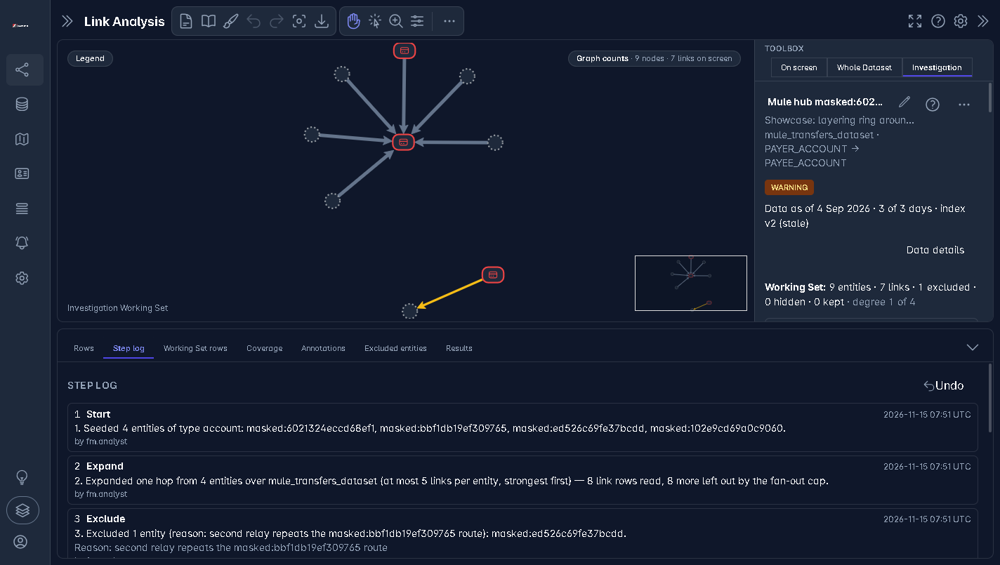
*An open Investigation with the **Step log** in the dock: every step, who took it and when.*

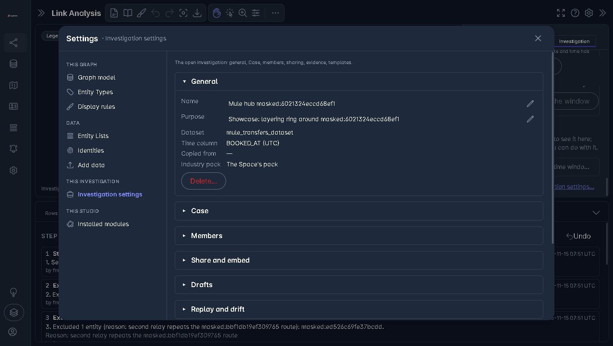
***Investigation settings…** (bottom of the Investigation tab): General, Case, Members, Share and embed, Drafts, Replay and drift, Oversight and approvals, Measures and templates, Dossier, References.*

Masked ids show as aliases (`masked:…`) on the canvas, in the step log
and in the Dossier, and one entity reads as the same alias everywhere in the Investigation. When ids on the canvas are
masked, the line under it says *N entities masked* with **Reveal…**; the node details dialog has the same button under
**Masked id**. Reveal asks for a reason, then shows the real identifiers of every masked node on screen, to you and on this
screen only: the canvas labels, the hover text, the node's title and details, and the step log read the real identifiers. Each entity revealed
is recorded in the audit trail with your reason. You need *See unmasked ids* and to lead the Investigation; reviewers
and everyone else keep the aliases, the Dossier stays masked, and closing the Investigation forgets what you revealed.
On a graph that is not saved yet the button says to save it first: a reveal is recorded against an Investigation and
its purpose. **Investigation settings… ▸ Oversight and approvals ▸ Masked entities** lists the aliases with the same
one **Reveal all…**. A second person approves or denies a held expand in the same section. Each request says which
four-eyes limit it crossed in words (*reads up to 500 rows, above the limit of 100*) and when it was made, in the same
local `2026-11-15 13:21` form as every other recorded time in Link Analysis.

Top to bottom, most important first:

1. **Header:** the **Name** (a lead renames it in place: label · value · ✎; a long name wraps to two lines, the whole of
   it in its tooltip), then three facts on three lines: the purpose (it wraps to up to three lines; the whole of it is in
   its tooltip), *Data:* and the Dataset in words (its name, else the first sentence of its description), and its link
   (*Links from payer account to payee account*; the stored names are in the tooltip of those two lines), the data-trust sentence and **Data details** ([§11.11](#1111-data-trust-what-data-am-i-looking-at)), a **?** that shows *How to investigate* again, and `⋯` with **Settings…** (⚙ Settings ▸
   Investigation settings), **Build Dossier…**, **Members…**, **Close** and **Delete**. A person who may approve a held
   expand of someone else sees a **N to approve** badge under the Dataset line; it brings the waiting line into view
   ([§11.4](#114-large-expands-need-a-second-person-four-eyes)). Under it one counts line: *Working Set: 42 entities · 118 links ·
   3 excluded · 2 hidden · 1 kept · expanded 2 of 4 degrees · 3 busy held*; a count of excluded, hidden or kept that is
   zero is left out, and before the first Expand it ends *not expanded yet*.
2. **How to investigate** — five steps, shown until you press **Got it** (remembered in this browser).
3. **Undo** / **Redo** of recorded steps, which stay at the top while the tab scrolls ([§7](#7-expand-and-clean-up-the-graph)).
   A reviewer, or someone reading it through its Case, sees both disabled; their tooltip says *Only a lead changes the
   steps of this Investigation.*
4. The **queued start entities**, when there are any.
5. **Expand** ([§7.1](#71-expand)): the per-degree results, then ONE Expand form — From, **Expand** with its preview and
   four-eyes line, and the **Expand filter** groups. A reader sees *Needs the Manage Incidents and Cases permission.* instead of the form; a reviewer of the Investigation,
   or someone reading it through its Case, sees *Only a lead expands this Investigation.* and no *How to investigate*
   coaching. Before you save, an Expand that finds nothing new is not recorded: the line under the canvas says *Expand found nothing new,
   so no step was added.*
6. **Clean up** ([§7.4](#74-clean-up)): one-press clean-ups with their counts.
7. **Selected entity:** who it is (masked, busy, not in the Working Set), **Start from it** when it is not in the Working
   Set yet, **Expand anyway** on a busy one, **Pick neighbours…** (tick some, or **Add the 10 strongest**: one expand to
   only those), its notes and **Note** / **Annotate**. Expand, Keep, Hide, Exclude and Shrink are on the canvas
   (double-click, right-click, the canvas toolbar, keys). Right-click one entity ▸ **Pick neighbours…** selects it,
   opens this tab and reads its neighbour list.
8. **Busy entities** (a fold; each with its sealed count, *Busy: 650 linked entities (limit 500), not expanded*, and
   **Expand anyway**).
9. **More steps** (a fold): **Connect** (Connect start entities) · **Time** (Time window, Snapshot marker) · **Compare**
   (Threshold, Compare), the **Scope list** (entity ids to **Include** or **Leave out**) and **Add start entities…**
   (the start form: Start from, Entity Type and value, an Entity List or pasted values, recorded as one Start step).
10. Two links: **Open the Step log** (the dock's Step log tab) and **Investigation settings…**.

The tab lists no steps: the full record is in the dock's **Step log** (with **Undo** and **Re-order steps…**, which
creates a fork), beside **Working Set rows**, **Coverage**, **Annotations** (entity and link) and **Excluded
entities**. **Replay** is in ⚙ Settings ▸ Investigation settings ▸ *Replay and drift*. Clicking a node while an
Investigation is open **selects** it for the next step.

### 11.3 Steps you can take

| Step | Effect |
|---|---|
| **seed** | Put starting entities into the Working Set (by id, or from an Entity List) |
| **expand** | Follow links: direction, link kinds, time window, minimum events / distinct days, degree bounds, fan-out cap, budget, and the busy limit (an added entity with more linked entities is *busy*: held, not expanded further unless overridden) |
| **window** | The time range later expands inherit: from / to, slot, days of the week and **Excluded dates (holidays)** — a date, `FROM..TO`, or a yearly rule `*-MM-DD`, `*-MM-DOW#N` (e.g. `*-11-THU#4`) or `*-MM-DOW#L`, at most 32 rules |
| **exclude** | Remove entities — a **reason is required** |
| **hide / keep** | Hide from view only; **keep** protects an entity from exclusion |
| **annotate** | A note, with an optional confidence grade (NATO/Admiralty, e.g. `B2`), on an entity or a link |
| **resolve** | Merge identifiers the Space knows to be one person ([§11.7](#117-identity-resolution)) |
| **undo** | A recorded step that reverts an earlier one |

### 11.4 Large expands need a second person (four-eyes)

An expand whose budget or fan-out cap is above the Space's four-eyes thresholds does not run: it says **waiting for
approval**, names the request (for example *p1*) and the limit crossed. Someone **other than you** with *Approve link
expansions* opens the same Investigation and sees it at once: a **1 to approve** badge in the header, and on the same
line, instead of your waiting text, *Requested next, not yet run: Degree 2.* (your name) *asks for your approval. It
would add every neighbour of each entity, more than the 2,000 allowed without a second approval.* with **Approve** and
**Deny**. It opens *Requested next, not yet run* because it sits under the line of the Expand already recorded (*… (step
2): 6 new entities, 7 links added.*), and both can name the same Expand (*Expand one hop from every entity*).

The approver's line is written for the person deciding (LA-FULL-CYCLE-TEST-1, 2026-11-16). It names you as the sign-in
names you: a Demo User's display name, or the signed-in person's own name; under OIDC the browser holds no directory of
other people, so another person reads as their sign-in id. It leaves the request id out (that is the server's handle; **Oversight and approvals**
still lists it), and it says the limit as what the expand would do (*read up to 5,000 rows, more than the 1,000
allowed*, *add every neighbour of each entity…*) rather than in setting words; when it crosses both, the two limits
share one clause (*…; without a second approval the limits are 1,000 rows and 2,000 neighbours of each entity.*).

* **Approve** asks first (*Approve this expand?*, in the same words: who asks and what it would do; approving runs it
  now, as your step, and records them as the approver), then runs it; the line then says what it admitted.
* **Deny** is a second step on the line: an optional **Reason** (at most 200 characters; you see it on your line) and
  **Deny request**, or **Cancel**. Nothing is read. The reason is optional because the server, Oversight and the
  console's inbox all take it as optional, and the denial itself (who, when) is always recorded.

The same decision stays in ⚙ Settings ▸ Investigation settings ▸ **Oversight and approvals** (Approve there asks the
same question) and, in the console, **Approvals Inbox → Link expansions**. Nobody can approve their own request, and
without a sign-in (Basic) nobody can approve at all: the server cannot tell two people apart, so neither the badge nor
the buttons are offered. Where the Investigation has members only a lead or reviewer may decide (a refusal is shown on
the line). Before you press Expand, the
form already says *Will need approval from a second person* when it would be held.

### 11.5 Replay, drift, Drafts and Members

* **Replay** re-checks that the log still produces the recorded Working Set; **Re-read** re-runs each recorded query
  and shows **drift** — what changed in the data since. Both work read-only, so a reviewer can check.
* **Re-order steps** creates a **fork**: a new Investigation showing its parent; the original is untouched.
* **Drafts** (⚙ ▸ Investigation settings): **Fork a Draft** (optionally named, up to 80 characters; one live Draft per
  person, up to 50 open in a Space) to try a side line, then **Conflicts**, **Rebase**, **Promote** (a promote with a
  sensitive expand waits for four-eyes) or **Discard**.
* **Members** (**File ▸ Members…**, the Investigation's `⋯` menu, or Investigation settings): lead, analyst,
  reviewer. A lead can **Grant** and **Revoke**; the last lead cannot be removed.

### 11.6 Working Set rows and Coverage

**Working Set rows** lists entities, links or exclusions with paging and says if and where it is truncated.
**Coverage** (**Check coverage**) shows which days of the window have no rows at all (*Days with no data* / *Every day
has data*) — an empty result on a missing day says nothing about activity — and, where the Dataset can tell, days
covered per Collector.

### 11.7 Identity resolution

Select two entities and **Merge** (canvas toolbar) to open ⚙ Settings ▸ **Identities** with the pair filled in; state
that they are the same, with a reason. Keys are typed and normalised (`msisdn:+4477…`); a **mapping Dataset** imports
many pairs at once (the import answers with counts only). The **Identity Facts** tab shows its head (fact number and
hash) and *Chain verified* (the whole chain is re-checked on every read); when the check fails it says *Chain NOT
verified* and hides the head. The screen states what the log alone cannot show: facts cut off its end. Inside an
Investigation the **resolve** step shows merged nodes; by default this is display only — choose **merged** on a step to
treat a whole group as one entity. It is reversible: retract an assertion.

**Merge** is on the canvas toolbar only while an Investigation's canvas is open, and needs *Manage Incidents and Cases*. It is
disabled with the reason unless exactly two entities with an Entity Type are selected and neither is a masked alias
(the server refuses an alias too; under the default *typed* masking a masked type such as *account* therefore cannot be
merged). It only fills the *Assert same entity* form: nothing is written until you give a reason and confirm. After the
assertion succeeds in an open Investigation, the form offers **Add a resolve step**; the merge stays a view, no id is
rewritten. **Possible duplicates** ([§8](#8-the-analysis-catalogue)) suggests pairs to merge.

### 11.8 Measures and Alert Rules

The **Measures** strip (⚙ ▸ Investigation settings ▸ Measures and templates) shows entity, link and event counts,
excluded count, deepest hop and links by kind. **Watch** on a Measure creates an **Alert Rule** over the sealed Working
Set; it fires through the normal alert path, **once, on the count** of breaching entities, and can open an Incident. A
fired Alert names the Investigation, not the entities — *Open Investigation* on the Alerts page reads them where access
rules and masking apply. **Save as template** turns the method into a reusable recipe (seeds become parameters; ad-hoc
exclusions are dropped and the preview says so); **Instantiate** builds a new Investigation from it.

### 11.9 Evidence: snapshot, Dossier, sealed bundle

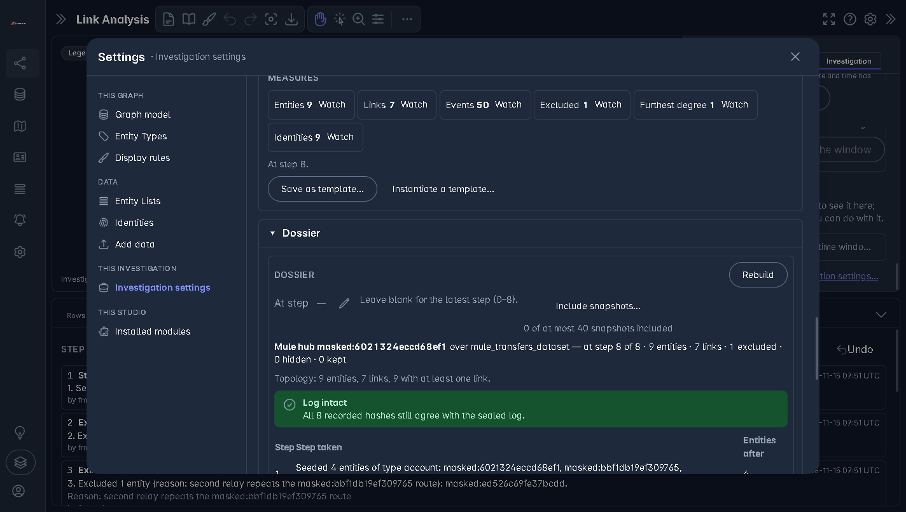
***Build Dossier** is in **File ▸ Build Dossier…**, the Investigation's `⋯` menu and **Investigation settings… ▸ Dossier**. *Log intact* means every recorded step still matches the sealed log.*

1. **File ▸ Save snapshot…** freezes the screen as a **snapshot** with a SHA-256 fingerprint; the dialog's button is
   **Save snapshot**, and the line under the canvas then confirms *Snapshot “…” saved and sealed as evidence.* A *saved
   view* re-reads live data; a *snapshot* does not change.
2. **Build Dossier** (**File ▸ Build Dossier…**, the Investigation's `⋯` menu, or ⚙ ▸ Investigation settings ▸
   Dossier): summary and topology, a ledger of every step with who
   and why, exclusions, score tables and a **SHA-256 manifest**. Download the *steps* and *method* statements or the
   JSON. Masked ids stay masked, even inside free-text reasons.
3. **Verify this Dossier** reports anything **changed, missing or added** since.
4. **Download Dossier (sealed)** — one file for someone outside the system (Dossier + references + a seal), taken at
   the step on screen; *Verify a bundle…* checks the uploaded file whole and fails an edited file (*edited after
   export*), listing each problem as found. A failed seal is a result, not an error.
5. **Compare and seal** (Steps ▸ Compare ▸ Compare) compares two windows and seals the difference as a step.
6. **References** — pointers to records in other systems (system, type, id, optional URL); shown as text, never
   opened, never edited — add a new one to supersede.

### 11.10 Widgets, sharing and embed

* **Case:** an Investigation is yours by default. **Link to Case** lets the owner or assignee of that open Case
  *read* it until the Case closes. *Shared through Case … (read-only)* marks such a row in File ▸ Open….
* **Pin to a Widget** puts a Working Set on a Dashboard: **Show** picks which of its rows; **Frozen** (as of a pinned
  step, the default) or **Live**.
  Only readers of the Investigation see data; others see *Not available to you*.
* **Share and embed** gives someone without an account a **read-only, sealed view** through a link (served at
  `/embed/inv/<token>` by the console and by Inspecto LA). Off unless the host enables embedding; minting needs the
  share capability **and** being a lead. **Create link** (label, lifetime up to the Space's maximum) shows the link
  **once** — copy it before **Done**. Each link lists status, expiry and views; **Revoke** cuts access at once.
* **Read-only toolset.** A Dashboard Widget and the embed viewer show the graph with the viewing tools only (search,
  filters, layout, fit, display); nothing that changes the graph or the Investigation is offered there.

### 11.11 Data trust: what data am I looking at

An open Investigation shows a **Data strip** above it: a status badge and one plain sentence, for example *Data
current to 4 Sep 2026 (3 of 3 days).*, and **Data details**, which opens a drawer with four parts. The sentence says
how current and how complete the data is, and adds a second sentence only for what needs a look (*1 missing day; the
link index is out of date.*). The badge says what its colour means: **Data OK**, **Check data**, **Data problem** or
**Not known**. The link index version, and a link index that is simply up to date, are no news to the reader, so they
are in the sentence's tooltip (*Link index version 2, up to date.*) and in Data details, not in the sentence
(LA-FULL-CYCLE-TEST-1, 2026-11-16: *link index v2* and a bare *OK* meant nothing to someone outside the team). The
judgement behind it is unchanged, and the index state is the one answer the Data page reads too. The drawer:

* **Fresh** — when data last arrived for the Dataset.
* **Complete** — the days of the Investigation's window, day by day. A missing day inside the span of the delivered
  files is a **gap** (the strip's sentence counts it as a *missing day*); a missing day before the first or after the newest file reads *not delivered yet* (not a gap, no
  warning); with no delivered day known every missing day is a gap. An Investigation with no time window is judged over
  the files' span; with no event day in any file it says *this Investigation sets no time window, and its Files name
  no event day.*
* **Files** — one row per file: name, event day, rows, error rows (rows in the empty partition count as errors and make
  the file *PARTIAL*), when it was ingested (the time it was committed, in UTC, not when it arrived), its outcome
  (*SUCCESS*, *PARTIAL*, *QUARANTINED*, *FAILED*) and its index state (*INDEXED vN*, *WAITING*, *UNKNOWN* past the index's
  file limit, *NO_INDEX*). Newest event day first, then by name.
* **Index** — the link index version and whether it is out of date, with the reason in plain words.

**An out-of-date link index.** The strip then adds *The link index is out of date.* with a **Check data** badge, the Data page's
**Graph** says *out of date*, and the Expand says *Answered from the Dataset because the link index is out of date*:
the three read one judgement of the index. (A Dataset drawn over several column pairs has an index per pair: the strip
and the Data page warn when any of them is out of date, the Expand speaks of the one it reads.) Until the index is
built again the graph is read from the Dataset,
which gives the same answer more slowly. **Rebuild**, beside the words, builds it again in the way the server advises;
it is enabled for someone allowed to build the link index, and for anyone else it says *Needs Build link index.*

**Corrected days.** When a Collector re-delivers a day inside the Investigation's window after your last look, the
strip turns to a warning naming the corrected days; **Refresh** re-reads the strip and the Investigation. The warning
clears only after you record a step that reads data (a start, Connect, Expand, Compare or a temporal step); a step that
reads nothing (exclude, hide, keep, annotate, a window, an undo…) does not count as a look.

**In the Dossier** a data footer gives the data-as-of day, the index version and whether it was out of date, files waiting and
days missing. It is labelled as the state at export time: it is outside the Dossier's fingerprint and the bundle's seal.

**Stated limits** (also in the drawer): an unchanged duplicate file is skipped silently; a file still in an inbox is a
count only; completeness is judged on days and file order, not on a list of Collectors expected to deliver.

**Alerts that watch the data** (set up by an administrator; the `la-daily-feed` Space Template ships them): a
freshness Alert Rule whose maximum age can follow the Collector's poll (*auto* = twice the poll), an index-lag Alert
Rule, one Alert per failed or refused index build, one per file problem (per Pipeline, file and day; it names no
entity), and a daily rows band (below 50 % or above 200 % of the 7-day median; days with fewer than 3 days before them
are not judged). Durations read as `45 s`, `2 h 10 min`, `3 d 4 h`, and days as `2026-09-08`.

---

## 12. Entity Lists, Alerts and Geo

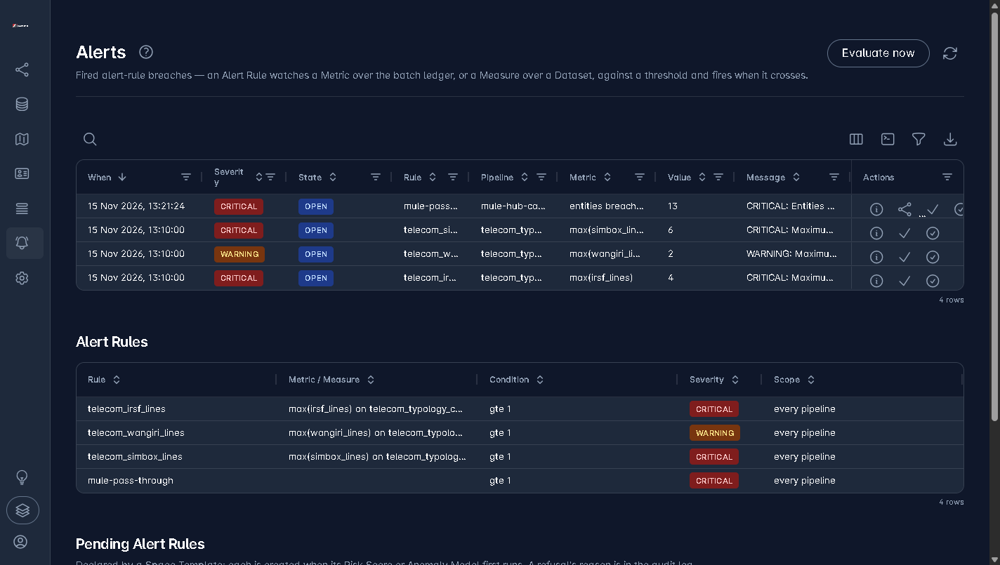
*Alerts: what fired, with **What happened**, **Acknowledge** and **Resolve** on each row, and the Alert Rules below.*

* **Entity Lists:** named lists of accounts or numbers (watch lists, agent tills), with ranges, CIDR network ranges,
  expiry and every change on the record. Add to one from a *Find something interesting* result (**Add to a list**),
  **Exclude… ▸ Add to a list…**, or, with an Investigation open, the selection. A list can seed or exclude in bulk; a
  governed list needs a second approver. A Space with no list is offered **first lists to start with** from its pack
  (Telecom: *Call centres* to leave out, *Lines to watch*; Mobile Money: *Merchants*, *Wallets to watch*).
* **Alerts:** fired Alerts, and a way into the Investigation behind a standing detection.
* **Geo:** places entities and routes on a map, over a Dataset with coordinates ([§6.3](#63-pivot-between-graph-and-map)
  for moving a record between the map and the graph).

### 12.1 Links that open Inspecto LA

Another system can link straight to an Investigation or an entity: the link opens the **Open in Inspecto LA** page
(`/open` in la-app, inside the signed-in app; `/studio/open` in the console). The page checks the link first and says
in a sentence what is wrong (an unknown parameter, no entity and no Investigation, a malformed `<type>:<key>`, a bad id,
a time window with no zone or ending before it starts); the server then checks it again, and its refusal (a raw value
of a masked type, an Investigation you may not read) is shown the same way. The entity is shown by the key the server
returns, the alias for a masked type; **Reveal the value** shows only if you may reveal, asks the server once (recorded)
and keeps the value on the page, never in an address. The page never moves on by itself: choose **Open the
Investigation** or **Open the Entity**. The link format: [architecture-http-and-ui.md §6.4](architecture-http-and-ui.md).

---

## 13. Worked examples

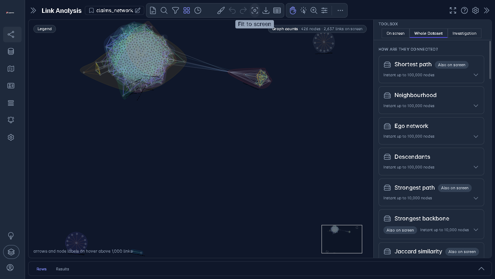
*A saved view opened from **My work** (*claims_network*, 426 nodes): the dense group is the staged-accident ring. The **Whole Dataset** tab lists the server algorithms.*

**Find a money-mule ring.** Choose **File ▸ Examples ▸ Follow the money**, or open `mule_layering_ring` (on the
`la-showcase` Space Template: 112 accounts over three days). On screen ▸ **Suspicion score** ▸ **Find suspicious nodes** puts the relays and
the hub in the top decile. **Pattern match ▸ Structuring (smurfing)** finds `MULE-HUB-01`: 96 in-band legs from 12
payers. **Value Measures ▸ Pass-through** flags 13 accounts (the two relays at ≈ 0.985, the hub at 0.979, `SHELL-A`
above 1); **Velocity** shows them forwarding within hours (median 1.5 h and 2.5 h for the relays, 6 h for the hub).
**Start an Investigation from the top results**, state your purpose, expand one degree; **File ▸ Save snapshot…**
▸ *create a new Case from graph nodes*, tick the hub and relays; **Build Dossier**, **Verify this Dossier**, and send
the sealed Dossier to the reviewer.

**Find the cash-out point.** **Value Measures ▸ Cash-out concentration** with cash-out kind `cash_out`: `TILL-06` holds
97 % of cash-out value from 8 payers (reproduced by `ControlApiLaShowcaseFiguresTest`). **Benefit transfer** isolates
`SKIMMER-01` (6 recipients).

**Check for one person behind two identities.** In the `demo` Space open `roaming_imsi_footprint` (each roaming IMSI
linked to the visited networks that billed it): IMSI `001010000000042` touches four partners in three days, which
**Explain node** and **Centrality** surface. Spellings of one operator (*Cinder Wireless*, written four ways) merge into
one node automatically; for a phone number and a SIM of one person, open an Investigation, **Merge** them (§11.7), then
**resolve**. *(Unverified: whether the screen announces a count of possible split identities.)*

**Telecom fraud.** The `la-showcase` Space also ships `telecom_fraud_network`, and the `demo` Space other views; the
telecom demo as a presenter runs it is [§13.1](#131-telecom-fraud-demo-as-built-2026-10-12).

### 13.1 Telecom fraud demo (as-built 2026-10-12)

Shipped through six live browser walk-throughs; the sixth (2026-10-12) was judged *ready to present*, every storyboard
beat passing. Backend routes and invariants are in [architecture.md](architecture.md); presenter setup in
[admin-guide-demo.md](admin-guide-demo.md). Provenance (archived):
[`la-telecom-fraud-demo-storyboard.md`](../../../../archived-documents/plans-archive/la-telecom-fraud-demo-storyboard.md)
and [`la-telecom-demo-data.md`](../../../../archived-documents/plans-archive/la-telecom-demo-data.md). Remaining small
items: BACKLOG `LA-TELECOM-DEMO-RESIDUALS-1`.

**Scenes (one analyst, one ring, ~15 min).** (1) Start from the **MSISDN starter card** ("Investigate a number",
`?seed=`) with the suspect `99979100001` - telecom typology Alerts are aggregate-only (no entity on the Alert, by
design), so they are not the entry point. (2) Degree 1: voice / SMS / forwarding / shared-device neighbours and the
counts. (3) Expand degree 2, 3, 4 with the hub held; **only then**, as the last beat, show the hub's audited **Expand
anyway** and four-eyes - overriding the hub first floods the frontier with its background contacts. (4) Slice by link
kind (voice, SMS, forwarding, shared device / identity / payment, SIM history). (5) The ring: shared IMEI, forwarding
chain. (6) Node dialog: Risk (propagated risk), Enrichment (`crm_kyc`, `hlr_eir`, read through masking), Case history,
watch / block actions. (7) Louvain community and the telecom pattern packs (Wangiri, IRSF, SIM box, forwarding chain).
(8) Act: watch list, one-step Attach to Case, export. (9) Under the hood: the Pipelines and Jobs that built it.

**Data (`la-showcase` Space Template).** Eight synthetic feeds (CDR voice/SMS, HLR/EIR, CRM/KYC, recharge,
provisioning, block list, alarms; generator `tools/gen-la-telecom-data.py`, byte-identical output) folded by the
`sql.template` Jobs `telecom_links` (MSISDN-MSISDN pairs, the "shared X" key in `via`) and `telecom_msisdn_indicators`
(0-100 score) on a `*/10` cron, plus `telecom_typology_counts`. Planted: suspect / Wangiri `99979100001` (WANGIRI-B
`99979100002`), premium range `99891000001`-`12`, IRSF `99979200001`-`4`, subscription fraud `99979300001`-`5`, SIM
box `99979400001`-`6`, mules `99979500001`-`5`, the benign taxi-dispatch hub `99970000100`. Degree ladder from the
suspect under the Telecom preset (pinned by `TelecomLinksGoldenTest`): d1 402 admitted · d2 492, hub flagged at 628
in-window contacts · d3 143 (SUBFRAUD-01..05) · d4 55 (SIMBOX-01/06, MULE-01..05) · SIMBOX-02..05 at d5 via
`shared_device`. Nothing is fan-out capped or truncated.

**Telecom preset.** 30-day window on `last_seen` ending at the Dataset's latest `last_seen`, read zone-free
(`strftime`) and parsed as UTC (a bare `MAX` came back in the host zone and dropped links); when the latest time cannot
be read no window is sent ("all available data"). `minEvents` 1, `maxFanOut` 500, `budget` 10000, `hubThreshold` 500;
expand ranks by `eventsCol`. `config/link-analysis.toon` sets `four_eyes_fan_out_above: 2000` (operator 2026-10-11),
so the bounded ladder never waits.

**Four-eyes beat.** An unbounded expand (no `maxFanOut`) or any fan-out above 2000 waits for approval: `analyst`
requests, `manager` approves in **Approvals → Link expansions**; the panel re-reads the log and shows approved /
denied.

**Gotchas.** Only `manager` (`la-manager`, `canOperateRuns`) may press *Run* on the Jobs - the seed `admin` gets
403; press it after seeding rather than waiting for the cron. The benign taxi hub scores like the suspect - a talking
point (high connectivity is not guilt), not a defect. Offline smoke: `node tools/la-demo-smoke.mjs --telecom`; the
same runner also probes the empty-Dataset 409, the read-only persona, the settings round-trip and the sign-in picker
(`--embed` for the embed link when the host runs `-Dla.embed.enabled=true`). Live run recipe: build the bundle in a
worktree and serve it on a free port (e.g. :8099), never the shared :8080.

---

## 14. Who can do what: roles and editions

If a control is greyed out, hover it: it names what is missing.

| You want to | You need |
|---|---|
| Explore, analyse, save a view, export | Sign-in |
| Start an Investigation, take steps, Drafts, link or attach to a Case, add to a watch or block list | *Manage Incidents and Cases* (`canManageIncidents`) |
| Run on the Server side of the catalogue, **Compute risk** | `canRunLinkGraphAnalysis` |
| Build a link index | `canBuildLinkIndex` |
| Approve or deny a held large expand (never your own) | *Approve link expansions* (`canApproveLinkExpansions`) |
| **Watch** a Measure (bind an Alert Rule) | `canAuthorAlertRules` |
| See real identifiers instead of aliases | *Reveal* (`canRevealLinkEntities`) |
| Mint an embed link | `canShareInvestigation` and lead of the Investigation |
| Change Link Analysis settings, set what a column holds, add an Entity Type, choose the Space's Industry pack | `canAuthorWorkbench` |
| Add data with sign-in, **Upload a CSV** to a Collector | the right to upload data (`canUploadData`) |
| See **Getting started counters** | an administrator (`canAdminister`) |

**Read-only roles.** Without *Manage Incidents and Cases* the Investigation tab shows a **Read-only** banner, *Changing an Investigation needs the Manage
Incidents and Cases permission.* (the banner's title says Read-only, so the sentence does not repeat it): you can open, read, replay, re-read and build, download and verify the Dossier; every
write control is disabled with that sentence. A reviewer of an Investigation, and a member of its linked Case, read it
the same way (*You review this Investigation: you can read it and decide approvals…*): only a lead changes its steps, so they get no Expand form, and **Undo** and **Redo** are disabled with that reason. A refusal shows the server's reason; a missing
permission is named in words (*Your role does not have the Workbench author permission*). *Not found* on an Investigation can mean it does
not exist, is not yours, or its Dataset is no longer shared with you — the same answer on purpose. In the
`la-showcase` demo, *Demo Reviewer* and *Demo Outsider* are read-only; *Demo Analyst* holds manage-incidents,
graph-run, index-build and Alert Rule authoring; *Demo Manager* is the second approver; *Demo Admin* also holds
`canAuthorWorkbench`.

**Saved views and settings (Workbench author).** The seeded `admin` role holds the *Workbench author* permission
(since 2026-11-15, `LA-FULL-CYCLE-TEST-1` D1), as `power`, the developer roles and `super` do, so the administrator
who creates a Space can save its first view and change its settings; `operations`, `support` and `business` do not
hold it. Without the *Workbench author* permission (`canAuthorWorkbench`) —
a separate question from *Manage Incidents and Cases* — Settings → Link Analysis shows its values with no Save, and File ▸
Save view, Save view as… and Delete view (and Rename, Duplicate and Delete in File ▸ Open…) are greyed out with the
reason. A view shared with you to view only cannot be saved over or renamed (use Save view as… for a copy), and only
its owner can delete a shared view.

**Editions and levels.** Link Analysis is in every edition, but what it offers depends on the edition and on the
Inspecto LA level (see [EDITIONS](../../../../EDITIONS.md) and the [level admin guide](admin-guide.md)):

| | Basic / Explorer level | Standard and above, with Investigations |
|---|---|---|
| Start a graph, Expand…, Clean up, Collapse, browser catalogue, saved views, Snapshot | ✓ (exploring only: nothing recorded) | ✓ |
| Investigations, step log, Dossier, four-eyes, Drafts, Case history | hidden or locked, with one line naming what has it (*Start an Investigation from this*) | ✓ |
| Server side of the catalogue | hidden, with the reason | ✓ (with `canRunLinkGraphAnalysis`) |
| Add data from a file, an inbox (*Watch this folder*) or a Postgres table; Discover, *About*, *Build a question* | ✓ | ✓ |
| *Read from another database or a remote system*, *Keep this up to date* | locked | ✓ |
| *Keep* (retention) on the Dataset card | not shown: every file stays, compacted | ✓ |

**Masking.** Per Space, ids are shown *typed* (only sensitive types masked), *all* masked, or *none*; a Space that sets
nothing uses *typed* in Standard and above and *none* in Basic. The same rule applies on the graph, the node list,
paths, patterns, Value Measures and the Working Set. One rule decides what is masked everywhere (MASKING-TWO-VOCABULARIES-1,
2026-11-14): a column in a sensitive class, or a class or id that a masked Entity Type claims. Risk Score evidence,
publication and embed links, BI in *typed* mode and Link Analysis all use it, and an Entity Type's `masked: false` no
longer unmasks a sensitive class; only masking mode *none* turns masking off.

---

## 15. Limits and honest behaviour

* **Views are not evidence; snapshots and Dossiers are.**
* Nothing is silently dropped: truncation, unmatched values, unvalued rows and refusals are all stated.
* Time-based tools read times in a stated zone (UTC for Measures); naive timestamps are assumed UTC.
* The server path search over a Dataset is certified at about one million links; above that the link index (Space
  setting `index.enabled`, on by default) is measured to 100 million links.
* An Alert on an Investigation watches its **sealed** Working Set, not live data.
* **Every limit is a setting.** *Settings → Link Analysis* lists each with its default, range and value in force, in
  three sections: **Analysis** (the Space's limits — expand budgets, hub threshold, four-eyes thresholds, path depth,
  page sizes, masking mode, link index, Draft limits, embed link lifetimes — set by a Space administrator), **Host
  resources** (Graph Run ceilings, index build memory, rate limits — a system administrator), and **My browser**
  (canvas, labels, layouts and browser algorithm caps for your own machine, never above the Space's value; *Reset to
  Space value*). A value outside its range is refused with the range. Exact keys and defaults: [*Grounded limits and
  consequences*](architecture-records.md#grounded-limits-and-consequences).
* Rate limit: a burst of 30 requests per user, then one every 2 seconds (server-wide `rate.link_analysis_burst` /
  `rate.link_analysis_per_s`).

---

## 16. Troubleshooting

| You see | It means / do this |
|---|---|
| A control is greyed out | You lack the capability or edition named in its tooltip; ask your administrator |
| **Truncated** | A cap cut the data. Narrow the query, or use the Server side of the catalogue |
| *No preview on this server* in Expand… | The server is older than the preview; Expand anyway — the result line says what it added, with Undo |
| Layered is greyed out | The graph is wide and shallow (more than 60 nodes on one rank); use Force |
| `masked:…` everywhere | Your Space masks sensitive ids; with *See unmasked ids*, save the graph as an Investigation and press **Reveal…** (see [Masked ids in an Investigation](#masked-ids-in-an-investigation)) |
| *Waiting for approval* | The expand is above the four-eyes limit; a second approver opens the Investigation (§11.4) |
| *Investigation is not available* / not found | It does not exist, is not yours, or its Dataset is no longer shared; ask its owner to add you |
| *No node on this graph can become a Case member* | The ids are masked, and Reveal does not unmask a Case key; link the Investigation to a Case (**Investigation settings… ▸ Case**) |
| A tool says it needs a time column | The pattern is time-ordered; see §9 |
| A pattern finds nothing on a big graph but should | The browser graph was truncated; switch the catalogue to Server |
| *Every node mapping needs a Dataset and an id column* | Fill every required field in Graph model before Run query |
| Merged step refused | No **resolve** is in force at that point; add one first |
| *The analysis was not saved* with a reason | The server refused it; usually a missing capability |
| *That is over a size limit, so nothing was stored.* (413) | Narrow the step (fewer seeds, shorter window) or fork a smaller Investigation |
| *Too many requests…* (429) | Wait a few seconds and retry |
| Sign-in: **The server could not start a session** | The server's message is shown with **Try again**; an administrator fixes the configuration |
| Sign-in: **Single sign-on isn't set up** | Ask the administrator |
| *The server requires sign-in, but this page started without a session* | Reload to sign in |
| *No Space is attached …* (503) | An administrator must add or create a Space |

---

## 17. Vocabulary

| Word | Meaning |
|---|---|
| **Dataset** | A table of rows Link Analysis reads |
| **Entity / node / link** | An account, number or device; a transfer or call folded from rows between two of them |
| **Entity Type** | The kind of thing a column holds (Account, Phone number); two columns join only on the same type |
| **Industry pack** | The Space's domain words and suggested tools (Telecom, Mobile Money, Generic) |
| **Saved view** | A named graph start plus the Entity Lists it uses; re-reads live data |
| **Snapshot** | A frozen copy of what was on screen, with a fingerprint |
| **Investigation** | The recorded, replayable work |
| **Working Set** | The entities an Investigation currently holds |
| **Step log** | The ordered steps of an Investigation |
| **Draft** | A side line forked from the main log |
| **Dossier** | The evidence document built from an Investigation |
| **Entity List** | A named set of entities (watch, exclusion, known good, block) |
| **Identity resolution** | Declaring that two identifiers are one entity |
| **Measure** | A computed figure over a Dataset or Working Set, such as pass-through ratio |
| **Alert Rule** | A saved condition that raises an Alert when a Measure crosses a level |
| **Incident / Case** | The operational records you escalate to |
| **Space** | Your team's workspace, with its own Datasets, members and settings |

---

## 18. If you used the old Studio

The Studio was reorganized on 2026-10-27 (`LA-STUDIO-UI-REORG-1`). Nothing was removed; this is where things went.

| Old | Now |
|---|---|
| Query panel (left) | ⚙ Settings ▸ **Graph model** (with **Refresh**; the status bar was removed on 2026-10-29) |
| Grow (popover, rung form) | **Expand** (**G**) — in an Investigation, a section of the Investigation tab: From, a − N + Degrees stepper, Direction, then the Links / Time / Limits folds |
| Status bar: Limits, Installed modules | The **Limits** icon on the Graph counts card; ⚙ Settings ▸ **Installed modules** |
| Domain profile picker | None — the Space's **Industry pack** applies, shown in Graph model |
| Save as a case (saved view) | **File ▸ Save view** / **Save view as…** |
| Open saved views | **File ▸ Open…** ▸ *Saved views* |
| Toolbox → View tab | The tool rail (layout, filters, Display options) and **Canvas mode** |
| Toolbox → Analysis tab, *All algorithms (server)* | Right panel ▸ **On screen** and **Whole Dataset** tabs (2026-10-29: the Analysis tab's Browser \| Server switch became two tabs, renamed for where the tools look) |
| Start box's *Follow the money*, *Open a saved view*, *Explore a Dataset* cards | **File ▸ Examples ▸ Follow the money**, **File ▸ Open…**, **File ▸ Explore Dataset…** |
| Start box ▸ One entity ▸ *Investigate*, then the purpose form, then Expand… | One start form in the Investigation tab (File ▸ New): Start from, Time column, Time zone, Degrees; Name and Purpose on **Save** |
| Selection bar, box select | Canvas toolbar selection group; **Shift+drag** lasso in Pan, or Lasso mode |
| Investigation tab's Case, Members, Drafts, Oversight, Dossier cards | ⚙ Settings ▸ **Investigation settings** |
| Investigation tab's *Upload a CSV* and Identity sections | ⚙ Settings ▸ **Add data** and ⚙ Settings ▸ **Identities** |
| Display menu's colour rules | ⚙ Settings ▸ **Display rules** |
| Title, explain button and page info in the footer status bar (2026-10-15 layout) | The title and **About** in the header row; the page-info line and the status bar are gone |
| Table icon in the toolbar | **Show the rows** (tool rail) opens the dock |
| Plain drag draws a selection box | Plain drag pans; **Shift+drag** or Lasso mode selects |
| *Retire* an Entity Type | **Delete** (only a type nothing uses) |

---

## Reference notes

Engineering as-built detail behind the chapters above that no architecture doc holds yet. The backend is
[architecture.md](architecture.md); the HTTP surface and the Investigation UI (Studio reorganization §6.14) are
[architecture-http-and-ui.md](architecture-http-and-ui.md); onboarding is
[architecture-data-onboarding.md](architecture-data-onboarding.md); design records are
[architecture-records.md](architecture-records.md).

### Studio layout internals (`LA-STUDIO-UI-REORG-1` phases 1-3, as built 2026-10-27)

Analyst view: [§4](#4-the-screen) and [§18](#18-if-you-used-the-old-studio); decisions and drives:
architecture-http-and-ui.md §6.14; plan archived as `docs/archived-documents/plans-archive/la-studio-ui-reorg-plan.md`.

- **Header** `header[data-testid="la-header"]`: the title (the page's one `<h1>`, `la-title`, `text-lg` since
  2026-10-29), the tool rail and the canvas toolbar side by side (`la-toolbars`), **Full screen** (`la-fullscreen`), the
  one **About** explain button (`la-about`) and **⚙ Settings** (`la-settings-open`). No side-panel toggle and no
  Analysis / Investigation shortcuts in the header (operator 2026-10-29): the right panel opens, collapses and switches
  tab from its own rail and tabs. The selection chip shows the count only (the word is screen-reader text and the
  tooltip). The explain control renders through the `LA_AI_ASSIST` host slot
  (`<inspecto-la-host-slot [component]="aiExplain" [inputs]=...>`), not a direct `@inspecto/core/ai-assist` import: the
  library's `no-restricted-imports` rule forbids host edges outside `la-host`.
- **Tool rail** (`la-tool-rail`): **File ▾** is `la-file`; the list icon becomes `share` while the list shows (*Show
  graph*); *Select neighbours* (selection group) uses `cursor-arrow-ripple`.
- **Canvas toolbar** (`la-canvas-toolbar`): groups `la-group-mode` (Canvas mode, `canvas-mode.ts`: `pan` | `lasso` |
  `fisheye` | `linkFilter`; Lasso is session-only, Fisheye and Link filter are the saved view's plugin flags),
  `la-group-selection`, `la-group-edits`, Clean up, `la-group-held`; below the fold width the groups after Canvas mode
  fold into `la-canvas-tools-more`. The G6 `brush-select` box is removed; a saved view naming it opens as Pan.
- **Clean up** (`inspecto-link-analysis-cleanup`): in an Investigation `recordCleanup` records `hide` over the
  complement plus an `annotate` carrying the reason (OP-1).
- **⚙ Settings** is `LinkAnalysisSettingsComponent`, an in-page overlay whose sections are projected `laSection` blocks;
  *This Investigation* is `InvestigationSettingsSections`. Its backdrop handler is `onBackdropClick($event)` (returns
  nothing): the earlier `$event.target === $event.currentTarget && requestClose()` returned `false` for a click inside
  the panel, which Angular treats as `preventDefault()`, so no submit button inside Settings submitted (found by the
  2026-10-28 Merge drive; spec *a submit button inside a section still submits* in
  `link-analysis-settings.component.spec.ts`).
- **Dock** (`la-dock`, `DOCK_TABS`): state in `localStorage` `inspecto.la.dock`, height
  `inspecto.split.link-analysis.dock`.
- **Industry pack in force:** `profileId = investigation.boundProfileId() ?? boundProfile() ?? activeDomainProfileId()`.
- **Known defects** of the reorganization: open rows in `docs/BACKLOG.md` §3.12 (`LA-SETTINGS-OVERLAY-NEVER-HIDES-1`
  and the other `LA-REORG-*` rows).

### Graph host pointer model (as built 2026-10-15)

The Link Analysis page (`link-analysis.component.html/.ts`) drives the shared G6 host
(`src/app/inspecto/graph/graph-view.component.ts`) through an opt-in `GraphViewInteraction` (input `[interaction]`;
`null` keeps every other graph exactly as before). `buildBehaviors()` is the pure, unit-tested wiring.

- `panByDrag: false` drops G6's `drag-canvas`. (`boxSelect`, a plain-drag `brush-select`, was removed by the
  2026-10-27 reorganization: plain drag pans again.)
- `doubleClick: true` emits `nodeDblClick` and delays the single click by `NODE_DBLCLICK_DELAY_MS` (230 ms), so a
  double click does not also open the node dialog. A double click on an expanded node folds the branch it brought in
  (`collapseBranch`) and a second unfolds it (`expandBranch`); a node with nothing downstream says so in the live region;
  a super-node toggles its members.
- `fitOnDataChange` re-fits after an expand, fold or hide (never after a hover, a selection or a restyle);
  `fitOnResize` re-fits once the canvas size settles and has changed by more than `RESIZE_REFIT_MIN_PX` (8 px) (G6's
  `resize()` keeps the old zoom, which left the graph off to a side when a dock opened). The Minimap pans through its
  own mask drag (`translateBy`), so it needs no `drag-canvas`.
- **Selection:** the page's `selectedNodeIds` (read as `selectedOnCanvas`, which drops nodes no longer drawn) is painted
  as a thicker outline and a halo (`[selection]`) and spoken in a live region. The host mirrors it into G6's `selected`
  state (`syncSelectionState`), which `drag-element` groups by, so dragging one selected node moves them all. Selection
  actions never resize the canvas (a layout shift used to throw the analyst's zoom away). While exploring, an expand
  from the selection is one `expandNode` per node, at most 25 per press, and a hide is part of undo/redo
  (`PresentationSnapshot.hiddenNodeIds`); in an Investigation an expand from the selection is ONE logged `expand` step
  with the pack presets, and an exclude asks its reason in the shared `EntityListReasonDialog` (200 characters). The
  Attach snapshot records exactly the selection in `selectedNodeIds`.
- **Not driven live** (unit-tested only, 2026-10-15): fold / unfold by double click, Minimap pan, wheel zoom, the
  selection actions, Attach with a selection, the Investigation expand / exclude path.

### Evidence UI (DR-U6..U9, as built 2026-10-10)

- **Dossier bundle:** `LinkAnalysisDossierComponent` has *Download sealed bundle* (`GET …/dossier/bundle` at the
  on-screen step, saved `<id>-bundle.json`) and *Verify a bundle…* (the uploaded file is POSTed WHOLE, never re-shaped:
  the seal covers all of it). `sealIntact:false` reads "edited after export"; `problems[]` is shown verbatim.
- **References:** `LinkAnalysisReferencesComponent` (under the Dossier) lists and adds `…/references`; `url` is
  rendered as text, never a link; no edit or delete (append-only by design).
- **Compare:** the `compare` op through the Investigation tab hits the same `…/ops` route; checked live against a demo
  backend (activity mode, two windows), answered with a sealed `comparison`.
- **Identity Facts** tab: `LinkAnalysisIdentityComponent` reads `GET /inv/entity-identities`; the server re-verifies the
  whole chain on every read (`EntityFactLog.read`), so a 500 renders *Chain NOT verified*. Import →
  `POST /inv/entity-identities/import` (counts only).
- **Alert → Investigation (DR-U9) — decision:** the Alert does NOT carry the breaching entity names.
  `la-live-detection-design` invariant 2 ("aggregate output only"; D-LD9 relies on it) holds: an Alert is readable by
  people outside the Investigation's gates, so names on it would bypass R3 / PDP / membership even masked per Space. The
  Alerts page offers *Open Investigation* (`?investigation=<id>` deep link, handled in `LinkAnalysisComponent.ngOnInit`),
  where Value Measures name them under the Investigation's own gates and masking. Reversing this needs the invariant
  changed first.

### Data trust internals (`LA-DATA-TRUST-1`, as built 2026-10-14)

Analyst view: [§11.11](#1111-data-trust-what-data-am-i-looking-at). Plan archived as
`archived-documents/plans-archive/la-data-trust-plan.md`; Files-only demo scope (Hive and the `db` Collector stay on
hold, `D-ING5`). Live-drive findings: [tests-live-drives.md](tests-live-drives.md).

- **Files read** `GET /inv/datasets/{id}/files` (`DatasetFilesRoutes`, la-api). Ingested-at is the Consignment's commit
  time; index state `UNKNOWN` is past `IndexManifest.MAX_INPUT_FILES`. It extends `CollectorCoveragePort` /
  `HostCollectorCoveragePort`, which join each Pipeline's `_batches_`, `_lineage_` and `_status_` CSVs per Dataset. Gated
  like `GET /inv/index` (`geoLink`, R3 Dataset view, write root 503). `DatasetFilesRoutes.FILE_ORDER`: event day newest
  first (no day last), then name A-Z, then Collector, Pipeline, Consignment and ingested-at, so the order is total and a
  page boundary neither repeats nor drops a File; the bridge order is irrelevant, the route sorts. The route serves no
  server path.
- **Corrected-day warning** `GET /inv/investigations/{id}/data-changes` (`DataChanges`, geo-link):
  `collector.delivery.anomaly` Signals whose day lies inside the Investigation's window and that are newer than its last
  look; the banner component `link-analysis-corrected-days` is mounted in the strip. **Last-look rule** (operator,
  2026-10-14): `DataChanges.lastLook` moves only for a logged op that carries a sealed read — `read` (seedBy, connect,
  expand), `comparison` (compare) or `temporalFindings` (temporal) — at the newer of the step's `at` and the sealed
  `readAt`; `seed`, `exclude`, `excludeBy`, `hide`, `keep`, `threshold`, `window`, `resolve`, `snapshot`, `annotate` and
  every `undo` never silence the warning (an undo of a read step does not either). `DataChanges.parseDay` accepts
  compact (`20260902`, as the delivery manifest signals its bucket key), hourly and ISO days.
- **Gap vs not delivered yet:** `splitMissing` (`data-trust.ts`); a pending day cell has state `pending`. Without a
  Window step in the whole log the strip never sends a bare `GET …/coverage` (the server refuses it with 422,
  2026-10-29); a log with a Window step, or a truncated log, is left to the server.
- **Alerts:** freshness `maximumAge` `auto` (2x the feeding Collector's poll) or `Nxpoll` (`AlertRule.followsPoll`);
  index lag (`indexLag: true`, a LITERAL `maximumAge`, fed by `IndexLagProbe`); `EventAlertBridge` raises one Alert per
  Job for a refused or failed `la.index.build` (`la_index_build`) and one per (pipeline, File, day) for a
  `collector.file.problem` Signal (`FileProblemSignal`, emitted from `ConsignmentIngestor`). Texts: `Alert.duration`
  (no decimals) and `EventAlertBridge.isoDay`. A POLLED Collector emits `pipeline.commit`, never `dataset.write`, so the
  freshness and index-lag clocks read it through `PipelineCommitProbe` and the commit half of `IndexLagProbe` (a Job-run
  Pipeline still uses `dataset.write`).
- **Volume Expectation:** `Expectation` kind `baseline` gained `trailingDays` / `minPriorDays` (each day judged against
  the median of the days before it).
- **Template** `spaces/_templates/la-daily-feed`: `daily_xdr_freshness`, `daily_xdr_index_lag` (`2h`),
  `la_daily_rows_band`, plus `la_index_build` and `la_rows_band_evaluate` (both on `pipeline.commit` of `daily_xdr`);
  `LaDailyFeedTemplateRulesTest` reads the shipped tree.
- **Dossier footer** (`DossierDataFooter`): outside the custody hash and the bundle seal (design
  `archived-documents/plans-archive/la-data-trust-s9-dossier-footer.md`). It keeps `asOf` (the raw covered-through
  instant) and adds `asOfDay`, the last covered UTC day (`DossierDataFooter.coveredDay`: a UTC-midnight instant names the
  day BEFORE); the SPA renders `formatDay(asOf)` and never steps back a second time. A DATE event column is covered
  "through its end", the next UTC midnight.
- **Times:** Files `ingestedAt` is a UTC ISO instant (`HostCollectorCoveragePort.utcInstant` reads the ledger's
  zone-naive `end_time` in the HOST zone it was written in, as `AlertService` does; a zoned or unreadable value passes
  through); the drawer shows it via `formatInstant` (`5 Sep 2026 10:03 UTC`).
- **Accessibility:** the drawer's Files table was run through axe-core 4.12.1 on a served Enterprise `la-app` bundle
  with the Browser pane visible, 70 Files (wcag2a/2aa/21a/21aa/22aa + best-practice): 0 violations, also at 1100x420
  and 420 px wide. The grid renders in auto-height layout; earlier hits were a hidden-pane artefact.
- **Freshness cache:** `DatasetMeasureProbe.dataAsOf` (behind `GET /datasets/{id}/freshness` and
  `DatasetProvider.dataAsOf`) caches the parquet maximum per (roots, Dataset, column) under an input-file stamp (the
  relation SQL plus path, size and mtime of every file `DatasetRelation.inputFiles` resolves, Consignment subtraction
  included), so it can never show fresher or staler data than the disk. No cache for a Dataset with no enumerable files
  (`view`-backed), more than 2000 files, no registry, a relation that reads the clock (`now`, `current_*`, `today`,
  `random`) or a failed read. Reading it from the manifest / ledger was rejected: a Pipeline's partition day is not the max
  of a TIMESTAMP `eventDate` column. Measured on 70 Files / 322k rows: miss 895-993 ms, hit 132-138 ms;
  `GET .../files` 46-103 ms.
- **Coverage cache:** `InvestigationCoverageRoutes.gaps` (behind `GET /inv/investigations/{id}/coverage` and the Dossier
  footer's days) caches the DuckDB local-day `GROUP BY` per (roots, Dataset, relation SQL, time column, naive zone,
  window zone, from, to, input-file fingerprint `DatasetProvider.inputFingerprint`). No cache past
  `InputFingerprint.MAX_FILES`, for an unknown listing, a clock-reading relation, a failed read or a failure to stamp;
  256 entries, then cleared. It sits BELOW the gates (`openForRead`, the R3 `relationFor` check and the
  `LINK_INVESTIGATION_COVERAGE` audit run on every call). The per-Collector read (`CollectorCoveragePort.deliveries`) is
  not cached. Measured (`ControlApiCoverageCacheTest#coldOpenBench`, `-Dinspecto.bench.coverage=true`): coverage 480 ms
  uncached → 683 ms first read, then 86-102 ms; the Dossier 524-714 ms → 97-166 ms (the replay itself is ~100 ms).
- **Open remainder:** a literal-suffix `file_template` cannot see a RENAMED correction (see
  `okf/product/module/etl/plan-ingestion.md`; the shipped template ends in `*`); completeness against an expected
  Collector roster is `LA-COLLECTOR-COVERAGE-1`.

### Industry pack in the browser (`LA-EDITIONS-1` phase 4, as built 2026-10-17)

Server side: [architecture.md](architecture.md) §3.6.

- The SPA ships no industry profiles: `projects/link-analysis/src/graph/domain-profile.ts` holds only the neutral
  `GENERIC_PROFILE` and a registry (module-level signals) that `DomainProfileService`
  (`projects/link-analysis/src/api/domain-profile.service.ts`) fills from `GET /settings/link-analysis/domain-profile`
  once per Space (and after a save). `domainProfiles()`, `domainProfile(id)`, `profileForEntityType(type)` and
  `activeDomainProfileId()` are reactive, so a `computed` re-runs when the packs arrive; until then, and when the read
  fails, everything reads `generic`.
- Relabels: the Working set tiles (`concept.node|link|row`), Entity Type labels (the server relabels
  `entityTypesInForce`), `measure.<id>` (read when the panel opens), `entity_type.msisdn` on the starter card;
  the legend (`inspecto-link-analysis-legend` in `link-analysis-overlays.component.ts`, also used by the saved-view
  Widget) draws `link_kind.<kind>` and `entity_type.<kind>`; the pattern picker (`link-analysis-toolbox.component`:
  `packOptions()`, `packDescription()`) draws `pattern.<pack id>`. `data-kind`, the hidden-kind set, the saved view and
  the pack id keep the raw value. One lookup: `termLabel(profile, key, neutral)`.
- Default reading: the page applies the Space's selected profile once, when the packs arrive, unless a view, a case or
  an Investigation has already chosen one; a deep link (`?seed=&entityType=`) waits for the first answer.
- Settings page: `LinkAnalysisDomainProfileComponent` (`link-analysis-domain-profile.component.ts`), console and la-app.
- Neutral words are enforced by `check-vocabulary.mjs` rule `industry-pack-term` (AC-09); specs that need the telecom
  binding install `TELECOM_PACK_FIXTURE` (`graph/domain-profile.testing.ts`).
- Glossary popover: `inspecto-link-analysis-glossary` (presentational, OnPush; `glossaryEntries(profile)` is the pure
  model), a `laFormMenu` popover over `term.<id>`. Other term families keep their own surfaces; the Settings Domain
  Profile table lists every key. Not built: search inside the popover, deep links from a pattern or Incident to its term.

### Canvas styling internals (2026-10-18 … 2026-11-06)

Decisions behind the canvas work (D-M1; D-UP1…D-UP8 with `canUploadData`; heroicons glyphs with no pack field; *Search
around* inside the Pattern section) were decided under operator delegation, recorded 2026-10-18
(`LA-I2-GAPS-RESIDUALS-1` tracks what is left). The canvas-styling, visual-query and entity-merge plans are archived in
`docs/archived-documents/plans-archive/`; what they deferred is retired to `BACKLOG.md` §6 with a reopen trigger.

- **Glyphs:** `catalog-graph.ts` `GLYPH_LIBRARY` holds inlined Heroicons outline paths (MIT; attribution in the
  comment), `ENTITY_TYPE_GLYPH` keys nine Entity Type ids (subscriber, imsi, imei, msisdn, wallet, account, agent,
  handset, cell), `entityTypeIcon(...)` builds the tile; the shared icon picker gains the same glyphs. Opt-in:
  `<inspecto-graph-view [entityIcons]>`; Link Analysis sets it; a Display `nodeShapes` override wins. No runtime sprite
  extraction and no pack field. Driven live 2026-10-28: the seeded `mule-hub-case` draws its typed `account` seeds as
  the glyph tile; a saved view over `mule_transfers_dataset` draws untyped `entity` nodes, so no icons.
- **Size and spacing (2026-10-24):** the host's own default node size for the catalog and Pipeline graphs stays 32 px.
  Spacing multipliers Compact 1 · Roomy 2 · Spacious 3 · Wide 4 · Widest 5, applied by
  `layoutConfig(id, { nodeSize, spacing })` to the force, layered, radial, clustering, concentric, Fruchterman and tree
  layouts (`grid`, `circular` and `mds` have no spacing parameter in G6); with neither argument every layout is
  byte-for-byte what it was. A change re-runs the layout (`layoutKey()` in `graph-view.component.ts`).
- **Automatic look:** `auto-style.ts` (pure). The look starts from an FNV-1a hash of the type name; on a clash the more
  common type claims its slot first (ties by name). Colours come from `ICON_COLOR_SWATCHES`; `AUTO_COLORS` drops every
  swatch within `NEUTRAL_DISTANCE` = 40 (RGB) of the default link colour in either colour scheme. Ties for most common go
  to the alphabetically first. A type whose colour the graph feed stamps keeps it, and a type with a glyph keeps its
  tile. `displayOptions()` merges the automatic look under the analyst's choices (the legend and canvas read the same
  merged colours for nodes and links); `chosenDisplay()` is what a saved view keeps. Not driven live (vitest only).
- **Reopen on refresh:** opening or saving a view writes `?view=<id>` (kept, no longer consumed); `forgetOpenView()`
  drops it; `openViewId` is what the page tracks.
- **Display rules:** `inspecto/graph/node-rules.ts` is the pure model (`NodeRule {kind?, attr, op, value, color}`); it
  is on the core allow-list in `eslint.config.mjs` because `graph-view` reads it. Saved as
  `GraphDisplayOptions.nodeRules` (written only when non-empty), undo via `PresentationSnapshot.nodeRules`; UI
  `inspecto-link-analysis-display-rules` (presentational). A Reference-detail rule carries `reference` (the Reference's
  Dataset id); values come from the masked `POST /inv/reference-rows`, batched over the drawn nodes of that Entity Type
  (`LA-REFERENCE-DETAILS-MORE-1`, 2026-11-06).

### Canvas readability internals (`LA-FULL-CYCLE-TEST-1` phase 6, as built 2026-11-16)

Findings 15, 17, 18, 19 and 20 of the 2026-11-15 full-cycle test. Each decision was taken by the lane under the
operator's delegation ("clean, CXO-presentable"); the operator may reverse any of them.

- **Labels on under 80 nodes** (finding 15). `nodeLabelsChoice` (`boolean | null`, null = automatic) and
  `nodeLabelsAuto` (canvas ≤ `AUTO_NODE_LABEL_MAX` = 80 nodes) in `link-analysis.component.ts`; `nodeLabels` is the
  choice, else the automatic value. Why 80: it is the embedded Investigation view's own label default
  (`display.embed_label_limit`), so a shared embed and the studio agree, and a fitted ~1,100 × 650 px canvas gives each
  of 80 nodes about 95 px square, room for a node and its 11 px label (masked aliases are drawn short). A constant, not a
  new `LaLimit`: it is a default the tick overrides, not a cap the server enforces. A saved view stores the state shown
  (`display.nodeLabels`); a view that never stated it follows the size. The render strip says *node labels off above 80
  nodes: Display options turns them on* (`data-testid="la-labels-off"`) when the rule, not the analyst, turned them off.
- **Expand places outside** (finding 17). `placeBesideNeighbours` (`graph-view.component.ts`) puts a new node on a ring
  round its anchors, starting on the side facing away from the graph's centre (an anchor at the centre: the widest
  opening between its links, beyond its ring), fanning to both sides; a spot is taken only when it keeps
  `placementGap(nodeSize, spacing)` (the node plus Radial's gap: 80 px at LA's defaults) from every drawn node, sits
  0.4 × gap off every drawn link, and the new node's own links pass no drawn node; else the ring widens. Where no such
  spot exists near the anchors (an evenly spaced Grid, where every own link passes a node), the link rules are dropped
  after `PLACEMENT_STRICT_TRIES` = 120 spots each and the node takes the first spot that only keeps the gap, which a ring
  just past the drawing always has (a grid of cells finds it fast): the cost per node stays bounded and the node stays
  beside the graph. Before, a golden-angle spiral at 60 px round the anchors landed inside a star, on its links.
- **The opening layout is kept** (finding 17). `openingLayout()` decides `defaultLayoutFor` when a graph opens and keeps
  it while the graph shares a node with the last one (an Expand, a Save) unless the kept layout is now over its node
  cap. Re-deciding it on every Expand flipped a growing graph from Layered to Force, and a layout change re-runs the
  layout over every node.
- **Save keeps positions** (finding 17). `saveUnsaved` first records the canvas positions by each entity's raw
  spelling (`carriedPositions`, from `GraphViewComponent.nodePositions()`); `positionHints` maps the saved Working Set's
  ids back through `exploreAliases` (the saved Investigation speaks its own aliases, DR-D2) and the graph view takes them
  as `[positionHints]`: a hinted new node is drawn at its hint, and a fresh build whose every node is hinted runs no
  layout (the layout is set after the first draw). The hints belong to the Investigation saved; a new start clears them.
- **Start entity marked** (finding 17). `workingSetToGraph` sets `data.start` on hop-0 entities (unsaved and saved
  alike, only when some entities are not a start, so a seedless start badges nothing); the graph view draws a 3.5 px
  outline and a *start* badge: a tab centred on the node's top edge (`top`, lifted `START_BADGE_RISE` = 10 px, so it
  overlaps the outline by 3 px; presentability 2), beside *held* (`right-top`) and *+n* (`right-bottom`).
- **Banner clears on the next step** (finding 19). An effect clears `startNotice` when `growExclude.lastChange` or
  `investigation.lastStep` gets a value: every Expand, Exclude, Clean up, Undo and recorded step (Save replays steps)
  sets one of them, and its own result line takes the banner's place. Drawing the start is not a step.
- **The change line at the top centre** (finding 19, the "snackbar" over the minimap). The Grow / Exclude result line
  (`la-change-line`) moved from the canvas's bottom right, where it covered the minimap, to the top band every fit keeps
  clear (`CANVAS_FIT_PADDING` top 44 px, 54 since presentability 2), centred in the gap between the Legend pill (6.5rem) and the Graph counts pill
  (15rem), so it stays one line beside an open toolbox (a 1,000 px canvas). Tried and dropped: the bottom centre, where it covered the nodes a fit draws along the bottom.
- **Notices at the top centre in la-app** (finding 19). `provideToastr({ positionClass: 'toast-top-center' })` after
  the shell's provider in `la-app/app.config.ts`. Bottom right covered the minimap; top right covers the page's own
  actions (Save's notice covered Save). The console keeps its bottom right.
- **Rows grid number columns** (finding 19). *Count* and *Links* are `flex: 0, width: 130`: stretched like the text
  columns, a right-aligned name sat at the far edge with its filter funnel alone at the other, read as a column with no
  name.
- **Force pulls to the centre** (finding 18, re-driven 2026-11-16 on `claims_network`, 426 nodes: two unlinked groups
  were still thrown to the corners after `LA-OVERLAYS-HIDE-GRAPH-1`). `layoutConfig('force')` adds d3 `forceX`/`forceY`
  at `FORCE_GRAVITY` = 0.05 (off in G6's defaults): an unlinked group settles at the main group's edge
  (≈ √(N · |push| / pull)); d3's own 0.1 squeezed the main group.
- **Colour scheme** (finding 20). la-app's Gamma `scheme` is `auto`; `LaAppComponent` follows `prefers-color-scheme`
  live: on the media query's `change` it emits the Gamma config again (same values), because the graph and map canvases
  read the scheme only on a config emit and draw with colours they cannot take from CSS. `SchemePreferenceService` (`inspecto/shell/`) keeps *Match system / Light / Dark* per
  person in this browser (`inspecto.scheme.<actor>`, `inspecto.scheme` where nobody signs in; every storage call in
  try/catch) and is started by la-app's root only, so the console keeps its configured dark. The shared `<user>` menu
  offers it with `[schemeChoice]="true"` (la-shell), as `menuitemradio` items; the menu then shows on Basic too.
- Specs: `graph-view-placement.spec.ts` (the 17-node fixture: no two node boxes overlap after Expand and after Save, no
  layout run through a Save), `link-analysis.component.spec.ts` ▸ *a drawn graph stays readable*, the label specs,
  `scheme-preference.service.spec.ts`, `user.component.spec.ts` ▸ *colour scheme*. Live drive (Basic, 2026-11-16):
  labels note, notices at top centre, scheme switch, `claims_network` fit; the Investigation Save path was not driven
  live (the drive server is Basic, no Investigations).

### Presentability round 2: decisions (`LA-FULL-CYCLE-TEST-1`, as built 2026-11-16)

An independent review of live screenshots for a bank's executives found these; each wording or layout call and why:

- **Waiting for a first run is not an error.** A Pipeline-fed Dataset whose store holds no rows yet (`empty: true`)
  says *Waiting for its first run* in the secondary ink with a clock, on its menu row and in its header (was a red *No
  rows yet — its Pipeline has not run*). The server reports only empty / not empty / unknown, never a failed run, so the
  Data page has no red state to show here; a failed run is the Pipeline's own status, not this page's.
- **The "Kept up to date by a Pipeline or a Job" card is gone.** It held one heading and one sentence: the header's
  *Kept up to date by a Pipeline* chip already says where the rows come from, and the page's own intro already says
  columns and Mappings are set here. A card that only repeats the header reads as unfinished; the one thing it added (the
  wait for a first run) now sits in the header.
- **Record type: "Any kind of record", not "Not set".** A Dataset with no record type is a complete answer (every Entity
  Type in its usual order), so the blank choice says so, with that as its hint. One wording for Add data and the Data
  page (`anyRecordOption` in `api/entity-type-options.ts`). The row still shows only when the Space's packs offer record
  types.
- **The Dataset menu line never clips.** *From a Pipeline* (the header says the rest), the Mappings only once there is
  one (no *0 Mappings*), and the line wraps instead of `truncate`. Dropping zero beat shortening every count: it is the
  common case for a Pipeline-fed Dataset and says nothing.
- **Start badge as a tab on the node.** Centred on the node's top edge and overlapping the 3.5 px start outline by 3 px,
  in the node's own colour (theme tokens via the node colour and surface, as before). Off the top-left corner it read as
  belonging to whichever node was nearest. Fit: measured on the live build (Advanced demo, `mule-hub-case`, 1440 × 860),
  G6's fit bounds include badges, so the badge stayed inside the 44 px band; the band now also adds the badge's rise
  (`CANVAS_FIT_PADDING` top 54) so a start entity at the top never has its badge under the Legend / Graph counts pills.
- **Toolbox header in words.** The Investigation tab names its Dataset by title, else the first sentence of its
  description, else its id, and its link as *Links from payer account to payee account* (`bindingWords` in
  `la-starter.ts`; column names as words, since a Dataset column carries no label of its own; the whole first sentence,
  wrapped, not the Start box's 90-character cut). la-app's `LA_DATASETS` now carries the Data page's `title` (as the
  Dataset's name) and `description`, which it dropped before, so the Start box names Datasets the same way. The stored
  `mule_transfers_dataset · PAYER_ACCOUNT → PAYEE_ACCOUNT` stays in the line's tooltip and, for keyboard and screen
  reader users too, under ⚙ Settings ▸ Investigation settings ▸ General (*Dataset* and a new *Link columns* row);
  the recorded header and every op still use the stored names.
- **Working Set line.** Zero excluded / hidden / kept counts are left out; *degree 1 of 4* became *expanded 1 of 4
  degrees* (*not expanded yet* before the first Expand). The word stays *degree*, not *hop*: the Expand stepper, its
  results (*Degree 1: …*) and its limits all say degree, and one concept keeps one word.
- **Plain sentences.** *Window: all available data* → *The next Expand reads all available data.*; *12 weaker links
  were left out: each entity keeps its 50 strongest links* → *Only the 50 strongest links of each entity were added; 12
  weaker links were left out.* (both computed on screen, not stored in the Investigation).
- **Reveal wording.** *Reveal the ids on screen* → *Reveal the masked entities on screen* (button, dialog title, node
  details), and *N ids masked* → *N entities masked*. Not *identities*: in the GLOSSARY that word belongs to identity
  resolution (**Identity Fact**); what is masked is an **Entity**, and Oversight already said *Reveal the masked entities*.
- **Hover text after a Reveal.** A revealed node's hover card and the hover text of its links name it by its real id,
  as its canvas label does (`hoverLabel` on the node data, set from `revealedIdOf`); every op still speaks the alias.
- Specs: `data.page.spec.ts`, `add-data.component.spec.ts`, `graph-view.component.spec.ts` (start tab, hover name),
  `link-analysis.component.spec.ts` (fit band), `link-analysis-investigation.component.spec.ts` (header words, counts
  line, window sentence), `la-starter.spec.ts` (`bindingWords`), `investigation-state.spec.ts`, `investigate-number.spec.ts`.

### Executive demo polish: decisions (`LA-EXEC-DEMO-POLISH-1`, as built 2026-11-16)

The final executive review of six live screens judged the Investigation screen fit for a bank COO *when cropped*. What
it noted, and the call taken for each so the uncropped screen passes:

- **The minimap folds to a button.** It covered the node labels in the canvas's bottom-right corner. Padding the fit
  instead was rejected: G6 pads a fit per side, not per corner, so keeping a 160 × 100 px box clear costs about a fifth
  of the canvas height (or width) on every graph, and a fitted graph is wholly on screen anyway, so an open minimap only
  repeated it. It now starts folded to an icon button at the right end of the line under the canvas (*Show the
  minimap* / *Hide the minimap*: the label says the state, so no `aria-pressed` repeats it); open, that line and its button stay to the minimap's left. The View
  ▸ **Minimap** tick keeps its meaning (does the canvas offer one) and stays in saved views, so no showcase view
  changed; ticking it opens the minimap at once. The fold is a class on `<inspecto-graph-view>`
  (`minimapCollapsed`, hiding G6's `.g6-minimap` element), never a plugin change, because a plugin change rebuilds the
  graph and runs its layout again. Per screen, not stored.
- **The approver's line says it is a further Expand.** *Requested next, not yet run: Expand one hop from every entity.
  Demo Analyst asks for your approval. It would add every neighbour of each entity, more than the 2,000 allowed
  without a second approval.* It sits under the recorded line *Expand one hop from every entity (step 2): 6 new
  entities, 7 links added.*, and with the same head the two read as one Expand that both ran and was over the limit.
  The "missing full stop" before *Only the 5 strongest links* is in the source and always was (`degreeOutcomeMessage`
  ends the count sentence with one); the review's screenshots are 800 × 477 px, where a full stop is under a pixel. A
  spec now pins that exact line.
- **The header separates its facts.** The name wraps to two lines (its whole in the tooltip) instead of being cut at one
  (*Mule hub: six feeder accounts and a r…*): a new `wrap` input on `<inspecto-pen-field>`, and the same clamp for a
  reader who may not rename it. Then three lines with space between them: the purpose in the body ink (it is the
  case's own sentence), *Data:* and the Dataset in words, and *Links from payer account to payee account*, both in the
  secondary ink. Not a labelled definition list: a *Links* label would repeat the line's first word, and the purpose
  needs no label under the name. Theme classes only.
- **One spelling: *On screen*.** The tab label exists once in the source (`allToolboxTabs`, the G16 wording, matching
  *on screen* in the counts); no *Onscreen* is written anywhere, and the GLOSSARY has no entry for it. The two readings
  came from the 800 px screenshots, where the space between the words is about a pixel. The tabs are now
  `whitespace-nowrap`, so a narrow toolbox can never break or squeeze the label.
- **Undo and Redo follow the role, not only the permission.** A reviewer, or someone reading through the Case, held
  the permission, so both looked enabled under a banner saying only a lead changes steps. They now follow `canChange`
  (permission and not read-only), disabled but focusable, with the tooltip *Only a lead changes the steps of this
  Investigation.*; the component's `undo()` / `redo()` check the same. Ctrl+Z on the canvas still reaches the store
  for them (the page does not know the role), where the server refuses it.
- **The start tab beside a neighbour's label: left as it is.** On the mule case the force layout puts SMURF-02 directly
  above RELAY-01, so SMURF-02's label backing ends just above RELAY-01's start tab. Nothing overlaps; they touch. The
  tab already rises the least it can while staying a tab of its own node (10 px: its 13 px less a 3 px overlap), and the label's
  4 px drop and 1 px padding are what keep link lines off the letters. Moving either changes the phase-6 and
  presentability-2 placements for every graph to fix one pair, and spacing the layout further changes every layout,
  so no offset was changed.
- **Graph counts say entities.** *9 nodes · 8 links on screen* → *9 entities · 8 links on screen*, as the Working Set
  line, the *N entities masked* line and the toolbox say them.
- **Reveal says identifiers.** *Shows the real ids of …* → *Shows the real identifiers of …* in the canvas and
  Oversight Reveal dialogs, the Reveal button's tooltip, the Start box note and the Case-member refusal. The permission
  keeps its granted name, *See unmasked ids*, and the GLOSSARY's **Masking mode** has no other word for the unmasked
  value.
- Specs: `graph-view.component.spec.ts` (fold class, no rebuild), `link-analysis.component.spec.ts` (fold button, tab
  labels, counts words, Reveal dialog text), `link-analysis-investigation.component.spec.ts` (header lines and wrapped
  name, reviewer Undo / Redo), `expansion-decision.spec.ts`, `investigate-number.spec.ts`.

### Search around, Merge and Possible duplicates internals

- **Search around:** `search-around.ts` is the pure model (`SearchAroundSpec`, `stepsToSearchAround(steps)` and
  `searchAroundToSteps(spec)` convert to and from `PatternStep[]`); `link-analysis-search-around.component.ts`
  (presentational, OnPush) is the form. The toggle appears only while `aroundSpec()` is non-null; editing rewrites
  `patternSteps` and the button runs the same `runPattern`. `stepsToSearchAround` returns null on `afterPrevious` /
  `maxGapHours`; the toggle sits in the non-branching branch, after `branchStages()`. The *Custom* reset is pinned in
  `link-analysis-toolbox.component.spec.ts`. Driven live 2026-10-18 (Advanced la-app demo bundle, Demo Analyst): a
  *Shared associates* run answered 200 matches as masked aliases.
- **Merge:** `mergePairOf` (`investigation-state.ts`) takes the two selected entities and
  `InvestigationSessionStore.mergeDraft` carries the pair into `LinkAnalysisIdentitiesComponent`, which prefills *Assert
  same entity*; *Add a resolve step* sends `{op:'resolve'}`. `mergeUnavailable` is pinned by five specs in
  `link-analysis.component.spec.ts`. The alias refusal on the server: architecture-http-and-ui.md §6.7. Driven live
  2026-10-28 (Advanced demo bundle, Demo Admin, `mule-hub-case`, masking set to `none` for the drive then restored):
  shift-click two accounts, toolbar ⋯ ▸ *Merge...* opened ⚙ Settings ▸ Identities prefilled (SMURF-01, MULE-HUB-01);
  *Assert same entity* answered 201 ("the group now holds 3 identifiers"); *Add a resolve step* sealed step 9.
- **Possible duplicates** (`LA-PRODUCT-NEXT-1` phase 6, 2026-10-30): `possibleDuplicates` in `graph-analysis.ts`
  (Adamic-Adar); node cap `browser_algorithms.linkPrediction`; **Merge…** calls the host's `mergeNodes`, shared with
  `mergeSelected`; spec *phase 6 Merge… on a suggested pair…* in `link-analysis.component.spec.ts`. The spike is in
  `archived-documents/plans-archive/la-product-next-plan.md` §3 phase 6. Not driven in the browser yet.

### Upload a CSV internals (as built 2026-10-19)

Route and Collector rules: architecture-http-and-ui.md §6.6. Components: `LinkAnalysisUploadsComponent`
(`link-analysis-uploads.component.ts`), words and checks in `upload-state.ts`, the four calls in `InvService`. Status
codes behind the words: delete after pickup 409, in-flight run 409, over the limit 413, too many 429, someone else's
delete 403. The analyst-upload plan was archived 2026-10-22 (`docs/archived-documents/plans-archive/la-analyst-upload-plan.md`);
its open items are in `docs/superpower/link-analysis-roadmap.md` §D4. Driven live 2026-10-28 (Advanced demo bundle,
today `-Product la -Distribution demo`; Demo Admin, `la-showcase`): a two-row CSV to `crm_kyc` answered
`POST /inv/uploads/crm_kyc` 201 and was listed *Waiting for the Collector* with its size, line count and landing time.

### Entity profile and Open page internals

- **Entity profile pages** (as built 2026-10-15; plan archived
  [`la-entity-profile-plan`](../../../../archived-documents/plans-archive/la-entity-profile-plan.md); routes:
  architecture-http-and-ui.md §6.3): `projects/link-analysis/src/entities/*`, mounted by la-app (nav **Entities**) and
  the full SPA (D-EP6). *Open an Entity* POSTs the value to `resolve` and navigates by the returned key. The pen field
  takes Enter to commit, so the form never submits; the lookup listens for Enter on the host, from the input and on the
  closed row when it holds a value (`preventDefault` suppresses the button's own Enter-click that re-opened the editor,
  LA-ONBOARD-FIXES-1 F-12). The **Masked** tile: `masking.masked` from the server, else
  `maskedUnder(mode, type.masked)` in `entity-profile-view.ts`; the cards read `/settings/link-analysis`
  `maskingModeInForce` (`none` by default on Basic) and say nothing until it is read (F-6). Driven live (IMS Space,
  Enterprise demo bundle, Demo Analyst): the 15-SIM device shows as IMEI to IMSI, most per Entity 15; the lookup of
  the burst number lands on `/entities/msisdn/masked:...` with no raw identifier in the page or the URL.
- **Open in Inspecto LA page** (as built 2026-10-17; wire contract: architecture-http-and-ui.md §6.4):
  `projects/link-analysis/src/open/*` (`open.routes.ts`, `OpenInLaComponent`, `open-link.ts` with `parseOpenLink` and
  `DeepLinkService`). The page reads its base from the route, so its links are its siblings
  (`link-analysis?investigation=`, `entities/<type>/<key>`). The server check is `POST /inv/deep-links/resolve`; Reveal
  needs `canRevealLinkEntities`.

### Read-only client gates and Case history caps (2026-10-12)

- Every Link Analysis write control asks the same `LensService` signal the server route gates on
  (`canManageIncidents`, `canAuthorAlertRules`, `canAuthorWorkbench`, `canRunLinkGraphAnalysis`, `canBuildLinkIndex`)
  and, without it, is disabled with a visible reason (`aria-describedby`) or replaced by a note: Investigation start and
  step handlers (also inert on Enter), Case link, Members grant / revoke, References add, Templates save / instantiate,
  bound-rule edit, the Identity Fact log (read and import). The Dossier, bundle download and both verify POSTs are
  read-shaped and stay enabled. User-facing table: [§14](#14-who-can-do-what-roles-and-editions).
- `POST /inv/case-history` counts only records the caller may read against its caps
  (`case_history.max_linked_investigations`, default 200; `case_history.max_attachments`, default 1,000): hidden ones
  neither consume a cap nor set `truncated`, so a low-privilege caller learns nothing about the Space and its own
  matches are never crowded out. A DoS bound of 5x the caps (hidden included) ends the scan; it sets `truncated` only
  for a caller admitted at least one record (see the `CaseHistory` javadoc).

### Investigation pivot internals (shipped 2026-07-20)

Analyst view: [§6.3](#63-pivot-between-graph-and-map). The ui-design-review R8 "pivot bar", scoped to what R8 specified
(design: [`ui-design-review.md`](../../../../archived-documents/plans-archive/ui-design-review.md) R8; BACKLOG §4).

- **`PivotService`** (`inspecto-ui/projects/link-analysis/src/investigation/pivot.service.ts`, root-provided):
  `pivotTo(view, ref)` navigates to `/studio/link-analysis` (`'graph'`) or `/studio/geo-map` (`'map'`) carrying the
  selection's `ElementObjectRef` (Incident / Case id) as `pivotId` / `pivotType` query params; `readIncoming(route)`
  reads a valid incoming pivot, or `undefined`.
- **`ElementDetailDialog`** gained `pivotViews?: PivotView[]` on `ElementDetailData`: a button per offered view, shown
  only alongside `objectRef`. A pivot button calls `PivotService.pivotTo` and closes the dialog with no result; hosts
  handle no new `ElementDetailResult` kind. `table` was already the dialog's "Open record".
- **link-analysis** offers `pivotViews:['map']` when a clicked node carries `data.objectRef`; on `ngOnInit` it stashes an
  incoming pivot and, once the next graph query resolves, scans `nodes[].data.objectRef` and calls `focusNode(id)` (the
  `emphasis` signal); the pending pivot is cleared after one attempt.
- **geo-map** offers `pivotViews:['graph']` when a point's row resolves an `objectRef` (`objectRefFromAttrs`); on a
  match it sets `selectedId` and calls `mapView.setCamera({center, zoom})` — not `mapView.flyTo(id)`, which reads the
  map child's `@Input data`, still the previous value in the same tick as `this.geo.set(...)`.
- Not found: `toastr.info`, no error state, no retry. Deliberately not built: a persistent bar widget, a `timeline`
  target, any pre-fetch of the pivoted-to record.
- Tests: `pivot.service.spec.ts`, `element-detail.dialog.spec.ts`, and additions to `link-analysis.component.spec.ts` /
  `geo-map.component.spec.ts`.

---

## Screens

Screens for Link Analysis. Design and internals: [Link Analysis architecture](architecture.md).

- **Studio - Link Analysis** (`studio/link-analysis`), **Entities** (`studio/entities`) and **Geo map**
  (`studio/geo-map`), all from the library `inspecto-ui/projects/link-analysis/`.
- The standalone **la-app** shell (`inspecto-ui/projects/la-app/`), served by the same host.
- **Open in Inspecto LA** (`/open` in la-app, `studio/open` in the console; [§12.1](#121-links-that-open-inspecto-la)).
- Public embed view at `GET /public/investigations/{token}`.
