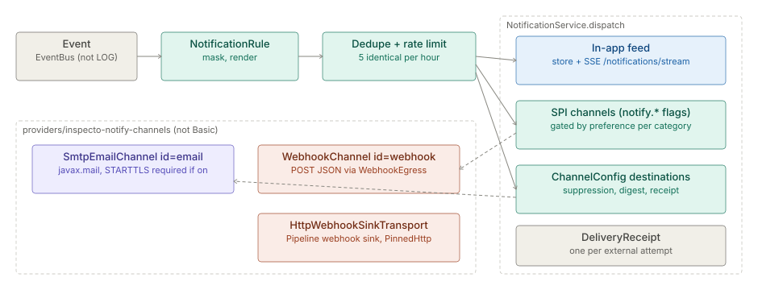

# Notifications

> **Level 3 module page** (`SOLUTION-SUITE-DOCS-1`). Layer: Platform base.
> Offering: in-app feed in every edition; the email and webhook channels (`providers/inspecto-notify-channels`)
> in the Standard, Advanced (includes Standard) and Preview Offerings, not Basic. Checked against the code on 2026-10-17.

## 1. What it is

Notifications turn platform events into messages for people and systems. There are three channels:

- **In-app** — intrinsic to `NotificationService`
  (`platform/inspecto-engine/src/main/java/com/gamma/notify/NotificationService.java`): a stored feed with
  per-reader read state and a live Server-Sent Events push.
- **Email** — `SmtpEmailChannel` (channel id `email`).
- **Webhook** — `WebhookChannel` (channel id `webhook`), which POSTs the notification as JSON.

Email and webhook are implementations of the `@PublicApi` SPI `NotificationChannel`
(`platform/inspecto-engine/src/main/java/com/gamma/notify/NotificationChannel.java`), discovered with
`ServiceLoader`. They live in the provider module `providers/inspecto-notify-channels`, whose
`META-INF/inspecto/module.toon` declares `id: notify-channels`, `bindingTime: boot` and provides the
contracts `NotificationChannel` and `WebhookSinkTransport`. The same module also ships
`HttpWebhookSinkTransport`, the HTTP transport used by the Pipeline webhook sink.

## 2. Who uses it

- **Every user** reads the in-app feed (bell menu) and sets their own per-category, per-channel preferences.
- **Workbench authors** (`canAuthorWorkbench`) manage channel destinations and authored notification rules.
- **Administrators** (`canAdminister`) set the deployment-wide default preference grid and archive feed items.
- **Operators** configure the SMTP relay and default webhook URL through `-D` system properties.

## 3. Where it sits

The engine side (`com.gamma.notify` in `platform/inspecto-engine`) owns rendering, dedupe, preferences,
receipts and suppression. The control-plane routes are in
`inspecto/src/main/java/com/gamma/control/NotificationRoutes.java`. The transports are a separate provider
so the Basic build ships no external channel: the root `pom.xml` adds `providers/inspecto-notify-channels`
only under the `edition-standard`, `edition-preview` and `edition-advanced` profiles
(EDG-01). Notifications are also a Platform Service (`notifications`, via `NotificationAccess`) distinct from
the `mail` Platform Service (`MailAccess`), which sends to recipients an author names — see
[Platform Services](../../layer/platform/architecture-platform-services.md).

## 4. How it works

1. `NotificationService.onEvent` receives every event except `LOG` and matches it against notification rules.
2. `dispatch` applies content masking, renders the rule, drops it if an identical unread item exists
   (`hasActiveDuplicate`), and applies `NotificationRateLimiter` (`DEFAULT_MAX_PER_HOUR = 5` identical items
   per rolling hour).
3. **In-app**: stored and pushed to listeners when `inApp` is enabled for the category in the default grid or
   any Subject's override turns it on.
4. **SPI channels from flags**: each discovered channel that is `configured()` and enabled for the category
   gets `deliver(n, null, deliveryId)`; it resolves its destination from its own `notify.*` flags.
5. **Persisted destinations**: each enabled `ChannelConfig` is delivered through the channel whose id matches
   its `kind`, to the config's own `target`. An optional `template` replaces the body; `digestMinutes > 0`
   buffers and flushes one combined message; `SuppressionList` skips addresses with a recorded hard bounce.
6. A `DeliveryReceipt` is opened per external attempt. The delivery id is carried as an SMTP `Message-ID`
   or an `X-Inspecto-Delivery-Id` webhook header so a provider callback can be correlated.

Failures are logged and isolated; there is no retry inside a channel (best effort), except
`retrySoftBounce` on the service for soft-bounced receipts.

Categories (`NotificationCategory`): `pipeline`, `job`, `ops`, `collaboration`, `security`. `security` is
critical and always delivers regardless of preferences.

## 5. Configuration

System properties read by the channel constructors:

| Key | Default | Meaning |
|---|---|---|
| `notify.smtp.host` | unset | SMTP relay; unset ⇒ email channel not configured |
| `notify.smtp.port` | `25` | relay port |
| `notify.smtp.from` / `notify.smtp.to` | unset | sender; fixed recipient (required with host) |
| `notify.smtp.user` / `notify.smtp.pass` | unset | SMTP AUTH |
| `notify.smtp.starttls` | `false` | when `true`, STARTTLS is **required**, not opportunistic |
| `notify.webhook.url` | unset | webhook target; unset ⇒ webhook channel not configured |
| `notify.webhook.token` | unset | bearer token |
| `notify.webhook.timeout.seconds` | `10` | request timeout |
| `notify.security.digestMinutes` | `10` | security email digest window; `0` = immediate |
| `notify.suppression.bounce.ttl` | see `SuppressionList` | how long a hard bounce suppresses an address |
| `notify.suppression` | on | `off` disables suppression |

Persisted destinations are `channel` components per Space, parsed by `ChannelConfig.fromMap` with fields
`id`, `kind`, `target`, `description`, `enabled`, `createdAt`, `template`, `digestMinutes`. `kind=email`
requires one or more comma-separated email addresses as `target`.

## 6. Screens

Moved to [Notifications — screens](user-guide-notifications.md).

## 7. API

Moved to [Notifications — API](api-notifications.md).

## 8. Interactions

- [Events](../event/architecture-overview.md) — the input stream; see also
  [events and metrics](../event/spec-events-metrics.md).
- [Alerts](../../addon/incidents/architecture-alerts.md) and [Incidents](../../addon/incidents/architecture-incidents.md) raise events that rules turn into notifications.
- [Platform Services](../../layer/platform/architecture-platform-services.md) — `notifications` and `mail` services granted to Runs.
- [Pipelines and Steps](../etl/architecture-pipelines-steps.md) — the webhook sink posts through `HttpWebhookSinkTransport`.
- [Spaces](../config/architecture-spaces.md) — channel destinations are per Space; webhook egress uses the Space's allowlist.
- [Identity and access](../access/architecture-overview.md) — the capability gates above.

## 9. Limits and gotchas

- An unconfigured channel is dropped at discovery (`discoverChannels` checks `configured()`), so a missing
  `notify.smtp.host` / `notify.smtp.to` or `notify.webhook.url` silently disables that flag-driven path.
- A `ChannelConfig` whose `kind` has no transport on the classpath (e.g. Basic) delivers nothing.
- Suppression applies only to persisted `ChannelConfig` targets, never to the flag-driven path (no target).
- Webhook egress (`WebhookEgress`) checks the resolved address against the egress policy and the current
  Space's allowlist, pins the connect to that address, never follows a 3xx and treats non-2xx as failure.
  Loopback is never allowlistable.
- SMTP TLS server-identity checking is always on; a relay reached by IP or by a name not on its certificate
  fails. Setting `notify.smtp.starttls=true` against a relay without STARTTLS now fails the send.
- The webhook channel refuses attachments (SPI default); only email carries `MailAttachment`s.
- The rate limiter and dedupe key on `dedupeKey`, so distinct alerts are not capped by each other.
