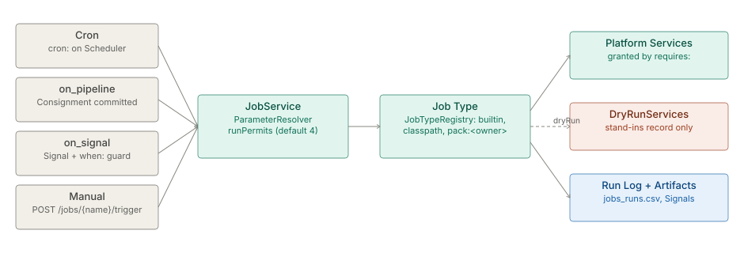

# Jobs and scheduler

> **Level 3 module page** (`SOLUTION-SUITE-DOCS-1`). Layer: Platform base.
> Offering: all tiers; Job Packs and some maintenance tasks (backup, restore) are Standard and
> above. Checked against the code on 2026-10-17.

## 1. What it is

Inspecto has two units of work:

- A **Consignment** is a set of files ingested and processed together, atomically, by the poll cycle
  ([parsing-ingest](../etl/architecture-parsing-ingest.md)). Its status flow is
  [consignment-status-flow](../engine/architecture-consignment-status.md).
- A **Job** is a configured, triggerable unit of work outside the poll cycle. Each Job names a
  **Job Type** (the template) and runs as a **Run** with a Run Log, Signals and artifacts.

`JobService` (`platform/inspecto-engine/src/main/java/com/gamma/job/JobService.java`) hosts the Jobs
of one Space, arms their triggers on the shared `Scheduler`, resolves parameters, bounds
concurrency and records every Run. The concept page is [jobs](spec-jobs.md);
the boundary with Steps is [job-vs-step](architecture-job-vs-step.md).

## 2. Who uses it

- **Operators** schedule, trigger, disable, replay and dry-run Jobs, and read Run history.
- **Analysts** run reports and KPI Jobs on demand from the KPI and Reports page.
- **Pack authors** ship Job Types as hot-deployable Job Packs.

## 3. Where it sits

Jobs are the platform's scheduler. Add-ons register Job Types (for example `alert.evaluate`,
`caserule.evaluate`, `incident.open`), and Pipelines run their at-rest chain as a `pipeline` Job
([pipelines-steps](../etl/architecture-pipelines-steps.md)). A Job reaches shared capabilities only through
[Platform Services](../../layer/platform/architecture-platform-services.md) it declares in `requires:`.

Job Types come from `JobTypeRegistry`, which records each type's source as `builtin`, `classpath`
or `pack:<owner>`. Built-ins include `pipeline`, `enrich`, `report`, `maintenance`, `sql.template`,
`mail.send`, `consignment.process`, `objectstore.export` and `space.comparison`. `GET /jobs/types`
lists exactly what registered, so a switched-off module's types disappear.

## 4. How it works

**Four triggers.**

- **Cron** — a `cron:` Job is armed on the `Scheduler`; cron fires in the operations zone
  (`-Dops.timezone`). `catch_up: true` replays one missed fire at start-up.
- **Event** — `on_pipeline:` fires when that Pipeline commits a Consignment successfully.
- **Signal** — `on_signal:` (exact type or `prefix.*`) with an optional `when:` guard over the
  payload. A burst is coalesced into one Run unless `coalesce: false`; at most 1000 Runs queue per Job.
- **Manual** — `POST /jobs/{name}/trigger`. Under `/api/v1` it is async: `202`, a `runId`, and the
  caller polls `GET /jobs/runs/{runId}`.

`enabled: false` turns off every automatic trigger but not the manual ones.

**Parameters.** `ParameterResolver` resolves each declared parameter, first hit wins: trigger args,
Signal `bind:`, the Job's `params:`, the `$` context (`$today`, `$run.*` and others), then the
default. A missing or mistyped required parameter ends the Run as `REJECTED` before user code runs.

**Concurrency.** Different Jobs run in parallel; one Job never overlaps itself (a second fire is
`SKIPPED`). The total bound is `JobService.DEFAULT_MAX_CONCURRENT_RUNS` = 4, owned by `scheduler.toon`
through `/system/scheduler`; a full pool queues Runs instead of blocking the trigger thread.

**Dry run.** `POST /jobs/{name}/trigger?dryRun=true` runs the Job with `JobContext.dryRun()` true, and
`DryRunServices.wrap` replaces every mutating Platform Service with a stand-in that records instead
of acting. Since 2026-10-17 that includes `mail` (nothing is sent; `mail.send` reports `SKIPPED`) and
`objects` (reads pass through, writes are recorded). `DryRunCoverageTest` fails the build if a newly
registered Platform Service is neither substituted nor declared read-only. A Signal fires a dry Run
only when its payload says `dryRun: true`.

**Run records.** Every Run appends to `jobs_audit/jobs_runs.csv`, emits
`job.run.started` / `completed` / `failed` / `rejected`, and may record artifacts. The reporting
projection (`DbJobRunStore`) exists only with `-Djobs.backend=duckdb|postgres`.

## 5. Configuration

A Job is a `job:` section in a `*_job.toon` under the Space's `config/jobs/`.

| Key | Meaning |
|---|---|
| `type` | the Job Type id |
| `cron`, `on_pipeline`, `on_signal`, `when`, `bind` | triggers and guards |
| `params:` and flat type-specific keys | parameters; unknown keys are absorbed as parameters |
| `enabled`, `catch_up`, `coalesce` | automatic triggers, missed-fire replay, Signal coalescing |
| `requires` (on the Job Type) | the Platform Services the type may use |

JVM flags: `-Djobs.maxConcurrentRuns` (bootstrap default only), `-Djobs.backend`,
`-Djobs.runlog.maxEntries` (10,000), `-Djobs.packs.dir` and `-Djobs.packs.allowlist` (a jar loads
only if its SHA-256 is listed).

## 6. Screens

Moved to [the user guide](user-guide-jobs.md#screens).

## 7. API

Moved to [Jobs and scheduler — API](api-jobs-scheduler.md).

## 8. Interactions

- **Events:** Runs emit Signals that can trigger other Jobs ([events](../event/architecture-overview.md)).
- **Alerts and Decision Rules:** a Decision Rule's `start-job` consequence starts a Job
  ([decision-kernel](../scoring/architecture-decision-kernel.md), [alerts](../../addon/incidents/architecture-alerts.md)).
- **Maintenance and backup** are tasks on the `maintenance` Job Type ([observability-backup](../observability/architecture-observability-backup.md)).
- **Studio:** scheduled report delivery is the `report` Job Type ([studio-bi](../../layer/product/architecture-studio-bi.md)).

## 9. Limits and gotchas

- An unrecognised key in a Job body is absorbed as a parameter, never rejected; a misspelled
  trigger key yields a Job with no trigger.
- Replay needs the original Run in memory (`LIVE_RUN_CAP`, lost on restart), independent of
  `-Djobs.backend`.
- `JobService` is per Space: in hosted multi-space mode the concurrency bound applies per Space.
- A dry run of a task with no preview does nothing.
- No Job Type waits synchronously on another Run; chaining is fire-and-forget through Signals.
