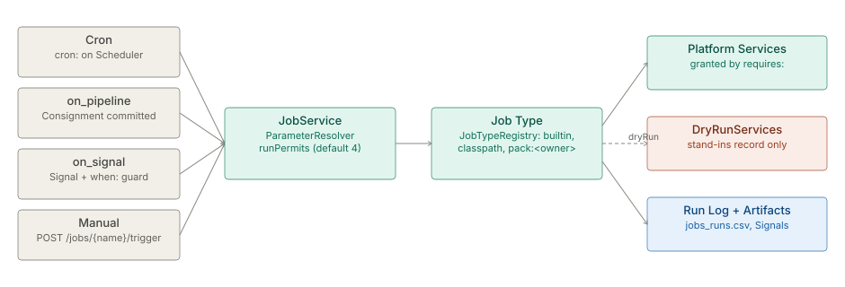

# Jobs, scheduler and multi-Space

The architecture of the `processor` hub, in three parts: Jobs and the scheduler that hosts them per Space,
the binding boundary between a Job (at rest) and a Pipeline Step (in motion), and how one server hosts
many isolated Spaces. The parts keep their own status lines and verification dates.

**On this page**

- [Jobs and scheduler](#jobs-and-scheduler) — Job Types, the four triggers, parameters, concurrency, dry run.
- [Job vs Pipeline Step — capability boundary](#job-vs-pipeline-step--capability-boundary) — the full
  comparison, the binding line and the gray zone.
- [Multi-Space Hosting](#multi-space-hosting) — `SpaceManager`, the `space` MDC isolation and the `/spaces` seam.

## Jobs and scheduler

> **Level 3 module page** (`SOLUTION-SUITE-DOCS-1`). Layer: Platform base.
> Offering: all tiers; Job Packs and some maintenance tasks (backup, restore) are Standard and
> above. Checked against the code on 2026-10-17.

### 1. What it is

Inspecto has two units of work:

- A **Consignment** is a set of files ingested and processed together, atomically, by the poll cycle
  ([parsing-ingest](../etl/architecture.md)). Its status flow is
  [consignment-status-flow](../engine/architecture.md).
- A **Job** is a configured, triggerable unit of work outside the poll cycle. Each Job names a
  **Job Type** (the template) and runs as a **Run** with a Run Log, Signals and artifacts.

`JobService` (`platform/inspecto-engine/src/main/java/com/gamma/job/JobService.java`) hosts the Jobs
of one Space, arms their triggers on the shared `Scheduler`, resolves parameters, bounds
concurrency and records every Run. The concept page is [jobs](spec-jobs.md);
the boundary with Steps is [job-vs-step](#job-vs-pipeline-step--capability-boundary).

### 2. Who uses it

- **Operators** schedule, trigger, disable, replay and dry-run Jobs, and read Run history.
- **Analysts** run reports and KPI Jobs on demand from the KPI and Reports page.
- **Pack authors** ship Job Types as hot-deployable Job Packs.

### 3. Where it sits

Jobs are the platform's scheduler. Add-ons register Job Types (for example `alert.evaluate`,
`caserule.evaluate`, `incident.open`), and Pipelines run their at-rest chain as a `pipeline` Job
([pipelines-steps](../etl/architecture.md)). A Job reaches shared capabilities only through
[Platform Services](../../layer/platform/architecture-platform-services.md) it declares in `requires:`.

Job Types come from `JobTypeRegistry`, which records each type's source as `builtin`, `classpath`
or `pack:<owner>`. Built-ins include `pipeline`, `enrich`, `report`, `maintenance`, `sql.template`,
`mail.send`, `consignment.process`, `objectstore.export` and `space.comparison`. `GET /jobs/types`
lists exactly what registered, so a switched-off module's types disappear.

### 4. How it works

**Four triggers.**

- **Cron** — a `cron:` Job is armed on the `Scheduler`; cron fires in the operations zone
  (`-Dops.timezone`). `catch_up: true` replays one missed fire at start-up.
- **Event** — `on_pipeline:` fires when that Pipeline commits a Consignment successfully.
- **Signal** — `on_signal:` (exact type or `prefix.*`) with an optional `when:` guard over the
  payload. A burst is coalesced into one Run unless `coalesce: false`; at most 1000 Runs queue per Job.
- **Manual** — `POST /jobs/{name}/trigger`. Under `/api/v1` it is async: `202`, a `runId`, and the
  caller polls `GET /jobs/runs/{runId}`.

`enabled: false` turns off every automatic trigger but not the manual ones.

**Parameters.** `ParameterResolver` resolves each declared parameter, first hit wins: trigger args,
Signal `bind:`, the Job's `params:`, the `$` context (`$today`, `$run.*` and others), then the
default. A missing or mistyped required parameter ends the Run as `REJECTED` before user code runs.

**Concurrency.** Different Jobs run in parallel; one Job never overlaps itself (a second fire is
`SKIPPED`). The total bound is `JobService.DEFAULT_MAX_CONCURRENT_RUNS` = 4, owned by `scheduler.toon`
through `/system/scheduler`; a full pool queues Runs instead of blocking the trigger thread.

**Dry run.** `POST /jobs/{name}/trigger?dryRun=true` runs the Job with `JobContext.dryRun()` true, and
`DryRunServices.wrap` replaces every mutating Platform Service with a stand-in that records instead
of acting. Since 2026-10-17 that includes `mail` (nothing is sent; `mail.send` reports `SKIPPED`) and
`objects` (reads pass through, writes are recorded). `DryRunCoverageTest` fails the build if a newly
registered Platform Service is neither substituted nor declared read-only. A Signal fires a dry Run
only when its payload says `dryRun: true`.

**Run records.** Every Run appends to `jobs_audit/jobs_runs.csv`, emits
`job.run.started` / `completed` / `failed` / `rejected`, and may record artifacts. The reporting
projection (`DbJobRunStore`) exists only with `-Djobs.backend=duckdb|postgres`.

### 5. Configuration

A Job is a `job:` section in a `*_job.toon` under the Space's `config/jobs/`.

| Key | Meaning |
|---|---|
| `type` | the Job Type id |
| `cron`, `on_pipeline`, `on_signal`, `when`, `bind` | triggers and guards |
| `params:` and flat type-specific keys | parameters; unknown keys are absorbed as parameters |
| `enabled`, `catch_up`, `coalesce` | automatic triggers, missed-fire replay, Signal coalescing |
| `requires` (on the Job Type) | the Platform Services the type may use |

JVM flags: `-Djobs.maxConcurrentRuns` (bootstrap default only), `-Djobs.backend`,
`-Djobs.runlog.maxEntries` (10,000), `-Djobs.packs.dir` and `-Djobs.packs.allowlist` (a jar loads
only if its SHA-256 is listed).

### 6. Screens

Moved to [the user guide](user-guide-jobs.md#screens).

### 7. API

Moved to [Jobs and scheduler — API](api-jobs-scheduler.md).

### 8. Interactions

- **Events:** Runs emit Signals that can trigger other Jobs ([events](../event/architecture.md)).
- **Alerts and Decision Rules:** a Decision Rule's `start-job` consequence starts a Job
  ([decision-kernel](../scoring/architecture.md), [alerts](../../addon/incidents/architecture.md)).
- **Maintenance and backup** are tasks on the `maintenance` Job Type ([observability-backup](../observability/architecture.md)).
- **Studio:** scheduled report delivery is the `report` Job Type ([studio-bi](../../layer/product/architecture-studio-bi.md)).

### 9. Limits and gotchas

- An unrecognised key in a Job body is absorbed as a parameter, never rejected; a misspelled
  trigger key yields a Job with no trigger.
- Replay needs the original Run in memory (`LIVE_RUN_CAP`, lost on restart), independent of
  `-Djobs.backend`.
- `JobService` is per Space: in hosted multi-space mode the concurrency bound applies per Space.
- A dry run of a task with no preview does nothing.
- No Job Type waits synchronously on another Run; chaining is fire-and-forget through Signals.

## Job vs Pipeline Step — capability boundary

Both do work on data, so they invite the question "which one should this be?". The answer is not a
matter of taste: [`GLOSSARY.md`](../../../../GLOSSARY.md) §5 and
[`pipeline-graph-design.md`](../engine/architecture-pipeline-graph.md) §3.8 make **in-motion
(Pipeline) vs at-rest (Job)** a *binding* line. This part carries the full capability comparison behind
that rule, verified against source 2026-08-07; extensibility and naming re-grounded 2026-09-01.

### 0. The one-line difference

**A Step is not an *Executable*** — the Pipeline is; a Step is a node inside it. A Job is imperative
Java — you implement `Job.run(ctx)` and ship a class. A Step is *today* declarative config lowered into
DuckDB SQL by `RowShaper`/`TransformCompiler` and executed by `ConsignmentGraphRunner`. In the committed
vocabulary (D2) a Step receives a **Consignment token** and resolves the data by reference — edges carry no
records; the full runtime edge model converges at Phase 7
([`node-types.md`](../engine/spec-node-types.md) § *The token model*). Since 2026-08-29 a plugin *can* supply a Step's execution
(`PipelineNodeExecutor`, §3) — that changes who writes the SQL-shaping code, not what a Step **is**, and
it still gets no service façade. [Platform Services](spec-platform-services.md) stage 2 (still unbuilt) is
the different, richer thing: a pack-hosted Step *program* (`EXECUTED` mode) — again without changing what
a Step **is**: a node producing consignment counters inside someone else's Run, never an Executable.

### 1. What each one is

| | Pipeline Step | Job |
|---|---|---|
| Internal type | `PipelineNode`, discriminated by the type registry — `BuiltinNodeType` (29 ids) layered under `PipelineNodeType` providers | `Job` + `JobTypeProvider` |
| Executed by | `ConsignmentGraphRunner` / `ConsignmentIngestor`, inside `CollectorProcessor`'s poll cycle | `JobService.runJob` on a virtual thread |
| Is it an **Executable**? | **No** — the *Pipeline* is the Executable; a Step is a node inside it | **Yes** — the Scheduler starts it and it produces a Run |
| Authored as | node entries in the pipeline TOON | `<name>_job.toon` |

### 2. What they genuinely share

Real symmetry, not coincidence — several of these were built to the same shape deliberately.

| Capability | Step | Job |
|---|---|---|
| **Declared config contract** | `NodeAttribute` — `key`, `label`, `type`, `tier`, `required`, `defaultValue`, `options`, `min`/`max`, `help`, `placeholder`, `dependsOn` | `ParameterDecl` — the same (minus `dependsOn`), plus `pattern`, `group`, `multi`, `secret`, `deduce`, `expressions` |
| **Server-published for the UI** | `GET /pipelines/node-types` | `GET /jobs/types[/{id}]` |
| **Overlap guard** | `PipelineRunGuard` — binary semaphore per pipeline id; poll `tryAcquire` (skip), operator `acquire` (block) | `LockingRunner.runExclusiveOrSkip` per job name; a fire during a Run records `SKIPPED` |
| **Concurrency cap** | back-pressure skips (`inspecto_acquire_backpressure_skips_total`) | `-Djobs.maxConcurrentRuns` semaphore |
| **Dry run** | `PipelineDryRun` (T18) — bounded sample through a scratch DuckDB, commits nothing | `JobContext.dryRun()` — a destructive Job Type previews instead of acting; `POST /jobs/{name}/trigger?dryRun=true` |
| **Prometheus metrics** | `inspecto_batches_total`, `inspecto_batch_duration_seconds`, `inspecto_output_rows_total`, … | `inspecto_jobs_total`, `inspecto_job_duration_seconds` |
| **Durable audit** | `ConsignmentAuditWriter` — `status` (per file), `batches`, `lineage` (ledger file names keep the pre-rename spelling — BACKLOG §4 residual) | `JobRunLedger` (`jobs_runs.csv`) + optional DuckDB projection |
| **Repeat safety** | `.processed` markers + the acquisition dedup ledger | `TriggerCoalescer`, signal chain-depth cut, `catch_up` |
| **UI surface** | `/pipelines` | `/jobs`, `/jobs/:name` |
| **Timeout / cancellation** | ⛔ none | ⛔ none — a `CronHandle.cancel()` only un-arms *future* fires |

⚠ The two dry-runs share a word, not a mechanism: the Step one previews a *candidate config* over sample
rows; the Job one makes a *real, destructive* action non-destructive. Do not describe them as one feature.

### 3. Where they differ

| Dimension | Pipeline Step | Job |
|---|---|---|
| **Data state** | **In motion** — the Step's Consignment token references rows in flight | **At rest** — data already landed |
| **Implementation** | Config → DuckDB SQL | Java class in a jar |
| **Extensibility** | **Open, in two independent halves** (both `ServiceLoader` seams): `PipelineNodeType` (descriptor) + `PipelineNodeExecutor` (execution, SHIPPED 2026-08-29) — a third party CAN ship a Step type today; a plugin needs **both** registrations. See [node-types.md §"The execution half"](../engine/spec-node-types.md) | **Open registry**: `JobTypeProvider` via `ServiceLoader` *and* hot-deployable Job Packs |
| **Hot deploy / unload** | via a **pack**: `JobPackManager` also registers pack-contributed node types + their Steps into the owner-keyed overlay (`PipelineNodeTypes.register` / `StepExecutors.register`, first pack wins per type, deregistered on unload — 2026-08-31; since S2-3, 2026-09-28, a pack's executor is a `StepExecutor` and a pack carrying a raw `PipelineNodeExecutor` is rejected, D-2). Classpath (`META-INF/services`) providers still require a build. 🔴 **The two routes are deliberately ASYMMETRIC: a pack may NOT redefine a built-in** — the registration is refused and, pack loading being atomic, the whole pack is rejected, because a jar dropped in a directory silently redefining `sink.persistent` would change what every existing pipeline means — **while a classpath provider MAY**, that being an edition specialising the core at build time, reviewed and shipped together. ⚠ And **unloading a pack makes its types unknown again, so a stored pipeline naming one stops loading** — the same exposure a Job typed on an unloaded pack has, and the reason a pack is normally *replaced* rather than removed. Stated, not fixed. *(Distilled 2026-09-10 (Sprint 7.6) from the three archived plans; this was their only home.)* | `JobPackManager`: watched dir, isolated `URLClassLoader`, atomic load-or-reject, in-flight-Run quiesce before unload |
| **Code trust** | classpath providers: none needed (compiled/deployed with the engine); pack-contributed ones inherit the pack jar's trust gate | `-Djobs.packs.allowlist` (SHA-256 of the staged jar, required; none ⇒ every pack refused), plus the optional integrity check `-Djobs.packs.requireSignature` on every class entry |
| **Runtime context** | ⛔ none — config plus a SQL relation | `JobContext`: `runId`, `spaceId`, `trigger`, `config`, `params`, `log()`, `signals()`, `artifacts()`, `dryRun()` |
| **Unit of work** | one **Consignment**, over one input relation | one **Run** |
| **Trigger** | ⛔ cannot be scheduled — fires only inside its Pipeline's poll cycle | `cron` · `on_pipeline` · `on_signal` (+`when:`/`bind:`) · manual · catch-up |
| **Cross-run state** | ⛔ none of its own | watermarks (`PipelineWatermarkStore`), Run Artifacts, `$job.last_success_time` |
| **Emits** | nothing directly (the CONTROL trio `gap`/`alert`/`event` emit via the engine) | declared Signals + `ArtifactDecl`s |
| **Failure grain** | file → quarantine (`QUARANTINED_UNREADABLE`/`_MISMATCH`); Consignment → `FAILED`; retried by the next poll of the same input | thrown exception → `FAILED` JobRun; missing/invalid parameter → `REJECTED` before user code runs |
| **Observability grain** | per Consignment + per file; T22 per-`(node, relationship)` provenance counts | per Run: ledger row, structured `RunLog`, Artifacts |
| **Secrets** | ⛔ `NodeAttribute` has no `secret` | `ParameterDecl.secret` — masked at the response boundary |
| **`$`-Expressions** | ⛔ no `deduce`/`expressions` in the node contract | authored values resolve at fire time through `ExpressionRegistry` |

### 4. The binding rule, and how they compose

> in-motion (Pipeline) vs at-rest (Job) is a binding line, so an at-rest operator cannot be an in-motion
> node — [`GLOSSARY.md`](../../../../GLOSSARY.md) §5

- **No nesting.** No `job` id has ever existed in `BuiltinNodeType`, and a sub-Pipeline is not a Step
  either.
- **Compose as producer/consumer over a shared store**: a Job fires on the Pipeline's `on_commit`, or
  binds by store name to a `sink.view`.
- **The reverse is allowed**: a `pipeline`-type Job re-running an authored Pipeline over data at rest
  makes the Job the *outer* Executable. That is composition, not embedding.

#### Decision rule

- Transforming rows as they flow through one Pipeline's Consignment → **Step**.
- Own clock or event, spanning Pipelines, reading status/metadata, or reaching outside → **Job**.
- Java that must run per record/file *inside* the data path → **`ConsignmentProcessor`** (§5).

### 5. The gray zone — four things that blur the line

1. **`ConsignmentProcessor` is a Java plugin that is not a Step.** It is the SPI for per-record/file/batch
   Java in the data path, but it is hosted *by* the `consignment.process` **Job** Type over one committed
   Consignment, and gets a narrower `ProcessorContext` — its javadoc states authors never touch `Job` or
   `JobContext`. So there are already **two** plugin surfaces with different reach.
2. **A node-type plugin is a Step, but it is not the pack-hosted Step *kind*.** The old trap here
   ("`PipelineNodeType` looks extensible and is not") closed 2026-08-29: `PipelineNodeExecutor` is the
   execution half, and a plugin registering **both** halves runs today. The residual split is between
   that — engine-**classpath** code on the raw batch connection, with no isolation, no `StepContext`, no
   watchdog — and the platform-services **S2-3** pack Step (`StepExecutor`: isolated classloader,
   `StepContext`, services ceiling, watchdog; shipped 2026-09-28). `scaffold.mjs new nodetype` builds the
   former; `new step` builds the latter. Since S2-3 a pack may no longer carry a raw executor (D-2); see
   [Platform Services §7c](spec-platform-services.md).
3. **`TriggerCoalescer` lives in `com.gamma.pipeline.exec` but is Job-only.** Package placement misleads.
4. **`transform.join` against a Reference Dataset is compile-only** — no runtime executor. So "a Step
   cannot read a second Dataset" is true *today* but is a missing executor, **not** part of the boundary.
   Do not state it as the rule; the rule is in-motion vs at-rest.

### 6. As-built gaps (2026-08-07)

- **A Job Pack's capability surface is far narrower than the plugin model implies.** `JobContext` offers
  no Dataset, Alert/Incident, Notification or query access. Built-ins reach those through constructor
  injection inside `JobService.registerBuiltins()` (`dataDir`, an `ObjectService` supplier, an
  `AlertService` supplier, the notification store, even `this`); a pack provider is instantiated no-arg by
  `ServiceLoader` and can receive none of it. A hot-deployed pack can log, emit a Signal and record
  artifact metadata — nothing else. Both sample Job Types added 2026-08-07 (`sample.hello`,
  `alert.evaluate`) required engine edits and **could not have shipped as packs**.
  → ✔ **CLOSED by platform-services S1-1…S1-7 (2026-08-09)**: `JobContext.services()` grants the declared
  `requires:` set from the boot `PlatformServiceRegistry` — v1 ids `notifications`, `incidents`, `schema`,
  `consignment-status`. `sample.hello` was migrated onto its grant and **its constructor injection removed**,
  so it is now pack-shippable, and a pack jar compiled inside `JobPackManagerTest` declares *and* consumes a
  grant, loads, and completes a Run — the evidence above is inverted. `alert.evaluate` followed on
  2026-08-10 once the `alerts` service joined the menu (D7's honest resolution), so **no built-in Job
  reaches the engine by constructor injection for its own work any more**. One as-built limit remains:
  `dataDir`-style Dataset reach is still injection-only (next bullet).
- **There is no Dataset API to hand anyone.** `SqlTemplateJob`/`ObjectsAnalyticsJob` resolve
  `Path.of(dataDir).resolve(name)` and open raw DuckDB. Dataset access is a filesystem convention, not an
  interface — it must exist before it can be granted to plugins.
  → *Deferred by design*: `DatasetAccess` follows the Consignment Selector
  ([`consignment-addressing-plan.md`](../../../../archived-documents/plans-archive/consignment-addressing-plan.md) §6), then joins
  the seam as its flagship service.
- **No Job authors Notifications.** `NotificationStore.add(...)` exists; the only Job touching it is
  `maintenance` *pruning*. → ✔ **CLOSED by S1-3** (`NotificationAccess`, dedupe-collapse honoured;
  `sample.hello` is the reference consumer). The prune task is untouched.
- **No per-node metrics** — pipeline-level only.
- **No timeout or cancellation on either side.** → *Partially owned*: the **S2-3** watchdog covers
  `EXECUTED` Steps (plan R1); the Job-side watchdog stays a recorded gap beyond that plan.
- **`NodeAttribute` lacks `secret`, `pattern`, `group`, `multi` and expression support** that
  `ParameterDecl` gained in the job-parameter-contract work (re-verified 2026-09-01; it has since
  gained `dependsOn`, which `ParameterDecl` lacks). → *Fulfilled by* stage 2's widened
  `StepTypeProvider` descriptor (**S2-1**).

> ⚠ **The §6 gaps have an owner: [Platform Services](spec-platform-services.md).** **Stage 1 is COMPLETE
> (S1-0…S1-8, 2026-08-09/10)** — the seam (grants via `requires:`), the v1 service menu, and the pack
> scaffolder + `PackTestHarness` — so the ✔ pointers above are as-built, not planned. Stage 2 (the open
> Step-kind registry, `LOWERED`/`EXECUTED`) stays gated on the branch-aware executor's armed path, so
> every §6 gap still marked *Fulfilled by* an `S2-*` step is open; it and stage 3 are tracked in
> [`BACKLOG.md`](../../../../BACKLOG.md) §4. The seam's durable operating rules live in
> [`PROJECT_NOTES.md`](../../../../PROJECT_NOTES.md) §5; this part's §0 wording came from **S1-0**, and the
> plan itself is archived at
> [`plans-archive/platform-services-plan.md`](../../../../archived-documents/plans-archive/platform-services-plan.md).
> ⚠ Stage 2 being gated no longer means "no plugin Step at all": the classpath node-type seam
> (`PipelineNodeType` + `PipelineNodeExecutor`, plus the pack overlay) shipped independently,
> 2026-08-29/31 — what S2 still owns is the *pack-hosted* Step kind with isolation and a watchdog.

Related: [Jobs & Scheduling](spec-jobs.md) · [Pipeline graph design](../engine/architecture-pipeline-graph.md)
· [Signal backbone](../event/spec-signal-backbone.md) · [Platform Services](spec-platform-services.md)

## Multi-Space Hosting

One server hosts many isolated **spaces** (projects). The ~40-method per-instance `CollectorService` is
**wrapped, not rewritten**.

* `SpaceManager` (`inspecto/src/main/java/com/gamma/service/SpaceManager.java`) — `single(CollectorService)`
  (single-tenant, byte-identical to pre-multi-space) or `discover(spacesRoot)` (boots each `spaces/<id>/`
  with a `config/` subtree). Runtime CRUD with no restart: `create`, `createFromBundle`, `delete(id, purge)`,
  serialized on `lifecycleLock` (reads are lock-free).
* `SpaceContext` (`…/service/SpaceContext.java`) — a thin per-space holder (id + `SpaceRoot` + manifest + its
  own unchanged `CollectorService`).
* `SpaceMigrator` (`…/service/SpaceMigrator.java`) — the **one-time CLI** that turns the flat layout into a
  `spaces/<id>/` directory (`configDir→config`, `database/→data`, `jobs_audit/→audit`, DuckDB files → `duckdb/`;
  idempotent, `--dry-run`). ⚠ Nothing invokes it at boot — this line said "on boot" until 2026-09-08.

### Singleton isolation via the `space` MDC

Five process-wide singletons — `EventLog`, `MetricRegistry` (its `space` label),
[`ConnectionRegistry`](../connectors/spec-connectors.md), `StabilityGate`, `AcquisitionLedgers` — resolve per-space
by reading `EventLog.currentSpaceId()`, which returns the `space` **SLF4J MDC** key or `"default"` when
absent. **The MDC does not cross thread-pool boundaries**, so every executor on the execution path must copy
the MDC onto its worker (see [gotchas](../../layer/platform/admin-guide-gotchas.md)). The `default` space sets no MDC → output
stays label-free (byte-identical single-space).

### API seam

⚠ **`DELETE /spaces/{id}` has TWO distinct `409`s** (`SpaceRoutes.java`): (1) a **single-tenant
refusal** — `requireMultiSpace` (`:118` → `:133-135`) fires first for every CRUD verb when
`supportsCrud()` is false: *"this server hosts a single space; launch with -Dspaces.root to manage
many"*; (2) a **last-space-on-disk purge refusal** (`:124-127`), only on `?purge=true` — the tree is
the last copy and `main()` refuses to boot an empty `-Dspaces.root`, so the escape is *"delete it
without `?purge=true` (the files stay for re-discovery), or create another space first"*.

`/spaces/{id}/…` is stripped + MDC-bound by [`ControlApi.dispatch`](api-control-api.md); un-prefixed paths use the
current/default space. In versioned URLs the space segment sits **after** `/v1`
(`/api/v1/spaces/<id>/…` — dispatch strips `/api/v1` first, then matches `/spaces/{id}/…`). Space CRUD
(server-global, un-prefixed), all in `SpaceRoutes.java`: `GET /spaces` (`:45`), `POST /spaces` (`:58`), `POST /spaces/import` (`:60`, from a bundle zip), `PUT /spaces/{id}` (`:62`, rename/re-describe), `DELETE /spaces/{id}?purge=` (`:64`), `GET /spaces/templates` (`:56`, the shipped-template gallery — empty, not 409, on a single-tenant server), and
`GET /spaces/_meta → {multiSpace}` (the UI capability probe — never infer from the space-list length). The
**whole-space zip** lives in `DataSourceRoutes.java:38-41`, not here: `GET /spaces/{id}/export`,
`POST /spaces/{id}/import/preview` (dry run) and `POST /spaces/{id}/import[?on_conflict=overwrite]`
(`BundleExporter` / `BundleImporter`, zip-slip jailed) — omitted from this part until 2026-09-08. Requirement of
record: [Spaces & tenancy capability spec](../config/plan-spaces.md). The UI
side is the [spaces feature](../../layer/product/user-guide-spaces.md) + the global
[space interceptor](../../layer/product/spec-multi-space.md).
