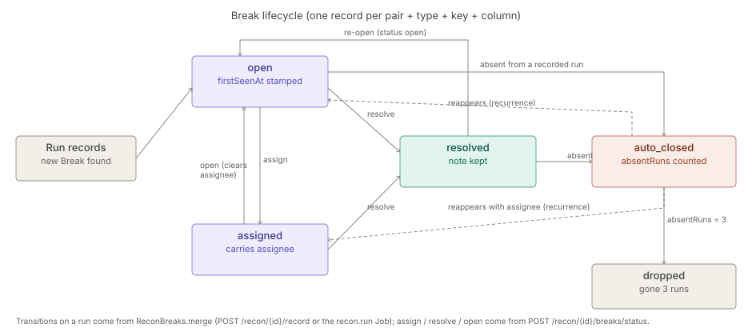

# Reconciliation

> **Level 3 module page** (`SOLUTION-SUITE-DOCS-1`). Layer: Add-on.
> Offering: Standard and above — add-on `reconciliation` (status `built`, module `reconciliation`) in
> `offerings/standard.toon`. Checked against the code on 2026-10-17.

## 1. What it is

Reconciliation compares two or three Datasets at a **key-column grain** and reports the differences as
**Breaks**. It lives in `features/inspecto-reconciliation` (package `com.gamma.recon`). The module descriptor
`features/inspecto-reconciliation/src/main/resources/META-INF/inspecto/module.toon` declares
`offeringRole: optional`, one config kind (`reconciliation`), one Job Type (`recon.run`) and ten routes.

Four Break types exist (`ReconBreaks.TYPES`): `missing_right` (anchor only), `missing_left` (compared side
only), `value_break` (matched key, a Measure outside tolerance) and `cardinality_break` (only when a
cardinality is asserted). The comparison itself is stateless (`ReconService`); the Break lifecycle is
server-side operational state (`ReconBreaks` + `ReconStateStore`).

## 2. Who uses it

- **Authors** (`canAuthorWorkbench`) define a Reconciliation through the generic component CRUD.
- **Operators** (`canOperateRuns`) record runs and resolve, re-open or assign Breaks.
- **Incident handlers** (`canManageIncidents`) promote a single Break to an Incident.
- Revenue-assurance and business-assurance solutions — see
  [revenue-assurance](../../solution-pack/business-assurance/architecture-revenue-assurance.md).

## 3. Where it sits

An add-on over the platform base. It reads Datasets through their trusted relation SQL (`DatasetRelation`),
computes in an ephemeral DuckDB sandbox (`SqlSandbox`), schedules through the Jobs layer
([jobs-scheduler](../processor/architecture-jobs-scheduler.md)) and opens Incidents through the `objects` Platform Service
([platform-services](../../layer/platform/architecture-platform-services.md)). Without `inspecto-ops` the `objects` grant is empty: the Job
stays signal-only and `POST /recon/promote` answers 503.

## 4. How it works

1. **Compare** — `ReconConfigLoader.buildSpec` turns the saved config into a `ReconService.Spec`; the
   interactive route and the scheduled Job share it, so both reconcile identically. `ReconService.dayRun`
   builds one `FULL OUTER JOIN` grain table (`__grain`) per day, classifies each row, then derives exact
   per-side totals and the Break summary in one aggregate. NULL keys match via `IS NOT DISTINCT FROM`.
2. **Record** — `POST /recon/{id}/record` or the `recon.run` Job computes all Breaks and merges them into the
   state file with `ReconBreaks.merge`.
3. **Lifecycle** — states `open | assigned | resolved | auto_closed`:
   - a new Break is `open` and stamped `firstSeenAt` (never re-stamped);
   - a Break still present keeps status, note and `firstSeenAt`; each run adds one `occurrence`;
   - an `open`/`assigned`/`resolved` Break absent from a run becomes `auto_closed` (`absentRuns = 1`);
   - an `auto_closed` Break that reappears is **re-opened, not new** (one `recurrence`); with an assignee it
     comes back `assigned` to that owner;
   - after `RECURRENCE_WINDOW_RUNS` (3) consecutive absent runs it is dropped and would return as new.
   - `assigned` keeps the assignee on resolve; re-opening (`open`) clears it.
4. **Signal and Incident** — the Job emits `recon.run.completed` (`ReconSignals`), severity `WARNING` when any
   Break exists, and opens one deduped Incident per Reconciliation on a breach.

Age (`ageDays`) is derived at read time for unresolved Breaks, never stored.

## 5. Configuration

A `reconciliation` component (read in `ReconConfigLoader`):

| Key | Meaning |
|---|---|
| `datasets` | 2–3 Dataset ids; the first is the anchor (v1 `leftDataset` / `rightDataset` / `thirdDataset` still read) |
| `keyColumns` | grain columns (safe identifiers) |
| `compareColumns[]` | `column`, `agg` (`sum` \| `count`, default `sum`), `toleranceType` (`exact` \| `absolute` \| `percent`, default `exact`), `tolerance` |
| `includeRecordCount` | default `true`; the implicit `__records` Measure |
| `columnMap` | per-Dataset unified → physical column |
| `filters` | per-Dataset row predicate, checked by `ExpressionGuard` |
| `cardinality` | `one_to_one` \| `one_to_many` \| `many_to_one` \| `many_to_many` (default; asserts nothing) |
| `impact.column` | a carried Break impact column, summed but never compared |
| `bands` | `{okBelow, warnAbove}` percent bands, `0 <= okBelow <= warnAbove <= 100` |

Scheduled runs: a Job of type `recon.run` with parameter `reconciliation` (required) and `day` (optional,
`yyyy-mm-dd`; absent = latest day on any side). See [jobs-scheduler](../processor/architecture-jobs-scheduler.md).

State: `<write-root>/recon-state/<id>.json`, written atomically and jailed under the write root.

## 6. Screens

Moved to [the user guide](user-guide-reconciliation.md#screens).

## 7. API

Moved to [Reconciliation — API](api-reconciliation.md).

## 8. Interactions

- [incidents](../../addon/incidents/architecture-incidents.md) — a breach opens an Incident; single Breaks are promoted with `POST /recon/promote`.
- [events](../event/architecture-overview.md) / [alerts](../../addon/incidents/architecture-alerts.md) — `recon.run.completed` is a Signal an Alert Rule can watch.
- [jobs-scheduler](../processor/architecture-jobs-scheduler.md) — `recon.run` Job Type (`ReconRunJobType`), `requires: [objects]`.
- [case-management](../case-management/architecture-overview.md) — Incidents opened here can be escalated to Cases.
- Deleting a `reconciliation` component triggers `ReconComponentDeleteHook`.

## 9. Limits and gotchas

- Sides are pre-aggregated per key, so `cardinality` is an assertion, not a matching strategy; the default
  `many_to_many` asserts nothing and keeps old verdicts byte-identical.
- A state holds at most `ReconStateStore.MAX_BREAKS` (50 000) Breaks per run — a bigger run is refused, never
  truncated; days older than `RETAIN_DAYS` (90) are dropped whole, open Breaks included.
- Board page size: default 50, max 200; `sample` 1–100 000 keys, chosen deterministically by key hash.
- Recording from the Job is best-effort: a refusal is logged, the run still succeeds.
- `POST /recon/promote` refuses an inline draft config — the Reconciliation must be saved.
- The SPA recomputes Break identity; `ReconBreaks.keyText` must match JavaScript number spelling or recorded
  resolutions silently read as open.

