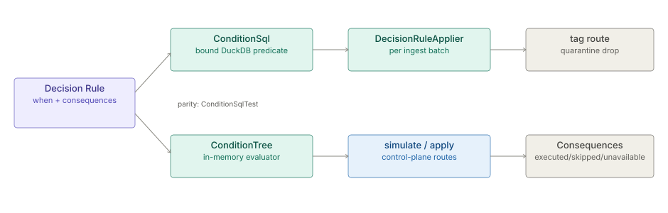

# Decision Kernel (Decision Rules and the Condition Language)

> **Level 3 module page** (`SOLUTION-SUITE-DOCS-1`). Layer: Platform base.
> Offering: every edition (some consequences need add-on modules). Checked against the code on 2026-10-17.

## 1. What it is

The **Decision Kernel** is the one runtime every decision kind shares: the **Condition Language** (the condition
tree), the when / then model and the **Consequence registry**. A **Decision Rule** is its business-logic and
routing kind: `when` a record matches, apply `consequences`. It is not a general rule engine (decision D-MR12).

Code: `platform/inspecto-engine/src/main/java/com/gamma/query/ConditionTree.java` (in-memory evaluator),
`platform/inspecto-engine/src/main/java/com/gamma/query/ConditionSql.java` (DuckDB predicate),
`platform/inspecto-engine/src/main/java/com/gamma/query/DecisionRuleApplier.java` (per-batch record routing),
`platform/inspecto-engine/src/main/java/com/gamma/pipeline/DecisionRules.java` (rule loading),
`platform/inspecto-engine/src/main/java/com/gamma/decision/` (Consequence registry),
`inspecto/src/main/java/com/gamma/control/DecisionRoutes.java` (HTTP).

## 2. Who uses it

- **Authors** (`canAuthorWorkbench`) write Decision Rules and simulate them against sample rows.
- **Other kinds** use the same tree: Alert Rule `when`, Expectation `condition` (and `non_null` / `range` / `regex`
  expanded into a tree), Tag and Case Rule filters, Notification Rule match, Risk factor filters, Escalation match.

## 3. Where it sits

Engine base (`inspecto-engine`) plus control-plane routes. The browser twin is
`inspecto-ui/src/app/inspecto/query/query-eval.ts`; `ConditionTree` is a port of it, so a preview in the editor
and a backend count agree. The `Conditions` text notation (Access Policies only) is separate; compiling it into
the tree was declined (see [module reorganisation decisions](../../layer/platform/plan-module-reorganisation-decisions.md)).

## 4. How it works



**The condition tree.** A group `{kind: group, op: AND|OR, items: [...], negate?}` nests leaves
`{kind: condition, field, operator, value?, value2?, valueField?, ignoreCase?}`. Operators: `=`, `!=`, `<`, `<=`,
`>`, `>=`, `contains`, `startsWith`, `endsWith`, `in`, `between`, `isNull`, `isNotNull`, `matches` (regex, at most
256 characters, no lookaround, back-references or possessive quantifiers). An empty or incomplete group means
"no constraint" (matches all). The root must be a group: a bare leaf is 422 (`ConditionTree.requireGroupRoot`,
shared by both evaluators). Strict twins (`matchedStrict`, `filterStrict`, `validateStrict`,
`ConditionSql.predicateStrict`) throw on malformed trees and treat an absent field as false.

**Two backends, one meaning.** `ConditionTree` evaluates in memory (simulate, Alert Rule row scoping);
`ConditionSql.predicateBound` renders a DuckDB predicate with every operand bound as a parameter
(`DECISION-RULE-SQL-GUARD-1`). `ConditionSqlTest` asserts the SQL count equals `ConditionTree.matched`.

**Record-routing consequences at ingest.** `DecisionRuleApplier` runs per batch between transform and partition
write: enabled rules whose `targetType: pipeline` and `target` match the Pipeline, in priority order. Order of
effect: `tag` (appends `__tags`), then `route` (copies to `dirs.database/<destination>`), `quarantine` (copies
under `dirs.quarantine/records/<rule>/`), then one removal for `drop`. Each applied rule emits a
`decision-rule.applied` Signal. Rules are re-read every batch. A broken rule is logged and skipped - routing never
fails the batch. `targetType: job` rules apply to `sql.template` job results and Stage-2 enrichment output.

**Platform consequences on apply.** `POST /decision-rules/{name}/apply` runs `emit-signal`, `start-job`,
`trigger-pipeline`, `create-alert`, `create-incident` (contributed by `inspecto-ops`), `invoke-api` (contributed by
`inspecto-action-requests`, proposes an [Action Request](../action-requests/architecture-overview.md)), plus stub `render-widget` /
`generate-report`. Each reports `executed`, `skipped` or `unavailable` (a known action whose module is absent).

## 5. Configuration

A Decision Rule is a `decision-rule` component under `<write-root>/registry` (`ComponentStore`):

```
name: big-calls
targetType: pipeline
target: cdr-ingest
priority: 10
enabled: true
when: {kind: group, op: AND, items: [{kind: condition, field: duration, operator: ">", value: 3600}]}
consequences: [{action: tag, params: {tag: long-call}}]
```

`lastSimulation` is a result stamp written by simulate (non-authoring, no version churn). `makers` is server-stamped
for rules with `invoke-api`. Decision Rules are a governed kind under [maker-checker](../workflow/architecture-maker-checker.md).

## 6. Screens

- **Decision Rules** list and form (`inspecto-ui/src/app/modules/admin/decision-rules/`), with the shared
  condition editor `inspecto-ui/src/app/inspecto/query/query-condition-group.component.ts` and the consequence
  catalogue client `inspecto-ui/src/app/inspecto/decision/consequence.ts`.

## 7. API

| Route | Purpose |
|---|---|
| `GET|POST /decision-rules` | list, create (503 no write root, 422 bad body, 409 duplicate) |
| `GET|PUT|DELETE /decision-rules/{name}` | read, update, delete (404 unknown) |
| `POST /decision-rules/{name}/simulate` | evaluate `when` over body `sampleRows`; returns `matched`, `total`, `checkedAt` |
| `POST /decision-rules/{name}/apply` | run platform consequences for one record |
| `GET /decision-rules/consequences` | every action with `available`, `reason`, `module` |

## 8. Interactions

- [Action Requests](../action-requests/architecture-overview.md) via `invoke-api`; [maker-checker](../workflow/architecture-maker-checker.md) governs rule saves.
- [Platform Services](../../layer/platform/architecture-platform-services.md): Jobs run by `start-job`.
- Concept detail: [Decision Rules and the condition-tree evaluator](../processor/spec-decision-rules.md).

## 9. Limits and gotchas

- The tree fails **open** on an empty group (matches all) - deliberate for half-built editor rows.
- Platform consequences never fire during live runs: no automatic caller exists; only `/apply` runs them.
- Simulate needs `sampleRows`; with none it returns `0/0`.
- Two read-only callers still inline literals (`ConditionSql.predicate`): the AI query tool and the Link Analysis
  `EngineDatasetProvider` port (`LA-FILTER-SQL-BIND-1`).
- A Job's `when:` string is a Signal trigger expression, a different grammar the tree never reads.
