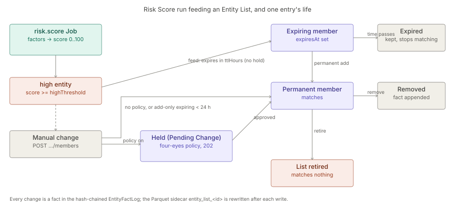

# Risk Scores and Entity Lists

> **Level 3 module page** (`SOLUTION-SUITE-DOCS-1`). Layer: Add-on.
> Offering: Standard and above — add-on `scoringLists` (status `built`, modules `entity-list`, `scoring`) in
> `offerings/standard.toon`. Checked against the code on 2026-10-17.

## 1. What it is

Two modules sold as one add-on:

- **Risk Scores** — `features/inspecto-scoring` (id `scoring`, package `com.gamma.risk`): an explainable 0–100 score
  per entity from weighted factors, computed by the `risk.score` Job. Classes: `RiskScoreModel` (spec + validation),
  `RiskScorer` (pure arithmetic, `recompute`), `RiskScoreEvaluator` (DuckDB evaluation and output),
  `RiskScoreJobType`, `RiskScoreRoutes`, `RiskScoreKindValidator`.
- **Entity Lists** — `features/inspecto-entity-list` (id `entity-list`, package `com.gamma.entitylist`): a
  Space-scoped set of typed entity keys with a purpose `allow | block | watch | exclusion`, stored as facts in the
  hash-chained log `EntityFactLog` (`platform/inspecto-entity-store`). Classes: `EntityListRoutes`,
  `RiskWatchListFeed` (implements the `WatchListFeed` SPI), `EntityListGovernableKinds`.

`scoring` requires `entity-list`; `entity-list` requires `entity-store`. Full concepts:
[Risk Scores](spec-risk-scores.md), [Entity Lists](../entity-list/spec.md).

## 2. Who uses it

- **Analysts** (`canWorkIncidents`) read and preview scores.
- **Incident managers** (`canManageIncidents`) create lists, change members, retire lists.
- **Authors** (`canAuthorWorkbench`) define `risk-score` models and register a list's sidecar as a Dataset.
- Consumers: [screening](../screening/architecture-overview.md), [anomaly](../anomaly/architecture-overview.md), [link-analysis](../la-core/architecture-overview.md).

## 3. Where it sits

Add-ons over the platform base. Scores are written through the shared score output contract (engine
`ScoreOutputWriter`, see [analytics-kernel](../analytics/architecture-overview.md)); Incidents come from the ordinary Alert Rule
machinery ([alerts](../../addon/incidents/architecture-alerts.md)). Without the modules `/risk-scores*` and `/entity-lists*` answer 503 and
`/bootstrap` reports `features.scoring` / `features.entityList` false.

## 4. How it works

**Scoring.** Each factor's indicator is a Measure (`count` or `agg(field)`, with filters) over one Dataset grouped
by its key column, compiled by the guarded `MeasureCompiler` — no raw SQL. `contribution = weight × indicator`,
bounded to `±cap`; a missing indicator is 0 and flagged; `score = Σ contribution` clamped to `[0, 100]`;
`high = score ≥ highThreshold`. The Job writes `risk_scores_<id>` (history) and swaps `risk_scores_<id>_latest`,
then emits `risk.score.produced`.

**Watch-list feed.** If the model declares `watchList`, every high entity is added to that `watch` list expiring
`ttlHours` after the run (actor `job:risk.score:<model>`). A permanent member stays permanent. A feed that cannot
happen fails the run.

**Entry lifecycle.** Members and range entries (`prefix`, `from`/`to`, `cidr`) are added or removed by appending
facts. An entry with `expiresAt` stops matching once expired but stays visible in as-of reads. An expiring add
never shortens a permanent entry. Under an approval policy for kind `entity-list`, `members` and `retire` are held
as Pending Changes (202) — except add-only changes whose entries all expire within 24 h. A retired list matches
nothing. Every write rewrites the Parquet sidecar `<dataRoot>/entity_list_<id>/entries.parquet`.

## 5. Configuration

`registry/risk-scores/<id>.toon` (`risk-score` kind):

| Key | Meaning |
|---|---|
| `entityType` | subscriber, account, device, sim, dealer, channel, partner, or a plain token |
| `highThreshold` | in (0, 100] |
| `dataScope` | optional read scope |
| `watchList` | `{list, ttlHours}`, `ttlHours` 1..24 |
| `maxEntities` | 1..2 000 000, else `-Drisk.score.maxEntities` (default 200 000); exceeding fails the run |
| `factors[]` | `id`, `label?`, `dataset`, `key`, `measure`, `filters?`, `weight`, `cap?`, `evidence?` |

Output names are derived; sending `scoresDataset` is a 422, and `risk_scores_` is a reserved prefix.

Entity Lists have no TOON file: they are created through the API. Four-eyes is the approval policy
`approval: {entity-list: {required: true}}` (see [maker-checker](../workflow/architecture-maker-checker.md)).

Schedule `risk.score` with parameter `model` on a `cron` or `on_pipeline:` trigger ([jobs-scheduler](../processor/architecture-jobs-scheduler.md)).
For Incidents, declare the `_latest` Dataset and a per-entity Alert Rule with `by: [model, entity_key]`.

## 6. Screens

- `/risk-scores` — `inspecto-ui/src/app/modules/admin/risk-scores/risk-scores.component.ts`, with
  `risk-score-form.dialog.ts`, `risk-score-factors.component.ts`, `risk-score-actions.component.ts`.
- Risk Score panel on the Incident page: `inspecto-ui/src/app/inspecto/components/risk-score-panel.component.ts`.
- Entity Lists in the Link Analysis app: `inspecto-ui/projects/la-app/src/app/entity-lists.page.ts` and the
  Investigation section `inspecto-ui/projects/link-analysis/src/link-analysis/link-analysis-entity-lists.component.ts`
  (entry editing parsed by `entity-list-entries.ts`).

## 7. API

| Route | Gate | Handler |
|---|---|---|
| `GET /risk-scores/{model}/{entityKey}` | `canWorkIncidents`; existence-hiding 404 | `features/inspecto-scoring/src/main/java/com/gamma/risk/RiskScoreRoutes.java` |
| `POST /risk-scores/preview` | `canWorkIncidents` (+ `canAuthorWorkbench` for unsaved content) | same |
| `GET /entity-lists`, `GET /entity-lists/{id}` | Space access | `features/inspecto-entity-list/src/main/java/com/gamma/entitylist/EntityListRoutes.java` |
| `POST /entity-lists` | `canManageIncidents` | same |
| `POST /entity-lists/{id}/members` | `canManageIncidents` (may be held) | same |
| `POST /entity-lists/{id}/retire` | `canManageIncidents` (may be held) | same |
| `POST /entity-lists/{id}/match` | Space access (read-shaped POST, 1..5 000 values) | same |
| `POST /entity-lists/{id}/register-dataset` | `canAuthorWorkbench` | same |

Models are authored through `/components/risk-score/{id}`.

## 8. Interactions

- [alerts](../../addon/incidents/architecture-alerts.md) / [incidents](../../addon/incidents/architecture-incidents.md) — a per-entity Alert Rule over `_latest` opens an Incident per
  high entity and heals when the score drops.
- [anomaly](../anomaly/architecture-overview.md) — feeds the same watch lists and uses an `exclusionList`; its `_latest` can be a factor.
- [screening](../screening/architecture-overview.md) — matches against Entity Lists.
- [link-analysis](../la-core/architecture-overview.md) — `excludeBy` / `seedBy` seal live list members.
- [maker-checker](../workflow/architecture-maker-checker.md) — model saves and list changes go through Pending Changes.

## 9. Limits and gotchas

- Range bounds must be equal length; CIDR blocks with host bits set are refused; IPv4-mapped IPv6 is IPv4.
- `excludeBy` / `seedBy` seal exact keys only; ranges do not take part yet.
- A failed sidecar write never undoes the fact (`sidecar: "failed"`); the log is the truth.
- A registered sidecar Dataset reads raw Parquet, so masking does not apply.
- Score entity keys are masked on read unless the caller holds `canRevealLinkEntities`.
- A scoring query failure is rethrown with a generic message so cell values never reach logs.
- Risk Scores are not shipped in Basic.
