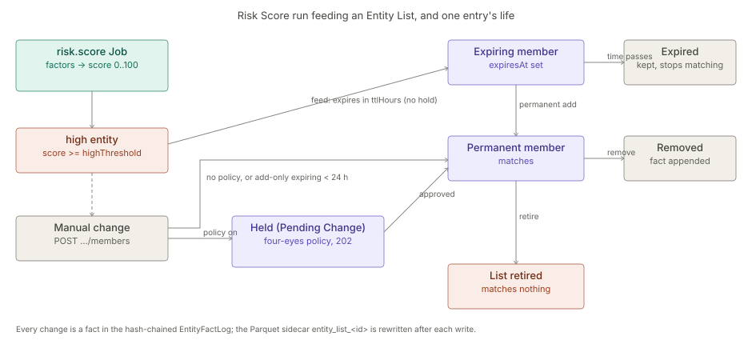
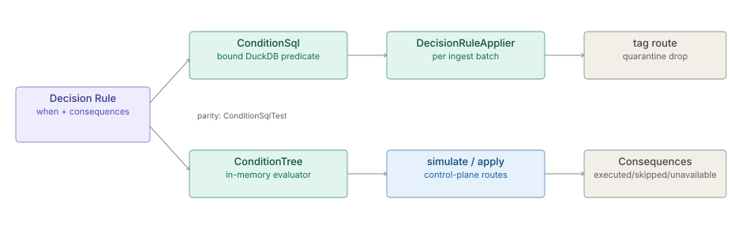

# Scoring and the Decision Kernel

The architecture of the `scoring` hub, in two parts: Risk Scores with the Entity Lists they feed (two
modules sold as one add-on), and the Decision Kernel — the Condition Language, the when / then model and
the Consequence registry that every decision kind shares. Each part keeps its own status line and the
date it was checked against the code.

**On this page**

- [Risk Scores and Entity Lists](#risk-scores-and-entity-lists) — the `risk.score` Job, the watch-list
  feed and the list entry lifecycle.
- [Decision Kernel (Decision Rules and the Condition Language)](#decision-kernel-decision-rules-and-the-condition-language) —
  the condition tree, its two backends and the consequences.

## Risk Scores and Entity Lists

> **Level 3 module page** (`SOLUTION-SUITE-DOCS-1`). Layer: Add-on.
> Offering: Standard and above — add-on `scoringLists` (status `built`, modules `entity-list`, `scoring`) in
> `offerings/standard.toon`. Checked against the code on 2026-10-17.

### 1. What it is

Two modules sold as one add-on:

- **Risk Scores** — `features/inspecto-scoring` (id `scoring`, package `com.gamma.risk`): an explainable 0–100 score
  per entity from weighted factors, computed by the `risk.score` Job. Classes: `RiskScoreModel` (spec + validation),
  `RiskScorer` (pure arithmetic, `recompute`), `RiskScoreEvaluator` (DuckDB evaluation and output),
  `RiskScoreJobType`, `RiskScoreRoutes`, `RiskScoreKindValidator`.
- **Entity Lists** — `features/inspecto-entity-list` (id `entity-list`, package `com.gamma.entitylist`): a
  Space-scoped set of typed entity keys with a purpose `allow | block | watch | exclusion`, stored as facts in the
  hash-chained log `EntityFactLog` (`platform/inspecto-entity-store`). Classes: `EntityListRoutes`,
  `RiskWatchListFeed` (implements the `WatchListFeed` SPI), `EntityListGovernableKinds`.

`scoring` requires `entity-list`; `entity-list` requires `entity-store`. Full concepts:
[Risk Scores](spec-risk-scores.md), [Entity Lists](../entity-list/spec.md).

### 2. Who uses it

- **Analysts** (`canWorkIncidents`) read and preview scores.
- **Incident managers** (`canManageIncidents`) create lists, change members, retire lists.
- **Authors** (`canAuthorWorkbench`) define `risk-score` models and register a list's sidecar as a Dataset.
- Consumers: [screening](../screening/architecture.md), [anomaly](../anomaly/architecture.md), [link-analysis](../la-core/architecture.md).

### 3. Where it sits

Add-ons over the platform base. Scores are written through the shared score output contract (engine
`ScoreOutputWriter`, see [analytics-kernel](../analytics/architecture.md)); Incidents come from the ordinary Alert Rule
machinery ([alerts](../../addon/incidents/architecture.md)). Without the modules `/risk-scores*` and `/entity-lists*` answer 503 and
`/bootstrap` reports `features.scoring` / `features.entityList` false.

### 4. How it works



**Scoring.** Each factor's indicator is a Measure (`count` or `agg(field)`, with filters) over one Dataset grouped
by its key column, compiled by the guarded `MeasureCompiler` — no raw SQL. `contribution = weight × indicator`,
bounded to `±cap`; a missing indicator is 0 and flagged; `score = Σ contribution` clamped to `[0, 100]`;
`high = score ≥ highThreshold`. The Job writes `risk_scores_<id>` (history) and swaps `risk_scores_<id>_latest`,
then emits `risk.score.produced`.

**Watch-list feed.** If the model declares `watchList`, every high entity is added to that `watch` list expiring
`ttlHours` after the run (actor `job:risk.score:<model>`). A permanent member stays permanent. A feed that cannot
happen fails the run.

**Entry lifecycle.** Members and range entries (`prefix`, `from`/`to`, `cidr`) are added or removed by appending
facts. An entry with `expiresAt` stops matching once expired but stays visible in as-of reads. An expiring add
never shortens a permanent entry. Under an approval policy for kind `entity-list`, `members` and `retire` are held
as Pending Changes (202) — except add-only changes whose entries all expire within 24 h. A retired list matches
nothing. Every write rewrites the Parquet sidecar `<dataRoot>/entity_list_<id>/entries.parquet`.

### 5. Configuration

`registry/risk-scores/<id>.toon` (`risk-score` kind):

| Key | Meaning |
|---|---|
| `entityType` | subscriber, account, device, sim, dealer, channel, partner, or a plain token |
| `highThreshold` | in (0, 100] |
| `dataScope` | optional read scope |
| `watchList` | `{list, ttlHours}`, `ttlHours` 1..24 |
| `maxEntities` | 1..2 000 000, else `-Drisk.score.maxEntities` (default 200 000); exceeding fails the run |
| `factors[]` | `id`, `label?`, `dataset`, `key`, `measure`, `filters?`, `weight`, `cap?`, `evidence?` |

Output names are derived; sending `scoresDataset` is a 422, and `risk_scores_` is a reserved prefix.

Entity Lists have no TOON file: they are created through the API. Four-eyes is the approval policy
`approval: {entity-list: {required: true}}` (see [maker-checker](../workflow/architecture.md)).

Schedule `risk.score` with parameter `model` on a `cron` or `on_pipeline:` trigger ([jobs-scheduler](../processor/architecture.md)).
For Incidents, declare the `_latest` Dataset and a per-entity Alert Rule with `by: [model, entity_key]`.

### 6. Screens

Moved to [Risk Scores and Entity Lists — screens](user-guide-scoring-entity-lists.md).

### 7. API

Moved to [Risk Scores and Entity Lists — API](api-scoring-entity-lists.md).

### 8. Interactions

- [alerts](../../addon/incidents/architecture.md) / [incidents](../../addon/incidents/architecture.md) — a per-entity Alert Rule over `_latest` opens an Incident per
  high entity and heals when the score drops.
- [anomaly](../anomaly/architecture.md) — feeds the same watch lists and uses an `exclusionList`; its `_latest` can be a factor.
- [screening](../screening/architecture.md) — matches against Entity Lists.
- [link-analysis](../la-core/architecture.md) — `excludeBy` / `seedBy` seal live list members.
- [maker-checker](../workflow/architecture.md) — model saves and list changes go through Pending Changes.

### 9. Limits and gotchas

- Range bounds must be equal length; CIDR blocks with host bits set are refused; IPv4-mapped IPv6 is IPv4.
- `excludeBy` / `seedBy` seal exact keys only; ranges do not take part yet.
- A failed sidecar write never undoes the fact (`sidecar: "failed"`); the log is the truth.
- A registered sidecar Dataset reads raw Parquet, so masking does not apply.
- Score entity keys are masked on read unless the caller holds `canRevealLinkEntities`.
- A scoring query failure is rethrown with a generic message so cell values never reach logs.
- Risk Scores are not shipped in Basic.

## Decision Kernel (Decision Rules and the Condition Language)

> **Level 3 module page** (`SOLUTION-SUITE-DOCS-1`). Layer: Platform base.
> Offering: every edition (some consequences need add-on modules). Checked against the code on 2026-10-17.

### 1. What it is

The **Decision Kernel** is the one runtime every decision kind shares: the **Condition Language** (the condition
tree), the when / then model and the **Consequence registry**. A **Decision Rule** is its business-logic and
routing kind: `when` a record matches, apply `consequences`. It is not a general rule engine (decision D-MR12).

Code: `platform/inspecto-engine/src/main/java/com/gamma/query/ConditionTree.java` (in-memory evaluator),
`platform/inspecto-engine/src/main/java/com/gamma/query/ConditionSql.java` (DuckDB predicate),
`platform/inspecto-engine/src/main/java/com/gamma/query/DecisionRuleApplier.java` (per-batch record routing),
`platform/inspecto-engine/src/main/java/com/gamma/pipeline/DecisionRules.java` (rule loading),
`platform/inspecto-engine/src/main/java/com/gamma/decision/` (Consequence registry),
`inspecto/src/main/java/com/gamma/control/DecisionRoutes.java` (HTTP).

### 2. Who uses it

- **Authors** (`canAuthorWorkbench`) write Decision Rules and simulate them against sample rows.
- **Other kinds** use the same tree: Alert Rule `when`, Expectation `condition` (and `non_null` / `range` / `regex`
  expanded into a tree), Tag and Case Rule filters, Notification Rule match, Risk factor filters, Escalation match.

### 3. Where it sits

Engine base (`inspecto-engine`) plus control-plane routes. The browser twin is
`inspecto-ui/src/app/inspecto/query/query-eval.ts`; `ConditionTree` is a port of it, so a preview in the editor
and a backend count agree. The `Conditions` text notation (Access Policies only) is separate; compiling it into
the tree was declined (see [module reorganisation decisions](../../layer/platform/spec-module-reorg-decisions.md)).

### 4. How it works



**The condition tree.** A group `{kind: group, op: AND|OR, items: [...], negate?}` nests leaves
`{kind: condition, field, operator, value?, value2?, valueField?, ignoreCase?}`. Operators: `=`, `!=`, `<`, `<=`,
`>`, `>=`, `contains`, `startsWith`, `endsWith`, `in`, `between`, `isNull`, `isNotNull`, `matches` (regex, at most
256 characters, no lookaround, back-references or possessive quantifiers). An empty or incomplete group means
"no constraint" (matches all). The root must be a group: a bare leaf is 422 (`ConditionTree.requireGroupRoot`,
shared by both evaluators). Strict twins (`matchedStrict`, `filterStrict`, `validateStrict`,
`ConditionSql.predicateStrict`) throw on malformed trees and treat an absent field as false.

**Two backends, one meaning.** `ConditionTree` evaluates in memory (simulate, Alert Rule row scoping);
`ConditionSql.predicateBound` renders a DuckDB predicate with every operand bound as a parameter
(`DECISION-RULE-SQL-GUARD-1`). `ConditionSqlTest` asserts the SQL count equals `ConditionTree.matched`.

**Record-routing consequences at ingest.** `DecisionRuleApplier` runs per batch between transform and partition
write: enabled rules whose `targetType: pipeline` and `target` match the Pipeline, in priority order. Order of
effect: `tag` (appends `__tags`), then `route` (copies to `dirs.database/<destination>`), `quarantine` (copies
under `dirs.quarantine/records/<rule>/`), then one removal for `drop`. Each applied rule emits a
`decision-rule.applied` Signal. Rules are re-read every batch. A broken rule is logged and skipped - routing never
fails the batch. `targetType: job` rules apply to `sql.template` job results and Stage-2 enrichment output.

**Platform consequences on apply.** `POST /decision-rules/{name}/apply` runs `emit-signal`, `start-job`,
`trigger-pipeline`, `create-alert`, `create-incident` (contributed by `inspecto-ops`), `invoke-api` (contributed by
`inspecto-action-requests`, proposes an [Action Request](../action-requests/architecture.md)), plus stub `render-widget` /
`generate-report`. Each reports `executed`, `skipped` or `unavailable` (a known action whose module is absent).

### 5. Configuration

A Decision Rule is a `decision-rule` component under `<write-root>/registry` (`ComponentStore`):

```
name: big-calls
targetType: pipeline
target: cdr-ingest
priority: 10
enabled: true
when: {kind: group, op: AND, items: [{kind: condition, field: duration, operator: ">", value: 3600}]}
consequences: [{action: tag, params: {tag: long-call}}]
```

`lastSimulation` is a result stamp written by simulate (non-authoring, no version churn). `makers` is server-stamped
for rules with `invoke-api`. Decision Rules are a governed kind under [maker-checker](../workflow/architecture.md).

### 6. Screens

Moved to [Decision Kernel (Decision Rules and the Condition Language) — screens](user-guide-decision-kernel.md).

### 7. API

Moved to [Decision Kernel (Decision Rules and the Condition Language) — API](api-decision-kernel.md).

### 8. Interactions

- [Action Requests](../action-requests/architecture.md) via `invoke-api`; [maker-checker](../workflow/architecture.md) governs rule saves.
- [Platform Services](../../layer/platform/architecture-platform-services.md): Jobs run by `start-job`.
- Concept detail: [Decision Rules and the condition-tree evaluator](../processor/spec-decision-rules.md).

### 9. Limits and gotchas

- The tree fails **open** on an empty group (matches all) - deliberate for half-built editor rows.
- Platform consequences never fire during live runs: no automatic caller exists; only `/apply` runs them.
- Simulate needs `sampleRows`; with none it returns `0/0`.
- Two read-only callers still inline literals (`ConditionSql.predicate`): the AI query tool and the Link Analysis
  `EngineDatasetProvider` port (`LA-FILTER-SQL-BIND-1`).
- A Job's `when:` string is a Signal trigger expression, a different grammar the tree never reads.
