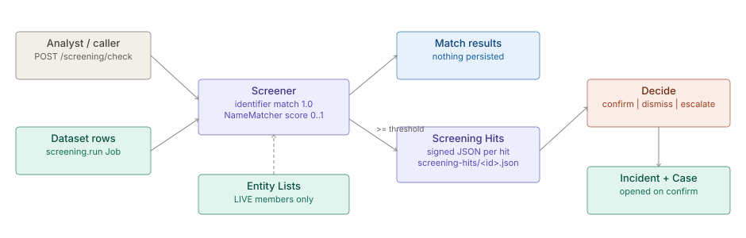

# Screening

> **Level 3 module page** (`SOLUTION-SUITE-DOCS-1`). Layer: Add-on.
> Offering: Standard and above (`screening` add-on, module `screening`). Checked against the code on 2026-10-17.

## 1. What it is

Screening matches subjects (a key, a name, an identifier) against [Entity Lists](../scoring/architecture-scoring-entity-lists.md) and keeps
a reviewable record of every match a scheduled run finds. Two paths share one matcher:

- **Check** - an ad-hoc, read-shaped call that returns Match Scores and persists nothing.
- **Run** - the `screening.run` Job Type screens every row of a Dataset and raises a **Screening Hit** for each
  match at or above the threshold that has no hit yet.

Module: `features/inspecto-screening` (manifest id `screening`, requires `entity-list` and `ops`). Deeper design
notes: [Screening concept](spec.md).

## 2. Who uses it

- **Compliance analysts** (AML, sanctions, PEP) check a name on demand and work the hit queue.
- **Reviewers** confirm, dismiss or escalate hits; a second person confirms an escalated hit.
- **Pipeline authors** schedule `screening.run` over a customer or counterparty Dataset.

## 3. Where it sits

An add-on over the platform base. It reads Entity Lists (`entity-list` module), runs as a Job through the
[Jobs scheduler](../processor/architecture-jobs-scheduler.md), and on confirm opens an [Incident](../../addon/incidents/architecture-incidents.md) and a
[Case](../case-management/architecture-overview.md). Bundles without the jar answer the routes with the manifest's `absentMessage`
("Standard edition and above").

## 4. How it works

1. **Matching** (`Screener`). Identifier: the list's own matching (exact under the sealed normaliser, then
   prefix / range / CIDR), score 1.0. Name: `NameMatcher` against the list's LIVE members, blocked on the first
   folded letter or the first letter of the transliteration skeleton. A retired list and an expired entry never
   match; a masked list's entry is shown as its mask token.
2. **Name score** (`NameMatcher`). Fold (NFKD, marks stripped, Cyrillic / Greek look-alikes to Latin, digit
   look-alikes inside letter tokens, honorifics dropped), then `max(tokenSet, joined)` over Jaro-Winkler; a
   phonetic skeleton score is taken when the plain score is low, capped at `PHONETIC_CAP`. Pure and deterministic.
3. **Run** (`ScreeningJobType`). Params `dataset`, `keyField`, `nameField` and/or `idField`, `lists` (comma
   separated), `threshold` (default 0.85), `maxRows` (default 100 000, ceiling 1 000 000). More rows than `maxRows`
   FAILS the Run - a partial screen would read as a clean one. A classified column is stored masked in the hit;
   matching uses the raw value. New hits emit the `screening.hits.raised` Signal (`ScreeningSignals`).
4. **Hits** (`ScreeningHits`). One HMAC-signed JSON document per hit at `<write-root>/screening-hits/<id>.json`,
   the Action Requests storage pattern (atomic temp + move, signed under domain `screening-hit`). A forged or edited
   document reads back `integrity: invalid` and can never be decided. Identity: `dedupeKey = sha256(listId, entry,
   subjectKey)`; a Run never raises a second hit for a key that already has one.
5. **Decide**. States `open -> confirmed | dismissed | escalated`, `escalated -> confirmed | dismissed`; confirmed
   and dismissed are final. Whoever escalated cannot confirm (four-eyes). A confirm opens an Incident and a Case
   for the subject key and its Dataset (`ScreeningCases`) - never the screened name - and stamps `caseId` /
   `incidentId` on the hit.

## 5. Configuration

- **Job**: a `screening.run` Job in the Space's Jobs config with the params above. No module-level TOON file.
- **Lists**: authored through Entity Lists; Screening adds no list format.
- **Enablement**: `screening` in the Offering (`offerings/standard.toon`), then per Space in the module switch.

## 6. Screens

Moved to [Screening — screens](user-guide-screening.md).

## 7. API

Moved to [Screening — API](api-screening.md).

## 8. Interactions

- [Scoring and Entity Lists](../scoring/architecture-scoring-entity-lists.md) - the lists screened against.
- [Jobs scheduler](../processor/architecture-jobs-scheduler.md) - runs `screening.run`.
- [Incidents](../../addon/incidents/architecture-incidents.md) and [Case management](../case-management/architecture-overview.md) - opened on confirm.
- [Action requests](../action-requests/architecture-overview.md) - same signed-document storage pattern.
- [Events](../event/architecture-overview.md) - the `screening.hits.raised` Signal.
- [AML solution](../../solution-pack/aml/architecture.md).

## 9. Limits and gotchas

- `maxRows` overflow fails the whole Run on purpose; raise the param rather than splitting silently.
- Hits live in the config tree a Space backup carries; every import refuses the `screening-hits` directory and a
  whole-Space export skips it.
- A hit is never re-raised for the same `(list, entry, subject)`, even after dismissal.
- Folding covers Latin, Cyrillic and Greek look-alikes; other scripts fold only through NFKD.
