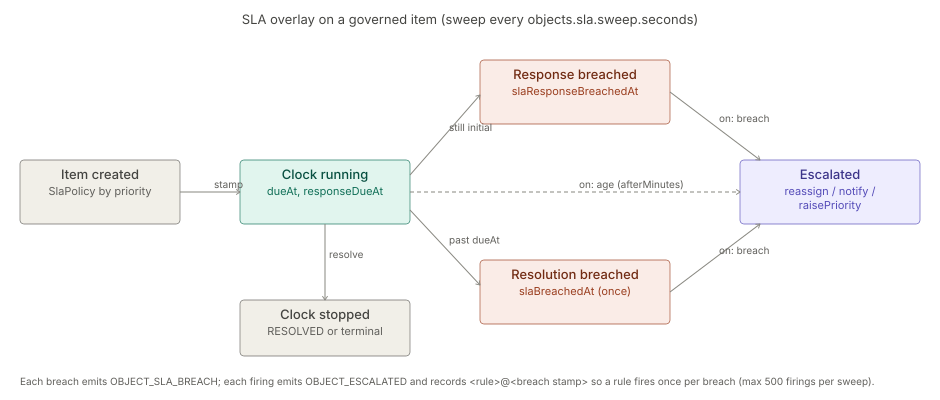
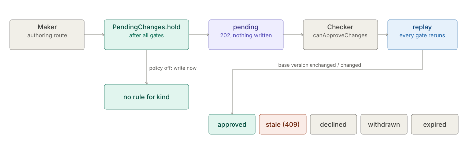

# Workflow, SLA and maker-checker

The architecture of the `workflow` hub, in two parts: authored workflows, SLA Policies and
Escalation Rules for Incidents and Cases, and maker-checker, which holds a config change as a Pending
Change until a second person approves it. Each part keeps its own status line and the date it was checked against
the code.

**On this page**

- [Workflow and SLA](#workflow-and-sla) — the workflow models, the SLA clock and escalation.
- [Maker-checker (Pending Changes)](#maker-checker-pending-changes) — the Approval Policy, hold, decide,
  apply and expire.

## Workflow and SLA

> **Level 3 module page** (`SOLUTION-SUITE-DOCS-1`). Layer: Add-on.
> Offering: add-on `workflowSla` in `offerings/standard.toon` — `status: built`, module `ops`.
> The models are built (`ASSURE-WORKFLOW-SLA-1`, closed 2026-10-04); see §9. Checked against the code on 2026-10-17.

### 1. What it is

Authored **workflows** (the states and actions an Incident or Case may take), **SLA Policies** (response and
resolution targets per priority, on a business calendar) and **Escalation Rules** (what happens on a breach
or at an age). The pure models live in `platform/inspecto-workflow` (module id `workflow`, "Workflow and SLA
models", `offeringRole: base`); the runtime sweep lives in `features/inspecto-ops`.

- `platform/inspecto-workflow/src/main/java/com/gamma/workflow/Workflow.java` — definition, built-ins, validation, `apply`.
- `platform/inspecto-workflow/src/main/java/com/gamma/workflow/SlaPolicy.java` — targets + calendar (`addWorkingMinutes`).
- `platform/inspecto-workflow/src/main/java/com/gamma/workflow/EscalationRule.java` — trigger `BREACH` | `AGE`, priority ladder `LOW < MINOR < MAJOR < CRITICAL`.
- `platform/inspecto-workflow/src/main/java/com/gamma/workflow/SlaDecisions.java` — deadline and breach decisions.

### 2. Who uses it

- **Administrators** (`canAdminister`) author workflows, SLA Policies and Escalation Rules.
- **Incident and case handlers** see SLA badges (Respond by / Due / breached) and receive escalations.

### 3. Where it sits

The models are platform base; they are applied to `INCIDENT` and `CASE` objects by `ObjectService` in
`features/inspecto-ops` (`sweepIncidentSla`), with authored files loaded by `GovernanceRegistry`. Without
`inspecto-ops` there are no objects to govern and `GET /workflows/{type}` answers 503. See
[incidents](../../addon/incidents/architecture.md) and [case-management](../case-management/architecture.md).

### 4. How it works



- **Workflow** — built-ins from `Workflow.defaultFor`: INCIDENT `IDENTIFIED → DIAGNOSING → RESOLVED → ARCHIVED`
  (with `reopen`), CASE `OPEN → INVESTIGATING → ESCALATED → RESOLVED → CLOSED`, TASK `OPEN → CLOSED`. An authored
  workflow must pass `problems()`: a terminal state, every state reachable, a finishing way out of every
  non-terminal state, no duplicate action from one state, and for an Incident `RESOLVED` present with only
  `RESOLVED` moving into a terminal state other than `ARCHIVED`.
- **SLA clock** — on creation `dueAt` / `responseDueAt` are stamped from `createdAt` using the policy for the
  item's priority (`*` fallback; severity when priority is missing). A response breach is the response
  deadline passing while the item is still in its initial state; a resolution breach stamps `slaBreachedAt`
  once. Each breach emits `OBJECT_SLA_BREACH`. The clock stops at `RESOLVED` and at terminal states.
- **Escalation** — a rule fires on a breach (`target` resolution or response) or on age (`afterMinutes`),
  optionally filtered by `priority` and a `when` condition, and runs `reassign`, `notify` and/or
  `raisePriority`. It records `<rule>@<breach stamp>` in `attributes.escalations`, so it fires once per breach,
  sets `escalated=true` and emits `OBJECT_ESCALATED`. At most 500 firings per sweep.

### 5. Configuration

| Item | Where |
|---|---|
| Component kinds `workflow`, `sla-policy`, `escalation-rule` | `ComponentStore`; directories `registry/workflows/`, `registry/sla-policies/`, `registry/escalation-rules/` |
| Legacy override | a `*_workflow.toon` file (below an authored component, above the built-in) |
| SLA keys | `responseMinutes`, `resolutionMinutes` per priority or `*`; calendar working days, `start`, `end`, holidays, IANA zone (required) |
| Escalation keys | `on` (`breach` \| `age`), `target` (`resolution` \| `response`), `afterMinutes`, `priority`, `when`, actions `reassign` / `notify` / `raisePriority` |
| Sweep cadence | JVM property `-Dobjects.sla.sweep.seconds` (default 60; 0 disables) |

`GovernanceRegistry` re-reads the directories on change, loads at most 50 Escalation Rules, and keeps the
last valid version of a broken file. See [toon-config](../config/spec-toon-config.md).

### 6. Screens

Moved to [Workflow and SLA — screens](user-guide-workflow-sla.md).

### 7. API

Moved to [Workflow and SLA — API](api-workflow-sla.md).

### 8. Interactions

- [maker-checker](#maker-checker-pending-changes) — all three kinds are governable; a held write reads "submitted for
  approval". Imports refuse them.
- [notifications](../notify-channels/architecture.md) — a `notify` escalation emits a warning `OBJECT_ESCALATED` event that the
  `builtin-escalation` rule in `NotificationRules` delivers.
- [identity-access](../access/architecture.md) — `reassign` targets are checked at save time (id shape only; no
  directory implementation ships).
- [jobs-scheduler](../processor/architecture.md) — not used: the sweep is a timed cadence, not a Job Type.

### 9. Limits and gotchas

- A Case's `targetDate` is only a loose hint; the SLA Policy is the clock.
- Not built (retired to BACKLOG §6 2026-10-18; trigger: an IAM customer): a deleted assignee is not rechecked at sweep time.
- Queues and watchers were retired (INC-4); assignment is person-only.

## Maker-checker (Pending Changes)

> **Level 3 module page** (`SOLUTION-SUITE-DOCS-1`). Layer: Platform base.
> Offering: every edition; deciding needs an Authenticator, so on Basic it cannot be switched on through the API.
> Checked against the code on 2026-10-17.

### 1. What it is

Maker-checker holds a config change for a second person's approval. When the Space's **Approval Policy**
requires approval for a kind, an authoring route does not write: it stores a **Pending Change** and answers
`202 {status: pending, written: false, pendingChange}`. A person holding the approver capability then approves
(the original request is replayed) or declines it. The author cannot decide their own change; they can withdraw it.

Code: `inspecto/src/main/java/com/gamma/control/PendingChanges.java` (hold, store, replay check, expiry),
`inspecto/src/main/java/com/gamma/control/PendingChangeRoutes.java` (HTTP),
`inspecto/src/main/java/com/gamma/control/ApprovalPolicy.java` (policy and the governable kinds),
`inspecto/src/main/java/com/gamma/control/ApproverCheck.java` and
`inspecto/src/main/java/com/gamma/control/ApproverRoster.java` (who may decide).

### 2. Who uses it

- **Makers**: anyone authoring a governed kind (Pipelines, schemas, components, Jobs, Alert Rules, Decision Rules, Expectations, channels).
- **Checkers**: holders of `canApproveChanges` (or the capability the policy names for the kind), working the inbox.
- **Administrators**: set the policy (`canAdminister`) and, under OIDC, the approver roster.

### 3. Where it sits

Core control plane (`inspecto` module), not an add-on. It sits between every config-writing route's validation
gates and its first side effect. The same approver-eligibility reading (`ApproverCheck`) and the same per-Space
HMAC key are reused by [Action Requests](../action-requests/architecture.md), which has its own mandatory approval and is never
held as a Pending Change.

### 4. How it works



1. **Hold.** Each authoring route calls `PendingChanges.hold(api, ex, kind, name, proposed, current)` after all
   its validation. No rule for the kind: it returns and the route writes as before. Otherwise it stores the change
   and throws `PendingChanges.Held`. One pending change per kind + name (a second is 409). The author may send
   an `X-Change-Reason` header.
2. **Writers that cannot be one change refuse** (409) under a policy: `/bundle/import`, `/pipelines/import`,
   BI template apply, `POST /import` with a governed entry (`PendingChanges.holdRefusing`, `holdRefusingPaths`).
3. **Decide.** Approve / decline need `canApproveChanges`, an authenticated Subject, a valid record (HMAC), status
   `pending`, the policy's `approverCapability`, four-eyes (not the author) and, under OIDC, a place on the roster.
4. **Apply.** Approve replays the stored request (method, path, query, body, `If-Match`) through
   `ApiContext.replay` with the change stamped on it. Every gate of the route runs again. The hold lets it through
   only if it is the same write and the replaced content is still at the **base version**; otherwise the change is
   closed as **stale** (409). Versions are content hashes that ignore `createdAt`, `updatedAt`, `lastResult`,
   `lastSimulation`, so routine evaluation does not stale a waiting change.
5. **Expire.** Past `expiresAfterHours` a pending change becomes `expired` - lazily, on the next list, read, decide
   or withdraw (`PendingChanges.expireIfDue`); there is no scheduler.

States: `pending` then `approved`, `declined`, `withdrawn`, `stale` or `expired`; a record failing its MAC reads
`invalid` and cannot be decided.

### 5. Configuration

`approval.toon` in the Space config root:

```
approval:
  pipeline: {required: true, approverCapability: canApproveChanges, fourEyes: true}
expiresAfterHours: 168
```

- Default: off for every kind; capability `canApproveChanges`; four-eyes on; 168 h.
- Validated fail closed: a kind outside `ApprovalPolicy.GOVERNABLE`, a capability no route demands, an unknown key
  or a bad value is 422. A present but unreadable file is **not** off: every governable kind is held
  (`failedClosed: true` on the GET).
- Governable: `pipeline`, `schema`, `enrichment`, `meta`, `job`, and every `ComponentStore` kind except `requirement`
  (including `channel`, `notification-rule`). Not governable: Connections, Tags, Case Rules, Space settings documents
  (the policy itself above all).
- `approvers.toon` (`users`, `groups`): the per-Space approver roster used when the Authenticator cannot list
  its principals (OIDC). Absent or empty admits nobody.
- `-Dinspecto.pendingChanges.lockWaitMs`: bound on waiting for the store's file lock.
- Storage: `<write-root>/pending-changes/<id>.json`, ids `pc-<yyyyMMddHHmmss>-<6 hex>`; key in
  `<config root>.secrets/.pending-changes.key`, outside the config tree.

### 6. Screens

Moved to [Maker-checker (Pending Changes) — screens](user-guide-maker-checker.md).

### 7. API

Moved to [Maker-checker (Pending Changes) — API](api-maker-checker.md).

### 8. Interactions

- [Action Requests](../action-requests/architecture.md) reuse `ApproverCheck`, the roster and the HMAC key (domain-separated).
- [Decision Kernel](../scoring/architecture.md): Decision Rules are a governed kind.
- [Platform Services](../../layer/platform/architecture-platform-services.md): a Job's run-time writes are not held (by decision).
- Details: [config safety - Maker-checker](../config/spec-config-safety.md),
  [auth and security](../access/admin-guide-auth-security.md).

### 9. Limits and gotchas

- A change with no eligible approver waits until it expires; nothing auto-declines.
- Job **run-time** writes (a `MaterializeTask` restating its Dataset) are not held, by decision.
- The MAC defends against records written through doors that cannot read the key, not against a local administrator.
- The hold guard's closure stops at a file boundary; `ConfigWriteFunnelTest` keeps the inventory of writers.
- Approve replays as the **author**: `updatedBy` on a Job is the author, never the approver.
- A store lock that cannot be taken in time answers 503.
