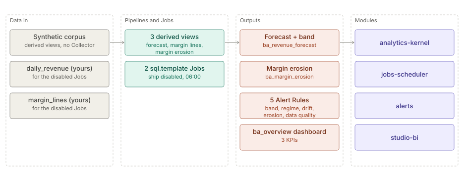
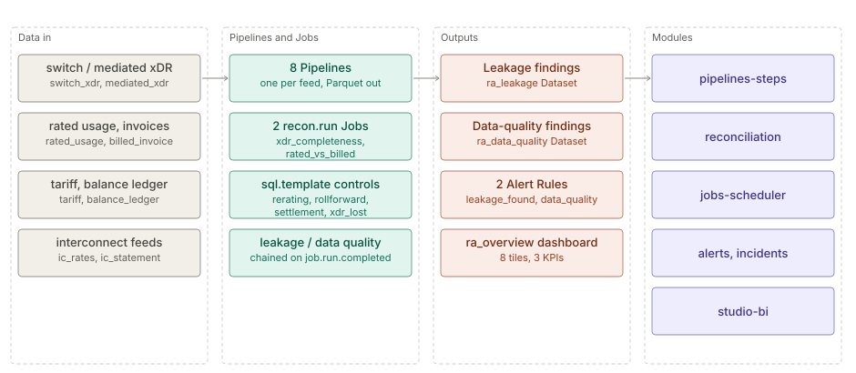

# Business assurance and revenue assurance

The architecture of the `business-assurance` hub, in two parts, one per Space Template: `business-assurance`
(revenue forecast and margin erosion over plain DuckDB SQL and Alert Rules) and `telco-ra` (telecom revenue
assurance: Reconciliations and control Jobs over eight feeds). Each part keeps its own status line and the
date it was checked against its template.

**On this page**

- [Business assurance](#business-assurance) — the revenue forecast, margin erosion, Jobs and Alert Rules.
- [Revenue assurance (telecom)](#revenue-assurance-telecom) — the eight feeds, Reconciliations and control Jobs.

## Business assurance

> **Level 2 solution page** (`SOLUTION-SUITE-DOCS-1`). Content pack: Space Template `business-assurance`
> (`spaces/_templates/business-assurance/template.toon`). Offering: listed in `offerings/basic.toon`
> `contentPacks`, so in every edition. Checked against the template on 2026-10-17.

### Business problem

Finance and commercial teams want to know early when revenue leaves its normal seasonal range, when the
trend itself shifts, and which product, channel and partner combination is losing margin — without a
data-science project. The pack does both with plain DuckDB SQL and Alert Rules.

### Data in

The pack ships **no Collector or Pipeline**. It brings:

- A deterministic synthetic corpus: 26 weeks of daily revenue and 8 weeks of sales lines across 4
  products, 3 channels and 3 partners. It is generated inside three derived views in
  `spaces/_templates/business-assurance/config/views/` (`ba_revenue_forecast_view.toon`,
  `ba_margin_lines_view.toon`, `ba_margin_erosion_view.toon`), with planted anomalies (a revenue dip, a
  regime shift, an eroding P3 / online / PB line).
- Seed Parquet for the two Datasets the Alert Rules read: `data/revenue_forecast/seed.parquet` and
  `data/margin_erosion/seed.parquet` in the template folder.
- For your own data: two Jobs that expect stores named `daily_revenue` (columns `ds`, `revenue`) and
  `margin_lines` (product, channel, partner, units, revenue, cost).

### What the pack sets up

- **Revenue forecast** — a Holt-Winters additive model with a weekly season, written in SQL: forecast,
  lower and upper band (4 robust sigma), and flags `outside_band`, `regime_change`, `drift_change` per
  day after a 28-day warm-up (`ba_revenue_forecast_view.toon`).
- **Margin erosion** — baseline versus recent 28-day margin per product × channel × partner, with a
  status (`assessed`, `insufficient`, `new`, `data_quality`) and `erosion_pp`
  (`ba_margin_erosion_view.toon`).
- **Two Jobs** `ba_revenue_forecast` and `ba_margin_erosion` (`sql.template`, 06:00) that run the same
  SQL over `daily_revenue` / `margin_lines` into `revenue_forecast` / `margin_erosion`; both ship
  `enabled: false` (`spaces/_templates/business-assurance/config/jobs/`).
- **Five Alert Rules** (`spaces/_templates/business-assurance/config/registry/alert-rules/`):
  `ba_revenue_outside_band`, `ba_revenue_regime_change`, `ba_revenue_drift` (CRITICAL, by `ds`),
  `ba_margin_erosion` (WARNING, `max(erosion_pp)` > 5) and `ba_margin_data_quality` (WARNING).
- **Three KPIs** (`ba_revenue`, `ba_margin`, `ba_days_outside_band`), five Widgets including
  `ba_revenue_vs_forecast` and `ba_margin_erosion_by_partner`, and the `ba_overview` dashboard.
- **Runbooks** — `spaces/_templates/business-assurance/config/runbooks/business-assurance-runbooks.md`.

### Day in the life of an analyst

1. On the synthetic corpus the dashboard is populated immediately from the seed Datasets.
2. With real data, the analyst lands `daily_revenue` and `margin_lines` and enables the two Jobs.
3. Each morning `ba_overview` shows revenue against forecast with the band, and days outside it.
4. A `ba_revenue_outside_band` Alert on one day is checked against the calendar (holiday, outage); a
   `ba_revenue_regime_change` means the new level is real and the forecast re-anchors.
5. A `ba_margin_erosion` Alert names the product, channel and partner; the analyst takes it to pricing or
   partner management. A `data_quality` status means fix the feed first.

### Modules used

- [Analytics kernel](../../module/analytics/architecture.md) — SQL views and Datasets.
- [Jobs and scheduler](../../module/processor/architecture.md).
- [Alerts](../../addon/incidents/architecture.md), [Incidents](../../addon/incidents/architecture.md).
- [Studio BI](../../layer/product/architecture-studio-bi.md).

### Diagram

### Limits

- No ingest is configured; you must provide `daily_revenue` and `margin_lines` yourself.
- Model parameters (smoothing constants, band width, warm-up, minimum lines and revenue) are literals
  inside the SQL, not separate configuration keys.
- One weekly season only; no holiday calendar.
- The margin model compares two fixed 28-day windows.

## Revenue assurance (telecom)

> **Level 2 solution page** (`SOLUTION-SUITE-DOCS-1`). Content pack: Space Template `telco-ra`
> (`spaces/_templates/telco-ra/template.toon`). Checked against the template on 2026-10-17.

### Business problem

Usage that the network carried but nobody billed, billed at the wrong rate, or settled wrongly with an
interconnect partner is revenue lost silently. A revenue-assurance team needs repeatable controls that
compare every hand-off (switch to mediation to rating to billing, prepaid balances, partner statements),
quantify the gap and track each finding until it is confirmed and recovered.

### Data in

Eight synthetic feeds, each with its own Pipeline and Schema under `spaces/_templates/telco-ra/config/`:

| Feed (Pipeline) | Role |
|---|---|
| `switch_xdr` | xDRs as the switch produced them |
| `mediated_xdr` | xDRs after mediation |
| `rated_usage` | rated xDRs with a charge |
| `billed_invoice` | invoice lines per subscriber |
| `tariff` | effective-dated tariff table (a Reference) |
| `balance_ledger` | prepaid balance movements |
| `ic_rates` | interconnect rates (a Reference) |
| `ic_statement` | partner interconnect statements |

Each Pipeline polls `data/inbox/<feed>` and writes Parquet
(`spaces/_templates/telco-ra/config/switch_xdr/switch_xdr_pipeline.toon`). The synthetic golden corpus
(fixed seed, planted leakages and benign look-alikes) ships in `data/samples`; copy a feed into
`data/inbox/<feed>` to ingest it.

### What the pack sets up

- **Two Reconciliations** — `ra_xdr_completeness` (switch / mediation / rating 3-way) and
  `ra_rated_vs_billed` (monthly rated charge against the invoice, keyed on `SUBSCRIBER_ID`, absolute
  tolerance 0.05; `spaces/_templates/telco-ra/config/registry/reconciliations/ra_rated_vs_billed.toon`).
  Both run as `recon.run` Jobs at 05:00 and 05:05.
- **Control Jobs** (`spaces/_templates/telco-ra/config/jobs/`), all `sql.template`:
  `ra_xdr_lost` (05:02), `ra_rerating` against the tariff (05:10), then `ra_rollforward`
  (opening + in − out = closing) and `ra_settlement`, chained with `on_signal: job.run.completed`.
  `ra_leakage` and `ra_data_quality` fold the findings into two Datasets once `ra_settlement` succeeds.
  `ra_recovery` runs hourly; `ra_objects_analytics` (`objects.analytics`) hourly.
- **A completeness tile** fed by `ra_switch_kpi_completeness` (`kpi.completeness`, ships `enabled: false`).
- **Two Alert Rules** — `ra_leakage_found` (CRITICAL, count by `CONTROL` ≥ 1) and `ra_data_quality`
  (WARNING), in `spaces/_templates/telco-ra/config/registry/alert-rules/`.
- **Two Expectations** — `ra_rated_charge_non_negative`, `ra_switch_xdr_id_non_null`.
- **Three KPIs** — `leakage_found`, `leakage_items`, `data_quality_items`.
- **Dashboard** `ra_overview` with eight tiles: leakage found / items / confirmed / recovered, xDR lost,
  data-quality items, leakage by control, completeness status
  (`spaces/_templates/telco-ra/config/registry/dashboards/ra_overview.toon`).
- **Runbooks** — `spaces/_templates/telco-ra/config/runbooks/telco-ra-runbooks.md`.

Every tolerance and threshold is configuration in these files.

### Day in the life of an analyst

1. Overnight the feeds land; the two Reconciliations run at 05:00, the re-rating, roll-forward and
   settlement controls follow in a chain.
2. At the start of the day the analyst opens `ra_overview`: leakage found per control, xDRs lost, and the
   data-quality count.
3. A `ra_leakage_found` Alert per control opens an Incident; a Reconciliation breach opens one too. The
   analyst works it from the runbook, confirms or dismisses the finding and records the Disposition.
4. Confirmed items feed the impact ledger; `ra_recovery` refreshes the recovered amount hourly, which
   shows on the "leakage recovered" tile.
5. Data-quality findings (for example a negative rated charge) go back to the feed owner rather than
   being counted as leakage.

### Modules used

- [Pipelines and Steps](../../module/etl/architecture.md) — the eight feeds.
- [Collectors](../../module/acquire/architecture.md) and
  [Parsing and ingest](../../module/etl/architecture.md) — inbox polling and Schemas.
- [Reconciliation](../../module/reconciliation/architecture.md) — the two `recon.run` controls.
- [Jobs and scheduler](../../module/processor/architecture.md) — cron and signal chaining.
- [Alerts](../../addon/incidents/architecture.md) and [Incidents](../../addon/incidents/architecture.md).
- [Studio BI](../../layer/product/architecture-studio-bi.md) — KPIs, Widgets, the dashboard.
- [Platform services](../../layer/platform/architecture-platform-services.md) — `objects.analytics`.

### Diagram

### Limits

- The corpus is synthetic and the Schemas are canonical; a real operator maps its own switch, mediation
  and billing extracts onto them.
- The completeness tile is empty until `ra_switch_kpi_completeness` is enabled.
- Needs the Standard edition or above (Alert Rules, Reconciliations): `minEdition: standard`, listed in
  `offerings/standard.toon` `contentPacks`.
- Eleven Jobs: seven `sql.template` controls, two `recon.run`, `objects.analytics` and the disabled
  `kpi.completeness` tile.
