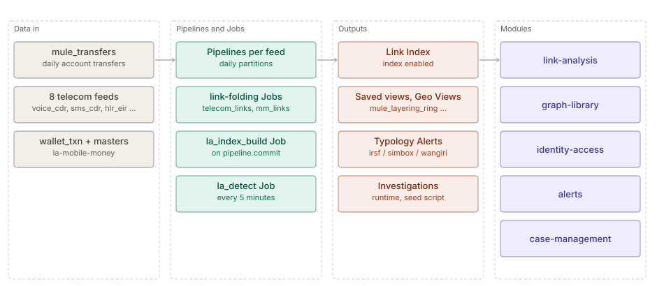

# Link Analysis showcase

The architecture of the `la-showcase` hub, in two parts: the Link Analysis solution page for the Space
Templates `la-showcase` and `la-mobile-money`, and the rules by which every Link Analysis showcase Space in
the catalogue is built and shipped (distribution, the edition rule, the Advanced tier pattern, data
generation). Each part keeps its own status line and dates.

**On this page**

- [Link Analysis](#link-analysis) — the solution page: data in, what the pack sets up, tiers, design rules.
- [Link Analysis showcase catalogue — architecture](#link-analysis-showcase-catalogue--architecture) —
  the three downloads, the packer, the edition rule, the Advanced tier pattern, data generation.

## Link Analysis

> **Level 2 solution page** (`SOLUTION-SUITE-DOCS-1`). Content: the Space Templates `la-showcase`
> (`spaces/_templates/la-showcase/template.toon`) and `la-mobile-money`
> (`spaces/_templates/la-mobile-money/template.toon`). Offering: the `linkAnalysis` add-on in
> `offerings/basic.toon` (modules `la-storage`, `la-core`, `la-api`, `geo-link`) and
> `offerings/advanced.toon` (`la-store-pg`). Checked against the templates on 2026-10-17.

### Business problem

Fraud and AML rings hide in relationships: smurfs feeding a mule hub, money circulating between shell
accounts, a cash-out till taking most of the proceeds, a SIM box several hops from a suspect. Row-level
alerts see each party alone. Investigators need a graph over transactions and telecom events, masked by
default, with a second approver for wide expansions and standing detection on what they found.

### Data in

`la-showcase` (`spaces/_templates/la-showcase/config/`):

| Pipeline | Contents |
|---|---|
| `mule_transfers` | daily synthetic account-to-account transfers (three landed days, plus staged next-day and gap-day files in `data/staged`) |
| `mule_account_locations`, `mule_geo_legs` | account cities and geocoded story legs for the Geo scene |
| `voice_cdr`, `sms_cdr`, `hlr_eir`, `crm_kyc`, `recharge`, `provisioning`, `fraud_blocklist`, `fraud_alarms` | eight 60-day telecom feeds (`config/telecom/`) |

`la-mobile-money` (`spaces/_templates/la-mobile-money/config/`): `wallet_txn` (daily, 14 landed days),
`wallet_master` and `agent_master` snapshots.

### What the pack sets up

- **Settings** — `spaces/_templates/la-showcase/config/link-analysis.toon`: no `masking_mode` (the edition default applies: off in Basic, `typed` in Standard and above; operator 2026-10-21),
  `four_eyes_fan_out_above: 2000`, `index.enabled: true`, Drafts limits (`max_open: 10`,
  `hibernate_after_minutes: 60`, `expire_after_days: 14`). The mobile-money template sets a fan-out
  threshold of 100 (`spaces/_templates/la-mobile-money/config/link-analysis.toon`). Both templates declare
  `minEdition: basic` (plan wave B, step 5): a Basic tier with an Advanced tier on top.
- **Index Job** `la_index_build` (`la.index.build`, `on_signal: pipeline.commit` for `mule_transfers`):
  first a full build, then appends (`spaces/_templates/la-showcase/config/jobs/la_index_build_job.toon`).
- **Standing detection** `la_detect` (`la.detect`, every 5 minutes) evaluates Alert Rules bound to an
  Investigation whose owner enabled standing detection.
- **Link-folding Jobs** — `telecom_links` and `telecom_msisdn_indicators` (`sql.template`, every 10
  minutes) fold the telecom feeds into one MSISDN-to-MSISDN link Dataset and a 0–100 indicator per MSISDN;
  `telecom_typology_counts` and `telecom_typology_alerts` (`alert.evaluate`) follow on
  `job.dataset.produced`. In `la-mobile-money`, `mm_links` folds wallets into one link Dataset (p2p,
  cash in/out, merchant pay, shared device, shared id).
- **Alert Rules** `telecom_irsf_lines`, `telecom_simbox_lines` (CRITICAL) and `telecom_wangiri_lines`
  (WARNING) over `telecom_typology_counts_dataset`. Advanced tier: on a build without Alert Rules (Basic) they ship
  unarmed. The boot logs one WARN per rule ("Not arming alert rule") and arms none, and the template gallery and
  `POST /spaces` accept the template because `minEdition: basic` marks them unarmed (operator 2026-11-08, "A: allow,
  unarmed"; `SpaceManager.missingFeatures`, `TemplateSeedGate`).
- **Saved views** — `mule_large_transfers`, `mule_layering_ring`, `mule_structuring`,
  `telecom_fraud_network`; in mobile money `mm_device_farm`, `mm_money_trail`, `mm_structuring_band`.
- **Pattern packs** `telecom-forwarding-chain`, `telecom-payment-ring`, `telecom-subscription-ring`.
- **Geo Views** `mule_account_locations_map`, `mule_ring_route_map`, `mule_cashout_till_map`.
- **Demo Users and roles** — `roles.toon` and `demo-users.toon` (lead analyst, second approver,
  read-only reviewer, a non-member, an admin who can reveal masked values).

**Tiers.** The Basic tier is every feed, Pipeline and Dataset, the `sql.template` link Jobs, `la_index_build`, the
pattern packs and the four saved views; the Geo Views and the dashboard's Link analysis Widget need Standard and above.
The Advanced tier is masking, four-eyes, Drafts, `la_detect`, the `mule_account` Risk Score and its Job, the three Alert
Rules and `telecom_typology_alerts`, the roster and roles, and the seed script's runtime state. On Basic it is inert,
never an error.

Investigations, members, Entity Lists, a Case and a bound Alert Rule are runtime state with no template
home; `tools/seed-la-showcase.mjs` and `tools/seed-la-mm.mjs` create them against a running server.

### Day in the life of an analyst

1. A new `mule_transfers` file commits; the index appends without anyone asking.
2. The lead analyst opens `mule_structuring`, seeds it with `MULE-HUB-01`, sees the twelve smurfs and
   runs cycle detection — the `SHELL-A`..`SHELL-D` loop is the only directed cycle.
3. Expanding the hub exceeds the four-eyes fan-out threshold, so the expansion waits for the second
   approver.
4. Identifiers stay masked; only the admin role can reveal.
5. The analyst saves the finding to an Investigation, binds a structuring Alert Rule and enables standing
   detection; `la_detect` then watches it every five minutes and a hit can go to a Case.

### Modules used

- [Link Analysis](../../module/la-core/architecture.md) — index, views, Investigations,
  four-eyes, masking, standing detection.
- [Graph library](../../module/graph/architecture.md) — cycles, paths, pattern packs.
- [Pipelines and Steps](../../module/etl/architecture.md),
  [Jobs and scheduler](../../module/processor/architecture.md).
- [Identity and access](../../module/access/architecture.md) — roles, reveal.
- [Maker-checker](../../module/workflow/architecture.md) — the second approver.
- [Alerts](../../addon/incidents/architecture.md),
  [Case management](../../module/case-management/architecture.md).

### Diagram



### Limits

- Both templates are demos on synthetic data and need the Demo Auth build (`serve-demo`) for the Demo
  Users.
- Investigations and Entity Lists are not part of the template; the seed scripts must be run.
- Since 2026-11-08 both have a Basic tier (`minEdition: basic`) and are in `offerings/basic.toon` `contentPacks` with
  every other showcase; their Demo Users, Alert Rules and Investigations are the inert Advanced tier there
  ([catalogue architecture](#edition-rule-a-basic-tier-and-an-inert-advanced-tier)).
- The AML pack ships its own Link Analysis starter view (see [AML](../aml/architecture.md)).

### Showcase design rules (decided 2026-10-16 for the three vertical showcases)

The verticals [`la-mobile-money`](../la-mobile-money/admin-guide-showcase-runbook.md) (A),
[`la-audit`](../la-audit/admin-guide-showcase-runbook.md) (B) and [`la-claims`](../la-claims/admin-guide-showcase-runbook.md) (C)
follow the `la-showcase` layout. Each is built to these rules (plan archived:
`docs/archived-documents/plans-archive/la-multi-vertical-showcase-plan.md`; rehearsal still owed: roadmap §D5).

- **Synthetic and small.** Every value is invented, from small pools and a seeded lognormal, with cities used only for
  Geo. Each corpus stays at about 600 entities, 8,000 link rows and under 1 MB of CSV. Scale is shown from the recorded
  benchmark, never from a showcase.
- **Planted stories with known answers.** Each vertical plants 5 to 7 findings, and a golden test pins the ground truth
  of each (`LaMobileMoneyGoldenTest`, `LaAuditGoldenTest`, `LaClaimsGoldenTest`). Each plant has a **benign look-alike**
  (a big biller, a busy approver, a family sharing one phone), so "high connectivity is not guilt" is a scene.
  Regeneration is byte-identical (seeded `random.Random`). The background graph stays sparse and acyclic wherever a
  story promises "the only cycle", and the golden test builds the graph the way the app draws it (one link per row).
- **Data shape.** One feed per fact (Collector + Pipeline). `sql.template` Jobs fold the raw Pipelines into one link
  Dataset per vertical, so normalisation lives in the Jobs. Every link Dataset carries a real event-day column (for
  the data-trust strip) and a `via` key for shared-attribute links. It never carries an identifier column that a tile
  could sum. Shared-attribute links are materialised once and de-duplicated, with blank or placeholder values
  excluded. Entity ids are typed and classified (`typed` masking), and Entity List membership must match the alias the
  canvas shows.
- **Decisions D1-D5.** The third vertical is insurance claims (D1), because its graph comes from shared attributes, not
  from moving money. A is a new template, so the shipped `mobile-money` demo is untouched (D2). The embed portals are
  static pages served from the template's `portal/` folder (D3). The `la-showcase` mule corpus is not retired: it stays
  the runbook's and the whitepaper's proven base (D4). Live runs use an Advanced or Preview Demo Auth bundle (D5).
- **One kit per lane.** The planned shared kit was dropped: each vertical owns its generator (`tools/gen-la-*-data.py`),
  seed script, smoke runner, runbook and portal. No precision or detection-rate claim is made from synthetic data, and
  plants are called planted.

## Link Analysis showcase catalogue — architecture

Inspecto ships **18 Link Analysis showcase Spaces in 9 industries** (the list, what each teaches and where to start:
[catalogue user guide](user-guide-showcase-catalogue.md)). This part holds the rules every one of them is built and
shipped by. Each Space's own figures, personas and Alert Rule are in its hub (`solution-pack/la-<id>/`, mostly
`admin-guide-install.md`); how a release is built and boot-tested is in the
[release guide](admin-guide-showcase-release.md). Built 2026-11-07 to 2026-11-09 (plan archived:
`docs/archived-documents/plans-archive/2026-11-07-la-showcase-police-insurance-utility-plan.md`, with the realism
review of every story and the per-Space build records).

### Distribution and install layout

A showcase ships as **three downloads**, unzipped side by side into one folder the user chooses (`<parent>`), so the
product can be upgraded by replacing its folder without touching any Space or data:

| Download | File | Contents | Unzips to |
|---|---|---|---|
| Product | `inspecto-deploy-<platform>-<flavour>.zip` | the server, the UI, the embedded Java runtime and the template gallery (`spaces/_templates`). No Space is attached, but the gallery carries each template's committed data (about 45 MB in all) | `<parent>/inspecto-la/` |
| Space | `inspecto-la-space-<id>-<version>.zip` | `<id>/space.toon` and `<id>/config/` (with an empty `egress.toon`): configuration only | `<parent>/inspecto-la-spaces/` |
| Data | `inspecto-la-data-<id>-<version>.zip` | `<id>/data/<feed>/inbox/*` (landed at start) and `<id>/data/staged/*` (copied in during the demo) | `<parent>/inspecto-la-data/` |

```
<parent>/
  inspecto-la/             product (replace to upgrade)
  inspecto-la-spaces/<id>/ space.toon + config/
  inspecto-la-data/<id>/   data/, then the Space's audit/ and duckdb/
```

#### How the server finds them

- **Spaces:** `SPACES_ROOT`, read by `serve.bat` / `serve.sh` / `serve-demo.*` and passed as `-Dspaces.root`.
- **Data:** `SPACES_DATA_ROOT`, passed by the same launchers as `-Dspaces.data.root`; each Space's `data/`, `audit/`
  and `duckdb/` then live under `<data root>/<id>` (`SpaceDataRoot`; the
  [configuration reference](../../module/config/admin-guide-configuration-reference.md) has the rules). Both may be
  relative: the JVM resolves them against its working directory and every launcher changes to the bundle root first,
  so the documented `..\inspecto-la-spaces` and `..\inspecto-la-data` need no launcher logic. Guarded by a
  `tools/check-launchers.mjs` scenario.
- **Why the split is exact.** With a data root set, a Space folder that still holds `data/`, `audit/` or `duckdb/` is
  not booted, so the Space zip carries no `data/`; an unstamped data root holding only those folders is adopted on the
  first boot. The data folder becomes the Space's runtime state as soon as the server starts. Deleting it and
  unzipping the data download again resets the showcase; the configuration is untouched.
- **Version check.** `space.toon` names `min_product_version`; `SpaceVersionCheck` logs a WARN at boot for a Space
  that asks for a newer product, and the Space still boots. A `dev` run checks nothing.
- **Known limits (accepted 2026-11-07):** renaming a Space in Settings rewrites `space.toon` with its four known
  fields and drops `min_product_version`; an absolute `SPACES_DATA_ROOT` with a space in it splits in `serve.bat` (as
  `SPACES_ROOT` already does; the documented relative paths avoid it); `4.1.0-rc1` counts as meeting `4.1.0`.
- **`la-sample` is the exception:** its files are in `data/samples` for the in-app *Try it with sample data*
  (`POST /spaces {template, loadSamples: true}`, which works from a data root), so its data download lands nothing
  until the files are copied into `data/inbox`. Every other showcase keeps its files in `data/<feed>/inbox`.

#### The packer

`node tools/package-la-showcase.mjs <id> [--version <v>] [--min-product <v>] [--out <dir>]` writes the Space and data
zips (`tools/package-la-showcase.test.mjs`).

- **Committed content only**, the rule of `inspecto/package-spaces.ps1`: files are read with `git show HEAD:<path>`,
  so an uncommitted edit never ships. Commit first.
- **The Space zip mirrors `SpaceManager.createFromTemplate`:** `config/**` with `${SPACE}` replaced by the id, an empty
  `config/egress.toon` (without it the server would allow the Space's current outbound hosts unreviewed), and
  `space.toon` written from `template.toon` (`name`, `tagline`, `min_product_version`). `template.toon` and `portal/`
  stay in the gallery. A template with no committed `data/` is refused.
- **Version:** the reactor version in `pom.xml` (operator 2026-11-09: the downloads carry the product version as is,
  built from the same commit as the product); `min_product_version` defaults to it without its qualifier.
- **Industry composition.** `<id>` may also name an industry recipe, `spaces/_industries/<id>.toon`
  (`useCases[n]: …`), which the packer composes from the use-case templates it names. Every file comes from exactly
  one use case, and a path two use cases ship with different bytes is refused (a real collision is renamed in its
  template on purpose). Joined instead: `config/link-analysis.toon` (Entity Types merged by id, every other top-level
  setting such as `four_eyes_fan_out_above` or `drafts:` by key), the Advanced tier's roster (`config/demo-users.toon`
  by user id, `config/roles.toon` by role name) and `config/examples/*.md`. A differing re-declaration of any merged
  key, user or role is refused; the same bytes ship once. A test composes every committed recipe from the real
  templates. The industry Spaces themselves are an active plan (`docs/superpower/2026-11-08-la-industry-spaces-plan.md`).

### Edition rule: a Basic tier and an inert Advanced tier

Every showcase has a **Basic tier**: Collectors, Pipelines, Datasets, the link Dataset Job, saved views and saved Geo
Views, nothing that needs a sign-in. It loads and is explorable on a Basic build; that is the acceptance test. The
**Advanced tier** (Demo Users, roles, four-eyes approval, Drafts, Alert Rules, the seed script that creates the
Investigation, Entity List and Case) ships **in the same Space download** and stays inert on Basic. Every showcase's
`template.toon` says `minEdition: basic` (`la-sample`, which has no Advanced tier, states none), and every showcase is
in `offerings/basic.toon`
`contentPacks` (Preview carries them through `includes`; `tools/check-offerings.test.mjs` pins the placement).

What "inert" means, as seen live on Basic:

| Part | On Basic |
|---|---|
| `config/demo-users.toon`, `config/roles.toon` | ignored (no sign-in; only the demo-auth module reads the roster). The gallery no longer refuses a `minEdition: basic` template for its roster (operator 2026-11-08, "A: allow on Basic") |
| Alert Rules (`config/registry/alert-rules/`, or deferred `config/pending/alert-rules/`) | loaded, **not armed**: a WARN "Not arming alert rule '<rule>'" at boot; the `alert.evaluate` Job runs and logs "no rule breached"; 0 Alerts. The gallery and `POST /spaces` do not refuse them for a `minEdition: basic` template (operator 2026-11-08, "A: allow, unarmed"; each rule's content is still judged). Rules: [Spaces user guide](../../layer/product/user-guide-spaces.md), edition fit |
| `masking_mode` in `link-analysis.toon` | **left unset** in every showcase: the edition default (`EditionMaskingDefault`) is `none` where nobody signs in and `typed` with sign-in. A stated `typed` masked every id on Basic, where nobody can reveal it (found on `la-claims`) |
| `la.index.build`, `la.detect` Jobs | run and succeed (built in on every edition) |
| a Job whose type's module is not installed (for example `risk.score`) | listed `hosted: false`, never fires |
| the seed scripts | not run (they need Demo Auth) |

### The Advanced tier pattern (the thirteen new Spaces)

`la-police`, `la-utility` and the eleven wave C Spaces share one pattern (the older `la-showcase`, `la-mobile-money`,
`la-claims` and `la-audit` have their own Advanced tiers, described in their runbooks):

- **Personas.** A lead analyst, a second approver (manager), a read-only reviewer and an outsider who is not a member,
  named `<prefix>.analyst` and so on (`rp.*` in `la-utility`, `police.sio` as the approver in `la-police`), plus the
  shared `admin`.
- **One roster across Spaces.** `admin` and the `fraud-analyst`, `la-viewer` and `la-settings` roles are byte-identical
  in these thirteen: a user id defined differently in two Spaces of one server is refused with 409
  `ROSTER_CONFLICT` ([Demo Auth](../../module/demo-auth/admin-guide.md)). Proved 2026-11-09 with all twelve 2026-11-09
  Spaces in one server. The older templates differ in their roles (`la-showcase`'s `fraud-analyst` adds
  `canShareInvestigation`; `la-audit` and `la-mobile-money` define no `la-viewer`; `la-audit`'s roster uses
  `audit.admin`).
- **Four-eyes and Drafts.** Every `link-analysis.toon` states `four_eyes_fan_out_above: 2000` and the same Drafts limits;
  no Entity Type is masked.
- **The Alert Rule is a registry rule over a one-row counts Job** (one exception: `la-utility`'s
  `utility_transformer_loss` is `max(loss_pct) gte 15` over the multi-row monthly `transformer_loss` output, so its
  Alert carries the highest monthly loss, not a count). A `sql.template` Job on the link Job's
  `job.dataset.produced` writes one row of counts; an `alert.evaluate` Job runs after it; the rule compares one count
  with a threshold. It is **not grouped** (`by:`): `POST /spaces` checks a `by` column against the Dataset's Schema, and
  a Job output has none when the Space is created, while the deferred `pending/alert-rules/` waits only for score-model
  outputs. One Alert per entity would need such a deferral for Job outputs; not built. The rule **names a count, never
  an entity** (the saved view shows who), the count is a **running total**, so the rule stays met after every build and
  there is one open Alert, not one per build, and since `ALERT-VALUE-REFRESH-1` (2026-11-09) the open Alert is
  **refreshed in place** to the current value, keeping its first-fire time. Each rule is pinned by its golden test
  against its story's benign look-alike.
- **Four rules are deliberately narrower than the first wording,** each to keep its look-alike out: `la-trade` (only
  trades between companies that share a director), `la-logistics` (only uninsured carriers), `la-benefits` (days
  counted from the death notice, not the death) and `la-telco-ra` (two or more unbilled months, the latest still
  unbilled). `la-police` counts repeat sellers only, because a resold stolen item alone is ordinary; a per-build "new
  matches" count is a later refinement if a demo needs it.
- **The seed script** `tools/seed-la-<id>.mjs` (`--scaffold`, a dry run by default, `--apply`, idempotent; story ids
  read from the generator's ground truth): an Investigation over the link Dataset with a bounded expand, annotation,
  window or threshold, resolve and snapshot; its members (not the outsider); an Entity List; a Case assigned to the
  manager and linked; an Investigation template; one unbounded expand held for four-eyes; one open Draft. A Draft may
  only annotate an entity in the Working Set (an entity two hops out is refused, 422), so each Draft annotates the
  story's seed.

### Data generation

- **One generator per Space**, `tools/gen-la-<id>-data.py`: standard library only, a fixed seed, written straight into
  the template's `data/` (twelve landed months plus one staged month); a re-run is byte-identical. Writes go through
  `tools/la_gen_io.py`: an unchanged file is left alone, a changed one is written to a temp name and moved into place,
  and only files a run no longer writes are removed, last (`LA-GENERATOR-DELETE-FIRST-1`).
- **Ground truth** `tools/gen-la-<id>-data.ground-truth.json` (story → entity ids and look-alike ids), never shipped.
- **Golden tests:** `tools/gen-la-<id>-data.test.mjs` (the planted facts in the files) and a Java golden test that runs
  the real Pipelines and Jobs (every story one connected piece of the link Dataset, no look-alike linked to a story
  entity, every saved view under 4 000 rows and 1 000 nodes, the Alert Rule's own measure and threshold).
- **Realism first:** a background population with heavy-tailed degrees, daily and weekly cycles and 3–8 % blank
  optional fields, then each story planted by rewiring a few records; every story has a benign look-alike.
  Synthetic identity only (invented names, a reserved phone range, invented streets, real cities at city level).
  Several Spaces are smaller than first specified to keep the committed corpus small (for example `la-utility`: 1 000
  premises, not 8 000); each hub says so.
- **Link Jobs also run on `cron: "*/5 * * * *"`**, because a `pipeline.commit` that lands while a run is in flight is
  skipped, not queued (`JOB-SIGNAL-OVERLAP-SKIP-1`). Exception: `la-ownership`'s `ownership_links` has no cron yet
  (BACKLOG `LA-OWNERSHIP-NO-CRON-FALLBACK-1`). A counts or link Job that judges a month waits until that month's
  every side has landed (`la-utility`'s `transformer_loss` joins both reads; `la-telco-ra` waits for the billing file).

### Deliberate decisions and gotchas

- The version lives in `space.toon`, not a separate manifest; the launchers pass the paths through unchanged.
- Two views of the older showcases are cut at the 4 000-row default projection limit on every edition,
  `mm_money_trail` (`la-mobile-money`) and `telecom_fraud_network` (`la-showcase`); left as found.
- A product zip attaches no Space, but its template gallery still carries every template's data.
- On a Preview log, the `alert.evaluate` Job's "no rule breached" line also appears while an Alert stays open (the rule
  is edge-triggered), so it does not mean "no breach" there (`ALERT-EVALUATE-NO-BREACH-WORDING-1`).
