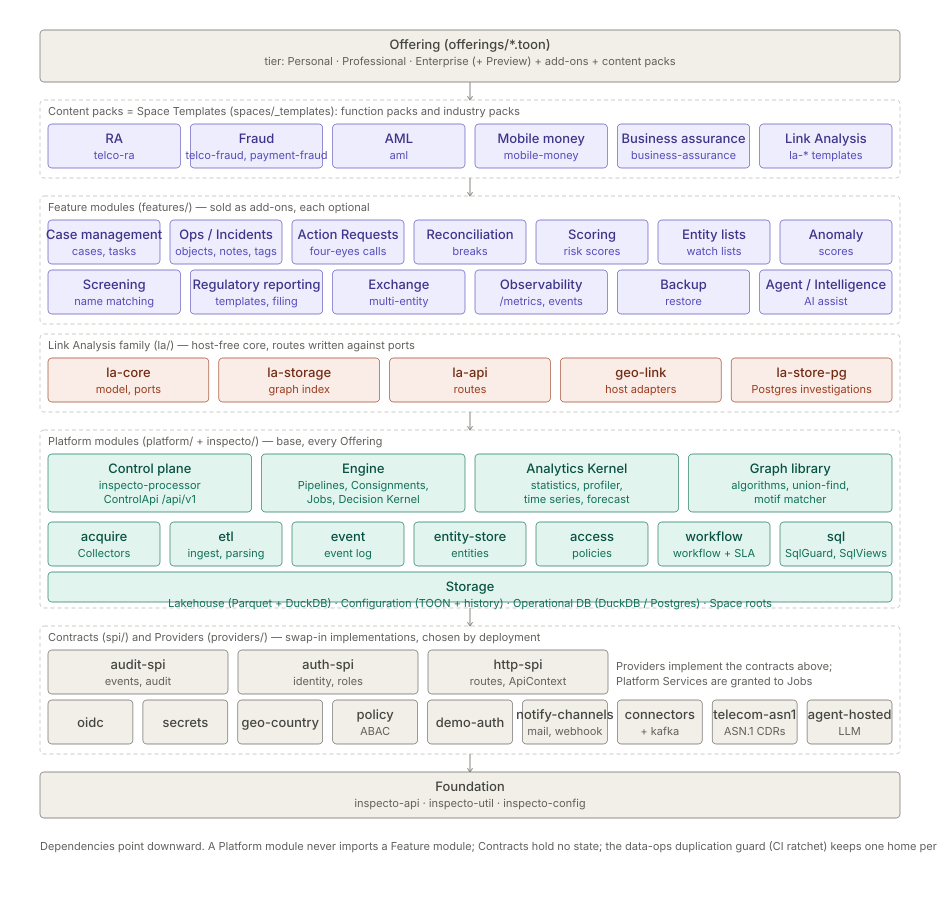
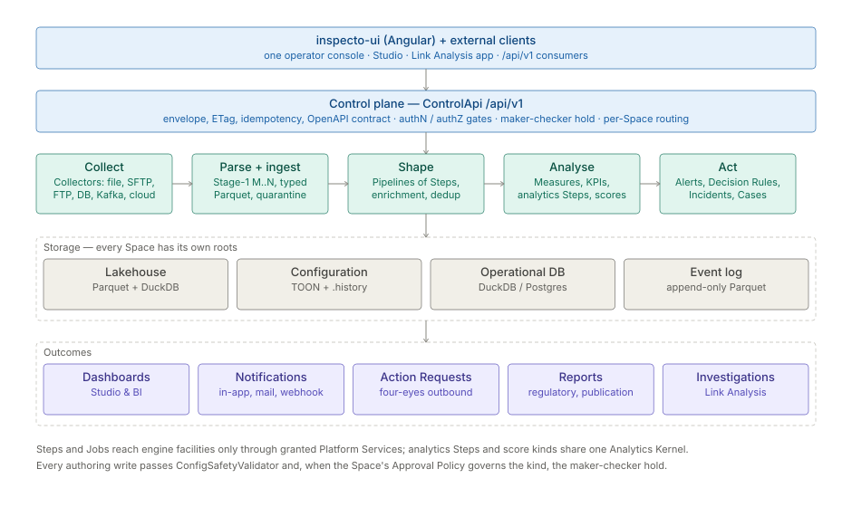
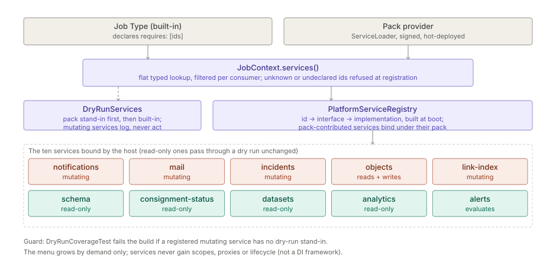
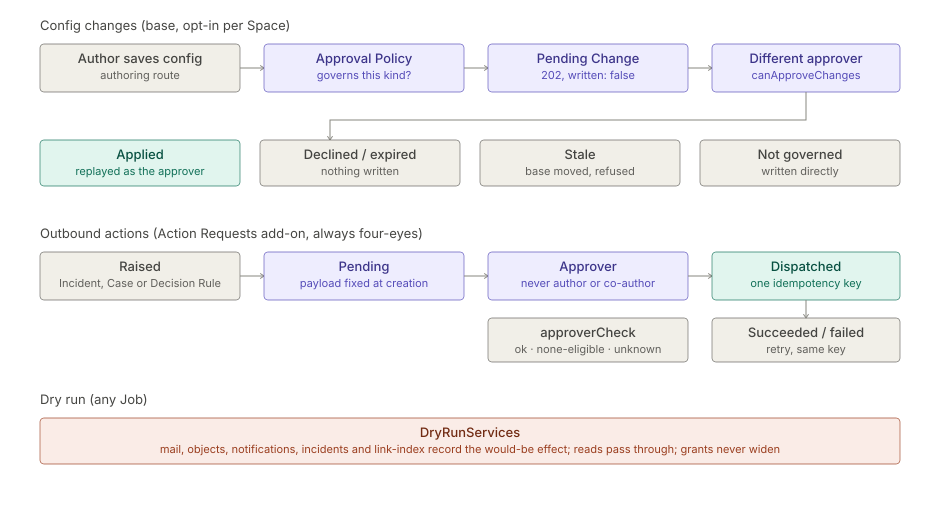

# Inspecto — Technical Architecture

> **Status:** current as of 2026-10-17. Audience: architects, integrators, technical evaluators.
> Deeper, per-concept detail lives in `docs/okf/` (linked per section); vocabulary follows `docs/GLOSSARY.md`.

## 1. Shape of the system

Inspecto is one framework-free Java application (JDK `HttpServer`, manual wiring, `ServiceLoader` contracts,
virtual threads) with an embedded DuckDB analytical engine, plus one Angular operator console. It is shipped as
thin per-module jars on a jlinked runtime. There is no external database to install: storage is files under each
Space's roots, with Postgres as an optional Operational DB family.

What a customer runs is an **Offering**: a tier (Personal, Professional, Enterprise; Preview bundles everything)
plus add-ons plus content packs, composed in `offerings/*.toon`. A module is usable only when it is Installed in
the build, Enabled for the Space, and Permitted for the user.

| Layer | Directory | Rule |
|---|---|---|
| Content packs | `spaces/_templates` | Space Templates: function packs (RA, Fraud, AML …) and industry packs (Telecom, Mobile Money …); data and config, no code |
| Feature modules | `features/` | Optional add-ons; depend on platform modules, never on each other's internals |
| Link Analysis family | `la/` | Host-free core; routes written against ports; adapters bind it to the host |
| Platform modules | `platform/`, `inspecto/` | Base of every Offering: control plane, engine, Analytics Kernel, graph library, storage |
| Contracts | `spi/` | Interfaces only, no state |
| Providers | `providers/` | Swap-in implementations of the contracts, chosen by deployment |
| Foundation | `inspecto-api`, `inspecto-util`, `inspecto-config` | Shared types, utilities, TOON configuration |

See `docs/okf/backend/module-taxonomy.md` for the module list and placement rules.

## 2. Solution data path

1. **Collect** — Collectors pull from files, SFTP/FTP, databases, Kafka and cloud stores.
2. **Parse and ingest** — Stage-1 parsing (M..N records), typed Parquet into the lakehouse, bad rows quarantined.
3. **Shape** — Pipelines of Steps: enrichment, deduplication, joins, time-series and analytics Steps.
4. **Analyse** — Measures and KPIs in Studio & BI; scores and baselines through the Analytics Kernel.
5. **Act** — Alerts, Decision Rules (Decision Kernel + condition tree), Incidents, Cases, Action Requests.

Everything is reached through the control plane, `ControlApi` under `/api/v1` (response envelope, ETags,
idempotency keys, an OpenAPI contract checked in the build), with per-Space routing and authN/authZ gates.

## 3. Engine and analytics

- **Pipelines, Consignments and Jobs** run in the engine; Jobs reach engine facilities only via Platform Services (§4).
- **Analytics Kernel** (`platform/inspecto-analytics`) is the single home of generic data operations: statistics,
  column profiler, time-series grain and SQL, baselines, score-output contract, forecasting with intervals,
  accuracy and backtest, seasonality, similarity, entity grouping, sampling. Domain logic stays in its module.
  See `docs/okf/backend/analytics-kernel.md`.
- **Graph library** (`platform/inspecto-graph`): graph algorithms, union-find, temporal motif matcher.
- **One SQL building path**: `SqlIdent`, `SqlBuilder`, `SqlViews`; `SqlGuard` validates user SQL.
  See `docs/okf/backend/engine/db-layer.md`.
- A CI ratchet (`tools/check-data-ops-duplication.mjs`) keeps one home per data operation; its inventory is 0.

## 4. Platform Services

Job Types and pack providers declare the services they require; `JobContext.services()` returns a filtered view
of the boot-built registry. Ten services are bound today. Under a dry run every mutating service is replaced by a
stand-in that records the would-be effect, and a guard test fails the build if one is missing.
See `docs/okf/backend/control-plane/platform-services.md`.

## 5. Governance

- **Maker-checker for configuration** (base, opt-in per Space): a write to a kind the Approval Policy governs is
  held as a Pending Change and applied only when a different user approves it.
- **Action Requests** (add-on): outbound calls raised by Incidents, Cases or Decision Rules are always four-eyes;
  the payload is fixed at creation and dispatched once under one idempotency key, with bounded retries.
- Every authoring write passes `ConfigSafetyValidator`; audit events go through `audit-spi`.

## 6. Storage

| Store | Format | Holds |
|---|---|---|
| Lakehouse | Parquet read by DuckDB | Ingested and derived Datasets |
| Configuration | TOON files with history | Pipelines, Collectors, rules, dashboards |
| Operational DB | DuckDB, or Postgres family | Incidents, Cases, Pending Changes, investigations |
| Event log | Append-only Parquet | Platform events and audit |

Each Space has its own roots; nothing is shared across Spaces except the installation.

## 7. Security and editions

- Identity through `auth-spi` with an OIDC provider (Keycloak or WSO2, a config choice) or demo auth;
  policies and ABAC through `inspecto-access` and the policy provider; secrets through the secrets provider.
- Editions are build flavors of one codebase; an Offering file decides which modules are bundled.
  See `docs/EDITIONS.md`.

## 8. Frontend

`inspecto-ui` is one Angular SPA: operator console, Studio (Pipelines, dashboards, Measures), Link Analysis app
and administration. It talks only to `/api/v1`; feature screens appear only when their module is Enabled and
Permitted.

## 9. Go deeper

- [Solution pages](solutions/README.md) — one per content pack, plus three journeys (file to dashboard, alert to
  closed Case, changing configuration safely).
- [Module pages](modules/README.md) — one per module, each on the same nine-heading template with a flow diagram.

## 10. Integration checklist

1. Choose an Offering and identity provider.
2. Define Collectors for each Stream and Reference.
3. Apply a content pack (Space Template) or author Pipelines in Studio.
4. Configure Alert Rules, Decision Rules and notification channels.
5. Turn on maker-checker for the kinds that need approval.
6. Integrate external systems through `/api/v1` (OpenAPI contract) or Action Requests.
