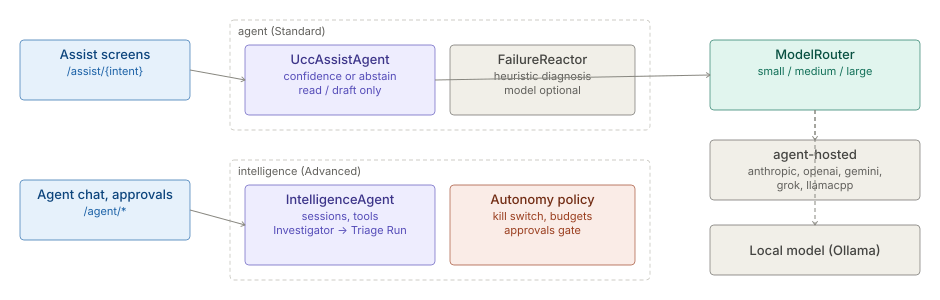

# AI assist

> **Level 3 module page** (`SOLUTION-SUITE-DOCS-1`). Layer: Add-on.
> Offering: `aiAssist` add-on - Standard: `agent` (plus the `agent-hosted` provider); Advanced adds
> `intelligence`. Checked against the code on 2026-10-17.

## 1. What it is

AI assist is the optional model-backed help layer, in two tiers:

- **Assist agent** (`features/inspecto-agent`, manifest id `agent`): explain, diagnose, draft and triage skills
  that are read-only or draft-only and abstain rather than ship a low-confidence answer; plus failure diagnosis of
  failed batches.
- **Intelligence agent** (`features/inspecto-intelligence`, manifest id `intelligence`, Advanced): multi-turn
  sessions, tool calls, playbook investigations that produce **Triage Runs**, an approvals gate for mutating
  actions, and bounded autonomy behind a kill switch.

Hosted model providers come from `providers/inspecto-agent-hosted` (manifest id `agent-hosted`, requires `agent`).
Concepts: [Assist agent](../../okf/backend/agent/assist-agent.md),
[Embedded intelligence](../../okf/backend/agent/embedded-intelligence.md),
[Hosted providers](../../okf/backend/agent/hosted-providers.md), [Assistant](../../okf/capabilities/assistant/assistant.md).

## 2. Who uses it

- **Analysts and authors** ask for explanations, Pipeline step drafts and Alert triage.
- **Operators** read failure diagnoses and Triage Runs, give feedback, approve agent actions.
- **Administrators** choose the model provider and set the autonomy policy and kill switch.

## 3. Where it sits

An add-on over the platform base. Routes live in the host (`AssistRoutes`, `AgentRoutes` in
`inspecto/src/main/java/com/gamma/control/`) and answer 503 `CAPABILITY_UNAVAILABLE` when the module is absent.
The agents hold no write credential of their own; anything that changes state goes through the control plane's
own gates and audit.

## 4. How it works

1. **Assist call** (`UccAssistAgent`). `POST /assist/{intent}` resolves a Capability, runs it, estimates
   confidence (`UccConfidenceEstimator`), and surfaces the answer only above the capability's threshold; otherwise
   it abstains. `applyVia` is always null - nothing is applied. One keys-only audit event per call.
2. **Models** (`ModelRouter`, `ModelTier`). Small / medium / large tiers. Without a configured model every
   capability returns "model unavailable"; construction touches no network.
3. **Hosted providers** (`LangChain4jProviderPlugin`). One chat provider per tier for `anthropic`, `openai`,
   `gemini`, `grok` or `llamacpp`; the jar on the classpath is what makes these selectable.
4. **Failure diagnosis** (`FailureReactor`). Subscribes to batch events; for each FAILED batch it enqueues (bounded,
   sheds load) and diagnoses off the ingest thread - heuristic always, model only when available.
5. **Intelligence sessions** (`InspectoIntelligenceAgent`). Server-issued session ids; a session is bound to its
   opener and carries the caller's capabilities, so a tool the model calls meets the same gate as
   `POST /agent/tools/{name}`.
6. **Playbook investigation** (`Investigator`). Fixed evidence order (`timeline_build`, `config_versions_diff`,
   `diff_batches`, `anomaly_scan`), then ONE model call ranks hypotheses and drafts a fix -> a Triage Run.
   Feedback on a Triage Run is stored durably for the learning dashboard.
7. **Autonomy** (`AutonomyPolicy`, `AutonomyPolicyEngine`, `OpsMonitor`). Global kill switch; per-action-class mode
   (an unconfigured class is OFF); rolling hourly / daily budgets. Pilot class `batch_rerun`. Every decision,
   including denials and shadow no-ops, is logged; executed actions are audited as `actor=agent:ops-monitor`.

## 5. Configuration

- **Provider settings**: `config/assist-settings.properties` (override `-Dassist.settings.file`) with `provider`,
  `base.url`, `api.key.ref` (the NAME of an env var or system property - never the key), `model.small`,
  `model.medium`, `model.large`, `timeout.seconds`. A key posted through the API is held in memory only.
- **Autonomy policy**: `<assist.write.root>/agent/policy.json`, edited through `/agent/policy`; survives restart.
- **Egress**: the intelligence gateway refuses a `base.url` outside the Space's model endpoint allowlist.
- **Enablement**: `agent` in `offerings/standard.toon`, `intelligence` in `offerings/advanced.toon`.

## 6. Screens

Under `inspecto-ui/src/app/modules/admin/`: **Assist** (`assist/`), **Agent chat** (`agent-chat/`),
**Diagnoses** (`diagnoses/`), **Approvals** (`approvals/`), **Autonomy** (`autonomy/`), **Learning**
(`learning/`). In-context explain / draft / status widgets: `inspecto-ui/src/app/inspecto/ai-assist/`.

## 7. API

| Route | Gate |
|---|---|
| `POST /assist/{intent}` | per-skill |
| `GET /assist/diagnoses`, `/assist/metrics`, `/assist/skills`, `/assist/settings` | read |
| `POST /assist/settings` | `canAdminister` |
| `POST /assist/settings/test` | `canAuthorWorkbench` (real outbound call) |
| `POST /agent/sessions`, `/agent/sessions/{id}/...` | session owner |
| `POST /agent/tools/{name}`, `/agent/tools/{name}/derive` | the tool's declared capability |
| `/agent/triage-runs`, `/agent/feedback` | triage and learning |
| `/agent/approvals`, `/agent/policy`, `/agent/policy/kill-switch`, `/agent/actions` | approvals and autonomy |

## 8. Interactions

- [Pipelines and steps](pipelines-steps.md) - draft-pipeline skill; [Alerts](alerts.md) - triage-alert skill.
- [Reconciliation](reconciliation.md) - diagnose-break skill; [Anomaly](anomaly.md) - `anomaly_scan` tool.
- [Observability and backup](observability-backup.md) - batch failure events; [Maker-checker](maker-checker.md).
- [Identity and access](identity-access.md) - tool gates; [Link Analysis](link-analysis.md).

## 9. Limits and gotchas

- No model configured = abstain everywhere; the module is safe to ship enabled.
- Raw API keys are never written to disk; after a restart the key must come from the named env var.
- `/assist/settings` and `/assist/settings/test` are gated together; the settings are server-wide, not per Space.
- Triage Runs and the autonomy ledger are in-memory rings; only feedback and the policy are durable.
- `InspectoPackConfig` is always the offline deployment profile; MCP tools stay off.
- The intelligence agent's model path (eoiagent gateway, `GatewayFactory`) was not traced in this check.
