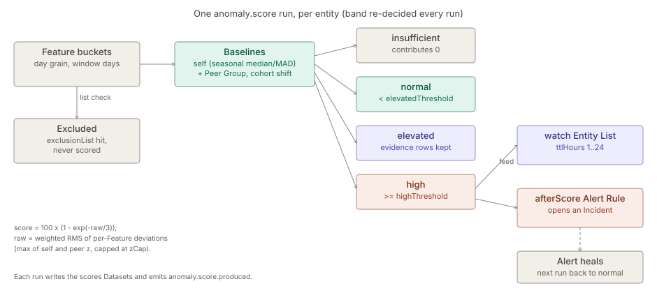

# Anomaly Detection

> **Level 3 module page** (`SOLUTION-SUITE-DOCS-1`). Layer: Add-on.
> Offering: Professional and above — add-on `anomalyDetection` (status `built`, module `anomaly`) in
> `offerings/professional.toon`. Checked against the code on 2026-10-17.

## 1. What it is

An **Anomaly Score** answers "is this entity behaving unlike itself, or unlike its peers, and why?" — a 0–100
number per entity per run, stored with a per-Feature explanation so it can be recomputed. The authored Type is an
**Anomaly Model** (component kind `anomaly-model`). The module is `features/inspecto-anomaly` (id `anomaly`,
package `com.gamma.anomaly`): `AnomalyModel` (parse, fail closed), `AnomalyLists` (watch / exclusion lists),
`AnomalyScoreEvaluator` (one DuckDB statement per Feature), `AnomalyScorer` (pure maths), `AnomalyScoreJobType`
(Job Type `anomaly.score`), `AnomalyScoreRoutes` and `AnomalyKindValidator`.

It is distinct from a Risk Score (absolute weighted factors — see [scoring-entity-lists](scoring-entity-lists.md)),
a `baseline` Expectation and the Link Analysis `suspicionScore`. Full concept:
[Anomaly Scores](../../okf/backend/control-plane/anomaly-scores.md).

## 2. Who uses it

- **Fraud and assurance analysts** (`canWorkIncidents`) read an entity's score and preview a model.
- **Authors** define models in Studio; unsaved-content preview also needs `canAuthorWorkbench`.
- Telecom-fraud and mobile-money solutions — see [telecom-fraud](../solutions/telecom-fraud.md).

## 3. Where it sits

An add-on that requires `entity-list` (`requires.modules` in its `module.toon`) but **not** `scoring`. The
baseline maths come from the Analytics Kernel (`com.gamma.analytics.baseline`, see
[analytics-kernel](analytics-kernel.md)); the score output contract and its writer `ScoreOutputWriter` are shared
with Risk Scores in the engine. Without the module `/anomaly-scores*` answers 503 and the SPA hides every anomaly
surface.

## 4. How it works

1. **Buckets** — each Feature is aggregated at day grain over `window` days, excluding the scored day. Missing
   buckets are 0 for count/sum; an entity's history starts at its first bucket.
2. **Exclusion** — entities on the `exclusionList` are removed before grouping, so they neither shape a cohort
   nor count against `maxEntities`.
3. **Self baseline** — median and scaled MAD of same-slot buckets (`seasonality: weekday` falls back to `none`
   below `minBaselinePoints`), with a floor so a flat history does not explode.
4. **Peer Group** — when `peers` is declared, the cohort's median / MAD on the scored day; a cohort below
   `minGroupSize` is `insufficient`. A **cohort shift** scales the self baseline when the whole cohort moves
   together, so a promotion day does not flag every member.
5. **Combine** — per Feature `max(self z, peer z)` in the declared direction, capped at `zCap`; `raw` is the
   weighted RMS; `score = 100 × (1 − exp(−raw/3))`.
6. **Band** — `normal < elevatedThreshold ≤ elevated < highThreshold ≤ high`; no usable baseline → `insufficient`
   (contributes 0); self insufficient with usable peers → peers only (`peersOnly`).
7. **Outputs** — `anomaly_scores_<id>` (history) and `anomaly_scores_<id>_latest`; evidence rows for
   `elevated` / `high` only; `high` entities fed to the watch Entity List; Signal `anomaly.score.produced`.

The band is re-decided every run: an entity back to `normal` lets its Alert heal.

## 5. Configuration

`registry/anomaly-models/<id>.toon` (`anomaly-model` kind), keys parsed by `AnomalyModel.fromMap`:

| Key | Meaning |
|---|---|
| `entityType` | subscriber, account, … |
| `bucket` | `day` (`hour` refused — not built) |
| `window` | days, max 90 |
| `scoredPeriod` | only `1` accepted |
| `seasonality` | `none` \| `weekday` |
| `minBaselinePoints` | default 7, `<= window` |
| `elevatedThreshold`, `highThreshold` | band edges |
| `maxEntities` | else `-Danomaly.score.maxEntities`; exceeding fails the run, never partial |
| `dataScope` | caller must hold it to read |
| `watchList` | `{list, ttlHours}` (1..24, default 24) |
| `exclusionList` | an Entity List id |
| `peers` | `by` (1..3 columns), `dataset`, `key`, `minGroupSize` (default 30), `fallback` (`none` \| `population`) |
| `features[]` | `id`, `label`, `dataset`, `key`, measure, time, `filters`, `unit`, evidence, weight, direction |

Schedule an `anomaly.score` Job (see [jobs-scheduler](jobs-scheduler.md)). Incidents come from a pending Alert
Rule declaring `afterScore: {kind: anomaly-model, model: <id>}` over the `_latest` Dataset. The prefix
`anomaly_scores_` is reserved for Dataset and sink writes.

## 6. Screens

- `/anomaly-models` — Studio pane (`inspecto-ui/src/app/modules/admin/anomaly-models/anomaly-models.component.ts`)
  with `anomaly-model-form.dialog.ts`, `anomaly-model-features.component.ts` and `anomaly-model-preview.component.ts`.
- Entity anomaly panel `inspecto-ui/src/app/inspecto/components/anomaly-panel.component.ts` (data via
  `inspecto-ui/src/app/inspecto/api/anomaly-scores.service.ts`): band badge, top Features, day series. Hosted on the
  Incident page, the Risk Score entity view and Link Analysis.

## 7. API

Handler: `features/inspecto-anomaly/src/main/java/com/gamma/anomaly/AnomalyScoreRoutes.java`.

| Route | Gate | Purpose |
|---|---|---|
| `GET /anomaly-scores/{model}/{entityKey}` | `canWorkIncidents` | latest score with Feature explanation; existence-hiding 404 |
| `POST /anomaly-scores/preview` | `canWorkIncidents` (+ `canAuthorWorkbench` for unsaved content) | score one entity now, write nothing |

Authoring uses the generic `/components/anomaly-model/{id}` routes.

## 8. Interactions

- [scoring-entity-lists](scoring-entity-lists.md) — watch-list feed and exclusion list; a model's `_latest`
  Dataset can be a Risk Score factor.
- [alerts](alerts.md) / [incidents](incidents.md) — the `afterScore` pending Alert Rule opens an Incident per
  high entity.
- [analytics-kernel](analytics-kernel.md) — baselines and the score output contract.
- [link-analysis](link-analysis.md) — the entity panel.
- [maker-checker](maker-checker.md) — model saves go through the component hold.

## 9. Limits and gotchas

- Day buckets only; `scoredPeriod` is fixed at 1.
- Exceeding the entity cap fails the run; it never scores a subset.
- A template's Feature Datasets need a Schema before the model can be saved.
- A legitimately heavy entity belongs on the `exclusionList`, not in a weaker peer rule.
- Open residuals (dashboard tile, hour buckets, pack golden corpora) are tracked in
  `ANOMALY-DETECTION-RESIDUALS-1`.
