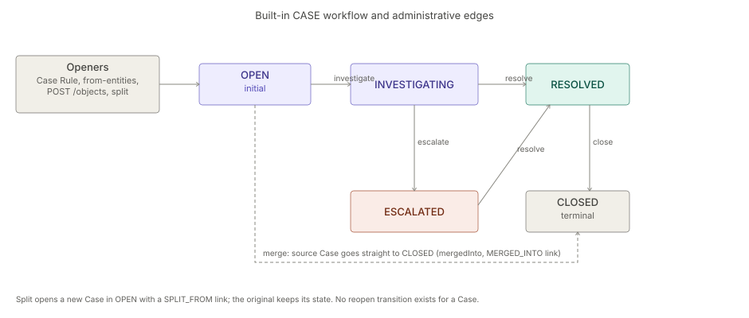

# Case Management

> **Level 3 module page** (`SOLUTION-SUITE-DOCS-1`). Layer: Add-on.
> Offering: Professional and above — add-on `caseManagement` (status `built`, module `case-management`) in
> `offerings/professional.toon`. Checked against the code on 2026-10-17.

## 1. What it is

A **Case** groups related Incidents for one investigation. There is no Case-specific model: a Case is an
`OperationalObject` (`features/inspecto-ops/src/main/java/com/gamma/ops/OperationalObject.java`) of type
`CASE` (`ObjectType`), stored and changed by the ops object machinery (`ObjectStore`, `ObjectService`), with
its members joined by `CONTAINS` links (`LinkStore`).

The module `features/inspecto-case-management` (id `case-management`, feature id `cases`, requires module
`ops`) adds what is Case-specific, in package `com.gamma.ops.cases`:

- `CaseRule` — a rule that groups matching Incidents into a Case;
- `CaseOperations` — merge, split, rule evaluation, open-from-entities;
- `CaseRoutes` — the HTTP routes;
- `CaseRuleEvalJob` — Job Type `caserule.evaluate`, emitting `caserule.evaluate.completed` (`CaseSignals`);
- `CaseConfigExtension` — loads rule files at boot.

## 2. Who uses it

- **Investigators** (`canWorkIncidents`) work Cases through the shared object routes.
- **Incident managers** (`canManageIncidents`) open a Case from entities.
- **Authors** (`canAuthorWorkbench`) write Case Rules; **administrators** (`canAdminister`) merge, split and
  evaluate rules by hand.

## 3. Where it sits

An add-on on top of [incidents](incidents.md): it needs the `ops` module, which supplies the objects, links,
workflow engine and SLA sweep. The chain is Alert → Incident → Case
([Incidents capability](../../okf/capabilities/incidents/incidents.md)).

## 4. How it works

Built-in CASE workflow (`Workflow.defaultFor`), initial `OPEN`, terminal `CLOSED`:

| From | Action | To |
|---|---|---|
| `OPEN` | `investigate` | `INVESTIGATING` |
| `INVESTIGATING` | `escalate` | `ESCALATED` |
| `INVESTIGATING` / `ESCALATED` | `resolve` | `RESOLVED` |
| `RESOLVED` | `close` | `CLOSED` |

Administrative edges outside the workflow:

- **Merge** (`CaseOperations.mergeCases`) moves each source Case straight to `CLOSED`, sets `mergedInto`, adds a
  `MERGED_INTO` link, and moves members' `CONTAINS` links, tags and watchers to the survivor.
- **Split** opens a new Case in `OPEN` with a `SPLIT_FROM` link; the original keeps its state.

**Case Rules.** A rule selects Incidents matching its filter, created within `windowMinutes` and not already in
any Case. It attaches them to the open Case it raised before (`attributes.raisedByRule`), or opens a new Case
once `threshold` is met. Re-running never duplicates members. With `groupBy`, each value of `key.<col>` gets its
own Case; only a digest of the value goes into `caseGroup` and the title.

**From entities.** `POST /cases/from-entities` creates or reuses one Incident per entity (matched by entity key
and Dataset) and opens a Case over them; on failure it compensates.

## 5. Configuration

A Case Rule is a `*_caserule.toon` file with a `case_rule { ... }` block (loaded at boot; an invalid file is
skipped with a warning) or a rule saved with `POST /cases/rules`.

| Key | Meaning |
|---|---|
| `name`, `title` | required |
| `filter` | at least one of `type`, `q`, `status`, `priority`, `severity` (nested or flattened) |
| `threshold` | Incidents needed to open a Case, `>= 1` |
| `windowMinutes` | look-back window, `>= 0` |
| `category`, `tags` | stamped on the Case |
| `groupBy` | a plain column name; one Case per `key.<col>` value |

Unknown keys are kept. The workflow can be replaced per object type (see [workflow-sla](workflow-sla.md));
an SLA Policy accepts `objectType: CASE`. Scheduled evaluation: Job Type `caserule.evaluate` with required
parameter `rule` ([jobs](../../okf/backend/control-plane/jobs.md)).

## 6. Screens

Route `/cases` (`inspecto-ui/src/app/modules/admin/objects/cases.routes.ts`):

- `/cases` — "Case Manager" inbox (`object-mail.component.ts`, type `CASE`), rules via `case-rules.dialog.ts`,
  analytics via `case-analytics.dialog.ts`;
- `/cases/:id` — detail (`object-detail.component.ts`) with `case-contents.component.ts`,
  `merge-cases.dialog.ts`, `split-case.dialog.ts`, `add-member.dialog.ts`.

Front-end notes: [objects](../../okf/frontend/features/objects.md).

## 7. API

Handler: `features/inspecto-case-management/src/main/java/com/gamma/ops/cases/CaseRoutes.java`.

| Route | Gate |
|---|---|
| `GET /cases/rules` | — |
| `POST /cases/rules`, `DELETE /cases/rules/{name}` | `canAuthorWorkbench` |
| `POST /cases/rules/{name}/evaluate` | `canAdminister` |
| `POST /cases/from-entities` | `canManageIncidents` |
| `POST /objects/{id}/merge` (`sources`) | `canAdminister` + data-scope guard |
| `POST /objects/{id}/split` (`title`, `members`) | `canAdminister` + data-scope guard |

State changes, comments, links and findings use the shared object routes in
`features/inspecto-ops/src/main/java/com/gamma/opsapi/ObjectRoutes.java` (`POST /objects/{id}/transition`,
`/resolve`, `/assign`, all `canWorkIncidents`).

## 8. Interactions

- [incidents](incidents.md) — members are Incidents; an Alert Rule's `key.<column>` attributes feed `groupBy`.
- [alerts](alerts.md) — first link of the Alert → Incident → Case chain.
- [link-analysis](link-analysis.md) — from-entities opens a Case from investigated entities; a classified
  Dataset needs `canRevealLinkEntities`.
- [jobs-scheduler](jobs-scheduler.md) — `caserule.evaluate`.
- [events](events.md) — `OBJECT_ACTIVITY` events for transitions and merges.
- [action-requests](action-requests.md) — shown on the detail page (UI panel only).

## 9. Limits and gotchas

- No `reopen` for a Case (an Incident has one).
- At most `MAX_CASE_ENTITIES` = 100 entities per from-entities call (422 beyond).
- Merge refuses a non-Case, a merge into itself, or a closed / already-merged source; comments and
  attachments stay on the source.
- Split refuses a closed Case or a member it does not contain.
- Dispositions and the postmortem resolution gate apply to Incidents only; a Case's disposition is part of
  its Findings.
- Rule evaluation stays `canAdminister` although transitions moved to `canWorkIncidents`.
- Whether the SLA clock stops at `CLOSED` was not confirmed (`SlaDecisions` names `RESOLVED` and `ARCHIVED`).
