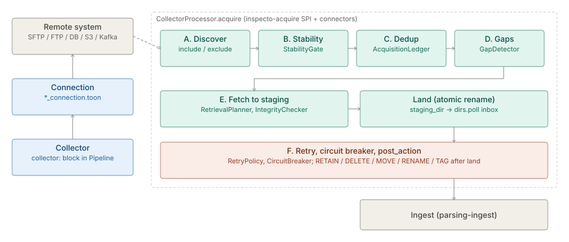

# Collectors

> **Level 3 module page** (`SOLUTION-SUITE-DOCS-1`). Layer: Platform base.
> Offering: all tiers (local, SFTP, FTP/FTPS, DB, S3, Azure, GCS); the Kafka Collector is Professional and above.
> Checked against the code on 2026-10-17.

## 1. What it is

A **Collector** is a configured collection task bound to one **Connection** (a named endpoint plus
credentials). It reaches a remote system, decides which files are new and complete, fetches them once,
and lands them in the Pipeline's inbox (`dirs.poll`). Everything after landing is ingest's job
([parsing-ingest](parsing-ingest.md)). The capability spec of record is
[acquisition.md](../../okf/capabilities/acquisition/acquisition.md); this page is the module summary.

Code homes:

- SPI and engine-side logic: `platform/inspecto-acquire/src/main/java/com/gamma/acquire` —
  `CollectorConnector`, `CollectorConnectorFactory`, `CollectorConnectors`, `ConnectionProfile`,
  `StabilityGate`, `AcquisitionLedger`, `DuplicatePolicy`, `GapDetector`, `RetrievalPlanner`,
  `IntegrityChecker`, `CircuitBreaker`, `RateLimiter`, `PostAction`, `retry/RetryPolicy.java`.
- Remote connectors: `providers/inspecto-connectors/src/main/java/com/gamma/acquire/connectors`.
- Kafka connector: `providers/inspecto-connectors-kafka/src/main/java/com/gamma/acquire/kafka`.
- Cycle driver: `platform/inspecto-engine/src/main/java/com/gamma/inspector/CollectorProcessor.java`.

## 2. Who uses it

- **Integration engineers** author Connections and the `collector:` block of a Pipeline.
- **Operators** watch Collector state, test Connections, and trigger an immediate scan.
- **Upstream systems** (an S3 event, an upload script) can call the notify route to ask for a scan now.

## 3. Where it sits

Collectors are the first stage of the platform base: a remote system feeds a Collector, the Collector
lands bytes, and a [Pipeline](pipelines-steps.md) parses and loads them into [storage](storage.md).
The connector schemes are pluggable through `ServiceLoader`: `CollectorConnectors.forConfig` resolves
`local` to the built-in `LocalFileSystemConnector` and any other scheme to a registered
`CollectorConnectorFactory` matched on `scheme()`. An unknown scheme fails fast; there is no fall-back
to `local`.

| Scheme | Class | Module |
|---|---|---|
| `local` | `LocalFileSystemConnector` | `inspecto-acquire` (built in) |
| `sftp` | `SftpConnector` | `inspecto-connectors` |
| `ftp`, `ftps` | `FtpConnector` (two factories) | `inspecto-connectors` |
| `db` | `DbExportConnector` | `inspecto-connectors` |
| `s3` | `S3Connector` + `AwsSigV4` | `inspecto-connectors` (SDK-free) |
| `azure` | `AzureBlobConnector` + `AzureSharedKey` | `inspecto-connectors` (SDK-free) |
| `gcs` | `GcsConnector` + `GcpServiceAccountToken` | `inspecto-connectors` (SDK-free) |
| `kafka` | `KafkaConnector` | `inspecto-connectors-kafka` |

The registry files are
`providers/inspecto-connectors/src/main/resources/META-INF/services/com.gamma.acquire.CollectorConnectorFactory`
and the matching file in `inspecto-connectors-kafka`.

## 4. How it works

`CollectorProcessor.acquire` runs phases A to F; `acquire` is a no-op for a `local` Collector.

- **A. Discover.** `CollectorConnector.discover` lists candidates; it never dedups. Shaped by
  `include`, `exclude`, `recursive_depth` and `discovery` (`poll` or `watch`).
- **B. Stability.** `StabilityGate` asks the connector's `readiness` first (object stores answer
  `READY`), and only on `UNKNOWN` applies size/mtime quiescence (`window`, `size_checks`) or a
  `ready_marker`.
- **C. Dedup.** `DuplicatePolicy` has a `Mode` (`PATH`, `METADATA`, `CHECKSUM`, `ETAG`) and an
  `OnChange` (`IGNORE`, `REPROCESS`, `ALERT`, `ARCHIVE_OLD_VERSION`). Fingerprints live in the
  `AcquisitionLedger` (`InMemoryAcquisitionLedger` by default, `DbAcquisitionLedger` when durable).
- **D. Gaps.** `GapDetector` finds missing keys in a dated filename series and emits `SEQUENCE_GAP`
  once per hole (`GapTracker`).
- **E. Fetch and land.** `RetrievalPlanner` picks `FETCH_TO_BACKUP`, `STREAM` or `STAGE_TEMP`. Fetches go
  to `collector.fetch.staging_dir`, are checked by `IntegrityChecker`, then atomically renamed into
  `dirs.poll`. A partial download never sits in the inbox.
- **F. Resilience and disposition.** `RetryPolicy` wraps `discover` and `fetchTo`; `CircuitBreaker`
  skips a failing Collector for a cooldown; `PostAction` applies `RETAIN`, `DELETE`, `MOVE`, `RENAME` or
  `TAG` to the remote file only after landing.

`db` and `kafka` Collectors produce slices: the row watermark or offset frontier is advanced only after
the slice commits, so delivery is at-least-once.

## 5. Configuration

**Connection** — authored as `*_connection.toon` (`ConnectionRegistry`), parsed by
`ConnectionProfile`: `id`, `connector`, `host`, `port`, `database`, `base_path`, `username`, `password`,
`options`, plus optional `tunnel` and `proxy` blocks. Secrets resolve through `SecretResolver` references.

**Collector** — the `collector:` block of a Pipeline (`platform/inspecto-etl/src/main/java/com/gamma/etl/PipelineConfigParser.java`;
there is no other spelling):

| Key | Purpose |
|---|---|
| `connector`, `connection` | scheme (default `local`) and the Connection id |
| `include`, `exclude`, `recursive_depth`, `discovery` | discovery |
| `stability` | `window`, `size_checks`, `ready_marker`, `exclude_temp_files`, `exclude_temp_patterns` |
| `duplicate` | `mode`, `algorithm`, `on_change` |
| `guarantee` | `BEST_EFFORT` (default), `AT_LEAST_ONCE`, `EXACTLY_ONCE` |
| `incremental.watermark` | `last_modified` file-level watermark |
| `gap_detection` | `enabled`, `sequence`, `file_template`, `seq_scope` |
| `fetch` | `mode`, `staging_dir`, `parallel_fetch`, `rate_limit` |
| `retry` | `count`, `backoff`, `initial_delay`, `max_delay` |
| `circuit_breaker` | `failure_threshold`, `cooldown` |
| `post_action` | `on_success`, `archive_path`, `tags`, `on_unsupported` |
| `consignment` | `max_files`, `max_bytes`, `order` |

Connector `options` examples: Kafka reads `topic`, `bootstrap_servers`, `security_protocol`,
`max_records`, `start` (default `earliest`); `db` reads `watermark_column`, `watermark_type`,
`watermark_initial`.

JVM switches: `-Dacquire.ledger.backend` (`memory` | `db`), `-Dacquire.pollSeconds`,
`-Dacquire.maxConcurrent`, `-Dacquire.backpressure.highWater` (0 = off).

## 6. Screens

- **Collectors** — route `collectors`, `inspecto-ui/src/app/modules/admin/collectors/collectors.component.ts`,
  with the detail drawer `collector-detail.dialog.ts`.
- **Connections** — route `settings/connections` (the old `connections` path redirects),
  `inspecto-ui/src/app/modules/admin/connections/connections.component.ts`, plus the graded probe /
  explore / sample view `connection-workbench.component.ts`.

## 7. API

From `inspecto/src/main/java/com/gamma/control/AcquisitionRoutes.java` and `ConnectionRoutes.java`:

| Route | Gate |
|---|---|
| `GET /collectors` | read |
| `POST /collectors/{id}/notify` | `canOperateRuns`; body ignored, triggers a scan; audited `collector.notified` |
| `GET /metrics/acquisition` | read |
| `GET /connections`, `GET /connections/{id}` | read |
| `POST /connections`, `PUT /connections/{id}`, `DELETE /connections/{id}` | `canOnboardConnections` |
| `POST /connections/{id}/test`, `POST /connections/test`, `POST /connections/{id}/probe` | `canOnboardConnections` |
| `GET /connections/{id}/explore`, `GET /connections/{id}/sample` | read |

Gates are listed in `platform/inspecto-access/src/main/java/com/gamma/access/CapabilityManifest.java`.

## 8. Interactions

- [parsing-ingest](parsing-ingest.md) — consumes the landed inbox.
- [pipelines-steps](pipelines-steps.md) — the `collector:` block lives in a Pipeline.
- [identity-access](identity-access.md) — `canOperateRuns`, `canOnboardConnections`.
- [observability-backup](observability-backup.md) — acquisition metrics and the completeness KPI that reads `gap_detection`.
- [events](events.md) — `SEQUENCE_GAP`, `FILE_CHANGED`.
- [spaces](spaces.md) — ledgers and stability gates are per Space.
- Mechanism detail: [connectors](../../okf/backend/acquisition/connectors.md),
  [framework](../../okf/backend/acquisition/framework.md).

## 9. Limits and gotchas

- The default ledger is in memory: restart-safe dedup and frontiers need `-Dacquire.ledger.backend=db`.
- A ledger-requiring `guarantee` with `duplicate.mode: path` only logs a `[CONFIG]` warning and behaves
  as best-effort.
- `staging_dir` must be outside `dirs.poll`; it is refused otherwise.
- `discovery: watch` narrows latency only; the interval poll stays on as the backstop.
- The DB watermark compare is strictly `>`: back-dated rows below the frontier are missed.
- NFS/SMB connectors were declined by design; mount the share and use `local`.
- `https` is a Connection scheme for the outbound webhook, not a Collector scheme.
- Kafka is proven against `MockConsumer` and a fake connector, not a live broker; broker consumer
  groups are out by decision.
- Older javadocs in `inspecto-acquire` still say `source.*`; the config key is `collector.*`.
