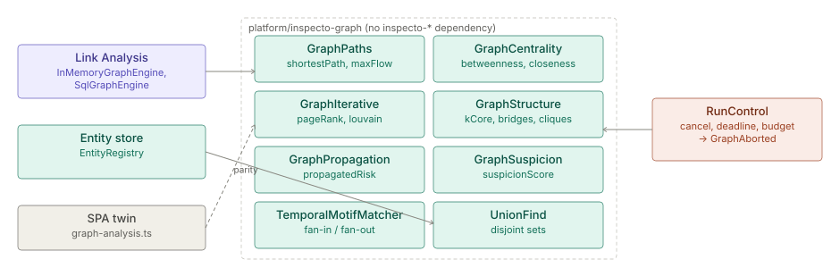

# Graph library

> **Level 3 module page** (`SOLUTION-SUITE-DOCS-1`). Layer: Platform base.
> Offering: all tiers (a core thin jar in every edition). Checked against the code on 2026-10-17.

## 1. What it is

The graph library is the module `platform/inspecto-graph` (package `com.gamma.graph`): server-side
graph algorithms over plain node and edge ids — paths, flow, centrality, PageRank, communities,
k-core, cliques, link prediction, propagated risk, a suspicion blend and a temporal motif matcher.
It is plain JDK with no dependency on any other Inspecto module.

It began as a port of the Link Analysis SPA's algorithms and was moved into the platform by the
analytics core plan (decision D-AN2) so Fraud, AML and Case Management can use it without depending
on Link Analysis. The backend description of Link Analysis, which is its main caller, is
[link-analysis (backend)](../../okf/backend/modules/link-analysis.md).

## 2. Who uses it

- **Module developers** who need a graph computation on the server.
- **Investigators** indirectly, through the Link Analysis algorithm toolbox and pattern search.

## 3. Where it sits

It is a leaf library. Link Analysis keeps the algorithm catalogue (`Algorithm`), dispatch
(`InMemoryGraphEngine`), the cost ceilings and budget (`GraphBudget`) and edge-weight parsing; this
module keeps only the algorithms. Callers found in the code:

| Caller | Use |
|---|---|
| `la/inspecto-la-core` (`GraphEngine`, `InMemoryGraphEngine`, `GraphRunService`, `PatternQueryCompiler`) | run algorithms and motif search for an Investigation |
| `la/inspecto-la-storage` (`SqlGraphEngine`, `RoutingGraphEngine`) | the SQL-backed graph engine |
| `la/inspecto-la-api` (`PatternRoutes`, `GraphResultJson`) | route and JSON shape |
| `platform/inspecto-entity-store` (`EntityRegistry`) | `UnionFind` for entity merging |

## 4. How it works

| Class | Algorithms |
|---|---|
| `GraphPaths` | `shortestPath`, `weightedShortestPath`, `allPaths`, `maxFlow`, `egoNetwork`, `maximumSpanningForest` |
| `GraphCentrality` | `betweennessCentrality`, `closenessCentrality`, `jaccardSimilarity`, `linkPrediction` |
| `GraphIterative` | `pageRank`, `eigenvectorCentrality`, `katzCentrality`, `hits`, `detectCommunities`, `louvainCommunities` |
| `GraphStructure` | `kCore`, `bridges`, `articulationPoints`, `cliques`, `findCycles` |
| `GraphAlgorithms` | `degreeCentrality`, `connectedComponents`, `triangleCount`, `neighborhood` |
| `GraphPropagation` | `propagatedRisk` — explainable guilt-by-association from each node's own score |
| `GraphSuspicion` | `suspicionScore` — blends degree, betweenness, PageRank, k-core and triangles |
| `TemporalMotifMatcher` | ordered `fan-in` / `fan-out` stages over timed directed legs (structuring, layering, round trips) |
| `UnionFind` | deterministic disjoint sets over string keys |
| `RunControl`, `GraphAborted` | cancellation, wall-clock deadline, work budget and progress |

**Parity with the browser.** Most classes are line-for-line ports of
`inspecto-ui/projects/link-analysis/src/graph/graph-analysis.ts`. Each Java parity test
(`GraphAlgorithmsParityTest`, `GraphPathsParityTest`, `GraphStructureParityTest` and others) and its
TypeScript twin read the same hand-derived fixture, so the server and the SPA agree to the double.
`GraphPropagation` is server-only and has hand-computed tests instead.

**Run control.** An algorithm calls `RunControl.checkpoint()` once per bounded unit of work. Another
thread may cancel it or read progress. A stop throws `GraphAborted` and returns no partial result —
the caller reports the reason and the numbers, never a half-computed ranking.

**Temporal motifs.** `TemporalMotifMatcher` finds stages where a node reaches at least
`minBranches` distinct counterparties within `windowHours`, optionally after the previous stage and
within `maxGapHours`; the last stage may close back to the origin. It returns nodes, edges, layers
and a `truncated` flag (match `limit` reached, or the 500,000 leg-examination budget spent).

## 5. Configuration

None. Limits (node ceilings, cost classes, budgets) are set by the caller; for Link Analysis see
`/settings/link-analysis/limits` and [link-analysis](link-analysis.md).

## 6. Screens

None of its own. Results appear in the Link Analysis algorithm toolbox and pattern search.

## 7. API

No HTTP routes. Link Analysis exposes the algorithms through its own routes (for example the
pattern route behind `/inv/pattern/branching`).

## 8. Interactions

- **[Link Analysis](link-analysis.md)** is the main caller.
- **[Analytics kernel](analytics-kernel.md):** statistics over vectors live there; graph searches
  live here. The motif matcher moved here for that reason.
- **[Scoring and Entity Lists](scoring-entity-lists.md)** and the entity store use `UnionFind`.

## 9. Limits and gotchas

- A Java change to a ported algorithm must be mirrored in `graph-analysis.ts`, or the parity tests
  fail on one side.
- The library holds no limits; an uncapped caller can run an expensive algorithm on a large graph.
  Always pass a `RunControl` with a budget or deadline.
- Deterministic entity grouping is built in the [Analytics Kernel](analytics-kernel.md) (`EntityGrouping`, Step
  `enrichment.entity.link`); `UnionFind` is also used by the entity store's `EntityRegistry`.
- Its pom's enforcer `bannedDependencies` rule fences out `inspecto-*` dependencies; adding one fails the build.
