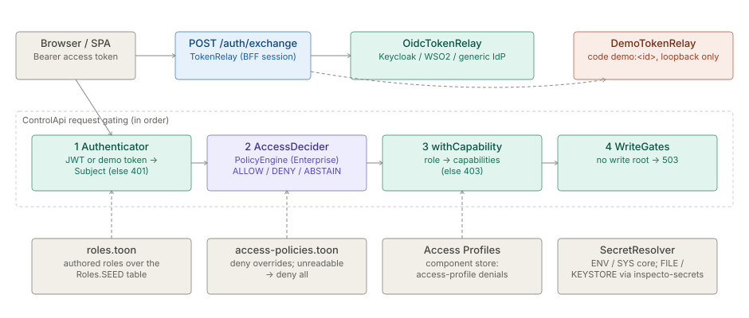

# Identity and Access

> **Level 3 module page** (`SOLUTION-SUITE-DOCS-1`). Layer: Platform base.
> Offering: auth-free on Personal; OIDC sign-in and file/keystore secrets on Professional and up; Attribute-based
> Access Policies (ABAC) on Enterprise and Preview; Demo User sign-in only in a `-DemoAuth` demo bundle.
> Checked against the code on 2026-10-17.

## 1. What it is

Identity and Access decides **who is calling** and **what they may do**. The core defines the contracts and
implements none of the enforcement; optional modules plug in through `ServiceLoader`:

| Piece | Module | What it contributes |
|---|---|---|
| SPI contracts | `spi/inspecto-auth-spi` | `Authenticator`, `TokenRelay`, `AccessDecider`, `Subject`, `SecretsProvider`, `SecretResolver` |
| Roles, grants, row scope, audit | `platform/inspecto-access` | `Roles` (role → capability table), `AccessGrants`, `AccessPolicyStore`, `RowScope`, `WriteGates` |
| OIDC sign-in | `providers/inspecto-oidc` | `OidcAuthenticator` (JWT → `Subject`), `OidcTokenRelay` (code exchange / refresh / logout) |
| Demo sign-in | `providers/inspecto-demo-auth` | `DemoAuthenticator`, `DemoTokenRelay` — pick a Demo User, no password |
| ABAC engine | `providers/inspecto-policy` | `PolicyEngine` (the `AccessDecider`), plus the `PII_MASK` edition feature |
| Secrets schemes | `providers/inspecto-secrets` | `FileKeystoreSecretsProvider` — `${FILE:…}` and `${KEYSTORE:…}` |

The full specification, decisions and refusals live in [Security](../../okf/capabilities/security/security.md); this page is the
module-level map.

## 2. Who uses it

- **Administrators** (`canConfigureAccess`) author the role table, Access Policies, the Access Catalog and
  Access Profiles.
- **Every signed-in user** — their identity-provider roles become capabilities and data scopes.
- **Operators / deployers** choose the identity provider with `-Dauth.oidc.*` properties and wire secrets.
- **Demo presenters** use the Demo User picker on a loopback-bound demo bundle.

## 3. Where it sits

Platform base, in front of every `ControlApi` route. The access module is `bindingTime: build`
(`platform/inspecto-access/src/main/resources/META-INF/inspecto/module.toon`); the four providers are
`bindingTime: boot` and are selected purely by being on the classpath — no runtime flag turns them on.
Maven profiles in `pom.xml`: `edition-professional` and `edition-standard` add `inspecto-oidc` and
`inspecto-secrets`; `edition-enterprise` and `edition-preview` add `inspecto-policy` too.
`inspecto-demo-auth` is a default reactor module but `inspecto/package.ps1` stages it only under
`-DemoAuth`, replacing `inspecto-oidc.jar`; `tools/check-demo-auth-isolation.mjs` fails CI if it leaks into a
non-demo bundle.

## 4. How it works

Request gating (see [Security §3.2](../../okf/capabilities/security/security.md)):

1. **Authenticate.** With an `Authenticator` active, a request with no valid token gets `401`. The OIDC
   authenticator verifies the JWT against the issuer's JWKS (optionally a signed gateway assertion in the
   `X-JWT-Assertion` header), and `RoleMapper` maps the roles claim through `Roles.effective` to capabilities
   and data scopes. With `auth.oidc.provider=keycloak` and no explicit `rolesClaim`, realm roles plus client
   roles of `auth.oidc.clientId` are used. An unknown role name grants nothing.
2. **Authorize (ABAC).** If `inspecto-policy` is present, `PolicyEngine` evaluates the Space's
   `access-policies.toon` against a `subject.* / resource.* / env.*` context: **deny overrides**, then allow,
   else ABSTAIN (the capability gates decide). A policy allow never bypasses a capability gate.
3. **Capability gate.** Each mutating route is wrapped in `ApiContext.withCapability(...)`; the capability
   names are constants in `Roles` (`canConfigureAccess`, `canOperateRuns`, `canAdminister`, …).
4. **Write gate.** `WriteGates` refuses writes with `503` when no `-Dassist.write.root` is set — an ops
   decision independent of identity.

**Sessions (BFF).** The SPA runs PKCE and posts the code to `/auth/exchange`; the `TokenRelay` returns an
access token and keeps the refresh token in the HttpOnly `inspecto_rt` cookie (`AuthRoutes`).

**Demo auth.** The SPA sends `code = "demo:<id>"`; `DemoTokenRelay` mints tokens for a Demo User listed in a
Space's `config/demo-users.toon`, whose roles resolve against the bound Space's role table — so a demo sees
the access production would give the same roles. Both demo classes call `LoopbackOnly.require()` and refuse to
load unless `-Dcontrol.bind` is a loopback address.

**Roles.** `Roles.SEED` ships `pipeline-developer`, `app-developer`, `developer`, `operations`, `support`,
`admin`, `power`, `super` (every capability) and `business`. A Space's `roles.toon` overrides per role name;
an authored role with an empty capability list is revoked. Edits apply on the next request.

**Secrets.** `SecretResolver` expands references at use time: `${ENV:NAME}`, `${SYS:prop}` and bare `${NAME}`
in every edition; `${FILE:/path}` and `${KEYSTORE:alias}` only through `FileKeystoreSecretsProvider`. A
Personal bundle refuses those two schemes with an edition-naming error rather than returning null.

## 5. Configuration

| Key (JVM `-D`) | Read by | Meaning |
|---|---|---|
| `auth.oidc.provider` | `OidcConfig` | `generic` (default), `wso2`, `keycloak`; anything else refuses boot |
| `auth.oidc.issuer`, `auth.oidc.jwksUri`, `auth.oidc.tokenEndpoint`, `auth.oidc.authorizeUrl`, `auth.oidc.endSessionUrl` | `OidcConfig.get` | Explicit value wins, then the discovery document, then the Keycloak path preset |
| `auth.oidc.discoveryUrl` | `OidcConfig` | Optional discovery document; must be https (http only on localhost); issuer mismatch refuses boot |
| `auth.oidc.audience`, `auth.oidc.rolesClaim` (default `roles`) | `OidcAuthenticator` | Token audience; claim carrying role names |
| `auth.oidc.gateway.issuer` / `.audience` / `.jwksUri` / `.header` | `OidcAuthenticator` | Signed API-gateway assertion (header default `X-JWT-Assertion`) |
| `auth.oidc.clientId` (default `inspecto-spa`), `auth.oidc.clientSecret`, `auth.oidc.scopes` | `OidcTokenRelay` | Client used for code exchange; the secret is a resolver reference |
| `control.bind` | `LoopbackOnly`, `ControlApi` | Must be loopback for demo auth |
| `secrets.keystore.path` / `.type` (default `JCEKS`) / `.password` | `FileKeystoreSecretsProvider` | Keystore behind `${KEYSTORE:…}`; the password is itself a reference |

Per-Space documents: `roles.toon` (`Roles.FILE`), `access-policies.toon` (`AccessPolicyStore.FILE`),
`config/demo-users.toon` (`DemoUsers`); Access Catalog and Access Profiles are component-store types
`access-catalog` and `access-profile`.

## 6. Screens

- **Sign-in** — `inspecto-ui/src/app/inspecto/auth/sign-in.component.ts`: SSO button, or the Demo User picker
  with a "not secured" warning in a demo build.
- **Admin → Access** — `inspecto-ui/src/app/modules/admin/access/access.component.ts`, with the role table
  (`access-roles.component.ts`) and Access Policies (`access-policies.component.ts`, `policy-form.dialog.ts`).
- Capability-driven visibility in the SPA comes from `LensService`; see [Security §3.14](../../okf/capabilities/security/security.md).

## 7. API

| Route | Gate | Purpose |
|---|---|---|
| `POST /auth/exchange`, `POST /auth/refresh`, `POST /auth/logout` | public; `503` without a `TokenRelay` | BFF session (`AuthRoutes`) |
| `GET` / `PUT /access/roles` | PUT: `canConfigureAccess` | Effective role table / author it |
| `GET` / `PUT /access/policies` | PUT: `canConfigureAccess` | Access Policies |
| `POST /access/policies/preview` | `canConfigureAccess` | Impact matrix for an unsaved draft |
| `GET /access/explain` | ungated | "Why denied?" for the caller; `{enabled:false}` without the engine |
| `GET` / `PUT /access/catalog` | PUT: `canConfigureAccess` | Access Catalog |
| `GET /access/profiles`, `PUT` / `DELETE /access/profiles/{id}` | writes: `canConfigureAccess` | Access Profiles (`role-…` / `lens-…`) |

All in `inspecto/src/main/java/com/gamma/control/AccessRoutes.java` and `AuthRoutes.java`.

## 8. Interactions

- **Spaces** — roles, policies and Demo Users are per Space; the bound Space decides which role names grant
  what.
- **Collectors / connections** — credentials are stored as `SecretResolver` references, never values.
- **Audit** — `AuditTrail` in `platform/inspecto-access` records every state-changing Control API request as an append-only audit Event, with the actor taken from the `Subject`.
- **Masking** — `PolicyEditionFeatures` enables the `PII_MASK` edition feature with the policy module.

## 9. Limits and gotchas

- **Personal has no authenticator**: every route is open. Bind with `-Dcontrol.bind=127.0.0.1` on shared
  networks; the default listens on every interface.
- **Fail-closed documents**: an unreadable `roles.toon` suspends all role grants; an unreadable
  `access-policies.toon` denies every decision until fixed.
- **Demo auth is not security**: anyone reaching the port can sign in as any Demo User. It refuses to load off
  loopback; a Demo User roster conflict disables sign-in with a `409` while the server keeps running.
- **Discovery drift**: [Security §6.2](../../okf/capabilities/security/security.md) records OIDC discovery as refused, but
  `OidcConfig` now supports `auth.oidc.discoveryUrl`; the code is current, the spec section is stale.
- **No Vault / cloud KMS** secrets scheme; only ENV, SYS, FILE and KEYSTORE.
- `POST /access/policies/preview` is evaluated by the route PEP as a write against the current policy
  document, so a subject that document already denies cannot preview.
