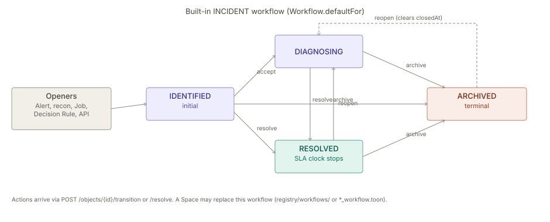

# Incidents

> **Level 3 module page** (`SOLUTION-SUITE-DOCS-1`). Layer: Add-on.
> Offering: add-on `incidents` in `offerings/standard.toon` — `status: planned`, `hostedBy[2]: engine,ops`
> (no module of its own; the code ships in the engine and the `ops` module). Checked against the code on 2026-10-17.

## 1. What it is

An **Incident** is an operational object of type `INCIDENT` (`ObjectType`, in
`platform/inspecto-workflow/src/main/java/com/gamma/workflow/ObjectType.java`) that records something wrong
and is worked to resolution. The record is `OperationalObject`
(`features/inspecto-ops/src/main/java/com/gamma/ops/OperationalObject.java`), persisted through `ObjectStore`
(`DbObjectStore` / `InMemoryObjectStore`) and changed only through `ObjectService`. States are strings held
by a `Workflow`, not an enum. The capability spec is [Incidents](../../okf/capabilities/incidents/incidents.md); the chain is
Alert → Incident → Case.

## 2. Who uses it

- **Operators / analysts** holding `canWorkIncidents` acknowledge, transition, assign and resolve.
- **Incident managers** holding `canManageIncidents` open Incidents (also used by `POST /recon/promote`).
- **Administrators** (`canAdminister`) patch objects and author workflows, SLA Policies and Escalation Rules.

## 3. Where it sits

Split across two layers:

- the engine seam `IncidentAccess` / `ObjectAccess` (`platform/inspecto-engine/src/main/java/com/gamma/objects/`)
  lets core code open an Incident without depending on the ops module;
- the store, service, routes and governance live in `features/inspecto-ops`.

A bundle without `inspecto-ops` reports `features.ops=false`; the object routes answer 503 and openers fall
back to signal-only behaviour. See [platform-services](platform-services.md) (`objects` service).

## 4. How it works

Every Incident enters `IDENTIFIED`. The built-in workflow (`Workflow.defaultFor`) allows:

| From | Action | To |
|---|---|---|
| `IDENTIFIED` | `accept` | `DIAGNOSING` |
| `IDENTIFIED` / `DIAGNOSING` | `resolve` | `RESOLVED` |
| `IDENTIFIED` / `DIAGNOSING` / `RESOLVED` | `archive` | `ARCHIVED` |
| `RESOLVED` / `ARCHIVED` | `reopen` | `DIAGNOSING` (out of `ARCHIVED` clears `closedAt`) |

Only `ARCHIVED` is terminal; the SLA clock stops at `RESOLVED`. Openers:

- `POST /objects` (a title and at least one link);
- `AlertService.promoteToIncident` — a critical Alert Rule firing opens one deduped Incident linked
  `ESCALATED_FROM` the Alert, and re-opens it on relapse;
- `POST /recon/promote` and the `recon.run` Job ([reconciliation](reconciliation.md));
- the `incident.open` Job (`platform/inspecto-engine/src/main/java/com/gamma/job/IncidentOpenJob.java`);
- a Decision Rule `create-incident` consequence (`CreateIncidentConsequence`);
- `EventAlertBridge` on a sequence-gap event.

Every status change lands in `ObjectService.commit()`, which stamps resolution times and emits `OBJECT_*`
events into the signal ledger.

## 5. Configuration

No dedicated `incidents:` keys exist beyond the offering entry. Governance is authored as components:

- workflow resolution order: `registry/workflows/`, then a `*_workflow.toon` override, then the built-in;
- `registry/sla-policies/` (`SlaPolicy`) and `registry/escalation-rules/` (`EscalationRule`, at most 50
  loaded) — read by `GovernanceRegistry`, re-read on file change, a broken file keeps its last valid version;
- component kinds `workflow`, `sla-policy`, `escalation-rule`;
- Job types `incident.open`, `objects.analytics`, `incident_purge` (see [jobs-scheduler](jobs-scheduler.md)).

An authored workflow is validated at save and load (reachable states, a way out of every non-terminal state,
`RESOLVED` present for an Incident). SLA details: [workflow-sla](workflow-sla.md).

## 6. Screens

Route `/incidents` (`inspecto-ui/src/app/modules/admin/objects/incidents.routes.ts`):

- `/incidents` — inbox (`object-mail.component.ts`, data type `INCIDENT`), create via `object-create.dialog.ts`;
- `/incidents/:id` — detail (`object-detail.component.ts`) with `resolve.dialog.ts`, `categorize.dialog.ts`,
  `impact-panel.component.ts`, `postmortem-panel.component.ts`, `object-link.dialog.ts` and
  `action-requests-panel.component.ts`.

Front-end notes: [objects](../../okf/frontend/features/objects.md).

## 7. API

Handler: `features/inspecto-ops/src/main/java/com/gamma/opsapi/ObjectRoutes.java`.

| Route | Gate |
|---|---|
| `GET /objects`, `GET /objects/analytics`, `GET /objects/by-entity` | read, post-filtered by scope |
| `POST /objects` | `canManageIncidents` |
| `POST /objects/{id}/ack`, `/resolve`, `/transition`, `/assign` | `canWorkIncidents` |
| `PUT /objects/{id}/postmortem`, `/category`, `/impact` | `canWorkIncidents` |
| `GET` / `POST` / `DELETE /objects/{id}/links`, `GET /objects/{id}/graph` | scope guard |
| `/objects/{id}/comments`, `/attachments`, `POST /objects/{id}/rca`, `PUT /objects/{id}/findings` | scope guard |
| `PATCH /objects/{id}` | `canAdminister` |
| `GET /objects/{id}` | scope guard |

The capability gate runs before the scope guard: no capability → 403, out-of-scope object → 404.

## 8. Interactions

- [alerts](alerts.md) — critical Alerts promote to Incidents; stored Alerts are worked separately.
- [events](events.md) — `OBJECT_*` events record every change.
- [notifications](notifications.md) — SLA notifications key on `sla:{{correlationId}}` (`NotificationRules`).
- [case-management](case-management.md) — Cases group Incidents.
- [maker-checker](maker-checker.md) — governance files can be applied through an approval.
- [decision-kernel](decision-kernel.md) — the `create-incident` consequence.

## 9. Limits and gotchas

- The add-on is `planned` in the offering even though the objects machinery is built — it has no module id.
- `POST /objects/{id}/ack` sends action `ack`, which the built-in INCIDENT workflow does not define; it only
  works with a custom workflow (not verified by a test).
- No acknowledged-at stamp, so no MTTA. Queues and watchers were retired; assignment is person-only.
- `reopen` from `IDENTIFIED` / `DIAGNOSING` is illegal, so an Alert relapse there does not change state.
- A reopened Incident's analytics measure to its latest resolution.
- Nothing opens an Incident from a Diagnosis yet.
