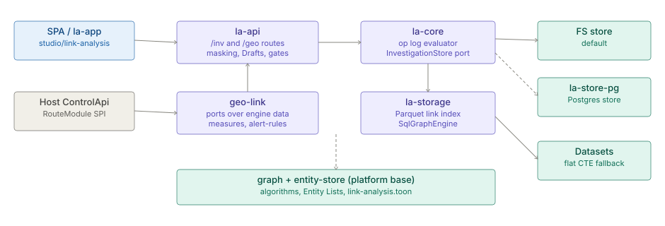

# Link Analysis

> **Level 3 module page** (`SOLUTION-SUITE-DOCS-1`). Layer: Link Analysis.
> Offering: Professional and above (`linkAnalysis` add-on: `la-storage`, `la-core`, `la-api`, `geo-link`);
> Enterprise adds `la-store-pg`. Checked against the code on 2026-10-17.

## 1. What it is

Link Analysis (LA) lets an analyst explore who is connected to whom in platform Datasets (calls, transfers,
devices, accounts), record that exploration as an **Investigation**, run graph algorithms over it, and hand the
result on as a sealed dossier, a Case link or a standing detection. It is an optional, ServiceLoader-discovered
extension of the one host process - no LA server, no LA main class.

The full backend structure is in [Link Analysis backend architecture](../../okf/backend/modules/link-analysis.md);
behaviour and decisions in the [feature concept](../../okf/frontend/features/link-analysis.md). This page is the
module-level summary.

## 2. Who uses it

- **Fraud and AML investigators** expand from a seed entity, pin evidence, and export a dossier.
- **Supervisors** approve sensitive expansions (four-eyes) and promote Drafts.
- **Space administrators** tune limits, masking and the link index.
- **External reviewers** read a time-limited public embed of an Investigation.

## 3. Where it sits

| Module (manifest id) | Path | Role |
|---|---|---|
| `la-core` | `la/inspecto-la-core` | Domain and ports: op-log evaluator, `InvestigationStore` port + filesystem store, Drafts, Graph Run service |
| `la-storage` | `la/inspecto-la-storage` | Versioned Parquet link index, `SqlGraphEngine` / `RoutingGraphEngine` |
| `la-api` | `la/inspecto-la-api` | The `/inv` and `/geo` routes (81), masking, Draft orchestration, gates |
| `geo-link` | `la/inspecto-geo-link` | Bridge to the host: `DatasetProvider`, `CasePort`, `CollectorCoveragePort`, `LinkIndexBuilder`, measures and alert-rule routes |
| `la-store-pg` | `la/inspecto-la-store-pg` | Postgres `InvestigationStoreProvider` (Enterprise) |

They sit on two platform-base modules, `graph` (algorithms) and `entity-store` (Entity Types, Entity Lists,
identity facts, `LinkAnalysisSettings`). The engine names no `la-*` class; it reaches LA only through SPIs it owns.

## 4. How it works

1. **Investigation = op log.** Each action (`POST /inv/investigations/{id}/ops`) is appended to a hash-sealed log
   and folded deterministically into a **Working Set**. Undo, reorder and replay re-fold the log.
2. **Reads** come from the Dataset (flat recursive CTE in sandboxed DuckDB) or, when `index.enabled` (default on)
   and a fresh index exists, from the link index; a fallback always carries a closed `Reason`.
3. **Link index** (`IndexBuilder`, `IndexBuildService`): `la-index/<ds>/<mapping>/vN/` bucketed Parquet plus a
   manifest and `CURRENT` pointer; `full | append | compact` builds via `POST /inv/index/builds` or the
   `la.index.build` Job.
4. **Graph Run** (`GraphRunService`): algorithms from `GET /inv/graph/algorithms` over the Working Set
   (`InMemoryGraphEngine`) or the index (`SqlGraphEngine`), in a bounded pool.
5. **Drafts**: fork, ops, rebase, promote - parallel work on one Investigation without blocking the main log.
6. **Masking**: `EntityMasking` sends tokens out; raw values stay inside; reveal is audited.
7. **Outputs**: dossier and bundle (SHA-256 root, verify routes), Case link, Working Set measures, standing
   detection via the `la.detect` Job into [Alerts](alerts.md), public embeds.
8. **Store**: filesystem by default; Postgres with `-Dinvestigations.backend=db` and a `jdbc:postgresql:` URL.

## 5. Configuration

- **Space**: `link-analysis.toon` in the Space write root (masking mode, index switch, SPACE-layer limits), edited
  through `PUT /settings/link-analysis` and `PUT /settings/link-analysis/limits`.
- **Install**: `la-limits.toon` (INSTALL-layer limits: Graph Run pool and ceilings, index threads, rate buckets),
  edited through `PUT /system/link-analysis/limits` (`canAdminister`). Catalogue: `LaLimit` in
  `platform/inspecto-entity-store`.
- **JVM**: `-Dinvestigations.backend=db` (Postgres store), `-Dla.embed.enabled` (public embeds).
- **Enablement**: Installed (jar) -> Enabled (`geoLink` per Space) -> Permitted (capability, membership, policy).
- Full limit table: [backend architecture section 9](../../okf/backend/modules/link-analysis.md).

## 6. Screens

- **Studio - Link Analysis** (`studio/link-analysis`), **Entities** (`studio/entities`) and **Geo map**
  (`studio/geo-map`), all from the library `inspecto-ui/projects/link-analysis/`.
- The standalone **la-app** shell (`inspecto-ui/projects/la-app/`), served by the same host.
- Public embed view at `GET /public/investigations/{token}`.

## 7. API

Grouped; the authoritative list is each module's `META-INF/inspecto/module.toon`.

| Group | Routes |
|---|---|
| Exploration | `POST /inv/projection`, `/inv/projection/neighbors`, `/inv/traversal/recursive-paths`, `/inv/pattern/*`, `POST /geo/projection`, `/geo/routes` |
| Investigations | `GET`/`POST /inv/investigations`, `.../ops`, `/undo`, `/reorder`, `/replay`, `/log`, `/working-set`, `/members`, `/case` |
| Four-eyes | `GET /inv/pending`, `.../pending/{id}/approve`, `/deny` |
| Drafts | `.../drafts`, `/rebase`, `/promote`, `/discard`, `/conflicts` |
| Dossier, embeds | `.../dossier`, `/dossier/bundle`, `/verify`, `.../embeds` |
| Graph, index | `GET /inv/graph/algorithms`, `POST /inv/graph/runs`, `GET /inv/index`, `POST /inv/index/builds` |
| Entities | `/inv/entity-types`, `/inv/entity-identities`, `/inv/entities/{type}/{key}/profile` |
| geo-link | `.../measures`, `/data-changes`, `/alert-rules`, `/standing-detection` |

Request gate order: authenticate -> rate limit -> ABAC -> module enabled -> capability -> open gate (member, policy).

## 8. Interactions

- [Graph library](graph-library.md) - algorithms; [Scoring and Entity Lists](scoring-entity-lists.md) - identity.
- [Case management](case-management.md) - Case link; [Alerts](alerts.md) - standing detection.
- [Jobs scheduler](jobs-scheduler.md) - `la.index.build`, `la.detect`; [Storage](storage.md) - Datasets.
- [Exchange](exchange.md) - saved views shared across Spaces; [AI assist](ai-assist.md).
- [Link Analysis solution](../solutions/link-analysis.md).

## 9. Limits and gotchas

- Every bound is a configuration item; a stored value outside its range reads as the default.
- Expensive exploration POSTs are rate-limited per subject (burst 30, 1 per 2 s by default); Investigation routes
  are exempt.
- A view-backed Dataset cannot be fingerprinted, so the index serves it only while younger than
  `index.max_age_hours` (default 24).
- A stale-served `expand` may count hub degree over newer rows than it shows (documented exception).
- An index build waits while ingest runs and fails after 6 h of continuous ingest.
- The `la/inspecto-la-graph` directory in the working tree is untracked and not part of any Offering; not covered.
