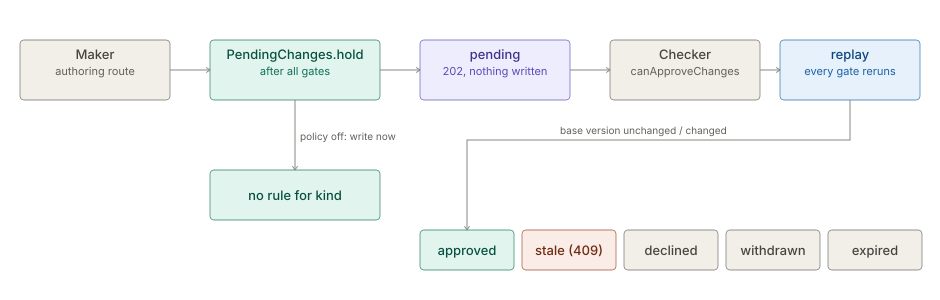

# Maker-checker (Pending Changes)

> **Level 3 module page** (`SOLUTION-SUITE-DOCS-1`). Layer: Platform base.
> Offering: every edition; deciding needs an Authenticator, so on Personal it cannot be switched on through the API.
> Checked against the code on 2026-10-17.

## 1. What it is

Maker-checker holds a config change for a second person's approval. When the Space's **Approval Policy**
requires approval for a kind, an authoring route does not write: it stores a **Pending Change** and answers
`202 {status: pending, written: false, pendingChange}`. A person holding the approver capability then approves
(the original request is replayed) or declines it. The author cannot decide their own change; they can withdraw it.

Code: `inspecto/src/main/java/com/gamma/control/PendingChanges.java` (hold, store, replay check, expiry),
`inspecto/src/main/java/com/gamma/control/PendingChangeRoutes.java` (HTTP),
`inspecto/src/main/java/com/gamma/control/ApprovalPolicy.java` (policy and the governable kinds),
`inspecto/src/main/java/com/gamma/control/ApproverCheck.java` and
`inspecto/src/main/java/com/gamma/control/ApproverRoster.java` (who may decide).

## 2. Who uses it

- **Makers**: anyone authoring a governed kind (Pipelines, schemas, components, Jobs, Alert Rules, Decision Rules, Expectations, channels).
- **Checkers**: holders of `canApproveChanges` (or the capability the policy names for the kind), working the inbox.
- **Administrators**: set the policy (`canAdminister`) and, under OIDC, the approver roster.

## 3. Where it sits

Core control plane (`inspecto` module), not an add-on. It sits between every config-writing route's validation
gates and its first side effect. The same approver-eligibility reading (`ApproverCheck`) and the same per-Space
HMAC key are reused by [Action Requests](action-requests.md), which has its own mandatory approval and is never
held as a Pending Change.

## 4. How it works



1. **Hold.** Each authoring route calls `PendingChanges.hold(api, ex, kind, name, proposed, current)` after all
   its validation. No rule for the kind: it returns and the route writes as before. Otherwise it stores the change
   and throws `PendingChanges.Held`. One pending change per kind + name (a second is 409). The author may send
   an `X-Change-Reason` header.
2. **Writers that cannot be one change refuse** (409) under a policy: `/bundle/import`, `/pipelines/import`,
   BI template apply, `POST /import` with a governed entry (`PendingChanges.holdRefusing`, `holdRefusingPaths`).
3. **Decide.** Approve / decline need `canApproveChanges`, an authenticated Subject, a valid record (HMAC), status
   `pending`, the policy's `approverCapability`, four-eyes (not the author) and, under OIDC, a place on the roster.
4. **Apply.** Approve replays the stored request (method, path, query, body, `If-Match`) through
   `ApiContext.replay` with the change stamped on it. Every gate of the route runs again. The hold lets it through
   only if it is the same write and the replaced content is still at the **base version**; otherwise the change is
   closed as **stale** (409). Versions are content hashes that ignore `createdAt`, `updatedAt`, `lastResult`,
   `lastSimulation`, so routine evaluation does not stale a waiting change.
5. **Expire.** Past `expiresAfterHours` a pending change becomes `expired` - lazily, on the next list, read, decide
   or withdraw (`PendingChanges.expireIfDue`); there is no scheduler.

States: `pending` then `approved`, `declined`, `withdrawn`, `stale` or `expired`; a record failing its MAC reads
`invalid` and cannot be decided.

## 5. Configuration

`approval.toon` in the Space config root:

```
approval:
  pipeline: {required: true, approverCapability: canApproveChanges, fourEyes: true}
expiresAfterHours: 168
```

- Default: off for every kind; capability `canApproveChanges`; four-eyes on; 168 h.
- Validated fail closed: a kind outside `ApprovalPolicy.GOVERNABLE`, a capability no route demands, an unknown key
  or a bad value is 422. A present but unreadable file is **not** off: every governable kind is held
  (`failedClosed: true` on the GET).
- Governable: `pipeline`, `schema`, `enrichment`, `meta`, `job`, and every `ComponentStore` kind except `requirement`
  (including `channel`, `notification-rule`). Not governable: Connections, Tags, Case Rules, Space settings documents
  (the policy itself above all).
- `approvers.toon` (`users`, `groups`): the per-Space approver roster used when the Authenticator cannot list
  its principals (OIDC). Absent or empty admits nobody.
- `-Dinspecto.pendingChanges.lockWaitMs`: bound on waiting for the store's file lock.
- Storage: `<write-root>/pending-changes/<id>.json`, ids `pc-<yyyyMMddHHmmss>-<6 hex>`; key in
  `<config root>.secrets/.pending-changes.key`, outside the config tree.

## 6. Screens

- **Operations > Pending Changes** (`/pending-changes`, `inspecto-ui/src/app/modules/admin/pending-changes/`):
  waiting or all changes; author, reason, expiry, decision and a line diff. Approve / Decline show only with
  `canApproveChanges`; Withdraw only to the author.
- **Settings > Approvers** (`inspecto-ui/src/app/modules/admin/settings/approver-roster.component.ts`).
- The policy has no dedicated screen found in the SPA; it is set through `PUT /settings/approval`.

## 7. API

| Route | Gate | Notes |
|---|---|---|
| `GET /settings/approval` | read | carries `failedClosed` |
| `PUT /settings/approval` | `canAdminister`; 403 with no Authenticator | empty body 422 - send `{"approval": {}}` to turn off |
| `GET /pending-changes[?status&kind]` | read | capped at 500, `total` + `truncated` |
| `GET /pending-changes/{id}` | read | with `current` and `proposed` |
| `GET /pending-changes/{id}/diff` | read | line diff over both contents as TOON |
| `POST /pending-changes/{id}/approve` · `/decline` | `canApproveChanges` | four-eyes, roster, stale check |
| `POST /pending-changes/{id}/withdraw` | author only | status `withdrawn` |
| `GET|PUT /settings/approvers` | PUT `canAdminister` | the roster |

## 8. Interactions

- [Action Requests](action-requests.md) reuse `ApproverCheck`, the roster and the HMAC key (domain-separated).
- [Decision Kernel](decision-kernel.md): Decision Rules are a governed kind.
- [Platform Services](platform-services.md): a Job's run-time writes are not held (by decision).
- Details: [config safety - Maker-checker](../../okf/backend/config/config-safety.md),
  [auth and security](../../okf/backend/editions/auth-security.md).

## 9. Limits and gotchas

- A change with no eligible approver waits until it expires; nothing auto-declines.
- Job **run-time** writes (a `MaterializeTask` restating its Dataset) are not held, by decision.
- The MAC defends against records written through doors that cannot read the key, not against a local administrator.
- The hold guard's closure stops at a file boundary; `ConfigWriteFunnelTest` keeps the inventory of writers.
- Approve replays as the **author**: `updatedBy` on a Job is the author, never the approver.
- A store lock that cannot be taken in time answers 503.
