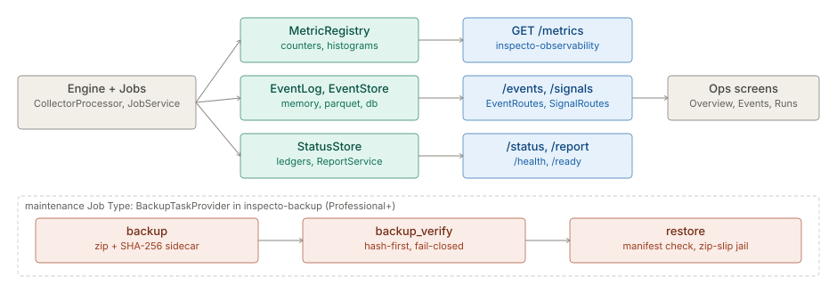

# Observability and backup

> **Level 3 module page** (`SOLUTION-SUITE-DOCS-1`). Layer: Platform base.
> Offering: health, status, run reports and the audit log in all tiers; the Prometheus endpoint, the
> Events screen routes (`inspecto-observability`) and backup / restore (`inspecto-backup`) are
> Standard and above. Checked against the code on 2026-10-17.

## 1. What it is

Two platform concerns that keep a deployment operable:

- **Observability** — engine counters exposed for Prometheus, the event ledger, the who-did-what
  audit trail, run reports with percentiles, and health and readiness probes.
- **Backup and restore** — tasks on the `maintenance` Job Type that archive a directory tree with a
  SHA-256 manifest, verify an archive, and restore it fail-closed.

The capability spec of record is [observability](../../okf/capabilities/observability/observability.md); the
event and metrics plumbing is [events-metrics](../../okf/backend/control-plane/events-metrics.md); the
runbook is [`backup-restore-runbook.md`](../../ops/backup-restore-runbook.md).

## 2. Who uses it

- **Operators** watch the Overview, Runs, Events and Audit log screens and schedule retention and
  backup Jobs.
- **Platform teams** scrape `GET /metrics` and probe `/health` and `/ready`.
- **Auditors** search and export the audit trail.

## 3. Where it sits

The counters and the event bus are core plumbing written to from across the engine; the two
optional modules add only surfaces:

- `features/inspecto-observability` — `MetricsRoutes` (`GET /metrics`) and `EventRoutes` (`/events*`).
- `features/inspecto-backup` — `BackupTask`, `BackupTaskProvider` (the `MaintenanceTaskProvider`
  seam), `BackupSignals`, and `BackupEditionFeatures` (declares `sink.archive` and `sink.ducklake`).

Absent `inspecto-observability`, core `AbsentModuleRoutes` answers `503`. Absent `inspecto-backup`,
`backup`, `backup_verify` and `restore` are unknown maintenance tasks and vanish from the Jobs form.

## 4. How it works

**Metrics.** `MetricRegistry` (`platform/inspecto-event`) holds counters, gauges and histograms keyed
by name and labels; `scrape()` renders Prometheus text version 0.0.4. Series include
`inspecto_batches_total`, `inspecto_output_rows_total`, `inspecto_inbox_oldest_seconds`,
`inspecto_batch_duration_seconds` and `inspecto_job_duration_seconds`. `GET /metrics` is
unauthenticated by design (scrapers carry no token). Duration percentiles come from the report
routes, not from `/metrics`.

**Event ledger.** `EventLog` is a synchronous bus (global plus one per Space) and the single
secret-scrub seam. `EventStore` backends are chosen by `-Devents.backend`: `memory` (engine default,
a ring of 8,192), `parquet` (set by the Standard and Advanced launchers), or `db`.

**Audit.** `AuditTrail` is one interceptor in `ControlApi.dispatch` that records every successful
state-changing request, export reads and denied attempts, as `AUDIT` / `ACCESS_DENIED` events.

**Run reporting and health.** `ReportService` computes on demand over the `StatusStore`: error rate,
rows in and out, rejected files, and p50 / p95 / p99 durations. `/health/details` reports
`UP` / `DOWN` / `NOT_CONFIGURED` per subsystem and is auth-gated.

**Backup.** `backup` zips the files under `dir` into `<backup_dir>/<prefix>_<stamp>.zip`, skipping
the archive directory itself, secrets and DuckDB spill. Beside it goes a sidecar
`<archive>.manifest.json` with a SHA-256 per file and for the archive; both are staged and renamed, so
a crash leaves each absent or complete. Each backup appends a row to the `maintenance_backups`
Dataset. A dry run reports the file count and bytes and writes nothing.

**Verify and restore.** `backup_verify` checks the archive hash against the sidecar before trusting
it. `restore` is fail-closed: the sidecar must exist and match, extraction is path-jailed under
`target_dir` (zip-slip), existing files block unless `overwrite: true`, and every file is re-hashed.
All path parameters resolve against the Space config root through `PathJail.requireJobPathUnderAny`.

## 5. Configuration

| Key | Meaning |
|---|---|
| `-Devents.backend`, `-Devents.dir` | event store backend and location |
| `-Dstatus.backend` (default `db`), `-Djobs.backend` (default `none`) | status ledger and job-run projection |
| `-Dcontrol.bind`, `-Dcontrol.port` | listener; unset bind means every interface |
| `type: maintenance` with `task: backup` and `dir`, `backup_dir`, `prefix` | backup Job |
| `task: backup_verify` with `backup_dir`, `archive` | verify Job |
| `task: restore` with `archive`, `target_dir`, `overwrite` | restore Job |
| `retention_days` on deleting tasks (`event_prune`, `status_prune`, `runlog_prune`, …) | retention; never on by default |

`spaces/demo/config/jobs/` ships examples, including a nightly chain
(`chained_backup_job_template`) that links Jobs with `on_signal: job.run.completed`.

## 6. Screens

- **Overview** (`inspecto-ui/src/app/modules/admin/dashboard/dashboard.component.ts`): readiness,
  status, report percentiles, acquisition tiles, raw `/metrics` behind a toggle.
- **Events** (`inspecto-ui/src/app/modules/admin/events/events.component.ts`) and **Audit log**
  (`inspecto-ui/src/app/modules/admin/audit-logs/audit-logs.component.ts`).
- **Processing status** and **Run detail** ([parsing-ingest](parsing-ingest.md) §6).
- **Jobs** for backup and restore; there is no dedicated backup screen and no metrics browser.

## 7. API

| Route | Purpose |
|---|---|
| `GET /metrics` | Prometheus exposition (public) |
| `GET /metrics/acquisition` | acquisition tiles as JSON (authenticated, core) |
| `GET /health`, `GET /ready`, `GET /health/details` | probes; details is auth-gated |
| `GET /status`, `/status/problem-files`, `/report`, `/runs/{name}/report` | run reporting |
| `GET /events`, `/events/search`, `/events/export`, `/events/views` | event ledger |
| `GET /signals`, `/signals/stream` | Signal read view |
| `GET /audit/search`, `/audit/export`, `/audit/verify` | audit trail |
| `POST /jobs/{name}/trigger?dryRun=true` | preview a backup or retention task |

## 8. Interactions

- **Events and Alerts:** `maintenance.*` and backup Signals can drive Alert Rules
  ([events](events.md), [alerts](alerts.md)).
- **Jobs:** every task here runs on the scheduler ([jobs-scheduler](jobs-scheduler.md)).
- **Storage:** what is archived and pruned ([storage](storage.md)).
- **Identity and access:** the audit trail's actor comes from the session ([identity-access](identity-access.md)).

## 9. Limits and gotchas

- On Basic the demo backup chain stops at its first link with a FAILED run; that is the edition
  boundary, not a defect.
- The in-memory event store forgets on restart; durable audit needs the `parquet` or `db` backend.
- Retention is never on by default: every deleting task is inert until an operator defines a Job.
- `restore` restores an archive of files; it is not a bundle import.
- `-Dcontrol.token` is a dead flag with no reader.
