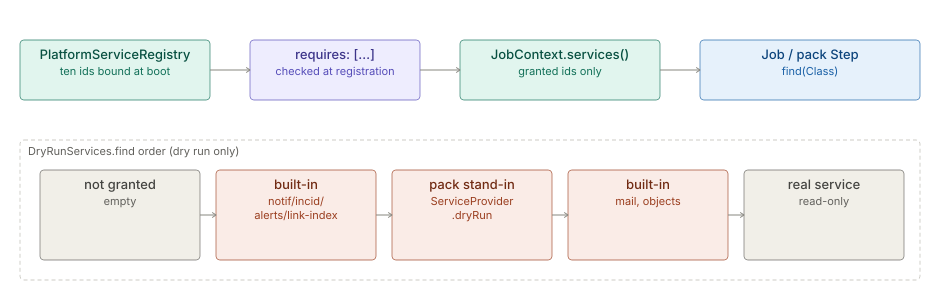

# Platform Services

> **Level 3 module page** (`SOLUTION-SUITE-DOCS-1`). Layer: Platform base.
> Offering: every edition; some services are bound only when their module is installed. Checked against the code on 2026-10-17.

## 1. What it is

A **Platform Service** is an engine facility a Job (or a pack Step) may be *granted*. The seam is
`PlatformServices` - a flat typed lookup (`find(Class)`, `get(Class)`, `granted()`) filtered by the consumer's
declared `requires:` list. No scopes, proxies or lifecycle: it must not grow into a dependency-injection framework.

Code: `platform/inspecto-engine/src/main/java/com/gamma/job/PlatformServices.java`,
`platform/inspecto-engine/src/main/java/com/gamma/job/PlatformServiceRegistry.java`,
`platform/inspecto-engine/src/main/java/com/gamma/job/DryRunServices.java`,
`platform/inspecto-engine/src/main/java/com/gamma/job/JobContext.java`,
`platform/inspecto-engine/src/main/java/com/gamma/job/ServiceProvider.java` (pack-contributed services).

## 2. Who uses it

- **Built-in Job Types** (`mail.send`, `alert.evaluate`, `la.detect`, `objects.analytics`, `caserule.evaluate`, ...).
- **Pack authors** writing Job Types, Steps or services (`tools/scaffold.mjs`, `PackTestHarness`).
- **Operators** reading a Job Type's reach on its "Uses services" chip row before arming it.

## 3. Where it sits

Engine base (`inspecto-engine`, package `com.gamma.job`). The host binds services at boot in
`inspecto/src/main/java/com/gamma/service/CollectorService.java`, before the Job engine is constructed. The
registry is a `JobService` constructor parameter, so `requires:` is validated during construction.

## 4. How it works

1. **Registry.** `PlatformServiceRegistry` is the boot-built table `id -> interface -> impl`. It fails closed on a
   duplicate id or interface; `grant(ids)` throws naming any id not bound in this build.
2. **Declared grant.** A Job Type declares `requires: [...]` on its descriptor. Validation is at registration,
   never at fire time: an unknown or build-absent id refuses the type (pack-atomically).
3. **`JobContext.services()`** carries the grant; it defaults to empty. An undeclared service is invisible even
   though the engine has it - that is what makes `requires:` an honest statement of reach.
4. **Dry run.** When the Run is a dry run, the grant is wrapped by `DryRunServices`. `find` order:
   1. not granted - empty (a dry run never widens visibility);
   2. built-in stand-ins for `notifications`, `incidents`, `alerts`, `link-index` - checked first, so a pack cannot override them;
   3. a **pack-contributed** stand-in (`PlatformServiceRegistry.StandIns`, from `ServiceProvider.dryRun`) - it wins
      over the two built-in stand-ins that follow;
   4. built-in stand-ins for `mail` and `objects`;
   5. otherwise the real service (read-only services pass through).

**The ten services** bound by `CollectorService`:

| Id | Interface | Dry run |
|---|---|---|
| `notifications` | `NotificationAccess` | logs the would-be notification |
| `mail` | `MailAccess` | logs recipient count and subject, sends nothing, answers `false` |
| `incidents` | `IncidentAccess` | logs the would-be Incident, opens nothing |
| `schema` | `SchemaAccess` | read-only, passes through |
| `consignment-status` | `ConsignmentStatusAccess` | read-only |
| `datasets` | `DatasetAccess` | read-only (per-call pinning) |
| `analytics` | `AnalyticsAccess` | read-only (Analytics Kernel) |
| `alerts` | `AlertAccess` | does not evaluate; returns empty and says nothing was checked |
| `link-index` | `LinkIndexAccess` | reports `DRY_RUN`, builds nothing |
| `objects` | `ObjectAccess` (only with `inspecto-ops`) | reads pass through; writes log and change nothing |

**`DryRunCoverageTest`** (`inspecto/src/test/java/com/gamma/job/DryRunCoverageTest.java`) reads every
`platformServices.register(...)` in `CollectorService`, binds each interface to a proxy and fails unless the
dry-run lookup returns something else, or the id is on its read-only list (`schema`, `consignment-status`,
`datasets`, `analytics`) with a reason. It exists because `mail` and `objects` once shipped without stand-ins
(`PLATFORM-SERVICES-DRYRUN-GAP-1`).

## 5. Configuration

There are no Space TOON keys. A Job definition grants through its type's `requires:`; the related keys are:

- `-Djobs.packs.requireSignature` - pack integrity (a different guarantee from grants).
- `deadline_seconds:` on a Job definition and `-Djob.deadlineCeilingSeconds` - Run deadline (default 30 min, ceiling 24 h).
- `PlatformServiceRegistry.disable/enable` - per service id, engine-internal only, not persisted, no route.

## 6. Screens

- The Job form's **Uses services** chip row, fed by `requires` on `GET /jobs/types`. No dedicated Platform
  Services screen was found.

## 7. API

- `GET /jobs/types` and `GET /jobs/types/{id}` carry each type's `requires`.
- No route registers, disables or lists services.

## 8. Interactions

- [Maker-checker](maker-checker.md): Job definitions are a governed kind; a Job's run-time writes are not held.
- [Decision Kernel](decision-kernel.md): `start-job` runs a Job and its grant.
- Jobs and scheduling, Analytics Kernel, Link Analysis and Incidents (module pages `jobs-scheduler`,
  `analytics-kernel`, `link-analysis`, `incidents`) consume or provide services.
- Concept detail: [Platform Services - the plugin envelope](../../okf/backend/control-plane/platform-services.md).

## 9. Limits and gotchas

- Every new **mutating** service needs a stand-in in `DryRunServices` (or `ServiceProvider.dryRun` for a pack),
  or `DryRunCoverageTest` fails.
- The `objects` stand-in is not an `ObjectServiceAccess`, so `OpsJobTypes.engineFor` finds no engine under a dry
  run: `caserule.evaluate` and `objects.analytics` report they did nothing. Check `ctx.dryRun()` before reading null as "not installed".
- A pack stand-in cannot replace the built-in `notifications`, `incidents`, `alerts` or `link-index` stand-ins.
- A lean `JobService` with no registry accepts a built-in's `requires:`; third-party providers stay strict.
- Pack Steps are capped: `StepExecutors.CEILING = {mail}` rejects a Step requiring `mail`.
- `DatasetAccess` pins per call: two reads in one Run may see different file lists.
