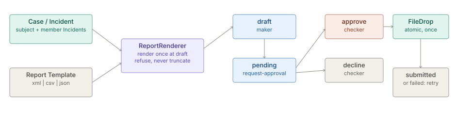

# Regulatory Reporting

> **Level 3 module page** (`SOLUTION-SUITE-DOCS-1`). Layer: Add-on.
> Offering: Standard and above (`regulatoryReporting` add-on, module `regulatory-reporting`). Checked against
> the code on 2026-10-17.

## 1. What it is

Regulatory Reporting turns a [Case](case-management.md) or an [Incident](incidents.md) into a regulator-format
document (XML, CSV or JSON) from a **Report Template**, has a second person approve it, and submits the exact
approved bytes to a jailed **file drop**. No live regulator API is built; file drop is the one delivery kind.

Module: `features/inspecto-regulatory-reporting` (manifest id `regulatory-reporting`, requires `ops`). Concept:
[Regulatory Reporting](../../okf/backend/control-plane/regulatory-reporting.md).

## 2. Who uses it

- **Investigators** (maker) draft a report from a Case or Incident and request approval.
- **Compliance officers** (checker) approve, decline or retry a failed submission.
- **Administrators** author Space templates and set where each drops its file.

## 3. Where it sits

An add-on over the platform base. It reads the operational objects of [Case management](case-management.md) and
[Incidents](incidents.md), reuses the [Maker-checker](maker-checker.md) signing key and decision pattern, and writes
into the same path jail as the `report` Job's `out_dir`.

## 4. How it works

1. **Template** (`ReportTemplate`). A TOON document: `id`, `title`, `format` (`xml | csv | json`), `rootElement`
   (xml), `delivery.kind: file-drop`, `delivery.dir`, and `fields[N]{name,source,required,maxLength}`. A
   `group/leaf` field repeats once per list item; `input.*` values are typed by the maker. Built-ins ship on the
   classpath (`sample-sar`:
   `features/inspecto-regulatory-reporting/src/main/resources/META-INF/inspecto/regulatory-templates/sample-sar.toon`);
   a Space's own sit in `regulatory-report-templates/` under its config root and win on an id clash. A template
   that does not validate is listed with its problems and can draft nothing.
2. **Render once** (`ReportRenderer`). The context is `report`, `subject`, `incidents`, `evidence` (attachment
   notes) and `input`. A required field that resolves empty, a value over `maxLength`, a path landing on an object,
   or text XML cannot carry REFUSES the render - a filing is never truncated or patched. Content, SHA-256 and the
   resolved drop directory are fixed on the record at draft, so the approver reads exactly what is submitted.
3. **Lifecycle** (`RegulatoryReports`). `draft -> pending -> approved -> submitted | failed`, plus `declined`,
   `expired` (undecided before `expiresAt`) and `invalid` (MAC fails). `rejected` is reserved for a regulator's
   refusal, which nothing records yet. Every transition is appended to `history`.
4. **Storage**. One signed JSON per report at `<write-root>/regulatory-reports/<id>.json`, atomic, jailed, signed
   with the Space's Pending Change key under domain `regulatory-report`.
5. **Delivery** (`FileDrop`). Temp file then atomic move, never overwritten. An existing file with the same SHA-256
   is the same submission (crash retry); any other existing file refuses.

## 5. Configuration

- **Space templates**: `regulatory-report-templates/<id>.toon` under the Space config root, or authored through
  `PUT /regulatory-reports/templates/{id}`.
- **Drop directory**: `delivery.dir` per template; a relative directory resolves against the Space config root and
  must pass the path jail.
- **Enablement**: `regulatory-reporting` in `offerings/standard.toon`, then per Space.

## 6. Screens

- **Regulatory reports** (`/regulatory-reports`, `inspecto-ui/src/app/modules/admin/regulatory-reports/`): list
  with status filters, the draft dialog, approve / decline / retry, and the template editor
  (`inspecto-ui/src/app/modules/admin/regulatory-reports/report-template.dialog.ts`).

## 7. API

| Route | Capability |
|---|---|
| `GET /regulatory-reports/templates` | read |
| `GET /regulatory-reports[?status=&template=&caseId=&incidentId=]` | read |
| `GET /regulatory-reports/{id}` | read (with `sourceChanged`, `approverCheck`) |
| `POST /regulatory-reports` | `canWorkIncidents` |
| `POST /regulatory-reports/{id}/request-approval` | `canWorkIncidents` |
| `POST /regulatory-reports/{id}/approve`, `/decline`, `/retry` | `canApproveChanges` |
| `GET /regulatory-reports/{id}/verify` | re-hashes the delivered file against its `.sha256` sidecar |
| `PUT`, `DELETE /regulatory-reports/templates/{id}` | `canApproveChanges` |

Draft gates, in order: capability -> write root 503 -> unknown body key 422 -> template unknown or broken 422 ->
not exactly one of `caseId` / `incidentId` 422 -> unread or non-scalar input 422 -> no operational objects 503 ->
subject absent or out of scope 404 -> a member Incident out of scope 403 -> drop directory refused 422 -> render
refused 422 -> saved `draft`.

## 8. Interactions

- [Case management](case-management.md), [Incidents](incidents.md) - report subjects.
- [Maker-checker](maker-checker.md), [Action requests](action-requests.md) - four-eyes pattern and storage.
- [Identity and access](identity-access.md) - scope checks on subject and member Incidents.
- [AML solution](../solutions/aml.md) — the only pack that ships a report template (`aml-str`).

## 9. Limits and gotchas

- A partial filing is refused: one out-of-scope member Incident blocks the whole draft (403).
- The report does not re-render when its Case changes; `sourceChanged` on the read tells the checker so.
- Deleting a template still referenced by a report is 409; a built-in with no Space override cannot be deleted.
- No regulator acknowledgement is recorded; `submitted` means the file landed in the drop directory.
